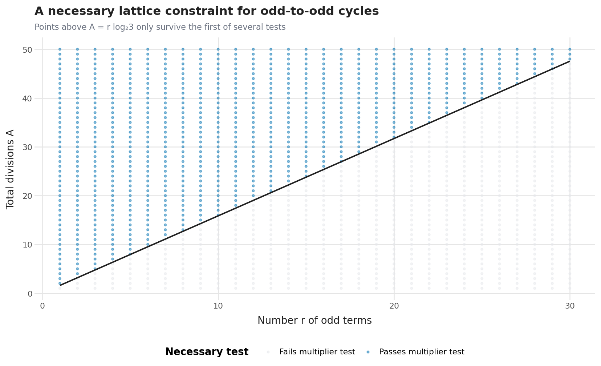

# Cycles and Diophantine constraints {#sec-cycles}

## From a repeating orbit to an equation

Under the unaccelerated map, $1\to4\to2\to1$ is the known positive cycle. Under
the shortcut map it appears as $1\to2\to1$, and under the odd-to-odd map as the
fixed point 1. These are three encodings of the same behavior.

Suppose a shortcut orbit has a cycle of length $k$ with parity word
$\boldsymbol\varepsilon$ containing $s$ odd entries. The affine formula from
[sec-parity](04-parity.md#sec-parity) gives, for a point $n$ on the cycle,

$$
n=\frac{3^s n+A}{2^k},
$$

and therefore

$$
(2^k-3^s)n=A. \tag{8.1}
$$

Because $A>0$ for a cycle containing an odd step, a necessary condition is
$2^k>3^s$. More strongly, $2^k-3^s$ must divide the parity-dependent integer
$A$. A plausible ratio of odd steps is not enough. Once the word's additive
term is correctly derived, a positive integral quotient gives an admissible
return, as the [integrality lemma](#sec-cycle-integrality) proves below.
Determining its least period is a separate question.

## The known cycle as a check

For the shortcut word $(1,0)$, $k=2$, $s=1$, and

$$
S^2(n)=\frac{3n+1}{4}.
$$

Equation (8.1) becomes $(4-3)n=1$, so $n=1$. This produces the cycle
$1\to2\to1$. Rotating the word to $(0,1)$ starts at 2 and describes the same
cycle. Cycle enumeration must quotient by rotations or it will count a single
cycle several times.

## Odd-to-odd cycle equations

Let a hypothetical $U$-cycle contain odd values $x_0,\ldots,x_{r-1}$ and let

$$
a_i=\nu_2(3x_i+1),\qquad A_r=a_0+\cdots+a_{r-1}.
$$

Multiplying the relations $2^{a_i}x_{i+1}=3x_i+1$ around the cycle gives a
leading multiplier $3^r/2^{A_r}$ plus positive additive terms. Closure forces

$$
2^{A_r}>3^r,
\qquad
\frac{A_r}{r}>\log_2 3.
$$

Thus the average number of divisions after an odd step must exceed about 1.585.
This condition is compatible with the heuristic mean 2 and hence does not rule
out cycles. It is a filter, not a contradiction.

[Figure 8.1](#fig-cycle-constraints) displays integer pairs $(r,A_r)$ in a finite box and the
boundary $A_r=r\log_2 3$. Points above the line pass only this multiplier test;
such a pair does not supply a parity word or solve its closure equation.
The visible abundance of points is precisely why the inequality alone is weak.

<figure id="fig-cycle-constraints">


<figcaption>

Figure 8.1: Finite lattice of possible odd-step counts and total division counts relative to the necessary cycle inequality. Passing points are only candidates, not cycles.

</figcaption>
</figure>

## Lower bounds by linear forms {#sec-cycle-minimum-bound}

Equation (8.1) ties a cycle to a close comparison between powers of 2 and 3. A
large minimum element gives a quantitative upper bound on that comparison.
Results from
Diophantine approximation and linear forms in logarithms can then exclude broad
parameter ranges or force any nontrivial cycle to be very large.

Here is the elementary bound that supplies this direction. Let a positive
shortcut cycle have $k$ steps, $s\ge1$ odd steps, and minimum $M$. Multiply
the ratios of consecutive values around the cycle. Every even step contributes
$1/2$, and every odd step from $x$ contributes
$(3/2)(1+1/(3x))$. The state ratios telescope to one, giving

$$
\frac{2^k}{3^s}
=\prod_{\text{odd states }x}\left(1+\frac1{3x}\right)
\le\left(1+\frac1{3M}\right)^s.
$$

All factors exceed one. With $\Lambda=k\log2-s\log3$, taking logarithms
and using $\log(1+t)<t$ for $t>0$ yields

$$
0<\Lambda
\le s\log\left(1+\frac1{3M}\right)
<\frac{s}{3M}.
$$

Thus it is a **large** minimum, relative to $s$, that forces the logarithmic
gap small. This supplies the elementary upper estimate used in the later
[Diophantine-bounds chapter](../collatz-research-toolkit/23-diophantine-cycles.md#sec-diophantine-cycles).
No numerical transcendence bound is being assumed here.

For a fixed pair $(k,s)$ the same product bound has an exact integer form:

$$
2^k M^s\le(3M+1)^s.
$$

For example, $(k,s)=(8,5)$ passes this test at $M=31$ and fails at $M=32$.
Since $(3+1/M)^s$ decreases with $M>0$, every larger minimum also fails.
Any positive cycle with those counts would therefore have minimum at most 31.
Passing this necessary bound does not produce a cycle or ensure integrality.

```python
def cycle_minimum_test(steps: int, odd_steps: int, minimum: int) -> bool:
    """Check two necessary exact inequalities for positive shortcut cycles."""
    if any(type(value) is not int for value in (steps, odd_steps, minimum)):
        raise TypeError("counts and minimum must be integers, excluding bool")
    if steps < 1 or not 1 <= odd_steps <= steps or minimum < 1:
        raise ValueError("use positive counts, odd_steps <= steps, and minimum >= 1")
    return (
        2**steps > 3**odd_steps
        and 2**steps * minimum**odd_steps <= (3 * minimum + 1)**odd_steps
    )

print(cycle_minimum_test(8, 5, 31), cycle_minimum_test(8, 5, 32))
```

The output is `True False`. The program compares integers; the product
argument proves why the comparison is necessary for every positive cycle.

The logical form is important: “any nontrivial cycle must contain at least this
many odd terms” is a lower bound, not nonexistence. Computational searches can
exclude cycles whose least element lies in a verified range; analytic bounds can
exclude certain lengths. Neither addresses a cycle beyond all covered cases
unless the bound is absolute and exhaustive.

## A hypothetical word

Take the formal shortcut word $(1,1,0,0)$. It has $k=4$, $s=2$, and direct
composition gives

$$
S^4(n)=\frac{9n+5}{16}.
$$

Closure would require $7n=5$, so no integer cycle realizes this word. This is
stronger than its slope $9/16<1$: the Diophantine equation rules it out.
For this exact shortcut map, an integral closure value already forces all
intermediate parities. The following argument explains why replay remains
useful as an implementation check without being an additional mathematical
obstruction.

## Integral closure, admissibility, and least period {#sec-cycle-integrality}

Keep the chronological convention: the first bit of
$w=(\varepsilon_0,\ldots,\varepsilon_{k-1})$ is the parity **before**
the first step. Its formal branches are
$F_\varepsilon(x)=(3^\varepsilon x+\varepsilon)/2$, applied from left
to right, and

$$
F_w(n)=\frac{3^s n+A_w}{2^k}.
$$

**Lemma 8.1 (Integrality).** For an integer $n$, the formal value $F_w(n)$ is an
integer if and only if every prescribed branch agrees with the actual
shortcut parity of the intermediate integers.

One direction follows by applying actual integer steps. For the converse,
the additive formula in Chapter 4 gives $A_w\equiv\varepsilon_0\pmod2$:
only the first bit can contribute an odd summand. Since $3^s$ is odd,
integrality of $F_w(n)$ forces $n\equiv\varepsilon_0\pmod2$.
Thus $m=F_{\varepsilon_0}(n)$ is the actual first shortcut step and is an
integer. Applying the remaining formal word to $m$ still gives the integer
$F_w(n)$. Induction on word length forces the remaining parities. The empty
suffix supplies the base case. Equivalently, integrality selects the unique
class

$$
n\equiv-A_w(3^s)^{-1}\pmod{2^k}.
$$

For a nonempty word, $2^k-3^s\ne0$, so its only formal closure candidate is
$n=A_w/(2^k-3^s)$. If this value is an integer, the lemma gives an actual
return after $k$ steps. If also $n>0$, every intermediate value is positive
automatically, because both admissible shortcut branches preserve positive
integers. There is no positive-integral-but-parity-failing case.

The rational-cycle formula is classical ([Lagarias 1990](d-bibliography.md#ref-lagarias1990cycles); [Brent 2002](d-bibliography.md#ref-brent2002rational), Section 2). A return after $k$ steps does not assert
**least** period $k$. For example, repeating the word `10` three times
returns to 1 after six steps while its least period is two. Rotations change
the starting point; repeating an entire word changes the declared return
length without necessarily changing the cycle.

### Exact candidate and independent replay

This standalone program assembles the affine composition in chronological
order, then replays integer candidates with the actual shortcut rule. It
returns the rational candidate, the replay including its final return, and
the first positive return time. A nonintegral candidate has no integer
replay. Zero and negative integer returns are included as diagnostics and
must not be reported as positive-domain cycles.

```python
from fractions import Fraction

def shortcut_cycle_certificate(
    word: str,
) -> tuple[Fraction, tuple[int, ...], int | None]:
    """Return a closure candidate, integer replay, and least return period."""
    if type(word) is not str:
        raise TypeError("word must be a binary string")
    if not word or any(bit not in "01" for bit in word):
        raise ValueError("provide a nonempty binary word")
    multiplier, additive, denominator = 1, 0, 1
    for bit in word:
        if bit == "1":
            multiplier *= 3
            additive = 3 * additive + denominator
        denominator *= 2
    candidate = Fraction(additive, denominator - multiplier)
    if candidate.denominator != 1:
        return candidate, (), None
    start = candidate.numerator
    value = start
    replay = [start]
    least_period = None
    for position, bit in enumerate(word, start=1):
        if value % 2 != int(bit):
            raise RuntimeError("integer closure contradicted the parity lemma")
        value = value // 2 if value % 2 == 0 else (3 * value + 1) // 2
        replay.append(value)
        if value == start and least_period is None:
            least_period = position
    if value != start:
        raise RuntimeError("the replay did not return to its closure candidate")
    return candidate, tuple(replay), least_period

for word in ("10", "1010", "1100", "1"):
    candidate, replay, least_period = shortcut_cycle_certificate(word)
    print(word, candidate, replay, least_period)
```

The candidates are $1,1,5/7,-1$. The first two have least period two;
the third fails integer closure, and the fourth is a fixed negative integer,
outside the conjecture's domain. The extra replay is deliberately redundant
with the proved lemma: it can expose an error in the coefficient producer or
in a stored word. A finite scan of words excludes only its declared lengths.

### Changed task: domain, repetitions, and an exact minimum cap {#sec-cycle-certificate-task}

Classify `010101`, `11100`, `110110`, and `000`. Compute each affine
numerator and denominator, its closure value, and every integer replay.
Separate a positive integer return, a nonintegral candidate, an integer
return outside the positive domain, and a least period shorter than the word.
Explain why none is an integral candidate with a failed intermediate parity.

Then suppose a positive shortcut cycle has $k=65$ and $s=41$. Use exact
integer powers and monotonicity to prove its minimum is at most 1192. State
what this necessary bound leaves undecided. The [separate explanation](#sec-cycle-certificate-solution)
supplies all candidates, replays, and endpoint comparisons.

## Worked boundary cases: a return can leave the positive domain

A word containing only even branches has endpoint equal to its start divided by two to the word length. A nonempty return would therefore force the start to be zero. This is an integer fixed point of the extended rule, but not a positive cycle. The positivity requirement excludes it before any conclusion about the classical conjecture is drawn.

For a word containing only odd shortcut branches, the additive term is three to the word length minus two to that length. Substituting into closure gives start negative one. The extended shortcut map really fixes negative one, so this is an admissible integer return rather than a failed parity candidate. It is excluded solely by the positive domain. The examples show why a cycle table needs separate fields for integrality and domain instead of one undifferentiated label “solution.”

By contrast, the mixed word `01` has endpoint three times the start plus two, divided by four. Closure gives start two, whose trace is two, one, two. Rotating to `10` gives start one on the same cycle. Thus a positive integral closure is useful, but counting distinct starting values would overcount cycles unless the rotation convention is stated.

## Worked return length: repeated words do not create new cycles

The word `1010` has endpoint nine times the start plus seven, divided by sixteen. Its closure equation gives start one. The trace is one, two, one, two, one, so the supplied four-symbol return length is twice the least period. It describes two traversals of the same cycle, not a new four-state cycle. The integrality lemma certifies the actual branch sequence; a separate first-return analysis determines the primitive period.

In general, if a deterministic orbit first returns to its start after p positive steps and also returns after k steps, divide k by p with remainder r smaller than p. Repeated full p-step blocks return to the start, so the remaining r steps must also return. Minimality of p forces r to be zero. Thus the least period divides every return length. A cyclic word from that orbit repeats its least-period block accordingly.

This gives a useful exclusion for a proposed primitive word. If it has no shorter repeating block, an actual return realising it cannot have a shorter period, because a shorter orbit period would repeat the parity block. The converse should be used with the exact return and branch premises visible; examining a formal string alone establishes no positive cycle. A source may choose canonical rotations and primitive words to simplify enumeration, while the final certificate still states the actual start and return relation.

## The minimum bound has a monotonic direction

The product inequality bounds how large a cycle's minimum could be for fixed counts. After dividing by the positive power of that minimum, its right side is three plus the reciprocal of the minimum, raised to the odd-count power. This strictly decreases as the minimum increases. Once a proposed minimum fails the necessary inequality, every larger minimum fails too. Passing at a smaller minimum remains only a necessary test: the word-dependent offset must still yield positive integral closure.

The direction matters when combining an analytic count restriction with a verified finite interval. A fixed-count bound forcing a minimum into that interval can exclude those counts if every input there is already proved to join the known cycle. It does not exclude other count pairs unless they too are covered. Likewise, excluding every nontrivial cycle would still leave the nonperiodic escape branch of the failure dichotomy. Each quantified range belongs in the statement rather than being supplied by an impressive-looking endpoint.

## Why cycle exclusion would not finish the problem

Assume all nontrivial positive cycles have been ruled out. A counterexample could
still have an orbit with no repeated value. Such an orbit is unbounded; as the
next chapter explains, on positive integers it must in fact eventually leave
every bounded set. Cycle arguments and divergence arguments address different
branches of the failure dichotomy.

<!-- inline-formula-code:start -->
## Formula and finite computation

A useful formula in this chapter is

$$
2^k>3^a
$$

The code evaluates a necessary multiplier condition for a parity word. The following standalone Python block expresses that finite rule with its inputs and stopping conditions visible.

```python
def cycle_multiplier_test(word: str) -> tuple[int, int, bool]:
    """Return numerator, denominator, and the necessary contraction comparison."""
    if not word or any(bit not in "01" for bit in word):
        raise ValueError("provide a nonempty binary parity word")
    odd_steps = word.count("1")
    numerator = 3**odd_steps
    denominator = 2 ** len(word)
    return numerator, denominator, numerator < denominator

for word in ("10", "1110", "101010", "11111100"):
    print(word, cycle_multiplier_test(word))
```

**What the computation establishes.** The calculation checks a declared finite instance; the surrounding argument explains what is true beyond those inputs.
<!-- inline-formula-code:end -->

## Chapter summary

A cycle yields an exact affine Diophantine equation. Multiplier and minimum
bounds constrain possible counts. For a correctly derived shortcut word, a
positive integral closure supplies the entire admissible return; independent
replay checks the implementation, and the least period may be shorter than the
word. A bounded word search excludes only its stated range. Even exclusion of
all nontrivial positive cycles would leave the possibility of escape.

## Exercises

<div class="exercise" id="collatz-cycles-rotated-known">
<p class="exercise-title"><strong>Exercise 1</strong></p>

Derive the shortcut formula for $(0,1)$ and recover the point two on the known cycle.

<details class="hint"><summary>Hint 1</summary>

First halve, then apply the odd shortcut.

</details>

<details class="hint"><summary>Hint 2</summary>

Equate the affine endpoint with the start.

</details>

<details class="solution"><summary>Solution</summary>

The endpoint is $(3n+2)/4$. Closure gives $4n=3n+2$, hence n equals two. Its actual trace is two, one, two, giving least period two. The word is the rotation of `10`, which starts at one, so the two calculations identify different points of the same cycle. Their different starting parity does not indicate two distinct positive cycles.

</details>

</div>

<div class="exercise" id="collatz-cycles-nonintegral-closures">
<p class="exercise-title"><strong>Exercise 2</strong></p>

Rule out positive integer cycles with words $(1,0,0)$ and $(1,1,0,0)$ by their closure equations.

<details class="hint"><summary>Hint 1</summary>

Keep the additive term.

</details>

<details class="hint"><summary>Hint 2</summary>

A positive rational candidate need not be an integer.

</details>

<details class="solution"><summary>Solution</summary>

The rows are $(3n+1)/8$ and $(9n+5)/16$. Closure gives $5n=1$ and $7n=5$, so the candidates are one fifth and five sevenths. Neither is an integer, hence neither word gives a positive integer return. Both slopes are below one, demonstrating that the multiplier condition alone does not construct a cycle. No parity-replay failure needs to be invented for these noninteger candidates.

</details>

</div>

<div class="exercise" id="collatz-cycles-rotation">
<p class="exercise-title"><strong>Exercise 3</strong></p>

Explain why cyclic rotations describe different starting points on one cycle.

<details class="hint"><summary>Hint 1</summary>

Begin the same closed trajectory at its next state.

</details>

<details class="hint"><summary>Hint 2</summary>

Count cycles separately from pointed returns.

</details>

<details class="solution"><summary>Solution</summary>

A k-step return visits a cyclic list of states. Starting the record at another state shifts the chronological parity list and gives a rotated word, while following the same directed edges. Thus rotations represent pointed descriptions of one cycle, potentially with repeated descriptions if a shorter period exists. An enumeration that wants unpointed primitive cycles should state a canonical rotation and remove repetitions, retaining the actual return certificate for the selected representative.

</details>

</div>

<div class="exercise" id="collatz-cycles-odd-average">
<p class="exercise-title"><strong>Exercise 4</strong></p>

Derive the strict inequality $A_r/r>\log_2 3$ for a positive odd-to-odd cycle.

<details class="hint"><summary>Hint 1</summary>

Multiply the exact ratios around the cycle.

</details>

<details class="hint"><summary>Hint 2</summary>

The additive correction at every odd state is positive.

</details>

<details class="solution"><summary>Solution</summary>

Each ratio is $(3+1/x_i)/2^{a_i}$. Their product around a positive cycle is one, so $2^{A_r}=\prod_i(3+1/x_i)>3^r$. Taking base-two logarithms and dividing by positive r gives the strict average inequality. It is a necessary condition compatible with many integer count pairs. It supplies no word, divisibility condition or nonperiodic escape argument.

</details>

</div>

<div class="exercise" id="collatz-cycles-candidate-obligations">
<p class="exercise-title"><strong>Exercise 5</strong></p>

Give the mathematical and implementation obligations after a formal shortcut word passes the slope inequality.

<details class="hint"><summary>Hint 1</summary>

Derive the offset correctly before forming closure.

</details>

<details class="hint"><summary>Hint 2</summary>

For this exact map, positive integral closure already forces the intermediate parities.

</details>

<details class="solution"><summary>Solution</summary>

Check the chronological word and exact affine coefficients, form the unique rational closure value, and require it to be a positive integer. The integrality lemma then proves every intermediate parity agrees and every state remains positive. Determine the least return period and account for rotations before counting a new cycle. An independent replay can detect an implementation or transcription error, but it is not an additional mathematical obstruction to a correctly derived positive integral closure. State the finite word-length range of any search.

</details>

</div>

<div class="exercise" id="collatz-cycles-offset-bound">
<p class="exercise-title"><strong>Exercise 6</strong></p>

Bound the minimum element of a hypothetical shortcut cycle in terms of $2^k-3^s$ and an upper bound on its additive term.

<details class="hint"><summary>Hint 1</summary>

Choose the cycle point at its minimum before deriving the word.

</details>

<details class="hint"><summary>Hint 2</summary>

Use the exact closure equation with a positive denominator.

</details>

<details class="solution"><summary>Solution</summary>

For the word starting at the minimum M, closure gives $(2^k-3^s)M=A$. With positive cycle and an odd step the denominator is positive. If a proved bound gives $A\le B$, then $M\le B/(2^k-3^s)$. For an integer bound take the floor. The bound on A must apply to that word or all relevant words; a bound for an unrelated rotation is not automatically the same statement. Passing the resulting cap still leaves integrality and other count pairs unresolved.

</details>

</div>

<div class="exercise" id="collatz-cycles-changed-certificate">
<p class="exercise-title"><strong>Exercise 7</strong></p>

Classify the source changed-task words `010101`, `11100`, `110110`, and `000`, including return domain and least period. Then state the scope of the supplied fixed-count minimum bound.

<details class="hint"><summary>Hint 1</summary>

Use the full affine closure rather than only the slope.

</details>

<details class="hint"><summary>Hint 2</summary>

Separate a noninteger candidate from a negative or zero integer return.

</details>

<details class="solution"><summary>Solution</summary>

The candidates are respectively two, nineteen fifths, negative five and zero. The first returns along the known shortcut cycle with least period two despite word length six. The second is noninteger. The third has integer trace $-5,-7,-10,-5,-7,-10,-5$ and least period three outside the positive domain. Zero is an extended fixed point, also excluded. All integer candidates satisfy their prescribed parities by the lemma. The retained [full explanation](#sec-cycle-certificate-solution) supplies every row and the exact fixed-count minimum comparisons; those comparisons do not cover all possible cycle counts or escape.

</details>

</div>

<div class="exercise" id="collatz-cycles-all-even">
<p class="exercise-title"><strong>Exercise 8</strong></p>

Prove that a nonempty all-even shortcut word cannot be a positive cycle.

<details class="hint"><summary>Hint 1</summary>

Its additive term is zero.

</details>

<details class="hint"><summary>Hint 2</summary>

The endpoint is a strict positive fraction of the start.

</details>

<details class="solution"><summary>Solution</summary>

For word length k positive, closure is n divided by two to the k equal to n. Multiplying gives (two to the k minus one) times n equal to zero. The coefficient is nonzero, so n is zero. This is an integer fixed point only in the extended domain. For every positive n the repeated halvings strictly reduce it as long as the branches remain even, so no positive all-even return is possible.

</details>

</div>

<div class="exercise" id="collatz-cycles-all-odd">
<p class="exercise-title"><strong>Exercise 9</strong></p>

Prove that an all-odd shortcut word has closure candidate negative one, and state why this is a valid integer return but no positive counterexample.

<details class="hint"><summary>Hint 1</summary>

The offset is three to the length minus two to the length.

</details>

<details class="hint"><summary>Hint 2</summary>

Compare that offset with the sign of the closure denominator.

</details>

<details class="solution"><summary>Solution</summary>

The closure denominator is two to the length minus three to the length, and the offset is its negative, giving candidate negative one. The extended shortcut rule sends negative one to negative one, so every prescribed odd branch is realised. The candidate is excluded by positivity, not by a failed parity test. A cycle catalogue must retain that distinction rather than discarding all nonpositive candidates as though their algebra were incorrect.

</details>

</div>

<div class="exercise" id="collatz-cycles-period-divisibility">
<p class="exercise-title"><strong>Exercise 10</strong></p>

Prove that the least period of a deterministic returning orbit divides every declared return length.

<details class="hint"><summary>Hint 1</summary>

Divide a return length by the least period.

</details>

<details class="hint"><summary>Hint 2</summary>

A nonzero remainder would be a shorter positive return.

</details>

<details class="solution"><summary>Solution</summary>

Let the least positive return time be p and another return length be k. Write k as q p plus r with zero at most r below p. After q full periods the state is again the start. The final r steps must return because the full k-step path does. If r were positive it would contradict minimality of p, hence r is zero. The result justifies separating primitive cycles from repeated traversals, and it depends on an actual returning orbit rather than a formal word alone.

</details>

</div>

### Changed-task explanation {#sec-cycle-certificate-solution}

For `010101`, the affine formula is $(27n+74)/64$, so closure gives
$37n=74$ and $n=2$. The replay is
$2\to1\to2\to1\to2\to1\to2$. It is a positive integer return of
length six with least period two.

For `11100`, the formula is $(27n+19)/32$, giving $n=19/5$.
There is no integer candidate to replay. For `110110`, the formula is
$(81n+85)/64$, giving $n=-5$. Its integer replay is
$-5\to-7\to-10\to-5\to-7\to-10\to-5$, with least period three.
Every parity agrees, but the start is negative. For `000`, the formula is
$n/8$ and the closure value is zero, a fixed point of the extended integer
map. The classical domain excludes zero as well as negative integers.

For the minimum cap, the exact comparisons are

$$
2^{65}\,1192^{41}\le3577^{41},\qquad
2^{65}\,1193^{41}>3580^{41}.
$$

The published `cycle_minimum_test(65, 41, 1192)` returns `True`, and
replacing 1192 by 1193 returns `False`. Dividing the necessary inequality
by $M^{41}$ shows its right side is $(3+1/M)^{41}$, strictly decreasing
with $M$. Thus all minima at least 1193 fail. The statement is conditional
on these fixed counts: it neither constructs a cycle with smaller minimum
nor excludes all possible counts or nonperiodic escape.
