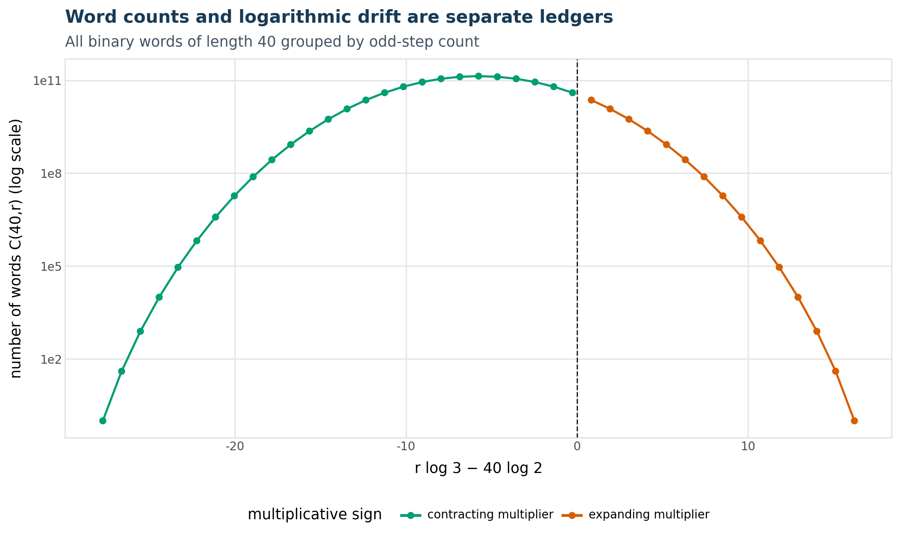

# What divergence would require {#sec-divergence}

## Unbounded versus tending to infinity

For arbitrary real sequences, being unbounded does not imply tending to infinity.
For a nonperiodic Collatz orbit on positive integers, it does. If such an orbit
visited a finite set infinitely often, some integer in that set would repeat.
Determinism would then make the orbit eventually periodic. Therefore a
nonperiodic counterexample visits every bounded set only finitely many times:

$$
C^j(n)\longrightarrow\infty.
$$

This argument uses discreteness and determinism. It does not show that an escape
orbit exists or cannot exist; it sharpens the alternative. A false conjecture
would produce either a nontrivial positive cycle or an orbit tending to infinity.

## Growth through odd-to-odd steps

For an odd orbit under $U$, write

$$
x_{i+1}=\frac{3x_i+1}{2^{a_i}},
\qquad a_i=\nu_2(3x_i+1).
$$

When $x_i$ is large, the logarithmic increment is

$$
\log x_{i+1}-\log x_i
=\log\left(3+\frac1{x_i}\right)-a_i\log2.
$$

If an orbit tends to infinity, the $1/x_i$ correction vanishes. Sustained escape
would therefore require the long-run average of the $a_i$ not to be substantially
larger than $\log_2 3$. The heuristic mean is 2, which predicts negative drift.
The missing theorem is uniform control along every arithmetic orbit.

An occasional block with small $a_i$ can cause a large rise. Conversely, one
large valuation can erase several rises. Neither a single increase nor a single
descent determines asymptotic behavior. Any rigorous drift argument must bound
exceptional sequences of valuations and the dependence between successive
residues.

## Local descent is not global descent

Suppose a proof shows that at least 99 percent of residue classes modulo $2^k$
fall below their starts within $k$ shortcut steps. A minimal counterexample, if
one exists, must occupy the remaining 1 percent. Refining the modulus may reduce
the fraction while preserving a nested exceptional path. Percentages do not
control universal quantifiers.

This phenomenon has a simple abstract model. For each $k$, let $E_k$ be the
integers congruent to 0 modulo $2^k$. The density of $E_k$ is $2^{-k}$, tending
to zero, yet the nested sets contain every multiple of arbitrarily large powers
only at zero—not a positive integer. If instead the nested residue at depth $k$
is chosen as the prefix of one fixed 2-adic integer (not necessarily an ordinary
nonnegative integer), the intersection in the 2-adics is nonempty even when it
contains no positive integer. A proof must
use arithmetic information to identify which situation occurs.

## The minimal-counterexample trap

Let $n_0$ be the least counterexample. It is true that its orbit never goes below
$n_0$. A circular argument often proceeds by transforming $n_0$ into another
integer $m$ and invoking minimality without proving $m<n_0$. If $m>n_0$, no
induction hypothesis applies. Showing that $m$ belongs to a “simpler” residue
class is also insufficient unless simplicity is a well-founded rank that strictly
decreases and is tied to convergence.

For example, an odd number $n=4q+3$ reaches $(3n+1)/2=6q+5>n$ after one shortcut
step. Writing that value in a different algebraic form does not make it smaller.
A later descent may occur, but it must be proved for the entire class rather than
assumed from examples.

## Product bounds and additive errors

Across $r$ odd-to-odd steps,

$$
x_r
=\frac{3^r}{2^{A_r}}x_0+B_r,
$$

where $A_r=\sum a_i$ and $B_r>0$ is an explicit sum of scaled additive terms.
For an escaping orbit, $x_i$ eventually becomes large, so relative additive
effects may be bounded. But using this observation to prove nonescape risks
circularity: one cannot assume the orbit is already large and regular in order
to rule out it becoming large.

A sound contradiction argument begins by assuming escape, derives consequences
valid eventually along that orbit, and then contradicts a rigorously established
property. The random model in the next chapter suggests which consequence to
seek; it does not supply the property.

## Worked necessary condition: telescope before taking an average

For an odd-to-odd orbit, the exact increment can be written as the logarithm of three, minus the valuation times the logarithm of two, plus a correction equal to the logarithm of one plus the reciprocal of three times the current state. Add this identity over r transitions. The intermediate logarithms telescope, so the logarithm of the final state equals the logarithm of the initial state plus r times the logarithm of three, minus the total valuation times the logarithm of two, plus the sum of all corrections.

Assume escape for a contradiction analysis. Then the odd states tend to infinity, so each positive correction tends to zero. Their average also tends to zero. To prove that last step directly, fix any positive tolerance. Beyond some finite initial segment, every correction is below the tolerance. Divide the fixed initial correction sum by r; it tends to zero. The remaining average is at most the tolerance. Since the tolerance was arbitrary, the full average tends to zero. This is an elementary averaging argument, not an independence assumption.

Every odd state is at least one, so its logarithm is nonnegative. Rearranging the telescoped equality and dividing by r bounds the average valuation above by the base-two logarithm of three, plus the average correction divided by the logarithm of two and a vanishing initial term. Consequently escape requires that the limit superior of average valuations be at most the base-two logarithm of three. No existence of an average limit has been assumed.

In particular, a proved positive gap above that threshold for every sufficiently long prefix would contradict escape. The gap must be a property of the actual arithmetic orbit, with the correction argument justified under the escape assumption. A mean of two in a different random model supplies no such bound. This derivation sharpens the heuristic target while exposing the exact theorem that remains missing.

## Worked block: two specified valuations give an exact descent

Suppose two actual consecutive odd-to-odd valuations are one and three. The first endpoint is three times the start plus one, divided by two. Applying the second branch gives nine times the original start plus five, divided by sixteen. The additive term survives the composition. Descent requires seven times the start to exceed five, true for every positive integer start. Thus every admissible occurrence of this two-valuation block ends below its own start.

The admissibility condition can also be made exact. Such starts are nineteen modulo thirty-two. Write a start as nineteen plus thirty-two times a nonnegative parameter. The first odd endpoint is twenty-nine plus forty-eight times the parameter, whose next expanded value is eight times eleven plus eighteen times the parameter. That latter factor is odd, so the second valuation is exactly three. The final odd state is eleven plus eighteen times the parameter, smaller than the original by eight plus fourteen times the parameter.

The hand example nineteen to twenty-nine to eleven illustrates the same row. It does not show that every orbit meets this block, or that such blocks occur frequently enough to dominate all growth. The block lemma is a conditional arithmetic theorem; the proposed escape argument needs a coverage or frequency theorem in addition. Replacing that missing premise by “the average valuation should be two” would change the source of evidence.

One can seek longer blocks with a strict affine inequality and explicit domain. A finite list of such blocks provides useful descent certificates where they occur. To conclude that every orbit descends, prove that every relevant start reaches an applicable block or another justified smaller state. The universal step cannot be supplied by examples alone.

## Worked pointwise condition: eventual valuations at least two suffice

A stronger condition than an average bound is easy to interpret. Suppose that from some point onward every odd-to-odd valuation is at least two. At any odd state greater than one, the next state is at most three times the state plus one, divided by four. This is strictly smaller than the current state. An infinite tail avoiding one would then be a strictly decreasing sequence of positive integers, impossible by well-ordering. Hence the tail reaches one.

At one the odd-to-odd map has valuation two and stays at one, so the conclusion is compatible with the assumed condition. The argument proves convergence conditional on that eventual pointwise bound. It does not establish the bound for every Collatz orbit. In fact many known convergent traces contain valuation one before their final small tail, so requiring it from the initial state would unnecessarily narrow the covered inputs.

The distinction between pointwise and averaged conditions matters. A pointwise decrease gives an immediate natural-number rank. An average log decrease may permit individual increases and needs a separate control of cumulative corrections, sampling and exceptional histories. Neither should be described merely as “usually goes down.” State the property actually proved and the domain where it holds.

As a comparison map, fix one and send every larger positive integer to its successor. Its only cycle is the fixed point one, while every other orbit escapes. This map is not Collatz. It demonstrates logically why excluding all additional cycles would still leave an escape obligation for a deterministic map on an infinite state space. No finite plot or cycle list can substitute for that obligation.

## Visual checkpoint: multiplicative drift versus word count

<figure id="fig-collatz-divergence-drift-ledger">


<figcaption>

Figure 9.1: Parity-word counts are separated from the sign of their shortcut multiplier.

</figcaption>
</figure>

[Figure 9.1](#fig-collatz-divergence-drift-ledger) separates two questions that a
heuristic can blur: how many words have a given odd count, and whether their
leading multiplier expands. Neither ledger controls additive offsets or proves
that deterministic orbits sample words independently.

<!-- inline-formula-code:start -->
## Formula and finite computation

A useful formula in this chapter is

$$
M(n)=\max_{j\le\sigma_\infty(n)}C^j(n)
$$

Peak records retain the starting value, height, and termination flag. The following standalone Python block expresses that finite rule with its inputs and stopping conditions visible.

```python
def orbit_peak(start: int, max_steps: int) -> tuple[int, bool]:
    """Return the largest seen value and whether one was reached."""
    if start <= 0 or max_steps < 0:
        raise ValueError("start must be positive and max_steps nonnegative")
    value = start
    peak = start
    for step in range(max_steps + 1):
        peak = max(peak, value)
        if value == 1:
            return peak, True
        if step < max_steps:
            value = value // 2 if value % 2 == 0 else 3 * value + 1
    return peak, False

def excursion_records(limit: int, max_steps: int) -> list[tuple[int, int, float]]:
    """Return complete finite peak records through a declared start limit."""
    if limit <= 0:
        raise ValueError("limit must be positive")
    records: list[tuple[int, int, float]] = []
    largest_peak = 0
    for start in range(1, limit + 1):
        peak, reached_one = orbit_peak(start, max_steps)
        if not reached_one:
            raise RuntimeError(f"start {start} exceeded the declared step budget")
        if peak > largest_peak:
            largest_peak = peak
            records.append((start, peak, peak / start))
    return records

print(excursion_records(limit=10_000, max_steps=10_000)[-10:])
```

**What the computation establishes.** The calculation checks a declared finite instance; the surrounding argument explains what is true beyond those inputs.
<!-- inline-formula-code:end -->

## Chapter summary

A nonperiodic counterexample on positive integers would tend to infinity.
Sustained growth would need an atypical sequence of small division exponents.
Density-heavy descent results, local averages, and minimality arguments all leave
room for a nested exceptional orbit unless they include a uniform arithmetic
control.

## Exercises

<div class="exercise" id="collatz-divergence-finite-visits">
<p class="exercise-title"><strong>Exercise 1</strong></p>

Prove that a nonrepeating positive-integer orbit visits every finite set only finitely often.

<details class="hint"><summary>Hint 1</summary>

Each element can occur at most once in a nonrepeating sequence.

</details>

<details class="hint"><summary>Hint 2</summary>

A finite set has only finitely many candidate states.

</details>

<details class="solution"><summary>Solution</summary>

A finite set with M elements can account for at most M entries of a nonrepeating sequence. Thus it is visited finitely often. For a deterministic orbit, a repeated state would force eventual periodicity, so a nonperiodic orbit has no repeated states. Applying the finite-set observation to each bounded initial interval proves that a nonperiodic positive-integer orbit tends to infinity. No analogous finite-set conclusion classifies all values in a bounded real interval, which can contain infinitely many distinct states.

</details>

</div>

<div class="exercise" id="collatz-divergence-log-increment">
<p class="exercise-title"><strong>Exercise 2</strong></p>

Derive the exact logarithmic increment for one odd-to-odd step.

<details class="hint"><summary>Hint 1</summary>

Take the logarithm of the positive quotient.

</details>

<details class="hint"><summary>Hint 2</summary>

Factor three times the current state from the numerator.

</details>

<details class="solution"><summary>Solution</summary>

From $x_{i+1}=(3x_i+1)/2^{a_i}$, subtracting $\log x_i$ gives $\log(3+1/x_i)-a_i\log2$. Equivalently this is $\log3-a_i\log2+\log(1+1/(3x_i))$. Positivity permits all logarithms. The last term is strictly positive and tends to zero only under a suitable large-state assumption. Dropping it changes an identity into an approximation and needs an explicit error bound in any proof.

</details>

</div>

<div class="exercise" id="collatz-divergence-additive-correction">
<p class="exercise-title"><strong>Exercise 3</strong></p>

Explain the additive term neglected when the multiplier $3/2^{a_i}$ is used.

<details class="hint"><summary>Hint 1</summary>

Compare the exact quotient with the multiplicative part.

</details>

<details class="hint"><summary>Hint 2</summary>

The omitted absolute term and relative term are different quantities.

</details>

<details class="solution"><summary>Solution</summary>

The exact update is $(3/2^{a_i})x_i+2^{-a_i}$. The absolute correction is $2^{-a_i}$; relative to the leading part it is $1/(3x_i)$. The corresponding log correction is $\log(1+1/(3x_i))$. Small relative size at large states does not justify deleting the correction uniformly over all inputs or all times. A sound escape analysis can derive a vanishing average correction after assuming actual states tend to infinity.

</details>

</div>

<div class="exercise" id="collatz-divergence-nested-exceptions">
<p class="exercise-title"><strong>Exercise 4</strong></p>

Construct nested integer subsets whose natural densities tend to zero but which all contain a chosen positive integer.

<details class="hint"><summary>Hint 1</summary>

Use that integer as a fixed residue at every depth.

</details>

<details class="hint"><summary>Hint 2</summary>

A periodic residue class has density the reciprocal of its modulus.

</details>

<details class="solution"><summary>Solution</summary>

For a chosen positive integer c, use positive starts congruent to c modulo successive powers of two. The sets are nested, each contains c, and their densities are the reciprocal powers of two. The intersection is exactly {c}, because a different integer has nonzero difference from c and cannot be divisible by every power of two. Hence vanishing density of possible exceptions does not prove an empty exceptional set. These abstract sets are not asserted to be the actual Collatz sieve outputs.

</details>

</div>

<div class="exercise" id="collatz-divergence-minimality-audit">
<p class="exercise-title"><strong>Exercise 5</strong></p>

Audit a least-counterexample argument: what exact inequality is required before minimality can be invoked?

<details class="hint"><summary>Hint 1</summary>

A changed algebraic form is not an ordering proof.

</details>

<details class="hint"><summary>Hint 2</summary>

The reached value must belong to the same domain and be smaller.

</details>

<details class="solution"><summary>Solution</summary>

If n is the least positive start failing to reach one, a reached value m can use minimality only after proving m is a positive integer and m is strictly less than n. Then m reaches one and its finite tail can be appended. Showing only that m has fewer written digits, a different residue description or an intuitively simpler form does not establish that inequality. A different complexity rank would require a separately proved well-founded induction principle tied to the convergence claim.

</details>

</div>

<div class="exercise" id="collatz-divergence-uniform-average">
<p class="exercise-title"><strong>Exercise 6</strong></p>

Assume odd states tend to infinity. Prove that a uniform lower bound on their prefix-average valuation exceeding $\log_2 3$ contradicts escape.

<details class="hint"><summary>Hint 1</summary>

Telescope the exact increment before taking an average.

</details>

<details class="hint"><summary>Hint 2</summary>

The positive log corrections have average tending to zero.

</details>

<details class="solution"><summary>Solution</summary>

Write the average valuation as A_r divided by r. The telescoped identity and nonnegative log of the final positive state give $A_r/r\le\log_2 3+\log x_0/(r\log2)+(r\log2)^{-1}\sum_{i<r}\log(1+1/(3x_i))$. Under escape the last average tends to zero by splitting a finite initial segment from a small tail. A fixed positive excess above the threshold for all sufficiently large r contradicts this upper bound. The arithmetic lower bound is an additional premise; a random-model mean does not establish it.

</details>

</div>

<div class="exercise" id="collatz-divergence-only-cycle-comparison">
<p class="exercise-title"><strong>Exercise 7</strong></p>

Give a deterministic positive-integer map with only one cycle but with escaping orbits, explaining why it is a logical comparison rather than a Collatz counterexample.

<details class="hint"><summary>Hint 1</summary>

Keep one fixed and increase every larger input.

</details>

<details class="hint"><summary>Hint 2</summary>

All states above one then move strictly upward.

</details>

<details class="solution"><summary>Solution</summary>

Define the comparison map to fix one and send each larger n to n plus one. Its only periodic point is one, since every other orbit increases by one forever and cannot repeat. Those other orbits tend to infinity. This proves that cycle exclusion alone is insufficient for a general infinite functional graph. It says nothing about whether the specific Collatz branch rule has such an orbit; that rule requires its own arithmetic argument.

</details>

</div>

<div class="exercise" id="collatz-divergence-two-valuation-block">
<p class="exercise-title"><strong>Exercise 8</strong></p>

Derive the two-step odd-to-odd row for valuations one and three and verify its admissibility on starts nineteen modulo thirty-two.

<details class="hint"><summary>Hint 1</summary>

Compose exact affine updates including their additions.

</details>

<details class="hint"><summary>Hint 2</summary>

The second expanded value has eight times an odd factor.

</details>

<details class="solution"><summary>Solution</summary>

The row is $(9n+5)/16$. For $n=19+32t$, the first endpoint is $29+48t$, and its expanded value is $88+144t=8(11+18t)$, with the factor odd. Thus the valuations are exactly one and three. The final endpoint is $11+18t$, smaller than the start by $8+14t$. This certifies the class for the stated block, while occurrence of the block on every orbit remains unproved.

</details>

</div>

<div class="exercise" id="collatz-divergence-cesaro-correction">
<p class="exercise-title"><strong>Exercise 9</strong></p>

Prove directly that the average of a real sequence tending to zero also tends to zero, and identify its role in the escape calculation.

<details class="hint"><summary>Hint 1</summary>

Fix a tolerance and bound the tail terms by it.

</details>

<details class="hint"><summary>Hint 2</summary>

The finite initial sum divided by the growing length vanishes.

</details>

<details class="solution"><summary>Solution</summary>

Choose an index beyond which absolute values are below a chosen tolerance. The average absolute contribution of that tail is at most the tolerance. The sum of the finitely many earlier absolute values divided by r tends to zero. Thus the average tends to zero. Applied to the log corrections under escape, this justifies the vanishing error in the valuation-average bound. It does not prove that the arithmetic states escape or that their valuations have an independent distribution.

</details>

</div>

<div class="exercise" id="collatz-divergence-pointwise-tail">
<p class="exercise-title"><strong>Exercise 10</strong></p>

Prove that eventual odd-to-odd valuations at least two force arrival at one, and state the missing universal premise.

<details class="hint"><summary>Hint 1</summary>

Every odd state greater than one then has a smaller next odd state.

</details>

<details class="hint"><summary>Hint 2</summary>

A strictly decreasing positive-integer tail cannot continue forever.

</details>

<details class="solution"><summary>Solution</summary>

With valuation at least two, the next odd state is at most (three x plus one) divided by four, strictly below x when x exceeds one. If the tail never hit one it would decrease indefinitely through positive integers, contradicting well-ordering. At one the map stays one with valuation two. This proves the conditional result. It does not show that every start eventually has this valuation property; proving a covering property of actual orbits remains a separate obligation.

</details>

</div>
