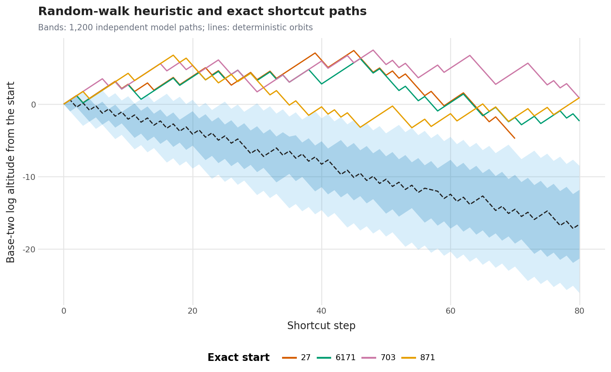

# Random-walk heuristics {#sec-random-walk}

## The shortcut coin-flip model

Pretend that the parity at each shortcut step is an independent fair coin. An
even step multiplies approximately by $1/2$; an odd step multiplies approximately
by $3/2$. The expected logarithmic increment is

$$
\frac12\log\frac12+\frac12\log\frac32
=\frac12\log\frac34<0.
$$

Negative log drift suggests that a typical modeled trajectory eventually moves
downward despite frequent excursions. Using the expected ordinary multiplier
instead gives

$$
\frac12\cdot\frac12+\frac12\cdot\frac32=1,
$$

which looks neutral. The discrepancy is not a paradox: multiplicative growth is
governed by sums of logarithms, and rare large values distort arithmetic means.

The $+1$ on odd steps is ignored in this model. It is relatively small at high
altitude but decisive near the bottom, where it helps create the known cycle.
Thus even the model's state variable and absorbing behavior require choices.

## The odd-to-odd geometric model

Complete finite odd residue blocks give an exact one-step law up to a stated valuation cutoff and its remaining tail bucket. Their limiting one-step distribution motivates the geometric model
$A=\nu_2(3n+1)$ with

$$
\Pr(A=a)=2^{-a},\qquad a=1,2,\ldots,
$$

and $\mathbb E[A]=2$. Approximating $U(n)$ by $3n/2^A$ yields expected log drift

$$
\mathbb E[\log3-A\log2]
=\log3-2\log2
=\log\frac34<0.
$$

This is the same structural prediction measured between odd terms. The fixed-valuation probabilities follow from residue counting; a finite modulus retains an unresolved high-valuation tail rather than determining every exponent. Treating successive $A$ values as independent is the heuristic addition. There is no uniform probability assigning equal positive mass to every positive integer.

## Comparing model paths with arithmetic paths

[Figure 10.1](#fig-random-walk) compares standardized logarithmic increments from exact shortcut
orbits with simulated independent steps. Both show downward central tendency and
wide fluctuations. They are not expected to match point-for-point. Exact orbits
merge, avoid impossible parity continuations for a given start, and carry the
additive term. Simulated paths have no modular consistency constraint.

<figure id="fig-random-walk">


<figcaption>

Figure 10.1: Quantile bands from an independent parity random walk compared with selected exact shortcut-orbit log altitudes. The comparison is heuristic, not a probabilistic theorem about integers.

</figcaption>
</figure>

The figure uses a fixed seed and a stated finite ensemble in `figures.py`. A
different seed changes individual simulated paths but should not drastically
change broad quantiles. Exact orbit lines are deterministic and do not have a
sampling error unless the starting values themselves were randomly selected.

## Where independence fails

One shortcut parity prefix is uniformly distributed as the starting residue runs
through a complete block modulo $2^k$. That exact finite fact can mimic $k$ fair
coins. Along a fixed orbit, however, the start is not resampled after every step.
Overlapping congruence information and the affine update connect later bits to
earlier ones. Conditioning on survival or unusually high altitude introduces
further bias: the remaining trajectories were selected precisely for atypical
prefixes.

This distinction resembles drawing every binary word once versus following one
infinite deterministic word. Counts over all words yield concentration estimates;
they may prove density statements about starting values. They cannot alone rule
out a single exceptional infinite word.

## Useful predictions

The random-walk model suggests several testable finite phenomena:

- stopping-time distributions should have a long right tail;
- most residue classes should exhibit descent over moderately long blocks;
- extreme peaks should occur but become sparse;
- conditioning on long survival should enrich parity prefixes with more odd
  branches or unusually small division exponents.

Agreement increases confidence that the model captures a coarse mechanism.
Disagreement can expose arithmetic structure. Neither outcome by itself proves
convergence or divergence.

## Worked finite model: mean height and typical scale differ

Start the multiplicative shortcut model at height one and take two independent fair branch choices. The possible products are one quarter with probability one quarter, three quarters with probability one half, and nine quarters with probability one quarter. Their arithmetic mean is one. The middle value three quarters is a median: at least half the mass lies on either side when equality is included. The geometric mean is also three quarters, obtained by exponentiating the average logarithm.

For k independent steps, let K count odd symbols. The product is three to the power K divided by two to the power k. Independence gives an arithmetic expectation equal to the kth power of the mean one-step multiplier, hence one. Linearity gives expected log height equal to k times one half of the logarithm of three quarters, strictly negative. The geometric mean therefore shrinks even while the arithmetic mean remains fixed. Rare larger products compensate for the many smaller ones in the arithmetic average.

This is a theorem about an explicitly defined product model. It neither asserts that an individual random realisation always decreases nor identifies arithmetic means of actual Collatz heights. The model ignores the affine addition and permits branch choices independently of a fixed starting integer. Its value is to make a mechanism precise enough to compare with arithmetic, while retaining those differences.

A finite probability bound illustrates what “typical” can mean here. The odd count has mean k divided by two and variance k divided by four. For any fixed positive gap $\delta$ above one half, the chance that its fraction exceeds that threshold is at most $1/(4k\delta^2)$. Indeed, on that event the squared deviation from the mean exceeds the squared threshold, and Markov's inequality bounds its probability by the mean squared deviation divided by that threshold. With the log-growth threshold as the gap's endpoint, this gives a bound tending to zero for nonnegative model log height at a fixed long horizon. It is not a statement about all times simultaneously or every deterministic start.

## Worked geometric law: compute the mean with a controlled tail

The geometric probabilities sum to one because the positive powers of one half form a convergent geometric series. The tail probability of an exponent at least j is two to the power one minus j. Summing these tail probabilities gives mean two. The tail identity follows by writing a positive integer a as the number of positive integers j not exceeding it and then adding the nonnegative contributions in either order.

One can avoid any implicit infinite rearrangement by using the exact finite formula $\sum_{a=1}^{N}a2^{-a}=2-(N+2)/2^N$. Induction verifies it by adding the next summand. The subtracted quotient tends to zero, so the partial sums tend to two. This proves both finiteness and the mean rather than assuming them.

The ordinary multiplicative factor in the odd model has mean one as well: three times the sum of four to the power negative a is one. Its log mean is the logarithm of three minus twice the logarithm of two. Thus the distinction between arithmetic and logarithmic means appears in both compressed conventions. One shortcut step and one odd-to-odd step use different clocks, so their numerical drift per transition should not be compared without that qualification.

Finite residue data have an additional bookkeeping boundary. A table with A known low bits can identify exact small valuations and one final “at least” class. Replacing that last class by an exact exponent would distort the mean. The infinite geometric distribution is a model or a limiting law assembled from increasingly precise finite counts, not the output of one finite residue table.

## Worked conditioning: high products change the branch law

Take three independent fair bits. The multiplicative product is at least one exactly when at least two bits are odd, since three squared exceeds eight while three alone does not. The selected words are `110`, `101`, `011` and `111`, each with conditional probability one quarter. Before selection every bit was fair. After selection the first bit is odd in three of the four words, so its conditional probability is three quarters.

The first two bits are both odd in two of the four selected words, giving conditional joint probability one half. Multiplying their conditional marginals would give nine sixteenths, not one half. Thus selection has introduced dependence as well as changing marginal probabilities, even though the original three bits were independent. Their conditional covariance is negative one sixteenth.

This exact example explains why filtering trajectories by high altitude or long survival changes the probability question. A bound for unconditioned independent increments cannot simply be reused on the selected ensemble without verifying its conditional hypotheses. The same concern applies when a search retains only unusually large peaks or unresolved starts. The event defining inclusion belongs to the model.

The calculation does not claim that the selected four words describe every kind of Collatz survival event. Actual heights include an order-dependent offset, and an event involving an entire path can differ from one involving only its endpoint. State the selection rule, arithmetic convention and population before comparing a model prediction with a dataset. The finite fairness theorem from parity coding can justify exact prefix distributions under a declared finite sampling rule; it does not make arbitrary conditioned arithmetic data fresh independent replicas.

## Optional stopping is not a shortcut

Martingale and random-walk theorems require probabilistic hypotheses, integrability,
and stopping-time conditions. Defining a random variable from uniformly sampled
starts can make these tools rigorous for a finite or density statement. Applying
an optional-stopping slogan directly to one deterministic Collatz orbit supplies
none of the needed probability space. The translation from arithmetic to
probability is the theorem to be proved, not a free assumption.

<!-- inline-formula-code:start -->
## Formula and finite computation

A useful formula in this chapter is

$$
\mathbb E[\log M]=\tfrac12\log(3/2)+\tfrac12\log(1/2)
$$

The two-branch model's expected logarithmic multiplier is a finite weighted sum. The following standalone Python block expresses that finite rule with its inputs and stopping conditions visible.

```python
from math import log

branches = [(0.5, 3.0 / 2.0), (0.5, 1.0 / 2.0)]
expected_log_multiplier = sum(probability * log(multiplier) for probability, multiplier in branches)
print(expected_log_multiplier)
```

**What the computation establishes.** The output certifies only the declared finite case. The theorem, if one is claimed, still requires the argument developed in the chapter.
<!-- inline-formula-code:end -->

## Chapter summary

Both shortcut and odd-to-odd random models predict negative logarithmic drift.
They explain common descent alongside rare high excursions. Exact residue counts
justify some one-block distributions, while independence across the evolving
orbit remains limited. The model guides questions and density results but cannot
eliminate every exceptional integer.

## Exercises

<div class="exercise" id="collatz-random-walk-two-means">
<p class="exercise-title"><strong>Exercise 1</strong></p>

Recompute the expected ordinary and logarithmic multipliers for the shortcut coin model. Explain why the logarithmic quantity is relevant.

<details class="hint"><summary>Hint 1</summary>

The ordinary factors are one half and three halves with equal weight.

</details>

<details class="hint"><summary>Hint 2</summary>

Products become sums after taking logarithms.

</details>

<details class="solution"><summary>Solution</summary>

The ordinary mean is one. The log mean is one half of $\log(1/2)+\log(3/2)$, hence $\tfrac12\log(3/4)<0$. Across independent steps the product mean stays one, while expected log height accumulates the negative increment. This describes typical multiplicative scale more directly than the arithmetic mean, which can be supported by rare large products. It remains a model calculation and omits the additive correction of the exact map.

</details>

</div>

<div class="exercise" id="collatz-random-walk-geometric-mean">
<p class="exercise-title"><strong>Exercise 2</strong></p>

Prove $\sum_{a\ge1}a2^{-a}=2$.

<details class="hint"><summary>Hint 1</summary>

Establish the finite partial-sum formula.

</details>

<details class="hint"><summary>Hint 2</summary>

The subtracted tail term is $(N+2)/2^N$.

</details>

<details class="solution"><summary>Solution</summary>

For N equals one, the partial sum is one half, matching $2-(N+2)/2^N$. If the formula holds at N, adding $(N+1)/2^{N+1}$ gives $2-(N+3)/2^{N+1}$, the next formula. Since $(N+2)/2^N$ tends to zero, the partial sums converge to two. This supplies a finite derivation and a tail bound. The numerical value is not evidence that successive actual arithmetic valuations are independent.

</details>

</div>

<div class="exercise" id="collatz-random-walk-hundred-step-reference">
<p class="exercise-title"><strong>Exercise 3</strong></p>

For the original optional simulation task, compare median and mean height after one hundred independent geometric-model steps. Give an exact mathematical reference rather than a fabricated simulation output.

<details class="hint"><summary>Hint 1</summary>

The total valuation is the waiting time for the hundredth success in fair Bernoulli trials.

</details>

<details class="hint"><summary>Hint 2</summary>

Symmetry of one hundred ninety-nine fair trials determines its median boundary.

</details>

<details class="solution"><summary>Solution</summary>

At initial height one, the mean product is one because each independent factor has mean one. If T is the sum of the one hundred geometric exponents, height is $3^{100}/2^T$. The event $T\le199$ is at least one hundred successes in one hundred ninety-nine fair trials, of probability one half by symmetry. Hence median heights lie between $3^{100}/2^{200}$ and $3^{100}/2^{199}$, while the mean remains one. Rare high values explain the gap. A future simulation could compare its sample summaries with these exact model statements; no such run is reported here.

</details>

</div>

<div class="exercise" id="collatz-random-walk-finite-fairness">
<p class="exercise-title"><strong>Exercise 4</strong></p>

Give an exact residue-counting statement that looks like k fair parity coins.

<details class="hint"><summary>Hint 1</summary>

Choose one representative of every class modulo $2^k$.

</details>

<details class="hint"><summary>Hint 2</summary>

Use the proved finite parity bijection.

</details>

<details class="solution"><summary>Solution</summary>

Choose a start uniformly from one through two to the k. Its residue is uniform, and each length-k shortcut parity word occurs exactly once by the coding bijection. Thus every complete bit assignment has probability two to the negative k, the product of k fair-bit probabilities. This is exact mutual independence for those k finite variables under that finite sampling law. It does not assert a uniform law on all positive integers or an infinite-time theorem for one fixed start.

</details>

</div>

<div class="exercise" id="collatz-random-walk-omitted-dependencies">
<p class="exercise-title"><strong>Exercise 5</strong></p>

Identify two dependencies or structural constraints omitted by the simple random-walk model.

<details class="hint"><summary>Hint 1</summary>

One concerns a fixed start and another concerns merged tails or selection.

</details>

<details class="hint"><summary>Hint 2</summary>

An affine offset also remembers branch order.

</details>

<details class="solution"><summary>Solution</summary>

For a fixed arithmetic start the later parity symbols are determined by the preceding states rather than freshly sampled. Distinct starts can merge and then share an entire future tail. Conditioning on a high endpoint changes branch marginals and dependence even in the independent model. In addition, exact endpoints include offsets depending on symbol order. Any two of these identify separate missing structures; none alone proves that a suitably scoped finite random approximation is useless.

</details>

</div>

<div class="exercise" id="collatz-random-walk-probability-space">
<p class="exercise-title"><strong>Exercise 6</strong></p>

Formulate a finite probability space by choosing a start uniformly modulo $2^k$, and state exactly which parity variables are independent.

<details class="hint"><summary>Hint 1</summary>

Use a complete positive representative block.

</details>

<details class="hint"><summary>Hint 2</summary>

Marginalise the uniform word law over unspecified bits.

</details>

<details class="solution"><summary>Solution</summary>

Take the finite set of starts one through two to the k with equal mass. Define bit j as the parity before shortcut transition j, for j from zero through k minus one. Every full bit assignment occurs once. Specifying any r of these bits leaves two to the k minus r completions, so its probability is two to the negative r, proving mutual fairness and independence within the prefix. A later bit outside the stored depth is not covered by this argument.

</details>

</div>

<div class="exercise" id="collatz-random-walk-two-step-distribution">
<p class="exercise-title"><strong>Exercise 7</strong></p>

Find the complete product distribution after two fair shortcut-model steps, and compute a mean and a median.

<details class="hint"><summary>Hint 1</summary>

The mixed words have the same product.

</details>

<details class="hint"><summary>Hint 2</summary>

Do not average logarithms as though they were ordinary heights.

</details>

<details class="solution"><summary>Solution</summary>

The products are one quarter with probability one quarter, three quarters with probability one half, and nine quarters with probability one quarter. Their weighted mean is one. Three quarters is a median and the geometric mean, while the ordinary mean is larger. This exact finite distribution exhibits the role of high values without relying on a simulation or claiming that the same products are the exact Collatz endpoints.

</details>

</div>

<div class="exercise" id="collatz-random-walk-conditioning">
<p class="exercise-title"><strong>Exercise 8</strong></p>

For three fair bits conditioned to have at least two ones, compute each of the first two marginal probabilities and their joint-one probability. Are they independent?

<details class="hint"><summary>Hint 1</summary>

List the four retained words.

</details>

<details class="hint"><summary>Hint 2</summary>

Compare the joint probability with the product of marginals.

</details>

<details class="solution"><summary>Solution</summary>

The words are `110`, `101`, `011`, `111`. Each of the first two bits is one in three words, so both marginals are three quarters. Both are one in two words, giving joint probability one half rather than nine sixteenths. They are dependent under the conditional law, with covariance negative one sixteenth. The example proves that selecting high-product paths can invalidate a fresh-independence assumption even when the unselected model was independent.

</details>

</div>

<div class="exercise" id="collatz-random-walk-chebyshev">
<p class="exercise-title"><strong>Exercise 9</strong></p>

For a binomial odd count K with k fair independent bits and positive $\delta$, bound $\Pr(K-k/2\ge\delta k)$ using its variance.

<details class="hint"><summary>Hint 1</summary>

The event forces a large squared deviation.

</details>

<details class="hint"><summary>Hint 2</summary>

Apply the elementary nonnegative-variable Markov bound.

</details>

<details class="solution"><summary>Solution</summary>

The variance is $k/4$. The event is contained in the event that $(K-k/2)^2\ge\delta^2k^2$, whose probability is at most $(k/4)/(\delta^2k^2)=1/(4\delta^2k)$. One may also cap the bound at one. This is a finite probability theorem for the stated bit model. Its decay at fixed horizons does not prove that every model path stays below a barrier forever or that every positive Collatz orbit obeys the same law.

</details>

</div>

<div class="exercise" id="collatz-random-walk-geometric-tail">
<p class="exercise-title"><strong>Exercise 10</strong></p>

A finite odd-residue table identifies exact valuations through A and a remaining tail. Explain why assigning the tail the exact value A plus one can bias an average.

<details class="hint"><summary>Hint 1</summary>

The stored precision gives a lower bound, not an equality.

</details>

<details class="hint"><summary>Hint 2</summary>

Some lifts can contain more removed factors of two.

</details>

<details class="solution"><summary>Solution</summary>

The tail class has valuation at least A plus one, with higher values possible for compatible lifts. Replacing all of them by that minimum undercounts any higher exponents and changes the statistic. Retain a tail category or refine the modulus enough for the intended finite question. The infinite geometric model supplies a distribution over all exponents, but that is additional limiting or model structure beyond a single finite table. The distinction matters before interpreting drift or comparing conventions.

</details>

</div>
