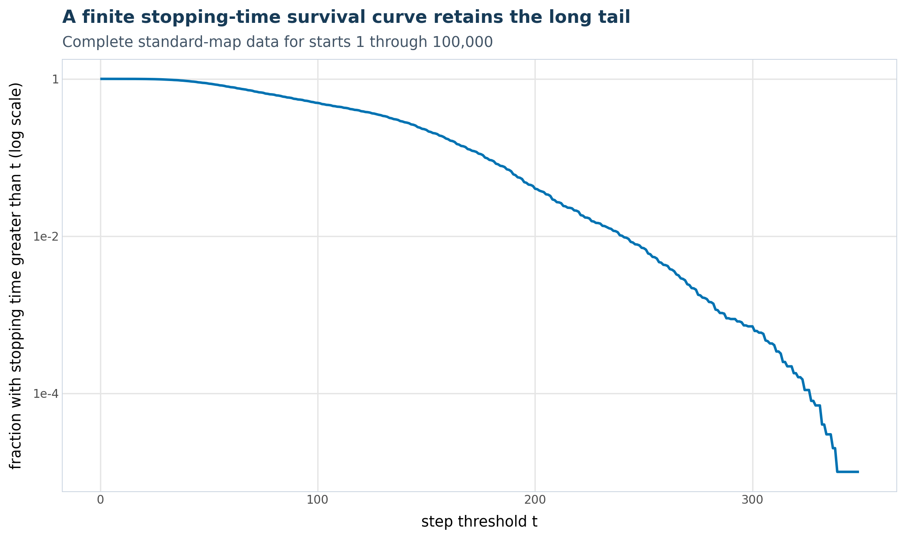

# Density viewpoints {#sec-density}

## Two ways to say “almost all”

For a set $A$ of positive integers, its **natural density**, when the limit
exists, is

$$
d(A)=\lim_{x\to\infty}\frac{|A\cap[1,x]|}{x}.
$$

Its **logarithmic density**, when the limit exists, is

$$
\delta(A)=\lim_{x\to\infty}
\frac{1}{\log x}\sum_{\substack{n\le x\\n\in A}}\frac1n.
$$

Natural density gives each integer up to $x$ equal weight. Logarithmic density
gives comparable total weight to multiplicative intervals such as $[y,2y]$.
When a paper says “almost all” it must specify the measure; a density-one result
still permits infinitely many exceptions.

The even integers have natural and logarithmic density $1/2$. The powers of two
have both densities zero even though the set is infinite. Thus density zero does
not mean nonexistent or finite. This simple observation is enough to block the
invalid inference from “almost every orbit has property $P$” to “every orbit has
property $P$.”

## Upper and lower densities

Some sets have no density because their relative frequency oscillates. One then
uses limsup and liminf to define upper and lower density. Statements involving
upper logarithmic density zero are especially useful: they say the exceptional
set becomes negligible under logarithmic weighting even if a limit was not
assumed in advance.

Quantifier order matters. The assertion

$$
\text{for every }\varepsilon>0,\quad
\overline\delta(E_\varepsilon)=0
$$

does not say that there is one finite stage working simultaneously for all
$\varepsilon$. Nor does a sequence of exceptional sets of density tending to
zero imply that their union or intersection is empty.

## Almost bounded values

For a start $N$, define the minimum orbit value

$$
\operatorname{Col}_{\min}(N)=\inf_{j\ge0}C^j(N).
$$

Since values are positive integers, this infimum is a minimum. The conjecture
says $\operatorname{Col}_{\min}(N)=1$ for every $N$. A weaker “almost bounded”
statement allows a threshold $f(N)$ that tends to infinity, however slowly, and
asserts that $\operatorname{Col}_{\min}(N)<f(N)$ for almost all $N$ in a stated
density sense. The threshold is not a fixed universal constant, and the result
does not say the minimum is 1.

For example, $f(N)=\log\log\log(N+e^e)$ eventually tends to infinity very slowly.
Reaching below this threshold from a huge start represents dramatic descent, yet
it still leaves an unbounded family of possible minimum values. This gap is the
space between Tao's theorem and the full conjecture.

## A quantifier translation table

Consider four claims:

1. Every $N$ reaches 1.
2. All but finitely many $N$ reach 1.
3. The set of $N$ reaching 1 has logarithmic density 1.
4. For every $f(N)\to\infty$, the set of $N$ whose orbit reaches below $f(N)$
   has logarithmic density 1.

Claim 1 implies claims 2 and 3. For this particular Collatz map, claim 2 also implies claim 1: a counterexample would generate infinitely many counterexamples by repeated doubling, as proved below. Claim 4 concerns descent to a moving threshold and does not currently imply claim 3. A density-one conclusion alone does not supply success for every input. Words like “almost,” “bounded,” and “eventually” must retain their exact quantifiers, while special arithmetic structure can sometimes strengthen a formally weaker statement.

## Sampling and logarithmic averages

A numerical approximation to logarithmic density weights an observed $n$ by
$1/n$ and normalizes by the corresponding harmonic sum. Uniformly sampling from
$[1,x]$ estimates natural proportions instead. One can approximate logarithmic
sampling by first selecting a scale nearly uniformly on a log axis, then sampling
within that scale with the appropriate correction. The experimental design
should match the theorem being illustrated.

No finite sample establishes an asymptotic density. A plot can reveal convergence
or oscillation over tested cutoffs, but it must show the cutoff range and weighting.
Error bars for random subsampling address sampling error, not the unknown tail
beyond the largest cutoff.

## Worked density proof: multiples and summation by parts

The multiples of three up to a positive integer cutoff N number exactly the floor of N divided by three. Dividing by N and bounding the floor error by one proves natural density one third. Their weighted sum is one third of the harmonic sum up to the floor of N divided by three. The elementary integral bounds on harmonic sums show that this, divided by the logarithm of N, also tends to one third. The two densities agree in this example, but the weights in their finite definitions differ.

There is a general reason natural density, when it exists, implies the same logarithmic density. Let A(N) count the selected positive integers through N. The finite identity

$$
\sum_{\substack{n\le N\\n\in A}}\frac1n
=\frac{A(N)}N+\sum_{m=1}^{N-1}\frac{A(m)}{m(m+1)}
$$

follows by writing each reciprocal as one over N plus the telescoping differences from its index through N minus one, then interchanging two finite sums. No infinite series has been rearranged.

If the natural density is d, write the count at m as d times m plus an error that is small relative to m. Substituting into the identity gives d times the harmonic sum through N, plus an error. To control that error, fix a positive tolerance and split off finitely many early terms. On the remaining tail the count error has absolute value at most the tolerance times m, so its weighted sum is at most the tolerance times a harmonic sum. After division by log N, the fixed early contribution vanishes and the tail is bounded by that tolerance asymptotically. The boundary count error divided by N and then by log N also vanishes.

Finally the harmonic sum divided by log N tends to one, by its integral upper and lower bounds. Letting the tolerance tend to zero proves logarithmic density d. The proof supplies a one-way implication; it does not make the finite sampling rules identical or assert that every logarithmic-density set has a natural density.

## Worked sparse family: infinitely many successes can have zero density

Consider the powers of two including one. Up to N there are at most one plus the base-two logarithm of N. Their natural proportion tends to zero. For a direct scale comparison, when N lies between consecutive powers with exponents j and j plus one, the count is at most j plus one while N is at least two to the j. Exponential growth of the denominator dominates this linear numerator, forcing the ratio to zero.

Their logarithmic weighted sum is bounded by the geometric series one plus one half plus one quarter and so on, at most two. Dividing that bounded sum by the unbounded logarithm of N gives logarithmic density zero too. This is a complete proof for both densities without computing a long prefix.

The complement therefore has density one in both senses while missing infinitely many positive integers. As a statement about sets, this refutes identifying density one with universal membership. For Collatz, the powers of two themselves are a proved convergent family, so they are not proposed exceptions. The example concerns what a density statement can encode, not a claim about where actual counterexamples lie.

A finite sample can make the same sparse family appear less sparse near a chosen scale. Its limiting density still comes from a proof controlling every larger cutoff. A plot of a falling proportion can suggest this result, but cannot replace the count bound. Conversely, observing no exceptions in a finite range supplies a different bounded statement and cannot determine whether an infinite sparse exception set exists later.

## Worked Collatz strengthening: cofinite convergence would be universal

The basin of one has structure beyond being an arbitrary subset of the positive integers. If a start fails to reach one, twice that start also fails. Its first standard step reaches the original start; if the doubled input reached one, the resulting tail would make the original input reach one as well. Repeating the argument gives every positive power-of-two multiple of the original start as another counterexample.

Those multiples are distinct and unbounded. Therefore any counterexample would force infinitely many counterexamples. The assertion that all but finitely many positive starts converge rules this out, so it implies that every positive start converges. The converse implication is immediate. This equivalence uses the actual even branch and domain of the Collatz map; it is not a general fact that a cofinite set contains every positive integer.

The implication is a logical reduction, not a new convergence theorem. No proof that only finitely many exceptions exist has been supplied. It also does not upgrade density-one convergence: an infinite sequence of power-of-two multiples can have density zero, so the doubling argument is compatible with an infinite sparse exceptional set. Different notions of smallness interact differently with the arithmetic structure.

Inspect a theorem's exact set and closure properties rather than relying on a generic hierarchy of quantifiers. Some apparently weaker statements become equivalent for a particular map; others retain genuine gaps. The cited partial results in the next chapters have their own conclusions, and none should be summarised as the unproved cofinite premise here.

## Moving thresholds preserve a different question

A fixed bound B asks for an orbit to reach one of finitely many possible small values. A function tending to infinity allows the permitted minimum to grow with the start, even when that growth is arbitrarily slow. Substituting a constant into a theorem requiring divergence of the threshold violates its hypothesis. Choosing a new constant separately at every cutoff also changes the quantifier order.

A comparison map illustrates the logical gap. Fix one, and send every larger positive input to the fixed point two. For every threshold function tending to infinity, all sufficiently large starts reach two below that threshold. The moving-threshold statement therefore holds with density one, yet only the start one reaches one. This is not the Collatz map and does not settle what further Collatz-specific arguments might accomplish. It demonstrates why the moving-threshold conclusion itself must not be printed as convergence to the particular target one.

## Visual checkpoint: an empirical survival tail

<figure id="fig-collatz-density-survival">


<figcaption>

Figure 11.1: The finite stopping-time survival fraction decreases across a complete declared range.

</figcaption>
</figure>

The vertical quantity in [Figure 11.1](#fig-collatz-density-survival) is a proportion in one
finite initial interval. It is not natural density, logarithmic density, or a
limit theorem. The distinction is exactly why density claims must state both a
set and a limiting normalization.

<!-- inline-formula-code:start -->
## Formula and finite computation

A useful formula in this chapter is

$$
\sigma(n)=\min\{k\ge1:C^k(n)<n\}
$$

The residue summary keeps searches bounded and failures explicit. The following standalone Python block expresses that finite rule with its inputs and stopping conditions visible.

```python
def first_descent_time(start: int, max_steps: int) -> int | None:
    """Return the first positive time below start, or None at the budget."""
    if start <= 1 or max_steps <= 0:
        raise ValueError("start must exceed one and max_steps must be positive")
    value = start
    for step in range(1, max_steps + 1):
        value = value // 2 if value % 2 == 0 else 3 * value + 1
        if value < start:
            return step
    return None

def descent_by_residue(
    modulus: int, samples_per_residue: int, max_steps: int
) -> dict[int, tuple[int, int]]:
    """Return solved and censored counts in each positive residue sample."""
    if modulus <= 0 or samples_per_residue <= 0:
        raise ValueError("modulus and sample count must be positive")
    summary: dict[int, tuple[int, int]] = {}
    for residue in range(modulus):
        solved = 0
        censored = 0
        for quotient in range(samples_per_residue):
            start = residue + quotient * modulus
            if start <= 1:
                continue
            if first_descent_time(start, max_steps) is None:
                censored += 1
            else:
                solved += 1
        summary[residue] = solved, censored
    return summary

print(descent_by_residue(modulus=16, samples_per_residue=200, max_steps=500))
```

**What the computation establishes.** The calculation checks a declared finite instance; the surrounding argument explains what is true beyond those inputs.
<!-- inline-formula-code:end -->

## Chapter summary

Natural and logarithmic density formalize distinct meanings of “almost all.”
Density-one sets may omit infinitely many integers. Almost-bounded orbit results
allow a threshold tending to infinity and are therefore much weaker than reaching
1. Exact quantifiers are part of the theorem, not technical decoration.

## Exercises

<div class="exercise" id="collatz-density-multiples-three">
<p class="exercise-title"><strong>Exercise 1</strong></p>

Compute the natural and logarithmic densities of multiples of three.

<details class="hint"><summary>Hint 1</summary>

The count is the floor of N divided by three.

</details>

<details class="hint"><summary>Hint 2</summary>

The reciprocal sum is one third of the harmonic sum at the reduced cutoff.

</details>

<details class="solution"><summary>Solution</summary>

The count divided by N tends to one third because the floor error is less than one. The weighted sum is one third times the harmonic sum through the floor of N divided by three. Its logarithmic normalization tends to one third because reducing the argument by a fixed factor changes its logarithm by a bounded amount. Thus both densities exist and agree, while the finite weighting rules differ.

</details>

</div>

<div class="exercise" id="collatz-density-powers-two">
<p class="exercise-title"><strong>Exercise 2</strong></p>

Prove that the powers of two have logarithmic density zero.

<details class="hint"><summary>Hint 1</summary>

Bound the whole reciprocal sum by a geometric series.

</details>

<details class="hint"><summary>Hint 2</summary>

The normalizing logarithm tends to infinity.

</details>

<details class="solution"><summary>Solution</summary>

The reciprocal weights of one, two, four and so on sum to two. Every finite cutoff sum is at most two. Dividing by log N gives a nonnegative quantity tending to zero. The set is infinite and unbounded, showing that neither property implies positive logarithmic density. This set calculation is separate from its already proved Collatz convergence.

</details>

</div>

<div class="exercise" id="collatz-density-infinite-exceptions">
<p class="exercise-title"><strong>Exercise 3</strong></p>

Give an infinite density-zero set and explain why it invalidates density one meaning every integer.

<details class="hint"><summary>Hint 1</summary>

Use the complement of a sparse family.

</details>

<details class="hint"><summary>Hint 2</summary>

A complement can retain infinitely many omissions.

</details>

<details class="solution"><summary>Solution</summary>

The powers of two have natural and logarithmic density zero. Their complement has density one but omits infinitely many inputs. Hence density one is not universal membership. These are not proposed Collatz exceptions; they are known successes. The example isolates the logical content of a density statement and the extra information a universal result would require.

</details>

</div>

<div class="exercise" id="collatz-density-four-negations">
<p class="exercise-title"><strong>Exercise 4</strong></p>

Negate each of the four claims in the quantifier table precisely.

<details class="hint"><summary>Hint 1</summary>

Negating every-start convergence gives one start with no successful time.

</details>

<details class="hint"><summary>Hint 2</summary>

Failure of density one includes a nonexistent limit.

</details>

<details class="solution"><summary>Solution</summary>

Claim1 fails if some positive start never reaches one. Claim2 fails if beyond every finite bound there is such a start. Claim3 fails if the convergent set has no logarithmic density-one limit, either because its limit differs or does not exist; equivalently the complement has positive upper logarithmic density. Claim4 fails if some one threshold function tending to infinity has a below-threshold success set failing logarithmic density one. The function is fixed in that negation, rather than changed separately at each sample cutoff.

</details>

</div>

<div class="exercise" id="collatz-density-fixed-moving">
<p class="exercise-title"><strong>Exercise 5</strong></p>

Compare a fixed bound B with a moving bound tending to infinity. Why is the constant two not an allowed specialisation of that hypothesis?

<details class="hint"><summary>Hint 1</summary>

A constant does not tend to infinity.

</details>

<details class="hint"><summary>Hint 2</summary>

Reaching a moving threshold is different from reaching target one.

</details>

<details class="solution"><summary>Solution</summary>

A fixed bound restricts the minimum to one fixed finite range. A moving bound allows the permitted minimum to grow with the starting value. The constant two violates the divergence premise and cannot be inserted into a theorem requiring every diverging threshold. Even reaching a fixed small value needs a separate argument connecting that value to one. Keep both the target and quantifier order explicit.

</details>

</div>

<div class="exercise" id="collatz-density-oscillating-blocks">
<p class="exercise-title"><strong>Exercise 6</strong></p>

Construct a set with no natural density using alternating very long included and excluded blocks. Determine upper and lower natural densities.

<details class="hint"><summary>Hint 1</summary>

Square each successive endpoint, beginning at two.

</details>

<details class="hint"><summary>Hint 2</summary>

Inspect cutoffs just before the end of each block.

</details>

<details class="solution"><summary>Solution</summary>

Include the first block between successive endpoints, exclude the next, and alternate. At the end of an included block, its length makes the selected proportion tend to one because the preceding endpoint divided by the new endpoint tends to zero. At the end of an excluded block, every selected value lies below its starting endpoint, so the proportion tends to zero. Since all proportions lie between zero and one, upper density is one and lower density zero. This argument makes no logarithmic-density claim.

</details>

</div>

<div class="exercise" id="collatz-density-cofinite-strengthening">
<p class="exercise-title"><strong>Exercise 7</strong></p>

Prove that all but finitely many Collatz starts reaching one would imply every start reaches one. Why does this not prove the conjecture?

<details class="hint"><summary>Hint 1</summary>

Double any hypothetical counterexample.

</details>

<details class="hint"><summary>Hint 2</summary>

Repeated doublings give distinct starts.

</details>

<details class="solution"><summary>Solution</summary>

Each power-of-two multiple reaches the original start after finitely many halvings. If that multiple converged, the original would inherit its successful tail. Thus a counterexample generates infinitely many counterexamples, contradicting a finite exceptional set. The implication is conditional on a cofinite-convergence premise that has not been established. It proves equivalence of two assertions for this map, not the truth of either one.

</details>

</div>

<div class="exercise" id="collatz-density-countable-union">
<p class="exercise-title"><strong>Exercise 8</strong></p>

Show why a countable union of density-zero sets need not have density zero. Contrast finite unions.

<details class="hint"><summary>Hint 1</summary>

Every singleton has density zero.

</details>

<details class="hint"><summary>Hint 2</summary>

A finite union admits a finite sum bound.

</details>

<details class="solution"><summary>Solution</summary>

All positive-integer singletons have both densities zero, but their countable union is the full domain of density one. For finitely many zero-density sets, the union count is at most the sum of their counts, and the normalized finite sum tends to zero. The same nonnegative weighted bound works logarithmically. A countably infinite sum needs further control; the finite argument cannot simply be repeated without that justification.

</details>

</div>

<div class="exercise" id="collatz-density-comparison-map">
<p class="exercise-title"><strong>Exercise 9</strong></p>

Verify the moving-threshold conclusion for the comparison map fixing one and sending larger inputs to two. Compute the density of starts reaching one.

<details class="hint"><summary>Hint 1</summary>

Every diverging threshold eventually exceeds two.

</details>

<details class="hint"><summary>Hint 2</summary>

Only the initial input one can reach one.

</details>

<details class="solution"><summary>Solution</summary>

For each diverging threshold, all sufficiently large starts reach two below it, so the moving-threshold success set is cofinite and has both densities one. Only start one reaches one, a singleton with both densities zero. This is a different map: actual Collatz sends two to one. The example clarifies the conclusion of a moving-threshold statement, and supplies no counterexample to Collatz or proof about its additional arithmetic structure.

</details>

</div>

<div class="exercise" id="collatz-density-finite-cutoff">
<p class="exercise-title"><strong>Exercise 10</strong></p>

A finite weighted sample shows no exception. Why does this not establish logarithmic density one, and what exact scope can be reported?

<details class="hint"><summary>Hint 1</summary>

A limiting statement controls all later cutoffs.

</details>

<details class="hint"><summary>Hint 2</summary>

Separate enumeration from random subsampling.

</details>

<details class="solution"><summary>Solution</summary>

A complete exact enumeration establishes its declared finite inputs under its arithmetic and event conventions. Random subsampling supplies sampled responses and any justified sampling inference. Neither determines the unobserved tail at every larger cutoff. Reciprocal weights can match a finite logarithmic normalization, but cannot prove its limit. State the range, weights and unresolved cases rather than promoting the finite plot into an asymptotic result.

</details>

</div>
