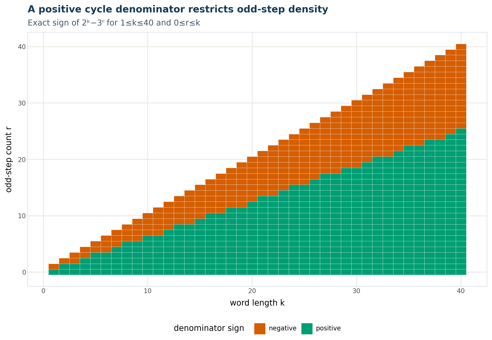

# Classical partial results {#sec-classical}

## Progress has several meanings

A partial result may concern descent below the start, membership in the basin of
1, density of an exceptional set, possible cycle sizes, or a finite verification
range. These conclusions are not interchangeable. The literature becomes much
clearer when each theorem is placed in a two-column ledger: its exact conclusion
and the remaining gap.

The foundational work of Terras ([Terras 1976](d-bibliography.md#ref-terras1976)) and Everett ([Everett 1977](d-bibliography.md#ref-everett1977)) showed,
in closely related conventions, that almost every starting value has **finite
stopping time**: it eventually falls below its own start, in the sense of natural
density. This does not say every start falls, and it does not even say that every
member of that density-one set reaches 1. After descending, an orbit might land
on an exceptional smaller number for which the same theorem offers no
pointwise conclusion.

<div class="callout callout-note">
<p class="callout-title">Density theorem, not convergence theorem</p>

The correct takeaway is that starts which fail to descend below themselves form
a density-zero exceptional set. “Therefore almost every orbit reaches 1” removes
a logical step that the theorem does not supply.

</div>

## Why parity counting proves density statements

Length-$k$ shortcut parity vectors correspond bijectively to residues modulo
$2^k$. A uniformly sampled residue therefore gives $k$ fair bits. Most bit
strings contain close to $k/2$ odd steps, making $3^s/2^k$ small. Concentration
estimates show that high-odd-density strings occupy a small fraction of residue
classes. The additive term and small representatives require care, but this
architecture can prove that the proportion lacking a stopping time tends to
zero.

The argument ranges over starts in a large interval and permits a shrinking
exceptional proportion. It does not track one fixed integer through arbitrarily
many successive blocks. That is why the same parity idea is rigorous for density
yet only heuristic for universal convergence.

## Counting integers known to reach 1

Define

$$
\pi_1(x)=|\{n:1\le n\le x,\ C^j(n)=1\text{ for some }j\}|.
$$

Krasikov and Lagarias developed systems of difference inequalities for inverse
orbit counts. Their computer-assisted analysis proves, for all sufficiently large
$x$, a lower bound of the form

$$
\pi_1(x)>x^{0.84}.
$$

The exponent is a rigorous quantitative guarantee that many integers lie in the
basin of 1 ([Krasikov and Lagarias 2003](d-bibliography.md#ref-krasikov2003)). Since $x^{0.84}/x=x^{-0.16}\to0$, this lower bound
does not establish positive density, much less density one. A rapidly growing
certified subset can still be sparse relative to all integers.

This result also illustrates a legitimate computer-assisted proof. The finite
linear or difference-inequality computation supports a general mathematical
bound once its reduction and certificates are justified. It is not the same
kind of computation as enumerating every orbit below a cutoff.

## Inverse-orbit and cycle results

Backward methods count nodes whose path reaches a chosen target. Difference
inequalities relate counts in residue classes and can turn local branching
information into global lower bounds. Cycle investigations combine the affine
closure equation, rational approximation to $\log 2/\log 3$, and exhaustive
checks over feasible parity patterns. Such work has pushed necessary lower bounds
for a hypothetical nontrivial cycle to enormous sizes.

Every bound must keep its parameter attached. “No cycle with at most $r$ odd
terms” differs from “no cycle whose smallest element is below $X$,” and both
differ from “no nontrivial cycle.” A later improved numerical bound does not
alter the type of the statement.

## Conditional statements

A conditional theorem has the form “if hypothesis $H$ holds, then the conjecture
follows” or “under stochastic assumption $M$, a typical trajectory descends.”
It can isolate a useful target, but evidence for $H$ is not a proof of $H$.
Examples include:

- sufficient uniform bounds on parity discrepancy;
- absence of an infinite nested path through unresolved sieve classes;
- strong mixing assumptions for successive valuation exponents;
- a global finite-stopping-time property for every integer.

The last condition is equivalent to the conjecture by strong induction, so
rephrasing it cannot count as progress unless it becomes easier to establish.

## A theorem-status exercise in reading

Suppose an abstract says, “Our algorithm verifies all $n<2^N$ in time
$O(\alpha^N)$, and experiments were run through $N=50$.” Three statements appear:
an algorithmic correctness theorem, a complexity claim under a computation model,
and a completed finite run. None says the conjecture is true. If the work is a
preprint, all three await independent review even when the code is available.

Likewise, “almost all” demands the density notion; “attains bounded values”
demands whether the bound is absolute or depends on the start; and “verified up
to $K$” demands whether $K$ is included. Exact language is a tool for combining
results without inventing implications.

## A complete finite-prefix route to the descent-density conclusion

The elementary ingredients developed earlier explain why a density-one descent theorem is compatible with an unresolved universal problem. Fix a positive prefix length k. Call a shortcut word good when its multiplier numerator is smaller than its denominator. Its full affine row has a nonnegative offset, and for all sufficiently large compatible starts the exact endpoint is strictly smaller than the start. The threshold depends on the word, but there are only finitely many words at this fixed length.

Choose the largest of their finite thresholds. Above that single threshold every compatible start in every good class descends at the kth shortcut endpoint. The omitted smaller starts form a finite set and have natural density zero. Each good word belongs to exactly one residue class modulo two to the k, and those classes are disjoint. Therefore the set of starts that eventually descend has lower natural density at least the proportion of good words. A shortcut descent also gives a standard-map descent after expanding its finitely many merged transitions.

It remains to show that the good-word proportion approaches one with k. Put the uniform distribution on all length-k binary words. Their odd count has mean k divided by two and variance k divided by four. A word fails the multiplier inequality only when its odd fraction reaches at least the base-three logarithm of two. This threshold exceeds one half because three is smaller than four. The elementary squared-deviation bound from the random-model chapter makes the fraction beyond that fixed positive gap at most a constant divided by k. Hence the proportion of good words tends to one.

For every positive tolerance, select a fixed k large enough to make that exceptional word fraction smaller than the tolerance. Now let the start cutoff tend to infinity while keeping that k fixed. The finite offset exceptions and the incomplete final residue block have vanishing proportion. The lower density of starts with finite stopping time is therefore at least one minus every positive tolerance, and so equals one. The upper density cannot exceed one, giving existence of natural density one.

This argument uses the finite parity bijection, exact affine thresholds, finite variance counting and periodic residue proportions. It does not assume that successive portions of one fixed orbit are independently resampled. The probability space is a counting device for a finite set of words. The conclusion concerns the set of starting values with some descent, exactly the type of partial result attributed above. The cited statements and their conventions remain unchanged.

The order of limits is essential. First choose a finite word length for a desired density error. Then take a large start interval so that the finitely many small exceptions are negligible. The proof supplies no one word length at which every positive input has descended. Increasing the length changes the thresholds and exceptional classes. A fixed input can remain in exceptions at every depth without contradicting a density-zero conclusion about their overall population.

## Why a density-one descent set is not an induction domain

Strong induction proves convergence if every input greater than one has a smaller reached value. A density-one descent theorem gives that premise for a large set, but a descended endpoint need not remain inside the same set. It can be an exceptional smaller input whose convergence has not been established. Applying induction only to the density-one set would therefore require an additional closure property that the theorem does not state.

Even if repeated descents occur for many starts, their number and final destination need analysis. A valid finite chain of strict descents must eventually stop, since positive integers cannot decrease indefinitely. The problem is establishing a next descent at each encountered nonterminal state. Replacing that property by a population frequency leaves precisely the pointwise gap. The density theorem is powerful because it narrows where a failure can occur, while leaving that gap explicit.

The inverse-basin count addresses a different set. Its members already have complete paths to one, so a lower bound there needs no further induction to certify those members. But a power-law lower bound with exponent below one can grow without supplying a positive limiting fraction. One cannot combine the large descent set and the growing basin count merely by adding their reported sizes: the relevant intersection and transition relations require proofs.

## Combining results requires matching the objects

Before using two partial results together, align their maps, clocks, domains and predicates. An odd-only theorem needs the initial power-of-two reduction and a translation of its conclusion. A bound on cycle minimum concerns a least element, not a count of odd states. A finite interval result has a cutoff, while an asymptotic lower bound has a sufficiently-large qualification. Each can be rigorous without answering the other's question.

For a proposed combination, state the missing implication as a separate mathematical claim. If it says every exceptional descending endpoint belongs to the known basin, that is a new coverage condition. If it says every nontrivial cycle must have a minimum inside a verified interval, that needs a uniform bound on all relevant cycle parameters. Naming the condition makes a possible research direction inspectable; omitting it manufactures a proof the inputs do not support.

The status ledger also separates a proved reduction from execution of its finite component. A sound reduction can make a finite certificate decisive for a parameter range, while an unperformed computation leaves that component unavailable. Conversely, a completed finite enumeration cannot establish a reduction that was never proved. This chapter supplies no new run or improved frontier and retains the original sources for every dated research statement.

## Visual checkpoint: a necessary cycle inequality

<figure id="fig-collatz-classical-cycle-grid">


<figcaption>

Figure 12.1: The sign of the affine cycle denominator restricts finite word parameters.

</figcaption>
</figure>

Green cells in [Figure 12.1](#fig-collatz-classical-cycle-grid) pass one necessary positivity
condition. They are not cycles: integrality, admissible parity, the affine
offset, and every intermediate state remain to be checked. This illustrates how
a classical obstruction narrows a search without settling the conjecture.

<!-- inline-formula-code:start -->
## Formula and finite computation

A useful formula in this chapter is

$$
D(B,K)=\frac{1}{B-1}
\#\{2\le n\le B:\exists 1\le k\le K,\ C^k(n)<n\}
$$

A bounded first-descent calculation illustrates a finite approximation to the
density quantity used in partial results. Both the start bound and time bound
are part of the computed object. The following standalone Python block expresses
that finite rule with its inputs and stopping conditions visible.

```python
def descends(start: int, max_steps: int) -> bool:
    """Return whether an iterate falls below start within max_steps."""
    if start <= 1 or max_steps <= 0:
        raise ValueError("start must exceed one and max_steps must be positive")
    value = start
    for _ in range(max_steps):
        value = value // 2 if value % 2 == 0 else 3 * value + 1
        if value < start:
            return True
    return False

start_bound = 500
step_bound = 200
verified = sum(
    descends(start, step_bound) for start in range(2, start_bound + 1)
)
print(verified / (start_bound - 1))
```

**What the computation establishes.** The output certifies only the declared finite case. The theorem, if one is claimed, still requires the argument developed in the chapter.
<!-- inline-formula-code:end -->

## Chapter summary

Classical work proves density-one finite stopping time, strong lower bounds on
the size of the known basin, and severe constraints on cycles. Each result
controls one projection of the problem. None eliminates every exceptional orbit,
and no current combination is known to prove universal convergence.

## Exercises

<div class="exercise" id="collatz-classical-one-descent">
<p class="exercise-title"><strong>Exercise 1</strong></p>

Explain why finite stopping time for one integer does not by itself imply that integer reaches one.

<details class="hint"><summary>Hint 1</summary>

A smaller endpoint needs its own convergence proof.

</details>

<details class="hint"><summary>Hint 2</summary>

Universal strong induction has a premise at every smaller input.

</details>

<details class="solution"><summary>Solution</summary>

Finite stopping time gives an actual smaller positive iterate. If that smaller input is already proved to reach one, the original start inherits its tail. Without that further fact, the descent alone does not certify arrival. A density-one descent theorem supplies no pointwise conclusion for an exceptional endpoint. Universal finite descent would permit strong induction, but one isolated descent or a large-set conclusion does not supply the same premise.

</details>

</div>

<div class="exercise" id="collatz-classical-basin-power-bound">
<p class="exercise-title"><strong>Exercise 2</strong></p>

Show that $\pi_1(x)>x^{0.84}$ does not imply positive natural density.

<details class="hint"><summary>Hint 1</summary>

Divide the lower bound by x.

</details>

<details class="hint"><summary>Hint 2</summary>

A lower bound tending to zero does not bound the proportion away from zero.

</details>

<details class="solution"><summary>Solution</summary>

The guaranteed ratio is only $x^{-0.16}$, which tends to zero. The inequality is compatible with a basin proportion tending to zero more slowly, as well as with a positive proportion; it decides neither. The theorem establishes many certified starts in absolute count. A positive-density conclusion would require a fixed positive lower bound on the ratio for sufficiently large cutoffs, and density one would require still more.

</details>

</div>

<div class="exercise" id="collatz-classical-status-table">
<p class="exercise-title"><strong>Exercise 3</strong></p>

Build the domain, convention, conclusion and remaining-gap table for the two cited classical result families.

<details class="hint"><summary>Hint 1</summary>

Keep eventual descent separate from known arrival at one.

</details>

<details class="hint"><summary>Hint 2</summary>

Use the exact attribution above rather than inventing a fresh paper review.

</details>

<details class="solution"><summary>Solution</summary>

For the Terras/Everett attribution, the domain is positive starts under the stated related iteration conventions, the conclusion is natural-density-one finite stopping time, and the gap is pointwise descent and certified continuation to one. For Krasikov–Lagarias, the counted set is starts with paths to one, the conclusion is the stated sufficiently-large power-law lower bound, and the gap is a positive or full density and complete basin coverage. The retained bibliography owns the precise original convention and publication details.

</details>

</div>

<div class="exercise" id="collatz-classical-equivalent-condition">
<p class="exercise-title"><strong>Exercise 4</strong></p>

Give a conditional statement equivalent to the conjecture but not evidently easier.

<details class="hint"><summary>Hint 1</summary>

Use the strict descent formulation.

</details>

<details class="hint"><summary>Hint 2</summary>

The conditional proof does not establish its premise.

</details>

<details class="solution"><summary>Solution</summary>

If every positive start above one has a finite iterate below itself, strong induction proves convergence. Conversely convergence gives a reached one below every such start. Thus the premise is equivalent to the conjecture. Reformulating it may suggest sieves or ranks, but supplies no proof that the premise holds. A purported advance must establish a new tractable sufficient condition or prove the existing one, rather than merely rename its universal quantifier.

</details>

</div>

<div class="exercise" id="collatz-classical-two-computations">
<p class="exercise-title"><strong>Exercise 5</strong></p>

Distinguish a computer-assisted asymptotic proof from exhaustive finite-range verification.

<details class="hint"><summary>Hint 1</summary>

Ask which reduction turns a finite calculation into the final claim.

</details>

<details class="hint"><summary>Hint 2</summary>

The second type retains a finite input interval.

</details>

<details class="solution"><summary>Solution</summary>

An asymptotic proof can reduce a general inequality or recurrence to a finite certificate, then use a proved mathematical argument to extend the certificate to all sufficiently large inputs. Exhaustive verification instead establishes the specified predicate for every input in a declared finite range, with arithmetic and coverage evidence. Both require justified computation, but their conclusions differ. This chapter reports the cited results and adds no new execution or independently assessed certificate.

</details>

</div>

<div class="exercise" id="collatz-classical-primary-source-card">
<p class="exercise-title"><strong>Exercise 6</strong></p>

For the original primary-paper reading project, specify a complete status card without claiming a new reading or review has occurred here.

<details class="hint"><summary>Hint 1</summary>

Name the exact predicate, domain and quantifiers.

</details>

<details class="hint"><summary>Hint 2</summary>

Keep bibliographic status separate from a reader judgement.

</details>

<details class="solution"><summary>Solution</summary>

A card for the retained Krasikov–Lagarias attribution names positive integer starts, basin membership under the declared map, the sufficiently-large lower bound on the basin count, the difference-inequality reduction and its finite computational dependency. It records the citation from the bibliography and explicitly leaves any newly performed paper audit unclaimed. Its common-overstatement field rejects positive density, density one and universal convergence as consequences of this bound alone. A reader undertaking the project must check those fields against the primary text and record any genuine new findings separately.

</details>

</div>
