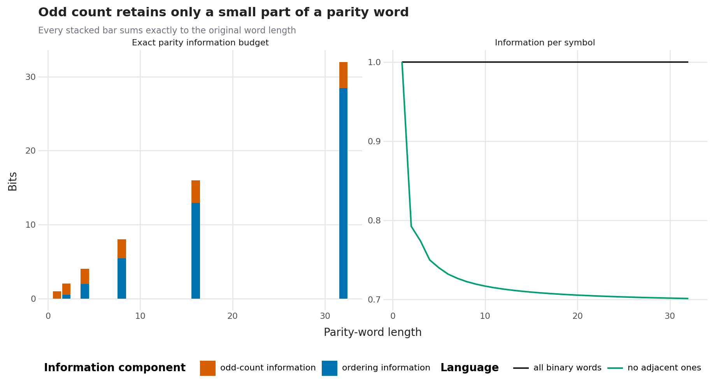

# Tao's almost-bounded-orbits theorem {#sec-tao}

## The exact expository statement

Let

$$
\operatorname{Col}_{\min}(N)=\min_{j\ge0}C^j(N).
$$

Tao's peer-reviewed theorem states that for every function
$f:\mathbb N_{>0}\to\mathbb R$ satisfying $f(N)\to+\infty$,

$$
\operatorname{Col}_{\min}(N)\le f(N)
$$

for almost all $N$ in the sense of logarithmic density
([Tao 2022](d-bibliography.md#ref-tao2022)). The result appeared in *Forum of Mathematics, Pi* in 2022; the
preprint is arXiv:1909.03562.

The function may grow as slowly as desired, provided it tends to infinity. For
example, one may choose an iterated logarithm on a domain where it is positive.
Then almost every start, logarithmically weighted, makes an immense relative
descent.

<div class="callout callout-warning">
<p class="callout-title">What the theorem does not say</p>

It does not say that almost every orbit reaches 1. It does not give one absolute
constant reached by a logarithmic-density-one set. It does not remove all
exceptional starts, and therefore does not prove the Collatz conjecture.

</div>

## Unpacking the quantifiers

The phrase “for every $f$” comes before the density-one conclusion. For each
chosen slowly growing threshold, there may be a different exceptional set of
logarithmic density zero. One cannot intersect over all possible functions and
assume the intersection still has density one. There are uncountably many real-
valued functions, and even countable intersections of density-one sets need not
retain density one without uniform estimates.

An equivalent quantitative viewpoint given in the paper is that for every
$\delta>0$ there is a constant $C_\delta$ such that
$\operatorname{Col}_{\min}(N)\le C_\delta$ on a set of lower logarithmic density
at least $1-\delta$. The bound deteriorates as $\delta$ shrinks. This is powerful
near-uniformity but still not a single bound for a density-one set.

## Why the Syracuse map appears

Tao passes to the Syracuse map on odd integers, which is this book's $U$:

$$
\operatorname{Syr}(N)=\frac{3N+1}{2^{\nu_2(3N+1)}}.
$$

The odd entries of a Collatz orbit form exactly a Syracuse orbit, so minimum-value
questions translate between the maps after removing the initial power of two.
For a finite sequence of exponents $\vec a=(a_1,\ldots,a_n)$, an iterate has the
form

$$
\operatorname{Aff}_{\vec a}(x)
=3^n2^{-|\vec a|}x+F_n(\vec a),
\qquad |\vec a|=a_1+\cdots+a_n.
$$

This separates the contracting multiplier from an offset carrying fine arithmetic
information. Replacing the actual exponents by independent geometric random
variables predicts contraction but is not sufficient: the offset distribution
must mix at fine scales.

## First passage and stabilization

Instead of following every orbit to a fixed bottom, the proof studies where a
trajectory first passes from one large scale to a lower scale. If these
first-passage distributions stabilize as the starting scale changes, the
descent can be iterated across a sequence of scales. Most logarithmic probability
mass is then transferred toward an arbitrarily slowly growing lower region.

The word “probability” here comes from sampling starting integers with carefully
chosen logarithmic distributions. It is not an assertion that one deterministic
orbit flips independent coins. Random variables are a rigorous averaging device
for a density theorem.

## Entropy, 3-adic mixing, and Fourier decay

At a high level, geometric exponent variables carry substantial entropy. The
Syracuse offset is studied modulo powers of 3, where multiplication by 2 is
invertible and the affine contributions can mix. The proof splits conditioned
offsets into components, controls a Rényi-entropy quantity, and proves that
high-frequency Fourier coefficients decay. A two-dimensional renewal process
and a geometric analysis of regions associated with frequencies close the
mixing estimate.

This is sometimes compressed in popular discussion to “an entropy decrement
argument.” That slogan is too coarse to serve as an account of the paper. The
published proof's named chain is stabilization of first passage, fine-scale
mixing of Syracuse offsets, reduction to Fourier decay, and control of a renewal
process. Entropy helps explain why spreading is plausible; the hard theorem is
the quantitative arithmetic mixing estimate.

Chapter [sec-collatz-entropy-information](41-entropy-information.md#sec-collatz-entropy-information) builds elementary Shannon and relative
entropy from finite tables. Its identities explain information loss but do not
replace the fine-scale mixing estimates used here.

## Approximate independence, not independence everywhere

Residue data can behave approximately like independent geometric variables over
selected ranges and under suitable averaging. The proof expends major effort to
make that approximation accurate enough for its density conclusion. It does not
show that all valuation sequences are independent, nor that the approximation
holds uniformly along every orbit.

This boundary explains the theorem's shape. Averaging and mixing can discard a
logarithmically negligible exceptional set. The full conjecture cannot discard
even one positive integer. Extending a density theorem to a universal theorem
would require a new mechanism controlling precisely those exceptional paths.

## A responsible one-sentence summary

Here is a summary that preserves the result:

> For any threshold tending to infinity, however slowly, Tao proved that the
> minimum of the Collatz orbit is at most that threshold for a
> logarithmic-density-one set of starting integers.

Replacing “threshold tending to infinity” by “fixed bound,” replacing
“logarithmic-density-one set” by “every integer,” or adding “reaches 1” creates a
different and unproved claim.

## Visual checkpoint: information retained and information lost

<figure id="fig-collatz-tao-information-budget">


<figcaption>

Figure 13.1: An information ledger compares parity descriptions with coarser residue summaries.

</figcaption>
</figure>

[Figure 13.1](#fig-collatz-tao-information-budget) is a conceptual ledger for the
entropy argument. Approximate mixing estimates control particular compressed
statistics; they do not make every parity bit independent or convert an
almost-all statement into universal convergence.

<!-- inline-formula-code:start -->
## Formula and finite computation

A useful formula in this chapter is

$$
\mathbb P_{\log,B}(A)=\frac{\sum_{n\le B,\ n\in A}1/n}{\sum_{n\le B}1/n}
$$

The code contrasts logarithmic and uniform weights on the same declared finite event. The following standalone Python block expresses that finite rule with its inputs and stopping conditions visible.

```python
bound = 1_000
event = [number for number in range(1, bound + 1) if number % 3 == 1]
logarithmic = sum(1.0 / number for number in event) / sum(
    1.0 / number for number in range(1, bound + 1)
)
uniform = len(event) / bound
print(logarithmic, uniform)
```

**What the computation establishes.** The output certifies only the declared finite case. The theorem, if one is claimed, still requires the argument developed in the chapter.
<!-- inline-formula-code:end -->

## Chapter summary

Tao converted the random-model intuition into a rigorous logarithmic-density
theorem through Syracuse first-passage distributions, 3-adic fine-scale mixing,
entropy and Fourier control, and renewal-process estimates. The theorem proves
almost-bounded descent, not convergence to 1, and leaves an exceptional set that
could contain a counterexample.

## Exercises

<div class="exercise" id="collatz_conjecture-13-tao-ex-1">
<p class="exercise-title"><strong>Exercise 1</strong></p>

Write the theorem with all quantifiers and then negate it.

</div>

<div class="exercise" id="collatz_conjecture-13-tao-ex-2">
<p class="exercise-title"><strong>Exercise 2</strong></p>

Explain why $f(N)\to\infty$ is weaker than a fixed bound.

</div>

<div class="exercise" id="collatz_conjecture-13-tao-ex-3">
<p class="exercise-title"><strong>Exercise 3</strong></p>

Translate $\operatorname{Col}_{\min}(N)$ to the Syracuse map after removing
the initial power of two.

</div>

<div class="exercise" id="collatz_conjecture-13-tao-ex-4">
<p class="exercise-title"><strong>Exercise 4</strong></p>

Identify which part of the proof architecture turns a random model into a
rigorous density statement.

</div>

<div class="exercise" id="collatz_conjecture-13-tao-ex-5">
<p class="exercise-title"><strong>Exercise 5</strong></p>

Correct the sentence “Tao proved almost every Collatz orbit converges.”

</div>

<div class="exercise" id="collatz_conjecture-13-tao-ex-6">
<p class="exercise-title"><strong>Exercise 6</strong></p>

**Challenge.** Show why intersecting the conclusions for a sequence
$f_k(N)\to\infty$ does not automatically produce a density-one set reaching a
fixed constant.

</div>

## Added worked examples: reading the conclusion exactly

The following examples are elementary illustrations of the quantifiers and weights. They do not reproduce the proof of the cited theorem or alter any statement above. The original chapter text, research-status warning, source citation and publication details are retained unchanged.

### Worked example: finite logarithmic weights are not uniform weights

Choose a start from one through six. Under uniform sampling, the event of being a multiple of three has probability two sixths, or one third. Under reciprocal weighting, the event's total weight is one third plus one sixth, or one half. The total weight of all six inputs is forty-nine twentieths. Its finite logarithmic probability is therefore ten forty-ninths, different from one third.

The discrepancy is exact and requires no simulated sample. Smaller inputs carry more weight under the reciprocal rule. A finite logarithmic probability normalises by the harmonic sum so that all event probabilities add to one. The asymptotic density definition instead uses log of the cutoff; the harmonic sum divided by that logarithm tends to one. These normalisations agree in their limit when the limit exists, while they need not give the same finite number.

The event here concerns divisibility, whose asymptotic density is known directly. The purpose is to identify what a finite probability table measures. Replacing a logarithmically weighted theorem by the outcome of a uniform-start experiment changes the finite question. Neither weighting makes a finite table prove an infinite limiting assertion. An illustration should name its population, weights and cutoff before comparing the displayed fraction with the theorem's conclusion.

### Worked example: countable intersections can lose every input

For each positive integer j, let the jth success set contain every positive integer at least j. Its omitted prefix is finite, so it has natural and logarithmic density one. Every finite intersection also has density one: it is the tail beginning at the largest of finitely many cutoffs. But the intersection over all j is empty. Any fixed positive integer is omitted once j exceeds it.

Equivalently, each omitted prefix has density zero while their countable union is the whole domain. Density lacks the countable-union implication one might incorrectly import from a countably additive probability measure. The sets in this example are fixed subsets of integers with limiting frequency properties; they are not events under a single uniform probability on all positive integers.

Consequently separate density-one conclusions for many thresholds cannot be intersected without a uniform estimate that actually controls their union of exceptions. This example shows the logical gap even for a countable sequence, before considering all real-valued threshold functions. It does not assert that the particular exceptional sets in Tao's proof are these tails. The theorem's actual quantitative estimates remain the cited deep input.

### Worked example: near-uniform bounds need not share one constant

Define a comparison function on positive integers by one plus the exponent of two dividing its input. For a positive integer B, the function exceeds B exactly on multiples of two to the B. That set has natural and logarithmic density two to the negative B. The set where the function is at most B therefore has density one minus that amount.

For every positive tolerance one can choose B large enough to make the omitted density smaller than the tolerance. Yet no finite B captures a density-one set: each leaves a positive tail density. The function is unbounded on inputs that are powers of two. Thus a family of constants depending on the tolerated exceptional fraction can have every required near-uniform property without one constant serving a full-density set.

The comparison function also lies below every diverging threshold on a logarithmic-density-one set. Fix a tolerance and first select B with its tail density below that tolerance. Beyond a finite cutoff the chosen threshold exceeds B. Any later failure is then contained in the comparison function's tail above B, so its upper logarithmic density is no greater than the tolerance. Let the tolerance tend to zero. This proof keeps the threshold fixed while the bound B varies in the argument.

These are properties of the comparison function, not claimed Collatz minimum values. They illustrate the distinction between the two equivalent viewpoints quoted from the paper and a stronger fixed-constant statement. They supply no new information about the arithmetic exceptional orbits.

## Added exercise support and further questions

The first six blocks supply hints and full answers to the original questions without changing them. The final four are additional questions. Their semantic IDs identify the mathematical tasks; no computation or independent research review is reported.

<div class="exercise" id="collatz-tao-quantified-negation">
<p class="exercise-title"><strong>Exercise 7</strong></p>

Support for original Exercise 1: write and negate the exact theorem.

<details class="hint"><summary>Hint 1</summary>

Fix one diverging real-valued threshold function before discussing its success set.

</details>

<details class="hint"><summary>Hint 2</summary>

Failure of density one is equivalent to positive upper logarithmic density of the exceptional complement.

</details>

<details class="solution"><summary>Solution</summary>

For every real-valued f on positive integers tending to positive infinity, the set of starts whose orbit minimum is at most f has logarithmic density one. Its negation asserts that some such fixed f has a failure set, where the minimum is strictly greater than f, of positive upper logarithmic density. A nonexistent success-density limit also fails the density-one assertion. The chosen function must still diverge; replacing it by a constant changes the hypothesis.

</details>

</div>

<div class="exercise" id="collatz-tao-moving-threshold">
<p class="exercise-title"><strong>Exercise 8</strong></p>

Support for original Exercise 2: explain the difference between a diverging threshold and a fixed bound.

<details class="hint"><summary>Hint 1</summary>

A diverging threshold eventually exceeds every fixed number.

</details>

<details class="hint"><summary>Hint 2</summary>

Its permitted values need not remain inside one finite interval.

</details>

<details class="solution"><summary>Solution</summary>

A moving threshold can grow indefinitely with the start, however slowly. A fixed bound restricts minima to one finite range. The theorem permits the former and does not supply the latter on a density-one set. A constant function is not an admissible diverging threshold. Quantitative constants depending on a positive tolerated exception fraction also need not remain bounded as that fraction shrinks, as the comparison function demonstrates.

</details>

</div>

<div class="exercise" id="collatz-tao-odd-minimum">
<p class="exercise-title"><strong>Exercise 9</strong></p>

Support for original Exercise 3: translate the minimum after removing the initial power of two.

<details class="hint"><summary>Hint 1</summary>

Initial halvings reach the odd part without increasing the state.

</details>

<details class="hint"><summary>Hint 2</summary>

A global positive minimum above one cannot occur at an even state.

</details>

<details class="solution"><summary>Solution</summary>

Write the start as a power of two times odd m. The initial halving chain ends at m. Every even state greater than one is followed by a smaller state, so the global orbit minimum occurs among the odd entries, or is one. Those odd entries are exactly the successive Syracuse states beginning at m. Hence the standard minimum equals the minimum of that odd-to-odd orbit. This is an exact convention translation; it does not establish any new density or independence statement.

</details>

</div>

<div class="exercise" id="collatz-tao-proof-architecture">
<p class="exercise-title"><strong>Exercise 10</strong></p>

Support for original Exercise 4: identify the arithmetic step beyond the random model.

<details class="hint"><summary>Hint 1</summary>

The offset retains fine residue information.

</details>

<details class="hint"><summary>Hint 2</summary>

The cited mixing and first-passage estimates are the substantive theorem inputs.

</details>

<details class="solution"><summary>Solution</summary>

The independent geometric model supplies a contraction prediction, but the actual proof needs quantitative fine-scale mixing of Syracuse offsets and stabilisation of first-passage distributions under the specified logarithmic averaging. The Fourier and renewal estimates described above justify the required approximation for that conclusion. A bare negative mean or a finite entropy identity does not supply those estimates. This answer identifies the cited architecture and does not claim to reprove the paper or independently review it.

</details>

</div>

<div class="exercise" id="collatz-tao-correct-summary">
<p class="exercise-title"><strong>Exercise 11</strong></p>

Support for original Exercise 5: correct the sentence claiming almost-everywhere convergence.

<details class="hint"><summary>Hint 1</summary>

Retain the moving threshold and density notion.

</details>

<details class="hint"><summary>Hint 2</summary>

The minimum need not equal one.

</details>

<details class="solution"><summary>Solution</summary>

A faithful summary says that for every threshold function tending to infinity, the Collatz minimum is at most that threshold for logarithmic-density-almost every start. It does not say those starts reach one. Replacing the moving threshold by one or a fixed constant removes a hypothesis and strengthens the conclusion. The source warning remains unchanged and continues to delimit the statement.

</details>

</div>

<div class="exercise" id="collatz-tao-countable-intersection">
<p class="exercise-title"><strong>Exercise 12</strong></p>

Support for original Exercise 6: explain why a sequence of conclusions cannot automatically give a fixed bound on a common density-one set.

<details class="hint"><summary>Hint 1</summary>

Even countable intersections of density-one sets can be empty.

</details>

<details class="hint"><summary>Hint 2</summary>

Use the tails beginning at successive integer cutoffs.

</details>

<details class="solution"><summary>Solution</summary>

Each tail from j onward has density one, yet their full intersection is empty because every integer is eventually excluded. Thus separate zero-density exception sets need not have a zero-density countable union. A simultaneous claim requires a uniform union control, not merely the theorem for each chosen function. The example is about logical inference between set statements, not an identification of the actual exceptions in the cited proof.

</details>

</div>

<div class="exercise" id="collatz-tao-four-point-weighting">
<p class="exercise-title"><strong>Exercise 13</strong></p>

Additional exercise: on starts one through four, compute uniform and reciprocal-weight probabilities of an odd start.

<details class="hint"><summary>Hint 1</summary>

The event weights are one and one third.

</details>

<details class="hint"><summary>Hint 2</summary>

The total reciprocal weight is twenty-five twelfths.

</details>

<details class="solution"><summary>Solution</summary>

Uniformly the probability is one half. Reciprocally the event weight is four thirds and the full weight twenty-five twelfths, giving sixteen twenty-fifths. The exact finite difference reflects the heavier weight on the small odd input one. Neither finite number is by itself an asymptotic density. The event and population are deliberately elementary so that the weighting distinction is visible without any orbit computation.

</details>

</div>

<div class="exercise" id="collatz-tao-bound-tolerance">
<p class="exercise-title"><strong>Exercise 14</strong></p>

Additional exercise: for the comparison function one plus the two-adic valuation, determine the density captured by bound three and why no fixed bound captures density one.

<details class="hint"><summary>Hint 1</summary>

Exceeding B means divisibility by the corresponding power of two.

</details>

<details class="hint"><summary>Hint 2</summary>

A fixed positive reciprocal-power tail remains.

</details>

<details class="solution"><summary>Solution</summary>

Bound three misses exactly multiples of eight, with density one eighth, and captures seven eighths. Every finite positive integer bound B misses multiples of two to the B, of positive density two to the negative B. Increasing B can make this as small as desired but never zero for fixed B. These are comparison-function values, not assertions about actual Collatz minima.

</details>

</div>

<div class="exercise" id="collatz-tao-threshold-sequence">
<p class="exercise-title"><strong>Exercise 15</strong></p>

Additional exercise: each $f_j(N)=1+N/j$ tends to infinity with N. If an integer-valued minimum were below or equal to every $f_j(N)$ at a fixed N, what would follow, and why cannot density-one conclusions alone establish it?

<details class="hint"><summary>Hint 1</summary>

For fixed N, make j larger than N.

</details>

<details class="hint"><summary>Hint 2</summary>

The intersection must be justified before all inequalities can be used at one input.

</details>

<details class="solution"><summary>Solution</summary>

For j greater than N the threshold is strictly less than two. A positive integer minimum at most every threshold would therefore equal one. But the theorem gives a separate density-one success set for each j, not a justified density-one common intersection. Intersecting them would require an additional uniform estimate. The calculation explains exactly how an invalid intersection would manufacture the stronger conclusion.

</details>

</div>

<div class="exercise" id="collatz-tao-zero-tolerance">
<p class="exercise-title"><strong>Exercise 16</strong></p>

Additional exercise: why cannot the quantitative statement for every positive exception tolerance be specialised to tolerance zero?

<details class="hint"><summary>Hint 1</summary>

Zero is outside the quantified domain.

</details>

<details class="hint"><summary>Hint 2</summary>

The comparison function provides a family with no uniform constant.

</details>

<details class="solution"><summary>Solution</summary>

The premise quantifies only over strictly positive tolerances and allows its constant to depend on that tolerance. There is no supplied constant at zero, nor a guarantee that the constants stay bounded while the tolerance decreases. The comparison function above has a suitable constant for every positive tolerance but a positive omitted density for every fixed constant. Thus passing to zero requires information absent from the statement, and no fixed-bound or target-one result follows by that substitution.

</details>

</div>
