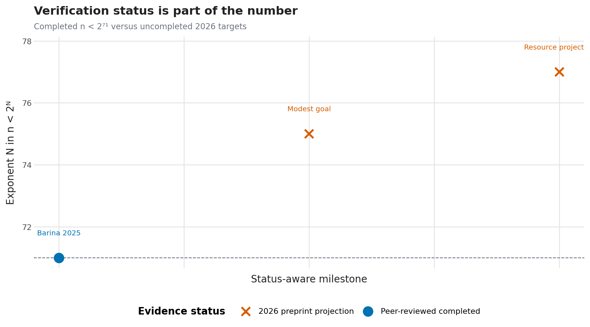

# Exhaustive verification {#sec-verification}

## What one dated published result certifies

Barina's peer-reviewed 2025 paper reports verification of the half-open range

$$
n<2^{71}.
$$

Barina reports this result in *The Journal of Supercomputing*, accepted on
21 April 2025 and published on 2 May 2025 ([Barina 2025](d-bibliography.md#ref-barina2025)). The endpoint is strict:
$2^{71}$ itself is not part of the stated half-open range. The result says every
positive start below that bound has a verified path to 1, using algorithms whose
correctness and implementation are described in the paper.

This is not “evidence only” in the casual sense. Subject to the usual standards
for computer-assisted mathematics, it is a proved finite statement. It is not a
proof of the universal conjecture because infinitely many starts remain outside
the range.

## Descent below the start

Processing starts in increasing order permits a decisive shortcut. If the orbit
of $n$ reaches $m<n$, and every smaller start has already been certified, then
$n$ inherits the certified tail of $m$. The verifier need not iterate all the way
to 1 for every start.

This induction requires complete lower-range coverage. In a distributed run,
worker intervals may finish out of order, so the final certificate must establish
that every dependency points into an interval whose status is already justified.
Alternatively, each worker can continue to 1 or to a trusted global baseline.

Residue sieves reduce work by handling many starts with shared low bits. Lookup
tables perform several shortcut steps at once. Preimage and path-merging sieves
remove starts whose orbit joins that of a smaller certified number. These are
speedups only when their exact arithmetic and coverage arguments are independently
validated.

## Published, proposed, and projected

[Figure 14.1](#fig-verification-summary) distinguishes completed verification from algorithmic
projection. Barina's 2025 point at 71 bits is completed and peer-reviewed. The
2026 Angeltveit manuscript is an arXiv preprint that proposes stronger sieves and
estimates that 75 bits is a modest target and 77 bits may be feasible with
resources comparable to the earlier 71-bit computation ([Angeltveit 2026](d-bibliography.md#ref-angel2026)). Those
numbers are goals or projections in the paper, not reported completed frontiers.

<figure id="fig-verification-summary">


<figcaption>

Figure 14.1: Status-aware summary of verification scales: completed peer-reviewed ranges are separated from projected targets in a 2026 preprint.

</figcaption>
</figure>

The preprint's introduction explicitly says that a proof appears to be out of
reach with current techniques. Its contribution is algorithmic: recursively add
low bits, apply descent and path-merging sieves, use precomputed bitvectors for a
look-ahead phase, and directly check the survivors. Calling it a proof of Collatz
would contradict its own scope.

## Arithmetic and implementation hazards

An exhaustive verifier can fail silently through:

- overflow in $3n+1$ or a batched affine numerator;
- signed/unsigned conversion at a boundary;
- missing or duplicated intervals in distributed work;
- a lookup table generated under a different map convention;
- stopping below a value that was not actually certified;
- a race or checkpoint bug that marks unfinished work complete;
- hardware faults or corrupt result files;
- non-reproducible compiler optimizations around undefined overflow.

Mitigations include arbitrary-precision reference tests, explicit precondition
checks for fixed-width kernels, redundant runs on different hardware, interval
manifests, checksums, versioned table generators, and small independently
checkable certificates. A fast program without a coverage story measures speed,
not theorem scope.

## Verification cost and scale

Increasing a bit frontier from $N$ to $N+1$ doubles the raw number of starts.
Better sieves can make the surviving fraction shrink with $N$, so runtime need
not exactly double. Angeltveit's preprint reports an algorithm intended to take
less than twice as long for $2^{N+1}$ as for $2^N$ and predicts a survivor
fraction tending to zero. The absolute number of survivors still grows, as the
paper emphasizes.

One should not extrapolate a trend line into a completed verification. Runtime
estimates depend on parameters, memory bandwidth, architecture, and the tail of
hard cases. “Feasible” means a resource estimate under assumptions; “verified”
requires the run and audit.

## Reproducibility package

An ideal published computation supplies:

1. a mathematical specification of every sieve;
2. source code and exact build instructions;
3. a machine-readable partition of the search range;
4. checkpoint and completion logs;
5. hashes for tables, binaries, and result files;
6. tests against a simple reference implementation;
7. independent reruns or certificate validation;
8. a statement of inclusivity at the frontier.

Reproducibility need not mean one reader repeats the entire expensive run.
Layered evidence lets readers validate algorithms on small ranges, verify
certificates cheaply, audit interval coverage, and compare aggregate hashes.

<!-- inline-formula-code:start -->
## Formula and finite computation

A useful formula in this chapter is

$$
\forall n\le B\;\exists k\le K:C^k(n)=1
$$

The bounded universal claim returns failures instead of silently dropping them. The following standalone Python block expresses that finite rule with its inputs and stopping conditions visible.

```python
def verify_interval(limit: int, max_steps: int) -> tuple[int, int, list[int]]:
    """Check starts 1..limit, returning record start, record time, and failures."""
    if limit <= 0 or max_steps < 0:
        raise ValueError("limit must be positive and max_steps nonnegative")
    record_start, record_time = 1, 0
    failures: list[int] = []
    for start in range(1, limit + 1):
        value = start
        for step in range(max_steps + 1):
            if value == 1:
                if step > record_time:
                    record_start, record_time = start, step
                break
            if step < max_steps:
                value = value // 2 if value % 2 == 0 else 3 * value + 1
        else:
            failures.append(start)
    return record_start, record_time, failures

print(verify_interval(limit=10_000, max_steps=10_000))
```

**What the computation establishes.** The calculation checks a declared finite instance; the surrounding argument explains what is true beyond those inputs.
<!-- inline-formula-code:end -->

## Chapter summary

Barina's 2025 peer-reviewed finite result covers exactly $n<2^{71}$. This is a
dated published milestone, not a claim that no later computation can exist.
Barina's completed run and Angeltveit's later proposed algorithm have different
evidence statuses. Exhaustive verification rests on downward induction, exact
sieves, safe arithmetic, complete range accounting, and an audit trail. Its
rigor is finite and its limitation is the unbounded domain.

## Exercises

<div class="exercise" id="collatz_conjecture-14-verification-ex-1">
<p class="exercise-title"><strong>Exercise 1</strong></p>

Explain why descending below the start is sufficient when starts are processed
in increasing order.

</div>

<div class="exercise" id="collatz_conjecture-14-verification-ex-2">
<p class="exercise-title"><strong>Exercise 2</strong></p>

Design a half-open interval manifest for 16 workers covering $[1,2^{20})$.

</div>

<div class="exercise" id="collatz_conjecture-14-verification-ex-3">
<p class="exercise-title"><strong>Exercise 3</strong></p>

Calculate the largest $n$ for which $3n+1$ is safe in an unsigned 64-bit
integer.

</div>

<div class="exercise" id="collatz_conjecture-14-verification-ex-4">
<p class="exercise-title"><strong>Exercise 4</strong></p>

Classify each phrase as completed, proposed, or conjectured: “verified below
$2^{71}$,” “algorithm could reach $2^{77}$,” “all starts reach 1.”

</div>

<div class="exercise" id="collatz_conjecture-14-verification-ex-5">
<p class="exercise-title"><strong>Exercise 5</strong></p>

Explain how independent certificate checking differs from simply rerunning the
same executable.

</div>

<div class="exercise" id="collatz_conjecture-14-verification-ex-6">
<p class="exercise-title"><strong>Exercise 6</strong></p>

**Project.** Write a threat model for a large distributed verification and
compare failures by detectability and mathematical impact; rank likelihood only under explicit evidence or declared hypothetical assumptions, stating uncertainty when neither is available.

</div>

## Added worked examples: the structure of a finite claim

These examples illustrate range accounting, exact arithmetic and dependency proofs. They add no completed computation or newer verification frontier. Every original statement about Barina, Angeltveit, dates, publication status and projected ranges above remains unchanged.

### Worked example: a complete half-open partition

Partition the positive inputs from one through sixteen, written as the half-open interval from one through less than seventeen, among four workers. The intervals from one to less than five, five to less than nine, nine to less than thirteen, and thirteen to less than seventeen each contain four inputs. Their lower and upper endpoints join exactly, their intersections are empty, and their union is the intended domain.

A total of sixteen reported rows would not suffice without those endpoint relations. If the second worker began at four and ended before eight, one start would overlap and another could be omitted while the combined count still looked plausible. Range identity and row identity are separate obligations. A retry must not silently create a second authoritative copy of an assigned start, and an unresolved shard cannot be converted to complete by averaging other workers' progress.

For a general interval length L and a chosen positive worker count, integer breakpoints obtained from successive floors of i times L divided by that count produce adjacent intervals. Empty shards may occur if there are more workers than inputs and should be labeled as empty, not as executed work. The first and last breakpoints establish the target endpoints; adjacency establishes coverage and disjointness. This is a proof of a partition formula, not a report that any worker was launched.

### Worked example: a finite downward certificate can pass through larger values

Consider starts one through eight. One is the base. Two reaches one; four reaches two; six reaches three; eight reaches four. For three, retain the segment three, ten, five, sixteen, eight, four, two. Its endpoint two is smaller than three and already certified in increasing-start order. The larger intermediate values are legal arithmetic states; their own starting-value certificates are not needed to verify this segment.

Five has the segment five, sixteen, eight, four, ending below five. Seven has the segment seven, twenty-two, eleven, thirty-four, seventeen, fifty-two, twenty-six, thirteen, forty, twenty, ten, five, ending below seven. Every adjacent pair follows the declared standard branch. Once the smaller endpoint's successful tail is known, concatenation proves success for the start. The dependencies point strictly downward even though individual trajectories can rise.

These finitely many exact paths and the base case prove the bounded statement for starts one through eight. They do not establish that a program generated them correctly, nor cover a ninth start without another argument. A verifier may discover certificates in a different order, but its final dependency proof must still justify each endpoint. A numerical label “safe” with no path or valid dependency is not that proof.

This example separates the producer's work from the certificate's logic. Searching for a suitable descent can be expensive; checking a supplied finite path is direct arithmetic. The original computation's large-scale engineering has additional obligations, but the underlying downward induction is already visible in this small exact proof.

### Worked example: safe storage of an endpoint is not safe formation

Use an illustrative six-bit unsigned range ending at sixty-three. The largest input for which three times the input plus one fits is twenty. Thus the largest safe odd input is nineteen, whose standard output is fifty-eight. At odd input twenty-one, the exact output is sixty-four, beyond the range; wraparound would produce zero.

The shortcut output at twenty-one is thirty-two, which does fit. Nevertheless forming sixty-four first in the narrow representation is unsafe. Writing the odd input as twice q plus one gives an algebraically equivalent shortcut output of three q plus two. Here q is ten, so this expression forms thirty-two without the overflowing intermediate. A general implementation still needs a precondition proving three q plus two fits; one successful numerical instance does not supply it for all inputs.

The mathematical clock and statistic remain part of the contract. The standard orbit visits sixty-four, so a compressed trace that records only thirty-two must account for the omitted peak if it reports unaccelerated maxima. The algebraic optimization preserves the shortcut endpoint under its conditions; it does not erase a state from the standard map. These are exact calculations, not a machine-arithmetic verification.

## Further questions {#added-exercise-support-and-further-questions}

The first six exercises include staged support; the remaining four develop further exact reasoning.

<div class="exercise" id="collatz-verification-downward-induction">
<p class="exercise-title"><strong>Exercise 7</strong></p>

Support for original Exercise 1: why is descent sufficient in increasing-start order?

<details class="hint"><summary>Hint 1</summary>

The endpoint must be a smaller positive integer.

</details>

<details class="hint"><summary>Hint 2</summary>

Concatenate its already justified tail with the recorded segment.

</details>

<details class="solution"><summary>Solution</summary>

Start one supplies the base. When certifying n, every smaller start already has a valid proof of arrival at one. An exact finite segment from n to some smaller positive m can be joined to that proof. Strong induction therefore certifies n. Intermediate values can exceed n, since their arithmetic transitions are checked directly; only the reused dependency must be justified. In a distributed ordering, the final record needs the same well-founded relation rather than an assumption that another worker must have finished.

</details>

</div>

<div class="exercise" id="collatz-verification-sixteen-shards">
<p class="exercise-title"><strong>Exercise 8</strong></p>

Support for original Exercise 2: partition $[1,2^{20})$ among sixteen workers.

<details class="hint"><summary>Hint 1</summary>

The interval contains $2^{20}-1$ positive inputs.

</details>

<details class="hint"><summary>Hint 2</summary>

Use floor breakpoints so the final endpoint is exact.

</details>

<details class="solution"><summary>Solution</summary>

Let $L=2^{20}-1$ and $a_i=1+\lfloor iL/16\rfloor$ for i from zero through sixteen. Assign shard i the half-open interval $[a_i,a_{i+1})$. The first endpoint is one, the last $2^{20}$, and consecutive endpoints join exactly, proving disjoint coverage. Fifteen shards have one more input than the remaining shard. Giving every shard width $2^{16}$ beginning at one would include an extra endpoint and change the range. No workers are executed by this partition proof.

</details>

</div>

<div class="exercise" id="collatz-verification-word-bound">
<p class="exercise-title"><strong>Exercise 9</strong></p>

Support for original Exercise 3: find the largest n for which $3n+1$ fits an unsigned sixty-four-bit integer.

<details class="hint"><summary>Hint 1</summary>

The maximum is $2^{64}-1$.

</details>

<details class="hint"><summary>Hint 2</summary>

Solve before multiplying.

</details>

<details class="solution"><summary>Solution</summary>

The required inequality is $3n+1\le2^{64}-1$, equivalent to $n\le\lfloor(2^{64}-2)/3\rfloor=6\,148\,914\,691\,236\,517\,204$. This is an expression bound regardless of which Collatz branch an even input would actually use. An odd-step implementation applies it before forming the product, or uses a separately justified wider or decomposed calculation. The arithmetic derivation is not an executed overflow check.

</details>

</div>

<div class="exercise" id="collatz-verification-status-phrases">
<p class="exercise-title"><strong>Exercise 10</strong></p>

Support for original Exercise 4: classify the three retained phrases.

<details class="hint"><summary>Hint 1</summary>

A completed bounded range and a resource projection have different evidence.

</details>

<details class="hint"><summary>Hint 2</summary>

The universal statement remains open in the cited record.

</details>

<details class="solution"><summary>Solution</summary>

The reported range below two to the seventy-one is the completed finite result attributed above. The phrase that an algorithm could reach two to the seventy-seven is a projection, not a completed range. The assertion that all starts reach one is the conjecture. This classification preserves the original dated source record and makes no claim about a newer frontier or a fresh review of either paper.

</details>

</div>

<div class="exercise" id="collatz-verification-checker-trust">
<p class="exercise-title"><strong>Exercise 11</strong></p>

Support for original Exercise 5: distinguish independent certificate checking from rerunning one executable.

<details class="hint"><summary>Hint 1</summary>

A checker can validate a supplied witness without repeating its search.

</details>

<details class="hint"><summary>Hint 2</summary>

Shared implementation assumptions remain a possible dependency.

</details>

<details class="solution"><summary>Solution</summary>

A rerun repeats the same program and may reproduce the same logic error. A certificate checker instead verifies a stated arithmetic predicate, path or range relation from explicit evidence, ideally using a simpler separately justified implementation. It still has trusted assumptions that must be named. Neither label alone establishes correctness: the certificate must match the theorem and cover the range. This answer describes the evidence distinction without claiming that a checker or rerun has been performed.

</details>

</div>

<div class="exercise" id="collatz-verification-failure-model">
<p class="exercise-title"><strong>Exercise 12</strong></p>

Support for original Exercise 6: give a bounded-computation failure model without inventing empirical likelihoods.

<details class="hint"><summary>Hint 1</summary>

Separate coverage, arithmetic, dependencies and record integrity.

</details>

<details class="hint"><summary>Hint 2</summary>

A likelihood ranking needs data not supplied by this chapter.

</details>

<details class="solution"><summary>Solution</summary>

Arithmetic wraparound, omitted inputs and unjustified dependency tails can each turn an invalid range claim into apparent success, so their mathematical impact can be complete invalidation. A lost checkpoint honestly marked unresolved mainly removes coverage until recovered; falsely marking it complete changes the claim. Corrupt records and convention mismatches also require investigation. Detectability depends on the retained paths, partitions and independent evidence. No measured failure frequencies are supplied, so a numerical likelihood ranking would be invented. State that uncertainty and the paper obligations rather than presenting a simulated operational audit.

</details>

</div>

<div class="exercise" id="collatz-verification-eight-partition">
<p class="exercise-title"><strong>Exercise 13</strong></p>

Additional exercise: partition $[1,33)$ among eight equal integer shards and prove the coverage statement.

<details class="hint"><summary>Hint 1</summary>

The range contains thirty-two inputs.

</details>

<details class="hint"><summary>Hint 2</summary>

Use width four and half-open endpoints.

</details>

<details class="solution"><summary>Solution</summary>

Let endpoints be $a_i=1+4i$ for i from zero through eight, and assign $[a_i,a_{i+1})$. Each contains four consecutive integers. The first begins at one and the last ends before thirty-three. Adjacent intervals share a boundary excluded on the left interval and included on the right, so no input is duplicated or missed. The partition is an exact statement independent of whether any computation is later run.

</details>

</div>

<div class="exercise" id="collatz-verification-large-intermediate">
<p class="exercise-title"><strong>Exercise 14</strong></p>

Additional exercise: why may the start-three certificate use sixteen before ending at two, even though sixteen has not yet been certified in increasing-start order?

<details class="hint"><summary>Hint 1</summary>

A transition can be checked without knowing convergence from its input.

</details>

<details class="hint"><summary>Hint 2</summary>

Only the final reused tail needs a previously established proof.

</details>

<details class="solution"><summary>Solution</summary>

The recorded segment follows exact standard steps from three through ten, five, sixteen, eight, four and two. Checking each local branch needs arithmetic, not a convergence assumption for every intermediate value. Its final two already has a certified tail to one, so concatenation proves the start. Replacing the final dependency by an uncertified label at a larger value would lose that argument. The decreasing relation applies to certificate dependencies, not every orbit transition.

</details>

</div>

<div class="exercise" id="collatz-verification-projection-boundary">
<p class="exercise-title"><strong>Exercise 15</strong></p>

Additional exercise: what extra evidence separates a projected feasible range from a completed bounded theorem?

<details class="hint"><summary>Hint 1</summary>

A resource estimate supplies no completed interval partition or arithmetic record.

</details>

<details class="hint"><summary>Hint 2</summary>

The actual claim needs its own scope-matching evidence.

</details>

<details class="solution"><summary>Solution</summary>

A completed claim needs a mathematically justified algorithm or certificate predicate, actual completion evidence for the declared range, exact arithmetic conditions, complete interval accounting and a justified dependency audit. A projection estimates resources under assumptions and can motivate work, but contains no such completed run by itself. The source publication labels remain unchanged. No amount of rephrasing feasibility as confidence establishes that the absent finite component has been carried out.

</details>

</div>

<div class="exercise" id="collatz-verification-strict-endpoint">
<p class="exercise-title"><strong>Exercise 16</strong></p>

Additional exercise: the reported strict range excludes $2^{71}$. Can an independent elementary argument establish that single endpoint without changing what the paper reports?

<details class="hint"><summary>Hint 1</summary>

The endpoint is a power of two.

</details>

<details class="hint"><summary>Hint 2</summary>

Distinguish a derived statement from the publication wording.

</details>

<details class="solution"><summary>Solution</summary>

The standard orbit of $2^{71}$ consists of seventy-one successive halvings before first reaching one. This proves that one endpoint independently. Combining that lemma with an accepted strict-range statement can establish the inclusive endpoint as a derived finite claim, but does not change the original publication statement or create a completed seventy-five-bit range. Every such finite extension still leaves infinitely many larger inputs. The distinction keeps elementary deductions and attributed computation scope separately visible.

</details>

</div>
