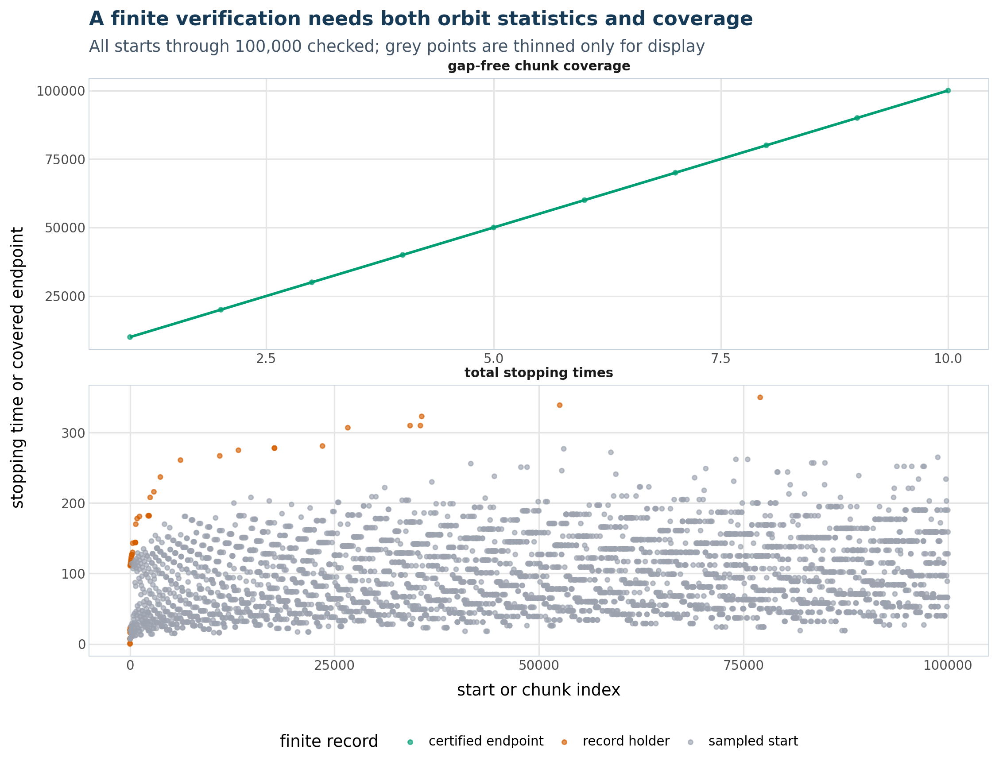

# A reproducible computational laboratory {#sec-laboratory}

## A simple reference iterator

Optimization should begin only after a transparent implementation exists. The
reference algorithm for one $C$-step is:

```text
collatz_step(n):
    require n is an integer and n > 0
    if n is even:
        return n / 2
    return 3*n + 1
```

The precondition is part of the function. Passing zero, a float, or a negative
integer changes the problem. A language with fixed-width integers also needs a
checked multiplication or arbitrary precision.

An orbit summary maintains explicit invariants:

```text
summarize(start, step_limit):
    require start > 0 and step_limit >= 0
    n <- start
    steps <- 0
    peak <- start
    while n != 1 and steps < step_limit:
        n <- collatz_step(n)
        steps <- steps + 1
        peak <- max(peak, n)
    if n == 1:
        return {status: reached_1, steps: steps, peak: peak}
    return {status: step_limit, steps: steps, peak: peak, last: n}
```

The unresolved return is not an exception and not convergence. It is a partial
result with enough state to resume or diagnose.

## Memoization without circularity

A cache can map a value to its known distance to 1. When a new orbit reaches a
cached value, walk backward through the newly collected prefix and assign
distances. Never insert “success” for an unfinished path. During parallel work,
cache writes need synchronization or immutable merging.

For a finite increasing verification, a boolean cache of smaller certified
starts is enough: stop when the current value is below the start and known
covered. The invariant is “every cached key has an independently justified path
to 1.” Caching a value merely because it was seen in another active path creates
a potential dependency cycle.

## Exact statistics

Total stopping time, first descent, peak, and parity vector can be computed in one
pass. Their sentinel values must not collide with genuine results: zero is a
valid total stopping time for start 1. A tagged result or nullable field is safer
than using $-1$ without documentation.

For large tables, stream records to a durable format rather than holding every
orbit in memory. The orbit itself can be streamed because the summary state is
constant-size, but a later altitude plot requires either retained values or a
second deterministic pass. These are resource choices, not mathematical changes.

## Tests before scale

A compact test suite includes:

- $C(1)=4$, $C(2)=1$, and $C(3)=10$;
- the full orbit of 6 from the preface;
- $\tau(27)=111$, $\sigma(27)=96$, and $M(27)=9232$;
- powers of two, whose total stopping times equal their exponents;
- odd values on both sides of a fixed-width overflow threshold;
- equality between one $U$-step and the corresponding expanded $C$ segment;
- a capped run that returns unresolved rather than success;
- empty, singleton, overlapping, and adjacent interval manifests.

Property tests can generate positive odd $n$ and verify that $U(n)$ is odd, that
$3n+1=2^aU(n)$ for the returned $a$, and that $a\ge1$. Cross-checking optimized
tables against direct iteration should include every residue for a small table,
not only random examples.

## A bounded loop has a proof independent of the conjecture

The reference summary algorithm can be justified with an explicit invariant. After j updates, its current value is the jth standard iterate of the original start; its step field is j; and its peak is the largest value among states from time zero through j. The step count lies between zero and the declared budget. Initialisation establishes all four facts because the current and peak values are the start and no update has occurred.

If the loop continues, it performs exactly one defined positive-integer Collatz update. The iteration equation advances the current-value invariant, increasing the count by one preserves its relation to time, and taking the maximum of the previous peak and new value preserves the peak invariant. The remaining budget decreases by one and cannot decrease indefinitely. Thus this bounded procedure terminates even though universal unbounded convergence is open.

On return, an observed current value one justifies a reached-target status. Since the loop would have stopped at any earlier one, the count is the first-arrival time. Otherwise exhaustion justifies an unresolved status together with the observed prefix and peak. It does not prove an infinite stopping time. The final target check has priority when an arrival occurs on the last permitted update. These are mathematical postconditions; no execution of a listing is being claimed here.

The same invariant can record first descent without using it as the loop's target. Until a descent field is set, every observed positive-time state is at least the original start. At the first state below it, store the current count and never overwrite it. That establishes minimality of the stored descent time. Continuing to one may then determine total stopping time as well. If the budget ends first, either, both or neither event field can be known, depending on the trace.

## Cache correctness includes the meaning of the cached statistic

Suppose a cache entry states the exact first-one distance of a value. Its invariant needs a proof of that distance, not merely a mark that the value was seen. A new exact orbit prefix may stop when it reaches such an entry, provided no earlier state in the prefix has already reached one. Joining the recorded prefix to the certified tail supplies a path to one. The absence of an earlier one in the prefix and the cached tail's first-arrival property prove that the sum of the two lengths is the correct total stopping time.

Walking backwards through the prefix can assign those lengths to its earlier vertices. Each assignment is justified by the same concatenation argument. An unfinished or actively explored prefix has no certified terminal tail and must not acquire success entries merely because it intersects another active prefix. An ordinary finite dependency cycle supplies no terminal reason. A strictly decreasing rank or a completed path to a trusted base supplies the well-founded argument instead.

A cache of total times is insufficient for every statistic. If a traversal skips a cached tail and wants the full peak, the cache must also contain a justified tail maximum or equivalent information; the prefix maximum alone can miss a later larger value. To obtain the earliest crossing below an arbitrary original start, a cached distance to one does not give the order and values of the tail's intermediate states. The implementation may need additional threshold information or a new traversal. A parity-word request similarly needs ordered branch data rather than just a length.

Thus memoisation is a specification transformation. State which observations the cached summary preserves and which it discards. A speed improvement that silently returns another statistic changes the mathematical output. The correct cache interface follows the requested contract, not simply the fact that all outputs relate to the same orbit.

## Resource bounds have units too

A fixed number of summary fields is not constant bit memory. The current state, peak and count are integers whose bit lengths can grow. Arbitrary-precision arithmetic avoids fixed-word overflow while still consuming time and space proportional to the operands and the chosen algorithms. A statement counting map updates must therefore be distinguished from a statement counting bit operations or allocated bytes.

Retaining an entire prefix uses one stored value per visited state, while a summary can retain only selected quantities. A later plot or complete replay may need the omitted ordered values. Recomputing them from a saved start under the same exact map is a possible design, but it has a new finite work cost and must use the same cap and event convention. A checksum of a prior file cannot substitute for recreating or retaining values needed by a mathematical claim.

Checkpoint records likewise need the original start, current value, elapsed transitions, observed maximum, known event fields and arithmetic convention. Resuming from only the current value loses elapsed time and the earlier peak. A resume proof treats the saved record as an initial state satisfying the same loop invariant. If that invariant is unverified, continuing the calculation does not retrospectively establish it.

## Read the laboratory as a specification before running it

The existing commands and listings describe an intended laboratory workflow. This source edition does not claim that they were executed again, that the inherited figures were regenerated or that a new suite passed. Mathematical invariants can be analysed on paper before those separate activities. A reader should retain the distinction when recording what evidence supports a finite result.

Exploration may deliberately choose a small sample or stop an interesting trajectory early. The bounded loop then still has a valid prefix postcondition. Certification asks for a stronger domain and coverage statement, and needs enough retained evidence to support it. The difference lies in the quantified claim and postcondition, rather than the visual polish of the notebook or report.

## Deterministic figures

This book's `figures.py` regenerates all plotted assets with a fixed seed,
explicit finite ranges, a color-blind-conscious palette, and high-resolution
PNG output. Each public function is typed, validates its inputs, and separates
orbit calculations from file output. The primary drawing layer is plotnine.

Run it from the book directory with writable caches:

```bash
MPLCONFIGDIR="$(mktemp -d)" \
XDG_CACHE_HOME="$(mktemp -d)" \
python figures.py
```

The script creates the `figures/` directory if needed, reports every saved file,
and refuses invalid starting values. Because the data are generated locally,
none of the figures depends on a network service. Random-walk comparisons alone
use pseudorandomness, and their seed is constant.

## Separating exploration from certification

An exploratory notebook can change parameters interactively, omit slow cases,
and focus on surprising examples. A certificate generator must be deterministic,
complete for its declared domain, and strict about failures. Keeping the two
roles separate prevents a plotting convenience—such as silently dropping a
nonfinite row—from entering a verification claim.

A useful pipeline is:

```text
specification -> reference implementation -> tests
              -> optimized implementation -> cross-checks
              -> range manifest -> run logs -> certificate audit
              -> derived tables -> figures and prose
```

Each arrow should have an artifact or check. A final PDF is presentation, not the
raw certificate.

## Capstone: a small auditable verifier

Verify every start in $[1,2^{20})$. Use half-open chunks, arbitrary-precision
reference arithmetic, and a downward-descent certificate. Export one row per
chunk with endpoints, count, largest observed peak, longest stopping time,
completion status, runtime, and a hash of the detailed result. Have a second
program verify coverage and replay all record setters plus a deterministic sample
from each chunk.

The final report should distinguish:

- the mathematical invariant making descent sufficient;
- the tested finite proposition;
- software and hardware details;
- checks performed independently;
- unresolved risks;
- why the result says nothing directly about $n\ge2^{20}$.

## Visual checkpoint: statistics require coverage

<figure id="fig-collatz-laboratory-coverage">


<figcaption>

Figure 15.1: Stopping-time records are paired with a gap-free finite coverage ledger.

</figcaption>
</figure>

The lower panel of [Figure 15.1](#fig-collatz-laboratory-coverage) is as important as the
upper one. Interesting records describe the computation only after interval
coverage, conventions, arithmetic, and failure reporting have been audited.

<!-- inline-formula-code:start -->
## Formula and finite computation

A useful formula in this chapter is

$$
n_{k+1}=C(n_k)
$$

A bounded loop returns both the visited orbit and its termination status. The following standalone Python block expresses that finite rule with its inputs and stopping conditions visible.

```python
def collatz_orbit(start: int, max_steps: int = 10_000) -> tuple[list[int], bool]:
    """Return an orbit prefix and whether it reached one within max_steps."""
    if start <= 0 or max_steps < 0:
        raise ValueError("start must be positive and max_steps nonnegative")
    orbit = [start]
    for _ in range(max_steps):
        if orbit[-1] == 1:
            return orbit, True
        current = orbit[-1]
        orbit.append(current // 2 if current % 2 == 0 else 3 * current + 1)
    return orbit, orbit[-1] == 1

orbit, reached_one = collatz_orbit(27)
print(len(orbit) - 1, max(orbit), reached_one, orbit[-5:])
```

**What the computation establishes.** The calculation checks a declared finite instance; the surrounding argument explains what is true beyond those inputs.
<!-- inline-formula-code:end -->

## Chapter summary

A reproducible laboratory validates inputs, uses transparent reference code,
stores completion status, avoids circular caches, tests edge cases, and records
provenance. Exploration discovers patterns; certification supports finite
theorems. This book's figures follow the same deterministic discipline.

## Exercises

<div class="exercise" id="collatz-laboratory-two-events">
<p class="exercise-title"><strong>Exercise 1</strong></p>

Extend the pseudocode contract to return first descent and first-one time without confusing their stopping conditions.

<details class="hint"><summary>Hint 1</summary>

First descent is relative to the original start.

</details>

<details class="hint"><summary>Hint 2</summary>

Only set its field on the first qualifying positive-time state.

</details>

<details class="solution"><summary>Solution</summary>

Keep separate optional fields. After each update, if no descent has been stored and the new value is below the original start, store the current transition count. Stop on one or budget exhaustion, with target detection taking priority. A reached-one record has an exact first-one time; a capped record leaves it absent. The invariant states that an absent descent field means no observed earlier qualifying state, while a stored field is the least observed such time. At start one total time is zero and first descent is outside the chapter definition.

</details>

</div>

<div class="exercise" id="collatz-laboratory-cache-invariant">
<p class="exercise-title"><strong>Exercise 2</strong></p>

Describe a memoisation cycle and the invariant preventing it.

<details class="hint"><summary>Hint 1</summary>

Two active paths can point at one another without a completed tail.

</details>

<details class="hint"><summary>Hint 2</summary>

Seen and certified have different meanings.

</details>

<details class="solution"><summary>Solution</summary>

If two unfinished paths each receive success because they reach the other, neither has a base proof. Require every cached success to have a completed path to one or a dependency on a smaller rank already justified. Induction on rank propagates the proof and excludes cycles. For an exact cached distance, also retain the first-arrival meaning and avoid an earlier one in the new prefix. No actual active-path execution is supplied by this paper explanation.

</details>

</div>

<div class="exercise" id="collatz-laboratory-odd-properties">
<p class="exercise-title"><strong>Exercise 3</strong></p>

State five mathematical properties for the odd-to-odd map that a future implementation must preserve. No executable tests are supplied.

<details class="hint"><summary>Hint 1</summary>

Include the domain, removed factor and endpoint.

</details>

<details class="hint"><summary>Hint 2</summary>

Equality with an expanded standard segment checks the convention.

</details>

<details class="solution"><summary>Solution</summary>

For positive odd input, the returned valuation is a finite integer at least one; the returned state is positive; it is odd; multiplying that state by the removed power of two reconstructs three times the input plus one; and one odd standard update followed by exactly that many halvings reaches the returned state. These are proof obligations under the definition. A software comparison can investigate implementation errors, but the properties and their hypotheses must first be specified and do not constitute performed tests here.

</details>

</div>

<div class="exercise" id="collatz-laboratory-seed-scope">
<p class="exercise-title"><strong>Exercise 4</strong></p>

Explain why a fixed seed helps reproducibility but does not validate a flawed probabilistic model.

<details class="hint"><summary>Hint 1</summary>

A seed selects a repeatable pseudorandom stream.

</details>

<details class="hint"><summary>Hint 2</summary>

It does not establish independence of arithmetic valuations.

</details>

<details class="solution"><summary>Solution</summary>

A fixed seed makes a specified simulation repeatable under its generator and environment. It does not prove that the simulated law represents actual Collatz starts, that conditioning is handled correctly or that shared tails are independent observations. The model and arithmetic transfer need separate arguments. Reproducing the same simulated picture can reproduce the same modeling mistake. The source retains its seed convention but reports no new simulation run or statistical validation.

</details>

</div>

<div class="exercise" id="collatz-laboratory-partition-condition">
<p class="exercise-title"><strong>Exercise 5</strong></p>

Specify the mathematical condition for a manifest checker to detect gaps and overlaps.

<details class="hint"><summary>Hint 1</summary>

Sort nonempty half-open integer intervals by lower endpoint.

</details>

<details class="hint"><summary>Hint 2</summary>

Compare adjacent endpoints and the target boundaries.

</details>

<details class="solution"><summary>Solution</summary>

Require the first lower endpoint to equal the target lower bound, every upper endpoint to equal the next lower endpoint, and the last upper endpoint to equal the target upper bound. Each interval must have integer endpoints and a stated empty-interval policy. A gap violates coverage and an overlap violates uniqueness. These equations prove a partition independently of a row total. A prospective checker must verify them and the associated completion records; no checker is implemented or run by this answer.

</details>

</div>

<div class="exercise" id="collatz-laboratory-capstone-specification">
<p class="exercise-title"><strong>Exercise 6</strong></p>

For the unchanged verifier capstone, state what a complete submission would need, while keeping its execution unclaimed here.

<details class="hint"><summary>Hint 1</summary>

Separate the mathematical theorem from its finite computational component.

</details>

<details class="hint"><summary>Hint 2</summary>

A presented report cannot substitute for missing artifacts.

</details>

<details class="solution"><summary>Solution</summary>

The submission needs the exact bounded claim, proof of the descent and dependency invariant, source and environment information, a complete half-open range partition, honest per-shard statuses, exact-arithmetic evidence, retained detailed certificates or traces, and independent arithmetic and coverage evidence when actually performed. Its report must distinguish authored expectations from real run results and retain unresolved failures. The requested implementation and independent audit are activities for the reader; this chapter supplies their specification and claims neither completion nor a new verified range.

</details>

</div>
