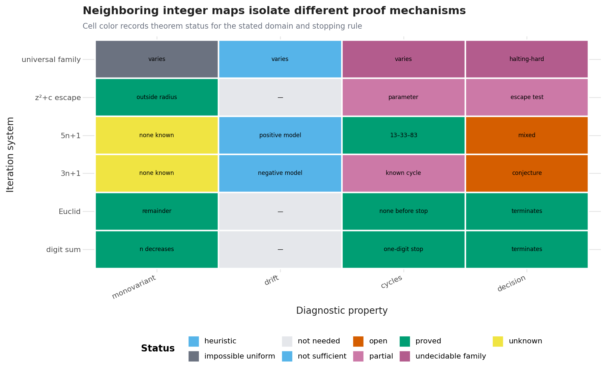

# Generalized Collatz maps {#sec-generalized}

## Changing the coefficients

The classical odd branch belongs to a family. For odd $n$, one can study

$$
U_{a,b}(n)=\frac{an+b}{2^{\nu_2(an+b)}},
$$

where $a$ and $b$ are positive odd integers, so $an+b$ is positive and even for positive odd n. Signed parameter variants need an explicit domain excluding zero numerators and any states outside their intended space. The original odd-to-odd
map has $(a,b)=(3,1)$. Small coefficient changes can produce visible cycles,
stronger upward drift, or immediate pathologies. Behavior in a neighboring
parameter does not transfer automatically to $3n+1$.

The heuristic logarithmic drift becomes

$$
\log a-\mathbb E[\nu_2(an+b)]\log2.
$$

When residue counting gives a geometric valuation with mean 2, the sign changes
near $a=4$. This helps explain why $3n+1$ appears contractive in a random model
and $5n+1$ appears expansive. It does not classify every orbit for either map:
additive terms, residue restrictions, and exceptional valuation sequences remain.

## Piecewise-affine maps on residue classes

A broader generalized Collatz map fixes a modulus $m$ and assigns an affine rule
to each residue class:

$$
F(n)=\frac{a_r n+b_r}{d_r}
\quad\text{when }n\equiv r\pmod m,
$$

with coefficients chosen so that the result is integral on that class. This
framework can encode state in residues. Iteration then resembles a small program:
the current residue selects an instruction, the affine update changes both value
and future state, and repeated steps can simulate control flow.

The classical map is a particularly simple two-branch member. A theorem about
the whole broad family may say little about this fixed member, just as the
undecidability of arbitrary computer programs does not make the behavior of one
specified three-line program undecidable.

## Conjugacies and conventions

Map conventions can sometimes be related by acceleration: one iterate of $U$
equals a variable number of $C$ iterates. A genuine conjugacy is stronger. Maps
$F$ and $G$ are conjugate when there is a bijection $\phi$ with

$$
\phi\circ F=G\circ\phi.
$$

Conjugacy transports full dynamics, including cycles and orbit structure.
Acceleration usually preserves reachability of a target but changes time and
intermediate peaks. Calling an acceleration a conjugacy without constructing a
bijection overstates the relation.

On the 2-adic integers, parity vectors give coordinates in which the shortcut
map relates closely to a shift. Positive integers occupy a special subset of the
2-adic space. An orbit result proved for arbitrary 2-adic points need not imply a
result about positivity or ordinary size, because 2-adic closeness measures
divisibility rather than magnitude.

## Easy cycles and escape

Generalized maps are a laboratory for testing arguments. If a proof uses only
formal parity independence and negative expected log drift, ask whether the same
argument would “prove” convergence for a parameter where a nontrivial cycle is
known. If it does, the proof has ignored arithmetic structure.

Conversely, a map with positive heuristic drift can still have many convergent
orbits or small cycles. Average drift describes a sampled model, not a complete
functional graph. Counterexamples in nearby families are valuable because they
identify which coefficient-specific facts a valid $3n+1$ proof must exploit.

## Undecidability context

Conway constructed generalized iteration systems capable of unpredictable,
computation-like behavior ([Conway 1972](d-bibliography.md#ref-conway1972)). Later work formalized a natural
generalized Collatz problem as recursively undecidable, indeed at a precise level
of the arithmetical hierarchy ([Kurtz and Simon 2007](d-bibliography.md#ref-kurtzsimon2007)). There is no algorithm that takes
an arbitrary map from that broad class and always decides the associated universal
termination question.

<div class="callout callout-warning">
<p class="callout-title">No undecidability result for the classical conjecture</p>

These theorems concern a family in which the map itself is part of the input.
They do not prove that the fixed $3n+1$ conjecture is undecidable, independent of
a standard axiom system, or unprovable. The classical conjecture remains an open
mathematical statement.

</div>

The distinction is quantificational. “For every program-like map, decide whether
all inputs halt” is an algorithmic meta-problem. “Does this one explicit map send
every positive integer to 1?” is one yes-or-no proposition. An undecidable family
can contain many easy individual cases.

## Why study generalizations?

Generalizations serve at least four purposes. They expose robust mechanisms such
as residue coding. They supply counterexamples to overly generic proof strategies.
They connect number-theoretic dynamics with computability. Finally, contrasting
parameters may reveal the special arithmetic needed for a future classical
proof. Their value depends on returning carefully to the original map rather
than treating family-level complexity as a conclusion about it.

## Domain and integrality precede dynamical interpretation

The positive odd coefficient convention gives a closed odd-to-odd map: the numerator is a positive even integer, its valuation is finite, and dividing by its exact power of two leaves a positive odd integer. These three obligations are separate. If a signed coefficient choice makes a numerator zero, the finite valuation in this definition is undefined. If it makes a negative numerator, a signed extension may still be studied, but it no longer gives the same positive-state contract. A logarithm used to discuss real growth also requires a positive argument.

For a general residue-affine branch, integrality on an entire class has a precise arithmetic criterion. Let the class be r modulo positive m and the denominator positive d. Substituting an arbitrary class member gives numerator a times r plus b, plus a times m times the class parameter. The quotient is integral for every member exactly when d divides both the base numerator and a times m. Sufficiency follows by divisibility of both terms. For necessity, compare two successive positive members: their quotient difference forces d to divide a times m; substituting that fact back forces divisibility of the base numerator.

Positivity is another condition. A negative slope numerator eventually sends large positive class members to negative values and cannot define a self-map of all positive members. A zero slope requires a positive constant result. For a positive slope, it suffices to check the least positive member of the class, since the numerator then increases with the parameter. When r is zero, that least positive member is m, not zero. These conditions describe a family of total maps rather than leaving domain exits hidden inside a trajectory.

The same care belongs in a finite listing. The code below uses positive odd coefficients and integer parameters, keeping every displayed state inside the positive domain. A broader signed experiment should use another declared interface and record a domain exit or undefined valuation explicitly. Its results cannot silently be pooled with this positive family.

## The geometric prediction has coefficient hypotheses

For odd a and b, the congruence a times n plus b equal to zero modulo a power of two has one residue root at each depth, since a is invertible modulo that modulus. Its root is odd because b is odd. The two-lift argument from the congruence chapter then yields the same finite valuation frequencies and unresolved tail bucket as before. This is a statement about the first update under a specified residue sampling law, independent of any claim about repeated sampling along one orbit.

For positive coefficients and state, the exact odd-step logarithmic increment is the logarithm of a plus b divided by the state, minus the valuation times the logarithm of two. Splitting off the logarithm of a leaves a positive correction tending to zero at large states. Replacing that correction by zero and replacing the actual valuations by independent geometric variables gives the displayed mean log prediction. The symbolic derivation explains which parts are exact and which are model substitutions.

Neither sign of the predicted mean classifies the full arithmetic functional graph. A cycle can coexist with an expansive random model, and a contractive mean can leave exceptional arithmetic sequences. To transfer a result between coefficient choices, identify the exact premise involving the coefficients and prove it after substitution. Similar-looking branch syntax supplies no such transfer on its own.

## What a genuine conjugacy transports

Suppose a bijection between two declared state spaces intertwines their maps in one step. Induction gives the same intertwining at every finite iterate. The base case uses the identity iterate; the next case applies the one-step equation after the induction hypothesis. Injectivity of the coordinate change then makes a return after k steps equivalent in the two systems. All positive return times agree, so the least period agrees as well. The image of a target basin is the basin of the image target.

These are iteration statements using one step on each side. Acceleration instead replaces one update by a finite block whose length can depend on the current state. Its expanded duration is the sum of those block lengths, so least periods and first-arrival counts need not match the original clock. Reachability can still be equivalent when every block is finite and the initial reduction and target convention are proved. That is a different theorem from a conjugacy.

A bijection need not preserve ordinary numerical order, distance, a probability measure or the printed size of a state. Such observations transport only after defining their corresponding observables or pushed-forward measures. Thus a topological or symbolic coordinate system may preserve the orbit relation perfectly while failing to control ordinary positive-integer height. Naming the state space and observable prevents this change of question from being concealed in the word equivalent.

## Three levels of computability questions

A family-level decision problem takes a map description as input. An undecidability theorem rules out one algorithm that always answers the specified question for every permitted description. It does not say that every description is difficult, and it does not determine the answer for the classical coefficients. The original citations above concern such explicitly generalised systems; their scope is retained.

A different uniform problem fixes one map but allows the starting state to vary. Such a problem can still carry computational complexity: a fixed program-like system may encode different instances in its inputs. Transferring an undecidability theorem to that setting needs a reduction that maps each source instance to a start of the fixed system and proves the required equivalence. Simply observing that the map looks like a short program is not that reduction.

Finally the classical universal conjecture is one sentence about one specified map and all its positive starts. Claiming its independence requires a named axiom system and an argument about provability and refutability in that system. Absence of a known proof is weaker than such a metatheorem. Keeping the map-description variable, starting-input variable and fixed sentence separate avoids both overstating the generalised results and dismissing the genuine complexity of fixed-map input families.

## Visual checkpoint: neighboring affine maps behave differently

<figure id="fig-collatz-generalized-neighboring-maps">


<figcaption>

Figure 16.1: Several neighboring integer maps have different finite drift and orbit behavior.

</figcaption>
</figure>

[Figure 16.1](#fig-collatz-generalized-neighboring-maps) prevents the phrase “Collatz-
like” from hiding the coefficients. Small changes can create obvious cycles,
escape, or contraction; a mechanism for one map does not transfer until its
algebraic hypotheses are checked.

<!-- inline-formula-code:start -->
## Formula and finite computation

A useful formula in this chapter is

$$
T_{a,b}(n)=\begin{cases}n/2&2\mid n,\\an+b&2\nmid n,\end{cases}
$$

Parameters make the generalized branch rule explicit without assuming Collatz behavior. The following standalone Python block expresses that finite rule with its inputs and stopping conditions visible.

```python
def generalized_orbit(start: int, odd_multiplier: int, odd_offset: int, steps: int) -> list[int]:
    if any(type(value) is not int for value in (start, odd_multiplier, odd_offset, steps)):
        raise TypeError("all parameters must be integers")
    if start <= 0 or steps < 0:
        raise ValueError("require a positive start and nonnegative step bound")
    if odd_multiplier <= 0 or odd_multiplier % 2 == 0 or odd_offset <= 0 or odd_offset % 2 == 0:
        raise ValueError("the positive odd-branch family requires positive odd coefficients")
    orbit = [start]
    for _ in range(steps):
        value = orbit[-1]
        orbit.append(value // 2 if value % 2 == 0 else odd_multiplier * value + odd_offset)
    return orbit

print(generalized_orbit(7, 5, 1, 14))
```

**What the computation establishes.** The output certifies only the declared finite case. The theorem, if one is claimed, still requires the argument developed in the chapter.
<!-- inline-formula-code:end -->

## Chapter summary

Affine coefficient changes and residue-class programs create a wide landscape of
Collatz-like dynamics. Acceleration, conjugacy, and 2-adic extension are distinct
operations. Generalized termination problems can be undecidable, but that fact
does not settle or classify the fixed $3n+1$ conjecture.

## Exercises

<div class="exercise" id="collatz-generalized-five-one">
<p class="exercise-title"><strong>Exercise 1</strong></p>

Define $U_{5,1}$ and calculate its first five odd-to-odd steps from three.

<details class="hint"><summary>Hint 1</summary>

Remove every factor of two after each odd multiplication.

</details>

<details class="hint"><summary>Hint 2</summary>

The expanded values at three and one are sixteen and six.

</details>

<details class="solution"><summary>Solution</summary>

The map sends odd positive n to $(5n+1)/2^{\nu_2(5n+1)}$. Starting at three gives the states three, one, three, one, three, one through five transitions. At three the removed exponent is four; at one it is one. This is an exact two-cycle for the neighbouring map and not a classical Collatz cycle. It also illustrates why the positive model drift for coefficient five does not classify every orbit.

</details>

</div>

<div class="exercise" id="collatz-generalized-model-drift">
<p class="exercise-title"><strong>Exercise 2</strong></p>

Compare heuristic log drift for coefficients three and five under the geometric valuation model.

<details class="hint"><summary>Hint 1</summary>

Use mean valuation two.

</details>

<details class="hint"><summary>Hint 2</summary>

Retain the words under the model.

</details>

<details class="solution"><summary>Solution</summary>

The mean leading log increment is log of a divided by four. For a equal to three it is negative, and for five positive. This calculation uses the geometric law and ignores the finite-state additive correction. It is not a pointwise inequality along every actual orbit. A comparison of coefficients is useful only with its sampling and approximation assumptions retained.

</details>

</div>

<div class="exercise" id="collatz-generalized-acceleration">
<p class="exercise-title"><strong>Exercise 3</strong></p>

Give an acceleration changing step count while preserving target reachability.

<details class="hint"><summary>Hint 1</summary>

Compare the standard and odd-to-odd traces from an odd start.

</details>

<details class="hint"><summary>Hint 2</summary>

Expand every valuation block into finitely many standard transitions.

</details>

<details class="solution"><summary>Solution</summary>

From three, the standard trace reaches one in seven transitions, while the odd trace three, five, one takes two. Each odd transition expands to one multiplication-and-addition followed by its finite number of halvings. Joining the blocks proves the same arrival question, with different clocks and omitted intermediate peaks. This is a reachability translation, not an asserted one-step conjugacy of the two declared state spaces.

</details>

</div>

<div class="exercise" id="collatz-generalized-conjugacy">
<p class="exercise-title"><strong>Exercise 4</strong></p>

Explain the difference between conjugacy and acceleration.

<details class="hint"><summary>Hint 1</summary>

A conjugacy uses a bijection and one step on each side.

</details>

<details class="hint"><summary>Hint 2</summary>

Acceleration uses a state-dependent block duration.

</details>

<details class="solution"><summary>Solution</summary>

A conjugacy intertwines the maps through a bijection, and induction preserves each finite iterate and every return time. Acceleration contracts finite orbit blocks, so reachability may correspond while periods and statistics change. Its equivalence requires finiteness and target conventions for the blocks. A bijection alone also need not preserve numerical heights or a chosen probability measure; those observables require their own transported definitions.

</details>

</div>

<div class="exercise" id="collatz-generalized-quantifiers">
<p class="exercise-title"><strong>Exercise 5</strong></p>

State the quantifier difference between generalised undecidability and the classical conjecture.

<details class="hint"><summary>Hint 1</summary>

Identify which description or input varies.

</details>

<details class="hint"><summary>Hint 2</summary>

Independence needs a named proof theory.

</details>

<details class="solution"><summary>Solution</summary>

The generalised decision theorem excludes a uniform algorithm on a class of map descriptions for the stated termination predicate. The classical conjecture is one universal sentence about one fixed map. A fixed-map problem varying the start is yet another uniform input family and would need its own reduction. None of these distinctions supplies an independence theorem for the classical sentence. The cited generalised result must keep its actual input class and predicate.

</details>

</div>

<div class="exercise" id="collatz-generalized-project-scope">
<p class="exercise-title"><strong>Exercise 6</strong></p>

For the unchanged finite comparison project, state a mathematically complete reporting contract without claiming a search was performed.

<details class="hint"><summary>Hint 1</summary>

Declare coefficients, range, clock and cap.

</details>

<details class="hint"><summary>Hint 2</summary>

An unresolved finite prefix is not proved escape.

</details>

<details class="solution"><summary>Solution</summary>

A report names each positive odd coefficient pair, the starting population, iteration convention, transition budget, arithmetic model and all completion or repetition statuses. A stored exact return can be replayed as a cycle certificate with its least period and domain; a capped increasing trace is only an escape-like finite observation. The geometric drift is separately labeled a model prediction. Retain every unresolved input rather than silently omitting it. Actual code, runs and independent checks belong to a completed reader project and are not supplied or claimed by this source answer.

</details>

</div>
