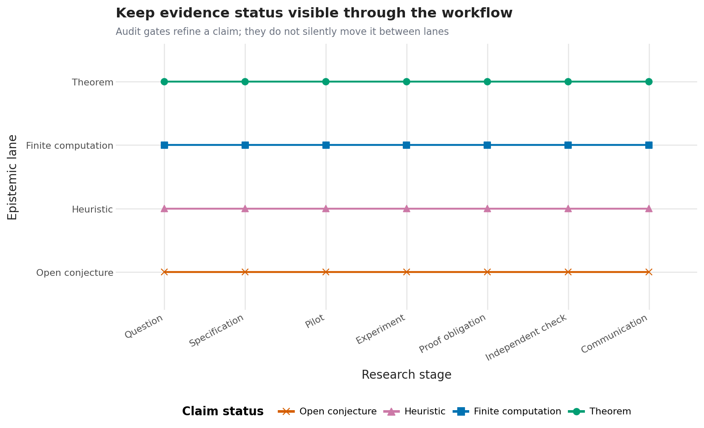

# Diagnosing proof attempts {#sec-proof-attempts}

## Why attractive arguments fail repeatedly

Collatz proof attempts tend to fail at the bridge from finite or average behavior
to one universal statement. The local algebra may be correct. The defect appears
when an exceptional residue class, an additive term, a quantifier, or an
induction dependency is dropped. A useful review therefore identifies the first
unsupported implication rather than merely labeling the whole attempt wrong.

No purported proof should be amplified because it is new, long, or
computer-formatted. Check whether specialists have validated it, whether the
venue uses mathematical peer review, and whether the precise theorem is the
classical positive-integer claim. Preprints and repositories establish
availability, not correctness.

## Failure 1: extrapolating a finite pattern

**Attempt.** Every residue modulo $2^{20}$ descends in the tested sample, so the
pattern continues for all higher bits.

**Defect.** A residue fixes only 20 shortcut parity decisions. Integers sharing
the residue can diverge later, and checking one representative is not a uniform
affine certificate.

**Repair target.** Derive a symbolic iterate that is below the start for every
member of each class, or supply a well-founded refinement proof that covers every
infinite path.

## Failure 2: making parity independent

**Attempt.** Odd and even shortcut steps are fair independent coins, so negative
expected logarithmic drift proves every orbit descends.

**Defect.** The map is deterministic; independence holds for finite parity words
when starts range uniformly over complete residue blocks. It does not hold as a
universal law along one fixed infinite orbit. A counterexample may be an
exceptional parity sequence of probability zero in the model.

**Repair target.** Prove an arithmetic mixing or discrepancy estimate with
quantifiers strong enough for the desired conclusion. Tao's theorem performs a
deep version under logarithmic averaging and accordingly obtains a density
result, not a universal one.

## Failure 3: averaging away exceptions

**Attempt.** Since the average multiplier is below one, no orbit can diverge.

**Defect.** An average over starts does not bound each start. Even a density-one
property can fail on infinitely many integers. Moreover, ordinary and logarithmic
averages give different answers for multiplicative processes.

**Repair target.** Establish a pointwise Lyapunov function $V$ satisfying a strict
descent condition along every nonterminal orbit, or control the exceptional set
by a separate exhaustive argument. No such global function is currently known.

## Failure 4: circular induction

**Attempt.** Assume all integers below $n$ converge. Transform $n$ to a simpler
integer $m$ and invoke induction.

**Defect.** Unless $m<n$, ordinary strong induction says nothing. “Simpler” may
mean fewer digits, a preferred residue, or a shorter observed orbit, none of
which is automatically a well-founded rank.

**Repair target.** Exhibit a rank into a well-ordered set that strictly decreases
at every dependency and prove that rank descent implies the required orbit
relation. For the standard stopping-time route, the rank is simply numerical
size and the needed fact is $C^j(n)<n$.

## Failure 5: dropping integrality or admissibility

**Attempt.** Solve the cycle equation for a favorable ratio of odd and even
steps, then treat the formal solution as a cycle.

**Defect.** The slope condition alone does not supply the word-dependent offset or an integral closure value. An incorrectly derived branch row may have incompatible parities; a return can repeat a shorter period or lie outside the positive domain. For a correctly derived word of the exact shortcut map, the integrality lemma in Chapter 8 proves that positive integral closure already supplies all intermediate parities. Those are not an additional obstruction in that specific setting.

**Repair target.** Check divisibility, positivity, every branch condition, closure,
and primitive period. A necessary multiplier inequality is only the first sieve.

## Failure 6: excluding only cycles

**Attempt.** Prove that the known cycle is the only positive cycle and conclude
that every orbit reaches it.

**Defect.** A nonrepeating orbit could tend to infinity. Functional graphs can
have cycle components and infinite escaping rays.

**Repair target.** Pair cycle exclusion with a theorem that every orbit is
bounded or has a repeated value. No such universal boundedness theorem is known.

## Failure 7: changing conventions

**Attempt.** Count one odd-to-odd transition as one step in the premise but use
an unaccelerated stopping-time bound in the conclusion.

**Defect.** Acceleration changes step counts, parity strings, peaks, and cycle
lengths. A qualitative reachability statement may survive translation while the
quantitative inequality does not.

**Repair target.** Define every map and construct an explicit translation for
each statistic used.

## A responsible review checklist

For any claimed proof, ask:

1. Is the exact map, domain, and target stated?
2. Where are universal and existential quantifiers introduced?
3. Does every induction edge strictly decrease a proved rank?
4. Are affine additive terms retained until legitimately bounded?
5. Are parity words shown admissible?
6. Is an average or density claim being promoted to a pointwise claim?
7. Are finite computations accompanied by complete coverage and safe arithmetic?
8. Are cycles and escape both addressed?
9. Does a cited theorem actually have the quoted conclusion?
10. Has independent expert review occurred?

An unsupported mathematical implication makes the presented proof incomplete without proving its final conclusion false. A proof and an assessment of that proof are distinct; neither the presence nor the absence of assessment replaces the argument itself.

## Workshop

Take the sentence “Because $3/4<1$, every two Collatz steps reduce the number.”
For an odd $n$, two unaccelerated steps give $(3n+1)/2$, approximately $3n/2$,
which is larger, not smaller. Under the odd-to-odd model, $3/4$ is an expected
log-scale effect after a random number of divisions, not a fixed two-step
multiplier. Repairing the sentence requires both a map convention and a
probabilistic qualifier; it cannot become a universal theorem by algebra alone.

## Reconstruct the judgement before diagnosing the gap

A proof claim has a domain, assumptions and conclusion. First recover those exactly. A manuscript may correctly prove a finite statement while its headline asserts universal convergence. In that case the proof of the finite statement need not be defective; the unsupported step is the promotion to a broader conclusion. Preserving the valid part makes the criticism more precise and can leave a useful lemma or certificate.

Track where arbitrary inputs are introduced and where witnesses depend on them. A proof of universal eventual arrival may choose a different time for each start. It need not supply one common time, and a reviewer should not impose that stronger demand. Conversely, a finite calculation for one chosen start cannot be followed by declaring that start arbitrary unless every step was valid uniformly. The dependency of a time, threshold or residue depth is part of the claim.

Classical proof and computational efficiency are separate too. A valid argument establishing existence of a hitting time need not provide a practical closed-form bound. If it proves every start eventually reaches one, direct iteration then has a proved totality property, even if its runtime is enormous. Demanding an efficient algorithm is stronger than the conjecture. A sound review should reject missing premises while avoiding requirements the asserted theorem does not need.

## Use stronger established lemmas when they actually apply

The shortcut integrality lemma is an example of a useful bridge that must not be ignored. For an accurately composed finite shortcut word, an integral final value forces the prescribed intermediate parities. Positive integral closure therefore gives a genuine positive return. Calling such a candidate “possibly parity inadmissible” would contradict the proved lemma, not expose a new flaw. A replay can still inspect a coefficient transcription or implementation, which is a different evidential role.

This conclusion has exact hypotheses. The word must use the specified shortcut branches in chronological order, with its actual offset and denominator. A mere ratio of odd counts does not provide those data. A different encoding, such as blocks recording exact odd-to-odd valuations, must satisfy its own conditions; the shortcut lemma should not be transferred by a change of notation alone. Matching theorem hypotheses is a task for both the proposed proof and its critic.

Similarly, a successful least-member check can genuinely certify a whole class when the known input depth covers the witness time and the affine monotonicity argument applies. It is not enough to repeat a slogan that representatives never prove classes. The correct question is whether a uniform transfer argument is present. When it is, that argument should be retained rather than discarded because its discovery used computation.

## An infinite symbolic path need not be a positive counterexample

Finite residue classes form a branching structure, but an infinite compatible path naturally describes a 2-adic point. It need not describe a positive ordinary integer. The all-one path discussed earlier is realised by negative one, while every finite prefix has positive representatives. Thus proving or exhibiting an infinite unpruned formal path is not by itself a disproof of positive convergence.

A sufficient coverage lemma can quantify over actual starts instead: every positive integer above one has some finite depth at which its class receives a valid descent certificate. Then every start has a smaller reached value, and strong induction proves the conjecture. The depth can depend on the start. The lemma may equivalently exclude only those infinite unresolved paths realised by positive integers, leaving other symbolic paths irrelevant to the target.

This distinction also limits the repair one should demand. Making the entire abstract refinement tree well founded is stronger than controlling its positive-integer realisations. A uniform finite depth covering every formal path may be impossible because compatible nonpositive symbolic points persist. A proof may use arithmetic information tied to a fixed start rather than a rank attached only to its residue node. The exact proposed rank and domain must be inspected before calling a refinement strategy circular or complete.

## Review status is evidence about a process, not another inference rule

Peer review, independent formal checking and reproducibility can expose errors and strengthen confidence in a manuscript. They do not replace the mathematical argument, and their absence should not be reported as proof that a result is false. Conversely, a venue label or a successful software command cannot repair an unproved implication. Record what was actually reviewed, under which assumptions and source version, rather than treating authority as a new axiom of arithmetic.

When no review or execution has occurred, a source can still present an authored proof, expected computation or proposed experiment with those labels. A later reviewer can inspect the exact judgement and dependencies. The distinction matters particularly for open-problem writing, where a broad assertion can be accidentally manufactured by removing one exceptional-set phrase. Here the chapter offers local diagnostic reasoning and preserves the conjecture's dated open status; it claims no assessment of a newly submitted proof.

## Visual checkpoint: place every claim on the evidence ladder

<figure id="fig-collatz-proof-attempts-claim-ladder">


<figcaption>

Figure 17.1: A claim ladder separates examples, finite certificates, theorems, heuristics, and open statements.

</figcaption>
</figure>

Use [Figure 17.1](#fig-collatz-proof-attempts-claim-ladder) when auditing any proposed proof.
A calculation may be correct yet support only a lower rung than its author
claims. Moving upward requires a valid argument about the new quantifiers, not
more confidence in the same experiment.

<!-- inline-formula-code:start -->
## Formula and finite computation

A useful formula in this chapter is

$$
C(n)<n\quad\text{for every }n>1
$$

A smallest-counterexample search immediately diagnoses this tempting false lemma. The following standalone Python block expresses that finite rule with its inputs and stopping conditions visible.

```python
def collatz_step(number: int) -> int:
    if number < 1:
        raise ValueError("number must be positive")
    return number // 2 if number % 2 == 0 else 3 * number + 1

counterexamples = [number for number in range(2, 30) if collatz_step(number) >= number]
print(counterexamples)
```

**What the computation establishes.** The output certifies only the declared finite case. The theorem, if one is claimed, still requires the argument developed in the chapter.
<!-- inline-formula-code:end -->

## Chapter summary

Most failed proofs cross an unjustified bridge: finite to infinite, average to
pointwise, formal to admissible, or larger to “simpler.” Diagnosis should locate
that bridge, state the missing lemma, and preserve correct local work. Peer review
and exact citation are necessary safeguards against amplifying unverified claims.

## Exercises

<div class="exercise" id="collatz-proof-attempts-first-gap">
<p class="exercise-title"><strong>Exercise 1</strong></p>

Find the first unsupported implication in the seven workshop arguments above.

<details class="hint"><summary>Hint 1</summary>

Separate valid local algebra from a changed quantified conclusion.

</details>

<details class="hint"><summary>Hint 2</summary>

Some proposed missing checks are redundant only when an exact lemma supplies them.

</details>

<details class="solution"><summary>Solution</summary>

The failures respectively promote a finite representative to an unproved class, assume an infinite arithmetic independence law, replace a population mean by a pointwise bound, invoke induction without a smaller justified state, omit the exact word/closure/domain conditions, omit escape, and change clocks without translating the statistic. The cycle case must use the stronger integrality lemma when its hypotheses hold. The first unsupported step should be named; valid preceding calculations need not be rejected.

</details>

</div>

<div class="exercise" id="collatz-proof-attempts-selected-drift">
<p class="exercise-title"><strong>Exercise 2</strong></p>

Construct a deterministic increment sequence with negative long-prefix averages but arbitrarily long positive-drift segments.

<details class="hint"><summary>Hint 1</summary>

Use very long negative blocks followed by shorter but growing positive blocks.

</details>

<details class="hint"><summary>Hint 2</summary>

Let the negative-block lengths dominate the sum of positive-block lengths.

</details>

<details class="solution"><summary>Solution</summary>

At stage j use increments negative two for four to the j terms, then positive one for two to the j terms. Positive blocks grow without bound, giving arbitrarily long rising segments. Across long prefixes the positive count is negligible relative to the negative count, including during the positive block, so the average increment tends to negative two. This is a signed comparison sequence, not a positive Collatz orbit. It illustrates selection of local rising windows and does not contradict the fact that a genuinely uniform negative asymptotic increment bound controls the whole sum.

</details>

</div>

<div class="exercise" id="collatz-proof-attempts-noninteger-cycle">
<p class="exercise-title"><strong>Exercise 3</strong></p>

Give a formal parity word whose cycle equation has no integral solution.

<details class="hint"><summary>Hint 1</summary>

Retain the offset as well as the slope.

</details>

<details class="hint"><summary>Hint 2</summary>

The word `1100` has denominator sixteen.

</details>

<details class="solution"><summary>Solution</summary>

Its row is nine n plus five divided by sixteen. Closure requires seven n equal to five, giving five sevenths, not an integer. Thus no integer cycle realises the word, despite its subunit slope. This is a nonintegrality obstruction. It is not an example of positive integral closure with failed shortcut parities, which the exact lemma excludes.

</details>

</div>

<div class="exercise" id="collatz-proof-attempts-cycle-repair">
<p class="exercise-title"><strong>Exercise 4</strong></p>

Write a circular two-node convergence justification and repair its dependency order.

<details class="hint"><summary>Hint 1</summary>

Two unsupported safety labels can point to one another.

</details>

<details class="hint"><summary>Hint 2</summary>

Replace them with actual segments ending at a smaller already justified input.

</details>

<details class="solution"><summary>Solution</summary>

A purported proof that A is safe because B is safe and B because A is safe has no base. For actual positive starts seventeen and twenty-six, the segments seventeen to fifty-two to twenty-six to thirteen, and twenty-six to thirteen, both end at the smaller thirteen. If thirteen is already certified, both inherit its tail with strictly downward dependencies. The repaired arithmetic segments differ from a fabricated reverse edge; no positive Collatz cycle is asserted by the abstract circular illustration.

</details>

</div>

<div class="exercise" id="collatz-proof-attempts-structural-report">
<p class="exercise-title"><strong>Exercise 5</strong></p>

For the unchanged online-claim project, specify a structural audit without claiming that a source was searched, publicised or reviewed here.

<details class="hint"><summary>Hint 1</summary>

Write the exact theorem before applying the checklist.

</details>

<details class="hint"><summary>Hint 2</summary>

Separate logical gaps from absent external review.

</details>

<details class="solution"><summary>Solution</summary>

An audit records the map, domain, target, quantifiers and assumed lemmas, then follows each proposed inference until the first unsupported step. It identifies whether the gap concerns coverage, arithmetic, probability, rank, cycle closure or escape and states the missing premise precisely. It also records source and review status honestly, without treating no review as a disproof. This is an answer framework for the reader activity, not a completed assessment of an external claim or a message sent to its author.

</details>

</div>

<div class="exercise" id="collatz-proof-attempts-uniform-lemma">
<p class="exercise-title"><strong>Exercise 6</strong></p>

State a sufficient uniform coverage lemma turning shrinking-density residue sieves into universal convergence.

<details class="hint"><summary>Hint 1</summary>

Quantify over every actual positive start.

</details>

<details class="hint"><summary>Hint 2</summary>

The resolving depth may depend on that start.

</details>

<details class="solution"><summary>Solution</summary>

Require that for every positive integer n above one, some finite depth places n in a class with a proved actual descent below n, including its domain, branch precision and strict inequality. This supplies universal finite stopping time and strong induction gives convergence. Shrinking uncovered densities alone do not establish that premise. An equivalent repair can rule out infinite unresolved paths realised by positive integers, while allowing nonpositive 2-adic paths. The lemma exposes the missing pointwise obligation rather than claiming it has been proved.

</details>

</div>
