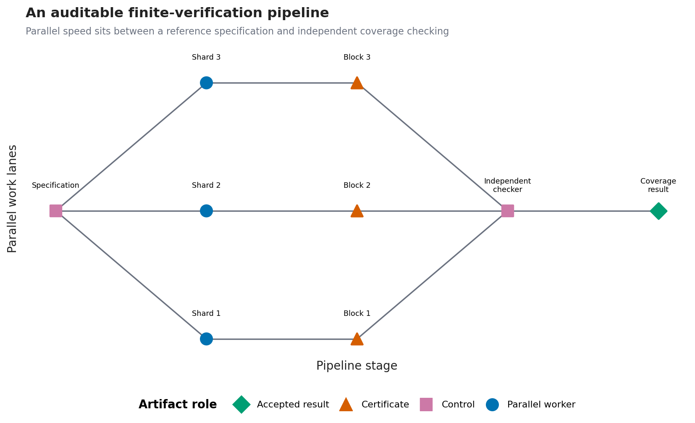

# Closing synthesis: what the elective establishes {#sec-synthesis}

This chapter closes the elective. It gathers the proved arithmetic, the exact limits of finite evidence and the distinctions needed to read the cited partial results. Its research directions point onward to the separate [Collatz Research Toolkit](#/books/collatz-research-toolkit), which states L4 preparation in proof, algebra, probability and algorithms. The elementary rule does not remove those prerequisites from advanced research methods.

## Computation that leaves reusable mathematics

The most valuable large computations produce more than a frontier number.
Compact certificates, independently generated sieves, record tables, and
failure-resistant interval manifests can support later algorithms. A small
checker with a simple correctness argument is preferable to requiring trust in
one enormous optimized executable.

Research questions include how to compress a descent certificate without hiding
dependencies, how to design independently checkable GPU results, and how to
reuse path merging across intervals. These are concrete projects even though no
finite frontier proves the conjecture.

## Sharper symbolic sieves

Parity-vector affine formulas give exact class behavior for finite prefixes.
Possible improvements combine powers-of-two residues with preimage information
modulo 3 or 9, optimize refinement order, or identify families of unresolved
words through automata. A successful paper should state whether it improves
runtime, finite coverage, a density exponent, or a universal bound.

The central theoretical question is not simply whether the uncovered fraction
shrinks, but whether arithmetic rules forbid an infinite nested exceptional
path corresponding to a positive integer. Studying that boundary may reveal an
invariant invisible in raw coverage percentages.

## Inverse growth and arithmetic dynamics

Inverse graphs invite questions about layer growth, residue distribution,
shortest path length to 1, and how paths exit and reenter numerical boxes.
Transfer operators can encode how mass moves between residue classes. Spectral
or ergodic tools may prove averaged contraction while making exceptional
structures explicit.

Any probabilistic formulation should name its measure. Natural-density sampling,
logarithmic weighting, Haar measure on 2-adic integers, and a Markov approximation
answer different questions. A bridge theorem between them is substantive
mathematics, not notation.

## Machine assistance

Computers can enumerate parity words, solve finite inequality systems, search
for invariants, check formal proofs, and discover counterexamples to intermediate
lemmas. Machine learning may rank residue classes or propose candidate Lyapunov
functions. None of these activities changes theorem status.

A responsible machine-assisted workflow keeps a held-out verifier, exports exact
rational certificates, tests candidate claims on adversarial generalized maps,
and submits the final logical object to human and formal review. A model's
confidence score is not evidence that a universal arithmetic proposition is
true.

## Open questions at several levels

**Foundational.** Does every positive integer reach 1? Are there any nontrivial
positive cycles? Does any positive orbit tend to infinity?

**Quantitative.** Can known lower bounds for the basin of 1 be strengthened? Can
natural-density versions of almost-bounded descent be proved at Tao's strength?
Can cycle lower bounds or verified frontiers be improved with reusable
certificates?

**Structural.** What correlations govern long valuation blocks? How do inverse
layers distribute across residue classes? Which arithmetic features distinguish
$3n+1$ from nearby generalized maps with visibly different behavior?

**Methodological.** Can proof assistants verify meaningful sieve reductions?
Which certificate formats make distributed verification independently auditable?
How should negative experimental results be reported so later work can reuse
them?

## Graduated research projects

1. **Foundational:** reproduce every statistic in this book for starts below
   10,000 and compare $C$, $S$, and $U$ conventions.
2. **Intermediate:** build an exact affine stopping-time sieve to depth 20 and
   publish unresolved words with checksums.
3. **Intermediate:** construct inverse layers under both $C$ and $U$, measuring
   the effect of depth versus value truncation.
4. **Advanced:** reproduce a small Krasikov-style difference-inequality system
   and export a machine-checkable rational solution.
5. **Advanced:** formalize the downward-induction certificate for a bounded
   verifier in a proof assistant.
6. **Expository:** prepare a theorem-status map linking each major primary source
   to its exact conclusion and non-conclusion.

Each project report should include definitions, provenance, negative results,
limitations, and a section titled “What this does not prove.”

## The chain of exact ideas developed here

The starting point was a function on a declared domain. Every positive integer has one next standard state, and the known cycle explains what happens after arrival at one. Shortcut and odd-to-odd conventions preserve that arrival question through finite blocks, while changing clocks and omitted values. The translation must be proved before combining statistics from different conventions.

Congruences then supplied finite branch information. The first k shortcut parities are fixed by k low bits, and the two-lift argument proves a bijection between those residues and finite binary words. A word produces an affine expression with a multiplier, offset and power-of-two denominator. The offset records branch order and survives every exact comparison. Keeping it turns a suggestive leading slope into a precise threshold inequality.

Uniform class certificates add the next logical step. A successful representative can establish infinitely many starts when a shared-prefix theorem and monotonicity transfer its inequality to all relevant lifts. A longer unchecked branch destroys that premise. Inverse exploration gives another kind of finite-to-infinite organization: every retained path certifies its own starting node, while the claim that every node is eventually found is the original coverage question in another language.

Cycle equations use the same affine data to describe returns. For an accurately derived shortcut word, positive integral closure is sufficient for an actual return; period and rotations still determine how it is counted. Product inequalities and logarithmic gaps restrict possible counts and minima. Those restrictions can eliminate specified ranges without eliminating every possible cycle. Even complete cycle exclusion would leave nonperiodic escape on the infinite state space.

The probability and density chapters kept different quantifiers visible. Finite word counting supports an exact fair-bit law under a specified finite population. Independent random products illustrate negative logarithmic drift and selection effects. The finite-prefix argument proves density-one descent while permitting exceptional starts. The cited almost-bounded theorem uses deeper arithmetic mixing under logarithmic averaging. Neither replaces a pointwise premise merely by having a small exceptional proportion.

## Two sufficient routes remain conditional

One complete route would prove that every positive start above one eventually reaches a smaller positive value. Strong induction then joins successful smaller tails. No common time bound is needed; the descent time can depend on the start. The earlier chapters prove this implication and many local descent families, while leaving the universal descent premise unproved.

Another route would prove that every positive orbit is bounded and that the known cycle is the only positive cycle. A bounded orbit repeats by the finite pigeonhole argument; determinism turns repetition into a periodic tail. The cycle classification would then force arrival in the known component. Boundedness here can use a different finite bound for each start. It is not a claim that every orbit stays below one common ceiling.

The two routes expose different missing obligations. A rank proof supplies pointwise descent. A boundedness-plus-cycle proof rules out both branches of the failure dichotomy. Their conditional validity does not make either missing premise easy, and reformulating a premise in another vocabulary does not prove it. The purpose of the synthesis is to identify what would suffice, preserving the difference between a proved reduction and its open antecedent.

Least-counterexample reasoning gives further necessary conditions if the conjecture fails. A least counterexample cannot reach a smaller positive start and must lie in the unresolved arithmetic classes. Cofinite convergence would already be universal because doubling one counterexample supplies infinitely many. Density-one convergence does not have that same consequence from doubling alone, since the generated infinite family can be sparse. The structure of the exceptional set matters as well as its size.

## Read a finite result through its predicate

A finite verification states that every start in one declared interval has some justified successful path. The path lengths may differ. Because the input set is finite, a common maximum length exists once every path is known finite, but an exposition must not invent a reported time bound that its source did not state. A code example using a fixed time budget establishes a stronger two-bound predicate only when every required case finishes within that budget.

A certificate can make some finite reasoning inexpensive to inspect compared with the search that found it. Its mathematical role depends on the predicate: a path establishes reachability, a residue row establishes a conditional affine identity, an interval partition establishes coverage, and a rank establishes noncircular dependencies. A hash identifies data bytes relative to a reference; it does not combine those different proofs automatically.

An unresolved result is also mathematical information when stated accurately. It may show that a particular prefix did not descend, that one chosen bound was exhausted or that a numerical sign enclosure crossed zero. None means the global claim is false. Retaining the unresolved status prevents a later average or figure from silently turning missing evidence into success. This principle applies equally to hand calculations and software records.

## Continue with a method at its stated level

The research toolkit retains the earlier advanced chapters and full solution material without claiming new mathematics from their reorganisation. Its discrete-dynamics and probability chapters state the ambient systems; its automata and verification chapters analyse finite abstractions and certificates; its later chapters treat renewal, symbolic measures, spectra, inference, distributed evidence and formal proof. Bring the preparation named in its preface and return to the elective when a map or evidence convention is uncertain.

Nine shorter articles isolate generic methods from that source. They are separate Draft readings with worked arguments and supported exercises, not an additional universal proof or a replacement for the longer hypotheses:

- [2-adic coding and the positive-integer boundary](#/articles/collatz-two-adic-coding).
- [Large-deviation bounds and arithmetic scope](#/articles/collatz-large-deviation-models).
- [Maximum-cycle-mean potential certificates](#/articles/collatz-cycle-mean-certificates).
- [Parity-language counting](#/articles/collatz-parity-language-counting).
- [Entropy and information loss](#/articles/collatz-entropy-information-loss).
- [Stopped drift certificates](#/articles/collatz-stopped-drift-certificates).
- [Coupling and overlapping-window dependence](#/articles/collatz-coupling-overlap-dependence).
- [Finite-horizon Presburger certificates](#/articles/collatz-presburger-finite-horizons).
- [Validated intervals and exact signs](#/articles/collatz-validated-interval-signs).

The full original sources remain separately available for their inner anchors, longer proofs, code and solution records. A short article can explain one method while importing a broader theorem explicitly. Reading the imported theorem's scope is part of using the method, especially when a finite graph, probability space or nonpositive extension replaces the original state space.

## A useful result keeps its claim recoverable

A contribution need not settle the conjecture to be worth studying. A sound class certificate, a clearer reduction, a counterexample to an intermediate lemma or an exact account of a failed numerical enclosure can remove ambiguity and guide later work. Its value increases when the original statement, hypotheses and evidence remain available, so another reader can use the result without reconstructing what the author meant.

The same standard applies to proofs, exact calculations, cited results and proposed projects. Future evidence can change a dated frontier or strengthen a partial result; preserving domains, quantifiers and proof obligations makes those changes clear.

## Final synthesis

The Collatz problem is not difficult because its rule is complicated. It is
difficult because local divisibility creates long-range deterministic
dependencies while imitating randomness under many averages. Congruences give
exact finite control. Parity vectors expose affine structure. Inverse graphs
certify vast basins. Probability predicts negative drift. Density theorems turn
some of that prediction into proof. Exhaustive computation moves an astonishing
finite boundary. Yet a universal quantifier can hide in every nested exceptional
class.

That gap teaches a general lesson. Evidence has types. A plot can reveal a
pattern; a finite run can prove a bounded statement; a heuristic can organize
intuition; a density theorem can control almost all inputs; and a universal proof
must still account for every exception. Mathematical maturity is not refusing
to speculate. It is preserving the labels while speculation becomes structure.

<div class="callout callout-important">
<p class="callout-title">Final status</p>

In the dated literature review used for this edition, the Collatz conjecture
remains open. Barina's peer-reviewed 2025 paper verifies $n<2^{71}$; this sentence
describes that publication and does not claim a timeless computational record.
Tao's theorem concerns almost-bounded minima for almost all starts in logarithmic
density. Angeltveit's 2026 work is an algorithmic preprint, not a proof. Any
future edition should re-audit status statements against primary sources.

</div>

## Visual checkpoint: a reproducible verification pipeline

<figure id="fig-collatz-synthesis-verification-pipeline">


<figcaption>

Figure 18.1: A finite verification pipeline separates specification, execution, certificates, and audit.

</figcaption>
</figure>

[Figure 18.1](#fig-collatz-synthesis-verification-pipeline) joins the mathematical and
engineering requirements of this part. A larger endpoint strengthens a bounded
theorem only when every stage remains checkable; it never changes the universal
conjecture's quantifier by itself.

<!-- inline-formula-code:start -->
## Formula and finite computation

A useful formula in this chapter is

$$
V(B)=\#\{n\le B:C^k(n)=1\text{ for some }k\le K\}
$$

A verification count retains both bounds, so the finite claim cannot masquerade as the conjecture. The following standalone Python block expresses that finite rule with its inputs and stopping conditions visible.

```python
bound, step_bound = 300, 2_000
verified = 0
for start in range(1, bound + 1):
    value = start
    for step in range(step_bound + 1):
        if value == 1:
            verified += 1
            break
        if step < step_bound:
            value = value // 2 if value % 2 == 0 else 3 * value + 1
print(bound, step_bound, verified)
```

**What the computation establishes.** The output certifies only the declared finite case. The theorem, if one is claimed, still requires the argument developed in the chapter.
<!-- inline-formula-code:end -->

## Chapter summary

Promising work lies in auditable computation, exact symbolic sieves, inverse
growth, arithmetic mixing, formal verification, and disciplined comparison with
generalized maps. The enduring synthesis is epistemic as well as mathematical:
state exactly what is known, exploit computation boldly, and never erase the
exceptional set by rhetoric.

## Exercises and projects

<div class="exercise" id="collatz-synthesis-dependencies">
<p class="exercise-title"><strong>Exercise 1</strong></p>

Draw the dependency diagram connecting congruences, parity vectors, sieves, random models, density results and verification.

<details class="hint"><summary>Hint 1</summary>

Separate arithmetic implications from heuristic comparisons.

</details>

<details class="hint"><summary>Hint 2</summary>

A finite parity counting law can support a density proof without an infinite independence premise.

</details>

<details class="solution"><summary>Solution</summary>

Congruences determine finite branch prefixes; their affine formulas support uniform sieve inequalities and cycle equations. Exact finite word counts motivate random models and also enter a separate rigorous descent-density proof. Verification combines local arithmetic certificates, full finite-range coverage and downward induction. The random model does not have an unproved arrow directly to universal convergence. Label the cited mixing theorem separately from elementary entropy identities and retain its logarithmic-density conclusion.

</details>

</div>

<div class="exercise" id="collatz-synthesis-project-question">
<p class="exercise-title"><strong>Exercise 2</strong></p>

For the unchanged project-design question, give a falsifiable six-week question and evidence contract without claiming a project was run.

<details class="hint"><summary>Hint 1</summary>

Choose a finite claim whose failure would be visible.

</details>

<details class="hint"><summary>Hint 2</summary>

Keep the conjecture outside the project conclusion.

</details>

<details class="solution"><summary>Solution</summary>

One project can ask whether a proposed certificate encoding is smaller than an explicitly specified baseline at a fixed finite sieve depth while preserving every certified row. Its stages define the claim and format, derive its correctness conditions, author producer and consumer, complete the finite evidence when authorised, inspect discrepancies, and report size with all unresolved rows. A failure to preserve a row falsifies the preservation claim; larger size refutes the compression target for that dataset. No universal convergence or completed six-week work is asserted by the design.

</details>

</div>

<div class="exercise" id="collatz-synthesis-nonclaim-box">
<p class="exercise-title"><strong>Exercise 3</strong></p>

Design the requested scope box for a new stopping-time record search.

<details class="hint"><summary>Hint 1</summary>

Name the map, event convention, input interval and cap.

</details>

<details class="hint"><summary>Hint 2</summary>

A record is relative to an ordered finite population.

</details>

<details class="solution"><summary>Solution</summary>

The box states that records refer only to completed inputs in the declared interval under the chosen standard or compressed clock. It gives the first-arrival definition, arithmetic model and unresolved policy. It says that a larger observed record does not bound later starts, a capped row is not an infinite stopping time, and no finite search proves universal convergence. This is mathematical scope information for a prospective report, not evidence that a new search or audit occurred.

</details>

</div>

<div class="exercise" id="collatz-synthesis-source-comparison">
<p class="exercise-title"><strong>Exercise 4</strong></p>

Compare two retained primary-source result types without claiming a fresh primary-paper review.

<details class="hint"><summary>Hint 1</summary>

Use the exact statements attributed in the earlier chapters.

</details>

<details class="hint"><summary>Hint 2</summary>

Keep completed finite verification separate from an asymptotic theorem.

</details>

<details class="solution"><summary>Solution</summary>

The retained Barina attribution concerns every positive start in a strict finite interval, with a computer-assisted arithmetic and coverage claim. The retained Tao attribution concerns orbit minima below each diverging threshold for logarithmic-density-almost every start, using quantitative arithmetic mixing. The first leaves all larger starts outside its range; the second permits exceptional starts and does not assert reaching one. These source statements have different predicates and evidence types. A new paper comparison must verify the originals rather than present this summary as a fresh review.

</details>

</div>

<div class="exercise" id="collatz-synthesis-missing-evidence">
<p class="exercise-title"><strong>Exercise 5</strong></p>

For the hypothetical computation lacking interval logs and overflow evidence, identify the justified conclusion and the missing obligations.

<details class="hint"><summary>Hint 1</summary>

A fast output table does not prove its declared range.

</details>

<details class="hint"><summary>Hint 2</summary>

Do not declare the theorem false solely from absent artifacts.

</details>

<details class="solution"><summary>Solution</summary>

The visible output may document a program result, but it does not yet establish complete unique input coverage or correct arithmetic at every update. The report should request or identify a range partition, honest completion statuses and a safe-arithmetic argument with supporting evidence. Their absence leaves the claimed finite theorem unsupported by the presented package; it does not prove that the theorem itself is false. No actual external submission has been assessed here.

</details>

</div>

<div class="exercise" id="collatz-synthesis-three-results">
<p class="exercise-title"><strong>Exercise 6</strong></p>

Explain why negative logarithmic model drift, density-one descent and the retained finite verification are compatible yet insufficient for universal convergence.

<details class="hint"><summary>Hint 1</summary>

Each controls a different predicate or population.

</details>

<details class="hint"><summary>Hint 2</summary>

A universal proof must still handle the missing arithmetic starts and escape branch.

</details>

<details class="solution"><summary>Solution</summary>

Negative log drift is a theorem of a declared random model and needs transfer to arithmetic. Density-one descent supplies a first smaller value for almost all starts but not pointwise continuation through every encountered endpoint. Finite verification supplies complete success only in its stated bounded interval. These results constrain possible failures and can motivate further work, yet none establishes universal descent or universal boundedness plus cycle uniqueness. Combining them requires a proved bridge with matching domains and quantifiers, rather than adding confidence or deleting the exceptional-set qualification.

</details>

</div>
