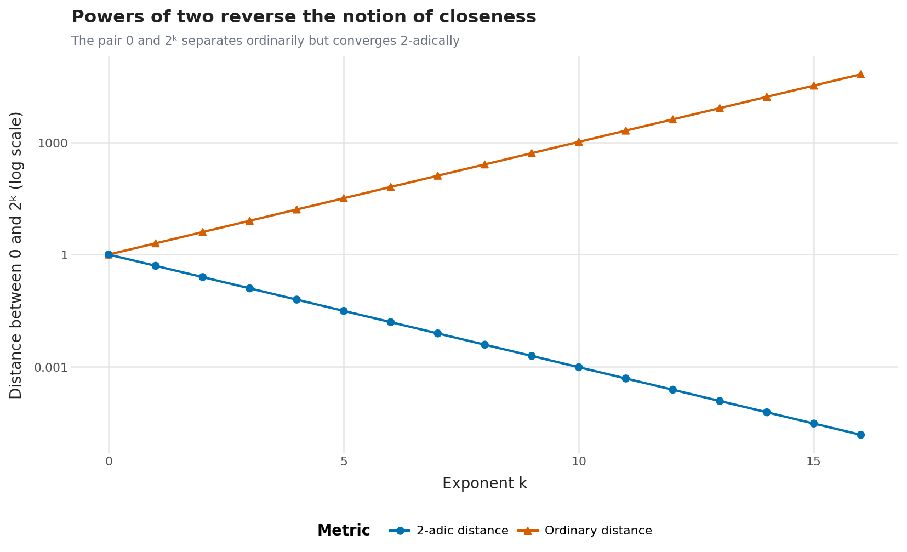

# The 2-adic extension {#sec-two-adic-extension}

## Motivation: distance measured by shared low bits

Ordinary absolute value calls two numbers close when their difference is small.
For parity and residues modulo powers of two, a different geometry is natural:
two integers are close when their difference is divisible by a large power of
2. Completing the integers in this geometry produces the **2-adic integers**
$\mathbb Z_2$.

The shortcut Collatz map extends continuously to this compact space, and parity
itineraries become coordinates. This yields a beautiful exact conjugacy with a
binary shift. It does not solve the positive-integer conjecture, because ordinary
positive integers form a very special measure-zero subset of the larger space.

## Constructing the 2-adic integers

For nonzero integer $m$, define

$$
|m|_2=2^{-\nu_2(m)},
\qquad |0|_2=0.
$$

Then $d_2(x,y)=|x-y|_2$ is a metric. The more trailing binary digits $x$ and $y$
share, the closer they are. It satisfies the strong triangle inequality

$$
|x+z|_2\le\max(|x|_2,|z|_2).
$$

One construction of $\mathbb Z_2$ is by compatible residues

$$
x_k\pmod{2^k},
\qquad x_{k+1}\equiv x_k\pmod{2^k}.
$$

Each level chooses one more low binary digit. Equivalently, a 2-adic integer has
an infinite expansion to the left,

$$
x=b_0+b_1 2+b_2 2^2+\cdots,
\qquad b_i\in\{0,1\}.
$$

The series converges 2-adically because $|2^k|_2=2^{-k}\to0$.

**Worked example: $-1$.** The ordinary positive integers
$1,3,7,15,\ldots,2^k-1$ grow without bound in the usual metric. Yet

$$
(2^k-1)-(-1)=2^k,
$$

so their 2-adic distance to $-1$ is $2^{-k}\to0$. Therefore

$$
-1=1+2+4+8+\cdots
$$

in $\mathbb Z_2$. There is no contradiction: convergence depends on the metric.

<figure id="fig-two-adic-closeness">


<figcaption>

Figure F.1: Usual and 2-adic distance move in opposite directions for pairs separated by powers of two.

</figcaption>
</figure>

[Figure F.1](#fig-two-adic-closeness) makes the change of geometry visible. A large ordinary
difference may be a tiny 2-adic difference.

## Extending the shortcut map continuously

Define on ordinary integers

$$
T(x)=
\begin{cases}
x/2,&x\equiv0\pmod2,\\
(3x+1)/2,&x\equiv1\pmod2.
\end{cases}
$$

Even and odd 2-adic integers are the two clopen residue classes modulo 2. On the
even class, $x/2$ is a 2-adic integer; on the odd class, $3x+1$ is divisible by
2. Each affine branch is continuous, and the domains are disjoint open-and-closed
sets, so $T:\mathbb Z_2\to\mathbb Z_2$ is continuous.

Continuity has a concrete finite form: to determine the first $k$ low bits of
$T(x)$, it is enough to know finitely many low bits of $x$. Because division by
2 discards one bit, $k+1$ input bits suffice for one step.

## Parity-vector conjugacy and the shift

Let $t_j(x)=T^{\circ j}(x)\bmod2$ be the parity itinerary and define

$$
Q(x)=\sum_{j=0}^{\infty}t_j(x)2^j\in\mathbb Z_2.
$$

The finite parity coding theorem from Chapter 21 says that, at every depth $k$,
starting residues modulo $2^k$ correspond bijectively to parity prefixes of
length $k$. Passing through all compatible levels makes $Q$ a homeomorphism of
$\mathbb Z_2$.

Define the 2-adic left shift

$$
\sigma(y)=\frac{y-(y\bmod2)}2,
$$

which discards the lowest binary digit. Removing the first parity symbol of an
orbit gives the exact **conjugacy equation**

$$
Q(T(x))=\sigma(Q(x)). \tag{24.1}
$$

Thus the 2-adic shortcut system and the one-sided binary shift are the same
topological dynamical system after the coordinate change $Q$. This classical
perspective is part of the established 3x+1 literature ([Lagarias 1985](d-bibliography.md#ref-lagarias1985); [Lagarias 2010](d-bibliography.md#ref-lagarias2010)).

## Periodic 2-adic points

Under the shift, a periodic binary block repeated forever is a periodic 2-adic
point. Conjugacy carries it to a periodic point of $T$. Consequently the 2-adic
map has many periodic points, including points that are not positive integers.

For instance, $x=-1$ is odd and

$$
T(-1)=\frac{-3+1}{2}=-1.
$$

It is a 2-adic fixed point with parity itinerary `111...`. Its existence says
nothing adverse about the positive conjecture because $-1$ is outside the
positive domain.

A repeated block $w$ of length $p$ represents a rational 2-adic number whose
denominator divides $2^p-1$, an odd integer. Applying $Q^{-1}$ yields a periodic
2-adic Collatz point. Determining which such points are positive ordinary integers
is an additional arithmetic restriction.

## Positive integers inside the 2-adic space

Every residue class modulo $2^k$ contains a positive integer, so the positive
integers are dense in $\mathbb Z_2$. Density means every 2-adic neighborhood
contains one; it does not mean positive integers occupy positive Haar measure.
They are countable, and each singleton has Haar measure zero, so their union has
measure zero.

This pair of facts is easy to misread:

- **topological density:** positive integers approximate every 2-adic point at
  any fixed finite precision;
- **measure zero:** a Haar-random 2-adic integer is almost surely not a positive
  integer.

If a property holds throughout a nonempty open set $U$, it cannot fail at
every point of a dense set $D$: by definition $U\cap D\ne\varnothing$.
In particular, the complement of an open dense set cannot itself be dense.
This differs from an almost-everywhere statement, whose exceptional set can
be dense. The distinction can be proved and computed explicitly here.

## Density, category, and small open covers {#sec-collatz-density-category}

Let $D=\{1,2,3,\ldots\}\subset\mathbb Z_2$. Each singleton is closed
and has empty interior, since every basic residue ball contains more than
one point. Thus $D$ is **meagre**, meaning a countable union of nowhere
dense sets. Its complement

$$
G=\mathbb Z_2\setminus D
=\bigcap_{j\ge1}\bigl(\mathbb Z_2\setminus\{j\}\bigr)
$$

is a countable intersection of open dense sets, called a dense
$G_\delta$ set. Baire's theorem says such an intersection is dense in a
complete metric space such as $\mathbb Z_2$ ([Melleray 2016](d-bibliography.md#ref-melleray2016baire),
Theorem 2.1). Here it also has Haar measure one, because $D$ has measure
zero. Yet $G$ contains no positive integer and has empty interior: every
nonempty open ball contains a member of $D$. In particular, $G$ is not
open. The property “belongs to $G$” holds on a dense $G_\delta$ set of
full measure while failing at every positive integer. Replacing
“dense $G_\delta$” by “open dense” in that statement would be false.

### Open dense sets can have small Haar measure

Normalized Haar measure assigns each cylinder $a+2^d\mathbb Z_2$ the
mass $2^{-d}$: its $2^d$ translates partition $\mathbb Z_2$ into equal
pieces ([Bell n.d.](d-bibliography.md#ref-bell2016padic), Section 3, Lemma 5). For an integer $s\ge1$, put

$$
O_s=\bigcup_{j\ge1}\bigl(j+2^{j+s}\mathbb Z_2\bigr),\qquad
K_s=\mathbb Z_2\setminus O_s.
$$

Every cylinder is open and contains its positive integer center $j$.
Consequently $O_s$ is open and contains $D$, so it is dense. Countable
subadditivity gives

$$
\mu(O_s)\le\sum_{j\ge1}2^{-(j+s)}=2^{-s},\qquad
\mu(K_s)\ge1-2^{-s}.
$$

Because $O_s$ is dense, the closed set $K_s$ has empty interior and is
nowhere dense. It contains no positive integer. Taking larger $s$ gives
closed nowhere dense sets with measure as close to one as desired, still
missing all positive integers. Topological and measure-theoretic sizes
therefore answer different questions.

### Exact finite-cylinder computation and its omitted tail

For $L\ge0$, let $O_{s,L}$ be the union using only $1\le j\le L$,
and write $p_{s,L}=\mu(O_{s,L})$. The unexamined cylinders have total
mass at most

$$
\sum_{j>L}2^{-(j+s)}=2^{-(L+s)}.
$$

Therefore the finite answer supplies the proved enclosure

$$
p_{s,L}\le\mu(O_s)\le p_{s,L}+2^{-(L+s)}.
$$

It does not by itself establish density of the infinite union; that came
from the all-center argument. Nor may overlapping cylinders simply have
their masses added. Two binary cylinders are either disjoint or one
contains the other: when their depths are $d\le e$, they intersect
exactly when their centers agree modulo $2^d$, in which case the
depth-$e$ cylinder lies inside the depth-$d$ cylinder.

The following standalone checker sorts by depth, discards cylinders already
contained in a retained one, and sums the remaining disjoint masses. It
allows negative centers, duplicate descriptions, and the depth-zero
cylinder $\mathbb Z_2$. It does not merge sibling cylinders, so the
retained description is not claimed to be a unique minimal representation.

```python
from fractions import Fraction

def binary_cylinder_union_measure(cylinders: list[tuple[int, int]]) -> Fraction:
    """Return Haar measure of a finite union of center + 2**depth Z_2."""
    normalized: set[tuple[int, int]] = set()
    for center, depth in cylinders:
        if type(center) is not int or type(depth) is not int:
            raise TypeError("centers and depths must be integers, excluding bool")
        if depth < 0:
            raise ValueError("depths must be nonnegative")
        normalized.add((center % (2**depth), depth))
    retained: list[tuple[int, int]] = []
    for center, depth in sorted(normalized, key=lambda pair: (pair[1], pair[0])):
        if any(center % (2**old_depth) == old_center for old_center, old_depth in retained):
            continue
        retained.append((center, depth))
    return sum((Fraction(1, 2**depth) for center, depth in retained), Fraction(0))

def small_open_cover_interval(shift: int, prefix: int) -> tuple[Fraction, Fraction]:
    """Enclose the infinite O_shift mass using an exact finite prefix and tail."""
    if type(shift) is not int or type(prefix) is not int:
        raise TypeError("shift and prefix must be integers, excluding bool")
    if shift < 1 or prefix < 0:
        raise ValueError("shift must be positive and prefix nonnegative")
    partial = binary_cylinder_union_measure(
        [(center, center + shift) for center in range(1, prefix + 1)]
    )
    return partial, partial + Fraction(1, 2 ** (prefix + shift))

for prefix in (8, 9):
    print(prefix, small_open_cover_interval(2, prefix))
```

The first eight cylinders for $s=2$ are disjoint and have mass
$255/1024$. The ninth, $9+2^{11}\mathbb Z_2$, lies inside
$1+2^3\mathbb Z_2$, since $9\equiv1\pmod8$. Adding it leaves the
finite union's mass unchanged, but reduces the unexamined-tail allowance.
The enclosures for the full union are respectively
$[255/1024,1/4]$ and $[255/1024,511/2048]$. Exact finite measure and the
geometric tail estimate have separate roles.

### Changed task: a longer prefix and a category contrast {#sec-collatz-cylinder-task}

For $s=2$ and $L=12$, identify all cylinders discarded by containment,
compute $p_{2,12}$ exactly, and enclose both $\mu(O_2)$ and $\mu(K_2)$
using the tail bound. Verify the finite union independently by counting
residues modulo $2^{14}$, rather than by reusing the pruning algorithm.

Then define $H=\bigcap_{s\ge1}O_s$. Determine whether it is dense,
whether it is a $G_\delta$ set, its Haar measure, and whether it contains
every positive integer. Explain why these answers are compatible, and why
they do not concern convergence of any Collatz orbit. The
[separate explanation](#sec-collatz-cylinder-solution) gives the exact
counts and the infinite-set arguments.

## Why 2-adic typicality does not settle ordinary growth

Equation (24.1) makes parity digits of a Haar-random 2-adic input behave like
independent fair bits. It is an exact measure-theoretic statement in that space.
Ordinary size, however, is not continuous in the 2-adic metric. Two numbers can
be 2-adically close while their usual magnitudes differ enormously, as
[Figure F.1](#fig-two-adic-closeness) shows.

The classical conjecture asks whether positive integer orbits reach an ordinary
small value, specifically 1. Haar-typical shift behavior does not control that
archimedean magnitude on a measure-zero subset. The 2-adic theory explains parity
coding perfectly while leaving the crucial size question open.

<div class="callout callout-warning">
<p class="callout-title">Pitfall clinic</p>

- The identity $1+2+4+\cdots=-1$ is 2-adic, not an ordinary real series sum.
- Dense does not mean large in measure.
- Haar-almost every 2-adic point says nothing automatically about positive
  integers.
- Parity conjugacy controls symbols; it does not preserve ordinary magnitude.
- Extra 2-adic cycles are not positive Collatz counterexamples.

</div>

<!-- inline-formula-code:start -->
## Formula and finite computation

A useful formula in this chapter is

$$
T_{N+1}(x\bmod2^{N+2})\bmod2^N
=T_N(x\bmod2^{N+1}),
$$

where $T_N:\mathbb Z/2^{N+1}\mathbb Z\to
\mathbb Z/2^N\mathbb Z$ applies one **shortcut** step. Division by two loses
one low bit, so an $N$-bit output requires $N+1$ input bits; there is no
well-defined shortcut endomap on residues modulo $2^N$ alone. Compatibility of
the correctly typed truncations is checked exhaustively at two successive
precisions. The following standalone Python block expresses that finite rule
with its inputs and stopping conditions visible.

```python
def truncated_shortcut(residue: int, input_bits: int) -> int:
    """Map an input_bits residue to the shortcut image modulo 2**(input_bits-1)."""
    if input_bits < 1:
        raise ValueError("input_bits must be positive")
    input_modulus = 2**input_bits
    representative = residue % input_modulus
    image = (
        representative // 2
        if representative % 2 == 0
        else (3 * representative + 1) // 2
    )
    return image % (2 ** (input_bits - 1))

output_bits = 6
compatible = all(
    truncated_shortcut(residue, output_bits + 2) % (2**output_bits)
    == truncated_shortcut(residue % (2 ** (output_bits + 1)), output_bits + 1)
    for residue in range(2 ** (output_bits + 2))
)
print(compatible)
```

**What the computation establishes.** The output verifies the commuting
projection square at one declared pair of finite precisions. The general
compatibility theorem follows from the branch formulas, not from this finite
scan.
<!-- inline-formula-code:end -->

## Exercises

<div class="exercise" id="collatz_conjecture-24-two-adic-extension-ex-1">
<p class="exercise-title"><strong>Exercise 1</strong></p>

Compute $|12|_2$, $|40|_2$, and $|12-40|_2$.

</div>

<div class="exercise" id="collatz_conjecture-24-two-adic-extension-ex-2">
<p class="exercise-title"><strong>Exercise 2</strong></p>

Show that congruence modulo $2^k$ is equivalent to 2-adic distance at most
$2^{-k}$.

</div>

<div class="exercise" id="collatz_conjecture-24-two-adic-extension-ex-3">
<p class="exercise-title"><strong>Exercise 3</strong></p>

List the compatible residues of $-1$ modulo $2,4,8,16$.

</div>

<div class="exercise" id="collatz_conjecture-24-two-adic-extension-ex-4">
<p class="exercise-title"><strong>Exercise 4</strong></p>

Prove $T$ maps odd 2-adic integers to 2-adic integers.

</div>

<div class="exercise" id="collatz_conjecture-24-two-adic-extension-ex-5">
<p class="exercise-title"><strong>Exercise 5</strong></p>

Find the first eight parity digits and $Q$ residue modulo $2^8$ for the
shortcut orbit starting at 1.

</div>

<div class="exercise" id="collatz_conjecture-24-two-adic-extension-ex-6">
<p class="exercise-title"><strong>Exercise 6</strong></p>

Verify equation (24.1) directly from the definition of $Q$.

</div>

<div class="exercise" id="collatz_conjecture-24-two-adic-extension-ex-7">
<p class="exercise-title"><strong>Exercise 7</strong></p>

Explain how positive integers can be both dense and measure zero.

</div>

<div class="exercise" id="collatz_conjecture-24-two-adic-extension-ex-8">
<p class="exercise-title"><strong>Exercise 8</strong></p>

State precisely the invalid inference in “parity is random in $\mathbb Z_2$,
so every positive Collatz orbit descends.”

</div>

<div class="exercise" id="collatz_conjecture-24-two-adic-extension-ex-9">
<p class="exercise-title"><strong>Exercise 9</strong></p>

Solve the [finite-cylinder and category task](#sec-collatz-cylinder-task).

</div>

## Answers and support

1. $12=4\cdot3$, so $|12|_2=1/4$; $40=8\cdot5$, so $1/8$;
   $12-40=-28=4(-7)$, so $1/4$.
2. $x\equiv y\pmod{2^k}$ means $\nu_2(x-y)\ge k$, exactly
   $|x-y|_2\le2^{-k}$.
3. They are $1,3,7,15$, the all-ones low-bit prefixes.
4. If $x$ is odd, $3x+1$ is even; division by 2 shifts its convergent binary
   expansion and remains in $\mathbb Z_2$.
5. $1\to2\to1\to2\cdots$ gives `10101010`, whose low-bit value is
   $1+4+16+64=85\pmod{256}$.
6. $Q(Tx)=\sum_{j\ge0}t_{j+1}(x)2^j$, which is precisely $Q(x)$ with its low
   digit removed.
7. Countably many points can meet every basic residue neighborhood while each
   point, and hence their countable union, has Haar measure zero.
8. It transfers a Haar-typical symbolic statement to a measure-zero arithmetic
   subset and replaces symbolic drift with ordinary-magnitude descent without a
   connecting theorem.

### Changed-task explanation {#sec-collatz-cylinder-solution}

Among the first twelve cylinders for $s=2$, only the ninth is contained in
an earlier cylinder: it lies inside the first. The other eleven are
pairwise disjoint. The first eight contribute $4080/16384$, while the
tenth, eleventh, and twelfth contribute respectively $4/16384$,
$2/16384$, and $1/16384$. Hence

$$
p_{2,12}=\frac{4087}{16384}.
$$

At depth fourteen, the union contains exactly 4087 of the 16384 residues.
The omitted tail has mass at most $1/16384$, so

$$
\frac{4087}{16384}\le\mu(O_2)\le\frac{4088}{16384}
=\frac{511}{2048},
$$

and taking complements gives

$$
\frac{1537}{2048}\le\mu(K_2)\le\frac{12297}{16384}.
$$

These are enclosures for infinite sets, not assertions that their endpoint
values are attained.

Every $O_s$ is open and dense, so Baire's theorem makes their countable
intersection $H$ dense and $G_\delta$. Each positive integer belongs to
every $O_s$ and hence to $H$. On the other hand, $H\subset O_s$ for all
$s$ implies $\mu(H)\le2^{-s}$ for every $s$, and therefore $\mu(H)=0$.
Thus a dense $G_\delta$ set can be Haar-null as well as full-measure, as
the earlier example $G$ was. The word “open” cannot be inserted: every
nonempty open cylinder has positive Haar measure. These sets illustrate
topology and measure in $\mathbb Z_2$; neither membership nor density here
encodes a Collatz descent or termination certificate.
