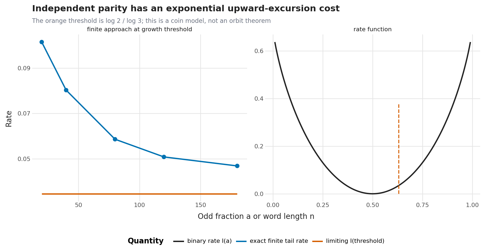

# Large Deviations and Rare Excursions {#sec-collatz-large-deviations}

The average logarithmic multiplier in a random Collatz model is negative, yet
some finite orbits climb to enormous peaks. Large-deviation theory studies the
exponentially small chance that many small fluctuations cooperate to produce
an atypical average. It supplies a disciplined heuristic language for rare
excursions—and a precise checklist of assumptions that the arithmetic map does
not automatically satisfy.

We build the theory first for independent coin tosses, then translate it to a
declared Collatz model and isolate every gap between model and theorem.

## From averages to rare events

Let $X_1,\ldots,X_n$ be independent identically distributed random variables
and

$$
\overline X_n=\frac1n\sum_{i=1}^nX_i.
$$

The law of large numbers says $\overline X_n$ is close to the mean
$m=\mathbb E X_1$ with high probability. A large-deviation question asks for a
fixed $a>m$:

$$
\mathbb P(\overline X_n\ge a).
$$

This probability often has exponential scale

$$
\mathbb P(\overline X_n\ge a)
\approx e^{-nI(a)}.
$$

The symbol $\approx$ here means logarithmic equivalence, not equality of
probabilities:

$$
\frac1n\log\mathbb P(\overline X_n\ge a)
\longrightarrow-I(a)
$$

under suitable regularity.

The nonnegative function $I$ is a **rate function**, with $I(m)=0$. Larger
$I(a)$ means a rarer deviation.

## Exponential bounds

For $t>0$, Markov's inequality gives

$$
\mathbb P\left(\sum X_i\ge na\right)
=\mathbb P\left(e^{t\sum X_i}\ge e^{tna}\right)
\le e^{-tna}\mathbb E e^{t\sum X_i}.
$$

Independence factors the expectation:

$$
\mathbb E e^{t\sum X_i}
=\left(\mathbb E e^{tX_1}\right)^n.
$$

Define the log moment-generating function

$$
\Lambda(t)=\log\mathbb E e^{tX_1}.
$$

Then

$$
\mathbb P(\overline X_n\ge a)
\le
\exp\{-n(ta-\Lambda(t))\}.
$$

Optimising over $t>0$ gives the Chernoff upper bound. The convex conjugate

$$
I(a)=\sup_{t\in\mathbb R}\{ta-\Lambda(t)\}
$$

is the candidate rate function.

This derivation shows exactly where independence enters: without it, the
moment-generating function of the sum does not become an $n$th power.

## Bernoulli calculation

Let $B_i$ be independent Bernoulli variables with
$\mathbb P(B_i=1)=p$. Then

$$
\Lambda(t)=\log(1-p+pe^t).
$$

For $a\in(0,1)$, optimization gives

$$
I_p(a)
=a\log\frac ap+
(1-a)\log\frac{1-a}{1-p}.
$$

This is the binary relative entropy. It is zero at $a=p$, positive elsewhere,
and strictly convex.

There is also an exact finite probability:

$$
\mathbb P(\overline B_n\ge a)
=\sum_{k=\lceil na\rceil}^n
\binom nk p^k(1-p)^{n-k}.
$$

Comparing its negative logarithm divided by $n$ with $I_p(a)$ reveals
finite-size corrections of order roughly $\log n/n$.

## Cramér's theorem

If the moment-generating function is finite in a neighbourhood of zero,
Cramér's theorem gives a large-deviation principle for $\overline X_n$ with
rate $I=\Lambda^\ast$. For a closed set $F$,

$$
\limsup_{n\to\infty}\frac1n
\log\mathbb P(\overline X_n\in F)
\le-\inf_{x\in F}I(x),
$$

while for an open set $G$,

$$
\liminf_{n\to\infty}\frac1n
\log\mathbb P(\overline X_n\in G)
\ge-\inf_{x\in G}I(x).
$$

The lower bound uses **exponential tilting**: change probability so the rare
average becomes typical, prove concentration there, and pay the
likelihood-ratio cost $e^{-nI(a)}$.

Heavy-tailed variables may lack a moment-generating function near zero. Then a
single enormous observation rather than coordinated small changes can dominate
the event, and Cramér's rate need not apply.

## A shortcut Collatz model

For the shortcut map, an even step multiplies approximately by $1/2$ and an odd
step approximately by $3/2$ for large $n$:

$$
T(n)=
\begin{cases}
n/2,&n\text{ even},\\
(3n+1)/2,&n\text{ odd}.
\end{cases}
$$

Ignoring the additive $1/(2n)$ correction in logarithmic scale, define model
increments

$$
X_i=
\begin{cases}
\log(1/2),&\text{with probability }1/2,\\
\log(3/2),&\text{with probability }1/2.
\end{cases}
$$

The mean is

$$
\mathbb E X_i
=\frac12\log\frac12+\frac12\log\frac32
=\frac12\log\frac34<0.
$$

If $K_n$ odd steps occur among $n$, the modeled log multiplier is

$$
S_n
=K_n\log\frac32+(n-K_n)\log\frac12
=K_n\log3-n\log2.
$$

A nonnegative modeled excursion requires

$$
\frac{K_n}{n}\ge\frac{\log2}{\log3}\approx0.6309,
$$

well above the independent fair-coin mean $1/2$.

The Bernoulli rate prediction is

$$
\mathbb P(S_n\ge0)
\asymp
\exp\left[
-nI_{1/2}\left(\frac{\log2}{\log3}\right)
\right]
$$

on logarithmic scale.

<figure id="fig-collatz-large-deviation">


<figcaption>

Figure G.1: The independent model's empirical odd-step fraction has an exponentially shrinking tail beyond the growth threshold.

</figcaption>
</figure>

[Figure G.1](#fig-collatz-large-deviation) is an exact calculation for independent fair coin
tosses. It is not an empirical theorem about Collatz parity vectors.

## Arithmetic corrections

Actual parity sequences are deterministic and constrained by starting residues.
For the shortcut map, every binary word of length $n$ corresponds to exactly
one residue class modulo $2^n$. Therefore a uniformly chosen residue modulo
$2^n$ has a uniformly distributed length-$n$ parity word. This gives an exact
finite uniformity statement.

But orbit sampling differs:

- choosing starting values uniformly from $[1,N]$ introduces boundary effects
  when $2^n$ is comparable with $N$;
- following one long orbit is not sampling independent new residue classes;
- conditioning on survival or high peak biases parity;
- the additive $+1$ accumulates through affine terms;
- an orbit's current magnitude and residue are linked.

For fixed $n$ with $N\to\infty$, residue uniformity supports binomial parity
counts. It does not establish an infinite-time independent process.

## Exact affine formula

For a parity word
$\varepsilon_0,\ldots,\varepsilon_{n-1}\in\{0,1\}$ under the shortcut map,
composition yields

$$
T^n(x)
=\frac{3^k x+b(\varepsilon)}{2^n},
\qquad
k=\sum_{i=0}^{n-1}\varepsilon_i,
$$

where $b(\varepsilon)$ is a nonnegative integer determined by the positions of
odd steps. The multiplicative estimate uses $3^k/2^n$; the affine correction
$b/2^n$ matters when $x$ is not much larger than it.

A rigorous finite excursion bound can:

1. group residue classes by parity word;
2. compute $k$ and $b$ exactly;
3. solve the inequality
   $(3^kx+b)/2^n\ge x$ within that class;
4. count admissible starting values in a finite interval.

This retains arithmetic dependence rather than treating the increments as
random.

## Peaks, maxima, and selection

If a model gives

$$
\mathbb P(S_n\ge a n)\lesssim e^{-nI(a)},
$$

a union bound over times $1\le n\le N$ gives an upper bound on ever crossing a
linear barrier. Dependence between times does not invalidate the union bound,
but may make it loose.

Record peaks selected from many starting values have severe selection bias.
Their distribution is not the distribution for a typical fixed start.
Overlapping orbits reuse long tails, so observations are correlated.

Stopping-time data can be heavy-tailed and censored: starts not resolved within
a cap have unknown, not zero, stopping times. Median, quantiles, survival
curves, and explicit censoring counts are safer than a lone mean.

## Importance sampling

To estimate a rare coin event, simulate under a tilted odd-step probability
$q$ near the target $a$ and reweight each word with $k$ odd steps by

$$
w=
\left(\frac{1/2}{q}\right)^k
\left(\frac{1/2}{1-q}\right)^{n-k}.
$$

Then the weighted event indicator has the original expectation. Effective
sample size and weight variance diagnose whether a few samples dominate.

For actual Collatz arithmetic, changing a coin law is not enough. One would
need a sampling distribution on residue classes or starting integers with an
exact likelihood ratio and preserve the affine constraints.

<div class="callout callout-warning">
<p class="callout-title">A correct model theorem is still a heuristic for the map</p>

Cramér's theorem rigorously describes independent increments. Applying its
rate to Collatz requires a proved sampling correspondence at the time scale and
conditioning used. Finite parity-word uniformity is valuable, but it does not
justify every infinite-orbit inference.

</div>

## Worked calculation: an exact tail, a bound, and an affine correction

Take twenty independent fair parity symbols. Multiplicative growth in the
shortcut model requires at least

$$
\left\lceil20\frac{\log2}{\log3}\right\rceil=13
$$

odd symbols. The exact model probability is therefore

$$
\mathbb P(K\ge13)
=2^{-20}\sum_{k=13}^{20}\binom{20}{k}
=\frac{137980}{1048576}
\approx0.131588.
$$

There is no simulation error in this number. The binomial coefficients count
all length-$20$ words, and division by $2^{20}$ uses their equal model weights.
It is already a useful warning: at this short horizon the event is unusual but
not astronomically rare.

The exact tail is a finite count and should be computed as one. `Fraction`
preserves the integer numerator and denominator displayed in the text.

```python
from fractions import Fraction
from math import comb

def fair_binomial_upper_tail(trials: int, threshold: int) -> Fraction:
    """Return P(K >= threshold) for K distributed Binomial(trials, 1/2)."""
    if trials < 0 or not 0 <= threshold <= trials + 1:
        raise ValueError("require trials >= 0 and 0 <= threshold <= trials + 1")
    favorable_words = sum(
        comb(trials, successes) for successes in range(threshold, trials + 1)
    )
    return Fraction(favorable_words, 2**trials)

tail = fair_binomial_upper_tail(20, 13)
if tail != Fraction(137980, 1048576):
    raise RuntimeError("the exact binomial tail disagrees with the derivation")
print(tail, float(tail))
```

The result contains no Monte Carlo error. It is nevertheless a probability
inside the independent fair-word model; it is not a frequency theorem for one
classical Collatz orbit.

For comparison, demand an odd fraction of $0.65$. The fair-coin rate is

$$
I_{1/2}(0.65)
=0.65\log(1.3)+0.35\log(0.7)
\approx0.0457005.
$$

Chernoff gives

$$
\mathbb P(K\ge0.65n)
\le e^{-0.0457005n}.
$$

At $n=20$ the right side is about $0.401$, much larger than the exact tail; an
upper bound need not be a close approximation. At $n=100$ the same expression
is about $0.0104$, displaying the exponential scale more clearly. Rounding
$0.65n$ to an integer must be specified when an exact finite probability is
reported.

The odd count still does not determine the exact iterate. Consider the first
three shortcut branches. With `1` for odd and `0` for even, the word `110`
has

$$
T^3(x)=\frac{9x+5}{8},
$$

whereas `101` has

$$
T^3(x)=\frac{9x+7}{8}.
$$

Both words contain two odd steps. The constants differ because an early
addition is multiplied by later odd branches. The starts $x=3$ and $x=1$
realise these words respectively:

$$
3\to5\to8\to4,
\qquad
1\to2\to1\to2.
$$

Thus the multiplicative approximation agrees for large $x$ at fixed horizon,
but it can be a poor description near the small cycle.

### From a finite theorem to an empirical test

For each residue $r\pmod {2^{20}}$, compute its parity word, odd count $k$, and
affine constant $b$. The parity-word bijection proves that the histogram of $k$
is exactly binomial across a complete residue system. A second histogram of
$b$ conditional on $k$ reveals information the coin model discards. Repeating
the calculation over $1\le x\le N$ should either use complete blocks of length
$2^{20}$ or report the partial-block boundary error.

A long-orbit experiment answers a different question. Its overlapping windows
share nineteen of twenty transitions and are strongly dependent. Confidence
intervals designed for independent rows are then invalid unless the dependence
is addressed. Block resampling, several independently chosen starts, and an
effective-sample-size calculation can describe uncertainty, but none creates
an infinite-time transfer theorem.

Chapter [sec-collatz-coupling-concentration](43-coupling-concentration.md#sec-collatz-coupling-concentration) computes an exact correction for
overlapping parity windows and derives concentration by coloring independent
source-bit subfamilies.

### Mini solution clinic

In Exercise 1, Markov's inequality is applied to $e^{t\sum X_i}$; independence
enters when its expectation factors into a product. In Exercise 7, the two
three-letter words above are the smallest convenient illustration. In Exercise
10, a defensible report should contain both the exact residue theorem and a
separate, explicitly empirical comparison to interval data.

<!-- inline-formula-code:start -->
## Formula and finite computation

A useful formula in this chapter is

$$
\mathbb P(S_n\ge k)=2^{-n}\sum_{j=k}^n{n\choose j}
$$

The binomial tail is evaluated exactly as a rational number. The following standalone Python block expresses that finite rule with its inputs and stopping conditions visible.

```python
from fractions import Fraction
from math import comb

trials, threshold = 30, 22
tail = Fraction(sum(comb(trials, successes) for successes in range(threshold, trials + 1)), 2**trials)
print(tail, float(tail))
```

**What the computation establishes.** The output certifies only the declared finite case. The theorem, if one is claimed, still requires the argument developed in the chapter.
<!-- inline-formula-code:end -->

## Summary, exercises, and support

Large deviations quantify exponential tail scales through a convex rate
function. For independent Bernoulli parity, upward Collatz-like growth requires
an atypically high odd fraction. Actual parity words have exact finite residue
structure but not an established infinite independent law; affine corrections,
selection, and censoring must be retained.

<div class="exercise" id="collatz_conjecture-35-large-deviations-ex-1">
<p class="exercise-title"><strong>Exercise 1</strong></p>

Derive the Chernoff bound step by step and mark the independence step.

</div>

<div class="exercise" id="collatz_conjecture-35-large-deviations-ex-2">
<p class="exercise-title"><strong>Exercise 2</strong></p>

Differentiate $ta-\log(1-p+pe^t)$ to derive $I_p(a)$.

</div>

<div class="exercise" id="collatz_conjecture-35-large-deviations-ex-3">
<p class="exercise-title"><strong>Exercise 3</strong></p>

Compute the growth-threshold odd fraction.

</div>

<div class="exercise" id="collatz_conjecture-35-large-deviations-ex-4">
<p class="exercise-title"><strong>Exercise 4</strong></p>

Compare exact binomial tails with $e^{-nI}$ for several $n$.

</div>

<div class="exercise" id="collatz_conjecture-35-large-deviations-ex-5">
<p class="exercise-title"><strong>Exercise 5</strong></p>

Prove length-$n$ parity words correspond to residues modulo $2^n$ for the
shortcut map.

</div>

<div class="exercise" id="collatz_conjecture-35-large-deviations-ex-6">
<p class="exercise-title"><strong>Exercise 6</strong></p>

Derive the affine iterate formula by induction.

</div>

<div class="exercise" id="collatz_conjecture-35-large-deviations-ex-7">
<p class="exercise-title"><strong>Exercise 7</strong></p>

Find two parity words with the same odd count but different affine term.

</div>

<div class="exercise" id="collatz_conjecture-35-large-deviations-ex-8">
<p class="exercise-title"><strong>Exercise 8</strong></p>

Explain why choosing only record-setting starts biases an empirical rate.

</div>

<div class="exercise" id="collatz_conjecture-35-large-deviations-ex-9">
<p class="exercise-title"><strong>Exercise 9</strong></p>

Implement tilted Bernoulli sampling with a fixed seed and report effective
sample size.

</div>

<div class="exercise" id="collatz_conjecture-35-large-deviations-ex-10">
<p class="exercise-title"><strong>Exercise 10</strong></p>

Design an exact residue-class experiment that tests the model without
claiming independent infinite dynamics.

</div>

For Exercise 2 solve
$a=pe^t/(1-p+pe^t)$ for $e^t$. For Exercise 6, update the multiplier and
constant separately at each affine branch.
