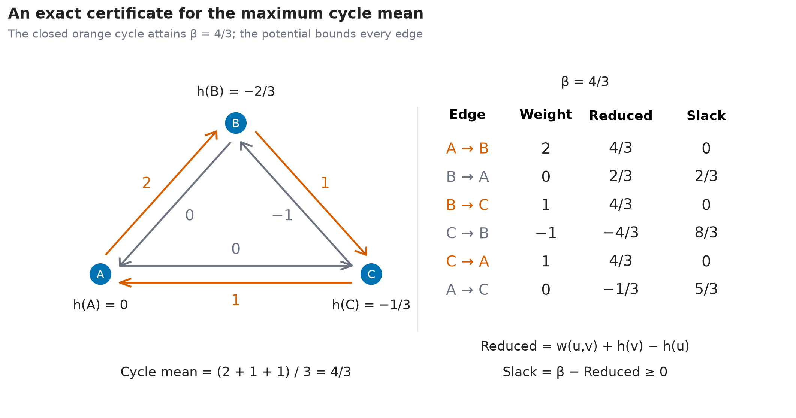

# Ergodic Optimization and Extremal Orbits {#sec-collatz-ergodic-optimization}

Average-case models ask what most orbits do. Ergodic optimization asks the
opposite question: which invariant orbit or measure maximises a long-run
average? For Collatz-like symbolic systems, this becomes a maximum-cycle-mean
problem on finite residue graphs, followed by a careful question: does the
optimizing symbolic path correspond to an actual positive integer orbit?

The finite graph proof below is self-contained. The measure paragraph supplies
advanced context with explicit hypotheses; neither probability nor measure
theory is needed to check the rational certificates.

## Preparation from this book

[Graph Theory and Spectral Views](../collatz-research-toolkit/29-graph-spectral.md#sec-graph-spectral) defines directed walks and explains why omitted
edges change a finite model. This chapter develops weighted walks, maxima,
and telescoping sums before using them. Rational arithmetic from the starting
toolkit suffices for the worked certificates. The later Collatz interpretation
uses the affine formulas in [sec-parity](04-parity.md#sec-parity) and cycle equations in
[sec-cycles](08-cycles.md#sec-cycles). [sec-collatz-interval-arithmetic](45-interval-arithmetic.md#sec-collatz-interval-arithmetic) supplies certified
logarithms when exact rational weights no longer suffice.

## Birkhoff sums and maximal averages

Let $T:X\to X$ be a map and let $\phi:X\to\mathbb R$ be an observable. Define

$$
S_n\phi(x)=
\sum_{k=0}^{n-1}\phi(T^kx).
$$

The finite-time average is $S_n\phi(x)/n$. The extremal value is

$$
\beta(\phi)
=\sup_x\limsup_{n\to\infty}
\frac1nS_n\phi(x).
$$

For multiplicative dynamics, choose

$$
\phi(x)=\log\frac{T(x)}x
$$

when defined. Then the sum telescopes:

$$
S_n\phi(x)=\log\frac{T^n(x)}x.
$$

Positive long-run average would mean exponential growth along that orbit.
For the exact Collatz map, additive terms and visits to small values make a
branch-only approximation different from this exact observable.

## Invariant measures {#sec-collatz-optimization-measures}

A Borel probability measure $\mu$ is $T$-invariant if

$$
\mu(T^{-1}A)=\mu(A)
$$

for every Borel set $A$. For the following theorem, assume that $X$ is a
nonempty compact metric space, $T:X\to X$ is **continuous**, and
$\phi:X\to\mathbb R$ is continuous. Then

$$
\beta(\phi)
=\max_{\mu\ \mathrm{invariant}}\int\phi\,d\mu.
$$

These hypotheses are part of the theorem ([Jenkinson 2019](d-bibliography.md#ref-jenkinson2019), Proposition 2.2).
An invariant measure exists in this setting, and a maximizing one exists.
The standard ergodic theorem supplies an orbit attaining its average. This
is advanced context for the finite graph result below.

Why continuity matters can already be seen from the empirical occupation
measure of an orbit segment:

$$
\mu_n=\frac1n\sum_{k=0}^{n-1}\delta_{T^kx}.
$$

Compactness gives a weakly convergent subsequence. Weak convergence means
convergence of integrals against continuous real test functions $f$.
The identity

$$
\int f\circ T\,d\mu_n-\int f\,d\mu_n
=\frac{f(T^nx)-f(x)}n\longrightarrow0
$$

holds because continuous $f$ is bounded on compact $X$. Because $T$ is
continuous, $f\circ T$ is also continuous, so both integrals pass to the weak
limit. Their equality proves that limit is invariant. Continuity of $\phi$
likewise passes its averages to the limit. A subsequence realizing an orbit's
limsup therefore gives the upper bound by invariant averages.

### A compact counterexample when continuity is missing

Let $X=\{0,2\}\cup\{1/j:j\ge1\}$ with its ordinary distance, and set

$$
T(1/j)=1/(j+1),\qquad T(0)=T(2)=2.
$$

The space is compact, but $T$ is discontinuous at zero. Let $\phi=1$ on
$X\setminus\{2\}$ and $\phi(2)=0$; this observable is continuous because 2
is isolated. Every orbit starting at $1/j$ has average one. Nevertheless the
only invariant probability is $\delta_2$: the empty preimages of $\{0\}$
and $\{1\}$ force their masses to zero, and the singleton preimage relations
then force every $\{1/j\}$ to have mass zero. Thus the supremum of invariant
averages is zero, whereas $\beta(\phi)=1$.

The empirical measures along $1,1/2,1/3,\ldots$ converge weakly to $\delta_0$,
which is not invariant. The finite telescoping identity still holds; passing
its first integral to the weak limit fails. No finite sample is a replacement
for this hypothesis check.

Compactness is also crucial. Positive integers with the usual topology are
not a compact invariant state space, so occupation mass can escape to infinity.

## Weighted directed graphs

Let a finite directed graph have edge weights $w(e)$. Assume for this
asymptotic statement that the graph has a directed cycle; an acyclic finite
graph has no infinite walk. For a path
$e_0,\ldots,e_{n-1}$, its mean is

$$
\frac1n\sum_{i=0}^{n-1}w(e_i).
$$

The maximum asymptotic path mean equals the maximum mean over directed cycles.
To see the upper bound, decompose a long path into a simple prefix plus cycles.
The prefix has bounded length, so its contribution vanishes; no cycle exceeds
the maximum cycle mean. Repeating a maximising cycle gives the lower bound.

Thus

$$
\beta_G
=\max_{\text{cycles }C}
\frac{\sum_{e\in C}w(e)}{|C|}.
$$

This finite theorem requires no probability.

## Karp's algorithm {#sec-collatz-karp-formula}

Let a nonempty finite directed graph have $n$ vertices and real edge weights.
A walk may repeat vertices. Define $D_k(v)$ as the maximum weight of a walk
of exactly $k$ edges ending at $v$, **with any starting vertex allowed**.
Thus $D_0(v)=0$ for every vertex. If no such walk exists, write
$D_k(v)=-\infty$. Dynamic programming gives

$$
D_{k+1}(v)=\max_{u\to v}\{D_k(u)+w(u,v)\},
$$

where an empty maximum is $-\infty$. There is no extra source edge in a
walk's length, and $n$ counts only the original vertices. Connecting an
auxiliary source by zero edges is at most an initialization device; counting
those edges would change these definitions.

For a graph containing a directed cycle, the all-start form of Karp's
characterization is

$$
\beta_G=
\max_{\substack{v\\D_n(v)>-\infty}}
\ \min_{\substack{0\le k<n\\D_k(v)>-\infty}}
\frac{D_n(v)-D_k(v)}{n-k}. \tag{36.1}
$$

In particular, the minimum **includes $k=n-1$**. No subtraction of two infinite
values is performed. The inner index set is nonempty because $D_0(v)=0$.
If every $D_n(v)=-\infty$, the graph has no cycle: an $n$-edge walk would repeat
a vertex, while a cycle could be repeated to make such a walk.

Karp's original fixed-source theorem is stated on strongly connected graphs
([Karp 1978](d-bibliography.md#ref-karp1978); [Dasdan and Gupta 1998](d-bibliography.md#ref-dasdangupta1998)). The all-start convention used here also works
on disconnected graphs; the following proof supplies that extension rather
than silently changing the initialization.

### Proof for the all-start convention

Assume there is a cycle, and let $\beta_G$ be its maximum cycle mean. Subtract
$\beta_G$ from every edge weight. Each $k$-edge walk weight decreases by
$k\beta_G$, so each quotient in (36.1) decreases by $\beta_G$. It suffices
to prove that the displayed maximum is zero for the normalized graph.

Every closed walk now has nonpositive weight: decompose it into simple
cycles, each with mean at most zero. Removing such cycles from any walk
preserves its ending vertex and can only increase its weight. The remaining
simple walk, permitted by the all-start convention, has fewer than $n$ edges. Therefore

$$
H(v):=\max_{0\le k<n}D_k(v)
$$

is the maximum weight of any walk ending at $v$, and $D_n(v)\le H(v)$.
Whenever $D_n(v)$ is finite, some finite $D_k(v)\ge D_n(v)$ with $k<n$.
Hence its inner minimum in (36.1) is at most zero.

Appending an edge to a walk attaining $H(u)$ gives

$$
H(v)\ge H(u)+w(u,v).
$$

Choose a cycle of mean zero, which exists by the definition of $\beta_G$.
Summing these inequalities around it forces equality on every edge of the
cycle. Take a walk of length $k<n$ attaining $H(v)$ at one of its vertices.
Extend it by $n-k$ edges along that cycle to a vertex $z$. Equality on the
cycle gives a walk of length $n$ and weight $H(z)$. Thus $D_n(z)=H(z)$,
and every finite quotient for $z$ is nonnegative. The outer maximum is at
least zero and at most zero, proving (36.1). Undoing normalization proves
the stated formula.

For a singleton with selfloops, $n=1$ and the sole index $k=0$ returns the
largest loop weight. A singleton without a loop has no cycle. These cases
must not be lost by using the empty range $k<n-1$.

The same proof produces an upper-bound witness after $\beta_G$ is computed:

$$
H_\beta(v)=
\max_{\substack{0\le k<n\\D_k(v)>-\infty}}
\bigl(D_k(v)-k\beta_G\bigr),
\qquad h(v)=-H_\beta(v).
$$

Then $w(u,v)+h(v)-h(u)\le\beta_G$ on every edge. A checker can verify
these edge inequalities without trusting the dynamic program.

With rational weights, every comparison can be exact. For logarithmic
weights, certified rational intervals give upper-bound graphs. A strictly
negative certified upper bound already establishes negativity. An exact
optimum or an attaining optimizer additionally needs a matching lower witness;
a strictly positive lower witness establishes positivity.

## Residue automata for parity

Choose the shortcut map and a modulus $2^m$. Each residue has a determined
parity branch and maps to a residue modulo $2^{m-1}$; to remain at fixed
precision, one may use lifted states encoding a window of parity bits. An edge
gets approximate log multiplier

$$
w_0=-\log2
\quad\text{for an even step},
\qquad
w_1=\log3-\log2
\quad\text{for an odd step}.
$$

An allowed symbolic cycle with $k$ odd steps among $n$ has mean

$$
\frac{k\log3-n\log2}{n}.
$$

The sign depends only on the odd-step fraction.

However, a periodic parity word need not produce a positive integer cycle.
The exact affine composition is

$$
T^n(x)=\frac{3^kx+b}{2^n}.
$$

Periodicity requires

$$
x=\frac b{2^n-3^k},
$$

which must be a positive integer in the correct residue class. Symbolic
admissibility is necessary but not sufficient.

## Dual certificates and subactions

Suppose there is a function $h$ on graph vertices and a number $\beta$ such
that every edge $u\to v$ satisfies

$$
w(u,v)+h(v)-h(u)\le\beta.
$$

Summing along a path telescopes:

$$
\sum_{i=0}^{n-1}w(e_i)
\le n\beta+h(v_0)-h(v_n).
$$

On a cycle the $h$ terms cancel, so every cycle mean is at most $\beta$.
If one cycle has equality on every edge, it attains the bound. The pair
$(h,\beta)$ is a compact independently checkable certificate.

In dynamic programming, $h$ resembles a Bellman potential. In ergodic
optimization it is called a **subaction**.

<figure id="fig-collatz-cycle-mean">


<figcaption>

Figure H.1: The six-edge rational graph developed below has maximum mean 4/3. The highlighted closed cycle attains that value, and every displayed edge slack is nonnegative.

</figcaption>
</figure>

[Figure H.1](#fig-collatz-cycle-mean) depicts the exact worked graph below. The edge table,
attaining cycle and potential certify a finite optimization theorem. This graph
has no claimed projection from Collatz integers.

## Extremal finite words

Let

$$
M_n=\max_{\text{allowed words }w,\ |w|=n}
\sum_{i=0}^{n-1}\phi(w_i).
$$

Dynamic programming computes $M_n$ without enumerating every word. If
$M_{m+n}\le M_m+M_n+C$ for a fixed boundary constant, a subadditive argument
gives a limiting maximal average after dividing by length.

For branch weights depending only on parity, maximising means maximising the
odd count under the symbolic constraints. Exact integer growth still depends
on the affine term and start size.

One can add constraints:

- avoid the known cycle;
- require a residue word to lift modulo $2^m3^\ell$;
- cap or penalise certain transitions;
- optimize peak above start over a finite horizon.

Each addition changes the graph and the claim.

## Infinite-state obstacles

Finite truncation of an infinite graph can:

- delete outgoing edges and artificially lower the optimum;
- reflect edges at a boundary and create artificial cycles;
- merge states that need different future information;
- retain symbolic cycles with no integer realisation.

To transfer a bound, prove a **finite-memory theorem**: the chosen state records
enough information that every integer orbit projects to a graph path and every
edge weight bounds the exact observable. A one-way projection can still give
an upper bound; equality needs a lifting argument.

The noncompactness of positive integers also blocks a simple invariant-measure
maximiser. A divergent orbit might generate no probability limit even if its
time averages have subsequential behavior.

## A certified workflow

1. Define the map and observable exactly.
2. Define graph states and prove the projection property.
3. Bound any difference between exact and edge observables.
4. Compute a maximum cycle mean with rational or interval arithmetic.
5. emit a cycle plus a potential certificate;
6. independently check every edge inequality;
7. test integer realisability through the affine cycle equation;
8. state whether the result is finite, asymptotic symbolic, or transferred to
   integer orbits.

<div class="callout callout-warning">
<p class="callout-title">Optimising a model does not find a Collatz counterexample</p>

A high-growth parity cycle can fail integrality, positivity, or residue
compatibility. Conversely, ruling out positive cycles in a finite automaton
does not rule out unrepresented long excursions.

</div>

## Worked certificate on a three-state graph

Consider vertices $A,B,C$ and the six directed edges

| edge | weight |
|:---|---:|
| $A\to B$ | $2$ |
| $B\to A$ | $0$ |
| $B\to C$ | $1$ |
| $C\to B$ | $-1$ |
| $C\to A$ | $1$ |
| $A\to C$ | $0$ |

The two-edge cycles have means $1$, $0$, and $1/2$. The cycle

$$
A\to B\to C\to A
$$

has mean $(2+1+1)/3=4/3$. Listing these obvious cycles suggests that $4/3$ is
maximal, but a certificate removes the need to trust an incomplete list.

Set

$$
\beta=\frac43,
\qquad
h(A)=0,
\quad h(B)=-\frac23,
\quad h(C)=-\frac13.
$$

On the proposed maximizing cycle,

$$
2+h(B)-h(A)
=1+h(C)-h(B)
=1+h(A)-h(C)
=\frac43.
$$

For the other three edges, the reduced weights are respectively

$$
\frac23,
\qquad
-\frac43,
\qquad
-\frac13,
$$

all at most $4/3$. Summing the edge inequalities around any closed walk makes
the potential terms cancel. Every closed walk therefore has mean at most
$4/3$, and the displayed three-cycle attains it. The rational tuple

$$
(\beta,h(A),h(B),h(C))
=\left(\frac43,0,-\frac23,-\frac13\right)
$$

is an exact certificate that a tiny independent checker can verify.

### How Karp's recurrence reaches the same answer

The all-start recurrence produces the following complete table:

| $k$ | $D_k(A)$ | $D_k(B)$ | $D_k(C)$ |
|---:|---:|---:|---:|
| 0 | 0 | 0 | 0 |
| 1 | 1 | 2 | 1 |
| 2 | 2 | 3 | 3 |
| 3 | 4 | 4 | 4 |

The inner minima in (36.1), in vertex order, are $4/3,1,1$, so the answer
is $4/3$. The generated potential $-H_\beta$ is precisely the potential
already displayed. The dynamic program finds the value; the six exact
edge inequalities and attaining cycle independently establish it. A
predecessor trace may suggest a cycle, but its mean must still be checked.

### What changes in a Collatz residue graph

For a residue automaton, an edge might carry an interval enclosing a logarithmic
multiplier. Replacing each interval by its upper endpoint gives an upper-bound
graph. A potential certificate then bounds every projected path provided three
facts have been proved: every integer transition projects to an edge, the edge
upper bound dominates the exact observable, and no required outgoing edge was
removed. The finite optimization is the easy part; those projection facts are
the mathematical bridge.

After locating a symbolic cycle, compose its exact affine branches. If the
result is $(3^kx+b)/2^n$, the only periodic candidate is
$x=b/(2^n-3^k)$. Reject it if the denominator has the wrong sign, the quotient
is nonintegral, or replay gives a different parity word. Passing these tests
produces an exact cycle certificate—not automatically a new Collatz cycle,
because the familiar small cycle and the chosen map convention must still be
accounted for.

[sec-collatz-interval-arithmetic](45-interval-arithmetic.md#sec-collatz-interval-arithmetic) constructs outward logarithm
enclosures, including a rational remainder and an interval-potential checker.

### Mini solution clinic

Exercise 4 should record the whole dynamic-programming table, not only its
largest entry. For Exercise 5, verify every edge inequality and then sum around
the proposed maximizing cycle. For Exercise 9, a useful refinement splits one
residue vertex according to the next unresolved binary or ternary digit and
rechecks that projection remains total.

## An endpoint that changes the sign {#sec-collatz-karp-sign}

Consider a different exact graph, with edges in this order:

| index | edge | weight |
|---:|:---|---:|
| 0 | $A\to B$ | $-3$ |
| 1 | $B\to C$ | $2$ |
| 2 | $C\to A$ | $0$ |
| 3 | $A\to A$ | $-3$ |
| 4 | $B\to B$ | $-3$ |
| 5 | $C\to C$ | $-1$ |

All-start dynamic programming gives

| $k$ | $D_k(A)$ | $D_k(B)$ | $D_k(C)$ |
|---:|---:|---:|---:|
| 0 | 0 | 0 | 0 |
| 1 | 0 | $-3$ | 2 |
| 2 | 2 | $-3$ | 1 |
| 3 | 1 | $-1$ | 0 |

For $A$, the quotients at $k=0,1,2$ are $1/3,1/2,-1$; for $B$ they are
$-1/3,1,2$; for $C$ they are $0,-1,-1$. Their minima are $-1,-1/3,-1$,
so (36.1) returns $-1/3$. Omitting $k=2=n-1$ instead returns $+1/3$,
reversing the sign.

A separate exact certificate has

$$
\beta=-\frac13,\qquad h(A)=0,\quad h(B)=\frac83,\quad h(C)=\frac13.
$$

The edge slacks $\beta-[w(u,v)+h(v)-h(u)]$, in the declared order, are

$$
0,\quad0,\quad0,\quad\frac83,\quad\frac83,\quad\frac23.
$$

All are nonnegative, and $A\to B\to C\to A$ has mean $-1/3$. This proves
optimality even without trusting the table. These weights define a finite
graph example; they are not asserted to be Collatz logarithmic increments.

<!-- inline-formula-code:start -->
## Formula and finite computation {#sec-collatz-karp-code}

The formula translated here is (36.1), together with the independent
certificate inequalities

$$
w(u,v)+h(v)-h(u)\le\beta,\qquad
\sum_{e\in C}w(e)=|C|\beta.
$$

The program uses vertices $0,\ldots,n-1$ and exact `Fraction` weights.
`None` represents an absent walk, not a large negative sentinel. The
certificate names its closed walk by edge indices, so parallel edges are
unambiguous. The example generates $h=-H_\beta$ from the rows and shifts all
potentials by the same constant so $h(A)=0$. Its checker uses no
dynamic-programming values.

```python
from fractions import Fraction

def validate_weighted_graph(
    vertex_count: int, edges: list[tuple[int, int, Fraction]]
) -> None:
    "Require a nonempty vertex set and exact finite weighted edges."
    if type(vertex_count) is not int:
        raise TypeError("vertex_count must be an integer")
    if vertex_count < 1:
        raise ValueError("vertex_count must be positive")
    if not isinstance(edges, list):
        raise TypeError("edges must be a list")
    for edge in edges:
        if not isinstance(edge, tuple) or len(edge) != 3:
            raise TypeError("each edge must be a source, destination, weight tuple")
        source, destination, weight = edge
        if type(source) is not int or type(destination) is not int:
            raise TypeError("edge endpoints must be integers")
        if not (0 <= source < vertex_count and 0 <= destination < vertex_count):
            raise ValueError("edge endpoint outside the vertex set")
        if not isinstance(weight, Fraction):
            raise TypeError("weights must be exact Fraction values")

def maximum_cycle_mean(
    vertex_count: int, edges: list[tuple[int, int, Fraction]]
) -> tuple[Fraction | None, tuple[tuple[Fraction | None, ...], ...]]:
    "Return the exact optimum, or None for no cycle, and all walk rows."
    validate_weighted_graph(vertex_count, edges)
    rows: list[list[Fraction | None]] = [
        [Fraction(0) for _ in range(vertex_count)]
    ]
    for _ in range(vertex_count):
        next_row: list[Fraction | None] = [None] * vertex_count
        for source, destination, weight in edges:
            previous = rows[-1][source]
            if previous is not None:
                candidate = previous + weight
                current = next_row[destination]
                if current is None or candidate > current:
                    next_row[destination] = candidate
        rows.append(next_row)
    minima: list[Fraction] = []
    for vertex in range(vertex_count):
        final = rows[vertex_count][vertex]
        if final is not None:
            quotients = [
                (final - earlier) / (vertex_count - depth)
                for depth in range(vertex_count)
                if (earlier := rows[depth][vertex]) is not None
            ]
            minima.append(min(quotients))
    optimum = max(minima) if minima else None
    return optimum, tuple(tuple(row) for row in rows)

def check_cycle_mean_certificate(
    vertex_count: int,
    edges: list[tuple[int, int, Fraction]],
    potential: list[Fraction],
    beta: Fraction,
    cycle_edges: list[int],
) -> tuple[Fraction, ...]:
    "Check every upper inequality and one attaining nonempty closed walk."
    validate_weighted_graph(vertex_count, edges)
    if not isinstance(potential, list) or len(potential) != vertex_count:
        raise ValueError("one potential value is required per vertex")
    if not all(isinstance(value, Fraction) for value in potential):
        raise TypeError("potential values must be exact Fractions")
    if not isinstance(beta, Fraction):
        raise TypeError("beta must be an exact Fraction")
    if not isinstance(cycle_edges, list) or not cycle_edges:
        raise ValueError("a nonempty list of cycle edge indices is required")
    if any(type(index) is not int for index in cycle_edges):
        raise TypeError("cycle edge indices must be integers")
    if any(not 0 <= index < len(edges) for index in cycle_edges):
        raise ValueError("cycle edge index outside the edge list")
    chosen = [edges[index] for index in cycle_edges]
    following = chosen[1:] + chosen[:1]
    if any(left[1] != right[0] for left, right in zip(chosen, following)):
        raise ValueError("the selected edges do not form a closed walk")
    slacks = tuple(
        beta - weight - potential[destination] + potential[source]
        for source, destination, weight in edges
    )
    if any(slack < 0 for slack in slacks):
        raise ValueError("a graph edge violates the proposed upper bound")
    if sum((edge[2] for edge in chosen), Fraction(0)) != beta * len(chosen):
        raise ValueError("the closed walk does not attain the proposed bound")
    return slacks

edges = [
    (0, 1, Fraction(-3)), (1, 2, Fraction(2)), (2, 0, Fraction(0)),
    (0, 0, Fraction(-3)), (1, 1, Fraction(-3)), (2, 2, Fraction(-1)),
]
optimum, rows = maximum_cycle_mean(3, edges)
if optimum is None:
    raise ArithmeticError("the example graph should contain a cycle")
generated_potential = []
for vertex in range(3):
    candidates = [
        value - depth * optimum
        for depth, row in enumerate(rows[:-1])
        if (value := row[vertex]) is not None
    ]
    generated_potential.append(-max(candidates))
potential = [
    value - generated_potential[0] for value in generated_potential
]
slacks = check_cycle_mean_certificate(
    3, edges, potential, optimum, [0, 1, 2],
)
print(optimum, rows, potential, slacks)
```

**What the computation establishes.** The finite recurrence computes the exact
maximum mean for the declared graph, or reports no cycle. The independently
checked upper inequalities and attaining walk prove the same optimum by
telescoping. Checking finitely many edges thereby controls every graph walk;
it does not prove that Collatz integers project to this graph. Omitting an edge
from the supplied graph changes the statement being checked. No density
estimate, stochastic independence, or Collatz termination follows.
<!-- inline-formula-code:end -->

## Changed task: a different maximizing cycle {#sec-collatz-karp-task}

In the sign-reversal graph, replace only the weight of edge 5, $C\to C$,
by $-1/4$.

1. Recompute every row through length three and all three inner minima.
2. Compute the value obtained if the last index $k=2$ is wrongly omitted.
3. Decide whether the former potential and bound still certify optimality.
   Identify a failed edge rather than only reporting “False.”
4. Give a new rational potential, all six slacks, and an attaining closed
   walk. Explain why the original three-cycle no longer attains the optimum.
5. State the additional mathematical obligations before applying this graph
   result to every Collatz orbit.

The [selected solution](#sec-collatz-karp-solution) separates the table,
upper witness, lower witness, and Collatz scope.

## Summary, exercises, and support

Ergodic optimization maximises long-run averages over orbits or invariant
measures. On finite weighted graphs it is exactly the maximum cycle mean.
Potential functions provide concise upper-bound certificates. Collatz
applications must bridge symbolic paths, affine compositions, and actual
integers.

<div class="exercise" id="collatz_conjecture-36-ergodic-optimization-ex-1">
<p class="exercise-title"><strong>Exercise 1</strong></p>

Prove the telescoping identity for the exact log-ratio observable.

</div>

<div class="exercise" id="collatz_conjecture-36-ergodic-optimization-ex-2">
<p class="exercise-title"><strong>Exercise 2</strong></p>

For a continuous self-map of a nonempty compact metric space, show that
every weak limit of empirical occupation measures is invariant. Identify
where continuity is used.

</div>

<div class="exercise" id="collatz_conjecture-36-ergodic-optimization-ex-3">
<p class="exercise-title"><strong>Exercise 3</strong></p>

Prove the maximum path mean equals the maximum cycle mean on a finite
directed graph containing a cycle.

</div>

<div class="exercise" id="collatz_conjecture-36-ergodic-optimization-ex-4">
<p class="exercise-title"><strong>Exercise 4</strong></p>

Run Karp's recurrence on a three-vertex weighted graph.

</div>

<div class="exercise" id="collatz_conjecture-36-ergodic-optimization-ex-5">
<p class="exercise-title"><strong>Exercise 5</strong></p>

Verify a supplied potential certificate edge by edge.

</div>

<div class="exercise" id="collatz_conjecture-36-ergodic-optimization-ex-6">
<p class="exercise-title"><strong>Exercise 6</strong></p>

Derive the affine periodicity equation
$x=b/(2^n-3^k)$.

</div>

<div class="exercise" id="collatz_conjecture-36-ergodic-optimization-ex-7">
<p class="exercise-title"><strong>Exercise 7</strong></p>

Find a parity word whose affine fixed point is not a positive integer.

</div>

<div class="exercise" id="collatz_conjecture-36-ergodic-optimization-ex-8">
<p class="exercise-title"><strong>Exercise 8</strong></p>

Compare rational interval bounds for $\log2$ and $\log3$ at two precisions.

</div>

<div class="exercise" id="collatz_conjecture-36-ergodic-optimization-ex-9">
<p class="exercise-title"><strong>Exercise 9</strong></p>

Design a state refinement that remembers one additional residue digit.

</div>

<div class="exercise" id="collatz_conjecture-36-ergodic-optimization-ex-10">
<p class="exercise-title"><strong>Exercise 10</strong></p>

State the exact theorem needed to transfer a finite graph upper bound to
all positive integer orbits.

</div>

For Exercise 3 remove cycles from any long path until only a simple remainder
remains. For Exercise 5 summing around a cycle cancels all potential terms.

## Selected solution to the changed task {#sec-collatz-karp-solution}

The rows are

| $k$ | $D_k(A)$ | $D_k(B)$ | $D_k(C)$ |
|---:|---:|---:|---:|
| 0 | 0 | 0 | 0 |
| 1 | 0 | $-3$ | 2 |
| 2 | 2 | $-3$ | $7/4$ |
| 3 | $7/4$ | $-1$ | $3/2$ |

The three inner minima are $-1/4,-1/3,-1/4$, so $\beta=-1/4$.
Omitting $k=2$ gives $7/12$, still the wrong sign. The old certificate
fails on the changed loop: its reduced weight is $-1/4$, greater than the
proposed old bound $-1/3$. Its slack there is $-1/12$.

A new witness is

$$
\beta=-\frac14,\qquad
h(A)=0,\quad h(B)=\frac{11}4,\quad h(C)=\frac12.
$$

The six slacks, in the declared order, are

$$
0,\quad0,\quad\frac14,\quad\frac{11}4,\quad\frac{11}4,\quad0.
$$

The loop at $C$ attains $\beta$; the three-cycle still has mean $-1/3$,
which is smaller. This change illustrates why a former attaining cycle must
be rechecked after an edge mutation, even when most inequalities survive.

For a Collatz application, prove that every relevant integer transition
projects to a retained edge and that its exact log ratio is bounded by that
edge's weight. Specify any stopping target or excluded small region and prove
its treatment. The known positive Collatz cycle itself has total exact log
ratio zero, so a negative bound for every full orbit including that cycle
would already be impossible. Neither the table nor its exact certificate
supplies these missing arithmetic hypotheses.
