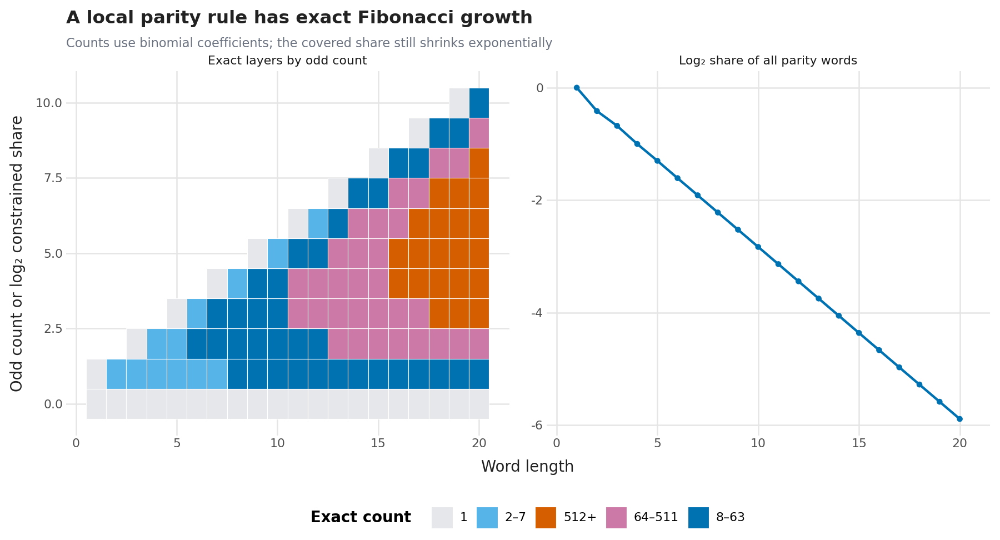

# Analytic Combinatorics of Parity Languages {#sec-collatz-analytic-combinatorics}

A finite Collatz orbit segment can be replaced by a word of zeros and ones. That
replacement is exact when the map convention and word length are fixed. Analytic
combinatorics asks a new family of questions: how many words satisfy a stated
constraint, how does that number grow, and which statistic is lost when many
words are grouped together? Recurrences, generating functions, and weighted
automata answer those questions without pretending that a word count settles an
infinite orbit problem.

This chapter develops every required counting tool from finite lists. Its main
case study counts parity words with no consecutive odd branches. The result is
an exact Fibonacci law for residue classes, followed by an explicit audit of
what the law does and does not imply about descent.
The generating-function viewpoint follows the finite-language methods developed
systematically in ([Flajolet and Sedgewick 2009](d-bibliography.md#ref-flajoletsedgewick2009)).

## Preparation from this book

No combinatorics course is required. A **word** is a finite ordered list of
symbols. We use the alphabet $\{0,1\}$, word length $|w|$, and odd count
$o(w)$, the number of symbols equal to one. A **language** is simply a set of
words selected by a rule. For example,

$$
\mathcal L_3=\{000,001,010,100,101\}
$$

is the set of length-three words without the adjacent block `11`.

The concise primer introduced algebra, sequences, finite sums, probability, and
algorithms. Chapter 4 derived the affine
formula for a parity word. Chapter 21 proved that length-$n$ shortcut parity
words correspond bijectively to residues modulo $2^n$. Those are the only
internal prerequisites. We briefly rebuild each tool when it is used.

There are two routes through the chapter. A reader interested in exact finite
counts can stop after the complete case study. A reader interested in asymptotic
growth should continue through the matrix and pole sections. Neither route
requires complex analysis: the dominant-root argument is first given through a
linear recurrence.

<div class="callout callout-note">
<p class="callout-title">Convention used throughout</p>

The shortcut map is
$$
S(n)=\begin{cases}
n/2,&n\text{ even},\\
(3n+1)/2,&n\text{ odd}.
\end{cases}
$$
The symbol `1` records an odd input to a shortcut step. Under this convention,
word `101` is realised by $n\equiv1\pmod8$; for example
$1\to2\to1\to2$. The start $5$ instead begins `100`.

</div>

## Counting before formulas

Suppose $a_n$ is the number of words of length $n$ satisfying a rule. Direct
enumeration lists all $2^n$ binary words and tests them. It is exact, but it
hides structure and doubles the candidate set whenever $n$ increases.

A **recurrence** computes a later count from earlier counts. Consider words that
avoid `11`. Any valid nonempty word ends in zero or one. Appending zero to any
valid word preserves validity. If a valid word ends in one, its preceding symbol
must be zero, unless its length is one. Removing the final block `01` leaves an
arbitrary shorter valid word. Therefore

$$
a_n=a_{n-1}+a_{n-2}\qquad(n\ge2),
$$

with $a_0=1$ for the empty word and $a_1=2$ for `0` and `1`. Thus

$$
1,2,3,5,8,13,21,34,55,\ldots
$$

are shifted Fibonacci numbers: $a_n=F_{n+2}$ when $F_0=0,F_1=1$.

A nonexample clarifies the logic. The rule “the word is the prefix of the orbit
of one fixed positive integer” generally does not lead to this recurrence. A
fixed orbit supplies one word at each length, and its next symbol is determined
arithmetically. The Fibonacci recurrence counts all formal words satisfying a
local language rule, not successive prefixes sampled from one trajectory.

## Generating functions as ledgers

The **ordinary generating function** of $(a_n)$ is a formal power series

$$
A(z)=\sum_{n\ge0}a_nz^n.
$$

At first, $z$ is a bookkeeping symbol: the coefficient of $z^n$ stores the
length-$n$ count. Multiply the recurrence by $z^n$ and sum over $n\ge2$:

$$
\sum_{n\ge2}a_nz^n
=z\sum_{n\ge2}a_{n-1}z^{n-1}
+z^2\sum_{n\ge2}a_{n-2}z^{n-2}.
$$

The left side is $A(z)-1-2z$. The two right sums are
$z(A(z)-1)$ and $z^2A(z)$. Rearranging gives

$$
A(z)=\frac{1+z}{1-z-z^2}.
$$

This rational expression is not an approximation. Expanding it formally
reproduces every integer coefficient. It also reveals the characteristic
equation $r^2=r+1$, whose positive root

$$
\varphi=\frac{1+\sqrt5}{2}
$$

controls exponential growth. The second root has absolute value below one, and
the exact Fibonacci formula yields

$$
a_n=F_{n+2}\sim\frac{\varphi^{n+2}}{\sqrt5}.
$$

The symbol $\sim$ means the ratio of the two sides tends to one. It does not
mean equality at finite $n$.

## Marking odd branches

One count is too coarse for Collatz multipliers. Introduce a second marker $u$:

$$
P_n(u)=\sum_{\substack{|w|=n\\w\text{ avoids `11`}}}u^{o(w)}.
$$

The coefficient of $u^k$ counts valid words with exactly $k$ odd symbols.
Repeating the final-symbol decomposition gives

$$
P_n(u)=P_{n-1}(u)+uP_{n-2}(u),
$$

with $P_0(u)=1$ and $P_1(u)=1+u$. Consequently the bivariate generating
function is

$$
P(z,u)=\sum_{n\ge0}P_n(u)z^n
=\frac{1+uz}{1-z-uz^2}.
$$

There is also a direct coefficient proof. To place $k$ ones with no adjacency
among $n$ positions, first reserve the $k-1$ zeros required between consecutive
ones. The remaining $n-(2k-1)$ zeros may be placed in the $k+1$ gaps before,
between, and after the ones. Equivalently, shift the chosen one-positions
$i_1<\cdots<i_k$ to $j_r=i_r-(r-1)$. This gives an ordinary $k$-subset of
$\{1,\ldots,n-k+1\}$. Hence

$$
[u^k]P_n(u)=\binom{n-k+1}{k}.
$$

For $n=8$, the values for $k=0,1,2,3,4$ are

$$
1,\ 8,\ 21,\ 20,\ 5,
$$

and their sum is $55=F_{10}$.

### Python translation: coefficient layers

The coefficient formula is directly executable. The list position is the number
of odd symbols, and the list value is the exact number of admissible words in
that layer. This is code for the constrained language, not for the unconstrained
binomial comparison used later.

```python
from math import comb

def no_adjacent_one_layers(length: int) -> list[int]:
    """Count length-word layers by number of ones, forbidding adjacent ones."""
    if length < 0:
        raise ValueError("length must be nonnegative")
    maximum_ones = (length + 1) // 2
    return [
        comb(length - ones + 1, ones)
        for ones in range(maximum_ones + 1)
    ]

totals = [sum(no_adjacent_one_layers(length)) for length in range(13)]
for length in range(2, len(totals)):
    if totals[length] != totals[length - 1] + totals[length - 2]:
        raise RuntimeError("coefficient layers failed the Fibonacci recurrence")
print(no_adjacent_one_layers(8), totals)
```

The output `[1, 8, 21, 20, 5]` is the coefficient vector of $P_8$.
The recurrence check is an independent structural invariant over the displayed
finite range; it does not establish a statement about an infinite orbit.

## Weighted finite automata

The same recurrence can be generated by a two-state machine. State $Z$ means
the previous symbol is zero, while state $O$ means it is one. From $Z$ one may
append zero or one; from $O$ only zero is legal. Give an appended zero weight
one and an appended one weight $u$. With rows as current states and columns as
new states, one weighted adjacency matrix is

$$
M(u)=\begin{pmatrix}1&u\\1&0\end{pmatrix}.
$$

Matrix powers count paths because matrix multiplication sums over every
intermediate state. Suitable start and accept vectors $s,t$ give the length
series

$$
F(z,u)=s^{\mathsf T}(I-zM(u))^{-1}t,
$$

up to the explicitly chosen treatment of the empty word. The inverse is a
rational matrix because, for a finite matrix, it can be written using its
adjugate divided by its determinant. Thus every regular language has a rational
generating function.

The converse also needs care: not every rational series is the zero-one count of
a deterministic automaton without additional conditions. Here we only use the
safe direction from a declared finite automaton to a rational count.

For a larger residue automaton, entries may be polynomials in several markers:
length, odd count, valuation sum, or a bounded cost. The matrix describes the
chosen quotient. If state reduction forgets a bit required for the next exact
transition, its path count is a model rather than an arithmetic theorem.

## Complete case study: language count to residue count

Chapter 21's finite parity coding theorem says that the map

$$
r\pmod{2^n}\longmapsto
(S^0(r)\bmod2,\ldots,S^{n-1}(r)\bmod2)
$$

is a bijection. Therefore exactly $F_{n+2}$ residues modulo $2^n$ have a
length-$n$ prefix avoiding consecutive odd branches. More finely, exactly

$$
\binom{n-k+1}{k}
$$

residues have such a prefix with $k$ odd steps. This is an exact finite theorem,
not a random model.

For a word with $k$ ones, Chapter 4 gives

$$
S^n(x)=\frac{3^kx+b(w)}{2^n},
\qquad b(w)\ge0.
$$

Avoiding `11` forces $k\le\lceil n/2\rceil$. For $n\ge5$,

$$
\frac{3^k}{2^n}
\le\frac{3^{\lceil n/2\rceil}}{2^n}<1.
$$

For odd $n=2m+1$, the upper bound is $3^{m+1}/2^{2m+1}$; increasing $m$ by
one multiplies it by $3/4$, and at $n=5$ it is $27/32$. The even case is
smaller. Thus, for each such word, every sufficiently large positive start in
its compatible residue class descends below its start at the declared time
$n$.

The word “eventually” is essential. Descent at time $n$ requires

$$
(2^n-3^k)x>b(w).
$$

The exact threshold is

$$
x>\frac{b(w)}{2^n-3^k}.
$$

Every smaller positive representative in the compatible residue class must be
checked separately. A subunit slope is not permission to discard the additive
term.

### Python translation: word, residue, affine term, and threshold

The next block keeps the four objects that are often collapsed in prose. It
computes the affine coefficients from a word, finds the unique compatible
residue by a bounded exhaustive check, and returns the first integer above the
multiplier threshold. A real descent certificate must then select members of
the compatible residue class at or above that threshold.

```python
def shortcut_affine(word: str) -> tuple[int, int, int]:
    """Return coefficient, offset, and denominator for one shortcut word."""
    if not word or any(symbol not in "01" for symbol in word):
        raise ValueError("word must be a nonempty binary string")
    coefficient, offset, denominator = 1, 0, 1
    for symbol in word:
        if symbol == "0":
            denominator *= 2
        else:
            coefficient *= 3
            offset = 3 * offset + denominator
            denominator *= 2
    return coefficient, offset, denominator

def shortcut_word_for_residue(residue: int, length: int) -> str:
    """Return a finite shortcut parity word for a nonnegative representative."""
    if residue < 0 or length < 0:
        raise ValueError("residue and length must be nonnegative")
    value = residue
    symbols: list[str] = []
    for _ in range(length):
        symbols.append(str(value % 2))
        value = value // 2 if value % 2 == 0 else (3 * value + 1) // 2
    return "".join(symbols)

def compatible_residue(word: str) -> int:
    """Return the unique residue modulo 2**len(word) realizing word."""
    if not word or any(symbol not in "01" for symbol in word):
        raise ValueError("word must be a nonempty binary string")
    modulus = 2 ** len(word)
    matches = [
        residue
        for residue in range(modulus)
        if shortcut_word_for_residue(residue, len(word)) == word
    ]
    if len(matches) != 1:
        raise RuntimeError("finite parity coding did not produce one residue")
    return matches[0]

def first_slope_descent_candidate(word: str) -> int | None:
    """Return the least integer satisfying the affine descent inequality."""
    coefficient, offset, denominator = shortcut_affine(word)
    difference = denominator - coefficient
    return None if difference <= 0 else offset // difference + 1

for word in ("100", "101", "110", "00001"):
    print(
        word,
        compatible_residue(word),
        shortcut_affine(word),
        first_slope_descent_candidate(word),
    )
```

For `101` and `110`, the last field is `None`: their three-step leading
coefficient is already at least the denominator. For a contracting word, the
reported integer is a threshold candidate, not automatically a compatible
class member; congruence and positivity remain separate checks.

<figure id="fig-collatz-parity-language-growth">


<figcaption>

Figure I.1: Exact counts of no-consecutive-one parity words by length and odd count, together with their Fibonacci growth relative to all binary words.

</figcaption>
</figure>

[Figure I.1](#fig-collatz-parity-language-growth) is generated from integer binomial
coefficients. No orbit simulation or random seed enters the figure.

## Prefix-free descent languages

A set of words is **prefix free** when no listed word is the beginning of
another. A certified word of length $d$ represents one residue cylinder of
weight $2^{-d}$. For a finite prefix-free set $\mathcal C$, the Kraft sum is

$$
K(\mathcal C)=\sum_{w\in\mathcal C}2^{-|w|}.
$$

If $K=1$, the cylinders cover every infinite binary sequence and, after
refinement to the maximum depth, every residue class. If $K<1$, the missing
weight measures unresolved cylinders, not counterexamples.

Generating functions can count certified and unresolved words by depth, but a
counting identity cannot establish the descent label. Each accepted word needs
an affine certificate, its compatible residue, its threshold, and coverage of
small exceptions. An automaton accepting a large fraction of prefixes may still
leave one compatible infinite path. Universal convergence cannot discard that
path merely because its relative frequency is zero.

### A complete symbolic cover that is not a descent cover

The four words

$$
\mathcal C=\{0,10,110,111\}
$$

are prefix free. Their weights add to

$$
\frac12+\frac14+\frac18+\frac18=1.
$$

Every infinite binary sequence begins with exactly one member of
$\mathcal C$: either its first bit is zero; its first two bits are `10`; or its
first two bits are `11`, after which the third bit selects `110` or `111`.
Thus this is a complete symbolic cover.

It is not a complete descent certificate. Word `0` maps $x$ to $x/2$, and word
`10` maps $x$ to $(3x+1)/4$, so they descend for the appropriate positive
starts apart from the known small equality at one. But

$$
S^3(x)=\frac{9x+5}{8}
$$

on `110`, while `111` has still larger slope. Those leaves rise at the declared
horizon. A Kraft sum verifies coverage, not the arithmetic label attached to
each leaf. A genuine sieve would expand the unresolved leaves and retain the
already certified leaves.

This example supplies a useful two-column checker. The symbolic column verifies
prefix freeness and Kraft equality. The arithmetic column recomputes every
affine map and descent range. Acceptance requires both columns.

## A second language: forbidding three consecutive odd steps

Let $t_n$ count binary words avoiding `111`. Every valid word ends in exactly
one of `0`, `01`, or `011`, except for initial words already handled by the
base cases. Removing that final block gives

$$
t_n=t_{n-1}+t_{n-2}+t_{n-3}\qquad(n\ge3),
$$

with

$$
t_0=1,\qquad t_1=2,\qquad t_2=4.
$$

The first counts are

$$
1,2,4,7,13,24,44,81,\ldots.
$$

The generating-function calculation gives

$$
T(z)=\sum_{n\ge0}t_nz^n
=\frac{1+z+z^2}{1-z-z^2-z^3}.
$$

An automaton uses states recording the current terminal run length of ones:
zero, one, or two. Appending zero returns to state zero; appending one advances
the state unless that would create a run of three. This illustrates the general
construction for avoiding $q$ consecutive ones, which needs $q$ run-length
states and satisfies a $q$-term recurrence.

Avoiding `111` does not force the odd fraction below one half. The repeating
word `110110...` has odd fraction $2/3$, above the multiplier descent threshold
$\log2/\log3$. Thus a language may have smaller entropy than the full shift and
still contain high-growth symbolic paths. “Constrained” is not synonymous with
“contracting.”

## Dominant roots without hidden analysis

For a recurrence

$$
a_n=c_1a_{n-1}+\cdots+c_da_{n-d},
$$

try a solution $a_n=r^n$. This yields the characteristic polynomial

$$
r^d-c_1r^{d-1}-\cdots-c_d=0.
$$

When the recurrence comes from an irreducible nonnegative finite automaton, its
largest positive root agrees with the Perron eigenvalue of the transition
matrix. Under the usual nonperiodicity condition, that root supplies the main
exponential factor. Periodic systems may have several roots on the same circle,
creating oscillating prefactors; the exponential rate still needs the declared
component and start/accept states.

For no-`11` words the rate is $\varphi$. Relative to all $2^n$ binary words,

$$
\frac{F_{n+2}}{2^n}
\asymp\left(\frac\varphi2\right)^n,
$$

so the proportion tends exponentially to zero. Nevertheless the number of
allowed words tends to infinity. This separates three statements that are often
confused: absolute count grows, relative frequency shrinks, and universal
coverage fails because some words are excluded.

## From a recurrence to a proof certificate

A recurrence computation should export more than its final count. For each
length it can store the full coefficient vector, its sum, and a recurrence hash
linking it to the previous rows. An independent checker verifies base rows,
applies exact integer additions, and compares a small selection with brute-force
enumeration.

For a weighted automaton, also export the ordered state list, every labeled
edge, initial vector, accept vector, and matrix orientation. The checker
reconstructs $M(u)$ rather than trusting a serialized matrix. State minimization
may be used for speed, but an equivalence certificate must show that merged
states accept exactly the same future suffixes.

When the language is attached to Collatz classes, add the map convention,
modulus, word-to-residue reconstruction, affine coefficients, and exception
range. That layered record lets reviewers accept the combinatorial count while
rejecting an unsupported arithmetic interpretation, rather than treating the
whole computation as one opaque claim.

## Counting total odd symbols, not only words

The bivariate polynomial stores aggregate statistics as well as layer counts.
Define

$$
B_n=P_n'(1).
$$

Differentiating a term $u^{o(w)}$ and setting $u=1$ contributes $o(w)$, so
$B_n$ is the total number of odd symbols across all valid length-$n$ words.
Differentiate the recurrence:

$$
P_n'(u)=P_{n-1}'(u)+P_{n-2}(u)+uP_{n-2}'(u).
$$

At $u=1$ this becomes

$$
B_n=B_{n-1}+B_{n-2}+F_n,
$$

because $P_{n-2}(1)=F_n$. Initial values are $B_0=0,B_1=1$.
The mean odd count under the uniform law on the constrained language is

$$
\mathbb E_n[o(W)]=\frac{B_n}{F_{n+2}}.
$$

For length eight, the coefficient table gives

$$
B_8=1(8)+2(21)+3(20)+4(5)=130,
$$

so the mean is $130/55=26/11$, far below the full-language mean four. Dividing
by the word length gives the finite length-eight mean odd fraction
$(26/11)/8=13/44$. This is an exact average over a finite residue subset. It
does not say that any one infinite orbit has limiting odd frequency $13/44$ or
that successive constrained blocks are independent.

Higher derivatives give factorial moments. For example,
$P_n''(1)$ totals $o(w)(o(w)-1)$, from which variance can be recovered. Thus
one exact polynomial supports counts, means, and fluctuations without generating
random words.

## Reproducible enumeration laboratory

A defensible implementation performs two independent calculations.

1. Dynamic programming computes $P_n(u)$ from the recurrence using exact
   integer coefficient arrays.
2. Brute force enumerates all words only for small $n$, rejects those containing
   `11`, and compares the complete coefficient table.
3. A residue checker traces every class modulo $2^n$ and verifies its word.
4. A manifest records $n$, convention, coefficient vector, total, code version,
   and a checksum of the sorted table.

The recurrence is the scalable producer; exhaustive word and residue scans are
independent small checkers. Floating point is unnecessary. A disagreement is a
bug or convention mismatch, not sampling noise.

### Reader checkpoint: one complete finite report

At length five, the no-`11` coefficient formula gives

$$
P_5(u)=1+5u+6u^2+u^3.
$$

The report should say: among the 32 residues modulo 32, exactly 13 have a
five-step parity prefix without consecutive odd branches; their odd-count layers
have sizes 1, 5, 6, and 1. Every such word has at most three odd steps, so its
leading multiplier is at most $27/32$. For each layer member, the exact affine
constant and compatible residue still determine whether every positive class
representative descends at step five or whether small exceptions remain.

That paragraph keeps four scopes visible: total residue universe, constrained
language, multiplier conclusion, and exact affine obligation. An inadequate
report might show only “13 safe classes,” silently turning a language count into
a descent certificate. The independent checker should reject the word `safe`
unless a descent inequality and exception list are present.

For a new constrained language, the same reporting template applies: definition,
recurrence, base cases, exact finite layer table, asymptotic rate, arithmetic
translation, and unresolved transfer. Reusing the template makes comparisons
possible without pretending different languages have the same mathematical
meaning.

## Theorem-scope and failure audit

- The recurrence, rational generating function, coefficient formula, and
  residue counts are exact theorems.
- Dominant-root asymptotics describe the number of formal prefixes in the
  declared language.
- A finite automaton describes only the memory encoded in its states.
- A subunit affine slope leaves an explicit additive threshold.
- A finite prefix-free Kraft sum of one already proves complete symbolic coverage; arithmetic descent coverage additionally requires
  valid leaf descent certificates, their thresholds, and all small exceptions resolved.
- Large language growth does not prove that the inverse component of one covers
  all positive integers.
- No finite automaton is known to recognize exactly the positive starts whose
  classical Collatz orbit reaches one.

The chapter therefore adds an exact counting method, not a claimed solution of
the conjecture.

<!-- inline-formula-code:start -->
## Formula and finite computation

A useful formula in this chapter is

$$
\#\{w\in\{0,1\}^k:|w|_1=j\}={k\choose j}
$$

The finite counts implement the coefficient array of $(1+z)^k$. The following standalone Python block expresses that finite rule with its inputs and stopping conditions visible.

```python
from math import comb

def parity_word_counts(length: int) -> list[int]:
    """Return binomial counts for zero through length odd positions."""
    if length < 0:
        raise ValueError("length must be nonnegative")
    counts = [comb(length, odd_steps) for odd_steps in range(length + 1)]
    if sum(counts) != 2**length:
        raise RuntimeError("binomial word count failed")
    return counts

for length in (4, 8, 16):
    print(length, parity_word_counts(length), sum(parity_word_counts(length)))
```

**What the computation establishes.** The calculation checks a declared finite instance; the surrounding argument explains what is true beyond those inputs.
<!-- inline-formula-code:end -->

## Exercises

<div class="exercise" id="collatz_conjecture-40-analytic-combinatorics-ex-1">
<p class="exercise-title"><strong>Exercise 1</strong></p>

List all no-`11` words of lengths zero through four and verify the recurrence.

</div>

<div class="exercise" id="collatz_conjecture-40-analytic-combinatorics-ex-2">
<p class="exercise-title"><strong>Exercise 2</strong></p>

Derive $(1+z)/(1-z-z^2)$ from the Fibonacci recurrence without skipping the
initial terms.

</div>

<div class="exercise" id="collatz_conjecture-40-analytic-combinatorics-ex-3">
<p class="exercise-title"><strong>Exercise 3</strong></p>

Prove $[u^k]P_n(u)=\binom{n-k+1}{k}$ by shifting positions.

<details class="solution"><summary>Solution</summary>

If the one-positions are
$1\le i_1<\cdots<i_k\le n$ and no two are adjacent, set
$j_r=i_r-(r-1)$. Then
$1\le j_1<\cdots<j_k\le n-k+1$. The construction reverses by
$i_r=j_r+(r-1)$, so valid placements are in bijection with $k$-subsets of an
$(n-k+1)$-element set. Their number is $\binom{n-k+1}{k}$.

</details>

</div>

<div class="exercise" id="collatz_conjecture-40-analytic-combinatorics-ex-4">
<p class="exercise-title"><strong>Exercise 4</strong></p>

Compute $P_6(u)$ and check that its coefficients sum to $F_8$.

<details class="solution"><summary>Solution</summary>

Starting with $P_0=1$ and $P_1=1+u$ gives

$$
P_2=1+2u,\qquad
P_3=1+3u+u^2,\qquad
P_4=1+4u+3u^2,
$$

$$
P_5=1+5u+6u^2+u^3,\qquad
P_6=1+6u+10u^2+4u^3.
$$

The coefficient sum is $21=F_8$.

</details>

</div>

<div class="exercise" id="collatz_conjecture-40-analytic-combinatorics-ex-5">
<p class="exercise-title"><strong>Exercise 5</strong></p>

Build the two-state weighted matrix and compute its square.

</div>

<div class="exercise" id="collatz_conjecture-40-analytic-combinatorics-ex-6">
<p class="exercise-title"><strong>Exercise 6</strong></p>

Design a three-state automaton for words avoiding `111`.

</div>

<div class="exercise" id="collatz_conjecture-40-analytic-combinatorics-ex-7">
<p class="exercise-title"><strong>Exercise 7</strong></p>

Derive the recurrence for the total number of words avoiding `111`.

</div>

<div class="exercise" id="collatz_conjecture-40-analytic-combinatorics-ex-8">
<p class="exercise-title"><strong>Exercise 8</strong></p>

Find the compatible residues modulo eight for `100` and `101` by tracing.

<details class="solution"><summary>Solution</summary>

Direct traces give

$$
5\to8\to4\to2,
\qquad
1\to2\to1\to2.
$$

Thus `100` corresponds to $5\pmod8$ and `101` to $1\pmod8$. The same result
follows by solving the intermediate parity congruences.

</details>

</div>

<div class="exercise" id="collatz_conjecture-40-analytic-combinatorics-ex-9">
<p class="exercise-title"><strong>Exercise 9</strong></p>

For word `100`, derive its affine formula and prove descent for every positive
compatible start.

<details class="solution"><summary>Solution</summary>

Composing odd, even, even shortcut branches gives

$$
S^3(x)=\frac{3x+1}{8}.
$$

For every positive $x$, $3x+1<8x$ because $1<5x$. Hence every positive start
in the compatible class $5\pmod8$ descends by the third shortcut step.

</details>

</div>

<div class="exercise" id="collatz_conjecture-40-analytic-combinatorics-ex-10">
<p class="exercise-title"><strong>Exercise 10</strong></p>

For a general word with slope below one, derive the exact descent threshold.

</div>

<div class="exercise" id="collatz_conjecture-40-analytic-combinatorics-ex-11">
<p class="exercise-title"><strong>Exercise 11</strong></p>

Give a prefix-free family with Kraft sum $3/4$ and identify its unresolved
residue fraction at a common depth.

</div>

<div class="exercise" id="collatz_conjecture-40-analytic-combinatorics-ex-12">
<p class="exercise-title"><strong>Exercise 12</strong></p>

Explain why one unresolved word at every depth need not be a positive-integer
counterexample.

<details class="solution"><summary>Solution</summary>

Unresolved nodes chosen separately at successive depths may be
incompatible, so they need not form one infinite binary path. Even a compatible
infinite path naturally specifies a 2-adic integer; its high bits need not
eventually vanish, so it need not represent a positive ordinary integer.

</details>

</div>

<div class="exercise" id="collatz_conjecture-40-analytic-combinatorics-ex-13">
<p class="exercise-title"><strong>Exercise 13</strong></p>

Write pseudocode for the recurrence producer and brute-force checker.

</div>

<div class="exercise" id="collatz_conjecture-40-analytic-combinatorics-ex-14">
<p class="exercise-title"><strong>Exercise 14</strong></p>

State precisely which conclusion the asymptotic $F_{n+2}\sim
\varphi^{n+2}/\sqrt5$ supports.

</div>

## Selected solutions

### Solution to Exercise 3

If the one-positions are
$1\le i_1<\cdots<i_k\le n$ and no two are adjacent, set
$j_r=i_r-(r-1)$. Then
$1\le j_1<\cdots<j_k\le n-k+1$. The construction reverses by
$i_r=j_r+(r-1)$, so valid placements are in bijection with $k$-subsets of an
$(n-k+1)$-element set. Their number is $\binom{n-k+1}{k}$.

### Solution to Exercise 4

Starting with $P_0=1$ and $P_1=1+u$ gives

$$
P_2=1+2u,\qquad
P_3=1+3u+u^2,\qquad
P_4=1+4u+3u^2,
$$

$$
P_5=1+5u+6u^2+u^3,\qquad
P_6=1+6u+10u^2+4u^3.
$$

The coefficient sum is $21=F_8$.

### Solution to Exercise 8

Direct traces give

$$
5\to8\to4\to2,
\qquad
1\to2\to1\to2.
$$

Thus `100` corresponds to $5\pmod8$ and `101` to $1\pmod8$. The same result
follows by solving the intermediate parity congruences.

### Solution to Exercise 9

Composing odd, even, even shortcut branches gives

$$
S^3(x)=\frac{3x+1}{8}.
$$

For every positive $x$, $3x+1<8x$ because $1<5x$. Hence every positive start
in the compatible class $5\pmod8$ descends by the third shortcut step.

### Solution to Exercise 12

Unresolved nodes chosen separately at successive depths may be
incompatible, so they need not form one infinite binary path. Even a compatible
infinite path naturally specifies a 2-adic integer; its high bits need not
eventually vanish, so it need not represent a positive ordinary integer.
