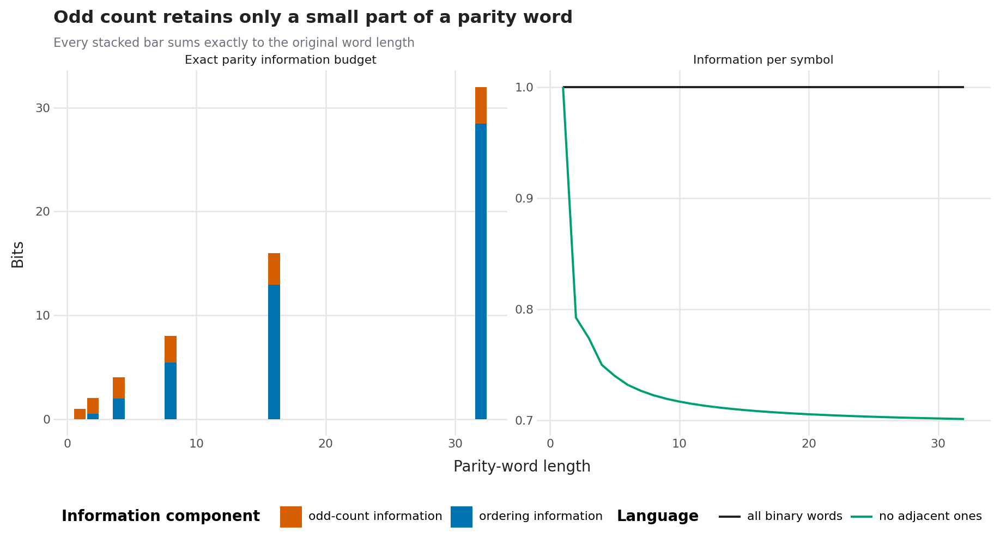

# Entropy, Coding, and Information Bounds {#sec-collatz-entropy-information}

The phrase “parity looks random” is too vague to calculate with. Information
theory replaces it with finite questions: how many bits are needed to identify
an outcome, how much uncertainty remains after a summary is revealed, and how
far a proposed probability model lies from observed frequencies? These
quantities belong to a declared sampling rule. They do not turn a deterministic
Collatz orbit into a physical random process.

This chapter begins with yes-or-no questions and builds Shannon entropy,
conditional entropy, mutual information, relative entropy, and data processing.
The central calculation accounts for every bit in a uniformly sampled parity
prefix. It shows exactly how much information is discarded when a full word is
replaced by its odd-step count.
Standard finite-source results can be found in ([Cover and Thomas 2006](d-bibliography.md#ref-coverthomas2006)); every result
used here is rederived at the resolution needed for the case studies.

## Preparation from this book

The concise primer introduced logarithms and finite probability
tables. Chapter 20 distinguished a random choice of a starting residue from the
deterministic orbit that follows. Chapter 21 proved the finite parity-word
bijection. Chapter 40 counted constrained languages. We need no measure theory
and no prior coding course.

A **binary question** has two answers. If both are equally possible, one answer
communicates one bit. Four equally likely possibilities require two such
questions; $2^k$ equally likely possibilities require $k$ bits. This motivates

$$
\log_2 N
$$

as the information needed to identify one of $N$ equally likely objects.

The sampling rule is part of every statement. “Choose $R$ uniformly modulo
$2^k$” defines a probability space. “Follow the orbit of 27” does not introduce
randomness: every value is fixed. We may still calculate descriptive complexity
of its recorded word, but Shannon probabilities require an ensemble or a
specified distribution.

## Self-information and entropy

If an outcome $x$ has probability $p(x)>0$, its **self-information** is

$$
I(x)=-\log_2p(x).
$$

A probability-one event carries zero surprise. An event of probability $1/8$
carries three bits. The logarithm turns products into sums: observing independent
events of probabilities $p$ and $q$ carries
$-\log_2(pq)=-\log_2p-\log_2q$ bits.

For a finite random variable $X$, its **Shannon entropy** is the average
self-information

$$
H(X)=-\sum_xp(x)\log_2p(x),
$$

where a zero-probability term is defined as zero by continuity. Entropy is
measured in bits because the logarithm base is two. Natural logarithms give
nats; changing the base changes units, not substance.

For a fair bit, $H=1$. For a bit that equals one with probability $p$,

$$
h_2(p)=-p\log_2p-(1-p)\log_2(1-p).
$$

This binary entropy is zero at $p=0,1$ and maximal at $p=1/2$. A biased bit can
be hard to predict on one trial while still carrying less than one bit on
average.

If $X$ takes at most $m$ values, then

$$
0\le H(X)\le\log_2m.
$$

The lower bound occurs for a constant variable; the upper bound occurs for the
uniform distribution. A proof of the upper bound follows later from relative
entropy.

A useful nonexample is the number of rows in a dataset. A million duplicate
rows do not contain a million independent pieces of information. Entropy uses
the distribution of possibilities, and inferential information also depends on
how rows share tails or selection rules.

### Python translation: finite Shannon entropy

The zero-probability convention and the normalization check belong in code;
otherwise a mistyped weight can yield a plausible but meaningless number.

```python
from math import fsum, isclose, log2

def shannon_entropy(probabilities: list[float]) -> float:
    """Return finite Shannon entropy in bits for a normalized distribution."""
    if not probabilities:
        raise ValueError("a distribution must have at least one outcome")
    if any(probability < 0.0 for probability in probabilities):
        raise ValueError("probabilities must be nonnegative")
    total = fsum(probabilities)
    if not isclose(total, 1.0, rel_tol=1e-12, abs_tol=1e-12):
        raise ValueError("probabilities must sum to one")
    return -fsum(
        probability * log2(probability)
        for probability in probabilities
        if probability > 0.0
    )

print(shannon_entropy([0.5, 0.5]))
print(shannon_entropy([0.75, 0.25]))
print(shannon_entropy([1.0, 0.0]))
```

The three outputs translate “fair,” “biased,” and “certain” into bits. They are
properties of the supplied finite laws, not of an undeclared Collatz process.

## Joint and conditional entropy

For a pair $(X,Y)$ with joint probabilities $p(x,y)$,

$$
H(X,Y)=-\sum_{x,y}p(x,y)\log_2p(x,y).
$$

The **conditional entropy** after learning $Y$ is

$$
H(X\mid Y)
=\sum_y p(y)H(X\mid Y=y).
$$

It averages the uncertainty remaining in $X$ over the possible revealed values
of $Y$. Expanding $p(x,y)=p(y)p(x\mid y)$ gives the chain rule

$$
H(X,Y)=H(Y)+H(X\mid Y).
$$

Indeed,

$$
-\log_2p(x,y)
=-\log_2p(y)-\log_2p(x\mid y),
$$

and averaging separates the two terms. The symmetric version also gives

$$
H(X,Y)=H(X)+H(Y\mid X).
$$

If $Y=f(X)$ is a deterministic summary, then $H(Y\mid X)=0$, so

$$
H(X)=H(Y)+H(X\mid Y).
$$

The summary's information plus the unresolved detail equals the original
information exactly.

## Mutual information

The **mutual information** is

$$
I(X;Y)=H(X)-H(X\mid Y)
=H(Y)-H(Y\mid X).
$$

It measures the expected reduction in uncertainty about either variable after
the other is known. It is symmetric and nonnegative. If $X$ and $Y$ are
independent, learning one does not change the law of the other, so $I=0$.
Conversely, for finite variables, $I=0$ implies independence.

Zero covariance is weaker. Let $X$ be uniform on $\{-1,0,1\}$ and set
$Y=X^2$. Symmetry gives $\mathbb E[XY]=\mathbb E[X^3]=0$, and
$\mathbb E[X]=0$, so covariance is zero. Yet $Y$ is completely determined by
$X$ and therefore carries information about it.

For deterministic $Y=f(X)$,

$$
I(X;Y)=H(Y).
$$

The summary cannot reveal more bits about $X$ than the summary itself can
carry.

## Relative entropy and model mismatch

Let $p$ and $q$ be distributions on the same finite set, with $q(x)>0$ whenever
$p(x)>0$. Their **relative entropy** or Kullback–Leibler divergence is

$$
D(p\Vert q)=\sum_xp(x)\log_2\frac{p(x)}{q(x)}.
$$

It is not a distance: it is generally asymmetric and does not obey the triangle
inequality. It is nevertheless nonnegative, with equality exactly when the two
distributions agree.

Terms with $p(x)=0$ contribute zero, including when $q(x)=0$. The bound $\ln t\le t-1$ holds for $t>0$, with equality only at $t=1$; apply it to $q(x)/p(x)$ only on $S=\{x:p(x)>0\}$:

$$
-\ln\frac{q(x)}{p(x)}\ge1-\frac{q(x)}{p(x)}.
$$

Multiply by $p(x)$ and sum over $S$, where $p$ has total mass one and $q$ has at most one. The right side becomes
$1-\sum_{x\in S}q(x)\ge0$. Dividing by $\ln2$ proves
$D(p\Vert q)\ge0$ in bits. Equality in the logarithm bound requires $q=p$ on $S$, and equality in the mass bound leaves no $q$-mass outside $S$.

Taking $q$ uniform on $m$ outcomes gives

$$
D(p\Vert q)=\log_2m-H(p)\ge0,
$$

which proves the entropy upper bound.

Chapter 35's Bernoulli rate function is a relative entropy. That calculation
measures the exponential cost of a biased empirical frequency under an
independent coin model. It is not evidence that actual orbit windows are
independent coins.

## Data processing and coarse summaries

Suppose $X\to Y\to Z$ is a processing chain: conditional on $Y$, the output $Z$
does not depend further on $X$. The **data-processing inequality** says

$$
I(X;Z)\le I(X;Y).
$$

Further processing cannot recover distinctions already erased. For a
deterministic coarsening $Z=g(Y)$, the result follows from the chain rule:

$$
I(X;Y)=I(X;Z)+I(X;Y\mid Z),
$$

and conditional mutual information is nonnegative.

In Collatz work, a residue modulo $2^k$ determines its full length-$k$ parity
word. Replacing the word by its odd count forgets ordering. Replacing the odd
count by the label “multiplicative slope below one” forgets still more. No later
regression or plot can recreate which affine additions occurred unless that
information was retained elsewhere.

This principle is not pessimism. It helps choose a sufficient data schema. If a
research question depends on the affine constant, store the word or the
constant; an odd count alone is not sufficient.

## Complete case study: the parity information budget

Choose $R$ uniformly from $\{0,1,\ldots,2^k-1\}$. Let $W$ be the first $k$
shortcut parity symbols and let $K=o(W)$ be their number of ones. The parity
bijection makes $R\mapsto W$ one-to-one, so

$$
H(R)=H(W)=\log_2 2^k=k.
$$

Every length-$k$ word is equally likely. Exactly $\binom kj$ words have
$K=j$, hence

$$
\Pr(K=j)=2^{-k}\binom kj.
$$

Conditional on $K=j$, those words remain equiprobable. Therefore

$$
H(W\mid K=j)=\log_2\binom kj.
$$

Because $K$ is a deterministic function of $W$, the chain rule gives

$$
k
=H(K)+H(W\mid K)
=H(K)+2^{-k}\sum_{j=0}^k
\binom kj\log_2\binom kj. \tag{41.1}
$$

Equation (41.1) accounts for every input bit. At $k=8$,

$$
H(K)\approx2.5442,
\qquad
H(W\mid K)\approx5.4558.
$$

Only about 2.54 bits remain in the odd count; more than 5.45 bits describe the
discarded order. At $k=32$, $H(K)\approx3.5470$ while ordering retains about
$28.4530$ bits. The count has only $k+1$ possible values, so its entropy grows
at most like $\log_2(k+1)$ even though the word contains $k$ bits.

### Python translation: the complete information budget

The binomial weights, odd-count entropy, and conditional ordering entropy can
be evaluated from one exact coefficient table. Floating point is used only for
the logarithms; the final conservation check guards the chain-rule identity.

```python
from math import comb, fsum, log2

def parity_information_budget(length: int) -> tuple[float, float, float]:
    """Return H(K), H(W|K), and their total for a uniform parity word."""
    if length < 0:
        raise ValueError("length must be nonnegative")
    denominator = 2**length
    layers = [comb(length, odd_steps) for odd_steps in range(length + 1)]
    probabilities = [layer / denominator for layer in layers]
    count_entropy = -fsum(
        probability * log2(probability)
        for probability in probabilities
        if probability > 0.0
    )
    ordering_entropy = fsum(
        probability * log2(layer)
        for probability, layer in zip(probabilities, layers)
    )
    total = count_entropy + ordering_entropy
    if abs(total - length) > 1e-10:
        raise RuntimeError("the entropy budget failed to conserve word bits")
    return count_entropy, ordering_entropy, total

for length in (4, 8, 32):
    print(length, parity_information_budget(length))
```

This code computes equation (41.1) for declared finite lengths. It does not
estimate entropy from an orbit and therefore has no sampling error or
independence assumption beyond the proved uniform-residue parity bijection.

<figure id="fig-collatz-information-budget">


<figcaption>

Figure J.1: The exact information budget of a parity word separates odd-count information from ordering information, while constrained-language entropy approaches its own rate.

</figcaption>
</figure>

The figure uses exact binomial probabilities and computed logarithms of exact
integer counts. It does not estimate entropy from an orbit sample.

## Coding interpretation

A **prefix code** assigns a binary codeword to each possible message so that no
codeword begins another. Such codes can be decoded without an end marker.
The Kraft inequality says their lengths $\ell_x$ satisfy

$$
\sum_x2^{-\ell_x}\le1.
$$

Shannon's source-coding theorem connects expected code length to entropy. For a
finite source, lengths $\ell_x=\lceil-\log_2p(x)\rceil$ obey Kraft and have
expected length below $H(X)+1$. Entropy is therefore an operational lower scale
for lossless average description.

This does not mean compressibility proves regularity of a particular infinite
parity sequence. A finite file can always be compressed or expanded depending
on format. A theorem about asymptotic source coding presumes a source law and a
sequence of messages.

## Entropy rates of constrained languages

If $L_n$ is a finite set of allowed length-$n$ words and the uniform law is used
on that set, its entropy is

$$
H_n=\log_2|L_n|.
$$

For the no-`11` language, $|L_n|=F_{n+2}$, so

$$
\lim_{n\to\infty}\frac{H_n}{n}
=\log_2\varphi\approx0.6942
$$

bits per symbol. This **topological entropy** counts allowed symbolic
distinctions. It is below the full binary rate one because the local rule removes
words.

An automaton quotient can reduce entropy by merging states or forbidding
transitions. Its entropy rate describes that quotient. It does not measure
ordinary integer height, stopping time, or the number of positive integers in
the inverse component of one.

## Entropy rate of a dependent two-state chain

Entropy of each coordinate does not describe information produced over time.
Consider the two-state Markov chain from Chapter 20,

$$
P=\begin{pmatrix}3/4&1/4\\1/2&1/2\end{pmatrix},
\qquad
\pi=(2/3,1/3).
$$

The stationary marginal entropy is

$$
H(X_t)=h_2(1/3)\approx0.9183\text{ bits}.
$$

For a Markov chain, the entire past affects the next state only through the
present state. The chain rule therefore gives

$$
H(X_0,\ldots,X_n)
=H(X_0)+\sum_{t=1}^nH(X_t\mid X_{t-1}).
$$

Under stationarity each conditional term is the row entropy averaged with
$\pi$:

$$
h
=\frac23h_2(1/4)+\frac13h_2(1/2)
\approx0.8742\text{ bits per step}. \tag{41.2}
$$

The coordinate marginal carries about $0.9183$ bits, but only about $0.8742$
new bits arrive per transition. The difference is temporal predictability. An
independent process with the same stationary marginal would have entropy rate
$h_2(1/3)$ instead.

For a finite transition matrix with a supplied stationary law, the entropy-rate
formula is a weighted sum of row entropies. The code checks normalization and
stationarity before evaluating it.

```python
from math import fsum, isclose, log2

def markov_entropy_rate(
    transition: list[list[float]], stationary: list[float]
) -> float:
    """Return the entropy rate in bits for a finite stationary Markov chain."""
    state_count = len(stationary)
    if state_count == 0 or len(transition) != state_count:
        raise ValueError("transition and stationary law must have the same size")
    if any(len(row) != state_count for row in transition):
        raise ValueError("transition matrix must be square")
    if any(probability < 0.0 for row in transition for probability in row):
        raise ValueError("transition probabilities must be nonnegative")
    if any(probability < 0.0 for probability in stationary):
        raise ValueError("stationary probabilities must be nonnegative")
    if not isclose(fsum(stationary), 1.0, abs_tol=1e-12):
        raise ValueError("stationary probabilities must sum to one")
    if any(not isclose(fsum(row), 1.0, abs_tol=1e-12) for row in transition):
        raise ValueError("every transition row must sum to one")
    propagated = [
        fsum(
            stationary[source] * transition[source][target]
            for source in range(state_count)
        )
        for target in range(state_count)
    ]
    if any(
        not isclose(propagated[index], stationary[index], abs_tol=1e-12)
        for index in range(state_count)
    ):
        raise ValueError("the supplied law is not stationary for this matrix")
    return -fsum(
        stationary[source] * probability * log2(probability)
        for source, row in enumerate(transition)
        for probability in row
        if probability > 0.0
    )

rate = markov_entropy_rate(
    [[0.75, 0.25], [0.5, 0.5]],
    [2.0 / 3.0, 1.0 / 3.0],
)
print(rate)
```

The output is about $0.8742$ bits per step and reproduces (41.2). The matrix
is an illustrative declared model; the computation does not estimate or infer
a transition law for Collatz parity data.

This chain is invented and does not describe Collatz residues unless a sampling
and projection theorem supplies its transition probabilities. Its role is to
show why one-step entropy cannot diagnose dependence.

### Block entropy as a diagnostic

For any process define

$$
H_n=H(X_0,\ldots,X_{n-1}).
$$

The increments

$$
H_{n+1}-H_n=H(X_n\mid X_0,\ldots,X_{n-1})
$$

measure new information in the next coordinate after the whole past is known.
Conditioning cannot increase entropy, so for a stationary process these
increments decrease toward the entropy rate under standard finite-alphabet
conditions.

For independent fair bits, $H_n=n$. For the alternating process selected by
one fair initial bit, $H_n=1$ for every positive $n$: each coordinate looks
fair, yet the first bit determines the full block. A histogram of zeros and ones
cannot distinguish these sources. Pair and longer-block counts begin to reveal
the difference.

## A complete coding example

Take four messages with probabilities

$$
1/2,\quad1/4,\quad1/8,\quad1/8.
$$

Assign codewords `0`, `10`, `110`, and `111`. They are prefix free, and their
lengths $1,2,3,3$ have expected value

$$
\frac12(1)+\frac14(2)+\frac18(3)+\frac18(3)
=\frac74.
$$

The entropy is also

$$
\frac12(1)+\frac14(2)+\frac18(3)+\frac18(3)
=\frac74\text{ bits}.
$$

The code attains entropy exactly because all probabilities are powers of two.
For general probabilities, integer codeword lengths usually force a gap, and a
Shannon code stays below $H+1$.

Collatz sieve words also form prefix-free families, but their purpose differs.
A coding tree maps messages to descriptions; a residue sieve maps binary
prefixes to arithmetic claims. Kraft equality can certify complete symbolic
coverage in both settings, while only the sieve needs an affine descent proof at
each leaf.

## Information sufficient for a research question

A statistic $T(X)$ is **sufficient** for a target question only when the
conditional law or exact predicate of interest depends on $X$ through $T$.
For the leading multiplier of a length-$k$ parity word, the odd count is
sufficient: it determines $3^K/2^k$. For the exact iterate, it is not sufficient
because the affine constant depends on order.

Compare `110` and `101`. Both have two odd symbols, so both have leading slope
$9/8$. Their exact formulas are

$$
\frac{9x+5}{8}
\quad\text{and}\quad
\frac{9x+7}{8}.
$$

The two-bit summary “there were two odd steps” cannot decide which offset
occurred. Information theory names the loss; the affine calculation shows why
it matters mathematically.

For a reproducible dataset, choose fields by the intended downstream claims.
Store the full parity word or affine constant when exact endpoints matter. Store
only $K$ when the declared result concerns the multiplier histogram. A smaller
schema is not automatically better if it makes the advertised theorem
uncheckable.

## Residue refinement as an information ladder

Let $R$ be uniform modulo $2^k$ and reveal only

$$
R_j=R\bmod2^j,
\qquad 0\le j\le k.
$$

There are $2^j$ equally likely revealed residues, so $H(R_j)=j$. Because
$R_j$ is determined by $R$,

$$
I(R;R_j)=j.
$$

Each revealed class has exactly $2^{k-j}$ compatible fine residues, giving

$$
H(R\mid R_j)=k-j.
$$

One additional low bit transfers exactly one bit from unresolved detail to the
revealed summary. Through parity coding, the same ladder reveals one additional
parity symbol. This is a finite identity, not a statement that a positive
integer orbit obtains a fresh random bit at each time.

Now compare revealing only the odd count $K$. It does not refine in a nested
one-bit ladder: learning $K$ for a longer prefix can change the interpretation
of the earlier total, and many orders remain merged. Information diagrams should
therefore name the actual variables rather than drawing every summary as though
it were a residue truncation.

### Exact tables versus entropy estimation

If every residue modulo $2^k$ is enumerated once, the parity and odd-count
probabilities are exact finite-population proportions. There is no sampling
standard error. Numerical logarithms still need enough precision for a reported
decimal, but the underlying rational probabilities are known.

If only sampled starts are used, a plug-in entropy can miss unobserved
categories and is typically biased downward. If overlapping windows are sampled
from one orbit, dependence also invalidates independent-row error bars. A sound
report separates exact table construction, numerical evaluation, sampling
variation, and extrapolation to a larger population.

## Entropy in data and in Tao's theorem

An empirical plug-in entropy replaces unknown probabilities by sample
frequencies. It is a statistic, and with many rare categories it is commonly
biased downward. Overlapping orbit windows also violate independent-sample
error formulas. A complete residue block has a different advantage: its finite
frequency table is exact for that block, so there is no sampling uncertainty,
although extrapolation remains a separate question.

Tao's theorem uses entropy at a much deeper level. The proof studies conditioned
Syracuse offsets, Rényi-type quantities, Fourier decay, and quantitative
arithmetic mixing. The elementary identity (41.1) explains why ordering contains
information, but it does not reproduce the transfer estimates that make Tao's
density theorem rigorous.

## An information claim ledger

Before attaching an entropy number to Collatz data, fill four entries.

1. **Random object:** a uniformly chosen residue, sampled positive start, model
   path, or empirical window.
2. **Distribution:** exact finite law, fitted law, or assumed model.
3. **Representation:** full word, odd count, affine coefficients, or coarse
   descent label.
4. **Conclusion:** coding length, model mismatch, finite uncertainty, or a
   transferred arithmetic statement.

For equation (41.1), the object is a uniform residue modulo $2^k$, the law is
exact, the representation is first the full word and then its count, and the
conclusion is a finite information identity. For a long orbit histogram, the
object is a deterministic window sequence under a declared empirical sampling
rule; an entropy estimate describes that file and its model, not a probability
that the conjecture holds.

An entropy of zero can mean a constant source, a fully predictable process after
conditioning, or a summary with one possible value. An entropy near its maximum
can mean a nearly uniform finite distribution while still hiding long-range
dependence. The ledger prevents the number from being interpreted without its
random object and conditioning information.

## Theorem-scope and failure audit

- Shannon identities are theorems for a declared probability distribution.
- Uniform residues give exactly uniform finite parity words.
- A deterministic function may have positive entropy when its input is random.
- Odd-count entropy measures retained uncertainty, not orbit growth.
- Relative entropy is a model-comparison quantity, not a probability that the
  model or conjecture is true.
- Entropy rate of a finite language does not control a specified exceptional
  infinite word.
- Empirical entropy from overlapping windows requires a dependence analysis.
- No elementary entropy calculation presently removes every exceptional
  positive Collatz orbit.

<!-- inline-formula-code:start -->
## Formula and finite computation

A useful formula in this chapter is

$$
\log C_w'(n)=a\log3-k\log2
$$

The ledger separates word multiplicity from its logarithmic drift. The following standalone Python block expresses that finite rule with its inputs and stopping conditions visible.

```python
from math import comb, log

def logarithmic_drift_ledger(length: int) -> list[tuple[int, int, float, str]]:
    """Return odd count, word count, log multiplier, and its sign label."""
    if length <= 0:
        raise ValueError("length must be positive")
    rows: list[tuple[int, int, float, str]] = []
    for odd_steps in range(length + 1):
        log_multiplier = odd_steps * log(3.0) - length * log(2.0)
        sign = "contracting" if 3**odd_steps < 2**length else "expanding"
        rows.append((odd_steps, comb(length, odd_steps), log_multiplier, sign))
    return rows

for row in logarithmic_drift_ledger(20):
    print(row)
```

**What the computation establishes.** The calculation checks a declared finite instance; the surrounding argument explains what is true beyond those inputs.
<!-- inline-formula-code:end -->

## Exercises

<div class="exercise" id="collatz_conjecture-41-entropy-information-ex-1">
<p class="exercise-title"><strong>Exercise 1</strong></p>

Compute the self-information of events with probabilities $1$, $1/2$, and
$1/32$.

</div>

<div class="exercise" id="collatz_conjecture-41-entropy-information-ex-2">
<p class="exercise-title"><strong>Exercise 2</strong></p>

Compute binary entropy at $p=1/4$ and compare it with one bit.

</div>

<div class="exercise" id="collatz_conjecture-41-entropy-information-ex-3">
<p class="exercise-title"><strong>Exercise 3</strong></p>

Prove the entropy chain rule by expanding $p(x,y)$.

</div>

<div class="exercise" id="collatz_conjecture-41-entropy-information-ex-4">
<p class="exercise-title"><strong>Exercise 4</strong></p>

Give a deterministic function $Y=f(X)$ and verify $H(X)=H(Y)+H(X\mid Y)$.

<details class="solution"><summary>Solution</summary>

Let $X$ be uniform on $\{0,1,2,3\}$ and let $Y=X\bmod2$.
Then $H(X)=2$ and $H(Y)=1$. Given either parity, two values of $X$ remain
equally likely, so $H(X\mid Y)=1$. Thus $2=1+1$.

</details>

</div>

<div class="exercise" id="collatz_conjecture-41-entropy-information-ex-5">
<p class="exercise-title"><strong>Exercise 5</strong></p>

Check the zero-covariance dependent example in the text.

</div>

<div class="exercise" id="collatz_conjecture-41-entropy-information-ex-6">
<p class="exercise-title"><strong>Exercise 6</strong></p>

Prove nonnegativity of relative entropy using $\ln t\le t-1$.

</div>

<div class="exercise" id="collatz_conjecture-41-entropy-information-ex-7">
<p class="exercise-title"><strong>Exercise 7</strong></p>

Use relative entropy against the uniform law to prove $H(X)\le\log_2m$.

</div>

<div class="exercise" id="collatz_conjecture-41-entropy-information-ex-8">
<p class="exercise-title"><strong>Exercise 8</strong></p>

Compute the complete parity information budget for $k=4$.

<details class="solution"><summary>Solution</summary>

For $k=4$, the odd-count probabilities are

$$
\frac1{16}(1,4,6,4,1).
$$

Direct substitution gives $H(K)\approx2.03064$ bits. Conditional ordering
contributes

$$
\frac1{16}\sum_{j=0}^4\binom4j\log_2\binom4j
\approx1.96936.
$$

Their sum is exactly four by the chain rule, with the decimals differing only
because of display rounding.

</details>

</div>

<div class="exercise" id="collatz_conjecture-41-entropy-information-ex-9">
<p class="exercise-title"><strong>Exercise 9</strong></p>

Prove that $I(W;K)=H(K)$ in the case study.

<details class="solution"><summary>Solution</summary>

Since $K$ is determined by $W$, $H(K\mid W)=0$. Therefore

$$
I(W;K)=H(K)-H(K\mid W)=H(K).
$$

This does not mean $K$ retains all information in $W$; the lost amount is
$H(W\mid K)$.

</details>

</div>

<div class="exercise" id="collatz_conjecture-41-entropy-information-ex-10">
<p class="exercise-title"><strong>Exercise 10</strong></p>

Bound $H(K)$ above by $\log_2(k+1)$.

</div>

<div class="exercise" id="collatz_conjecture-41-entropy-information-ex-11">
<p class="exercise-title"><strong>Exercise 11</strong></p>

Explain which information an odd-count table loses about the affine term.

</div>

<div class="exercise" id="collatz_conjecture-41-entropy-information-ex-12">
<p class="exercise-title"><strong>Exercise 12</strong></p>

Derive the entropy rate $\log_2\varphi$ for words avoiding `11`.

</div>

<div class="exercise" id="collatz_conjecture-41-entropy-information-ex-13">
<p class="exercise-title"><strong>Exercise 13</strong></p>

Give two processes with the same one-symbol entropy and different
dependence.

<details class="solution"><summary>Solution</summary>

Independent fair bits and the alternating process obtained by
choosing one fair initial bit and then flipping it at every time both have fair
one-symbol marginals and entropy one at each coordinate. The first has no
temporal dependence. In the second, one observed bit determines every future
bit, so its entropy rate is zero.

</details>

</div>

<div class="exercise" id="collatz_conjecture-41-entropy-information-ex-14">
<p class="exercise-title"><strong>Exercise 14</strong></p>

Explain why empirical entropy along one orbit does not invoke the parity
residue bijection as an independence theorem.

</div>

<div class="exercise" id="collatz_conjecture-41-entropy-information-ex-15">
<p class="exercise-title"><strong>Exercise 15</strong></p>

Rewrite “the parity entropy is high, so every orbit descends” with correct
theorem-status labels.

<details class="solution"><summary>Solution</summary>

A correct replacement is: “For a uniformly chosen complete
residue class modulo $2^k$, the finite parity prefix is uniform and contains
$k$ bits of Shannon entropy. Grouping by odd count yields an exact finite
information decomposition. A separate arithmetic argument would be required to
control every infinite positive-integer orbit.”

</details>

</div>

## Selected solutions

### Solution to Exercise 4

Let $X$ be uniform on $\{0,1,2,3\}$ and let $Y=X\bmod2$.
Then $H(X)=2$ and $H(Y)=1$. Given either parity, two values of $X$ remain
equally likely, so $H(X\mid Y)=1$. Thus $2=1+1$.

### Solution to Exercise 8

For $k=4$, the odd-count probabilities are

$$
\frac1{16}(1,4,6,4,1).
$$

Direct substitution gives $H(K)\approx2.03064$ bits. Conditional ordering
contributes

$$
\frac1{16}\sum_{j=0}^4\binom4j\log_2\binom4j
\approx1.96936.
$$

Their sum is exactly four by the chain rule, with the decimals differing only
because of display rounding.

### Solution to Exercise 9

Since $K$ is determined by $W$, $H(K\mid W)=0$. Therefore

$$
I(W;K)=H(K)-H(K\mid W)=H(K).
$$

This does not mean $K$ retains all information in $W$; the lost amount is
$H(W\mid K)$.

### Solution to Exercise 13

Independent fair bits and the alternating process obtained by
choosing one fair initial bit and then flipping it at every time both have fair
one-symbol marginals and entropy one at each coordinate. The first has no
temporal dependence. In the second, one observed bit determines every future
bit, so its entropy rate is zero.

### Solution to Exercise 15

A correct replacement is: “For a uniformly chosen complete
residue class modulo $2^k$, the finite parity prefix is uniform and contains
$k$ bits of Shannon entropy. Grouping by odd count yields an exact finite
information decomposition. A separate arithmetic argument would be required to
control every infinite positive-integer orbit.”
