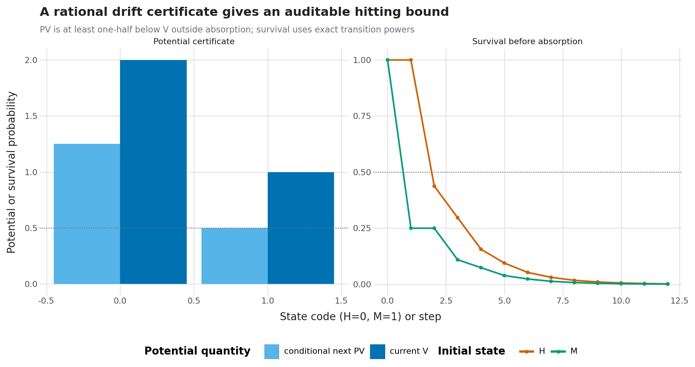

# Martingales, Supermartingales, and Drift {#sec-collatz-martingale-drift}

Negative average drift is one of the most persuasive Collatz heuristics and one
of the most frequently misused. Martingale theory explains precisely when a
conditional average can control a stopping event. It also exposes the missing
step in an argument that replaces deterministic arithmetic by independent coin
tosses.

We construct conditional expectation from finite tables, prove an additive
drift theorem, and check a complete rational three-state example. The resulting
certificate is rigorous for its declared Markov chain. Transferring such a
certificate to every positive Collatz orbit would require a separate arithmetic
theorem.
The martingale foundations and stopping cautions align with ([Williams 1991](d-bibliography.md#ref-williams1991)).

## Preparation from this book

The concise primer introduced finite probability; this chapter develops expectation
and finite random variables before using them.
Chapter 10 built the random-walk heuristic. Chapter 20 introduced martingale
language and warned about optional stopping. Chapter 36 used deterministic
potentials on graphs. This chapter supplies the proofs joining those ideas.

An **information history** $\mathcal F_t$ records everything observed by time
$t$. In a finite experiment it can be understood as a partition of all outcomes:
two outcomes lie in one cell when the observations through time $t$ cannot
distinguish them. As time passes, cells may split but never merge.

A process $X_0,X_1,\ldots$ is **adapted** when $X_t$ is known from
$\mathcal F_t$. The **conditional expectation**
$\mathbb E[Y\mid\mathcal F_t]$ is constant on every information cell and equals
the probability-weighted average of $Y$ inside that cell.

For example, toss two fair coins. After the first toss, the four outcomes split
into the cells $\{HH,HT\}$ and $\{TH,TT\}$. If $Y$ is the total number of heads,
then its conditional expectation is $3/2$ in the first cell and $1/2$ in the
second. Before observing anything its expectation is one; after both tosses it
equals the observed count.

## Martingales and one-sided drift

An integrable adapted process $(M_t)$ is a **martingale** when

$$
\mathbb E[M_{t+1}\mid\mathcal F_t]=M_t.
$$

It is a **supermartingale** when the left side is at most $M_t$, and a
**submartingale** when it is at least $M_t$. The prefix “super” refers to the
current value being above the next conditional mean, not to upward growth.

Let $B_i$ be independent fair bits and

$$
M_t=\sum_{i=1}^t(B_i-1/2).
$$

The new centered increment has conditional mean zero, so $M_t$ is a
martingale. If instead each bit has probability $p<1/2$ of one and we retain
the centering $1/2$, then the process is a supermartingale.

A nonexample is a single deterministic Collatz orbit with no random starting
rule. Its next state is already fixed, so conditional expectation adds nothing.
Putting probability on uniformly chosen residues creates a legitimate finite
probability space, but the resulting theorem inherits that sampling scope.

Every integrable adapted finite-time process has a **Doob decomposition**. Let

$$
D_t=\mathbb E[X_{t+1}-X_t\mid\mathcal F_t]
$$

and define $A_0=0$, $A_t=\sum_{j<t}D_j$. Then $M_t=X_t-A_t$ has conditional
mean-zero increments and is a martingale. This decomposition separates the
predictable drift from the residual fluctuation; it does not say the residuals
are independent.

## Stopping times and stopped processes

A random time $\tau$ is a **stopping time** when the event $\{\tau\le t\}$ can
be decided from $\mathcal F_t$. First arrival in a visible target is a stopping
time. “The last visit to a target” usually is not, because deciding that no
future return occurs requires future information.

The stopped process is

$$
M_{t\wedge\tau},
\qquad t\wedge\tau=\min(t,\tau).
$$

Before the target it follows $M_t$; after the target it remains fixed. If $M_t$
is a martingale and $\tau$ is a stopping time, the stopped process is again a
martingale under ordinary integrability conditions.

For a bounded stopping time $\tau\le N$, optional stopping gives

$$
\mathbb E[M_\tau]=\mathbb E[M_0].
$$

One proof writes

$$
M_\tau-M_0
=\sum_{t=0}^{N-1}
\mathbf1_{\{\tau>t\}}(M_{t+1}-M_t).
$$

The indicator is known at time $t$. Conditional expectation makes every summand
have mean zero. Unbounded stopping requires additional hypotheses such as
uniform integrability or suitable increment and expectation bounds.

The phrase “Collatz stopping time” names a deterministic orbit statistic. It
becomes a probabilistic stopping time only after a start or transition model is
declared, and its finiteness cannot be assumed when finiteness is the question.

## Additive drift theorem

Let $A$ be a target set and

$$
\tau=\inf\{t\ge0:X_t\in A\}.
$$

Suppose $V(X_t)\ge0$ and, for a constant $\delta>0$,

$$
\mathbb E[V(X_{t+1})\mid\mathcal F_t]
\le V(X_t)-\delta
\quad\text{on }\{t<\tau\}. \tag{42.1}
$$

The function $V$ is a probabilistic Lyapunov function. Define

$$
Y_t=V(X_{t\wedge\tau})+\delta(t\wedge\tau).
$$

On $t\ge\tau$, $Y$ is unchanged. On $t<\tau$, inequality (42.1) shows
$\mathbb E[Y_{t+1}\mid\mathcal F_t]\le Y_t$. Hence $Y_t$ is a
supermartingale. Taking expectations at a fixed time $n$ gives

$$
\mathbb E[V(X_{n\wedge\tau})]
+\delta\mathbb E[n\wedge\tau]
\le V(X_0).
$$

Discarding the nonnegative first term,

$$
\mathbb E[n\wedge\tau]\le\frac{V(X_0)}\delta.
$$

As $n$ grows, $n\wedge\tau$ increases to $\tau$. Monotone convergence yields

$$
\mathbb E\tau\le\frac{V(X_0)}\delta. \tag{42.2}
$$

A nonnegative random variable with finite expectation is finite almost surely,
so the target is reached with probability one in this model. The proof did not
require independent increments. It required the stronger conditional drift
inequality at every non-target history.

## Complete case study: a rational drift certificate

Consider states $H$ (high), $M$ (middle), and $A$ (absorbed), with transition
matrix, in that order,

$$
P=\begin{pmatrix}
1/4&3/4&0\\
1/4&0&3/4\\
0&0&1
\end{pmatrix}.
$$

Set

$$
V(H)=2,\qquad V(M)=1,\qquad V(A)=0.
$$

The conditional next potentials are

$$
PV(H)=\frac14(2)+\frac34(1)=\frac54,
$$

$$
PV(M)=\frac14(2)+\frac34(0)=\frac12.
$$

Thus the drift amounts are $3/4$ and $1/2$. Taking $\delta=1/2$ gives the
certificate

$$
PV(x)\le V(x)-\frac12
$$

outside $A$. The drift theorem proves

$$
\mathbb E_H\tau\le4,
\qquad
\mathbb E_M\tau\le2.
$$

We can solve the exact hitting times independently. First-step conditioning
gives

$$
h_H=1+\frac14h_H+\frac34h_M,
$$

$$
h_M=1+\frac14h_H.
$$

Substitution yields

$$
\frac9{16}h_H=\frac74,
\qquad
h_H=\frac{28}{9},
\qquad
h_M=\frac{16}{9}.
$$

The exact values lie below the certified bounds. A checker needs only rational
transition rows, the three rational potentials, the target label, and the
claimed $\delta$. It verifies row sums, nonnegativity, and two dot-product
inequalities.

<figure id="fig-collatz-supermartingale-drift">


<figcaption>

Figure K.1: A rational three-state chain has an exact potential drift certificate and explicitly computed absorption behavior.

</figcaption>
</figure>

[Figure K.1](#fig-collatz-supermartingale-drift) uses exact rational matrix powers before
conversion to plotting decimals. It is a theorem about the displayed chain,
not measured Collatz behavior.

### Python translation: an exact drift-certificate checker

The checker below accepts rational transition rows and potentials. It validates
the probability law before computing each statewise decrement; a decimal table
with a negative overall mean would not be an equivalent certificate.

```python
from fractions import Fraction

def verify_drift_certificate(
    states: tuple[str, ...],
    transition_rows: dict[str, tuple[Fraction, ...]],
    potentials: dict[str, Fraction],
    target_states: set[str],
) -> dict[str, Fraction]:
    """Return exact decrements V(x) - PV(x) outside the target set."""
    if not states or len(set(states)) != len(states):
        raise ValueError("states must be nonempty and distinct")
    if set(transition_rows) != set(states) or set(potentials) != set(states):
        raise ValueError("rows and potentials must name every state exactly once")
    if not target_states <= set(states):
        raise ValueError("target states must belong to the state space")
    decrements: dict[str, Fraction] = {}
    for state in states:
        row = transition_rows[state]
        if len(row) != len(states):
            raise ValueError("every transition row must match the state order")
        if any(probability < 0 for probability in row) or sum(row) != 1:
            raise ValueError("transition rows must be nonnegative and sum to one")
        if state not in target_states:
            next_potential = sum(
                probability * potentials[destination]
                for probability, destination in zip(row, states)
            )
            decrements[state] = potentials[state] - next_potential
    return decrements

state_order = ("H", "M", "A")
rows = {
    "H": (Fraction(1, 4), Fraction(3, 4), Fraction(0)),
    "M": (Fraction(1, 4), Fraction(0), Fraction(3, 4)),
    "A": (Fraction(0), Fraction(0), Fraction(1)),
}
potential = {"H": Fraction(2), "M": Fraction(1), "A": Fraction(0)}
decrements = verify_drift_certificate(state_order, rows, potential, {"A"})
print(decrements, min(decrements.values()))
```

The exact minimum is $1/2$, so the code checks the hypothesis with
$\delta=1/2$. The hitting-time conclusion still comes from the proved drift
theorem; the checker verifies its finite certificate.

## Exponential supermartingales

Additive drift controls expected hitting time. Exponential transforms control
barrier probabilities. For independent fair bits, let

$$
M_t=\sum_{i=1}^t(B_i-1/2).
$$

For any real $\lambda$, one increment has moment-generating factor

$$
\mathbb E[e^{\lambda(B_i-1/2)}]
=\cosh(\lambda/2).
$$

Therefore

$$
Z_t=
\frac{e^{\lambda M_t}}
{\cosh(\lambda/2)^t}
$$

is a nonnegative martingale. Ville's inequality states that for a nonnegative
supermartingale with $Z_0=1$,

$$
\Pr\left(\max_{t\le n}Z_t\ge c\right)\le\frac1c.
$$

It follows by stopping at the first crossing and applying bounded optional
stopping. Choosing $\lambda$ and translating the event yields a finite-horizon
upper bound on unusually large centered parity counts.

Chapter 35 optimized a related exponential bound at one terminal time. The
martingale formulation naturally handles a maximum over stopping times. Both
calculations rely on a declared random model; neither supplies arithmetic
independence along every orbit.

## Worked optional-stopping example: gambler's ruin

Let $X_t$ be a fair random walk on the integers between $0$ and $N$. From an
interior state it moves one unit left or right with equal probability. At either
endpoint it stops. Let

$$
\tau=\inf\{t:X_t\in\{0,N\}\}
$$

and start at $X_0=i$. The state itself is a martingale before stopping because
the conditional next mean is

$$
\frac12(X_t-1)+\frac12(X_t+1)=X_t.
$$

The stopped state is bounded between zero and $N$, so optional stopping is safe.
If $p_i$ is the probability of hitting $N$ before zero, then

$$
i=\mathbb E[X_\tau]=0(1-p_i)+Np_i,
$$

and therefore

$$
p_i=\frac iN.
$$

To obtain expected duration, calculate

$$
\mathbb E[X_{t+1}^2\mid\mathcal F_t]
=\frac12(X_t-1)^2+\frac12(X_t+1)^2
=X_t^2+1.
$$

Thus $X_t^2-t$ is a martingale before stopping. Applying optional stopping to
$\tau\wedge n$ first, then using boundedness and the finite-state absorption
argument, gives

$$
\mathbb E[X_\tau^2]-\mathbb E\tau=i^2.
$$

Since $X_\tau$ is zero or $N$,

$$
\mathbb E[X_\tau^2]=N^2p_i=Ni,
$$

so

$$
\mathbb E_i\tau=i(N-i). \tag{42.3}
$$

### Python translation: the closed-form ruin quantities

Once optional stopping has justified the formulas, code can make their domain
and units explicit without simulating a random path.

```python
from fractions import Fraction

def gamblers_ruin_quantities(position: int, upper_boundary: int) -> tuple[Fraction, int]:
    """Return upper-hit probability and expected duration for a fair walk."""
    if upper_boundary <= 0 or not 0 <= position <= upper_boundary:
        raise ValueError("require 0 <= position <= a positive upper boundary")
    hit_upper_probability = Fraction(position, upper_boundary)
    expected_duration = position * (upper_boundary - position)
    return hit_upper_probability, expected_duration

for position in range(6):
    print(position, gamblers_ruin_quantities(position, upper_boundary=5))
```

These values are exact consequences of the declared fair finite-state model.
They are not empirical stopping-time estimates and do not presume a Collatz
orbit reaches a boundary.

This complete example shows the proper order: define the probability space,
identify a martingale, stop first at a bounded time, justify passage to the
limit, and only then evaluate the terminal values. The same algebra performed
on an unproved Collatz hitting time would be circular.

## Exact finite parity martingales

Uniformly choose $R$ modulo $2^k$ and let
$B_1,\ldots,B_k$ be its shortcut parity prefix. The finite parity coding
theorem makes the word uniform on $\{0,1\}^k$. On this particular probability
space the coordinates are jointly independent fair bits. Hence

$$
M_t=\sum_{j=1}^t(B_j-1/2),
\qquad 0\le t\le k,
$$

is an exact martingale.

This statement is stronger than merely matching the one-bit histogram, but its
horizon is fixed before the residue is sampled. Increasing $k$ changes the
probability space. Following overlapping windows along one evolving orbit does
not repeatedly choose a fresh uniform residue.

Nor is $M_t$ exact log altitude. The multiplier-only approximation is

$$
K_t\log3-t\log2,
$$

where $K_t=\sum_{j\le t}B_j$, but the exact iterate contains an additive term.
At large starts and fixed horizon the relative correction may be small; near the
known cycle it is decisive. A martingale theorem about parity count therefore
does not automatically become one about $\log(S^t(R)/R)$.

### A finite barrier certificate

Because the horizon is bounded, one may safely stop $M_t$ when it first crosses
a level $a$ or at time $k$, whichever comes first. Exponential
supermartingales then bound the fraction of residues whose prefix contains an
unusually odd-rich initial segment. The result is an exact counting bound over a
complete residue block once the parity bijection is invoked.

To turn it into an exact arithmetic excursion count, refine each crossed word by
its affine constant and solve the height inequality on its compatible residue
class. The stochastic certificate controls how many words need inspection; the
affine checker controls what those words do.

## Drift conditions beyond a constant decrement

Sometimes a uniform additive decrement is too strong. A **state-dependent
drift** condition has

$$
\mathbb E[V(X_{t+1})-V(X_t)\mid\mathcal F_t]
\le-g(V(X_t))
$$

for a positive function $g$ outside the target. Integrating $1/g$ can produce a
hitting-time bound. A **multiplicative drift** condition

$$
\mathbb E[V(X_{t+1})\mid\mathcal F_t]
\le(1-\eta)V(X_t)
$$

implies

$$
\mathbb E[V(X_{t\wedge\tau})]
\le(1-\eta)^tV(X_0)
$$

when the stopped target potential is zero and the condition is correctly
extended. Markov's inequality can turn this expectation decay into a tail bound
when every non-target state has potential at least a positive constant.

These variants remain conditional statements. Choosing $V(n)=\log n$ because
its modeled mean decreases is not enough; the inequality must hold for the
actual conditional law at every represented state or history.

## Failure clinic: three tempting shortcuts

**Unconditional averaging.** Averaging drift over all residues may hide a small
state class with positive conditional drift. A universal conclusion must control
that class rather than average it away.

**Assuming the stopping event.** Writing $\mathbb E[M_\tau]=\mathbb E[M_0]$
before proving $\tau$ finite and the stopped family integrable uses the desired
conclusion as a hypothesis.

**Changing probability spaces.** Exact uniformity for every fixed prefix length
does not create one probability measure on positive integers that is uniform at
all scales. The compatible 2-adic measure exists, but positive integers are a
null subset and ordinary height is not controlled by it.

Each shortcut begins with a correct-looking formula. The audit must locate the
specific missing hypothesis, not merely label the whole approach “probabilistic.”

## From expected time to a tail bound

The additive drift theorem immediately gives a conservative survival bound.
Markov's inequality applied to the nonnegative hitting time yields

$$
\Pr(\tau>t)
\le\frac{\mathbb E\tau}{t}
\le\frac{V(X_0)}{\delta t}. \tag{42.4}
$$

For the three-state example started at $H$, this gives
$\Pr(\tau>t)\le4/t$. It is uninformative for $t<4$ and much looser than exact
matrix powers, but it is certified from the same two drift inequalities.

Stronger tail behavior needs stronger hypotheses. A multiplicative drift,
bounded increments, or an exponential supermartingale can yield exponential
rather than reciprocal decay. One must not advertise an exponential tail from
an additive expected-time proof alone.

### Exact matrix-power audit

For a finite absorbing chain, remove the absorbing row and column to obtain the
transient matrix

$$
Q=\begin{pmatrix}1/4&3/4\\1/4&0\end{pmatrix}.
$$

Starting from a transient row vector $v$, the survival probability after $t$
steps is

$$
vQ^t\mathbf1.
$$

Summing these probabilities over $t\ge0$ gives expected absorption time. The
matrix identity

$$
(I-Q)^{-1}=I+Q+Q^2+\cdots
$$

is justified because the finite chain absorbs and the powers tend to zero. Its
row sums reproduce $28/9$ and $16/9$. This supplies an independent exact check
of both the first-step equations and the plotted curves.

A Collatz residue model may have a similar finite matrix, but a spectral radius
below one then proves absorption only for that substochastic model. The report
must explain what escaped mass means and how every integer transition enters the
matrix.

## Residue models and Collatz translation

Uniform lifting of residues can define an exact finite Markov chain when the
state retains every bit needed for the next transition and the sampling rule is
specified. A drift certificate for that chain proves an average hitting result
under that distribution.

To reach a universal integer theorem, much more is needed:

1. every positive integer state must project to a model state;
2. transition probabilities must represent a legitimate averaging operation,
   not invented fresh randomness;
3. the potential must control ordinary height or a well-founded target;
4. exceptional deterministic paths must not be discarded by an almost-sure
   statement; and
5. all integrability or properness requirements must be proved.

Chapter 36's inequality
$w(u,v)+h(v)-h(u)\le\beta$ is pointwise on every graph edge. It is a
deterministic potential certificate. The present inequality averages outgoing
values using probabilities. Neither implies the other without additional
conditions.

## Certificate protocol

A portable drift record should include:

- ordered state identifiers and an exact target set;
- rational transition numerators and common denominators;
- proof that every row is nonnegative and sums to one;
- exact rational values of $V$ and $\delta$;
- one inequality row for every non-target state;
- the initial distribution or state;
- the theorem version connecting acceptance to (42.2); and
- an explicit label: exact chain theorem, arithmetic average, or heuristic.

Floating-point slack such as `0.5000001` is unnecessary when the table is
rational. If probabilities are themselves interval estimates, the checker must
maximize $PV$ over every allowed transition row before accepting the drift.

## Drift certificate versus pointwise rank

A rank function for deterministic termination satisfies

$$
R(F(x))<R(x)
$$

for every non-target state. A probabilistic drift certificate permits some
transitions to increase $V$ provided their conditional weighted average
decreases. The latter proves an almost-sure statement in its probability model;
the former proves termination of every represented path.

For the three-state chain, $H$ can transition to itself, so $V$ does not strictly
decrease on every step. The probability of leaving $H$ makes its expected next
value smaller. If one adversarially selected the self-loop forever, the path
would never absorb, although that infinite selection has probability zero under
the chain.

This distinction is exactly the universal Collatz barrier. A positive integer
orbit is one deterministic path, and it cannot be dismissed because a model
assigns its symbolic itinerary probability zero. A successful stochastic
transfer would need a theorem that converts modeled exceptional probability
into an arithmetic exceptional-set result with the advertised density. A
universal theorem then needs an additional mechanism eliminating the remaining
set entirely.

## Theorem-scope and failure audit

- Martingale and drift theorems require a declared probability space and
  information history.
- Conditional negative drift is stronger than a negative unconditional mean.
- Bounded optional stopping is safe; unbounded optional stopping needs further
  hypotheses.
- The rational three-state certificate is exact and independently checkable.
- Almost-sure target hitting may still allow a probability-zero exceptional
  path; the Collatz conjecture allows no exceptional positive integer.
- Exact one-step residue frequencies do not prove repeated fresh sampling.
- A deterministic graph potential and a probabilistic supermartingale are
  different certificate types.
- No known Collatz drift certificate satisfying all universal transfer
  obligations proves the conjecture.

<!-- inline-formula-code:start -->
## Formula and finite computation

A useful formula in this chapter is

$$
\mathbb E[X_{n+1}-X_n\mid\mathcal F_n]\le-\delta
$$

A finite conditional-increment table makes the drift inequality auditable state by state. The following standalone Python block expresses that finite rule with its inputs and stopping conditions visible.

```python
conditional_increments = {
    "small": [(-1.0, 0.7), (1.0, 0.3)],
    "large": [(-2.0, 0.6), (1.0, 0.4)],
}
drifts = {
    state: sum(increment * probability for increment, probability in outcomes)
    for state, outcomes in conditional_increments.items()
}
print(drifts)
```

**What the computation establishes.** The output certifies only the declared finite case. The theorem, if one is claimed, still requires the argument developed in the chapter.
<!-- inline-formula-code:end -->

## Exercises

<div class="exercise" id="collatz_conjecture-42-martingale-drift-ex-1">
<p class="exercise-title"><strong>Exercise 1</strong></p>

Compute conditional expected head count after one of two coin tosses is seen.

</div>

<div class="exercise" id="collatz_conjecture-42-martingale-drift-ex-2">
<p class="exercise-title"><strong>Exercise 2</strong></p>

Verify that centered fair-bit sums form a martingale.

</div>

<div class="exercise" id="collatz_conjecture-42-martingale-drift-ex-3">
<p class="exercise-title"><strong>Exercise 3</strong></p>

Construct a supermartingale from biased bits without changing the centering.

</div>

<div class="exercise" id="collatz_conjecture-42-martingale-drift-ex-4">
<p class="exercise-title"><strong>Exercise 4</strong></p>

Show that the event “the first head occurs by time $t$” is observable at time
$t$.

</div>

<div class="exercise" id="collatz_conjecture-42-martingale-drift-ex-5">
<p class="exercise-title"><strong>Exercise 5</strong></p>

Explain why “the last head occurs at time $t$” is generally not a stopping
time.

</div>

<div class="exercise" id="collatz_conjecture-42-martingale-drift-ex-6">
<p class="exercise-title"><strong>Exercise 6</strong></p>

Prove bounded optional stopping using the indicator-sum identity.

<details class="solution"><summary>Solution</summary>

For $\tau\le N$,

$$
M_\tau-M_0
=\sum_{t=0}^{N-1}\mathbf1_{\{\tau>t\}}(M_{t+1}-M_t).
$$

The indicator is $\mathcal F_t$-measurable. Taking conditional expectation of
each term gives the indicator times zero. The sum therefore has expectation
zero, proving $\mathbb E[M_\tau]=\mathbb E[M_0]$.

</details>

</div>

<div class="exercise" id="collatz_conjecture-42-martingale-drift-ex-7">
<p class="exercise-title"><strong>Exercise 7</strong></p>

Prove every step of the additive drift theorem.

</div>

<div class="exercise" id="collatz_conjecture-42-martingale-drift-ex-8">
<p class="exercise-title"><strong>Exercise 8</strong></p>

Verify the rational drift certificate in the case study.

<details class="solution"><summary>Solution</summary>

At $H$, the expected next potential is $5/4$, while
$V(H)-1/2=3/2$; the inequality holds with slack $1/4$. At $M$, both sides equal
$1/2$. The absorbing state is excluded from the required decrease. Thus
$\delta=1/2$ is valid.

</details>

</div>

<div class="exercise" id="collatz_conjecture-42-martingale-drift-ex-9">
<p class="exercise-title"><strong>Exercise 9</strong></p>

Solve the two hitting-time equations without using the supplied answer.

<details class="solution"><summary>Solution</summary>

Substitute $h_M=1+h_H/4$ into the first equation:

$$
h_H=1+\frac14h_H+\frac34+\frac3{16}h_H.
$$

Hence $(9/16)h_H=7/4$, so $h_H=28/9$ and
$h_M=1+7/9=16/9$.

</details>

</div>

<div class="exercise" id="collatz_conjecture-42-martingale-drift-ex-10">
<p class="exercise-title"><strong>Exercise 10</strong></p>

Compute the exact absorption probability by time $t$ from each state for
$t=1,2,3$.

</div>

<div class="exercise" id="collatz_conjecture-42-martingale-drift-ex-11">
<p class="exercise-title"><strong>Exercise 11</strong></p>

Verify that the exponential process $Z_t$ is a martingale.

</div>

<div class="exercise" id="collatz_conjecture-42-martingale-drift-ex-12">
<p class="exercise-title"><strong>Exercise 12</strong></p>

Prove Ville's inequality for a finite horizon.

</div>

<div class="exercise" id="collatz_conjecture-42-martingale-drift-ex-13">
<p class="exercise-title"><strong>Exercise 13</strong></p>

Give an example of negative unconditional drift but positive drift in one
visible state.

<details class="solution"><summary>Solution</summary>

Let a visible state be chosen uniformly from $A,B$. Give the
increment mean $-3$ in $A$ and $+1$ in $B$. The unconditional mean is $-1$,
but conditional drift in $B$ is positive. A process that can remain in $B$
cannot be controlled by the unconditional average alone.

</details>

</div>

<div class="exercise" id="collatz_conjecture-42-martingale-drift-ex-14">
<p class="exercise-title"><strong>Exercise 14</strong></p>

Design a JSON-like rational drift-certificate record.

</div>

<div class="exercise" id="collatz_conjecture-42-martingale-drift-ex-15">
<p class="exercise-title"><strong>Exercise 15</strong></p>

Compare the hypothesis of Chapter 36's edge potential with conditional
expected drift.

</div>

<div class="exercise" id="collatz_conjecture-42-martingale-drift-ex-16">
<p class="exercise-title"><strong>Exercise 16</strong></p>

Identify the missing transfer in the claim “the random Collatz walk reaches
a low state almost surely, therefore every integer reaches one.”

<details class="solution"><summary>Solution</summary>

The first statement is a theorem inside an independent random
model. The second quantifies over deterministic arithmetic starts. One must
prove that each positive orbit is controlled by the modeled filtration and
drift estimate, including model-null exceptional paths. No such transfer was
supplied.

</details>

</div>

## Selected solutions

### Solution to Exercise 6

For $\tau\le N$,

$$
M_\tau-M_0
=\sum_{t=0}^{N-1}\mathbf1_{\{\tau>t\}}(M_{t+1}-M_t).
$$

The indicator is $\mathcal F_t$-measurable. Taking conditional expectation of
each term gives the indicator times zero. The sum therefore has expectation
zero, proving $\mathbb E[M_\tau]=\mathbb E[M_0]$.

### Solution to Exercise 8

At $H$, the expected next potential is $5/4$, while
$V(H)-1/2=3/2$; the inequality holds with slack $1/4$. At $M$, both sides equal
$1/2$. The absorbing state is excluded from the required decrease. Thus
$\delta=1/2$ is valid.

### Solution to Exercise 9

Substitute $h_M=1+h_H/4$ into the first equation:

$$
h_H=1+\frac14h_H+\frac34+\frac3{16}h_H.
$$

Hence $(9/16)h_H=7/4$, so $h_H=28/9$ and
$h_M=1+7/9=16/9$.

### Solution to Exercise 13

Let a visible state be chosen uniformly from $A,B$. Give the
increment mean $-3$ in $A$ and $+1$ in $B$. The unconditional mean is $-1$,
but conditional drift in $B$ is positive. A process that can remain in $B$
cannot be controlled by the unconditional average alone.

### Solution to Exercise 16

The first statement is a theorem inside an independent random
model. The second quantifies over deterministic arithmetic starts. One must
prove that each positive orbit is controlled by the modeled filtration and
drift estimate, including model-null exceptional paths. No such transfer was
supplied.
