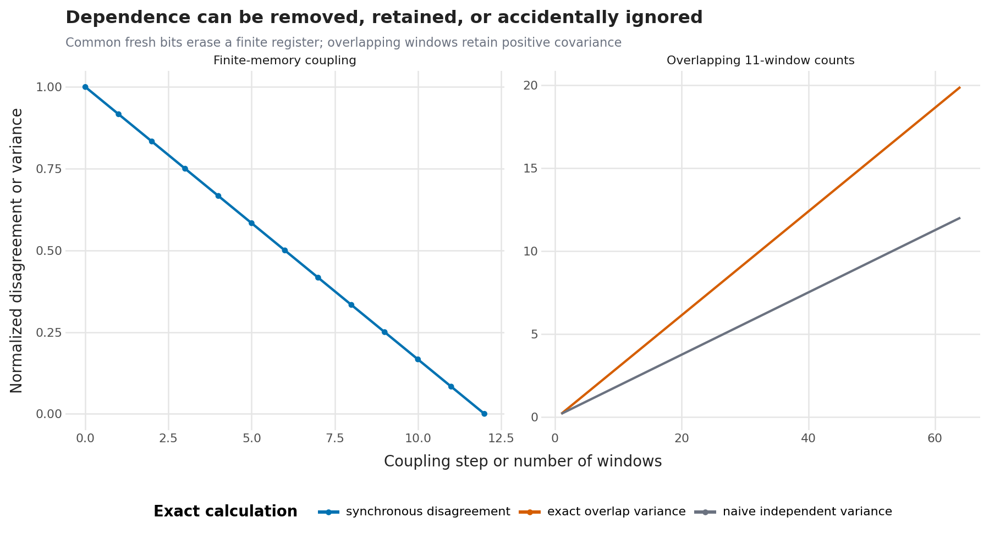

# Coupling, Concentration, and Rare Excursions {#sec-collatz-coupling-concentration}

Two datasets can have identical histograms and completely different internal
dependence. Two Collatz starts can look like separate observations and then
merge into the same tail. Coupling makes such relationships explicit by placing
two processes on one probability space. Dependence-aware concentration then
recovers valid bounds without pretending every overlapping window is a fresh
coin toss.

The chapter proves the coupling inequality, constructs an exact finite-memory
coupling, develops path coupling with its shortest-path metric hypothesis,
computes the variance of overlapping parity-pattern counts, and
derives a concentration bound by splitting dependent observations into
independent colors. Each theorem belongs to its stated model. The final audit
identifies what would be needed to control arithmetic rare excursions.
See ([Levin et al. 2017](d-bibliography.md#ref-levinpereswilmer2017); [Dubhashi and Panconesi 2009](d-bibliography.md#ref-dubhashipanconesi2009)) for broader coupling and
concentration frameworks.

## Preparation from this book

The concise primer introduced probability tables, and this chapter develops
variance. Chapter 20 compared equal
marginals with different dependence. Chapter 30 explained shared orbit tails
and resampling. Chapter 35 derived independent large-deviation bounds. No prior
probability course is assumed.

The **joint distribution** of $(X,Y)$ records probabilities of pairs. Its
**marginals** are obtained by summing over the other coordinate. Equal marginals
do not determine a joint distribution. If $X$ is a fair bit, both $Y=X$ and
$Y=1-X$ are fair, but the first pair always agrees and the second never agrees.

Covariance is

$$
\operatorname{Cov}(X,Y)
=\mathbb E[(X-\mathbb EX)(Y-\mathbb EY)].
$$

It measures linear association, not every dependence. Chapter 41 gave a
zero-covariance dependent example. Coupling uses the entire joint law instead.

## Couplings and total variation

Let $\mu$ and $\nu$ be probability distributions on the same finite state
space. A **coupling** is a pair $(X,Y)$ on one probability space such that
$X\sim\mu$ and $Y\sim\nu$. The joint law is chosen; the two marginals remain
fixed.

The **total variation distance** is

$$
\|\mu-\nu\|_{\mathrm{TV}}
=\max_A|\mu(A)-\nu(A)|
=\frac12\sum_x|\mu(x)-\nu(x)|.
$$

For every coupling,

$$
\|\mu-\nu\|_{\mathrm{TV}}\le\Pr(X\ne Y). \tag{43.1}
$$

To prove it, take any event $A$. If $X$ and $Y$ agree, their indicators of $A$
agree. Therefore

$$
|\mathbf1_{\{X\in A\}}-\mathbf1_{\{Y\in A\}}|
\le\mathbf1_{\{X\ne Y\}}.
$$

Taking expectations gives
$|\mu(A)-\nu(A)|\le\Pr(X\ne Y)$; maximize over $A$.

A **maximal coupling** attains equality. On each state, match mass
$\min(\mu(x),\nu(x))$; the total matched mass is
$1-\|\mu-\nu\|_{\mathrm{TV}}$. Distribute the unmatched remainders separately.
This construction is exact in a finite space.

### Worked maximal coupling of two coins

Let $X$ be Bernoulli with parameter $1/3$ and $Y$ Bernoulli with parameter
$3/4$. Match as much mass as possible at each value. At one, the shared mass is

$$
\min(1/3,3/4)=1/3.
$$

At zero, it is

$$
\min(2/3,1/4)=1/4.
$$

The total agreement probability is $7/12$. The unmatched $X$ mass is $5/12$
at zero, and the unmatched $Y$ mass is $5/12$ at one, so they disagree on the
remaining event. Thus

$$
\Pr(X\ne Y)=\frac5{12}.
$$

Direct calculation gives

$$
\|\mathcal L(X)-\mathcal L(Y)\|_{\mathrm{TV}}
=\frac12\left(\left|\frac13-\frac34\right|
+\left|\frac23-\frac14\right|\right)
=\frac5{12}.
$$

The coupling attains equality. An independent coupling would disagree with
probability

$$
\frac13\frac14+\frac23\frac34=\frac7{12},
$$

which is valid but weaker. Coupling is a designed proof device; independence is
not automatically the best design.

### Python translation: maximal Bernoulli coupling

Exact fractions make the common mass and unmatched mass visible. The function
returns total variation, which is also the smallest disagreement probability
over all couplings of these two Bernoulli laws.

```python
from fractions import Fraction

def bernoulli_total_variation(
    left_success: Fraction, right_success: Fraction
) -> Fraction:
    """Return total variation between two Bernoulli distributions."""
    if not 0 <= left_success <= 1 or not 0 <= right_success <= 1:
        raise ValueError("Bernoulli probabilities must lie in [0, 1]")
    left_distribution = (1 - left_success, left_success)
    right_distribution = (1 - right_success, right_success)
    return sum(
        abs(left - right)
        for left, right in zip(left_distribution, right_distribution)
    ) / 2

distance = bernoulli_total_variation(Fraction(1, 3), Fraction(3, 4))
maximal_agreement = 1 - distance
print(distance, maximal_agreement)
```

The output $5/12$ and $7/12$ reproduces the hand calculation. It certifies the
two supplied marginal laws only; constructing a process coupling requires
correct transition marginals at every step.

## Coupling Markov chains

For a Markov chain, a coupling evolves $(X_t,Y_t)$ so that each coordinate has
the correct transition law. A **synchronous coupling** uses the same new random
input whenever possible. If the coordinates meet and the coupling keeps them
together, the meeting time

$$
\tau_c=\inf\{t:X_t=Y_t\}
$$

is a coupling time. Inequality (43.1) then yields

$$
\|\mathcal L(X_t)-\mathcal L(Y_t)\|_{\mathrm{TV}}
\le\Pr(\tau_c>t).
$$

Fast meeting proves loss of memory for this chain. It does not mean numerical
states of two deterministic Collatz orbits become close in ordinary size.

## Complete case study: a shift-register coupling

Fix a memory length $m$. A state is a binary word

$$
x=(x_1,\ldots,x_m).
$$

At each step, discard $x_1$, shift left, and append an independent fair bit
$B_{t+1}$:

$$
X_{t+1}=(X_{t,2},\ldots,X_{t,m},B_{t+1}).
$$

Couple two copies by appending the same $B_{t+1}$. After one step, their oldest
coordinates have vanished. After $t$ steps, only the last $m-t$ original
coordinates can differ. After exactly $m$ steps, both registers consist of the
same fresh bits:

$$
X_m=Y_m
$$

for every pair of initial states and every realization of the fresh bits.
Therefore

$$
\Pr(X_t\ne Y_t)=0\quad(t\ge m),
$$

and all initial distributions produce the same law after $m$ transitions.

This finite chain is the low-bit shift underlying residue-window models. It
forgets a bounded prefix exactly. The 2-adic Collatz conjugacy makes related
symbolic statements exact on $\mathbb Z_2$. Positive integers, however, form a
measure-zero subset there, and ordinary magnitude is not a finite-window
observable. Exact residue mixing is not an orbit-height theorem.

## Overlapping windows create dependence

Let $B_1,\ldots,B_{r+1}$ be independent fair bits and count overlapping `11`
blocks:

$$
I_i=\mathbf1_{\{B_i=B_{i+1}=1\}},
\qquad
S_r=\sum_{i=1}^rI_i.
$$

Each indicator has

$$
\mathbb EI_i=\frac14,
\qquad
\operatorname{Var}(I_i)=\frac14\frac34=\frac3{16}.
$$

Adjacent indicators share one bit. Their joint-one event is `111`, so

$$
\mathbb E[I_iI_{i+1}]=\frac18,
$$

and

$$
\operatorname{Cov}(I_i,I_{i+1})
=\frac18-\frac1{16}=\frac1{16}.
$$

Indicators separated by at least two positions depend on disjoint source bits
and are independent. Expanding the variance of the sum gives

$$
\begin{aligned}
\operatorname{Var}(S_r)
&=\sum_{i=1}^r\operatorname{Var}(I_i)
+2\sum_{i=1}^{r-1}\operatorname{Cov}(I_i,I_{i+1})\\
&=\frac{3r}{16}+\frac{2(r-1)}{16}
=\frac{5r-2}{16}.
\end{aligned}\tag{43.2}
$$

Pretending the windows are independent gives $3r/16$ and underestimates
uncertainty by nearly forty percent for large $r$.

### Python translation: exhaustive overlap moments

For small $r$, enumerating every source word independently checks the covariance
derivation. Fractions ensure that the check tests the exact formula rather than
rounded agreement.

```python
from fractions import Fraction
from itertools import product

def overlap_moments(window_count: int) -> tuple[Fraction, Fraction]:
    """Return exact mean and variance of overlapping `11` counts."""
    if window_count <= 0:
        raise ValueError("window_count must be positive")
    source_length = window_count + 1
    counts = [
        sum(bits[index] == bits[index + 1] == 1 for index in range(window_count))
        for bits in product((0, 1), repeat=source_length)
    ]
    sample_size = len(counts)
    mean = Fraction(sum(counts), sample_size)
    variance = sum((Fraction(count) - mean) ** 2 for count in counts) / sample_size
    expected_variance = Fraction(5 * window_count - 2, 16)
    if variance != expected_variance:
        raise RuntimeError("exhaustive moments disagree with the overlap formula")
    return mean, variance

for window_count in range(1, 7):
    print(window_count, overlap_moments(window_count))
```

This is an exact finite enumeration of independent **source bits**. It does not
declare overlapping indicators independent, and it does not transfer the result
to windows cut from one deterministic orbit.

## Dependency graphs

A **dependency graph** has one vertex per random variable. Two disjoint vertex
sets with no connecting edge index independent variable families. For the
$I_i$, connect adjacent indices. The graph is a path.

A proper coloring partitions vertices into independent sets. Odd-indexed
windows use disjoint bit pairs, and so do even-indexed windows. Two colors
suffice. Coloring does not make the two color sums independent of one another;
it makes variables within each color independent, which is enough for a union
argument.

This strategy generalizes to length-$\ell$ windows of independent bits. Windows
whose starting positions differ by at least $\ell$ use disjoint inputs. Coloring
positions modulo $\ell$ yields $\ell$ independent subfamilies.

## Concentration by coloring

Hoeffding's inequality for $q$ independent variables in $[0,1]$ states

$$
\Pr\left(\sum_{j=1}^q(X_j-\mathbb EX_j)\ge s\right)
\le\exp\left(-\frac{2s^2}{q}\right).
$$

Write $S_r=S_{\mathrm{odd}}+S_{\mathrm{even}}$. If
$S_r-\mathbb ES_r\ge t$, at least one color sum exceeds its mean by $t/2$.
Let

$$
q_o=\left\lceil\frac r2\right\rceil,
\qquad
q_e=\left\lfloor\frac r2\right\rfloor.
$$

Hoeffding and the union bound give

$$
\Pr(S_r-\mathbb ES_r\ge t)
\le
\exp\left(-\frac{t^2}{2q_o}\right)
+\exp\left(-\frac{t^2}{2q_e}\right), \tag{43.3}
$$

when both color classes are nonempty. This bound may be loose, but it is valid.
An independent-window bound with $r$ fresh observations is not valid.

### Why Hoeffding has an exponential shape

For a sum $Q$ of independent bounded variables and $\lambda>0$, exponential
Markov inequality gives

$$
\Pr(Q-\mathbb EQ\ge s)
\le e^{-\lambda s}
\mathbb E[e^{\lambda(Q-\mathbb EQ)}].
$$

Independence factors the expectation. Hoeffding's lemma bounds each centered
factor for a variable in an interval of length one by
$\exp(\lambda^2/8)$. For $q$ variables,

$$
\Pr(Q-\mathbb EQ\ge s)
\le\exp\left(-\lambda s+\frac{q\lambda^2}{8}\right).
$$

The quadratic exponent is minimized at $\lambda=4s/q$, yielding

$$
\exp(-2s^2/q).
$$

This derivation identifies the independence step exactly: it factors the
moment-generating function inside one color class. The union step combining
colors does not assume the color sums are independent.

For length-$\ell$ windows, coloring starting positions modulo $\ell$ produces
at most $\ell$ classes. If the total excess is $t$, some color has excess at
least $t/\ell$. Applying Hoeffding within every color and adding the bounds gives
a valid, though often conservative, concentration inequality. The price of
dependence appears through more colors and smaller allocated deviations.

<figure id="fig-collatz-coupling-dependence">


<figcaption>

Figure L.1: Synchronous coupling erases finite register memory exactly, while overlapping parity windows have larger variance than an independence calculation claims.

</figcaption>
</figure>

## Coalescing Collatz tails

Deterministic coupling appears directly in Collatz data. Under the unaccelerated
map,

$$
C(2n)=n.
$$

The starts $n$ and $2n$ share every state after the latter's first step. If a
table stores all orbit steps from both starts, nearly the entire second record
duplicates the first tail. Treating those steps as independent observations
inflates effective information.

More generally, starts that enter one value $m$ form a **merge cluster** below
that meeting point. Cluster-aware resampling keeps a shared tail together. The
cluster definition must match the statistic: grouping at the first value below
a cutoff answers a different question from grouping by eventual equality.

The deterministic meeting does not by itself prove convergence. If the shared
tail were nonconvergent, both starts would share that failure. Coupling describes
dependence, not the destination.

### Exact relations among shared-tail statistics

If the orbit of $n$ reaches one, then under the unaccelerated map

$$
\tau(2n)=1+\tau(n).
$$

Their peaks satisfy

$$
M(2n)=\max\{2n,M(n)\}.
$$

Thus the two rows are algebraically linked, not merely correlated in an
estimated sense. If both complete traces are stored, every post-first-step value
in the $2n$ row duplicates the $n$ row. A naive row bootstrap treats an exact
identity as fresh variation.

For a bounded merge threshold $B$, define the signature of a start as its first
visited state at most $B$, together with `unresolved` if none is seen before the
step cap. Starts with the same resolved signature share the remaining tail below
$B$. Resampling whole signature clusters preserves that dependence for
statistics determined below the threshold. It does not automatically model
dependence above $B$ or extrapolate beyond the sampled range.

## Coupling contraction and the induced path metric {#sec-collatz-path-coupling}

Sometimes exact coalescence is too much to expect in one step. **Path
coupling** reduces a contraction proof to selected pairs, but it needs a
specific relation between those pairs and the distance. Connectivity alone
does not suffice.

Let $P$ be a Markov transition matrix on a finite state space $\Omega$ with
at least two states. Choose a connected undirected graph of **allowed pairs**
and assign its edges strictly positive lengths. Let $d$ be the induced
shortest-path metric: $d(x,y)$ is the minimum sum of edge lengths along an
allowed path from $x$ to $y$. This graph selects pairs for the proof; it need
not be the graph of possible transitions of $P$.

Suppose that, for every allowed pair $\{x,y\}$, there is a coupling of the
actual transition rows $P(x,\cdot)$ and $P(y,\cdot)$ such that

$$
\mathbb E[d(X_1,Y_1)]\le\rho d(x,y),
\qquad 0\le\rho<1.
$$

Then a coupling with the same bound exists for every pair of states. This is
the finite path-coupling principle; see ([Levin et al. 2017](d-bibliography.md#ref-levinpereswilmer2017), sec. 14.2,
Theorem 14.6) for the standard theorem and path-metric definition.

### Why the local couplings glue

Choose a shortest path $x=x_0,x_1,\ldots,x_r=y$. Every subpath is shortest, so

$$
\sum_{i=1}^r d(x_{i-1},x_i)=d(x,y).
$$

One may successively glue the edge couplings into a joint law of
$Z_0,\ldots,Z_r$: sample $Z_0$ from $P(x_0,\cdot)$ and then use each edge
coupling's conditional law of $Z_i$ given $Z_{i-1}$. The shared intermediate
marginal is $P(x_{i-1},\cdot)$, so induction preserves each edge joint law.
Conditional laws at zero-probability states may be chosen arbitrarily. The
triangle inequality now gives

$$
\mathbb E[d(Z_0,Z_r)]
\le\sum_{i=1}^r\mathbb E[d(Z_{i-1},Z_i)]
\le\rho\sum_{i=1}^r d(x_{i-1},x_i)
=\rho d(x,y).
$$

Fix such an endpoint coupling for each state pair, and at equal states use
the diagonal coupling, which keeps the two coordinates equal. Iterating this
coupling conditionally on the current pair preserves both Markov-chain laws
and gives

$$
\mathbb E[d(X_t,Y_t)]\le\rho^t d(x,y).
$$

Because the space is finite,
$\delta=\min_{u\ne v}d(u,v)>0$. If $\tau_c$ is the first time the coordinates
agree, their sticky construction makes
$\{\tau_c>t\}=\{X_t\ne Y_t\}$. The coupling inequality and Markov's inequality
therefore imply

$$
\|P^t(x,\cdot)-P^t(y,\cdot)\|_{\mathrm{TV}}
\le\Pr(\tau_c>t)
\le\min\left\{1,\frac{\rho^t d(x,y)}{\delta}\right\}.
$$

If all edge lengths are at least one, then $\delta\ge1$. The singleton case
is immediate without defining $\delta$. At $t=0$ use $\rho^0=1$, including
when $\rho=0$; zero contraction gives coalescence by time one. The pairwise
bound needs no stationarity or reversibility assumption. A mixing statement
to a stationary law requires that law and a further averaging step.

### A connected graph and a genuine metric can still fail {#sec-collatz-bad-path-metric}

Use states $0,1,2,3$, the allowed path `0—1—2—3`, and the metric

$$
d(0,3)=d(3,0)=1,\qquad
d(i,j)=4\ \text{for every other distinct pair}.
$$

All non-equilateral triangles have lengths $4,4,1$, so this really is a
metric. Let the chain be deterministic, with
$F(0)=F(2)=0$ and $F(1)=F(3)=3$. A coupling of deterministic transition rows
has no choice. Each allowed edge has initial distance four and image distance
one, so it satisfies the local bound even with $\rho=1/4$. Yet $0$ and $3$
are absorbing: starting there, their distance stays one and their laws remain
$\delta_0$ and $\delta_3$, at total variation distance one for every time.

The missing hypothesis is visible numerically. Giving the three allowed
edges their lengths four induces endpoint path distance twelve, whereas the
supplied metric assigns one. With the induced path metric, each edge's image
distance would be twelve, so the supposed local contraction would fail.
Triangle inequalities provide $d(x,y)\le\sum d(\text{edges})$; contraction
needs a path attaining equality, not merely a path that exists.

This standalone calculation checks the supplied metric and the three edge
ratios exactly. It also prints the endpoint ratio, which is one.

```python
from fractions import Fraction
from itertools import product

states = range(4)
bad_metric = tuple(
    tuple(0 if left == right else 1 if {left, right} == {0, 3} else 4
          for right in states)
    for left in states
)
image = (0, 3, 0, 3)
allowed_edges = ((0, 1), (1, 2), (2, 3))
if not all(
    bad_metric[left][right] <= bad_metric[left][middle] + bad_metric[middle][right]
    for left, middle, right in product(states, repeat=3)
):
    raise RuntimeError("the supplied distances fail a triangle inequality")
edge_ratios = tuple(
    Fraction(bad_metric[image[left]][image[right]], bad_metric[left][right])
    for left, right in allowed_edges
)
print(edge_ratios)
print(Fraction(bad_metric[image[0]][image[3]], bad_metric[0][3]))
```

### Complete case: random-coordinate refresh {#sec-collatz-coordinate-refresh}

Here is a different chain from the earlier shift register. On $\{0,1\}^m$,
where $m\ge1$, choose a coordinate uniformly and replace its bit by a fresh
fair bit. Couple two copies by using the **same coordinate and the same
fresh bit**. Each marginal has exactly the stated transition law, and equal
copies remain equal.

The hypercube edges join strings differing in one coordinate and have length
one. Their induced shortest-path metric is Hamming distance: every differing
coordinate must change along a path, and changing each once attains that
number. If the current Hamming distance is $h$, the chosen coordinate is
one of the $h$ disagreements with probability $h/m$. That refresh removes
one disagreement; otherwise the distance stays $h$. No new disagreement is
created. Thus, for every $m$ and every pair,

$$
\mathbb E[d_H(X_1,Y_1)]
=\frac hm(h-1)+\left(1-\frac hm\right)h
=\left(1-\frac1m\right)h.
$$

In particular the edge contraction factor is exactly $\rho=1-1/m$.
Conditional iteration gives
$\mathbb E[d_H(X_t,Y_t)]=h(1-1/m)^t$ from initial distance $h$.
The uniform distribution on the cube is stationary because refreshing one
coordinate of independent fair bits preserves that law. Coupling to a uniform
initial string, whose expected distance from any fixed start is $m/2$, gives
the valid mixing bound $\min\{1,(m/2)(1-1/m)^t\}$. It need not be the exact
total variation distance.

This program returns the exact joint one-step distribution, not just its
expected distance. Its $2m$ equally likely coordinate/bit choices allow both
coupling marginals and the contraction claim to be checked independently.

```python
from fractions import Fraction

def coupled_refresh_law(
    left: tuple[int, ...], right: tuple[int, ...]
) -> dict[tuple[tuple[int, ...], tuple[int, ...]], Fraction]:
    """Joint law using a common uniform coordinate and common fair bit."""
    if type(left) is not tuple or type(right) is not tuple:
        raise TypeError("states must be tuples")
    if not left or len(left) != len(right):
        raise ValueError("states must have the same positive length")
    if any(type(bit) is not int for bit in left + right):
        raise TypeError("bits must be integers, excluding bool")
    if any(bit not in (0, 1) for bit in left + right):
        raise ValueError("bits must be zero or one")
    size = len(left)
    law: dict[tuple[tuple[int, ...], tuple[int, ...]], Fraction] = {}
    for coordinate in range(size):
        for bit in (0, 1):
            next_left = left[:coordinate] + (bit,) + left[coordinate + 1:]
            next_right = right[:coordinate] + (bit,) + right[coordinate + 1:]
            pair = (next_left, next_right)
            law[pair] = law.get(pair, Fraction(0)) + Fraction(1, 2 * size)
    return law

law = coupled_refresh_law((0, 0, 0), (1, 0, 1))
expected_distance = sum(
    mass * sum(first != second for first, second in zip(left, right))
    for (left, right), mass in law.items()
)
print(expected_distance)
```

The output is $4/3$, from initial distance two and factor $2/3$. This exact
enumeration corroborates the implementation; the preceding argument proves
the identity for arbitrary $m$.

### Coalescence is a coordinate-cover event

An initial disagreement disappears on its coordinate's first refresh. Thus
the two chains have met precisely when all $h$ initially disagreeing
coordinates have been chosen. Inclusion–exclusion gives, for integer $t\ge0$,

$$
\Pr(\tau_c\le t)
=\sum_{j=0}^h(-1)^j\binom hj\left(\frac{m-j}{m}\right)^t.
$$

For a specified set of $j$ disagreeing coordinates, the term
$((m-j)/m)^t$ is the probability they are all unchosen. At $t=0$ use
$0^0=1$, which counts the empty coordinate word; the formula gives zero
when $h>0$ and one when $h=0$. When $h=0$, $\tau_c=0$. When $q$ original
disagreements remain, the probability of removing one on the next update is
$q/m$, so its geometric waiting time has mean $m/q$. Consequently

$$
\mathbb E[\tau_c]=m\sum_{q=1}^h\frac1q=mH_h,
\qquad H_0=0.
$$

For $m\ge2$ and $h>0$, there is positive probability of missing one required
coordinate for arbitrarily many steps; there is no deterministic coalescence
deadline. This differs from the shift register: its remaining disagreements
are shifted out by time $m$, even though its one-step Hamming contraction is
not a uniform strict factor at every configuration.

### Changed task: four coordinates and two kinds of bound {#sec-collatz-refresh-task}

Start one refresh chain at `0000`. Compare synchronous couplings with second
starts `1000`, `1100`, and `1111`. For each, find the exact probability of
coalescence by time four, the expected remaining Hamming distance then, and
the mean coalescence time. Check the first answer by enumerating all $4^4$
coordinate words, without using the inclusion–exclusion formula. Explain
when the expected-distance bound on noncoalescence needs clipping at one.

For the second pair, also calculate the actual total variation distance
between the two one-step marginal laws and compare it with this coupling's
probability of remaining unequal. Does synchronous refresh give a maximal
coupling in that case? The [separate explanation](#sec-collatz-refresh-solution)
contains the exact values and the overlapping transition masses.

### What an arithmetic transfer would still require

An attempted Collatz path coupling would need the induced path metric,
correct transition marginals, a proved local contraction, and a relation
between coalescence and the desired ordinary event. Ordinary absolute distance
expands on odd branches, while a residue metric ignores ordinary height.
The finite cube example supplies none of the missing Collatz hypotheses.

## Finite residue blocks versus one long orbit

For a uniformly chosen residue modulo $2^k$, its $k$ parity bits are exactly
independent. Counts of overlapping patterns within that word still overlap as
functions of the same bits, and equation (43.2) applies under the finite uniform
law. This is an exact finite theorem.

Now slide the same length-two window down one fixed infinite orbit. The source
bits are not newly sampled independent coordinates under a uniform positive-
integer law. The exact finite parity theorem cannot simply be restarted after
each shift, especially after conditioning on survival, altitude, or an earlier
pattern. These experiments answer different questions and need different claim
labels.

A clean report can contain both: an exact complete-residue calculation as a
baseline and an empirical long-orbit comparison with dependence diagnostics.
Agreement is evidence about the finite experiment. Disagreement can reveal
arithmetic selection. Neither outcome alone supplies an infinite transfer.

## A dependence-safe union over excursion times

Suppose a proved model bound has

$$
\Pr(A_t)\le e^{-ct}
$$

for the event that height exceeds a declared barrier at time $t$, with $c>0$.
The events may overlap heavily. Nevertheless,

$$
\Pr(\text{some }A_t\text{ occurs for }t\ge m)
\le\sum_{t=m}^{\infty}e^{-ct}
=\frac{e^{-cm}}{1-e^{-c}}. \tag{43.4}
$$

No temporal independence was used. Dependence affects how sharp the bound is
and whether the marginal estimate itself is valid, not the union inequality.

For a finite horizon $m\le t\le N$, retain the finite geometric sum rather than
silently sending $N$ to infinity. For actual Collatz arithmetic, each marginal
bound must be proved under the same sampling rule and conditioning. Importing
the independent Bernoulli rate from Chapter 35 without this transfer remains a
heuristic.

## Coupling as comparison, not forced equality

A coupling can compare two different models. One coordinate might be an exact
residue process, the other an independent approximation. If they agree through
time $t$ except on an event of probability at most $\varepsilon_t$, then every
bounded observable $f$ with $|f|\le1$ satisfies

$$
|\mathbb E f(X_t)-\mathbb E f(Y_t)|
\le2\varepsilon_t.
$$

Indeed the difference vanishes when the coordinates agree and has absolute
value at most two otherwise. This turns a quantitative coupling into a transfer
error for finite observables.

Constructing such a coupling is the difficult arithmetic step. Matching
one-step marginals is insufficient: the coupling must preserve each complete
process law and control disagreement under the conditioning used in the target
statement. A diagram showing two similar histograms is not a coupling proof.

### Reproducible comparison record

Record the two marginal process specifications, the shared randomness, the
update rule for the pair, and a proof that each coordinate has its advertised
law. Then record the disagreement event and its exact or bounded probability.
Without the marginal proof, an artificially convenient joint simulation may
compare neither intended process.

## Rare excursions under dependence

The union bound

$$
\Pr\left(\bigcup_jA_j\right)\le\sum_j\Pr(A_j)
$$

does not require independence. Therefore marginal upper bounds can still
control the probability of crossing any one of several finite-time barriers.
Dependence may make the result loose.

Multiplying moment-generating functions, applying a binomial law to overlapping
windows, or using a product likelihood does require stronger assumptions.
Chapter 35's independent rate remains a useful benchmark. To make it an
arithmetic result, one needs exact joint control over the relevant residue
blocks, conditioning, and time scale.

## Reproducible coupling laboratory

The register case needs no simulation. Enumerate all pairs of $m$-bit starts and
all appended words through length $m$, apply the synchronous update, and verify
coalescence. For the overlapping count, enumerate all $2^{r+1}$ source words at
small $r$ and compare exact mean and variance with (43.2).

A reproducibility record should distinguish:

- source bits from derived overlapping windows;
- marginal frequencies from joint transition frequencies;
- exact enumeration from Monte Carlo approximation;
- a coupling chosen for proof from the original process definition; and
- a model statement from a transferred arithmetic statement.

### Small exhaustive audit of the overlap formula

Take $r=3$, so four source bits produce three overlapping pair indicators.
Rather than simulate, enumerate all 16 source words. The expected count is
$3/4$. Formula (43.2) gives variance

$$
\frac{5\cdot3-2}{16}=\frac{13}{16}.
$$

The independent-window value would be $9/16$. An exact frequency table of
$S_3$ supplies a third check: count how many source words contain zero, one,
two, or three overlapping `11` blocks, calculate both moments, and compare the
rational results.

This audit also reveals why the indicators are one-dependent rather than
Markov by declaration. Their independence at distance two follows from disjoint
source-bit sets. It is a proved construction property, not a pattern inferred
from small covariance. For actual orbit bits, disjoint time windows still arise
from one deterministic start and are not automatically independent.

A robust implementation exports the source word, all derived indicators, and
the count. The checker recomputes indicators rather than trusting the aggregate
column. Mutation tests should shift one window endpoint and duplicate one source
word; both errors change the asserted finite law.

## Theorem-scope and failure audit

- Every coupling preserves its declared marginals.
- Coupling inequality is exact; a poor coupling may give a weak bound.
- Synchronous register coupling proves finite-window mixing after $m$ steps.
- Path coupling uses the metric induced by the allowed edge lengths; a
  connected graph and an unrelated metric are insufficient.
- Random-coordinate refresh contracts expected Hamming distance by
  $1-1/m$, but its coupling tail and marginal total variation can differ.
- Equation (43.2) exactly corrects overlap variance under independent source
  bits.
- Coloring restores independent subfamilies, not global independence.
- Shared Collatz tails make many common sampling units dependent.
- Low-bit mixing does not control ordinary height.
- No proved coupling currently forces every pair of positive Collatz orbits
  into the known cycle.

Three similar-looking phrases should now be kept separate. **Coalescence** means
two coupled coordinates become equal and remain equal. **Mixing** means a
process law forgets its initial distribution in a named metric. **Concentration**
means an observable stays near a center with high probability. Shift-register
coalescence proves mixing, and a separate bounded-difference argument proves
concentration of selected statistics. Neither word alone implies the other for
an arbitrary process.

For Collatz data, deterministic tail merging is coalescence of particular
starts, not mixing of a probability law. A narrow stopping-time histogram is a
finite concentration-like observation, not a theorem about future ranges.
Writing the intended noun first—coupling, law, observable, sample, or orbit—often
reveals whether the claimed implication has changed mathematical objects.

The reusable lesson is constructive: preserve joint structure when it is known,
partition dependence when it can be proved, and pay explicitly for whatever
independence remains a model assumption.

<!-- inline-formula-code:start -->
## Formula and finite computation

A useful formula in this chapter is

$$
\mathbb P(X_n\ne Y_n)\le\mathbb P(\tau_c>n)
$$

The synchronous register update shifts left, discards the oldest bit, and
appends one common bit. Exhaustive finite checking shows that every pair of
$m$-bit starts has coalesced after exactly $m$ shared inputs. The following
standalone Python block expresses that finite rule with its inputs and stopping
conditions visible.

```python
from itertools import product

def update_register(state: int, appended_bit: int, memory_length: int) -> int:
    """Discard the oldest bit and append one bit to a fixed-length register."""
    if memory_length <= 0:
        raise ValueError("memory_length must be positive")
    if not 0 <= state < 2**memory_length or appended_bit not in (0, 1):
        raise ValueError("state or appended bit lies outside its declared domain")
    mask = 2**memory_length - 1
    return ((state << 1) & mask) | appended_bit

def all_register_pairs_coalesce(memory_length: int) -> bool:
    """Exhaustively check synchronous coalescence after memory_length steps."""
    if memory_length <= 0:
        raise ValueError("memory_length must be positive")
    states = range(2**memory_length)
    for left_start in states:
        for right_start in states:
            for noise in product((0, 1), repeat=memory_length):
                left, right = left_start, right_start
                for appended_bit in noise:
                    left = update_register(left, appended_bit, memory_length)
                    right = update_register(right, appended_bit, memory_length)
                if left != right:
                    return False
    return True

print(all_register_pairs_coalesce(memory_length=4))
```

**What the computation establishes.** The output checks every pair and every
shared four-bit noise word. The algebraic shift argument proves the statement
for every finite memory length; the enumeration is a bounded implementation
check, not a simulation-based estimate.
<!-- inline-formula-code:end -->

## Exercises

<div class="exercise" id="collatz_conjecture-43-coupling-concentration-ex-1">
<p class="exercise-title"><strong>Exercise 1</strong></p>

Construct two joint laws of fair bits, one always equal and one always
opposite.

</div>

<div class="exercise" id="collatz_conjecture-43-coupling-concentration-ex-2">
<p class="exercise-title"><strong>Exercise 2</strong></p>

Derive the half-sum formula for total variation on a finite set.

</div>

<div class="exercise" id="collatz_conjecture-43-coupling-concentration-ex-3">
<p class="exercise-title"><strong>Exercise 3</strong></p>

Prove the coupling inequality.

<details class="solution"><summary>Solution</summary>

For any event $A$,

$$
|\mu(A)-\nu(A)|
=|\mathbb E(\mathbf1_{X\in A}-\mathbf1_{Y\in A})|
\le\Pr(X\ne Y).
$$

Taking the maximum over $A$ proves the result.

</details>

</div>

<div class="exercise" id="collatz_conjecture-43-coupling-concentration-ex-4">
<p class="exercise-title"><strong>Exercise 4</strong></p>

Construct a maximal coupling of Bernoulli distributions with parameters
$1/3$ and $3/4$.

</div>

<div class="exercise" id="collatz_conjecture-43-coupling-concentration-ex-5">
<p class="exercise-title"><strong>Exercise 5</strong></p>

Prove synchronous $m$-register coupling coalesces by time $m$.

<details class="solution"><summary>Solution</summary>

After $t$ synchronous updates, each register contains its last
$m-t$ original bits followed by the same $t$ appended bits. At $t=m$, no
original coordinate remains, so the registers are identical for every outcome.

</details>

</div>

<div class="exercise" id="collatz_conjecture-43-coupling-concentration-ex-6">
<p class="exercise-title"><strong>Exercise 6</strong></p>

Compute the normalized Hamming distance when the two initial registers are
opposite and no fresh-bit mismatch is introduced.

</div>

<div class="exercise" id="collatz_conjecture-43-coupling-concentration-ex-7">
<p class="exercise-title"><strong>Exercise 7</strong></p>

Derive every covariance term in (43.2).

</div>

<div class="exercise" id="collatz_conjecture-43-coupling-concentration-ex-8">
<p class="exercise-title"><strong>Exercise 8</strong></p>

Verify (43.2) by enumerating the eight source words when $r=2$.

<details class="solution"><summary>Solution</summary>

With three fair source bits there are two windows. Each indicator
has variance $3/16$, and both equal one only for `111`, with probability $1/8$.
Thus their covariance is $1/16$ and

$$
\operatorname{Var}(S_2)=2\frac3{16}+2\frac1{16}=\frac12,
$$

matching $(5\cdot2-2)/16$.

</details>

</div>

<div class="exercise" id="collatz_conjecture-43-coupling-concentration-ex-9">
<p class="exercise-title"><strong>Exercise 9</strong></p>

Color length-three overlapping windows into independent subfamilies.

</div>

<div class="exercise" id="collatz_conjecture-43-coupling-concentration-ex-10">
<p class="exercise-title"><strong>Exercise 10</strong></p>

Derive the two-color Hoeffding bound (43.3).

<details class="solution"><summary>Solution</summary>

If the total centered excess is at least $t$, one color has
excess at least $t/2$. Apply Hoeffding separately to $q_o$ and $q_e$ bounded
independent indicators, then add the two probabilities by the union bound.

</details>

</div>

<div class="exercise" id="collatz_conjecture-43-coupling-concentration-ex-11">
<p class="exercise-title"><strong>Exercise 11</strong></p>

Explain why two color sums need not be independent.

</div>

<div class="exercise" id="collatz_conjecture-43-coupling-concentration-ex-12">
<p class="exercise-title"><strong>Exercise 12</strong></p>

Prove that starts $n$ and $2n$ share a tail.

</div>

<div class="exercise" id="collatz_conjecture-43-coupling-concentration-ex-13">
<p class="exercise-title"><strong>Exercise 13</strong></p>

Design a cluster identifier for orbits that merge before a declared cutoff.

</div>

<div class="exercise" id="collatz_conjecture-43-coupling-concentration-ex-14">
<p class="exercise-title"><strong>Exercise 14</strong></p>

State which large-deviation step fails for overlapping windows.

</div>

<div class="exercise" id="collatz_conjecture-43-coupling-concentration-ex-15">
<p class="exercise-title"><strong>Exercise 15</strong></p>

Give a valid union-bound statement for a finite list of excursion times.

</div>

<div class="exercise" id="collatz_conjecture-43-coupling-concentration-ex-16">
<p class="exercise-title"><strong>Exercise 16</strong></p>

Audit the claim “residue windows mix, so positive Collatz orbits are
random.”

<details class="solution"><summary>Solution</summary>

Register mixing concerns a finite process supplied with fresh
independent bits. Arithmetic Collatz iteration supplies no such resampling, and
ordinary height is absent from the register state. A theorem must bridge both
differences before the conclusion can concern positive integer convergence.

</details>

</div>

<div class="exercise" id="collatz_conjecture-43-coupling-concentration-ex-17">
<p class="exercise-title"><strong>Exercise 17</strong></p>

Solve the [four-coordinate refresh task](#sec-collatz-refresh-task),
distinguishing exact coalescence, an expected-distance bound, and total
variation.

</div>

## Selected solutions

### Changed-task explanation: random-coordinate refresh {#sec-collatz-refresh-solution}

The three initial Hamming distances are $h=1,2,4$. At time four,
inclusion–exclusion or a direct count of coordinate words gives:

| Second start | $\Pr(\tau_c\le4)$ | $\Pr(\tau_c>4)$ | $\mathbb E[d_H(X_4,Y_4)]$ | $\mathbb E[\tau_c]$ |
|:--|--:|--:|--:|--:|
| `1000` | $175/256$ | $81/256$ | $81/256$ | $4$ |
| `1100` | $55/128$ | $73/128$ | $81/128$ | $6$ |
| `1111` | $3/32$ | $29/32$ | $81/64$ | $25/3$ |

For $h=1$, exactly $3^4=81$ coordinate words miss the one required
coordinate. For $h=2$, the number covering both required coordinates is
$4^4-2\cdot3^4+2^4=110$. For $h=4$, each coordinate must appear exactly once,
giving $4!=24$ words. Dividing by 256 yields the displayed probabilities.
The distance expectations are $h(3/4)^4$, and the waiting-time means are
$4H_h$. The value $81/64>1$ for `1111` shows why Markov's probability bound
must be clipped at one. Even the clipped bound one is weaker than the exact
tail $29/32$; the noncoalescence indicator is not the Hamming distance.

For starts `0000` and `1100`, one synchronous update can remove at most one
of the two disagreements, so its noncoalescence probability is one. Each
marginal law stays at its own initial string with probability $1/2$, and
moves to each of its four Hamming neighbors with probability $1/8$. Their
only common support states are `1000` and `0100`, each with mass $1/8$ in
both laws. Their total matched mass is $1/4$, and therefore

$$
\|P(0000,\cdot)-P(1100,\cdot)\|_{\mathrm{TV}}
=1-\frac14=\frac34<1.
$$

This synchronous coupling is not maximal for those marginals. It was chosen
for its simple distance contraction and preservation under iteration, which
do not assert optimal agreement at each time. All calculations concern this
finite refresh model.

### Solution to Exercise 3

For any event $A$,

$$
|\mu(A)-\nu(A)|
=|\mathbb E(\mathbf1_{X\in A}-\mathbf1_{Y\in A})|
\le\Pr(X\ne Y).
$$

Taking the maximum over $A$ proves the result.

### Solution to Exercise 5

After $t$ synchronous updates, each register contains its last
$m-t$ original bits followed by the same $t$ appended bits. At $t=m$, no
original coordinate remains, so the registers are identical for every outcome.

### Solution to Exercise 8

With three fair source bits there are two windows. Each indicator
has variance $3/16$, and both equal one only for `111`, with probability $1/8$.
Thus their covariance is $1/16$ and

$$
\operatorname{Var}(S_2)=2\frac3{16}+2\frac1{16}=\frac12,
$$

matching $(5\cdot2-2)/16$.

### Solution to Exercise 10

If the total centered excess is at least $t$, one color has
excess at least $t/2$. Apply Hoeffding separately to $q_o$ and $q_e$ bounded
independent indicators, then add the two probabilities by the union bound.

### Solution to Exercise 16

Register mixing concerns a finite process supplied with fresh
independent bits. Arithmetic Collatz iteration supplies no such resampling, and
ordinary height is absent from the register state. A theorem must bridge both
differences before the conclusion can concern positive integer convergence.
