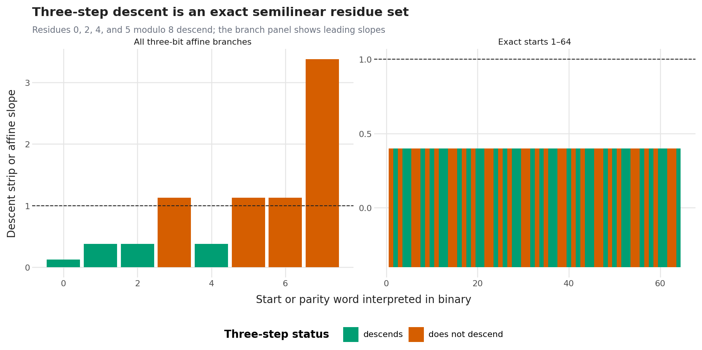

# Integer Programming, Presburger Arithmetic, and Certificates {#sec-collatz-presburger-certificates}

A bounded Collatz trace is a collection of integer equations, parity choices,
and inequalities. Integer programming can optimize over those choices.
Presburger arithmetic can eliminate the bounded intermediate variables and
describe the surviving starts as unions of arithmetic progressions. These are
powerful exact methods, but their bounded horizon is not a technical footnote:
unbounded iteration is the quantifier that contains the open problem.

This chapter constructs branch encodings without assumed solver knowledge,
derives the complete three-step shortcut descent set, and specifies proof
objects that can be checked independently of a fast optimizer.
The wider algorithmic settings are surveyed in ([Haase 2018](d-bibliography.md#ref-haase2018)) and
([Schrijver 1986](d-bibliography.md#ref-schrijver1986)).

## Preparation from this book

The concise primer introduced linear equations, inequalities, congruences,
quantifiers, algorithms, and exact integer arithmetic. Chapters 4 and 21
developed parity words and residue classes;
Chapters 32 and 37 introduced decision problems, SAT, and SMT.

A **linear expression** in integer variables is

$$
a_1x_1+\cdots+a_dx_d+b
$$

with fixed integer coefficients. A **linear constraint** compares two such
expressions using equality or an inequality. Integer programming asks whether
integer variables satisfy a finite collection of constraints, often while
minimizing or maximizing a linear objective.

Real linear programming permits fractional variables. The real constraints
$0\le x\le1$ and $x=1/2$ are feasible; the same constraints with $x$ required
integer are infeasible. Integrality is not a cosmetic restriction.

A **binary variable** $b\in\{0,1\}$ represents a branch choice. It does not
automatically mean parity: the encoding must connect $b$ to an equation proving
that the current state really has the selected parity.

## Exact branch relations

Use the shortcut map

$$
S(x)=\begin{cases}
x/2,&x\text{ even},\\
(3x+1)/2,&x\text{ odd}.
\end{cases}
$$

One transition from $x$ to $y$ is the disjunction

$$
(x=2y)
\quad\lor\quad
(x=2q+1\ \land\ 3x+1=2y) \tag{44.1}
$$

for an integer $q\ge0$. In the first branch, $x=2y$ already proves evenness.
In the second, $x=2q+1$ proves oddness and the second equation proves exact
division. Multiplication is only by fixed constants, so every equation is
linear.

A nonexample is

$$
y=b(3x+1)/2+(1-b)x/2.
$$

The products $bx$ are nonlinear variable products, division may be inexact, and
nothing forces $b$ to match parity. A compact-looking formula can be a weaker
encoding than an explicit disjunction.

## Integer-programming encodings

Many mixed-integer solvers support **indicator constraints**:

$$
b=0\Longrightarrow x=2y,
$$

$$
b=1\Longrightarrow x=2q+1\ \land\ 3x+1=2y.
$$

If indicators are unavailable, one may use big-$M$ inequalities that deactivate
one branch. The constant $M$ must follow from proved bounds. Guessing a large
number risks either excluding valid traces when it is too small or causing
numerical instability when it is enormous.

For starts $1\le x_0\le N$ and $h$ unaccelerated steps, the conservative
recurrence

$$
B_0=N,
\qquad
B_{j+1}=3B_j+1
$$

proves $x_j\le B_j$. It ignores divisions and is loose, but it is safe. Every
big-$M$ term can then be derived from the largest possible residual over these
explicit intervals. A tighter bound is welcome only with a proof.

For exact proof production, disjunctive branch enumeration or an SMT integer
formula may be preferable to numerically conditioned big-$M$ optimization.

## Presburger arithmetic

**Presburger arithmetic** is first-order arithmetic with integer variables,
addition, order, fixed integer constants, logical connectives, and quantifiers.
Congruences are expressible because

$$
x\equiv r\pmod m
\quad\Longleftrightarrow\quad
\exists q\in\mathbb Z:\ x=r+mq.
$$

Multiplication of variables such as $xy$ is excluded. Multiplication by a fixed
constant, such as $3x$, is repeated addition and is allowed.

Presburger arithmetic is decidable: an algorithm can determine the truth of
every sentence in the language. Decision procedures may be very expensive, so
decidable does not mean fast. More importantly, a relation describing one
Collatz step does not make its arbitrary transitive closure a fixed finite
formula.

In one dimension, Presburger-definable sets are **semilinear**: finite unions of
sets built from a base value plus nonnegative combinations of fixed periods.
Equivalently, they are eventually periodic. A union of residue classes modulo
$m$, perhaps with finitely many exceptional small values, is the simplest
example.

## Fixed-horizon trace formulas

For a fixed horizon $h$, introduce integers $x_0,\ldots,x_h$ and apply relation
(44.1) at each adjacent pair. The statement “descent at exactly time $h$” is

$$
x_0>0\ \land\ x_h<x_0
\ \land\
\bigwedge_{i=0}^{h-1}\operatorname{Step}(x_i,x_{i+1}). \tag{44.2}
$$

Descent by time $h$ replaces $x_h<x_0$ by a finite disjunction over
$x_1,\ldots,x_h$. All quantifiers and constraints remain Presburger.

There are $2^h$ formal parity words. For each one, intermediate variables can be
eliminated by substitution, producing

$$
S^h(x)=\frac{3^kx+b}{2^h}
$$

on one compatible residue modulo $2^h$. The inequality then becomes linear in
$x$. This word-by-word elimination is transparent and independently checkable,
although exponential in $h$.

## Complete case study: all three-step branches

For $h=3$, symbolic composition yields the following exact table.

| word | compatible residue $r\pmod8$ | $S^3(x)$ |
|:---:|---:|:---|
| `000` | 0 | $x/8$ |
| `001` | 4 | $(3x+4)/8$ |
| `010` | 2 | $(3x+2)/8$ |
| `011` | 6 | $(9x+10)/8$ |
| `100` | 5 | $(3x+1)/8$ |
| `101` | 1 | $(9x+7)/8$ |
| `110` | 3 | $(9x+5)/8$ |
| `111` | 7 | $(27x+19)/8$ |

Let us derive `101` completely. The equations are

$$
3x_0+1=2x_1,
\qquad
x_1=2x_2,
\qquad
3x_2+1=2x_3.
$$

Substitution gives

$$
x_2=\frac{3x_0+1}{4},
\qquad
x_3=\frac{9x_0+7}{8}.
$$

The required integrality and parities yield $x_0\equiv1\pmod8$. The descent
inequality would be

$$
\frac{9x_0+7}{8}<x_0,
$$

or $x_0<-7$, so no positive start in this class descends at step three.

For `100`, the compatible class is $5\pmod8$ and

$$
S^3(x)=\frac{3x+1}{8}<x
$$

for every positive $x$. The other rows are decided in the same way. The exact
result is

$$
S^3(x)<x
\quad\Longleftrightarrow\quad
x\equiv0,2,4,5\pmod8
\qquad(x>0). \tag{44.3}
$$

Equation (44.3) is a complete semilinear description, not an empirical pattern.
It can be checked by replaying eight affine formulas and inequalities.

### Python translation: generate and check the branch table

This bounded checker derives the table rather than copying it. For each formal
word it computes the affine numerator, reconstructs the unique compatible
residue, and tests the least positive member of that class. Because a row is
marked universally descending only when its leading coefficient is below the
denominator, descent at the least member then persists along the whole residue
tail.

```python
from itertools import product

def shortcut_affine_row(word: str) -> tuple[int, int, int]:
    """Return coefficient, offset, and denominator for a shortcut parity word."""
    if not word or any(symbol not in "01" for symbol in word):
        raise ValueError("word must be a nonempty binary string")
    coefficient, offset, denominator = 1, 0, 1
    for symbol in word:
        if symbol == "0":
            denominator *= 2
        else:
            coefficient *= 3
            offset = 3 * offset + denominator
            denominator *= 2
    return coefficient, offset, denominator

def shortcut_prefix(residue: int, horizon: int) -> str:
    """Return the horizon-symbol shortcut word of a nonnegative representative."""
    if residue < 0 or horizon < 0:
        raise ValueError("residue and horizon must be nonnegative")
    value = residue
    symbols: list[str] = []
    for _ in range(horizon):
        symbols.append(str(value % 2))
        value = value // 2 if value % 2 == 0 else (3 * value + 1) // 2
    return "".join(symbols)

def fixed_horizon_rows(
    horizon: int,
) -> list[tuple[str, int, int, int, int, bool]]:
    """Return word, residue, affine data, and universal-positive descent flag."""
    if horizon <= 0:
        raise ValueError("horizon must be positive")
    modulus = 2**horizon
    rows: list[tuple[str, int, int, int, int, bool]] = []
    for symbols in product("01", repeat=horizon):
        word = "".join(symbols)
        residues = [
            residue
            for residue in range(modulus)
            if shortcut_prefix(residue, horizon) == word
        ]
        if len(residues) != 1:
            raise RuntimeError("parity word did not identify exactly one residue")
        residue = residues[0]
        coefficient, offset, denominator = shortcut_affine_row(word)
        least_positive_member = residue if residue > 0 else modulus
        descends_for_entire_positive_class = (
            coefficient < denominator
            and coefficient * least_positive_member + offset
            < denominator * least_positive_member
        )
        rows.append(
            (
                word,
                residue,
                coefficient,
                offset,
                denominator,
                descends_for_entire_positive_class,
            )
        )
    return rows

three_step_rows = fixed_horizon_rows(horizon=3)
print(three_step_rows)
print([row[1] for row in three_step_rows if row[-1]])
```

The last output is `[0, 4, 2, 5]`, the table order version of
$\{0,2,4,5\}\pmod8$. This is a complete check for a fixed three-step horizon;
it does not quantify over unbounded time.

## Why every fixed-horizon descent set is semilinear

The three-step calculation is not an accident. Fix $h$. Every parity word $w$
of length $h$ has one compatible residue $r_w\pmod{2^h}$ and an affine formula

$$
S^h(x)=\frac{3^{k_w}x+b_w}{2^h}.
$$

On that class, descent is equivalent to

$$
(2^h-3^{k_w})x>b_w. \tag{44.4}
$$

If $2^h-3^{k_w}\le0$, the positive right side prevents descent. If the
coefficient is positive, (44.4) says

$$
x>\frac{b_w}{2^h-3^{k_w}}.
$$

Thus the descending starts for this word are all sufficiently large positive
members of one residue class, with a finite list of smaller exceptions. A finite
union over the $2^h$ words is semilinear. The same reasoning applies to descent
by time $h$, using a finite union over times and words.

This proof gives a direct decision procedure:

1. enumerate each word exactly once;
2. compute $(k_w,b_w)$ by integer recurrence;
3. reconstruct $r_w$;
4. compare the leading coefficient with $2^h$;
5. calculate the integer threshold when it is positive; and
6. output the residue tail plus explicit small exceptions.

The procedure may be exponentially expensive, but it terminates for each fixed
$h$ and emits a checkable normal form.

### Strict inequalities over integers

For integer expressions, strict inequalities can be normalized without
floating point:

$$
a<b\quad\Longleftrightarrow\quad a\le b-1.
$$

Likewise, the least integer $x$ satisfying $Dx>b$ for positive integer $D$ is

$$
x_{\min}=\left\lfloor\frac bD\right\rfloor+1.
$$

If only one residue $r\pmod m$ is allowed, compute the least class member at or
above $x_{\min}$ by exact quotient and remainder. This avoids an off-by-one
error when $b/D$ is itself an integer.

### Python translation: align an exact threshold with a residue class

The arithmetic below implements both the strict integer threshold and the
congruence alignment. Returning `None` keeps noncontracting affine rows distinct
from a very large threshold.

```python
def least_class_member_at_or_above(
    residue: int, modulus: int, minimum: int
) -> int:
    """Return the least positive x >= minimum with x congruent to residue."""
    if modulus <= 0 or not 0 <= residue < modulus or minimum <= 0:
        raise ValueError("require a positive modulus/minimum and normalized residue")
    first_positive = residue if residue > 0 else modulus
    if first_positive >= minimum:
        return first_positive
    increments = (minimum - first_positive + modulus - 1) // modulus
    return first_positive + increments * modulus

def affine_descent_tail_start(
    coefficient: int,
    offset: int,
    denominator: int,
    residue: int,
) -> int | None:
    """Return the first compatible positive start after which the row descends."""
    if coefficient < 0 or offset < 0 or denominator <= 0:
        raise ValueError("affine data must be nonnegative with positive denominator")
    difference = denominator - coefficient
    if difference <= 0:
        return None
    integer_threshold = offset // difference + 1
    return least_class_member_at_or_above(
        residue, denominator, integer_threshold
    )

print(affine_descent_tail_start(3, 1, 8, residue=5))
print(affine_descent_tail_start(9, 7, 8, residue=1))
```

The outputs `5` and `None` distinguish an entire descending residue tail from a
row whose leading multiplier already prevents descent at that horizon.

<figure id="fig-collatz-presburger-descent">


<figcaption>

Figure M.1: Three-step shortcut descent repeats as an exact union of four residue classes, with every parity word linked to its affine branch.

</figcaption>
</figure>

## Optimization questions

A bounded model may optimize:

- the number of odd branches, $\sum_i b_i$;
- the largest intermediate state, using a variable $p\ge x_i$;
- the final affine value;
- a weighted penalty for selected residue transitions; or
- the minimum start satisfying a bounded non-descent condition.

An optimizer's feasible assignment is a candidate witness. An independent
checker should decode every integer state, replay the map, verify the objective,
and compare it with any claimed bound.

Optimality or infeasibility is harder than feasibility. A certificate may be a
complete branch-and-bound tree whose leaves are closed by exact inequalities,
or a translation to SAT with a checked resolution certificate. Trusting the
solver's final status string alone is not a proof protocol.

### A bounded optimization case

Ask for the largest number of odd steps among three-step words that descend at
the third step for every positive compatible start. From the exact table, the
feasible words are `000`, `001`, `010`, and `100`. Their odd counts are zero or
one, so the optimum is one. The three witnesses with one odd bit establish the
lower bound; checking all other rows establishes the upper bound.

If the word variables were given to a solver, the output `optimum = 1` would not
explain either side. A compact certificate contains one feasible word and a
cover of all branches with odd count at least two, each rejected by its affine
inequality. Optimization proofs always need a witness plus an exclusion of every
better value.

For a larger horizon, dynamic programming or MILP can avoid listing every word
in the producer. The independent checker may still use a branch certificate,
an exact dual bound on a finite graph, or a SAT proof. Producer speed and checker
simplicity are separate design goals.

## Bounded cycle constraints

A period-$h$ cycle adds $x_h=x_0$ to the trace. One can require positivity,
exclude the known cycle, demand primitive period, and impose value bounds.
Alternatively, a fixed parity word gives the affine closure equation

$$
(2^h-3^k)x=b.
$$

Exact divisibility can reject a word without numerical logarithms. The bounded
search proves only that no cycle exists within the stated period, value, and map
convention. An aperiodic divergent orbit remains a different possibility.

## Certificates and trusted boundaries

A fixed-horizon elimination certificate can store one row per word:

$$
(w,r,h,k,b,\text{inequality range},\text{status}).
$$

The checker should:

1. recompute the affine coefficients from $w$;
2. reconstruct the compatible residue modulo $2^h$;
3. prove the stated linear inequality on the entire residue tail;
4. enumerate and check any finite exceptions;
5. verify that every word occurs once; and
6. report unresolved rows rather than silently dropping them.

For an integer-program certificate, record variable domains, all coefficients,
the exact objective, solver and format versions, and a proof object. Decimal
solver tolerances must not redefine integer equality.

### Feasible witnesses, unsatisfiability, and optimality

These statuses require different evidence.

- A **feasible witness** is checked by substitution and branch replay.
- **Unsatisfiability** requires a proof that every branch or logical assignment
  closes; failure to find a witness is insufficient.
- **Optimality** requires a feasible value $v$ and an unsatisfiability proof for
  values better than $v$.

An SMT model may use mathematical integers, while a bit-vector model uses
modular arithmetic. The certificate must name the theory. If a bit-vector
solution is decoded as an integer orbit, a separate range proof must show no
operation wrapped.

Presburger quantifier elimination can itself be treated as an untrusted
producer. A small checker substitutes the resulting semilinear description into
the original bounded relation in both directions, perhaps by checking residue
cases and threshold inequalities. Trust need not include the full elimination
engine.

## Quantifier-elimination clinic

Consider one shortcut step and the question $S(x)<x$ for $x>1$. The even branch
has $x=2y$ and $y<x$ immediately. The odd branch has $2y=3x+1$, so $y>x$ for
positive $x$. Eliminating $y$ gives

$$
S(x)<x\quad\Longleftrightarrow\quad x\equiv0\pmod2
\qquad(x>1).
$$

At two steps, enumerate `00`, `01`, `10`, and `11`. The compatible residues are
$0,2,1,3\pmod4$, respectively. Their formulas are

$$
\frac x4,\qquad\frac{3x+2}{4},\qquad
\frac{3x+1}{4},\qquad\frac{9x+5}{4}.
$$

The first three descend for their positive class members apart from any
explicit boundary equality, while `11` rises. This small calculation shows how
the semilinear description refines as the horizon grows. It also supplies base
cases for testing a general eliminator before the eight-row case.

Quantifier elimination never licenses discarding the original formula. The
checker should verify equivalence, not merely compare a few representatives.

## Combining congruences inside a certificate

Additional arithmetic filters often intersect a power-of-two parity class with
another modulus. For example,

$$
x\equiv5\pmod8,
\qquad
x\equiv1\pmod3
$$

combine to

$$
x\equiv13\pmod{24}.
$$

Checking $13$ verifies both congruences, and the Chinese remainder theorem proves
uniqueness modulo $24$ because 8 and 3 are coprime. If moduli are not coprime,
compatibility requires their residues to agree modulo the greatest common
divisor.

An elimination certificate should normalize intersections rather than count
the same integer through overlapping descriptions. Store each progression with
a least admissible element and period, sort them, and either prove disjointness
or apply an exact union algorithm. Adding the cardinalities of overlapping
progressions is a coverage bug.

### One-way versus equivalent elimination

A derived semilinear set can be checked in two directions:

1. every listed progression satisfies the original trace formula; and
2. every solution of the trace formula belongs to a listed progression.

The first proves soundness but may miss starts. The second proves completeness.
A finite verification or optimizer often needs both; a search for examples may
need only soundness. The certificate's claim must state which direction was
checked.

For the three-step table, compatible residues cover all eight classes exactly,
which proves completeness of branch enumeration. Replaying the inequality in
each class proves the descent classification. These are separate checks and
should remain separate in code and in prose.

## Why unbounded iteration remains hard

For every fixed $h$, the set

$$
D_h=\{x>0:\exists j\le h, S^j(x)<x\}
$$

is Presburger definable and effectively semilinear. The universal finite-
stopping statement has quantifiers

$$
\forall x>1\ \exists h\ge1:\ S^h(x)<x.
$$

No single fixed $h$ appears. Showing that each $D_h$ is computable does not show
their increasing union contains every positive integer. A proof would need one
finite cover, a uniform bound depending on controlled data, a well-founded rank,
or another argument governing the unbounded existential horizon.

Presburger decidability cannot be invoked on an infinite disjunction with one
new trace length per term as though it were a finite formula.

## Bounded-start versus bounded-horizon verification

Two finite problems are easily confused. Fixing a start bound $N$ but allowing
each orbit to run until it descends is a finite-domain computation whose runtime
must still be shown to terminate for every tested start. Fixing a horizon $h$
but allowing every positive start produces an infinite-domain semilinear theorem
through symbolic elimination. Bounding both gives an ordinary finite formula.

The three-step theorem (44.3) has unbounded starts and bounded time. An
exhaustive verification below $N$ has bounded starts and start-dependent times.
Neither subsumes the other automatically. They can cooperate: semilinear classes
cover most starts uniformly, while explicit iteration handles finite threshold
exceptions.

A certificate header should therefore store separate fields for start domain,
time horizon, stopping predicate, and class modulus. The phrase “verified to
three steps” is incomplete unless it says whether every start, every start below
a bound, or a selected residue set is quantified.

This separation also guides scaling. Increasing $h$ doubles formal words in a
naive eliminator; increasing $N$ enlarges finite enumeration. Compression methods
and proof obligations differ, so performance comparisons must not merge their
cost axes.

## Theorem-scope and failure audit

- Fixed-horizon Collatz relations use only Presburger operations.
- Word elimination yields exact affine and semilinear descriptions.
- Equation (44.3) is a universal theorem for three shortcut steps.
- A feasible solver assignment needs exact replay before becoming a witness.
- Infeasibility and optimality require checkable proof objects.
- A timeout, `unknown`, or empty search log has no mathematical status.
- A bounded cycle exclusion does not rule out longer cycles or aperiodic escape.
- Decidability of each fixed horizon does not decide an unbounded transitive
  closure.

<!-- inline-formula-code:start -->
## Formula and finite computation

A useful formula in this chapter is

$$
d_{k,a}=2^k-3^a>0
$$

Enumerating positive denominators supplies finite candidates, not a proof of cycles. The following standalone Python block expresses that finite rule with its inputs and stopping conditions visible.

```python
def positive_cycle_denominators(max_length: int) -> list[tuple[int, int, int]]:
    """Return finite pairs (k,r,2**k-3**r) with positive denominator."""
    if max_length <= 0:
        raise ValueError("max_length must be positive")
    rows: list[tuple[int, int, int]] = []
    for length in range(1, max_length + 1):
        for odd_steps in range(length + 1):
            denominator = 2**length - 3**odd_steps
            if denominator > 0:
                rows.append((length, odd_steps, denominator))
    return rows

candidates = positive_cycle_denominators(12)
print(len(candidates))
print(candidates[:20])
```

**What the computation establishes.** The calculation checks a declared finite instance; the surrounding argument explains what is true beyond those inputs.
<!-- inline-formula-code:end -->

## Exercises

<div class="exercise" id="collatz_conjecture-44-presburger-certificates-ex-1">
<p class="exercise-title"><strong>Exercise 1</strong></p>

Explain why $x=1/2$ separates real and integer feasibility.

</div>

<div class="exercise" id="collatz_conjecture-44-presburger-certificates-ex-2">
<p class="exercise-title"><strong>Exercise 2</strong></p>

Write exact even and odd branch relations without a variable product.

</div>

<div class="exercise" id="collatz_conjecture-44-presburger-certificates-ex-3">
<p class="exercise-title"><strong>Exercise 3</strong></p>

Identify every defect in the nonlinear compact encoding shown above.

</div>

<div class="exercise" id="collatz_conjecture-44-presburger-certificates-ex-4">
<p class="exercise-title"><strong>Exercise 4</strong></p>

Derive a safe bound through four unaccelerated steps from starts at most
$N$.

<details class="solution"><summary>Solution</summary>

Set $B_0=N$ and $B_{j+1}=3B_j+1$. Then

$$
B_1=3N+1,\qquad B_2=9N+4,\qquad
B_3=27N+13,\qquad B_4=81N+40.
$$

Induction proves every unaccelerated state is at most the corresponding bound,
because an even step is smaller and an odd step equals $3x+1$.

</details>

</div>

<div class="exercise" id="collatz_conjecture-44-presburger-certificates-ex-5">
<p class="exercise-title"><strong>Exercise 5</strong></p>

Express $x\equiv5\pmod8$ in Presburger arithmetic.

</div>

<div class="exercise" id="collatz_conjecture-44-presburger-certificates-ex-6">
<p class="exercise-title"><strong>Exercise 6</strong></p>

Eliminate the intermediate states for word `100`.

<details class="solution"><summary>Solution</summary>

The branches give

$$
3x_0+1=2x_1,\qquad x_1=2x_2,\qquad x_2=2x_3.
$$

Hence $x_3=(3x_0+1)/8$. Exact parity forces $x_0\equiv5\pmod8$.
Since $3x_0+1<8x_0$ for every positive integer, the whole class descends.

</details>

</div>

<div class="exercise" id="collatz_conjecture-44-presburger-certificates-ex-7">
<p class="exercise-title"><strong>Exercise 7</strong></p>

Eliminate them for `011` and find its compatible residue.

<details class="solution"><summary>Solution</summary>

For `011`,

$$
x_1=x_0/2,\qquad
x_2=(3x_1+1)/2,\qquad
x_3=(3x_2+1)/2,
$$

so $x_3=(9x_0+10)/8$. Tracing or solving the integrality conditions gives
$x_0\equiv6\pmod8$. Since $9x_0+10>8x_0$, no positive member descends at the
third step.

</details>

</div>

<div class="exercise" id="collatz_conjecture-44-presburger-certificates-ex-8">
<p class="exercise-title"><strong>Exercise 8</strong></p>

Verify every row of the three-step table.

</div>

<div class="exercise" id="collatz_conjecture-44-presburger-certificates-ex-9">
<p class="exercise-title"><strong>Exercise 9</strong></p>

Prove equation (44.3).

<details class="solution"><summary>Solution</summary>

The rows with leading coefficients $1$ or $3$ satisfy descent
for every positive compatible start; their residues are $0,4,2,5$. Rows with
leading coefficients $9$ or $27$ have positive additive terms and exceed the
start. Reordering the first set gives $0,2,4,5\pmod8$.

</details>

</div>

<div class="exercise" id="collatz_conjecture-44-presburger-certificates-ex-10">
<p class="exercise-title"><strong>Exercise 10</strong></p>

Write a formula for descent by, rather than exactly at, three steps.

</div>

<div class="exercise" id="collatz_conjecture-44-presburger-certificates-ex-11">
<p class="exercise-title"><strong>Exercise 11</strong></p>

Give a semilinear set with a finite exceptional prefix.

</div>

<div class="exercise" id="collatz_conjecture-44-presburger-certificates-ex-12">
<p class="exercise-title"><strong>Exercise 12</strong></p>

Encode a bounded maximum intermediate value.

</div>

<div class="exercise" id="collatz_conjecture-44-presburger-certificates-ex-13">
<p class="exercise-title"><strong>Exercise 13</strong></p>

State an exact checker for a feasible ILP orbit witness.

</div>

<div class="exercise" id="collatz_conjecture-44-presburger-certificates-ex-14">
<p class="exercise-title"><strong>Exercise 14</strong></p>

Design a certificate row for one infeasible parity word.

</div>

<div class="exercise" id="collatz_conjecture-44-presburger-certificates-ex-15">
<p class="exercise-title"><strong>Exercise 15</strong></p>

Explain why period at most 20 is not the same as no nontrivial cycle.

</div>

<div class="exercise" id="collatz_conjecture-44-presburger-certificates-ex-16">
<p class="exercise-title"><strong>Exercise 16</strong></p>

Negate the universal finite-stopping statement with correct quantifiers.

<details class="solution"><summary>Solution</summary>

Negation gives

$$
\exists x>1\ \forall h\ge1:\ S^h(x)\ge x.
$$

Such a start never descends below itself. It need not rise monotonically and
need not be periodic.

</details>

</div>

<div class="exercise" id="collatz_conjecture-44-presburger-certificates-ex-17">
<p class="exercise-title"><strong>Exercise 17</strong></p>

Diagnose the claim “every bounded trace is decidable, so Collatz is
decidable by Presburger arithmetic.”

</div>

## Selected solutions

### Solution to Exercise 4

Set $B_0=N$ and $B_{j+1}=3B_j+1$. Then

$$
B_1=3N+1,\qquad B_2=9N+4,\qquad
B_3=27N+13,\qquad B_4=81N+40.
$$

Induction proves every unaccelerated state is at most the corresponding bound,
because an even step is smaller and an odd step equals $3x+1$.

### Solution to Exercise 6

The branches give

$$
3x_0+1=2x_1,\qquad x_1=2x_2,\qquad x_2=2x_3.
$$

Hence $x_3=(3x_0+1)/8$. Exact parity forces $x_0\equiv5\pmod8$.
Since $3x_0+1<8x_0$ for every positive integer, the whole class descends.

### Solution to Exercise 7

For `011`,

$$
x_1=x_0/2,\qquad
x_2=(3x_1+1)/2,\qquad
x_3=(3x_2+1)/2,
$$

so $x_3=(9x_0+10)/8$. Tracing or solving the integrality conditions gives
$x_0\equiv6\pmod8$. Since $9x_0+10>8x_0$, no positive member descends at the
third step.

### Solution to Exercise 9

The rows with leading coefficients $1$ or $3$ satisfy descent
for every positive compatible start; their residues are $0,4,2,5$. Rows with
leading coefficients $9$ or $27$ have positive additive terms and exceed the
start. Reordering the first set gives $0,2,4,5\pmod8$.

### Solution to Exercise 16

Negation gives

$$
\exists x>1\ \forall h\ge1:\ S^h(x)\ge x.
$$

Such a start never descends below itself. It need not rise monotonically and
need not be periodic.
