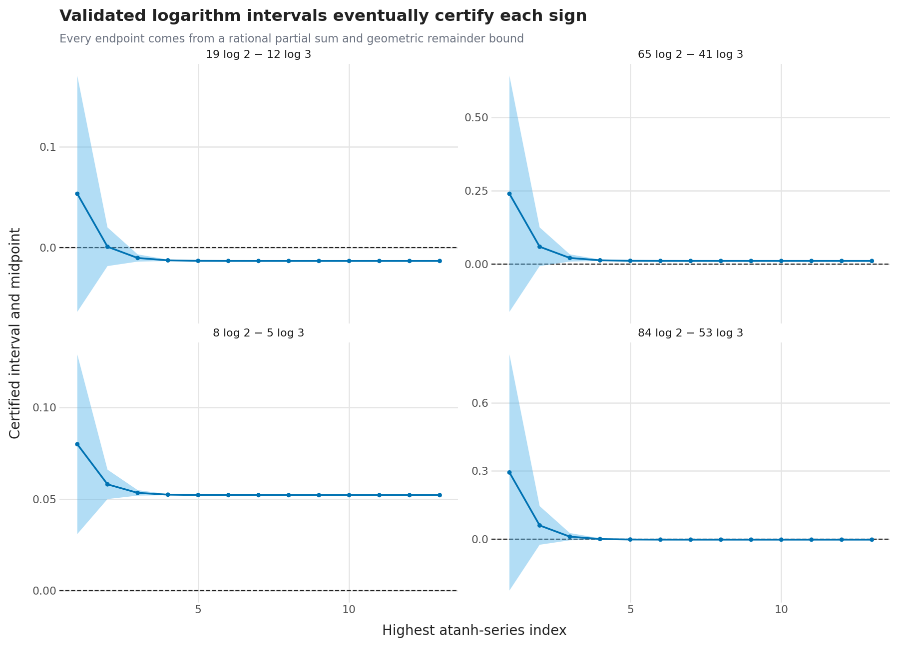

# Rigorous Interval Arithmetic and Validated Numerics {#sec-collatz-interval-arithmetic}

Computers usually store a nearby binary number rather than an arbitrary real
number. A displayed negative logarithmic drift can therefore be a numerical
suggestion rather than a proved sign. Interval arithmetic repairs the logical
gap: every computed quantity is enclosed between certified endpoints, and a
sign is asserted only when the entire enclosure lies on one side of zero.

This chapter builds interval operations from inequalities, certifies logarithms
with a rational series remainder, and proves a path bound from interval edge
weights and exact potentials. Exact integer arithmetic remains preferable when
it can answer the question directly.
The validated-numerics and floating-point background follows
([Moore et al. 2009](d-bibliography.md#ref-moorekearfottcloud2009); [Higham 2002](d-bibliography.md#ref-higham2002)).

## Preparation from this book

The concise primer introduced fractions, decimals, inequalities, and logarithms.
Chapter 7 warned about integer overflow.
Chapter 23 used logarithmic cycle forms, Chapter 35 computed rate functions,
Chapter 36 requested interval graph weights, and Chapter 37 separated bit-vector
arithmetic from mathematical integers. No numerical-analysis course is assumed.

An approximation such as $\pi\approx3.14159$ reports closeness informally. An
**enclosure**

$$
3.14159<\pi<3.14160
$$

is a mathematical statement. A closed interval

$$
[a,b]=\{x\in\mathbb R:a\le x\le b\}
$$

stores such a statement compactly.

Most binary floating-point formats represent numbers
$\pm m2^e$ with finitely many bits in $m$. The decimal $0.1$ has an infinite
binary expansion, so it is rounded. Round-to-nearest usually minimizes error,
but an ordinary rounded result is not automatically an upper or lower bound.

### A representability failure with integers

The common binary64 format has 53 bits of significand precision, including its
implicit leading bit. Every integer through $2^{53}$ is exact, but
$2^{53}+1$ lies halfway between representable neighbors and cannot be stored as
itself. Converting it to binary64 under round-to-nearest produces $2^{53}$.
Consequently an ordinary floating comparison may report

```text
float(2^53 + 1) == float(2^53)
```

even though the mathematical integers differ. Collatz states must therefore
remain exact integers. Floating point belongs only in derived quantities such as
plots or logarithmic estimates, with the estimate's status visible.

Cancellation creates another danger. Subtracting two large nearby rounded
numbers can destroy most meaningful digits. A result close to zero is exactly
where a sign proof needs the strongest error control.

## Interval inclusion

If $x\in X$ and $y\in Y$, an interval operation must produce a set containing
every possible exact result. For
$X=[a,b]$ and $Y=[c,d]$,

$$
X+Y=[a+c,b+d],
$$

$$
X-Y=[a-d,b-c].
$$

For multiplication, evaluate the four endpoint products:

$$
XY=
[\min(ac,ad,bc,bd),\max(ac,ad,bc,bd)].
$$

If $0\notin Y$, division is multiplication by the reciprocal interval. If
$0\in Y$, the ordinary quotient may be unbounded or disconnected; returning a
single finite interval would be unsound.

When endpoints are machine floats, the lower result must be rounded toward
$-\infty$ and the upper result toward $+\infty$. This is **outward rounding**.
Using round-to-nearest for both can move an endpoint inward and exclude the true
value.

Exact rational endpoints avoid primitive rounding for addition and
multiplication. Their numerators and denominators may grow, so practical systems
often combine arbitrary-precision directed rounding with independently
checkable rational certificates for final claims.

### Soundness by structural induction

An interval evaluator can be proved correct once for every expression tree. At
a leaf, the input interval is assumed to contain the true constant or variable.
At an internal node, assume the child intervals contain their exact values.
Apply an inclusion-preserving primitive operation and outward rounding; the
parent interval then contains the exact parent value. Induction reaches the
root.

This proof separates two obligations. The mathematical primitive rule must be
inclusive, and the implementation must round outward. Unit tests with familiar
values help but cannot replace either obligation. A certificate checker may use
exact rational endpoints and theorem-specific remainder bounds, avoiding trust
in the producer's floating-point environment.

## Monotone functions and domains

If $f$ is increasing on $[a,b]$, then

$$
f([a,b])=[f(a),f(b)]
$$

provided the endpoint evaluations are enclosed outward. The logarithm is
increasing on $(0,\infty)$, so a log interval must first prove its input lower
endpoint is positive. The exponential is increasing everywhere.

For a function that changes direction, critical points must be included. For
example, squaring $[-2,3]$ is $[0,9]$, not $[4,9]$, because zero lies inside the
input interval.

A nonexample is evaluating $1/X$ for $X=[-1,1]$ and returning $[-1,1]$.
Values near zero have arbitrarily large reciprocals and the reciprocal set has
two unbounded pieces.

## Dependency and overestimation

Intervals record ranges, not correlations between repeated occurrences. If
$X=[0,1]$, direct interval subtraction gives

$$
X-X=[-1,1],
$$

although the expression $x-x$ equals zero for every single $x$. Treating the
two appearances as independent choices loses dependency information.

Algebraic reformulation can help. Evaluate $x(1-x)$ on $[0,1]$ naively:

$$
[0,1](1-[0,1])=[0,1].
$$

Completing the square gives

$$
x(1-x)=\frac14-(x-1/2)^2,
$$

which encloses the exact range $[0,1/4]$. Subdividing $[0,1]$ and taking the
union of smaller enclosures also tightens the bound.

Wide intervals are not incorrect when they contain the truth. If an enclosure
straddles zero, the sign is **inconclusive**, not false. Increase precision,
subdivide a domain, or reformulate the expression; never select the desired
endpoint.

## Exact arithmetic first

Many apparent real comparisons in Collatz reduce to integers. The sign of

$$
A\log2-r\log3
$$

equals the sign of

$$
\log\left(\frac{2^A}{3^r}\right),
$$

which equals the sign of $2^A-3^r$. Exact arbitrary-precision powers decide it
without logarithms. Exact divisibility similarly decides a cycle closure.

Intervals remain valuable when expressions combine several elementary
functions, optimized real parameters, error terms, or graph weights in a way
that does not collapse to one integer comparison. A good workflow always asks
whether integer or rational algebra can remove the numerical layer first.

## Certified logarithms from a rational series

For $x>0$, define

$$
z=\frac{x-1}{x+1}.
$$

Then $|z|<1$ and

$$
\log x=2\operatorname{atanh}(z)
=2\sum_{j=0}^{\infty}\frac{z^{2j+1}}{2j+1}. \tag{45.1}
$$

For $x>1$, every term is positive. Truncate after $j=m$. Since the omitted
denominators are at least $2m+3$,

$$
\begin{aligned}
0<R_m
&=2\sum_{j=m+1}^{\infty}\frac{z^{2j+1}}{2j+1}\\
&\le
\frac{2z^{2m+3}}{2m+3}\sum_{q=0}^{\infty}z^{2q}\\
&=
\frac{2z^{2m+3}}{(2m+3)(1-z^2)}.
\end{aligned}\tag{45.2}
$$

Equations (45.1) and (45.2) give rational endpoints whenever $x$ is rational.
For $x=2$, $z=1/3$; for $x=3$, $z=1/2$. The calculation therefore needs only
integer powers, fractions, and an exact geometric-tail bound.

### Python translation: certified rational logarithm bounds

The partial sum is a lower bound and the displayed geometric remainder is an
upper error bound. The implementation accepts only $x>1$, the domain on which
this one-sided positive-tail proof applies.

```python
from fractions import Fraction

def rational_log_interval(
    value: Fraction, maximum_index: int
) -> tuple[Fraction, Fraction]:
    """Enclose log(value) using terms j=0,...,maximum_index of (45.1)."""
    if value <= 1:
        raise ValueError("this positive-tail implementation requires value > 1")
    if maximum_index < 0:
        raise ValueError("maximum_index must be nonnegative")
    transformed = (value - 1) / (value + 1)
    lower = 2 * sum(
        transformed ** (2 * index + 1) / (2 * index + 1)
        for index in range(maximum_index + 1)
    )
    remainder = (
        2
        * transformed ** (2 * maximum_index + 3)
        / ((2 * maximum_index + 3) * (1 - transformed**2))
    )
    return lower, lower + remainder

def linear_log_interval(
    power_of_two: int, power_of_three: int, maximum_index: int
) -> tuple[Fraction, Fraction]:
    """Enclose power_of_two*log(2) - power_of_three*log(3)."""
    if power_of_two < 0 or power_of_three < 0:
        raise ValueError("coefficients must be nonnegative")
    lower_two, upper_two = rational_log_interval(Fraction(2), maximum_index)
    lower_three, upper_three = rational_log_interval(Fraction(3), maximum_index)
    return (
        power_of_two * lower_two - power_of_three * upper_three,
        power_of_two * upper_two - power_of_three * lower_three,
    )

lower, upper = linear_log_interval(84, 53, maximum_index=12)
print(float(lower), float(upper), upper < 0)
print("exact integer cross-check:", 2**84 < 3**53)
```

The boolean sign is certified from rational endpoints. The converted decimals
are only a display; retaining the two fractions preserves the proof object.

## Complete case study: a certified logarithmic sign

Consider

$$
\Lambda=84\log2-53\log3.
$$

Let $L_2,U_2$ and $L_3,U_3$ be the rational lower and upper bounds from the
first thirteen terms, $m=12$. Multiplication by positive constants and
subtraction give

$$
84L_2-53U_3
\le\Lambda\le
84U_2-53L_3.
$$

Exact rational evaluation, displayed with outward-rounded decimal endpoints,
gives

$$
\Lambda\in
[-0.002088134,-0.002088094]. \tag{45.3}
$$

Both endpoints are negative, so $\Lambda<0$ is certified. Consequently

$$
2^{84}<3^{53}.
$$

An odd-only positive cycle with total valuation $84$ across $53$ odd steps
would require the opposite inequality and is therefore impossible. This
eliminates one aggregate parameter pair, not every valuation word or every
cycle length.

The exact integer cross-check computes

$$
2^{84}-3^{53}<0.
$$

Agreement checks both the series implementation and the sign interpretation.
In production, the certificate should retain the exact rational endpoints, not
only their displayed decimals.

### Certifying the multiplier threshold

The shortcut multiplier is below one when the odd fraction $a$ satisfies

$$
a<\alpha:=\frac{\log2}{\log3}.
$$

Positive enclosures $\log2\in[L_2,U_2]$ and
$\log3\in[L_3,U_3]$ imply

$$
\alpha\in\left[\frac{L_2}{U_3},\frac{U_2}{L_3}\right].
$$

Using deeper versions of the same rational series certifies, for example,

$$
0.63092975357145
<\alpha<
0.63092975357147.
$$

For an integer word with $k$ odd steps among $n$, comparing $3^k$ and $2^n$
is still the preferred exact test. The threshold interval is useful for plotting,
screening parameter ranges, and checking a decimal label. It should not replace
the exact power comparison in a finite certificate.

<figure id="fig-collatz-interval-certificates">


<figcaption>

Figure N.1: Rational logarithm enclosures shrink with series depth and certify the signs of selected near-cancellation pairs only when zero is excluded.

</figcaption>
</figure>

## Validated graph bounds

Suppose each exact edge weight $w(u,v)$ is enclosed by

$$
w(u,v)\in[L_{uv},U_{uv}].
$$

Let $h$ and $\beta$ be exact rational values satisfying

$$
U_{uv}+h(v)-h(u)\le\beta \tag{45.4}
$$

on every edge. Since $w\le U$, summing along a path
$v_0\to\cdots\to v_n$ gives

$$
\sum_{i=0}^{n-1}w(v_i,v_{i+1})
\le n\beta+h(v_0)-h(v_n). \tag{45.5}
$$

The potential terms telescope. If each exact weight is

$$
w_i=\log\frac{x_{i+1}}{x_i},
$$

the left side is $\log(x_n/x_0)$. Exponentiating (45.5) gives

$$
\frac{x_n}{x_0}
\le
\exp\bigl(n\beta+h(v_0)-h(v_n)\bigr).
$$

This is a valid orbit bound only when every integer transition projects to a
checked edge and $U_{uv}$ bounds the exact log ratio for every integer represented
by that edge. An interval calculation cannot repair a missing projection
theorem.

### Python translation: interval-potential slacks

For a finite edge list, the following checker returns the exact rational slack
$\beta-(U_{uv}+h(v)-h(u))$ on every edge. A negative entry exposes the precise
failed row rather than reducing the result to a single unchecked boolean.

```python
from fractions import Fraction

def interval_potential_slacks(
    edges: list[tuple[str, str, Fraction]],
    potential: dict[str, Fraction],
    beta: Fraction,
) -> list[tuple[str, str, Fraction]]:
    """Return exact slack for each upper-bounded weighted edge."""
    if not edges:
        raise ValueError("at least one edge is required")
    slacks: list[tuple[str, str, Fraction]] = []
    for source, destination, upper_weight in edges:
        if source not in potential or destination not in potential:
            raise ValueError("every edge endpoint needs a potential value")
        slack = beta - (
            upper_weight + potential[destination] - potential[source]
        )
        slacks.append((source, destination, slack))
    return slacks

edge_bounds = [
    ("A", "B", Fraction(1, 4)),
    ("B", "A", Fraction(-1, 2)),
]
potential = {"A": Fraction(0), "B": Fraction(-1, 4)}
slacks = interval_potential_slacks(edge_bounds, potential, beta=Fraction(0))
print(slacks, all(slack >= 0 for _, _, slack in slacks))
```

This checks one finite graph certificate. It says nothing about omitted edges
or whether the graph represents every positive-integer transition; those are
separate coverage obligations.

## Rates and optimized parameters

Chapter 35's Bernoulli rate

$$
I_p(a)=a\log\frac ap+(1-a)\log\frac{1-a}{1-p}
$$

can be enclosed by interval logarithms after proving all arguments positive.
When $a$ itself is an interval, repeated occurrences create dependency. A
derivative analysis can prove monotonicity on a subinterval, or the domain can be
subdivided. Reporting many ordinary decimal digits without an enclosure does not
certify an optimized Chernoff exponent.

The same principle applies to spectral radii and fitted exponents. Numerical
exploration may locate a candidate. A proof needs an independently checkable
residual bound, interval eigenvalue theorem, rational potential, or another
validated bridge appropriate to the claim.

## Worked affine interval over a residue tail

Take parity word `100`, for which

$$
S^3(x)=\frac{3x+1}{8},
\qquad x\equiv5\pmod8.
$$

For every compatible $x\ge5$,

$$
\frac{S^3(x)}x
=\frac{3+1/x}{8}.
$$

Because $1/x$ decreases on $[5,\infty)$,

$$
\frac38
<\frac{S^3(x)}x
\le\frac{3+1/5}{8}
=\frac25.
$$

Thus

$$
\log\frac{S^3(x)}x\le\log(2/5)<0.
$$

The rational inequality $S^3(x)/x\le2/5$ already proves contraction; an
interval logarithm is useful only if this edge weight must be combined with
other logarithmic weights. The example demonstrates a good hierarchy: prove a
rational range on the affine expression, apply monotonicity, then enclose the
transcendental function.

For word `101`,

$$
\frac{S^3(x)}x=\frac{9+7/x}{8}>\frac98,
$$

so every positive compatible start rises at this horizon. Combining both words
into one interval without retaining the word label would straddle one and lose
the useful conclusion. State refinement can be a numerical necessity as well as
an arithmetic one.

## Interval Newton as a vista

Validated root finding can prove that an equation has one root in a box. For a
differentiable $f$, choose midpoint $m$ of interval $X$ and an interval
enclosure $f'(X)$. When zero is not in $f'(X)$, form

$$
N(X)=m-\frac{f(m)}{f'(X)}.
$$

If $N(X)\subseteq X$, interval Newton theory can certify existence and
uniqueness under its hypotheses. If $N(X)$ misses $X$, the interval contains no
root. A practical checker must enclose $f(m)$, the derivative, and the division.

This tool can validate an optimized tilting parameter in a Chernoff calculation
or a spectral equation. It does not solve an integer orbit question merely
because a real surrogate has a unique optimum. The map from the validated real
result back to the arithmetic claim remains an explicit proof obligation.

## Certificate format and precision escalation

A portable validated-real certificate should include:

- the exact expression tree and variable domains;
- rational input endpoints;
- the directed-rounding or series rule used at each node;
- precision and library versions for reproducibility;
- exact remainder formulas for transcendental functions;
- a final rational interval;
- the decision predicate, such as “upper endpoint below zero”; and
- an independent checker that does not trust a plotted decimal.

Start at modest precision. If zero lies outside the result, stop with a
certificate. If zero lies inside, double precision or series depth. If width
stagnates, inspect dependency and subdivide. If the exact mathematical value is
zero, no precision will produce a strict-sign certificate; the workflow should
permit an inconclusive outcome.

## Reproducible validated-numerics laboratory

For the logarithm case, use exact rational arithmetic to generate every partial
sum and remainder. Export rows

$$
(A,r,m,\Lambda_{\mathrm{low}},\Lambda_{\mathrm{high}},\text{status}).
$$

A second program parses rational numerators and denominators, verifies the tail
formula, recomputes the combined interval, and checks any declared sign. The
Plotnine figure consumes this exported table but is not itself the certificate.

Mutation tests should swap an endpoint, round inward, omit a remainder, include
a zero denominator, and alter one coefficient. The checker must reject each
corruption.

### Independent replay at lower complexity

The producer may use a large multiprecision library and adaptive algorithms. A
checker for the logarithm certificate needs much less: exact rational parsing,
integer exponentiation, the finite sum, and the geometric remainder formula.
For a graph certificate it also needs edge lookup and rational inequality
checks. The PNG, plotting library, and exploratory optimizer lie outside the
trusted base.

Hashes establish that the checked bytes are the published bytes. They do not
prove the expression encoded by those bytes is the intended Collatz quantity.
The manifest must therefore include a human-readable formula and convention as
well as the machine record.

## Midpoint-radius form and accumulated error

An interval $[a,b]$ can be written as midpoint plus radius,

$$
m=\frac{a+b}{2},
\qquad
r=\frac{b-a}{2},
\qquad
[a,b]=m+[-r,r].
$$

This form is useful for reporting a central numerical value together with a
rigorous absolute error. The radius must be rounded upward. Writing
`value = m ± r` is rigorous only when the interval construction proves the
enclosure; the symbol itself does not create one.

For a sum of independently derived enclosures, worst-case radii add. Statistical
standard errors do not add in the same way and do not provide deterministic
rounding bounds. Keep numerical error, sampling uncertainty, and model error in
separate fields.

## Figure and table audit

The validated value table is authoritative; the figure is a view. Before
plotting, convert exact endpoints to ordinary floats only after expanding them
outward enough that the displayed ribbon still contains the certified interval.
At typical image resolution this final expansion is visually negligible but
logically documented.

Every axis should state whether it shows interval width, midpoint, lower bound,
or upper bound. A line joining midpoints can cross zero even when individual
intervals remain inconclusive, and a log scale cannot display a signed value
without transformation. The caption must state the expression, parameter pairs,
series depth, and sign rule.

For tabular publication, retain rational endpoints in a machine-readable file
and show shortened outward decimals in prose. Rounding both endpoints to the
same number of decimal places under round-to-nearest can accidentally narrow the
published interval.

## A validated-numerics claim ladder

Validated computation supports several distinct conclusions.

1. An **enclosure claim** says the exact value lies in a stated interval.
2. A **sign claim** adds that the interval lies strictly above or below zero.
3. An **optimizer claim** requires coverage of the whole search domain, not only
   an enclosed candidate value.
4. A **dynamical claim** requires the enclosed quantity to bound every relevant
   transition or path.
5. A **Collatz claim** still carries the original finite, density, or universal
   quantifiers.

Each step needs a new proof obligation. A tiny radius establishes precision,
not domain coverage. A certified negative edge mean establishes a finite graph
fact, not the projection of every integer orbit. A projected average may leave
exceptional paths. Keeping these levels separate prevents a highly accurate
number from acquiring an unjustified theorem status.

When a computation remains inconclusive, publish the enclosure and the reason:
insufficient precision, dependency width, a zero derivative interval, or an
unproved domain reduction. An honest inconclusive certificate is reusable data;
a forced sign is a false proof object.

## Theorem-scope and failure audit

- Outward interval operations prove inclusion when all inputs and domains are
  valid.
- An interval excluding zero certifies a sign; one containing zero is
  inconclusive.
- Exact integer and rational comparisons supersede floating point when
  available.
- More digits do not compensate for inward rounding or a missing remainder.
- A finite graph inequality needs a total arithmetic projection before it
  controls every represented orbit.
- Validated numerics can certify finite inequalities, not change a bounded
  quantifier into a universal one.
- No interval computation in this chapter proves the Collatz conjecture.

<!-- inline-formula-code:start -->
## Formula and finite computation

A useful formula in this chapter is

$$
[a,b]+[c,d]=[a+c,b+d]
$$

Exact rational endpoints give a transparent finite interval calculation. The
same functions also translate subtraction and the four-product multiplication
rule from this section. The following standalone Python block expresses those
finite rules with their inputs visible.

```python
from fractions import Fraction

def validate_interval(interval: tuple[Fraction, Fraction]) -> None:
    """Reject reversed rational interval endpoints."""
    if interval[0] > interval[1]:
        raise ValueError("lower endpoint must not exceed upper endpoint")

def add_intervals(
    left: tuple[Fraction, Fraction], right: tuple[Fraction, Fraction]
) -> tuple[Fraction, Fraction]:
    validate_interval(left)
    validate_interval(right)
    return left[0] + right[0], left[1] + right[1]

def subtract_intervals(
    left: tuple[Fraction, Fraction], right: tuple[Fraction, Fraction]
) -> tuple[Fraction, Fraction]:
    validate_interval(left)
    validate_interval(right)
    return left[0] - right[1], left[1] - right[0]

def multiply_intervals(
    left: tuple[Fraction, Fraction], right: tuple[Fraction, Fraction]
) -> tuple[Fraction, Fraction]:
    validate_interval(left)
    validate_interval(right)
    products = (
        left[0] * right[0],
        left[0] * right[1],
        left[1] * right[0],
        left[1] * right[1],
    )
    return min(products), max(products)

left = (Fraction(1, 10), Fraction(101, 1_000))
right = (Fraction(1, 5), Fraction(201, 1_000))
print(add_intervals(left, right))
print(subtract_intervals(left, right))
print(multiply_intervals(left, right))
```

**What the computation establishes.** Fraction arithmetic evaluates these
three interval operations exactly for the declared rational endpoints. A
floating-point implementation would additionally need directed rounding at
every primitive operation.
<!-- inline-formula-code:end -->

## Exercises

<div class="exercise" id="collatz_conjecture-45-interval-arithmetic-ex-1">
<p class="exercise-title"><strong>Exercise 1</strong></p>

Explain why decimal $0.1$ is not generally exact in binary floating point.

</div>

<div class="exercise" id="collatz_conjecture-45-interval-arithmetic-ex-2">
<p class="exercise-title"><strong>Exercise 2</strong></p>

Add and subtract two supplied rational intervals.

</div>

<div class="exercise" id="collatz_conjecture-45-interval-arithmetic-ex-3">
<p class="exercise-title"><strong>Exercise 3</strong></p>

Derive the four-product multiplication rule.

</div>

<div class="exercise" id="collatz_conjecture-45-interval-arithmetic-ex-4">
<p class="exercise-title"><strong>Exercise 4</strong></p>

Explain why division by an interval containing zero needs special handling.

</div>

<div class="exercise" id="collatz_conjecture-45-interval-arithmetic-ex-5">
<p class="exercise-title"><strong>Exercise 5</strong></p>

Compute both $X-X$ and the exact range of $x-x$ for $X=[0,1]$.

</div>

<div class="exercise" id="collatz_conjecture-45-interval-arithmetic-ex-6">
<p class="exercise-title"><strong>Exercise 6</strong></p>

Tighten the range of $x(1-x)$ by completing the square.

<details class="solution"><summary>Solution</summary>

Direct evaluation gives the valid but wide interval $[0,1]$.
Since

$$
x(1-x)=\frac14-(x-1/2)^2
$$

and $(x-1/2)^2\in[0,1/4]$ on $[0,1]$, the exact range is $[0,1/4]$.

</details>

</div>

<div class="exercise" id="collatz_conjecture-45-interval-arithmetic-ex-7">
<p class="exercise-title"><strong>Exercise 7</strong></p>

Derive identity (45.1) from the power series for $\operatorname{atanh}$.

</div>

<div class="exercise" id="collatz_conjecture-45-interval-arithmetic-ex-8">
<p class="exercise-title"><strong>Exercise 8</strong></p>

Prove the remainder bound (45.2).

<details class="solution"><summary>Solution</summary>

For $j\ge m+1$, replace $2j+1$ by its smaller lower bound
$2m+3$. Factor out $z^{2m+3}$ and sum the remaining geometric series in
$z^2$. Multiplying by two gives

$$
R_m\le
\frac{2z^{2m+3}}{(2m+3)(1-z^2)}.
$$

Every inequality points upward because $0<z<1$.

</details>

</div>

<div class="exercise" id="collatz_conjecture-45-interval-arithmetic-ex-9">
<p class="exercise-title"><strong>Exercise 9</strong></p>

Reproduce enclosure (45.3) with exact fractions.

</div>

<div class="exercise" id="collatz_conjecture-45-interval-arithmetic-ex-10">
<p class="exercise-title"><strong>Exercise 10</strong></p>

Verify its sign by comparing integer powers.

</div>

<div class="exercise" id="collatz_conjecture-45-interval-arithmetic-ex-11">
<p class="exercise-title"><strong>Exercise 11</strong></p>

Explain the scope of the cycle exclusion obtained from $(84,53)$.

<details class="solution"><summary>Solution</summary>

Negativity of $84\log2-53\log3$ rules out a positive
odd-only cycle with exactly 53 odd states and total valuation 84, because
positive closure requires $2^{84}>3^{53}$. It says nothing about other pairs,
aperiodic nonconvergence, or convergence of all starts.

</details>

</div>

<div class="exercise" id="collatz_conjecture-45-interval-arithmetic-ex-12">
<p class="exercise-title"><strong>Exercise 12</strong></p>

Prove the telescoping interval-potential bound (45.5).

<details class="solution"><summary>Solution</summary>

Replace each $w_i$ by its upper endpoint and apply (45.4):

$$
w_i\le\beta+h(v_i)-h(v_{i+1}).
$$

Summing cancels every interior potential, leaving
$n\beta+h(v_0)-h(v_n)$.

</details>

</div>

<div class="exercise" id="collatz_conjecture-45-interval-arithmetic-ex-13">
<p class="exercise-title"><strong>Exercise 13</strong></p>

List the projection obligations for applying (45.5) to residue states.

</div>

<div class="exercise" id="collatz_conjecture-45-interval-arithmetic-ex-14">
<p class="exercise-title"><strong>Exercise 14</strong></p>

Give an expression whose interval range improves after subdivision.

</div>

<div class="exercise" id="collatz_conjecture-45-interval-arithmetic-ex-15">
<p class="exercise-title"><strong>Exercise 15</strong></p>

Design a precision-escalation policy that permits “inconclusive.”

</div>

<div class="exercise" id="collatz_conjecture-45-interval-arithmetic-ex-16">
<p class="exercise-title"><strong>Exercise 16</strong></p>

Specify a mutation test for an interval certificate checker.

</div>

<div class="exercise" id="collatz_conjecture-45-interval-arithmetic-ex-17">
<p class="exercise-title"><strong>Exercise 17</strong></p>

Audit the claim “the computed cycle mean is $-10^{-12}$, so every orbit
descends.”

<details class="solution"><summary>Solution</summary>

The decimal needs a certified enclosure, the finite graph needs
a proved projection and complete edge set, and a negative cycle mean controls
cycles or modeled path averages only under its stated hypotheses. The universal
conclusion exceeds all three scopes.

</details>

</div>

## Selected solutions

### Solution to Exercise 6

Direct evaluation gives the valid but wide interval $[0,1]$.
Since

$$
x(1-x)=\frac14-(x-1/2)^2
$$

and $(x-1/2)^2\in[0,1/4]$ on $[0,1]$, the exact range is $[0,1/4]$.

### Solution to Exercise 8

For $j\ge m+1$, replace $2j+1$ by its smaller lower bound
$2m+3$. Factor out $z^{2m+3}$ and sum the remaining geometric series in
$z^2$. Multiplying by two gives

$$
R_m\le
\frac{2z^{2m+3}}{(2m+3)(1-z^2)}.
$$

Every inequality points upward because $0<z<1$.

### Solution to Exercise 11

Negativity of $84\log2-53\log3$ rules out a positive
odd-only cycle with exactly 53 odd states and total valuation 84, because
positive closure requires $2^{84}>3^{53}$. It says nothing about other pairs,
aperiodic nonconvergence, or convergence of all starts.

### Solution to Exercise 12

Replace each $w_i$ by its upper endpoint and apply (45.4):

$$
w_i\le\beta+h(v_i)-h(v_{i+1}).
$$

Summing cancels every interior potential, leaving
$n\beta+h(v_0)-h(v_n)$.

### Solution to Exercise 17

The decimal needs a certified enclosure, the finite graph needs
a proved projection and complete edge set, and a negative cycle mean controls
cycles or modeled path averages only under its stated hypotheses. The universal
conclusion exceeds all three scopes.
