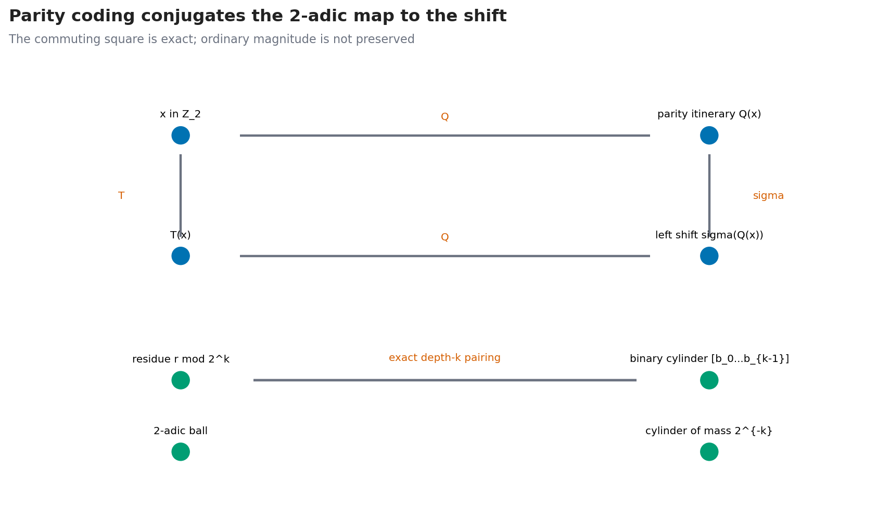

# Discrete dynamical systems {#sec-discrete-dynamics}
<!-- Retained source chapter 19 from collatz_conjecture; mathematical content and anchors preserved. -->

## Motivation: one rule, an entire geometry of time

Iteration turns a static function into a process. Instead of asking only for
$F(x)$, we ask about the infinite chain

$$
x,\ F(x),\ F^{\circ2}(x),\ldots.
$$

This viewpoint gives exact language for Collatz questions: recurrence, periodicity,
escape, and attraction. It also exposes a central difficulty. Many theorems for
finite state spaces fail on the infinite set of positive integers, and many
theorems for compact continuous spaces do not apply to an arithmetically thin
subset of the 2-adic integers.

## State spaces, orbits, and functional graphs

A **discrete dynamical system** is a pair $(X,F)$ consisting of a state space
$X$ and a function $F:X\to X$. Time is discrete because it advances through
$k=0,1,2,\ldots$. The **forward orbit** of $x$ is

$$
\mathcal O^+(x)=\{F^{\circ k}(x):k\ge0\},
$$

with multiplicity and order retained when we speak of the orbit sequence.

The **functional graph** has one vertex for every state and one directed edge
$x\to F(x)$. Every vertex has out-degree exactly one; its in-degree can be zero,
one, or larger. In a finite functional graph, every forward path eventually
repeats a vertex, then follows a directed cycle forever. The proof is the
pigeonhole principle: among $|X|+1$ visited states, two coincide, and determinism
makes all subsequent states repeat.

That theorem does not cover $X=\mathbb N_{>0}$. An infinite path can visit a new
state forever. For the Collatz map, proving that this never happens is part of
the open problem.

## Fixed points, cycles, transients, and basins

A **fixed point** satisfies $F(x)=x$. A point is **periodic of period $p$** if
$p\ge1$, $F^{\circ p}(x)=x$, and no smaller positive exponent has that property.
A **cycle** is the ordered collection of states on a periodic orbit. States
visited before a cycle form a **transient** segment.

The **basin** of a set $A$ is

$$
B(A)=\{x:\text{some }F^{\circ k}(x)\text{ belongs to }A\}.
$$

Under the unaccelerated positive Collatz map, $1\to4\to2\to1$ is a known
3-cycle. The classical conjecture says its basin is all positive integers. Under
the odd-only map, the same behavior is represented by the fixed point $1$.
Cycle length therefore depends on convention, while the underlying claim does
not.

**Worked example.** Consider $F(x)=x^2\bmod 10$ on
$X=\{0,1,\ldots,9\}$. Starting at $3$ gives
$3\to9\to1\to1$, so 3 has a two-step transient into the fixed point 1.
Starting at $2$ gives $2\to4\to6\to6$, entering a different fixed point. The
finite state space guarantees eventual periodicity, but not a single basin.

## Invariants and Lyapunov functions

An **invariant** is a quantity or property unchanged by every transition. If
$I(F(x))=I(x)$, states with different $I$-values cannot lie on the same orbit.
For example, a map that adds 6 preserves residue modulo 6. The Collatz map does
not preserve parity; parity is deliberately changed by the branches.

A **Lyapunov function** is a quantity designed to decrease along orbits. The
following discrete version gives a genuine termination theorem.

<div class="callout callout-note">
<p class="callout-title">Discrete descent theorem</p>

Let $V:X\to\mathbb N$ and $A\subseteq X$. If every $x\notin A$ satisfies
$V(F(x))<V(x)$, then every orbit reaches $A$ in at most $V(x_0)$ steps.

</div>

**Proof idea.** Until the orbit reaches $A$, the nonnegative integer $V$ strictly
decreases. A strictly decreasing list beginning at $V(x_0)$ cannot have more
than $V(x_0)$ transitions. This is well-founded descent, not an average argument.

For Collatz, the obvious candidate $V(n)=n$ fails because odd steps increase.
Showing that each $n>1$ eventually reaches a value below $n$ would be enough:
strong induction would then finish the conjecture. The missing word is
“showing”; computations verify this descent only on bounded inputs.

## Symbolic dynamics and itineraries

A **partition** divides $X$ into labeled pieces. Recording the label containing
$F^{\circ k}(x)$ produces an **itinerary**. For Collatz the two pieces are even
and odd, so an orbit produces a binary word

$$
\varepsilon_k=F^{\circ k}(x)\bmod2.
$$

Symbolic dynamics replaces numerical magnitudes by branch information. This can
reveal exact affine formulas, but it discards information too. A formal binary
word need not be compatible with every starting integer; admissibility is an
arithmetic constraint.

For the shortcut map $S(n)=n/2$ for even $n$ and $(3n+1)/2$ for odd $n$, a word
$\varepsilon_0,\ldots,\varepsilon_{k-1}$ with $s$ ones gives

$$
S^{\circ k}(n)=\frac{3^s n+b}{2^k}
$$

for a nonnegative integer $b$ determined by the positions of the ones. This is
an exact theorem for an orbit realizing the word, not a stochastic model.

## Recurrence, escape, and compactness contrasts

An orbit is **bounded** if all its values lie below some constant. It is
**unbounded** if it visits arbitrarily large values. It **diverges to infinity**
if, for every bound $M$, all sufficiently late values exceed $M$. Unboundedness
does not imply divergence: a sequence may make arbitrarily high excursions and
return to 1 infinitely often.

A point is **recurrent** in a metric system if its orbit returns arbitrarily
close to its starting point. On the discrete positive integers, “close enough”
eventually means equal, so recurrence implies periodicity. On the 2-adic
integers, distinct ordinary-looking values can be extremely close when their
difference is divisible by a high power of 2. Chapter 24 develops that topology.

Compactness often lets one extract a convergent subsequence or an infinite branch
from compatible finite data. The positive integers with their usual metric are
not compact. Even when Collatz is extended to the compact 2-adic integers, a
typical 2-adic point need not be a positive integer. One must not transfer a
compact-space conclusion across that boundary without a theorem.

## What general dynamical language clarifies about Collatz

The vocabulary separates two possible obstructions to the classical conjecture
for a deterministic positive-integer map:

1. a positive cycle other than the known one; or
2. an orbit that diverges to infinity.

Any unbounded positive-integer orbit must diverge to infinity. Infinitely many visits to one finite initial region repeat a state; determinism then forces an eventually periodic bounded orbit. This restriction does not hold for an arbitrary sequence.

Excluding only the first possibility is insufficient. Likewise, negative average
drift in a model is not a Lyapunov function for every arithmetic orbit.

<div class="callout callout-warning">
<p class="callout-title">Pitfall clinic</p>

- Eventual periodicity is automatic on a finite state space, not an infinite one.
- A quantity that decreases on average is not a pointwise Lyapunov function.
- Changing to the odd-only map changes periods and step counts.
- An itinerary is a coded orbit only after admissibility is checked.
- Unbounded and divergent-to-infinity are different predicates.

</div>

## Visual checkpoint: symbolic coding and conjugacy

<figure id="fig-collatz-dynamics-parity-conjugacy">


<figcaption>

Figure 1.1: Finite parity coding turns orbit prefixes into symbolic itineraries.

</figcaption>
</figure>

[Figure 1.1](#fig-collatz-dynamics-parity-conjugacy) shows what symbolic dynamics
organizes: an itinerary records branch choices and makes affine composition
possible. A finite coding diagram does not establish recurrence, compactness, or
conjugacy for every infinite orbit without the separate theorems stated above.

<!-- inline-formula-code:start -->
## Formula and finite computation

A useful formula in this chapter is

$$
\mu+\lambda=\min\{j>i\ge0:x_j=x_i\}
$$

A finite-state orbit ledger separates preperiod $\mu$ and period $\lambda$. The following standalone Python block expresses that finite rule with its inputs and stopping conditions visible.

```python
modulus, state = 32, 7
first_seen: dict[int, int] = {}
orbit: list[int] = []
for _ in range(modulus + 1):
    if state in first_seen:
        break
    first_seen[state] = len(orbit)
    orbit.append(state)
    state = (3 * state + 1) % modulus
preperiod = first_seen[state]
period = len(orbit) - preperiod
print(preperiod, period, orbit)
```

**What the computation establishes.** The output certifies only the declared finite case. The theorem, if one is claimed, still requires the argument developed in the chapter.
<!-- inline-formula-code:end -->

## Exercises

<div class="exercise" id="collatz_conjecture-19-discrete-dynamics-ex-1">
<p class="exercise-title"><strong>Exercise 1</strong></p>

Prove that every orbit of a function on a finite set is eventually periodic.

</div>

<div class="exercise" id="collatz_conjecture-19-discrete-dynamics-ex-2">
<p class="exercise-title"><strong>Exercise 2</strong></p>

Draw the functional graph of $F(x)=2x\bmod6$ on residues $0$ through $5$.

</div>

<div class="exercise" id="collatz_conjecture-19-discrete-dynamics-ex-3">
<p class="exercise-title"><strong>Exercise 3</strong></p>

Find all fixed points and cycles in that graph and list their basins.

</div>

<div class="exercise" id="collatz_conjecture-19-discrete-dynamics-ex-4">
<p class="exercise-title"><strong>Exercise 4</strong></p>

Prove the discrete descent theorem with an explicit induction on $V(x_0)$.

</div>

<div class="exercise" id="collatz_conjecture-19-discrete-dynamics-ex-5">
<p class="exercise-title"><strong>Exercise 5</strong></p>

Give an unbounded integer sequence that does not diverge to infinity.

</div>

<div class="exercise" id="collatz_conjecture-19-discrete-dynamics-ex-6">
<p class="exercise-title"><strong>Exercise 6</strong></p>

For shortcut Collatz, derive the affine formulas for parity words `00`, `01`,
`10`, and `11` and state which starting residues realize them.

</div>

<div class="exercise" id="collatz_conjecture-19-discrete-dynamics-ex-7">
<p class="exercise-title"><strong>Exercise 7</strong></p>

Explain why a proof that there are no nontrivial positive cycles would still
leave work to do.

</div>

<div class="exercise" id="collatz_conjecture-19-discrete-dynamics-ex-8">
<p class="exercise-title"><strong>Exercise 8</strong></p>

Invent a map on the positive integers with negative change on most states but
with one escaping orbit.

</div>

## Answers and support

1. Visit $|X|+1$ states and apply the pigeonhole principle; equality of two
   states makes all later successors equal.
2. The arrows are $0\to0$, $1\to2$, $2\to4$, $3\to0$, $4\to2$, $5\to4$.
3. The fixed point is 0; $2\leftrightarrow4$ is a 2-cycle. Basin of 0 is
   $\{0,3\}$; basin of the 2-cycle is $\{1,2,4,5\}$.
4. Base case $V=0$ cannot strictly descend in $\mathbb N$ outside $A$; for the
   step, $V(F(x))\le V(x)-1$ and apply the induction hypothesis.
5. For example $0,1,0,2,0,3,\ldots$ is unbounded but returns to 0.
6. Compose the two affine branches and then solve parity conditions modulo 4.
   The results are respectively $n/4$, $(3n+2)/4$, $(3n+1)/4$, and
   $(9n+5)/4$ on their unique compatible classes modulo 4.
7. An orbit that is not eventually periodic could still remain; for this
   deterministic positive-integer map it must diverge to infinity.
8. One example is $F(1)=1$, $F(2^k)=2^{k+1}$ for $k\ge1$, and $F(n)=1$
   otherwise; the orbit $2,4,8,\ldots$ escapes even though most states descend.
