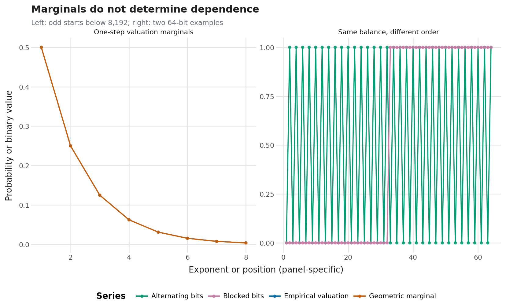

# Probability models with full foundations {#sec-probability-models}
<!-- Retained source chapter 20 from collatz_conjecture; mathematical content and anchors preserved. -->

## Motivation: prediction without pretending randomness

A Collatz orbit is deterministic: once its start is fixed, every later value is
fixed. Probability enters when we sample starts, summarize residue classes, or
replace complicated arithmetic dependence by an idealized random process. Such
models can predict drift and distributional shape. They become theorems about
Collatz only when a proof controls the difference between the model and the
actual arithmetic system.

This chapter builds the needed probability language from finite examples. It
then places the familiar random-walk heuristic inside that framework.

## Random variables and distributions

A **probability space** consists of outcomes $\Omega$, events, and a probability
rule $\mathbb P$. A **random variable** $X$ assigns a real number to each
outcome. Its **distribution** records probabilities such as
$\mathbb P(X=x)$ or $\mathbb P(X\le t)$.

For a finite or countable distribution,

$$
\mathbb E[X]=\sum_x x\,\mathbb P(X=x),
\qquad
\operatorname{Var}(X)=\mathbb E[(X-\mathbb E X)^2].
$$

Expectation is linear even when variables are dependent:
$\mathbb E[X+Y]=\mathbb E[X]+\mathbb E[Y]$. Variances add without covariance
terms only under suitable conditions such as independence.

**Worked example: one shortcut step.** In the coin-flip model, declare an even
branch with probability $1/2$ and an odd branch with probability $1/2$. Ignore
the additive $+1$ at large scale. The base-two logarithmic increment $X$ is

$$
X=\begin{cases}
-1,&\text{with probability }1/2,\\
\log_2(3/2),&\text{with probability }1/2.
\end{cases}
$$

Therefore

$$
\mathbb E[X]
=\frac{-1+\log_2(3/2)}2
=\frac{\log_2 3-2}{2}
\approx-0.2075.
$$

This is an exact calculation inside the stated model. It is not a theorem that
every Collatz orbit has negative drift.

## Expectation, variance, and concentration

A mean describes a center, not a guarantee. **Concentration inequalities** bound
the probability of a large deviation. One elementary result follows directly
from nonnegativity.

<div class="callout callout-note">
<p class="callout-title">Chebyshev's inequality</p>

If $X$ has finite mean $\mu$ and variance $\sigma^2$, then for every $t>0$,
$$
\mathbb P(|X-\mu|\ge t)\le\frac{\sigma^2}{t^2}.
$$

</div>

**Proof idea.** The event $|X-\mu|\ge t$ implies
$(X-\mu)^2\ge t^2$. Hence

$$
\sigma^2=\mathbb E[(X-\mu)^2]
\ge t^2\mathbb P(|X-\mu|\ge t).
$$

Rearrange. The argument is rigorous because it uses only the definition of
variance and a pointwise inequality.

For independent copies $X_1,\ldots,X_k$ with common variance $\sigma^2$, the
sample mean has variance $\sigma^2/k$. Chebyshev then shows deviations of fixed
size become unlikely as $k$ grows. Actual Collatz branch symbols are not freely
chosen independent copies, so this conclusion cannot be imported without an
arithmetic independence argument.

## Markov chains and transition operators

A **Markov chain** moves among states with probabilities depending only on the
current state. Its transition matrix $P$ has entries

$$
P_{ij}=\mathbb P(X_{k+1}=j\mid X_k=i),
\qquad \sum_jP_{ij}=1.
$$

If a row vector $\pi_k$ describes the current distribution, then
$\pi_{k+1}=\pi_kP$. A **stationary distribution** satisfies $\pi=\pi P$.

Consider the toy two-state chain “even-looking” $E$ and “odd-looking” $O$ with

$$
P=\begin{pmatrix}3/4&1/4\\1/2&1/2\end{pmatrix}.
$$

Solving $\pi=\pi P$ and $\pi_E+\pi_O=1$ gives
$\pi=(2/3,1/3)$. This calculation says what the invented chain predicts. It does
not establish these proportions for Collatz residues.

Residue processes can sometimes be made into exact finite-state systems after
one specifies how starts are sampled and how much modular information is retained.
Division by 2 loses a binary digit, so a transition modulo $2^k$ may require a
lift modulo $2^{k+1}$. A matrix that silently ignores this information loss is a
model, not an exact quotient of the map.

## Law of large numbers and exceptional paths

The **weak law of large numbers** says that for independent, identically
distributed variables with finite variance, the sample mean converges in
probability to the common expectation. In symbols, for every $\varepsilon>0$,

$$
\mathbb P\!\left(
\left|\frac{X_1+\cdots+X_k}{k}-\mu\right|>\varepsilon
\right)\longrightarrow0.
$$

Chebyshev proves this because the probability is at most
$\sigma^2/(k\varepsilon^2)$. Notice the quantifier: the probability of an
exception tends to zero. The theorem does not say there are no exceptional
paths, nor that a particular deterministic parity sequence is typical.

For the coin-flip logarithmic model, the law predicts a negative average
increment along most sufficiently long random paths. Rare paths with many odd
symbols still rise. To convert this statement to integers, one would need to
show that arithmetic itineraries are distributed sufficiently like those random
paths at all relevant scales. That is a deep mathematical task, not a matter of
renaming parity as a coin toss.

## Martingale intuition and stopping-time cautions

A process $(M_k)$ is a **martingale** relative to its information history if its
conditional next expectation equals its current value:

$$
\mathbb E[M_{k+1}\mid\mathcal F_k]=M_k.
$$

Martingales formalize a fair-game idea. A **stopping time** is a random time whose
occurrence can be recognized from information available so far. Optional-stopping
theorems relate $\mathbb E[M_\tau]$ to $\mathbb E[M_0]$, but only under hypotheses
such as bounded stopping time, bounded increments with integrability conditions,
or uniform integrability. Removing the hypotheses produces famous betting
paradoxes.

Collatz “stopping time” is a deterministic orbit statistic, not automatically a
probabilistic stopping time. It becomes one only after starts or transitions are
placed on a probability space. Even then, finiteness and integrability must be
proved before optional stopping can be invoked.

Chapter [source section](../collatz-conjecture/42-martingale-drift.md#sec-collatz-martingale-drift) proves bounded optional stopping and an
additive drift theorem. Chapter [source section](../collatz-conjecture/43-coupling-concentration.md#sec-collatz-coupling-concentration) develops
couplings and dependence-aware concentration rather than assuming fresh bits.

## The odd-to-odd valuation model

For odd $n$, let $A=\nu_2(3n+1)$. Uniform odd residue classes modulo high powers
of two suggest the geometric law

$$
\mathbb P(A=a)=2^{-a},\qquad a=1,2,\ldots.
$$

It sums to 1 and has $\mathbb E[A]=2$. Ignoring the additive term at large
values, one odd-to-odd step changes base-two altitude by
$\log_2 3-A$, whose modeled mean is $\log_2 3-2<0$.

The one-step valuation frequencies over complete residue blocks are exact. The
assumption that successive valuations act like independent samples is not exact
for a single deterministic orbit. The distinction between an exact marginal
count and a joint independence claim is essential.

<figure id="fig-probability-dependence">


<figcaption>

Figure 2.1: Exact finite valuation frequencies are compared with their geometric marginal model, while a second panel shows how dependence can persist despite matching one-step frequencies.

</figcaption>
</figure>

[Figure 2.1](#fig-probability-dependence) will be generated from declared finite samples. The
right panel is a reminder that identical histograms can hide very different
ordering and dependence.

## Translating probabilistic predictions back to arithmetic

A responsible translation has three layers:

- **exact arithmetic:** residue counts or identities proved for a finite modulus;
- **probability theorem:** a conclusion inside an explicitly defined random
  model; and
- **transfer claim:** a separate theorem, conjecture, or heuristic connecting
  arithmetic orbits to the model.

Tao's work controls certain averaged arithmetic distributions with far subtler
tools than an independent coin model (Tao 2022). The result described in Chapter
13 is rigorous, but it still does not state that almost every orbit reaches 1.

<div class="callout callout-warning">
<p class="callout-title">Pitfall clinic</p>

- Deterministic parity is not random merely because it looks irregular.
- Negative expected drift does not force every path downward.
- Correct one-step frequencies do not prove independence across time.
- A law of large numbers requires a defined probability space and hypotheses.
- Optional stopping without integrability or boundedness conditions is invalid.

</div>

<!-- inline-formula-code:start -->
## Formula and finite computation

A useful formula in this chapter is

$$
\mathbb E[X]=\sum_xx\,\mathbb P(X=x)
$$

A finite branch table computes expectation and variance before any independence assumption is used. The following standalone Python block expresses that finite rule with its inputs and stopping conditions visible.

```python
outcomes = [-1.0, 0.5849625007211562]
probabilities = [0.5, 0.5]
mean = sum(value * probability for value, probability in zip(outcomes, probabilities, strict=True))
variance = sum(
    probability * (value - mean) ** 2
    for value, probability in zip(outcomes, probabilities, strict=True)
)
print(mean, variance)
```

**What the computation establishes.** The output certifies only the declared finite case. The theorem, if one is claimed, still requires the argument developed in the chapter.
<!-- inline-formula-code:end -->

## Exercises

<div class="exercise" id="collatz_conjecture-20-probability-models-ex-1">
<p class="exercise-title"><strong>Exercise 1</strong></p>

Compute the variance of the two-point shortcut increment $X$.

</div>

<div class="exercise" id="collatz_conjecture-20-probability-models-ex-2">
<p class="exercise-title"><strong>Exercise 2</strong></p>

Use Chebyshev to bound the probability that the average of 400 independent
copies differs from $\mathbb E X$ by at least $0.2$.

</div>

<div class="exercise" id="collatz_conjecture-20-probability-models-ex-3">
<p class="exercise-title"><strong>Exercise 3</strong></p>

Verify that $(2/3,1/3)$ is stationary for the displayed transition matrix.

</div>

<div class="exercise" id="collatz_conjecture-20-probability-models-ex-4">
<p class="exercise-title"><strong>Exercise 4</strong></p>

Give two binary strings with the same number of zeros and ones but very
different adjacent-pair counts.

</div>

<div class="exercise" id="collatz_conjecture-20-probability-models-ex-5">
<p class="exercise-title"><strong>Exercise 5</strong></p>

Prove $\sum_{a\ge1}2^{-a}=1$ and $\sum_{a\ge1}a2^{-a}=2$.

</div>

<div class="exercise" id="collatz_conjecture-20-probability-models-ex-6">
<p class="exercise-title"><strong>Exercise 6</strong></p>

State precisely why a negative mean in the valuation model is not a proof of
Collatz convergence.

</div>

<div class="exercise" id="collatz_conjecture-20-probability-models-ex-7">
<p class="exercise-title"><strong>Exercise 7</strong></p>

Turn deterministic total stopping time into a random variable by specifying
a finite probability space.

</div>

<div class="exercise" id="collatz_conjecture-20-probability-models-ex-8">
<p class="exercise-title"><strong>Exercise 8</strong></p>

Classify each as theorem, finite computation, or heuristic: Chebyshev's
inequality; a histogram for starts below 8,192; successive valuations are
independent.

</div>

## Answers and support

1. With $a=-1$, $b=\log_2(3/2)$, and mean $(a+b)/2$, the variance is
   $(a-b)^2/4=(\log_2 3)^2/4$.
2. Independence gives variance of the mean $\operatorname{Var}(X)/400$; divide
   that by $0.2^2$. Numerically the bound is about $0.0393$.
3. Multiply: $(2/3,1/3)P=(2/3,1/3)$.
4. `00001111` and `01010101` have the same marginals; the first has one switch,
   the second seven.
5. Differentiate the finite geometric formula and pass to the limit, or use
   $S=1/2+1/4+\cdots=1$ and $E[A]=\sum_{a\ge1}\mathbb P(A\ge a)=2$.
6. The model allows random independent paths; an arithmetic orbit is one
   dependent deterministic itinerary, and no transfer theorem has been supplied.
7. Choose a start uniformly from $\{1,\ldots,N\}$ and define the statistic on
   that finite set, with a censoring rule if necessary.
8. The inequality is a theorem; the histogram is finite computation; temporal
   independence is a heuristic unless separately proved in a stated setting.
