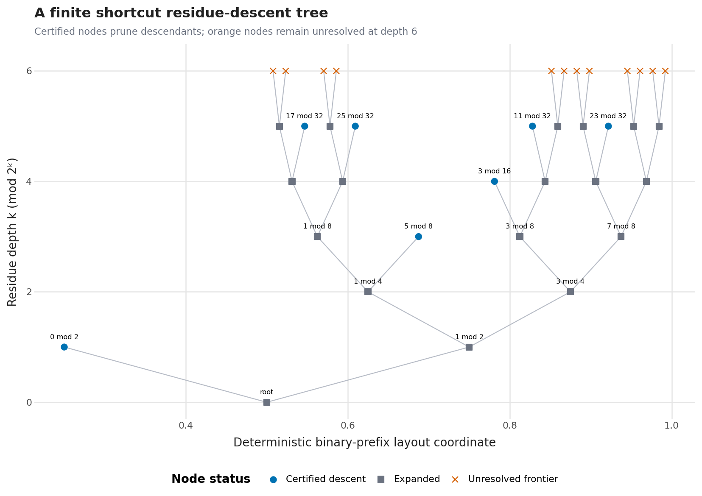

# Automata, residue trees, and symbolic sieves {#sec-automata-residue}
<!-- Retained source chapter 21 from collatz_conjecture; mathematical content and anchors preserved. -->

## Motivation: finite memory for an infinite problem

Congruence classes compress infinitely many integers into finitely many states.
Automata describe computations that use only finite memory. Trees organize how
coarse residue information splits when one more binary digit is revealed. These
ideas make finite descent sieves precise and checkable.

They also mark a boundary. A fixed finite automaton cannot remember arbitrarily
large orbit values or unbounded parity history. A successful finite-state
certificate must come with a theorem explaining why its finite coverage implies
the desired infinite or bounded-range statement.

## Finite-state machines

A **deterministic finite automaton** consists of a finite state set $Q$, an input
alphabet $\Sigma$, a transition function $\delta:Q\times\Sigma\to Q$, a start
state, and a set of accepting states. Reading symbols $b_1\cdots b_k$ applies
the transitions successively.

**Worked example: binary remainder modulo 3.** Suppose a state stores the
remainder $r$ of the bits read so far. Appending bit $b\in\{0,1\}$ changes the
represented integer from $n$ to $2n+b$, so

$$
\delta(r,b)=(2r+b)\bmod3.
$$

Starting at state 0 and reading `1011` gives
$0\xrightarrow1 1\xrightarrow0 2\xrightarrow1 2\xrightarrow1 2$.
Indeed binary `1011` is decimal 11, with remainder 2 modulo 3. Marking state 0
as accepting yields an automaton for multiples of 3.

A **transducer** additionally emits output. It can scan a parity word and update
the coefficients of an affine Collatz prefix, or scan a binary integer and emit
its residue information.

## Binary prefixes and residue classes

The lowest $k$ binary digits of $n$ determine its residue modulo $2^k$.
Appending one more high-order binary digit splits the class
$r\pmod{2^k}$ into

$$
r\pmod{2^{k+1}}
\quad\text{and}\quad
r+2^k\pmod{2^{k+1}}.
$$

These compatible classes form a rooted binary tree. A node at depth $k$ denotes
one residue modulo $2^k$; its two children are the refinements modulo
$2^{k+1}$.

For the shortcut map $S$, the first $k$ parity symbols contain exactly as much
information as the starting residue modulo $2^k$.

<div class="callout callout-note">
<p class="callout-title">Finite parity coding theorem</p>

For every $k\ge1$, the map sending $n\bmod2^k$ to the first $k$ parity symbols
of its shortcut orbit is a bijection between residues modulo $2^k$ and binary
words of length $k$.

</div>

**Proof idea.** Proceed backward. Suppose the suffix of length $k-1$ determines
the next-state residue $y\pmod{2^{k-1}}$. For initial symbol 0, the unique even
preimage is $n\equiv2y\pmod{2^k}$. For initial symbol 1, solve
$3n+1\equiv2y\pmod{2^k}$. Because 3 is invertible modulo $2^k$, there is one
solution, and it is odd. Thus each suffix has one preimage of each initial
symbol. Induction gives all $2^k$ words exactly once.

This theorem concerns finite prefixes. It does not say parity symbols along an
ordinary orbit are independent random bits.

## Transducers for affine updates

For a formal parity prefix, maintain coefficients $(p,q,d)$ satisfying

$$
S^{\circ d}(n)=\frac{pn+q}{2^d}.
$$

Initially $(p,q,d)=(1,0,0)$. Reading an even symbol increments $d$. Reading an
odd symbol replaces

$$
(p,q,d)\longmapsto(3p,\,3q+2^d,\,d+1).
$$

The update is exact algebra. For word `101`, the states are

$$
(1,0,0)\to(3,1,1)\to(3,1,2)\to(9,7,3),
$$

so a realizing start satisfies $S^{\circ3}(n)=(9n+7)/8$.
The finite parity coding theorem identifies one compatible residue class modulo
8; direct tracing gives $n\equiv1\pmod8$. Indeed,
$1\to2\to1\to2$ begins with `101`, whereas
$5\to8\to4\to2$ begins with `100`.

Because $q$ and $d$ grow, this coefficient transducer does not have a fixed
finite state set unless coefficients are reduced modulo a chosen modulus or the
depth is bounded. Calling it an “automaton” without stating that reduction would
hide unbounded memory.

## Tree pruning and coverage certificates

A **descent certificate** for a residue node proves that every positive integer
in that class follows a common valid prefix and ends below its own start. Once a
node is certified, all descendants inherit coverage and need not be expanded.
An unresolved node splits into its two children for a deeper analysis.

A finite collection of nodes is a **prefix cover** if every infinite binary
expansion passes through one of them. For a prefix-free collection with depths
$d_1,\ldots,d_m$, the exact coverage criterion is the Kraft sum

$$
\sum_{j=1}^m2^{-d_j}=1.
$$

Here each node at depth $d$ covers the fraction $2^{-d}$ of 2-adic binary
strings. For ordinary positive integers the same finite collection covers every
residue modulo $2^D$, where $D$ is the maximum depth, after refinement.

**Worked certificate.** The two depth-1 nodes “even” and “odd” cover all
integers, but only the even node gives immediate descent $n\mapsto n/2<n$ for
$n>1$. Split the odd node by more bits. This does not by itself finish the odd
case; it demonstrates honest pruning without pretending unresolved children are
covered.

<figure id="fig-residue-tree">


<figcaption>

Figure 3.1: A binary residue tree shows certified descent nodes, expanded nodes, and an unresolved finite frontier.

</figcaption>
</figure>

[Figure 3.1](#fig-residue-tree) depicts a finite illustrative sieve. Its caption and legend
distinguish a demonstrated finite prefix rule from a complete Collatz proof.

## Infinite paths and compactness arguments

**Lemma 21.1 (König's lemma).** An infinite, finitely branching rooted tree with
nodes at arbitrarily large depths has an infinite path. A useful contrapositive
is: if no infinite path exists, then such a tree must have bounded depth and is
finite.

In a residue sieve, the unresolved nodes must form a compatible, prefix-closed
tree before König's lemma applies. Merely finding at least one unresolved residue
at every depth is insufficient: the chosen residues might not be nested. If the
unresolved tree is infinite, the lemma supplies a compatible infinite binary
sequence, which is naturally a 2-adic integer. That sequence need not represent
a positive ordinary integer, whose high binary digits are eventually zero.

Thus compactness can reveal a 2-adic obstruction to a proposed finite cover
without producing a positive-integer counterexample.

## Limits of any fixed-depth automaton

A machine retaining only residues modulo $2^k$ cannot distinguish integers in
the same class. It can decide properties determined by those $k$ low bits, such
as the first $k$ shortcut parities. It cannot decide an unbounded future property
unless an additional theorem proves that the future is already forced by that
finite information.

For every fixed depth, an orbit may rise beyond the examined prefix before it
descends. Increasing depth expands evidence and may certify more classes, but the
passage from “every tested depth” to “one finite depth covers all paths” is a
quantifier change requiring proof.

Chapter [source section](../collatz-conjecture/40-analytic-combinatorics.md#sec-collatz-analytic-combinatorics) turns bounded automata into exact
generating functions. Chapter [source section](../collatz-conjecture/44-presburger-certificates.md#sec-collatz-presburger-certificates) eliminates
fixed-horizon trace variables into semilinear residue descriptions.

<div class="callout callout-warning">
<p class="callout-title">Pitfall clinic</p>

- Reducing coefficients modulo a modulus can erase inequalities needed for
  descent.
- An unresolved node is not a counterexample; it means the certificate has not
  decided that class.
- Nodes found separately at every depth may fail to form one infinite path.
- A 2-adic infinite path need not encode a positive integer.
- Finite-state recognition of a prefix is not prediction of an entire orbit.

</div>

<!-- inline-formula-code:start -->
## Formula and finite computation

A useful formula in this chapter is

$$
C_w(n)=\frac{3^an+b}{2^k}
$$

The code recovers affine coefficients and checks a concrete prefix. The following standalone Python block expresses that finite rule with its inputs and stopping conditions visible.

```python
def affine_word(word: str) -> tuple[int, int, int]:
    """Return A, B, D with the shortcut branch (A*n+B)/D."""
    if any(bit not in "01" for bit in word):
        raise ValueError("word must contain only zero and one")
    coefficient = 1
    offset = 0
    denominator = 1
    for bit in word:
        if bit == "1":
            coefficient *= 3
            offset = 3 * offset + denominator
        denominator *= 2
    return coefficient, offset, denominator

def shortcut_prefix(start: int, length: int) -> tuple[str, int]:
    """Return a shortcut parity word and the value after length steps."""
    if start <= 0 or length < 0:
        raise ValueError("start must be positive and length nonnegative")
    value = start
    bits: list[str] = []
    for _ in range(length):
        bit = value % 2
        bits.append(str(bit))
        value = value // 2 if bit == 0 else (3 * value + 1) // 2
    return "".join(bits), value

word, actual = shortcut_prefix(27, 10)
coefficient, offset, denominator = affine_word(word)
numerator = coefficient * 27 + offset
print(word, coefficient, offset, denominator)
print(actual, numerator // denominator, numerator % denominator)
```

**What the computation establishes.** The calculation checks a declared finite instance; the surrounding argument explains what is true beyond those inputs.
<!-- inline-formula-code:end -->

## Exercises

<div class="exercise" id="collatz_conjecture-21-automata-residue-trees-ex-1">
<p class="exercise-title"><strong>Exercise 1</strong></p>

Build the binary-remainder automaton modulo 5 and trace the input `1101`.

</div>

<div class="exercise" id="collatz_conjecture-21-automata-residue-trees-ex-2">
<p class="exercise-title"><strong>Exercise 2</strong></p>

List the two children of residue $3\pmod8$ modulo 16.

</div>

<div class="exercise" id="collatz_conjecture-21-automata-residue-trees-ex-3">
<p class="exercise-title"><strong>Exercise 3</strong></p>

Find the shortcut parity words of all residues modulo 4 and verify bijection.

</div>

<div class="exercise" id="collatz_conjecture-21-automata-residue-trees-ex-4">
<p class="exercise-title"><strong>Exercise 4</strong></p>

Use the coefficient update to derive the affine formula for word `1100`.

</div>

<div class="exercise" id="collatz_conjecture-21-automata-residue-trees-ex-5">
<p class="exercise-title"><strong>Exercise 5</strong></p>

Show that prefix nodes `0`, `10`, and `11` form a complete prefix-free cover.

</div>

<div class="exercise" id="collatz_conjecture-21-automata-residue-trees-ex-6">
<p class="exercise-title"><strong>Exercise 6</strong></p>

Explain why nodes `0` at depth 1, `01` at depth 2, `001` at depth 3, and so
on do not form a nested infinite path.

</div>

<div class="exercise" id="collatz_conjecture-21-automata-residue-trees-ex-7">
<p class="exercise-title"><strong>Exercise 7</strong></p>

State the extra structure needed before applying König's lemma to unresolved
residues.

</div>

<div class="exercise" id="collatz_conjecture-21-automata-residue-trees-ex-8">
<p class="exercise-title"><strong>Exercise 8</strong></p>

Give a property of integers that no fixed number of low binary digits can
decide, and justify your answer.

</div>

## Answers and support

1. Use $r\mapsto(2r+b)\bmod5$. Binary `1101` is 13, so the final state is 3.
2. They are $3\pmod{16}$ and $11\pmod{16}$.
3. Residues $0,1,2,3$ give `00`, `10`, `01`, `11`, respectively.
4. The updates end at $(p,q,d)=(9,5,4)$, so the formula is $(9n+5)/16$ on its
   compatible residue class.
5. Their weights are $1/2+1/4+1/4=1$, and no listed word prefixes another.
6. Although `01` extends `0`, the next word `001` does not extend `01`; its
   second bit has changed. Hence the listed nodes do not form one compatible
   chain through all depths.
7. The unresolved nodes must be prefix-closed, finitely branching, and present
   at arbitrarily large depths.
8. “The Collatz orbit eventually reaches 1” is not known to be decidable from
   any fixed low-bit prefix; more elementarily, “$n>2^k$” cannot be decided from
   $n\bmod2^k$ because the same residue has arbitrarily large representatives.
