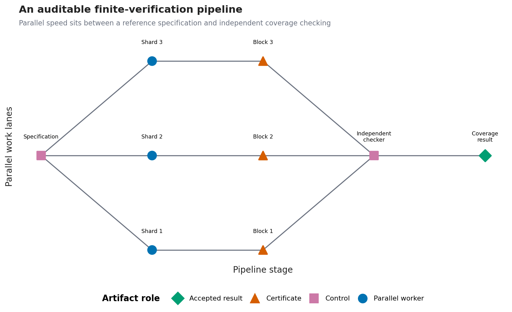

# Verification engineering {#sec-verification-engineering}
<!-- Retained source chapter 22 from collatz_conjecture; mathematical content and anchors preserved. -->

## Motivation: turn a computation into an auditable claim

Running a fast program and producing a large number is not yet a mathematical
verification. A trustworthy finite result needs a specification, a proof that
the implementation realizes it, a partition showing that no input is skipped or
duplicated, protection against machine faults, and an independently checkable
record. Verification engineering connects those obligations.

This chapter discusses architecture, not a changing numerical endpoint. Any
particular published range must be read with its date and source in Chapter 14.

## Reference semantics and executable specifications

**Reference semantics** state the mathematical operation independent of
optimization. For a positive integer $n$:

```text
if n is even: return n / 2
otherwise:    return 3*n + 1
```

An **executable specification** is a deliberately simple implementation used to
check optimized code on overlapping inputs. It should favor clarity and exact
arithmetic over speed.

A useful contract for a bounded verifier is:

> For every integer $n$ in the half-open interval $[L,U)$, produce a valid
> orbit prefix ending at a value below $n$, or report that the declared resource
> bound was exhausted.

The half-open convention makes adjacent partitions compose without overlaps:
$[L,M)\cup[M,U)=[L,U)$ and the two pieces are disjoint.

<div class="callout callout-note">
<p class="callout-title">Descent-certificate theorem</p>

Suppose that for every integer $n$ with $2\le n<N$, a valid Collatz prefix ends
at some positive $m<n$. Then every $n<N$ reaches 1.

</div>

**Proof.** Use strong induction. The claim holds for 1. Given $n<N$, its
certificate reaches $m<n$; by the induction hypothesis $m$ reaches 1, so
concatenating the paths proves the claim for $n$.

This theorem explains why “drops below the start” is a reusable certificate.
The program need not recompute the already certified tail.

## Word-size bounds and overflow proofs

Software integers have semantics. Arbitrary-precision integers match mathematical
integer operations until resources are exhausted. Fixed-width unsigned arithmetic
is faster on many machines but requires an explicit bound before every operation.

For the shortcut map,

$$
S(n)\le2n\qquad(n\ge1),
$$

because the even branch is $n/2$ and the odd branch satisfies
$(3n+1)/2\le2n$. Consequently, during any prefix of at most $k$ shortcut steps,

$$
S^{\circ j}(n)\le2^j n\le2^k n.
$$

This is a coarse but rigorous preflight bound. If $2^k n<2^w$, every state in
that capped prefix fits an unsigned $w$-bit word. A sharper implementation may
prove branch-specific bounds or switch to a wider type before danger.

Undefined signed overflow in some languages and silent modular wraparound in
others are different failure modes. The verifier must state its language-level
semantics, not merely the processor width.

## Parallel interval partitioning

A parallel verifier assigns disjoint input regions to workers. A **partition
manifest** should record each half-open interval, parameters, program version,
and completion state. The checker verifies:

1. intervals lie inside the target range;
2. sorting by lower endpoint yields no gap;
3. each upper endpoint equals the next lower endpoint;
4. no interval is duplicated; and
5. every completed result matches its declared interval and code version.

Residue-based partitioning can improve load balance, but then the manifest must
prove that every input belongs to exactly one residue shard. Work stealing may
change execution order without changing semantics if tasks carry stable
identifiers.

**Worked example.** To cover $[1,100)$ with four workers, choose
$[1,26)$, $[26,51)$, $[51,76)$, and $[76,100)$. Their sizes are 25, 25, 25,
and 24. Endpoints meet, so there is no gap or overlap. Splitting instead at
closed intervals $[1,25]$, $[25,50]$, and so on would duplicate boundary values
unless handled specially.

## Checkpoints, hashes, and fault models

A **fault model** lists failures the design intends to detect: process crashes,
bit flips, truncated files, stale workers, duplicated tasks, omitted tasks, or a
wrong executable. No finite checklist detects every conceivable error.

Checkpoints should be atomic: write a new record completely, flush as required,
then make it visible as the current checkpoint. A record can contain the last
completed task identifier, a rolling digest of prior results, counters, and a
versioned schema. On restart, validate the record before trusting it.

A cryptographic hash provides strong evidence that bytes have not changed since
a trusted digest was recorded. It does not show that those bytes encode correct
or complete mathematics. Redundant computations on different hardware and an
independent checker address different parts of the fault model.

## Certificate design and independent checkers

The best certificate is much easier to check than to discover. For individual
descent, a certificate may contain only the start and parity prefix. The checker
reconstructs each transition exactly, verifies admissibility, and confirms the
endpoint is positive and smaller than the start.

For a residue-class certificate, include:

- modulus and residue with canonical ranges;
- branch word and affine coefficients;
- a derivation or machine-checkable identity for the prefix;
- an inequality valid for every positive representative; and
- coverage data tying the class to the global partition.

**Worked example.** For start 7, the prefix

$$
7\to22\to11\to34\to17\to52\to26\to13\to40\to20\to10\to5
$$

ends below 7 after 11 transitions. A checker needs no claim about the rest of the
orbit: once smaller starts are already certified, strong induction supplies the
tail.

Independent checking means more than running the same binary twice. A small
checker written from the mathematical format, preferably by a different person
or in a different language, reduces common-mode implementation errors.

## Reproducible benchmarking and energy accounting

Performance claims need the same care as mathematical claims. Report input
distribution, completed work rather than attempted work, wall-clock and CPU or
accelerator time, thread count, compiler flags, hardware, software versions, and
whether preprocessing or verification time was excluded.

Energy use can be estimated from measured device power integrated over time, but
system boundaries matter: processor package, whole node, cooling, and embodied
hardware answer different questions. A faster method may use more instantaneous
power yet less total energy. These are engineering measurements with uncertainty,
not timeless constants.

<figure id="fig-verification-pipeline">


<figcaption>

Figure 4.1: A verification pipeline separates specification, sharded execution, certificates, independent checking, and a coverage manifest.

</figcaption>
</figure>

[Figure 4.1](#fig-verification-pipeline) emphasizes that speed is only the middle stage. A
claimed range is justified at the final coverage check, not by the number of
workers launched.

<div class="callout callout-warning">
<p class="callout-title">Pitfall clinic</p>

- Testing overflow after a wrapped operation cannot recover the lost value.
- A faster optimized program and its reference can share the same mistaken
  specification.
- Hash agreement proves byte agreement, not correctness.
- Rerunning one binary is replication, not an independent implementation.
- A missing half-open endpoint can invalidate an otherwise enormous run.
- Benchmark results without system boundaries invite false comparisons.

</div>

<!-- inline-formula-code:start -->
## Formula and finite computation

A useful formula in this chapter is

$$
[a,b)=\bigsqcup_{j=1}^r[a_j,b_j)
$$

A coverage audit checks ordering, gaps, overlaps, and endpoints before any orbit work begins. The following standalone Python block expresses that finite rule with its inputs and stopping conditions visible.

```python
chunks = [(1, 101), (101, 201), (201, 301), (301, 401)]
expected_start, expected_stop = 1, 401
contiguous = chunks[0][0] == expected_start and chunks[-1][1] == expected_stop
contiguous = contiguous and all(left[1] == right[0] for left, right in zip(chunks, chunks[1:]))
work_items = sum(stop - start for start, stop in chunks)
print(contiguous, work_items)
```

**What the computation establishes.** The output certifies only the declared finite case. The theorem, if one is claimed, still requires the argument developed in the chapter.
<!-- inline-formula-code:end -->

## Exercises

<div class="exercise" id="collatz_conjecture-22-verification-engineering-ex-1">
<p class="exercise-title"><strong>Exercise 1</strong></p>

Prove the bound $S^{\circ j}(n)\le2^jn$ by induction.

</div>

<div class="exercise" id="collatz_conjecture-22-verification-engineering-ex-2">
<p class="exercise-title"><strong>Exercise 2</strong></p>

Partition $[10,1{,}010)$ into six disjoint half-open intervals whose sizes
differ by at most one.

</div>

<div class="exercise" id="collatz_conjecture-22-verification-engineering-ex-3">
<p class="exercise-title"><strong>Exercise 3</strong></p>

Write pseudocode that checks a sorted interval manifest for gaps and overlaps.

</div>

<div class="exercise" id="collatz_conjecture-22-verification-engineering-ex-4">
<p class="exercise-title"><strong>Exercise 4</strong></p>

Verify the displayed descent certificate for 7 and count its transitions.

</div>

<div class="exercise" id="collatz_conjecture-22-verification-engineering-ex-5">
<p class="exercise-title"><strong>Exercise 5</strong></p>

Explain why storing only the endpoint below $n$ is insufficient unless the
checker can validate the path or another certificate.

</div>

<div class="exercise" id="collatz_conjecture-22-verification-engineering-ex-6">
<p class="exercise-title"><strong>Exercise 6</strong></p>

List one mitigation for each fault: overflow, omitted task, corrupted file,
and common software bug.

</div>

<div class="exercise" id="collatz_conjecture-22-verification-engineering-ex-7">
<p class="exercise-title"><strong>Exercise 7</strong></p>

Design a minimal certificate schema for one parity-prefix descent.

</div>

<div class="exercise" id="collatz_conjecture-22-verification-engineering-ex-8">
<p class="exercise-title"><strong>Exercise 8</strong></p>

Distinguish the mathematical claim, implementation claim, and run claim in a
finite verification.

</div>

## Answers and support

1. Base $j=0$ is equality. If the bound holds at $j$, apply
   $S(x)\le2x$ to obtain the case $j+1$.
2. The range has 1,000 integers. Four shards may have 167 entries and two 166,
   with endpoints accumulated from 10; any contiguous allocation with those
   sizes works.
3. Check the first lower and last upper endpoints, then require
   `interval[i].upper == interval[i+1].lower` and `lower < upper` throughout.
4. Each arrow follows the branch rule; 11 arrows lead from 7 to 5.
5. A false endpoint could be invented. The auditable object must connect it to
   the start by verified transitions or an equivalent algebraic proof.
6. Examples: checked/wider arithmetic; coverage manifest; cryptographic hash;
   separately specified independent checker.
7. Include start or residue, convention, parity word, endpoint, affine
   coefficients, and a schema version.
8. Mathematics: accepted certificates imply the bounded theorem. Implementation:
   code checks the certificate predicate. Run: this executable processed exactly
   the declared inputs without an undetected fault.
