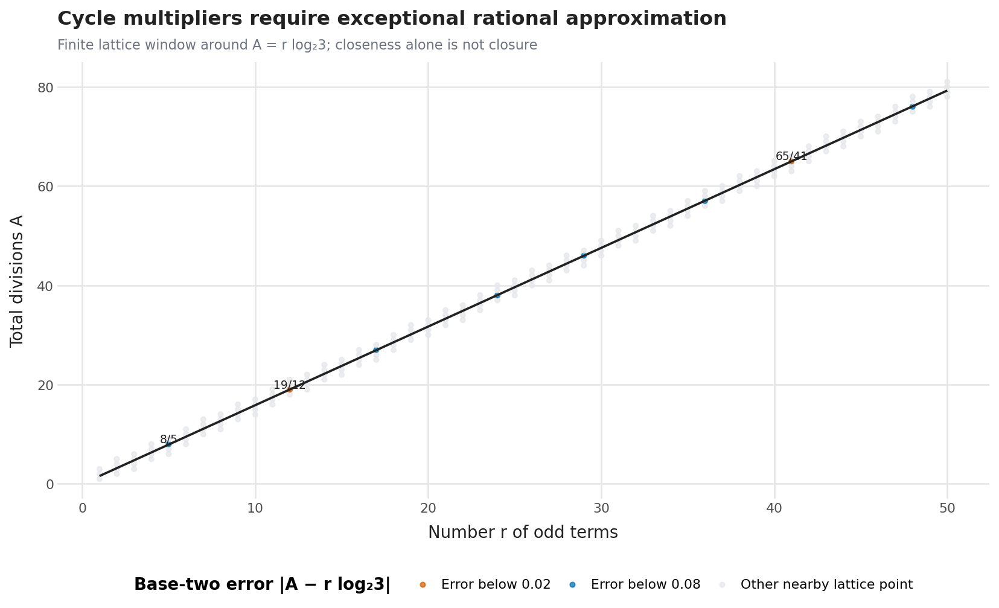

# Diophantine bounds for cycles {#sec-diophantine-cycles}
<!-- Retained source chapter 23 from collatz_conjecture; mathematical content and anchors preserved. -->

## Motivation: periodicity becomes an integer equation

A hypothetical Collatz cycle must satisfy far more than a rough balance between
multiplication by 3 and division by 2. Returning exactly to the starting integer
creates a Diophantine equation: an equation whose solutions must be integers.
Approximation theory, congruences, and positivity then filter the possibilities.

These filters have produced strong lower bounds and exclusions, but no argument
in this chapter proves that every nontrivial positive cycle is impossible. We
emphasize reusable deductions rather than a record-sized numerical bound that can
change with later research.

## Exact closure equations

Use the odd-only map. Let a proposed cycle have odd terms
$n_0,n_1,\ldots,n_{r-1}$, with indices read cyclically, and define

$$
a_i=\nu_2(3n_i+1),
\qquad
n_{i+1}=\frac{3n_i+1}{2^{a_i}}.
$$

Put $A=a_0+\cdots+a_{r-1}$ and
$A_j=a_0+\cdots+a_{j-1}$, where $A_0=0$. Repeated substitution gives

$$
n_r=
\frac{3^r n_0+
\displaystyle\sum_{j=0}^{r-1}3^{r-1-j}2^{A_j}}
{2^A}.
$$

Closure $n_r=n_0$ therefore requires

$$
(2^A-3^r)n_0
=B(a_0,\ldots,a_{r-1})
:=\sum_{j=0}^{r-1}3^{r-1-j}2^{A_j}. \tag{23.1}
$$

Every term of $B$ is positive. Hence a positive cycle must satisfy

$$
2^A>3^r,
\qquad
\frac Ar>\log_2 3. \tag{23.2}
$$

The inequality is necessary, not sufficient. Equation (23.1) also demands that
$2^A-3^r$ divide $B$ and that the resulting $n_0$ realize every prescribed
valuation exactly.

## A worked hypothetical cycle calculation

Take $r=5$ and valuation pattern $(2,1,2,1,2)$, so $A=8$. The partial sums are
$A_0,\ldots,A_4=0,2,3,5,6$. Thus

$$
\begin{aligned}
B
&=3^4+3^3 2^2+3^2 2^3+3\,2^5+2^6\\
&=81+108+72+96+64=421.
\end{aligned}
$$

The denominator is $2^8-3^5=256-243=13$, giving
$n_0=421/13$, not an integer. This pattern cannot close. Notice that it passed
the multiplier inequality $2^8>3^5$ but failed integrality.

Rotating the valuation word changes which odd cycle element is called $n_0$ and
changes $B$, while describing the same hypothetical cycle. A search should
canonicalize rotations to avoid duplicate work.

## Linear forms in logarithms

Define the nonzero **linear form in logarithms**

$$
\Lambda=A\log2-r\log3
=\log\!\left(\frac{2^A}{3^r}\right)>0.
$$

It cannot equal zero: $2^A=3^r$ contradicts unique prime factorization for
positive $A,r$. If a cycle has a large minimum element, equation (23.1) forces
$2^A/3^r$ to be very close to 1, making $\Lambda$ small. Deep theorems about
linear forms in logarithms supply explicit lower bounds on how small a nonzero
combination such as $A\log2-r\log3$ can be.

The [exact product bound in Chapter 8](../collatz-conjecture/08-cycles.md#sec-cycle-minimum-bound)
supplies that elementary upper estimate explicitly:
$0<\Lambda<r/(3M)$ for cycle minimum $M$, together with the exact necessary
comparison $2^A M^r\le(3M+1)^r$. Its counts agree with the present notation
because $r$ odd-to-odd steps with $A$ total divisions use $A$ shortcut steps.

The general strategy is a squeeze:

1. the cycle equation gives an **upper bound** for $\Lambda$ in terms of cycle
   data such as its minimum and valuation pattern;
2. transcendence theory gives a **lower bound** in terms of $A$ and $r$; and
3. incompatible bounds eliminate a region of parameters or force any survivor
   to be extremely large.

The conclusion depends on every constant and hypothesis in both bounds. Saying
only “$2^A$ is near $3^r$” is not a proof.

## Continued-fraction approximations to $\log 2/\log 3$

Inequality (23.2) asks for rational approximations
$A/r$ just above $\log_2 3$. Continued fractions organize exceptionally good
approximations to an irrational number. Early convergents to
$\log_2 3\approx1.5849625$ include

$$
1,\quad2,\quad\frac32,\quad\frac85,\quad
\frac{19}{12},\quad\frac{65}{41}.
$$

The approximation $65/41$ lies slightly above $\log_2 3$ and therefore passes
the first multiplier direction. It does not supply a cycle: one must distribute
$A=65$ positive valuations among $r=41$ odd steps, satisfy exact residue
conditions, make (23.1) integral, and close with positive terms.

<div class="callout callout-note">
<p class="callout-title">Best-approximation principle</p>

Convergents of an irrational continued fraction are exceptionally close among
rationals with comparable denominators. Therefore, if a cycle equation demands
an unusually small $|A/r-\log_2 3|$, the possible pair $(A,r)$ is strongly
constrained by convergents and nearby semiconvergents.

</div>

This principle is elementary continued-fraction theory. Turning it into a
numerical cycle bound requires the quantitative upper estimate supplied by the
exact closure equation.

<figure id="fig-cycle-log-approximations">


<figcaption>

Figure 5.1: Rational lattice points near the line A equals r log base two of three are colored by logarithmic approximation error, with early continued-fraction convergents identified.

</figcaption>
</figure>

[Figure 5.1](#fig-cycle-log-approximations) displays a finite lattice window. Proximity to the
line is only the multiplier test, not evidence that a cycle exists.

## Lower bounds on hypothetical cycle length

Several independent ingredients can force a hypothetical cycle beyond a tested
region:

- a lower bound on its smallest element from exhaustive verification;
- an upper estimate on $\Lambda$ derived from that large minimum;
- a lower estimate on nonzero $\Lambda$ from Diophantine approximation; and
- congruence or valuation restrictions on the word $(a_i)$.

A logically sound conclusion has the form “any nontrivial cycle satisfying these
hypotheses must have more than $R$ odd terms” or “no pattern in this explicitly
enumerated parameter region closes.” It must not be shortened to “there are no
cycles.” Numerical lower bounds are also time-sensitive and should be quoted
from a dated primary source rather than remembered as folklore; see the survey
and collected literature in (Lagarias 2010; Wirsching 1998).

## Admissibility and integrality sieves

Given $(a_0,\ldots,a_{r-1})$, a candidate must pass all of these tests:

1. **positivity:** each $a_i\ge1$ and $2^A>3^r$;
2. **closure integrality:** $(2^A-3^r)$ divides $B$;
3. **oddness:** the quotient $n_0$ and every reconstructed $n_i$ are odd;
4. **exact valuation:** $2^{a_i}\mid3n_i+1$ but
   $2^{a_i+1}\nmid3n_i+1$;
5. **distinctness for primitive period:** no earlier term repeats; and
6. **canonical rotation:** equivalent cyclic shifts are counted once.

Each rejected pattern is a finite theorem about that pattern. An algorithm that
tests finitely many words gives a bounded exclusion. Covering all lengths would
need a new argument, because the search space grows without bound.

## Why enormous lower bounds are not nonexistence proofs

The statement “a counterexample must be enormous” is compatible with both
possibilities: no counterexample exists, or one exists beyond the lower bound.
Mathematics often advances by making an obstruction more extreme, but a lower
bound is still not infinity.

The same logic applies to cycles and divergent orbits separately. Eliminating
cycles through a huge length would not rule out an aperiodic nonconvergent orbit.

Chapter [source section](../collatz-conjecture/45-interval-arithmetic.md#sec-collatz-interval-arithmetic) gives a rational-series method for
certifying logarithmic signs and explains when exact integer powers are the
stronger certificate.

<div class="callout callout-warning">
<p class="callout-title">Pitfall clinic</p>

- The multiplier inequality is necessary but far from sufficient.
- A close rational approximation to $\log_2 3$ does not construct a cycle.
- Floating-point near-equality must not replace exact divisibility.
- Rotations of one valuation word are not distinct cycles.
- A lower bound, however impressive, is not a nonexistence theorem.

</div>

<!-- inline-formula-code:start -->
## Formula and finite computation

A useful formula in this chapter is

$$
C_w(n)=\frac{3^an+b}{2^k}
$$

Branch composition returns the three integers in the affine formula. The following standalone Python block expresses that finite rule with its inputs and stopping conditions visible.

```python
from fractions import Fraction

def parity_affine(word: str) -> tuple[int, int, int]:
    """Return a, b, denominator for the affine composition encoded by word."""
    if any(bit not in "01" for bit in word):
        raise ValueError("word must contain only zero and one")
    coefficient, offset, denominator = 1, 0, 1
    for bit in word:
        if bit == "0":
            denominator *= 2
        else:
            coefficient = 3 * coefficient
            offset = 3 * offset + denominator
            denominator *= 2
    return coefficient, offset, denominator

word = "1110"
a, b, denominator = parity_affine(word)
start = 7
print(a, b, denominator, Fraction(a * start + b, denominator))
```

**What the computation establishes.** The calculation checks a declared finite instance; the surrounding argument explains what is true beyond those inputs.
<!-- inline-formula-code:end -->

## Exercises

<div class="exercise" id="collatz_conjecture-23-diophantine-cycles-ex-1">
<p class="exercise-title"><strong>Exercise 1</strong></p>

Derive equation (23.1) for $r=2$ directly by two substitutions.

</div>

<div class="exercise" id="collatz_conjecture-23-diophantine-cycles-ex-2">
<p class="exercise-title"><strong>Exercise 2</strong></p>

Show that $2^A=3^r$ has no solution in positive integers $A,r$.

</div>

<div class="exercise" id="collatz_conjecture-23-diophantine-cycles-ex-3">
<p class="exercise-title"><strong>Exercise 3</strong></p>

Test patterns $(1,2)$ and $(2,2)$ for a two-odd-term cycle using integrality.

</div>

<div class="exercise" id="collatz_conjecture-23-diophantine-cycles-ex-4">
<p class="exercise-title"><strong>Exercise 4</strong></p>

Compute $A/r-\log_2 3$ for $8/5$, $19/12$, and $65/41$ and identify which
lie above the required line.

</div>

<div class="exercise" id="collatz_conjecture-23-diophantine-cycles-ex-5">
<p class="exercise-title"><strong>Exercise 5</strong></p>

Explain why every $a_i$ must be at least 1.

</div>

<div class="exercise" id="collatz_conjecture-23-diophantine-cycles-ex-6">
<p class="exercise-title"><strong>Exercise 6</strong></p>

Give an exact divisibility test that avoids floating point.

</div>

<div class="exercise" id="collatz_conjecture-23-diophantine-cycles-ex-7">
<p class="exercise-title"><strong>Exercise 7</strong></p>

Why must a primitive cycle search reject a word whose reconstructed terms
repeat early?

</div>

<div class="exercise" id="collatz_conjecture-23-diophantine-cycles-ex-8">
<p class="exercise-title"><strong>Exercise 8</strong></p>

Classify “all valuation words with $r\le30$ fail” and “no nontrivial cycle
exists” by epistemic status, assuming the enumeration is audited.

</div>

## Answers and support

1. From $2^{a_0}n_1=3n_0+1$ and
   $2^{a_1}n_0=3n_1+1$, substitution gives
   $(2^{a_0+a_1}-9)n_0=3+2^{a_0}$.
2. Unique factorization would make the same positive integer have only prime 2
   and only prime 3 as a factor.
3. For $(1,2)$, denominator $8-9<0$, violating positivity. For $(2,2)$,
   $n_0=(3+4)/(16-9)=1$, which is the known fixed point of the odd-only map
   written with a repeated, nonprimitive word.
4. $8/5$ and $65/41$ are above; $19/12$ is below. A calculator is suitable for
   exploration, while a proof can compare integer powers exactly.
5. For odd $n_i$, $3n_i+1$ is even, so its 2-adic valuation is positive.
6. Compute $B\bmod(2^A-3^r)$ with exact integers and require remainder zero.
7. Early repetition means the actual primitive period divides the proposed
   length; otherwise the same cycle is mislabeled as longer.
8. The first is a finite computational theorem if the code and coverage are
   justified. The second remains an open conjectural claim.
