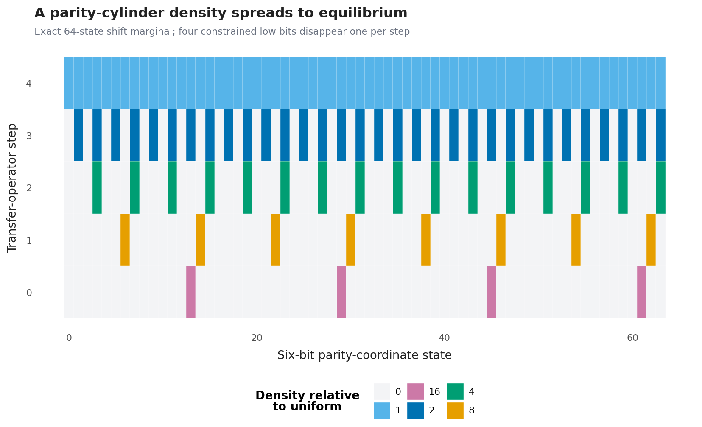

# Transfer operators and averaged dynamics {#sec-transfer-operators}
<!-- Retained source chapter 25 from collatz_conjecture; mathematical content and anchors preserved. -->

## Motivation: move distributions instead of points

An orbit follows one starting value. An averaged theory asks how an entire
distribution of starts changes under the map. A **transfer operator** packages
that evolution linearly: add two starting densities, and their pushed-forward
densities add. Linear algebra and spectral theory can then study mixing, stable
distributions, and decay of correlations.

This change of viewpoint is powerful but changes the question. A theorem about
the evolution of densities may permit an exceptional set of individual points.
The classical Collatz conjecture permits no exceptional positive integer.

## Moving densities rather than individual points

On a finite state set, let a row vector $p$ assign mass $p_i$ to state $i$.
A stochastic transition matrix sends it to $pP$. For a deterministic finite map
$F$, the matrix has one 1 in each row, and the mass at state $y$ after one step is

$$
p'_y=\sum_{x:F(x)=y}p_x.
$$

Many-to-one branches combine mass. States without preimages receive none.

On a probability space $(X,\mathcal A,\mu)$, let $T:X\to X$ be measurable
and assume $\mu(A)=0\Longrightarrow\mu(T^{-1}(A))=0$ for every
$A\in\mathcal A$. This one-sided null-preimage condition ensures that
transporting any probability density still gives a $\mu$-density. The clinic
below proves the condition's role and distinguishes it from invariance.
For $f\ge0$ with $\int f\,d\mu=1$, the output density $\mathcal Lf$, unique
up to $\mu$-null sets, is characterized by

$$
\int_A \mathcal L f\,d\mu
=\int_{T^{-1}(A)}f\,d\mu
$$

for every measurable set $A\in\mathcal A$. The left side measures output mass in
$A$; the right side measures input mass whose image lands there.

## Perron–Frobenius operators

The operator $\mathcal L$ above is often called a **Perron–Frobenius** or
**transfer** operator. It is linear, preserves nonnegativity, and preserves total
mass. A density $f_*$ satisfying $\mathcal Lf_*=f_*$ is invariant.

For the 2-adic shortcut map $T$, every $y\in\mathbb Z_2$ has two preimages:

$$
x_0=2y
\quad\text{and}\quad
x_1=\frac{2y-1}{3}.
$$

The first is even; the second is odd because 3 is invertible modulo 2. Each
parity branch occupies half the Haar measure, giving the exact formula

$$
(\mathcal Lf)(y)
=\frac12\left[f(2y)+f\!\left(\frac{2y-1}{3}\right)\right]. \tag{25.1}
$$

In particular, $\mathcal L1=1$, so normalized Haar measure is invariant.

**Worked example.** Let $f(x)=2$ on even 2-adic integers and $0$ on odd ones.
This is a probability density because the even class has Haar measure $1/2$.
In (25.1), $2y$ is even and $(2y-1)/3$ is odd, so

$$
(\mathcal Lf)(y)=\tfrac12(2+0)=1.
$$

After one step, the conditioned-even Haar distribution becomes uniform. This is
an exact 2-adic density calculation, not a statement that finite positive starts
become uniformly distributed by ordinary size.

## Clinic: when transported mass still has a density {#sec-collatz-density-clinic}

Use the finite probabilities and matrix language from [sec-probability-models](20-probability-models.md#sec-probability-models).
The new measure distinctions are introduced here.

The Haar example works because the reference measure is invariant. For another
map, first ask whether transported mass can still be represented by a density.
Let $\mu$ be a reference probability measure. A density $f\ge0$ assigns an event
$A$ probability $\int_A f\,d\mu$, with $\int f\,d\mu=1$. A **null event** has
$\mu$-measure zero; a **point atom** is a singleton with positive probability.
A density assigns every null event zero probability.

The reference measure is part of this description. A singleton can be an atom
for the transported probability even though it is null for the reference
measure. Our task is to compare these two measures on the same events. The
interval examples below require only lengths and rectangle or triangle areas.

For measurable $T$, transporting an input density always defines the measure

$$
\nu_f(A)=\int_{T^{-1}(A)}f\,d\mu.
$$

It has a $\mu$-density exactly when $\nu_f\ll\mu$: every $\mu$-null event also
has $\nu_f$-mass zero. Here $L^1(\mu)$ consists of real measurable functions
with $\int|f|\,d\mu<\infty$, identified up to null sets, and
$\|f\|_1=\int|f|\,d\mu$. To define the transfer operator on every such input,
require

$$
\mu(A)=0\quad\Longrightarrow\quad\mu(T^{-1}(A))=0. \tag{N}
$$

This is the one-sided nonsingularity condition used here
(Froyland et al. 2011). Under (N), integrating any $L^1$ input over a null
preimage gives zero. The Radon–Nikodym theorem therefore supplies its output
density, unique up to null sets; the transport identity gives linearity,
positivity and preservation of the signed integral, hence of density mass.
Positivity applied to $|f|\pm f$ gives
$|\mathcal Lf|\le\mathcal L|f|$ almost everywhere. Integrating yields
$\|\mathcal Lf\|_1\le\|f\|_1$.

Conversely, the input $f=1$ shows that (N) is necessary for an operator on all
inputs. For one selected $f$, only $\nu_f\ll\mu$ is needed. Sarig uses the
stronger convention $\mu(A)=0\iff\mu(T^{-1}(A))=0$
(Sarig 2020); only the forward implication (N) is required here.

### Worked example: finite bins conceal an atom

Let $\lambda$ be interval-length probability on $[0,1]$, and set

$$
T_0(x)=
\begin{cases}
0,&0\le x\le1/3,\\
(3x-1)/2,&1/3<x\le1.
\end{cases}
$$

Start uniformly. The plateau sends mass $1/3$ to zero. On the other branch,
$x=(2y+1)/3$ gives $dx=(2/3)\,dy$. Thus the exact output is

$$
\nu=\tfrac13\delta_0+\tfrac23\lambda,
$$

where $\delta_0$ puts all its mass at zero. Since $\lambda(\{0\})=0$ but
$\nu(\{0\})=1/3$, no Lebesgue density represents this output. Equivalently,
the preimage of the null event $\{0\}$ has length $1/3$, violating (N).
Continuity of the map on a compact interval has not prevented the atom.

The qualification about a selected input matters. For this same map, take
$f=(3/2)\mathbf1_{(1/3,1]}$. Its mass is one and it vanishes on the plateau.
The affine substitution now multiplies the input height by $2/3$, producing
the uniform output density $1$. The map fails (N), yet this particular input
creates no atom.

For an integer $m\ge1$, divide $[0,1]$ into $m$ equal cells $I_i$, numbered
from zero, with zero in the first cell and one in the last. Endpoint choices elsewhere have zero
mass. The output cell probabilities and their uniform-within-cell histogram are

$$
\begin{aligned}
p_0&=\tfrac13+\tfrac{2}{3m},\\
p_i&=\tfrac{2}{3m}\quad(i>0),\\
h_m(y)&=\tfrac23+\tfrac m3\mathbf1_{[0,1/m)}(y).
\end{aligned}
$$

Multiplying each cell probability by $m$ gives its histogram height.
Although $\int h_m\,d\lambda=1$, this is not a density of $\nu$: it spreads
the atom over the first cell and assigns the singleton zero mass.
A finite list of cell probabilities cannot distinguish those two allocations:
each places the same total mass in every recorded cell. Refinement improves
the location of that mass, while its height grows without bound. Exact
probabilities at each resolution therefore need not give a limiting density.

The entries here are probabilities of cells, rather than values of a density
at representative points. We use column vectors for this example, so an input
probability vector $p$ becomes $M_mp$. This is the transpose convention to
the row vectors at the start of the chapter.

With column input vectors, uniform conditional input in cell $I_j$ gives

$$
(M_m)_{ij}=m\lambda(I_j\cap T_0^{-1}(I_i)).
$$

For three cells, the first input cell maps entirely into the first output
cell. The middle cell splits in proportions $2/3,1/3$ between the first two
outputs; the last splits in proportions $1/3,2/3$ between the last two. Hence

$$
M_3=
\begin{pmatrix}
1&2/3&0\\
0&1/3&1/3\\
0&0&2/3
\end{pmatrix}.
$$

$$
M_3\begin{pmatrix}1/3\\1/3\\1/3\end{pmatrix}
=\begin{pmatrix}5/9\\2/9\\2/9\end{pmatrix}.
$$

Every column sums to one because the output events partition each input cell.
This proves finite mass preservation under the declared conditioning. It does
not prove density existence or justify assuming uniform conditional inputs
again after each step.

Refining the bins also needs a precise interpretation. The difference
$h_{2m}-h_m$ equals $m/3$ on $[0,1/(2m))$, equals $-m/3$ on
$[1/(2m),1/m)$, and vanishes elsewhere. Consequently

$$
\|h_{2m}-h_m\|_1
=\frac m3\frac1{2m}+\frac m3\frac1{2m}=\frac13.
$$

The histograms are not Cauchy in $L^1$, so they cannot converge in that norm.
They refine one fixed output measure; $m$ does not count time steps. For
integers $j\ge0$, genuine time iterates instead satisfy
$\mu_j=(1-(2/3)^j)\delta_0+(2/3)^j\lambda$, because zero stays fixed and
$T_{0*}\lambda=\nu$. Their atomic mass grows with $j$.

These particular time iterates also have exactly the cell probabilities
$M_m^ju$, where $u=(1/m,\ldots,1/m)^{\mathsf T}$. To prove this, let $e_0$
concentrate probability in the first cell. Since $T_0(x)\le x$, that cell
is invariant, giving $M_me_0=e_0$. The uniform-input calculation gives
$M_mu=\tfrac13e_0+\tfrac23u$. The span of $e_0,u$, of dimension at most two,
is therefore invariant, and induction gives the claimed bin masses.
This special agreement establishes no general exactness of repeated
within-cell reconditioning.

For every continuous real function $\varphi$,

$$
\begin{aligned}
\int\varphi h_m\,d\lambda
&=\tfrac23\int\varphi\,d\lambda
+\tfrac13m\int_0^{1/m}\varphi(y)\,dy\\
&\longrightarrow\tfrac23\int\varphi\,d\lambda+\tfrac13\varphi(0).
\end{aligned}
$$

Thus $h_m\lambda$ converges weakly as probability measures to $\nu$.
The convergence tests continuous functions; its limit may have an atom.
A continuous function varies little across the shrinking first cell, so it
assigns nearly the same integral to the spike and to an atom at zero. The
constant test function still records total mass one. No probability has
disappeared; one third of it has become concentrated at a point.

### Exact finite companion {#sec-collatz-density-code}

The standalone block uses exact rational arithmetic with positive cell counts
and nonnegative time indices. It prints $M_3$, the refinement distance $1/3$,
and parameters of the first two output densities $g_1,g_2$ for $S(x)=x/2$,
$f_0(x)=2x$, derived in the [changed task](#sec-collatz-density-task).

```python
from fractions import Fraction

def _require_integer(value: int, name: str, minimum: int) -> None:
    if isinstance(value, bool) or not isinstance(value, int) or value < minimum:
        raise ValueError(f"{name} must be an integer at least {minimum}")

def _overlap(
    left_start: Fraction, left_end: Fraction, right_start: Fraction, right_end: Fraction
) -> Fraction:
    return max(Fraction(0), min(left_end, right_end) - max(left_start, right_start))

def plateau_transition(cell_count: int) -> tuple[tuple[Fraction, ...], ...]:
    """Column input, row output; uniform conditional input inside each cell."""
    _require_integer(cell_count, "cell_count", 1)
    rows = []
    for output in range(cell_count):
        left, right = Fraction(output, cell_count), Fraction(output + 1, cell_count)
        row = []
        for source in range(cell_count):
            a, b = Fraction(source, cell_count), Fraction(source + 1, cell_count)
            mass = cell_count * _overlap(a, b, (2 * left + 1) / 3, (2 * right + 1) / 3)
            if output == 0:
                mass += cell_count * _overlap(a, b, Fraction(0), Fraction(1, 3))
            row.append(mass)
        rows.append(tuple(row))
    return tuple(rows)

def histogram_refinement_l1(cell_count: int) -> Fraction:
    """Integrate |h_(2m)-h_m| on their common exact rational partition."""
    _require_integer(cell_count, "cell_count", 1)
    cuts = (Fraction(0), Fraction(1, 2 * cell_count), Fraction(1, cell_count), Fraction(1))
    result = Fraction(0)
    for left, right in zip(cuts, cuts[1:]):
        point = (left + right) / 2
        heights = [
            Fraction(2, 3) + (Fraction(n, 3) if point < Fraction(1, n) else 0)
            for n in (cell_count, 2 * cell_count)
        ]
        result += (right - left) * abs(heights[1] - heights[0])
    return result

def contraction_density(iteration: int) -> dict[str, Fraction]:
    """Return the finite triangular density parameters and exact integrals."""
    _require_integer(iteration, "iteration", 0)
    slope, endpoint = Fraction(2) ** (2 * iteration + 1), Fraction(1, 2**iteration)
    halfway = endpoint / 2
    distance = 3 * slope * halfway**2 / 2 + slope * (endpoint**2 - halfway**2) / 2
    return {
        "slope": slope,
        "support_endpoint": endpoint,
        "mass": slope * endpoint**2 / 2,
        "first_moment": slope * endpoint**3 / 3,
        "next_L1_distance": distance,
    }

for row in plateau_transition(3):
    print(tuple(map(str, row)))
print("refinement L1:", histogram_refinement_l1(3))
for step in (1, 2):
    print(step, contraction_density(step))
```

The two triangular outputs have mass one, first moments $1/3$ and $1/6$, and
successive $L^1$ distance $3/2$. Changing the arguments checks further finite
cases. It cannot verify every $m$ or $k$, density existence, or a weak limit;
those claims require the arguments in this clinic.

### Changed task: densities at every finite time {#sec-collatz-density-task}

Replace the map by $S(x)=x/2$ and the starting density by $f_0(x)=2x$ on
$[0,1]$. Now every finite output has a density. Determine what that guarantees.

1. Verify (N), derive $\mathcal L_Sf$, and compute the first two outputs.
2. Find $g_k=\mathcal L_S^kf_0$ for all integers $k\ge0$. Check its mass and
   first moment, and compute $\|g_{k+1}-g_k\|_1$.
3. Find the weak probability-measure limit of $g_k\lambda$. Does weak
   convergence in $L^1$ hold? Determine all invariant probability measures
   and whether any has a density.

Use the [hint](#sec-collatz-density-hint) before reading the
[full solution](#sec-collatz-density-solution).

### Hint {#sec-collatz-density-hint}

Use $x=2y$ for one step, retaining the support. For the distance, split the
support in half. For continuous tests, bound variation on the shrinking
support. For invariance, examine the nested images $S^k([0,1])$.

### Full solution {#sec-collatz-density-solution}

A null event has a null preimage: intersect it with $[0,1/2]$ and multiply
lengths by two. Thus (N) holds, although $S$ does not preserve $\lambda$.
For example, all inputs land in $[0,1/2]$, although that interval has reference
mass only $1/2$. Null-preimage preservation permits a density; it does not
assert that the reference measure itself stays unchanged. The reverse null
implication fails: $A=(1/2,1]$ has positive length and empty preimage.
Extend $f$ by zero outside $[0,1]$. Substitution gives

$$
\begin{aligned}
(\mathcal L_Sf)(y)&=2f(2y)\mathbf1_{[0,1/2]}(y),\\
g_k(y)&=2^{2k+1}y\mathbf1_{[0,2^{-k}]}(y).
\end{aligned}
$$

The second formula follows by induction, starting with $k=0$. In particular,
$g_1=8y$ on $[0,1/2]$ and $g_2=32y$ on $[0,1/4]$, zero elsewhere.
Writing $a=2^{2k+1}$ and $b=2^{-k}$ gives

$$
\begin{aligned}
\int g_k\,d\lambda&=\frac{ab^2}{2}=1,\\
\int yg_k(y)\,dy&=\frac{ab^3}{3}=\frac{2^{1-k}}3.
\end{aligned}
$$

On the first half of $[0,b]$, $g_{k+1}=4g_k$, and $g_k$ has mass $1/4$
there. On the remaining half, $g_{k+1}=0$ and $g_k$ has mass $3/4$. Therefore

$$
\|g_{k+1}-g_k\|_1=3\cdot\tfrac14+\tfrac34=\tfrac32.
$$

There is no $L^1$-norm limit. Nevertheless, for continuous $\varphi$,

$$
\left|\int\varphi g_k\,d\lambda-\varphi(0)\right|
\le\sup_{0\le y\le2^{-k}}|\varphi(y)-\varphi(0)|\longrightarrow0.
$$

So $g_k\lambda$ converges weakly as Borel probability measures to $\delta_0$,
using the continuous-test convention in [source section](../collatz-conjecture/36-ergodic-optimization.md#sec-collatz-optimization-measures).
This is not weak convergence in $L^1$, which tests against all bounded
measurable functions. Any such limit $h$ would be nonnegative and have integral
one, by testing positivity and total mass. But testing
$\mathbf1_{[a,1]}$ for every $a>0$ would give $\int_a^1h=0$, since eventually
the support lies below $a$. This forces $h=0$ almost everywhere, a contradiction.

Finally, invariance of a probability $\eta$ implies
$\eta([0,2^{-k}])=1$: its preimage under $S^k$ is the whole interval.
Continuity from above gives $\eta(\{0\})=1$. Thus $\delta_0$ is the unique
invariant probability measure, and none has a Lebesgue density. The compact,
continuous invariant-measure theorem remains valid. Existence of finite
output densities, an invariant density, and convergence to it are separate
claims. These interval examples clarify those claims without proving a
Collatz termination statement.

## Residue-class transition matrices

Finite matrices approximate or exactly represent transfer on cylinder functions.
A **cylinder function of depth $k$** depends only on a residue modulo $2^k$.
Because one shortcut step discards a low bit, computing an output cylinder of
depth $k$ requires input information through depth $k+1$.

Under uniform lifting modulo 4, the shortcut images have these parities:

| input residue mod 4 | input parity | $T(x)$ parity |
|---:|:---:|:---:|
| 0 | even | even |
| 1 | odd | even |
| 2 | even | odd |
| 3 | odd | odd |

Conditioned on either input parity and uniform choice of its two lifts modulo 4,
the next parity is split equally. The resulting two-state matrix has both rows
$(1/2,1/2)$. This matrix is exact for that declared lifted distribution. It is
not a deterministic map from parity alone: the next parity needs one additional
input bit.

<figure id="fig-transfer-evolution">


<figcaption>

Figure 6.1: A localized parity-cylinder density spreads under four applications of the finite binary-shift transfer operator until its low-bit marginal is uniform.

</figcaption>
</figure>

[Figure 6.1](#fig-transfer-evolution) is computed on 64 parity-coordinate states with explicit
fair high-bit lifting. It illustrates the exact finite marginal of the 2-adic
shift, not an empirical claim about ordinary orbit magnitudes.

## Spectral gaps and mixing heuristics

An invariant density accounts for eigenvalue 1. A **spectral gap** informally
means that all relevant mean-zero deviations are contracted at a uniform rate
strictly below 1 in an appropriate function space. Iterating the operator then
drives regular initial densities toward equilibrium and makes correlations decay.

The words “appropriate function space” matter. An operator may have a gap on
locally constant or Hölder functions and fail to control extremely irregular
observables. Point masses and indicators of thin arithmetic sets can lie outside
the useful norm.

Through the parity homeomorphism $Q$, the 2-adic shortcut map is conjugate to the
binary shift. Finite parity cylinders therefore mix exactly as digits are shifted
away and replaced by unrestricted higher digits. This gives rigorous symbolic
mixing for Haar measure. It does not make usual logarithmic height a regular
2-adic observable, nor does it give positive integers positive Haar measure.

For ordinary Collatz questions, residue-transition matrices and operator spectra
remain valuable heuristics and sometimes ingredients in averaged proofs. A
claimed spectral estimate must identify the operator, measure, norm, truncation,
and error between finite and infinite systems.

## Natural versus logarithmic weighting

For a set $A$ of positive integers, natural sampling through $N$ gives weight

$$
\frac1N\sum_{n\le N}\mathbf1_A(n).
$$

Logarithmic sampling gives smaller integers proportionally more weight:

$$
\frac{1}{\log N}\sum_{n\le N}\frac{\mathbf1_A(n)}n,
$$

up to a harmless normalization refinement. These averages define different
notions of density and interact differently with multiplicative scaling.

A transfer operator is tied to its reference measure. Haar measure on
$\mathbb Z_2$, uniform measure on a finite interval, natural density, and
logarithmic density are not interchangeable. Tao's theorem uses logarithmic
density because it supports the required multiscale averaging (Tao 2022). The
measure is part of the theorem statement, not a technical decoration.

## The exceptional-set barrier

Suppose an averaged argument proves that a bad set has density zero. This can be
a major theorem while leaving infinitely many bad integers, just as the squares
have natural density zero but never end. A norm estimate may show that the mass
of exceptional states is small without showing it is empty.

To prove the classical conjecture, one needs a mechanism that removes every
positive-integer exception. Possible mechanisms might include well-founded
descent, a covering certificate, or a new rigidity theorem connecting an
exceptional orbit to an impossible arithmetic structure. No transfer-operator
heuristic alone supplies that final step.

<div class="callout callout-warning">
<p class="callout-title">Pitfall clinic</p>

- An invariant distribution is not an attracting fixed point for every orbit.
- A finite transition matrix depends on how unresolved high bits are lifted.
- Mixing in parity coordinates need not control ordinary magnitude.
- Spectral claims are meaningless without a space and norm.
- Density zero is not emptiness, and Haar typicality is not integer typicality.

</div>

<!-- inline-formula-code:start -->
## Formula and finite computation

A useful formula in this chapter is

$$
(Pf)(x)=\sum_{Ty=x}w(y)f(y)
$$

A stochastic matrix is a finite transfer operator whose mass preservation can be checked by column sums. The following standalone Python block expresses that finite rule with its inputs and stopping conditions visible.

```python
import numpy as np

operator = np.array([[0.5, 0.2, 0.0], [0.5, 0.3, 0.4], [0.0, 0.5, 0.6]])
density = np.array([0.2, 0.5, 0.3])
next_density = operator @ density
print(operator.sum(axis=0), density.sum(), next_density.sum(), next_density)
```

**What the computation establishes.** The output certifies only the declared finite case. The theorem, if one is claimed, still requires the argument developed in the chapter.
<!-- inline-formula-code:end -->

## Exercises

<div class="exercise" id="collatz_conjecture-25-transfer-operators-ex-1">
<p class="exercise-title"><strong>Exercise 1</strong></p>

For a deterministic map on a finite set, prove total mass is preserved by
$p'_y=\sum_{F(x)=y}p_x$.

</div>

<div class="exercise" id="collatz_conjecture-25-transfer-operators-ex-2">
<p class="exercise-title"><strong>Exercise 2</strong></p>

Verify that the two expressions in (25.1) are the even and odd preimages of
$y$.

</div>

<div class="exercise" id="collatz_conjecture-25-transfer-operators-ex-3">
<p class="exercise-title"><strong>Exercise 3</strong></p>

Apply (25.1) to the density that is 2 on odd inputs and 0 on even inputs.

</div>

<div class="exercise" id="collatz_conjecture-25-transfer-operators-ex-4">
<p class="exercise-title"><strong>Exercise 4</strong></p>

Derive the displayed parity transition table directly from residues modulo 4.

</div>

<div class="exercise" id="collatz_conjecture-25-transfer-operators-ex-5">
<p class="exercise-title"><strong>Exercise 5</strong></p>

Explain why parity alone does not determine next parity.

</div>

<div class="exercise" id="collatz_conjecture-25-transfer-operators-ex-6">
<p class="exercise-title"><strong>Exercise 6</strong></p>

Give an infinite density-zero set of positive integers.

</div>

<div class="exercise" id="collatz_conjecture-25-transfer-operators-ex-7">
<p class="exercise-title"><strong>Exercise 7</strong></p>

State three items that must accompany a numerical spectral-gap claim.

</div>

<div class="exercise" id="collatz_conjecture-25-transfer-operators-ex-8">
<p class="exercise-title"><strong>Exercise 8</strong></p>

Explain why exact symbolic mixing on $\mathbb Z_2$ does not settle Collatz.

</div>

## Answers and support

1. Summing over $y$ counts every input mass exactly once because a function has
   one output: $\sum_y p'_y=\sum_xp_x$.
2. $T(2y)=y$; the other value is odd and satisfies
   $(3((2y-1)/3)+1)/2=y$.
3. The even preimage contributes 0 and the odd preimage 2, so the result is again
   the uniform density 1.
4. Evaluate the shortcut branch for representatives 0, 1, 2, 3 and reduce the
   result modulo 2.
5. Residues 0 and 2 are both even but their images have different parity; the
   second low bit is needed.
6. The squares, powers of two, or primes are suitable examples; the first two
   have elementary density-zero proofs.
7. For example: the exact operator/matrix, reference measure, function space and
   norm, truncation size, and a rigorous truncation-error bound.
8. Positive integers have Haar measure zero, and the conjugacy records parity
   rather than usual size or arrival at 1.
