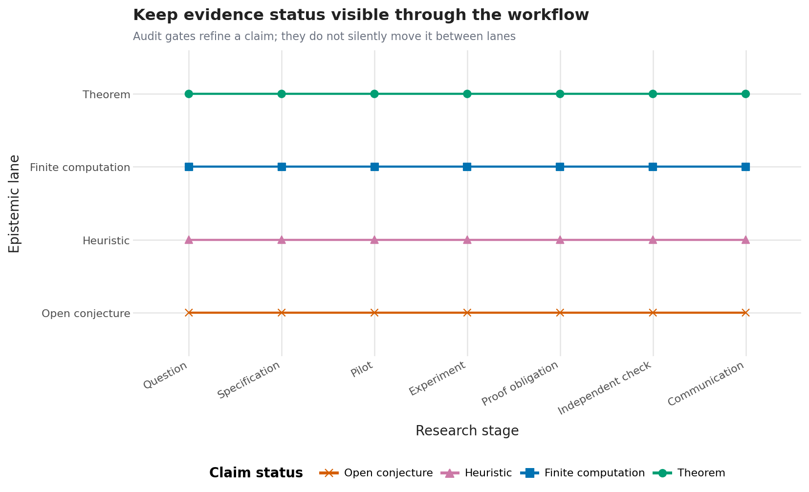

# Open research practicum {#sec-research-practicum}
<!-- Retained source chapter 26 from collatz_conjecture; mathematical content and anchors preserved. -->

## Motivation: make a contribution that can survive checking

An open problem attracts experiments, analogies, and proof attempts. The useful
ones are not necessarily the most dramatic. A carefully reproduced theorem
statement, a small independently checked certificate, or a counterexample to an
overconfident heuristic can be a real contribution to understanding.

This practicum organizes six projects from reading through communication. Each
project produces an auditable object. None asks you to announce a proof of the
Collatz conjecture.

## Research objects and a claim ledger

A **research object** is a package containing a question, method, evidence, and
enough provenance for another reader to inspect it. Maintain a **claim ledger**
with one row per assertion:

| claim | status | domain and quantifiers | evidence | unresolved dependency |
|:---|:---|:---|:---|:---|
| displayed identity | theorem | all stated variables | algebraic derivation | none |
| verifier passes range | finite computation | explicit half-open interval | certificate and checker | hardware/run audit |
| parity resembles coins | heuristic | declared sample/model | comparison plot | dependence control |
| every start reaches 1 | open conjecture | all positive integers | partial results only | universal proof |

The ledger prevents a paragraph from silently changing status halfway through.
Update it when a test fails or a proof obligation is discharged.

## Reproducing a theorem statement from a primary source

Choose a peer-reviewed paper or clearly identified preprint. Save bibliographic
metadata and version, locate the exact theorem, and record:

1. domain and notation;
2. every quantifier in its original order;
3. the measure or density notion;
4. hypotheses and exceptional sets;
5. the exact conclusion; and
6. what tempting stronger statement is **not** concluded.

**Worked example.** At expository resolution, Tao's theorem says: for any
function $f(N)$ tending to infinity, the minimum value attained by the Collatz
orbit of $N$ is below $f(N)$ for almost all $N$ in logarithmic density
(Tao 2022). A faithful report preserves “any $f$ tending to infinity,” “almost
all,” and “logarithmic density.” It must add that the theorem does not say almost
every orbit reaches 1.

Your deliverable is a one-page theorem card with the exact source location, a
notation translation, one toy example illustrating the quantifiers, and a box
of prohibited paraphrases.

## Designing a symbolic descent experiment

Select a shortcut-prefix depth $k$. Enumerate residues modulo $2^k$, derive their
parity words and affine formulas, and test a declared descent predicate. Keep
formal words separate from admissible residue classes.

Before running, write a protocol:

- input modulus and canonical residues;
- map convention and coefficient recurrence;
- exact descent test and step cap;
- treatment of start 0 as a residue representative;
- expected coverage identity; and
- independent spot checks.

Report unresolved classes rather than discarding them. Repeat at depths
$k,k+1,k+2$ and ask whether resolved nodes genuinely prune compatible descendants.
The output is a finite map of what the chosen predicate certifies, not a proof
that increasing $k$ must eventually cover everything.

## Building a small independently checked certificate

Implement a producer that finds descent prefixes for every start in, for example,
$[2,100{,}000)$. It should emit a stable, documented format. Separately implement
a checker that knows only the reference Collatz rule, format, and coverage
requirements.

<div class="callout callout-note">
<p class="callout-title">Finite soundness proposition</p>

If the checker (i) validates a descent prefix for every $n$ in $[2,N)$,
(ii) proves the manifest covers that interval exactly, and (iii) uses the
reference integer semantics, then the accepted certificate proves every
$n<N$ reaches 1.

</div>

The proof is the descent-certificate theorem plus the manifest coverage. The
proposition is conditional on checker correctness; keep that checker short enough
for line-by-line review and test it with deliberately corrupted certificates.

**Worked corruption tests:** change one parity bit, delete one interval, duplicate
an interval, alter an endpoint, truncate the final block, and substitute a stale
schema version. Record which invariant rejects each mutation.

## Testing a heuristic on adversarial generalized maps

A heuristic is better understood after it fails somewhere. Construct neighboring
piecewise-affine maps that preserve a negative average log multiplier under a
chosen residue model but contain an explicit escaping orbit or nontrivial cycle.
Chapter 16 supplies generalized-map language.

For a simple adversarial example, define on positive integers

$$
F(n)=\begin{cases}
2n,&n\text{ is a power of }2,\\
n-1,&\text{otherwise}.
\end{cases}
$$

Most integers decrease in one step, but
$1\to2\to4\to8\to\cdots$ escapes. The model “a typical state decreases” misses
a structured exceptional set. This is not a Collatz analogue in every algebraic
detail; it isolates the logical weakness of replacing a universal statement by
an average.

Design a stronger adversary within residue-class affine maps, then state exactly
which hypothesis a proposed heuristic would need to exclude it.

## Writing a theorem-status report

A status report begins with a date because computations, preprints, and
bibliographic metadata can change. Separate sections should cover:

- the open classical statement and map convention;
- peer-reviewed theorems;
- completed finite verifications, each with an explicit half-open range and
  source;
- unreviewed preprints or proposed algorithms;
- heuristics and empirical observations; and
- claims excluded for lack of a verifiable source.

Prefer a primary source for a theorem and its publication record for review
status. Quote sparingly; translate notation in your own words. Do not turn an
algorithmic projection into completed computation or turn a density theorem into
universal convergence. Chapter 12 and Appendix D model this separation.

## A staged route from project to publishable result

A realistic project advances through gates:

1. **Question.** Write a bounded, falsifiable question.
2. **Specification.** Define inputs, outputs, conventions, and epistemic status.
3. **Pilot.** Test tiny cases by hand and with a reference implementation.
4. **Reproduction.** Match an existing table, theorem example, or baseline.
5. **Experiment.** Run a preregistered finite study with provenance.
6. **Stress test.** Search adversarial inputs and alternative explanations.
7. **Proof obligation.** Isolate what would turn the pattern into a theorem.
8. **Independent check.** Invite a separate implementation or proof audit.
9. **Communication.** Release code, data or certificates, limitations, and a
   dated status statement.

Failure at a gate is information. A counterexample to your intermediate lemma
may be more valuable than another million confirming samples.

<figure id="fig-research-claim-ladder">


<figcaption>

Figure 7.1: A research workflow places theorem, computation, heuristic, and open claim on separate evidence lanes with audit gates before publication.

</figcaption>
</figure>

[Figure 7.1](#fig-research-claim-ladder) is a workflow, not a ranking of personal worth. A
careful finite result belongs on its own lane rather than being inflated into a
universal theorem.

<div class="callout callout-warning">
<p class="callout-title">Pitfall clinic</p>

- A secondary summary may omit a quantifier essential to the primary theorem.
- Changing the experiment after seeing results creates undisclosed researcher
  degrees of freedom.
- Producer and checker copied from the same complex code can share one bug.
- An adversarial example refutes a heuristic's universality, not necessarily its
  usefulness in a narrower setting.
- “No counterexample found” and “no counterexample exists” have different status.

</div>

<!-- inline-formula-code:start -->
## Formula and finite computation

A useful formula in this chapter is

$$
R(a,b;B,K)=\#\{n\le B:T_{a,b}^k(n)=1\text{ for some }k\le K\}
$$

A small parameter sweep records bounds and failures instead of reporting only favorable cases. The following standalone Python block expresses that finite rule with its inputs and stopping conditions visible.

```python
bound, steps = 50, 300
results: dict[tuple[int, int], int] = {}
for multiplier, offset in ((3, 1), (5, 1), (3, 5)):
    successes = 0
    for start in range(1, bound + 1):
        value = start
        for _ in range(steps):
            if value == 1:
                successes += 1
                break
            value = value // 2 if value % 2 == 0 else multiplier * value + offset
    results[(multiplier, offset)] = successes
print(results)
```

**What the computation establishes.** The output certifies only the declared finite case. The theorem, if one is claimed, still requires the argument developed in the chapter.
<!-- inline-formula-code:end -->

## Exercises and project briefs

<div class="exercise" id="collatz_conjecture-26-research-practicum-ex-1">
<p class="exercise-title"><strong>Exercise 1</strong></p>

Rewrite the worked Tao statement with all quantifiers visible, then write one
false stronger paraphrase and identify the extra claim.

</div>

<div class="exercise" id="collatz_conjecture-26-research-practicum-ex-2">
<p class="exercise-title"><strong>Exercise 2</strong></p>

Draft a claim-ledger row for a plot of total stopping times below 10,000.

</div>

<div class="exercise" id="collatz_conjecture-26-research-practicum-ex-3">
<p class="exercise-title"><strong>Exercise 3</strong></p>

Specify a depth-8 symbolic descent experiment, including the coverage check.

</div>

<div class="exercise" id="collatz_conjecture-26-research-practicum-ex-4">
<p class="exercise-title"><strong>Exercise 4</strong></p>

List six mutations an independent certificate checker should reject.

</div>

<div class="exercise" id="collatz_conjecture-26-research-practicum-ex-5">
<p class="exercise-title"><strong>Exercise 5</strong></p>

Modify the adversarial map so that its special escaping set is
$\{3\cdot2^k:k\ge0\}$.

</div>

<div class="exercise" id="collatz_conjecture-26-research-practicum-ex-6">
<p class="exercise-title"><strong>Exercise 6</strong></p>

Explain why a preprint can be a primary source yet not peer reviewed.

</div>

<div class="exercise" id="collatz_conjecture-26-research-practicum-ex-7">
<p class="exercise-title"><strong>Exercise 7</strong></p>

Design a two-week project that can succeed without resolving any open claim.

</div>

<div class="exercise" id="collatz_conjecture-26-research-practicum-ex-8">
<p class="exercise-title"><strong>Exercise 8</strong></p>

Write a three-sentence abstract whose labels distinguish a proved identity,
a finite experiment, and a heuristic interpretation.

</div>

## Answers and support

1. A suitable form is: “For every $f$ with $f(N)\to\infty$, the inequality
   holds for all $N$ outside a set of logarithmic density zero.” The false
   paraphrase “almost every orbit reaches 1” replaces an arbitrarily slow growing
   bound by the fixed bound 1 and changes the conclusion.
2. Status: finite computation; domain: starts $1\le n<10{,}000$ under a named
   map; evidence: deterministic script and data hash; limitation: nothing beyond
   the interval.
3. Enumerate all 256 residues, map each to its unique length-8 parity word, verify
   formulas with exact integers, and require the canonical residues or a proved
   class inequality to descend; coverage is exactly 256 accounted classes.
4. Wrong transition, missing shard, duplicate shard, changed endpoint, truncated
   record, wrong hash or version are examples.
5. Set $F(3\cdot2^k)=3\cdot2^{k+1}$ and $F(n)=n-1$ otherwise, taking care that
   the two cases are disjoint and positive.
6. “Primary” means it is the authors' original report; peer review is a separate
   publication process and status.
7. Examples include reproducing one published finite table with independent
   code, auditing a small residue sieve, or cataloguing how five sources state
   Tao's quantifiers.
8. Check that each sentence contains its own domain and label; no transition word
   such as “therefore” should promote the experiment or model into the theorem.

## Closing perspective

The Collatz problem rewards ambition disciplined by labels. Exact algebra,
auditable finite computation, and illuminating heuristics can coexist without
being confused. A strong research report makes its most vulnerable inference
easy to find. That is not merely caution; it is how other people can extend the
work.
