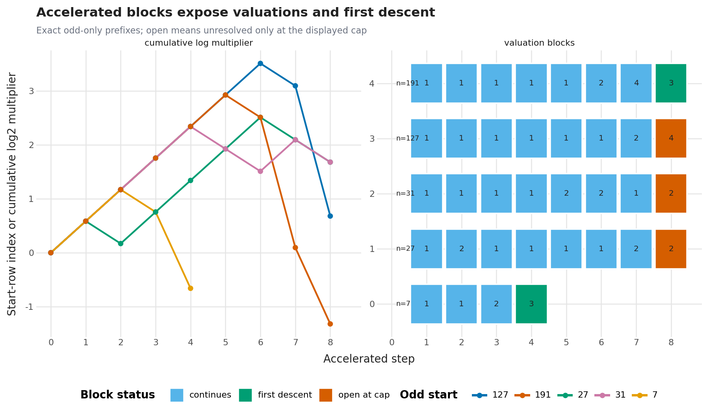

# Accelerated Maps and Renewal Structure {#sec-accelerated-renewal}
<!-- Retained source chapter 27 from collatz_conjecture; mathematical content and anchors preserved. -->

Long strings of divisions by two can hide the arithmetic event that created
them. The odd-only map compresses each such string into one step. This makes
valuation patterns and logarithmic drift easier to see, but compression changes
step counts and can tempt us into an unjustified independence model.

**Prerequisites.** The map conventions of [source section](../collatz-conjecture/01-problem.md#sec-problem), valuations and
congruences from Chapters 3–4, affine parity words from Chapter 4, and the
probability distinctions of [sec-probability-models](20-probability-models.md#sec-probability-models).

**Goals.** You will derive the odd-only map, count its one-step valuation law,
compose accelerated steps exactly, define descent blocks, and separate a renewal
analogy from a renewal theorem.

## From the ordinary map to the odd-only map

For an odd positive integer $n$, $3n+1$ is even. Let

$$
A(n)=\nu_2(3n+1)
$$

be the number of factors of two, and define

$$
U(n)=\frac{3n+1}{2^{A(n)}}.
$$

The value $U(n)$ is again odd. Thus

$$
U:\{1,3,5,\ldots\}\longrightarrow\{1,3,5,\ldots\}
$$

records one multiplication-addition event followed by every forced division by
two.

The positive orbit under the ordinary Collatz map reaches 1 if and only if its
odd subsequence reaches 1 under $U$. This equivalence concerns convergence,
not statistics. One $U$-step corresponds to $A(n)+1$ ordinary transitions
if the unaccelerated odd step $n\mapsto3n+1$ is counted separately. A stopping
time must therefore name its convention.

**Example.** Starting from 7,

$$
3\cdot7+1=22=2\cdot11,
$$

so $A(7)=1$ and $U(7)=11$. Next,

$$
3\cdot11+1=34=2\cdot17,
$$

so $U(11)=17$. But

$$
3\cdot17+1=52=4\cdot13,
$$

so the third accelerated step compresses two divisions.

## Valuation as a waiting-time variable

Fix $r\ge1$. Among odd residues modulo $2^{r+1}$, the congruence

$$
3n+1\equiv0\pmod {2^a}
$$

selects one residue modulo $2^a$, because 3 is invertible modulo every power
of two. Exactly half of those solutions fail modulo $2^{a+1}$. Consequently,
for $1\le a\le r$,

$$
\frac{\#\{n\bmod 2^{r+1}:n\text{ odd},\ A(n)=a\}}{2^r}
=2^{-a}.
$$

One remaining residue class has $A(n)\ge r+1$. Passing to Haar-random odd
2-adic integers gives the exact geometric marginal law

$$
\mathbb P(A=a)=2^{-a},
\quad a=1,2,\ldots,
$$

and hence $\mathbb E[A]=2$.

This is an exact residue count. It says nothing by itself about dependence among

$$
A(n),\ A(U(n)),\ A(U^2(n)),\ldots
$$

along one chosen positive orbit. Under the Haar 2-adic symbolic model, run
lengths can be represented by independent geometric variables. Positive
integers, however, form a countable measure-zero subset of $\mathbb Z_2$.
Transferring an almost-sure statement to every positive start remains a separate
problem.

## Stopping blocks

For an odd start $n_0>1$, define its first accelerated descent time

$$
\tau_-(n_0)
=\min\{k\ge1:U^k(n_0)<n_0\},
$$

when such a $k$ exists. The finite sequence from $n_0$ through
$U^{\tau_-(n_0)}(n_0)$ is a **stopping block**. If a block descends, strong
induction can reuse an already settled smaller start.

Not every short prefix descends. A certificate may say "this residue class
descends within $k$ accelerated steps," but unresolved classes cannot be
discarded. They are the boundary of that finite sieve.

<figure id="fig-accelerated-blocks">


<figcaption>

Figure 8.1: Accelerated stopping blocks group valuation runs and expose their exact logarithmic increments.

</figcaption>
</figure>

[Figure 8.1](#fig-accelerated-blocks) is generated from a declared finite range. Its open
blocks mean only that the chosen step cap found no descent, not that the
corresponding orbits diverge.

## Affine formulas for accelerated words

Write

$$
a_j=A(n_j),\quad n_{j+1}=U(n_j),
\quad S_j=a_0+\cdots+a_{j-1}.
$$

After $k$ steps,

$$
n_k=\frac{3^k n_0+B_k}{2^{S_k}},
$$

where

$$
B_0=0,\quad B_{j+1}=3B_j+2^{S_j}.
$$

**Proof.** Assume the formula at stage $j$. Then

$$
n_{j+1}
=\frac{3n_j+1}{2^{a_j}}
=\frac{3^{j+1}n_0+3B_j+2^{S_j}}
{2^{S_j+a_j}}.
$$

This is the claimed recurrence.

The recurrence for $B_j$ and the cumulative exponent $S_j$ can be evaluated
without expanding intermediate Collatz states. Positive entries are required
because each accelerated valuation removes at least one factor of two.

```python
def accelerated_affine_coefficients(
    valuations: list[int],
) -> tuple[int, int, int]:
    """Return 3**k, B_k, and 2**S_k for a finite accelerated word."""
    if any(valuation <= 0 for valuation in valuations):
        raise ValueError("accelerated valuations must be positive")
    offset = 0
    valuation_sum = 0
    for valuation in valuations:
        offset = 3 * offset + 2**valuation_sum
        valuation_sum += valuation
    return 3 ** len(valuations), offset, 2**valuation_sum

multiplier, offset, denominator = accelerated_affine_coefficients([1, 1, 2])
start = 7
numerator = multiplier * start + offset
if numerator % denominator != 0 or numerator // denominator != 13:
    raise RuntimeError("the accelerated affine formula failed on the 7 orbit")
print(multiplier, offset, denominator, numerator // denominator)
```

The output gives $(27,19,16,13)$, matching three accelerated transitions from
7. A formal valuation word may fail its prefix divisibility conditions for a
different start, so the computation is not an admissibility theorem.

The valuation word $(a_0,\ldots,a_{k-1})$ is not freely assignable to every
start. Integrality at each prefix imposes congruences on $n_0$, and exact
valuation requires divisibility by $2^{a_j}$ but not $2^{a_j+1}$. The
finite parity-prefix bijection collapses these into one odd residue class modulo
$2^{S_k+1}$: the extra bit certifies that the state after the final run of
divisions is odd rather than divisible once more by two.

The block descends precisely when

$$
(2^{S_k}-3^k)n_0>B_k.
$$

Thus $2^{S_k}>3^k$ is necessary for all sufficiently large starts in the
class to descend at that prefix, but it is not sufficient for every small
representative because the additive offset $B_k$ still matters.

## The renewal-process analogy

A renewal process has independent positive waiting times
$W_1,W_2,\ldots$. Renewal epochs are partial sums, and behavior after an epoch
restarts with the same probabilistic law. The Collatz valuations $A(n_j)$
look like waiting times because each counts divisions between odd states.

The analogy suggests grouping the orbit by descent blocks rather than by raw
steps. Yet classical stopping blocks are not proved independent or identically
distributed:

- the next odd state is an arithmetic function of every earlier valuation;
- two different starts may merge and share their entire future;
- conditioning on survival changes the residue distribution;
- the event "first descent now" depends on the initial altitude and all earlier
  offsets.

One can define a genuine renewal model whose waiting times are independent
geometric variables. Results proved in that model must retain the word
**model** until a transfer theorem controls the arithmetic dependence.

## Drift at block scale

One accelerated increment satisfies

$$
\log\frac{U(n)}n
=\log3-A(n)\log2
+\log\left(1+\frac1{3n}\right).
$$

The final term is positive and tends to zero as $n\to\infty$. Under the
geometric model,

$$
\mathbb E[\log3-A\log2]
=\log3-2\log2
=\log(3/4)<0.
$$

For a length-$k$ word, the leading increment is

$$
k\log3-S_k\log2.
$$

Negative average drift predicts that typical modeled blocks shrink. It does not
exclude rare indefinitely rising paths. Universal convergence demands control
over every admissible arithmetic path, including exceptional ones.

Tail behavior matters because long sequences with $A=1$ multiply altitude by
roughly $3/2$ at each accelerated step. They are rare in the independent
model but can dominate peaks and stopping-time moments. A finite average that
looks stable may conceal increasingly rare records.

## Exact block certificates

A bounded descent cover can be encoded by records

```text
modulus exponent r
odd residue c modulo 2^r
valuation word (a_0,...,a_{k-1})
affine numerator 3^k n + B_k
denominator exponent S_k
descent inequality and validity threshold
```

A checker should independently:

1. verify that the residue classes are disjoint and cover the declared domain;
2. recompute every valuation prefix from modular arithmetic;
3. recompute $B_k$ and $S_k$;
4. prove the descent inequality on the whole class, not only its least
   representative;
5. report unresolved classes explicitly.

If every positive start below $N$ has a checked descent to a smaller positive
integer and 1 is the base case, strong induction proves convergence below
$N$. No finite $N$ settles the universal conjecture.

<!-- inline-formula-code:start -->
## Formula and finite computation

A useful formula in this chapter is

$$
T(n)=\frac{3n+1}{2^{v_2(3n+1)}}
$$

Two independent implementations cross-check the accelerated map. The following standalone Python block expresses that finite rule with its inputs and stopping conditions visible.

```python
def standard_to_next_odd(odd_number: int) -> tuple[int, int]:
    """Return the next odd value and standard-step count from an odd start."""
    if odd_number <= 0 or odd_number % 2 == 0:
        raise ValueError("input must be a positive odd integer")
    value = 3 * odd_number + 1
    steps = 1
    while value % 2 == 0:
        value //= 2
        steps += 1
    return value, steps

def independently_accelerated(odd_number: int) -> tuple[int, int]:
    """Return the odd-only destination and its expanded standard-step count."""
    if odd_number <= 0 or odd_number % 2 == 0:
        raise ValueError("input must be a positive odd integer")
    expanded = 3 * odd_number + 1
    power = (expanded & -expanded).bit_length() - 1
    return expanded // (2**power), power + 1

for odd_number in range(1, 100, 2):
    first = standard_to_next_odd(odd_number)
    second = independently_accelerated(odd_number)
    if first != second:
        raise ArithmeticError(f"implementations disagree at {odd_number}")
print("cross-check passed for every positive odd start below 100")
```

**What the computation establishes.** The calculation checks a declared finite instance; the surrounding argument explains what is true beyond those inputs.
<!-- inline-formula-code:end -->

## Summary

- The odd-only map compresses all divisions following an odd step.
- Its one-step valuation has an exact geometric marginal over complete residue
  blocks.
- Accelerated words have exact affine formulas with integrality constraints.
- Stopping blocks support descent certificates and strong induction.
- The renewal and negative-drift models are informative but require a transfer
  theorem before they say anything universal about positive integers.

## Exercises

<div class="exercise" id="collatz_conjecture-27-accelerated-renewal-ex-1">
<p class="exercise-title"><strong>Exercise 1</strong></p>

Compute $A(n)$ and $U(n)$ for $n=1,3,5,7,9,11$.

<details class="solution"><summary>Solution</summary>

Direct factorization gives $(A,U)=(2,1),(1,5),(4,1),(1,11),(2,7),(1,17)$.

</details>

</div>

<div class="exercise" id="collatz_conjecture-27-accelerated-renewal-ex-2">
<p class="exercise-title"><strong>Exercise 2</strong></p>

Count odd residues modulo $32$ with $A(n)=1,2,3,4$, and $A(n)\ge5$.

<details class="solution"><summary>Solution</summary>

The counts are $8,4,2,1,1$.

</details>

</div>

<div class="exercise" id="collatz_conjecture-27-accelerated-renewal-ex-3">
<p class="exercise-title"><strong>Exercise 3</strong></p>

Derive $B_1,B_2,B_3$ from a symbolic word $(a_0,a_1,a_2)$.

<details class="solution"><summary>Solution</summary>

$B_1=1$, $B_2=3+2^{a_0}$, and
$B_3=9+3\cdot2^{a_0}+2^{a_0+a_1}$.

</details>

</div>

<div class="exercise" id="collatz_conjecture-27-accelerated-renewal-ex-4">
<p class="exercise-title"><strong>Exercise 4</strong></p>

Prove the displayed descent inequality.

<details class="solution"><summary>Solution</summary>

Multiply $n_k<n_0$ by the positive denominator and collect terms.

</details>

</div>

<div class="exercise" id="collatz_conjecture-27-accelerated-renewal-ex-5">
<p class="exercise-title"><strong>Exercise 5</strong></p>

Explain why $2^{S_k}>3^k$ need not descend for every small start.

<details class="solution"><summary>Solution</summary>

The positive offset $B_k$ must also be overcome.

</details>

</div>

<div class="exercise" id="collatz_conjecture-27-accelerated-renewal-ex-6">
<p class="exercise-title"><strong>Exercise 6</strong></p>

Compute the modeled mean logarithmic increment.

<details class="solution"><summary>Solution</summary>

It is $\log3-2\log2=\log(3/4)$.

</details>

</div>

<div class="exercise" id="collatz_conjecture-27-accelerated-renewal-ex-7">
<p class="exercise-title"><strong>Exercise 7</strong></p>

Give two reasons stopping blocks are not known classical renewals.

<details class="solution"><summary>Solution</summary>

Arithmetic dependence, merging tails, and survival conditioning are valid
reasons.

</details>

</div>

<div class="exercise" id="collatz_conjecture-27-accelerated-renewal-ex-8">
<p class="exercise-title"><strong>Exercise 8</strong></p>

Design the minimal checker input for one residue-class descent claim.

<details class="solution"><summary>Solution</summary>

At minimum: modulus, residue, word, affine coefficients, descent bound, and
the domain threshold.

</details>

</div>

### Answer support

1. Direct factorization gives $(A,U)=(2,1),(1,5),(4,1),(1,11),(2,7),(1,17)$.
2. The counts are $8,4,2,1,1$.
3. $B_1=1$, $B_2=3+2^{a_0}$, and
   $B_3=9+3\cdot2^{a_0}+2^{a_0+a_1}$.
4. Multiply $n_k<n_0$ by the positive denominator and collect terms.
5. The positive offset $B_k$ must also be overcome.
6. It is $\log3-2\log2=\log(3/4)$.
7. Arithmetic dependence, merging tails, and survival conditioning are valid
   reasons.
8. At minimum: modulus, residue, word, affine coefficients, descent bound, and
   the domain threshold.
