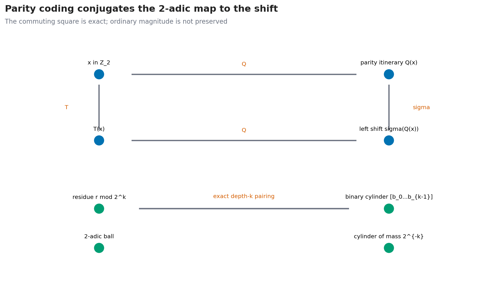

# Ergodic Theory and Symbolic Dynamics {#sec-ergodic-symbolic}
<!-- Retained source chapter 28 from collatz_conjecture; mathematical content and anchors preserved. -->

Iteration can be studied point by point or statistically across a space of
points. Ergodic theory supplies the second viewpoint. In the 2-adic extension of
Collatz, parity itineraries give an exact symbolic coordinate system and the map
becomes a binary shift. The result is powerful, but it describes a larger space
in which the positive integers have measure zero.

**Preparation.** The concise primer introduces sets and functions; this chapter
reviews the probability it needs;
the 2-adic construction and parity homeomorphism from
[source section](../collatz-conjecture/24-two-adic-extension.md#sec-two-adic-extension).

**Goals.** You will define invariant measure, recurrence, symbolic cylinders,
ergodicity, mixing, and entropy; prove basic shift calculations; and identify
the exact barrier between 2-adic typicality and the classical conjecture.

## Measure-preserving systems

A **measurable space** $(X,\mathcal A)$ consists of a set and a collection of
subsets closed under complements and countable unions. A probability measure
$\mu$ assigns total mass 1. A measurable map $F:X\to X$ is
**measure preserving** if

$$
\mu(F^{-1}A)=\mu(A)
$$

for every measurable $A$. Notice the inverse image: mass is compared by asking
which points enter $A$, even if $F$ is not invertible.

An event $A$ is **invariant modulo null sets** when
$F^{-1}A$ differs from $A$ by a set of measure zero. The system is
**ergodic** if every such event has measure 0 or 1. Ergodicity does not mean
every orbit is dense, random, or convergent. It says the probability space
cannot be divided into two positive-measure invariant populations.

**Finite example.** Let $F$ cyclically permute $m$ points carrying uniform
mass. The only invariant subsets are empty and the whole cycle, so the system is
ergodic. If the permutation has two cycles, either cycle is an invariant set of
intermediate mass, so it is not ergodic.

## Recurrence and wandering sets

A set $W$ is **wandering** when

$$
W,F^{-1}W,F^{-2}W,\ldots
$$

are pairwise disjoint. In a probability-preserving system, a wandering set must
have measure zero, because otherwise the disjoint inverse images would have
infinite total mass.

The Poincaré recurrence theorem strengthens this observation: for a measurable
set $A$, almost every point of $A$ returns to $A$ infinitely often.
One proof applies the wandering-set argument to points that never return after a
given time.

Three qualifications are essential:

- the total measure is finite;
- the transformation preserves that measure;
- the conclusion is almost everywhere, not every point.

Counting measure on all positive integers has infinite mass. The ordinary
Collatz map also does not preserve a uniform probability distribution on the
positive integers, because no such distribution gives every integer equal
positive mass. Recurrence cannot be imported by analogy alone.

## Binary sequence space

Let

$$
\Omega=\{0,1\}^{\mathbb N}
$$

be the set of infinite binary sequences
$\omega=(\omega_0,\omega_1,\ldots)$. A **cylinder set** fixes a finite prefix:

$$
[b_0\cdots b_{k-1}]
=\{\omega:\omega_i=b_i\text{ for }0\le i<k\}.
$$

Under the fair Bernoulli measure,

$$
\mu([b_0\cdots b_{k-1}])=2^{-k}.
$$

The left shift

$$
\sigma(\omega_0,\omega_1,\omega_2,\ldots)
=(\omega_1,\omega_2,\ldots)
$$

is measure preserving. Indeed, the preimage of a length-$k$ cylinder is the
disjoint union of the two length-$k+1$ cylinders obtained by prepending 0 or
1. Their masses add to $2^{-k}$.

Events depending on disjoint coordinate blocks are independent. Therefore, if
two cylinders $A$ and $B$ are separated far enough,

$$
\mu(A\cap\sigma^{-n}B)=\mu(A)\mu(B).
$$

This exact cylinder calculation extends to **mixing** for all measurable sets.
Mixing implies ergodicity.

## Parity conjugacy

For the shortcut map

$$
T(x)=
\begin{cases}
x/2,&x\equiv0\pmod2,\\
(3x+1)/2,&x\equiv1\pmod2,
\end{cases}
$$

on $\mathbb Z_2$, define its parity itinerary

$$
Q(x)=\bigl(T^j(x)\bmod2\bigr)_{j\ge0}.
$$

Chapter 24 proves that $Q$ is a homeomorphism and

$$
Q\circ T=\sigma\circ Q.
$$

The natural identification of a binary sequence with
$\sum_j\omega_j2^j$ also makes $Q$ a 2-adic coordinate map.

<figure id="fig-parity-conjugacy">


<figcaption>

Figure 9.1: The 2-adic parity homeomorphism conjugates Collatz iteration to the binary shift.

</figcaption>
</figure>

The commuting square in [Figure 9.1](#fig-parity-conjugacy) is an exact theorem. It preserves
topology and Haar/Bernoulli measure after the appropriate identification. It
does not preserve ordinary absolute size.

Because the fair binary shift is measure preserving, mixing, and ergodic, so is
the 2-adic shortcut system in these coordinates. For Haar-almost every
$x\in\mathbb Z_2$, parity frequencies and finite-word frequencies have their
Bernoulli values.

## Time averages and Birkhoff's theorem

For an integrable observable $f:X\to\mathbb R$, its time average along an
orbit is

$$
\frac1N\sum_{j=0}^{N-1}f(F^j x).
$$

Its space average is $\int f\,d\mu$. Birkhoff's ergodic theorem states that
time averages converge almost everywhere to an invariant function. If the
system is ergodic, that limit equals the space average almost everywhere.

Take $f(\omega)=\omega_0$ in the fair binary shift. Then Birkhoff gives

$$
\frac1N\sum_{j=0}^{N-1}\omega_j\longrightarrow\frac12
$$

for almost every sequence. Indicator functions of finite cylinders similarly
give the expected frequencies of finite words.

This theorem does not guarantee convergence for a specified exceptional
sequence. The constant sequence `111...` is a fixed point of the shift and has
frequency 1 of the symbol 1. Under $Q^{-1}$, it corresponds to the 2-adic
fixed point $-1$.

## Mixing, correlations, and entropy

For observables $f,g$, a lag-$n$ correlation compares

$$
\int f\,(g\circ F^n)\,d\mu
$$

with $\int f\,d\mu\int g\,d\mu$. Mixing says the difference tends to zero for
suitable observables. In the Bernoulli shift, observables depending on disjoint
finite coordinate blocks become exactly independent once the blocks separate.

The binary shift also produces one bit of information per step. Its measure-
theoretic entropy is $\log2$ in natural logarithm units, or 1 bit. Entropy
measures average symbolic information production. It does not measure growth of
ordinary integer values and does not imply computational unpredictability for
every input.

A factor map can lower entropy by merging symbolic distinctions. A finite
residue graph that forgets high bits may therefore look less complex than the
full system even when it reproduces a few short transition counts.

## The positive-integer barrier

The positive integers embed densely in $\mathbb Z_2$ but form a countable
Haar-null set. An almost-everywhere theorem may fail on that entire subset.
Moreover, the target event in the classical conjecture is archimedean:

$$
\text{the ordinary positive orbit reaches the value }1.
$$

Ordinary magnitude is discontinuous in the 2-adic topology. For example,
$2^k-1\to-1$ 2-adically while $2^k-1\to\infty$ ordinarily. A symbolic
theorem that controls low bits does not automatically control ordinary height.

The correct logical chain is:

1. parity conjugacy proves exact statements on $\mathbb Z_2$;
2. ergodic theorems prove almost-everywhere symbolic behavior there;
3. a new arithmetic transfer theorem would be needed to control all positive
   integer orbits and their ordinary magnitude.

Step 3 is precisely the missing bridge, not a routine corollary.

<!-- inline-formula-code:start -->
## Formula and finite computation

A useful formula in this chapter is

$$
h_k=\frac1k\log\#\mathcal L_k
$$

Finite binary languages give block-complexity and entropy-rate estimates. The following standalone Python block expresses that finite rule with its inputs and stopping conditions visible.

```python
from itertools import product
from math import log

for length in range(1, 9):
    language = {
        word for word in product((0, 1), repeat=length) if "111" not in "".join(map(str, word))
    }
    print(length, len(language), log(len(language)) / length)
```

**What the computation establishes.** The output certifies only the declared finite case. The theorem, if one is claimed, still requires the argument developed in the chapter.
<!-- inline-formula-code:end -->

## Summary

- Measure preservation uses inverse images; ergodicity rules out invariant sets
  of intermediate measure.
- Poincaré recurrence needs finite invariant measure and is almost everywhere.
- The fair binary shift is mixing and ergodic on sequence space.
- The 2-adic shortcut Collatz map is exactly conjugate to that shift by parity
  itineraries.
- Birkhoff controls almost every time average, not every specified orbit.
- Positive integers are a dense measure-zero subset, and ordinary magnitude is
  not a 2-adic observable controlled by the conjugacy.

## Exercises

<div class="exercise" id="collatz_conjecture-28-ergodic-symbolic-ex-1">
<p class="exercise-title"><strong>Exercise 1</strong></p>

Prove that a single cycle with uniform mass is ergodic.

<details class="solution"><summary>Solution</summary>

An invariant subset is a union of entire permutation cycles; there is only
one.

</details>

</div>

<div class="exercise" id="collatz_conjecture-28-ergodic-symbolic-ex-2">
<p class="exercise-title"><strong>Exercise 2</strong></p>

Compute the measure of the cylinder `[10110]`.

<details class="solution"><summary>Solution</summary>

It is $2^{-5}=1/32$.

</details>

</div>

<div class="exercise" id="collatz_conjecture-28-ergodic-symbolic-ex-3">
<p class="exercise-title"><strong>Exercise 3</strong></p>

Find the preimage under $\sigma$ of the cylinder `[01]`.

<details class="solution"><summary>Solution</summary>

It is the disjoint union `[001]` and `[101]`.

</details>

</div>

<div class="exercise" id="collatz_conjecture-28-ergodic-symbolic-ex-4">
<p class="exercise-title"><strong>Exercise 4</strong></p>

Prove the fair shift preserves cylinder measures.

<details class="solution"><summary>Solution</summary>

Each length-$k$ cylinder has two length-$k+1$ preimages whose masses add
correctly.

</details>

</div>

<div class="exercise" id="collatz_conjecture-28-ergodic-symbolic-ex-5">
<p class="exercise-title"><strong>Exercise 5</strong></p>

Give a non-typical binary sequence and one failed Birkhoff frequency.

<details class="solution"><summary>Solution</summary>

The constant-one sequence has symbol-one frequency 1 rather than $1/2$.

</details>

</div>

<div class="exercise" id="collatz_conjecture-28-ergodic-symbolic-ex-6">
<p class="exercise-title"><strong>Exercise 6</strong></p>

Explain why mixing is stronger than ergodicity.

<details class="solution"><summary>Solution</summary>

Mixing gives asymptotic independence of separated events; this forces
invariant events to have mass 0 or 1.

</details>

</div>

<div class="exercise" id="collatz_conjecture-28-ergodic-symbolic-ex-7">
<p class="exercise-title"><strong>Exercise 7</strong></p>

Show that the positive integers have Haar measure zero in $\mathbb Z_2$.

<details class="solution"><summary>Solution</summary>

Every singleton has measure zero, and a countable union of null sets is null.

</details>

</div>

<div class="exercise" id="collatz_conjecture-28-ergodic-symbolic-ex-8">
<p class="exercise-title"><strong>Exercise 8</strong></p>

Identify the missing implication in an attempted proof from 2-adic
ergodicity to classical Collatz convergence.

<details class="solution"><summary>Solution</summary>

One needs a theorem transferring almost-everywhere symbolic behavior on
$\mathbb Z_2$ to every positive integer and to ordinary size.

</details>

</div>

### Answer support

1. An invariant subset is a union of entire permutation cycles; there is only
   one.
2. It is $2^{-5}=1/32$.
3. It is the disjoint union `[001]` and `[101]`.
4. Each length-$k$ cylinder has two length-$k+1$ preimages whose masses add
   correctly.
5. The constant-one sequence has symbol-one frequency 1 rather than $1/2$.
6. Mixing gives asymptotic independence of separated events; this forces
   invariant events to have mass 0 or 1.
7. Every singleton has measure zero, and a countable union of null sets is null.
8. One needs a theorem transferring almost-everywhere symbolic behavior on
   $\mathbb Z_2$ to every positive integer and to ordinary size.
