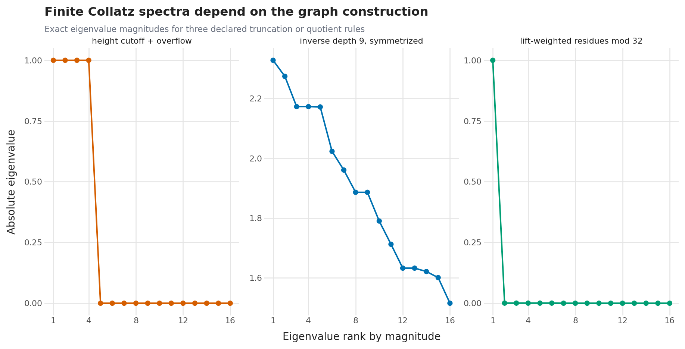

# Graph Theory and Spectral Views {#sec-graph-spectral}
<!-- Retained source chapter 29 from collatz_conjecture; mathematical content and anchors preserved. -->

Every deterministic map draws a directed graph: each state has one outgoing
edge, while several states may merge into the same future. Finite graph models
can count paths, expose bottlenecks, and support algorithms. Their spectra are
properties of the chosen truncation or quotient, not spectral proofs about the
infinite Collatz map.

**Preparation.** Inverse graphs from Chapter 6, the matrix review below, residue
automata from Chapter 21, and transfer operators from Chapter 25.

**Goals.** You will distinguish functional graphs from inverse graphs, audit
three truncation rules, use adjacency and stochastic matrices, interpret finite
eigenvalues, and understand what information quotient graphs lose.

## Functional graphs and inverse forests

For a map $F:X\to X$, its **functional graph** has a directed edge
$x\to F(x)$. Every vertex has out-degree one. Its in-degree can be zero, one,
or larger. If $X$ is finite, every component contains exactly one directed
cycle with directed trees feeding into it.

For the unaccelerated Collatz map on positive integers, every target $m$ has
the even predecessor $2m$. It also has an odd predecessor

$$
n=\frac{m-1}{3}
$$

exactly when this is a positive odd integer, equivalently when
$m\equiv4\pmod6$. Hence the inverse graph has arithmetic branching rather
than constant binary branching.

Calling the global inverse graph a tree assumes what must be proved. A
nontrivial directed cycle would make branches reconnect. The safe phrase is
**inverse graph**, or **inverse tree to a specified finite depth when no
collision occurs in that subgraph**.

## Three kinds of finite truncation

An infinite graph cannot be plotted directly. Common finite models answer
different questions.

### Height cutoff

Keep values $1\le n\le H$. An edge whose image exceeds $H$ leaves the
window. Deleting it turns some out-degrees from one to zero. Redirecting it to a
single overflow vertex preserves mass but creates an artificial hub.

### Inverse-depth cutoff

Begin at 1 and include predecessors through depth $d$. The boundary contains
vertices whose unexplored parents may be numerous. The model is good for local
ancestry and poor for statements about global density by value.

### Residue quotient

Identify integers modulo $m$. This can preserve congruence information, but
division by two is not a function modulo an even $m$ without an extra input
bit. A correct quotient may require states modulo $2m$, a relation with
multiple possible transitions, or explicitly weighted lifts.

Every plotted spectrum must name the vertex set, edge rule, and treatment of
escaping edges. Otherwise two different matrices can masquerade as the same
"Collatz graph."

<figure id="fig-graph-spectra">


<figcaption>

Figure 10.1: Finite Collatz graph spectra change under height, inverse-depth, and residue truncations.

</figcaption>
</figure>

[Figure 10.1](#fig-graph-spectra) uses exact finite matrices described in its generating code.
Differences between panels are a warning about modeling choices, not numerical
noise.

## Adjacency matrices and path counts

Label a finite directed graph by $1,\ldots,m$. Use the convention

$$
A_{ij}=\#\{\text{directed edges }i\to j\}.
$$

Then

$$
(A^k)_{ij}
$$

counts directed walks of length $k$ from $i$ to $j$. The proof is
induction: multiplication sums over the intermediate vertex.

For a closed finite functional graph, each row of $A$ has sum one. If it is a
zero-one matrix, $A$ itself is a deterministic transition matrix. A height
truncation with deleted edges has rows summing to zero at the boundary, so it is
substochastic rather than stochastic.

An inverse adjacency convention transposes $A$. Eigenvalues are unchanged by
transpose, but left and right eigenvectors exchange roles. Path formulas and
probability evolution do depend on the declared convention.

## Perron eigenvalues in finite models

A nonnegative matrix $A$ has a real spectral radius

$$
\rho(A)=\max\{|\lambda|:\lambda\text{ is an eigenvalue of }A\}.
$$

Under irreducibility, Perron–Frobenius theory supplies positive eigenvectors and
a positive leading eigenvalue. For an adjacency matrix, $\rho(A)$ often
controls exponential path-count growth. For a row-stochastic matrix,
$\rho(A)=1$, and a stationary distribution is a left eigenvector with
eigenvalue 1.

These statements are finite linear algebra. If $A_H$ comes from a height
cutoff, a sequence $\rho(A_H)$ can depend strongly on the boundary rule. Even
convergence of these numbers would not by itself imply that every infinite
orbit reaches the $1\leftrightarrow2$ cycle. Spectral information averages
many paths; the conjecture has a universal quantifier over individual starts.

### Weighted inverse operators

To correct branching bias, attach weights $w(x\to y)$ and define

$$
(Lf)(y)=\sum_{x:F(x)=y}w(x\to y)f(x).
$$

This resembles the transfer operator of Chapter 25. Different weights encode
counting, probability, natural-density, or logarithmic-density questions. A
spectral gap in one weighted norm does not automatically hold in another.

## Laplacians, conductance, and bottlenecks

For an undirected graph with adjacency $A$ and degree matrix $D$, the
combinatorial Laplacian is

$$
L=D-A.
$$

Its quadratic form is

$$
v^TLv=\sum_{\{i,j\}\text{ edge}}(v_i-v_j)^2,
$$

so small nonzero eigenvalues indicate partitions connected by few edges.
**Conductance** measures boundary edges relative to the mass of a vertex set.

A directed Collatz graph is not automatically an undirected reversible network.
Symmetrizing it discards edge direction and changes degree. A directed Laplacian
or Markov-chain analysis needs a stationary measure and perhaps a reversiblized
operator. Any conductance claim must name that construction.

Bottlenecks can still be algorithmically important. A set of residue states
with few exits may create long-lived finite behavior, heavy computational loads,
or slow mixing in a model. None of those descriptions means the set is an
invariant divergent component of the integer map.

## Quotient graphs and lumpability

Let $\pi:X\to S$ group detailed states into classes. A deterministic quotient
map $\overline F:S\to S$ exists only if

$$
\pi(x)=\pi(y)\quad\Longrightarrow\quad
\pi(F(x))=\pi(F(y)).
$$

When this fails, one can define a relation or a stochastic transition after
choosing a distribution within each class.

For a Markov chain, a partition is **strongly lumpable** when every two detailed
states in one block have the same total transition probability into every other
block. Only then does the projected process have a well-defined Markov matrix
independent of hidden within-block information.

Collatz residue graphs often fail naive lumpability because division reveals a
bit not stored in the state. Refining the modulus can repair one-step behavior
while later steps require further refinement. This is the finite-memory issue
behind residue automata.

## Automata and minimization

A deterministic finite automaton recognizes a language by reading symbols and
updating a finite state. Two states are equivalent when every possible future
suffix is either accepted from both or rejected from both. The Myhill–Nerode
theorem says that, after removing states unreachable from the start, the equivalence
classes form the unique minimal deterministic automaton, up to relabeling. For example, with alphabet `0,1`, start/accepting state `A`, rejecting state `D`, and transitions `A:0->A,1->A; D:0->D,1->D`, the two states are inequivalent but only `A` is reachable; deleting `D` gives the one-state automaton for all binary words.

For a bounded Collatz certificate language, symbols may be parity bits or
valuation blocks, and acceptance may mean "the associated residue class has a
proved descent prefix." Automaton minimization can merge states with identical
future certificate behavior. It cannot merge states merely because their first
few observed transitions happen to agree.

The full language of starts whose orbits reach 1 is not known to be recognized
by any finite automaton. Building minimal automata at bounded depth is a finite
experiment, not evidence of eventual finite-state completeness unless a theorem
proves stabilization.

## Infinite spectral vistas

On a countable graph, adjacency or transfer rules can define operators on spaces
such as $\ell^1$, $\ell^2$, or weighted supremum spaces. Boundedness depends
on degrees and weights. Spectra can change with the chosen space; an eigenvector
may belong to one space and not another.

A possible research program is:

1. choose a measure or weight justified by the arithmetic question;
2. prove the operator is bounded on a named Banach space;
3. locate spectrum or establish a contraction on a subspace;
4. prove that the resulting averaged statement controls exceptional positive
   integer orbits.

The final transfer step is the difficult one. Spectral-radius heuristics are not
orbit theorems until it is supplied.

<!-- inline-formula-code:start -->
## Formula and finite computation

A useful formula in this chapter is

$$
Af=\lambda f
$$

A finite residue graph turns adjacency and its eigenvalues into explicit arrays. The following standalone Python block expresses that finite rule with its inputs and stopping conditions visible.

```python
import numpy as np

adjacency = np.array(
    [[0, 1, 1, 0], [1, 0, 0, 1], [1, 0, 0, 1], [0, 1, 1, 0]],
    dtype=float,
)
eigenvalues = np.linalg.eigvalsh(adjacency)
print(eigenvalues)
```

**What the computation establishes.** The output certifies only the declared finite case. The theorem, if one is claimed, still requires the argument developed in the chapter.
<!-- inline-formula-code:end -->

## Summary

- A finite functional graph has out-degree one and one cycle per component.
- Height, inverse-depth, and residue truncations have different boundary errors.
- Matrix powers count walks under a declared adjacency convention.
- Perron eigenvalues describe finite path growth or stationary behavior, not
  universal convergence.
- Quotient dynamics require compatibility or lumpability.
- Infinite operator results depend on weights, function spaces, and a theorem
  controlling exceptional arithmetic paths.

## Exercises

<div class="exercise" id="collatz_conjecture-29-graph-spectral-ex-1">
<p class="exercise-title"><strong>Exercise 1</strong></p>

Prove that a finite functional-graph component contains one directed cycle.

<details class="solution"><summary>Solution</summary>

Following outgoing edges must repeat a vertex; out-degree one gives one
eventual cycle, and two cycles cannot lie in one weak component without a
vertex having two futures.

</details>

</div>

<div class="exercise" id="collatz_conjecture-29-graph-spectral-ex-2">
<p class="exercise-title"><strong>Exercise 2</strong></p>

Derive the condition $m\equiv4\pmod6$ for an odd predecessor.

<details class="solution"><summary>Solution</summary>

$(m-1)/3$ is an odd integer exactly when $m-1\equiv3\pmod6$.

</details>

</div>

<div class="exercise" id="collatz_conjecture-29-graph-spectral-ex-3">
<p class="exercise-title"><strong>Exercise 3</strong></p>

Build the functional graph of the shortcut map on $\{1,2,4\}$.

<details class="solution"><summary>Solution</summary>

The edges are $1\to2$, $2\to1$, and $4\to2$.

</details>

</div>

<div class="exercise" id="collatz_conjecture-29-graph-spectral-ex-4">
<p class="exercise-title"><strong>Exercise 4</strong></p>

Prove the matrix-power path-count formula.

<details class="solution"><summary>Solution</summary>

Split a length-$k+1$ walk at its penultimate vertex and use matrix
multiplication.

</details>

</div>

<div class="exercise" id="collatz_conjecture-29-graph-spectral-ex-5">
<p class="exercise-title"><strong>Exercise 5</strong></p>

Explain why deleting escaping edges makes a matrix substochastic.

<details class="solution"><summary>Solution</summary>

A boundary row loses probability or an outgoing edge, so its sum is below 1.

</details>

</div>

<div class="exercise" id="collatz_conjecture-29-graph-spectral-ex-6">
<p class="exercise-title"><strong>Exercise 6</strong></p>

Give a partition of a small deterministic graph that is not compatible with
a quotient map.

<details class="solution"><summary>Solution</summary>

Merge two vertices whose successors fall in different blocks.

</details>

</div>

<div class="exercise" id="collatz_conjecture-29-graph-spectral-ex-7">
<p class="exercise-title"><strong>Exercise 7</strong></p>

State what symmetrization loses in a directed Collatz graph.

<details class="solution"><summary>Solution</summary>

It loses direction, deterministic out-degree, and the distinction between
predecessors and successors.

</details>

</div>

<div class="exercise" id="collatz_conjecture-29-graph-spectral-ex-8">
<p class="exercise-title"><strong>Exercise 8</strong></p>

List the data needed to make a finite spectral plot reproducible.

<details class="solution"><summary>Solution</summary>

Vertex set, edge rule, weights, boundary handling, matrix convention, and
numerical eigensolver precision are essential.

</details>

</div>

### Answer support

1. Following outgoing edges must repeat a vertex; out-degree one gives one
   eventual cycle, and two cycles cannot lie in one weak component without a
   vertex having two futures.
2. $(m-1)/3$ is an odd integer exactly when $m-1\equiv3\pmod6$.
3. The edges are $1\to2$, $2\to1$, and $4\to2$.
4. Split a length-$k+1$ walk at its penultimate vertex and use matrix
   multiplication.
5. A boundary row loses probability or an outgoing edge, so its sum is below 1.
6. Merge two vertices whose successors fall in different blocks.
7. It loses direction, deterministic out-degree, and the distinction between
   predecessors and successors.
8. Vertex set, edge rule, weights, boundary handling, matrix convention, and
   numerical eigensolver precision are essential.
