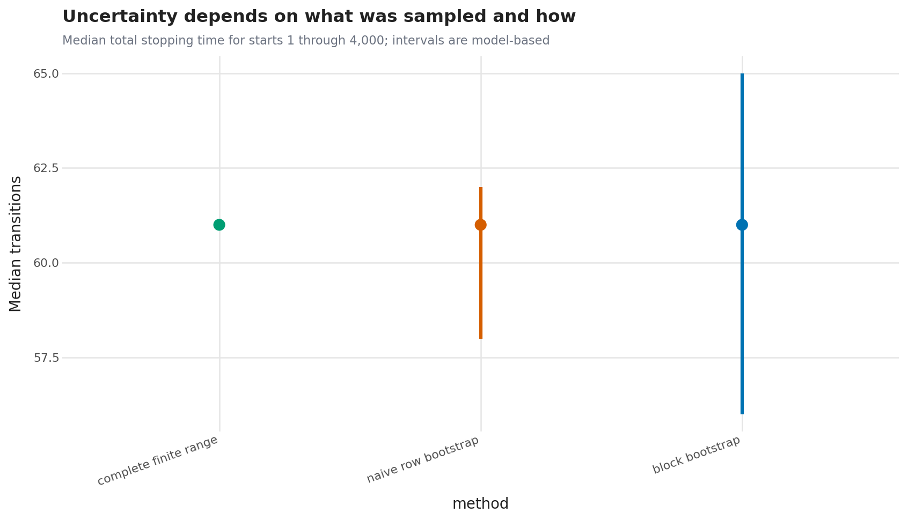

# Statistical Inference for Orbit Data {#sec-statistical-inference}
<!-- Retained source chapter 30 from collatz_conjecture; mathematical content and anchors preserved. -->

Collatz tables are exact finite arithmetic, yet their summaries can be
statistically misleading. Starting values are not always a random sample,
different orbits merge, unresolved runs are censored, and record searches select
extremes by design. Good inference begins by identifying the population and the
source of uncertainty.

**Preparation.** The statistics review below, probability models from
[sec-probability-models](20-probability-models.md#sec-probability-models), stopping times from Chapter 2, and reproducibility from
Chapters 7 and 15.

**Goals.** You will define sampling units, diagnose dependence and censoring,
choose robust summaries, audit regression and resampling, and write uncertainty
statements that do not pretend to measure the truth of the conjecture.

## What is the sampling unit?

A dataset needs a **population**, a **sampling rule**, and an **observational
unit**. Several Collatz studies that look similar use different units:

- starts chosen uniformly from $\{1,\ldots,N\}$;
- every start in a complete finite interval;
- odd residues from a complete block modulo $2^k$;
- steps sampled along one long orbit;
- record holders only;
- inverse-tree vertices selected by depth.

If every start below $N$ is enumerated, the resulting histogram is an exact
description of that finite population. It has no sampling error for that
population. It may still have software error, arithmetic error, or
**extrapolation uncertainty** when used to discuss larger starts.

Selecting record holders produces severe selection bias. A regression fitted
only to successive peak records describes a deliberately extreme subsequence;
it cannot estimate the distribution for typical starts without a selection
model.

### Starts versus orbit steps

Sampling starts gives one statistic per input. Sampling all steps gives longer
orbits more observations and therefore more weight. If the research question is
about a uniformly chosen starting value, pooling orbit steps changes the target
population.

Declare a row key such as

```text
(start, map convention, statistic definition, step cap, software version)
```

before computing summaries. Otherwise duplicated or convention-mismatched rows
can pass unnoticed.

## Dependence and effective information

Within one orbit, adjacent values are deterministic functions of one another.
They are maximally dependent in the predictive sense, even when their parity
symbols look irregular.

Different starts also share tails. For example, the orbit of $2n$ merges with
the orbit of $n$ after one step. If starts $a$ and $b$ reach a common value,
all later states and remaining stopping time are identical. Treating their tails
as independent replicates exaggerates information.

For a stationary numerical sequence with lag correlations $\rho_h$, a common
model-based approximation is

$$
n_{\mathrm{eff}}
\approx
\frac{n}{1+2\sum_{h\ge1}\rho_h}.
$$

This formula requires a stationary process and a convergent correlation sum.
It is not automatically valid for growing Collatz altitude, absorbing orbits,
or a deterministic enumeration of starts. Its role is diagnostic: positive
dependence can make $n$ rows contain far less than $n$ independent pieces
of information.

<figure id="fig-stopping-uncertainty">


<figcaption>

Figure 11.1: Dependence-aware intervals differ from naive intervals for stopping-time summaries.

</figcaption>
</figure>

[Figure 11.1](#fig-stopping-uncertainty) uses a finite declared sample and model-based
resampling only to illustrate the method. The exact complete-range median does
not need a confidence interval for its own range.

## Censoring and truncation

Suppose an experiment stops each orbit after $L$ steps. If a start has not
reached 1, its total stopping time is not $L$; it is known only to exceed
$L$. This is **right censoring**.

Replacing every unresolved value by $L$ biases means and quantiles downward.
Discarding unresolved starts introduces survivor-selection bias. Honest records
store

$$
(\min(\tau,L),\ \delta),
$$

where $\delta=1$ means the event was observed and $\delta=0$ means censored.

Survival analysis studies

$$
S(t)=\mathbb P(\tau>t).
$$

The Kaplan–Meier estimator can handle right censoring under assumptions about
how censoring relates to the event time. A fixed computational cap is known by
design, but the observations across starting values may still be dependent.
Standard error formulas based on independent subjects are not automatically
valid.

For complete enumeration below $N$, the most assumption-light report is the
exact unresolved count at each cap, together with the cap and convention. It
does not estimate an infinite-population survival curve unless a sampling model
is added.

## Heavy tails and record statistics

Stopping times and peaks are highly skewed in finite datasets. A small number of
large values can dominate a mean. Report several summaries:

- count and unresolved count;
- median and specified quantiles;
- arithmetic mean, when all values are resolved;
- trimmed summaries only with the trimming rule visible;
- maximum and the start attaining it;
- logarithmic peak summaries when scales span orders of magnitude.

A **heavy-tailed model** assigns nonnegligible probability to very large
values. Calling empirical Collatz statistics heavy-tailed should mean either a
specific fitted tail model or a descriptive observation about finite skewness.
It is not a theorem that an asymptotic tail distribution exists.

Record values are dependent by construction: the next record must exceed every
earlier one. Plotting record index against start can reveal computation history,
but ordinary least squares formulas derived for independent residuals do not
apply without modification.

## Regression and scaling claims

A power law

$$
y\approx Cn^\alpha
$$

becomes

$$
\log y\approx\log C+\alpha\log n.
$$

A straight line on log–log axes is suggestive, not decisive. Alternative
curved models can look linear over a short range. Taking logarithms also changes
the error model: constant variance in $y$ is not constant variance in
$\log y$.

An audit should inspect:

1. residuals against fitted values and start size;
2. sensitivity to the lower and upper fitting cutoffs;
3. robust or quantile fits, not only least squares;
4. held-out ranges inside the verified domain;
5. alternative models with comparable flexibility;
6. whether record selection or censoring generated the apparent slope.

Extrapolating a fitted curve beyond the largest verified start introduces
model uncertainty that a narrow regression band does not measure. No finite
regression can attach a probability to the universal Collatz conjecture without
a justified prior and data-generating model—and such a probability would then
describe that model, not a theorem.

## Resampling dependent data

The ordinary bootstrap samples rows independently with replacement. It is
appropriate only when rows can reasonably be treated as exchangeable
independent observations for the target statistic.

For an ordered dependent series, a **block bootstrap** resamples consecutive
blocks. For clustered data, a **cluster bootstrap** resamples whole clusters,
such as groups of starts known to share a tail below a merge threshold. These
methods preserve some dependence, but the block length or cluster definition is
a modeling choice.

Collatz starts are arithmetic rather than a stationary time series. Consecutive
integers can have deliberately alternating parity, while congruent starts share
finite parity prefixes. Useful resampling schemes may therefore block by
residue class or inverse-tree ancestry rather than numeric adjacency. The study
must justify the choice against the estimand.

### Randomization checks

A permutation test breaks selected relationships while preserving others. For
example, permuting stopping times across residue labels tests association under
an exchangeability null model. It does not test whether the Collatz conjecture
is true. Before permuting, ask which symmetries the null hypothesis actually
allows.

Chapter [source section](../collatz-conjecture/43-coupling-concentration.md#sec-collatz-coupling-concentration) makes shared-tail dependence exact,
derives an overlapping-window variance correction, and shows how graph coloring
recovers valid concentration bounds under proved source-bit independence.

## Separate four uncertainties

A reproducible report distinguishes:

1. **arithmetic certainty:** were exact integer transitions computed correctly?
2. **coverage certainty:** was the declared finite population covered once and
   only once?
3. **sampling uncertainty:** if starts were sampled, how would the statistic vary
   under the sampling design?
4. **model/extrapolation uncertainty:** which unproved assumptions connect the
   finite data to larger starts or random models?

Only the first two can usually be eliminated by a finite verification
certificate. Confidence intervals address the third under a design or model.
They do not absorb the fourth automatically.

A good sentence reads:

> Among all odd starts below the declared bound, computed exactly under the
> shortcut convention, the finite-population median was $m$. A cluster
> resampling analysis under the stated shared-tail model gave interval $I$ for
> a hypothetical sampling design. Neither statement estimates the probability
> of universal convergence.

## Adversarial data audit

Before publishing a plot, deliberately test:

- duplicated starts;
- missing shards at interval boundaries;
- unresolved rows encoded as resolved at the cap;
- overflow producing negative or wrapped values;
- mixed accelerated and unaccelerated step counts;
- record-only filtering applied before a "typical" summary;
- random seeds omitted from resampling;
- confidence levels or units missing from axes.

An audit that survives corrupted inputs is more informative than one more
decimal place in a fitted exponent.

<!-- inline-formula-code:start -->
## Formula and finite computation

A useful formula in this chapter is

$$
\widehat S_B(t)=B^{-1}\#\{n\le B:\sigma_\infty(n)>t\}
$$

The survival table reports its censoring boundary with every estimate. The following standalone Python block expresses that finite rule with its inputs and stopping conditions visible.

```python
def bounded_stopping_time(start: int, max_steps: int) -> int | None:
    """Return the standard stopping time, or None after the finite budget."""
    if start <= 0 or max_steps < 0:
        raise ValueError("start must be positive and max_steps nonnegative")
    value = start
    for step in range(max_steps + 1):
        if value == 1:
            return step
        if step < max_steps:
            value = value // 2 if value % 2 == 0 else 3 * value + 1
    return None

def survival_table(limit: int, max_steps: int) -> tuple[list[tuple[int, float]], int]:
    """Return empirical survival fractions and the censored-start count."""
    if limit <= 0 or max_steps < 0:
        raise ValueError("limit must be positive and max_steps nonnegative")
    times = [bounded_stopping_time(start, max_steps) for start in range(1, limit + 1)]
    censored = sum(time is None for time in times)
    table = [
        (
            threshold,
            sum(time is None or time > threshold for time in times) / len(times),
        )
        for threshold in range(max_steps + 1)
    ]
    return table, censored

table, censored = survival_table(limit=5_000, max_steps=500)
print(censored)
print(table[::50])
```

**What the computation establishes.** The calculation checks a declared finite instance; the surrounding argument explains what is true beyond those inputs.
<!-- inline-formula-code:end -->

## Summary

- Complete finite enumeration has no sampling error for its stated finite
  population, but it still has audit and extrapolation risks.
- Orbit observations and different starting values can be strongly dependent.
- A step cap creates censoring, not a completed stopping time.
- Robust summaries and record statistics must state their selection rule.
- Regression and resampling conclusions belong to explicit models.
- No confidence interval measures the truth of a universal conjecture without
  assumptions that themselves need justification.

## Exercises

<div class="exercise" id="collatz_conjecture-30-statistical-inference-ex-1">
<p class="exercise-title"><strong>Exercise 1</strong></p>

Give three different observational units for a Collatz study.

<details class="solution"><summary>Solution</summary>

Starting values, orbit steps, residue classes, or inverse vertices are
examples.

</details>

</div>

<div class="exercise" id="collatz_conjecture-30-statistical-inference-ex-2">
<p class="exercise-title"><strong>Exercise 2</strong></p>

Explain why starts $n$ and $2n$ do not give independent orbit tails.

<details class="solution"><summary>Solution</summary>

The second start, $2n$, maps to $n$ after one even step, after which their
trajectories coincide.

</details>

</div>

<div class="exercise" id="collatz_conjecture-30-statistical-inference-ex-3">
<p class="exercise-title"><strong>Exercise 3</strong></p>

Encode an unresolved orbit at a cap of 10,000 steps.

<details class="solution"><summary>Solution</summary>

Store observed value 10,000 with event indicator 0, plus the map convention.

</details>

</div>

<div class="exercise" id="collatz_conjecture-30-statistical-inference-ex-4">
<p class="exercise-title"><strong>Exercise 4</strong></p>

Describe the bias caused by replacing unresolved times with the cap.

<details class="solution"><summary>Solution</summary>

It makes long unresolved times artificially small and biases summaries
downward.

</details>

</div>

<div class="exercise" id="collatz_conjecture-30-statistical-inference-ex-5">
<p class="exercise-title"><strong>Exercise 5</strong></p>

Give two reasons a log–log line may not establish a power law.

<details class="solution"><summary>Solution</summary>

A short range, alternative curved models, heteroscedastic errors, and
selection are valid reasons.

</details>

</div>

<div class="exercise" id="collatz_conjecture-30-statistical-inference-ex-6">
<p class="exercise-title"><strong>Exercise 6</strong></p>

Choose a defensible resampling unit for starts grouped by a known merge
point.

<details class="solution"><summary>Solution</summary>

Resample the entire merge-defined cluster, while stating how clusters were
constructed.

</details>

</div>

<div class="exercise" id="collatz_conjecture-30-statistical-inference-ex-7">
<p class="exercise-title"><strong>Exercise 7</strong></p>

Classify arithmetic, coverage, sampling, and extrapolation uncertainty in a
proposed experiment.

<details class="solution"><summary>Solution</summary>

The four labels correspond respectively to transition correctness, complete
interval partition, sampling variation, and assumptions beyond the data.

</details>

</div>

<div class="exercise" id="collatz_conjecture-30-statistical-inference-ex-8">
<p class="exercise-title"><strong>Exercise 8</strong></p>

Write an accurate caption for a confidence interval from sampled finite
starts.

<details class="solution"><summary>Solution</summary>

Name the population, sampling design, method, level, dependence treatment,
and explicit non-universal scope.

</details>

</div>

### Answer support

1. Starting values, orbit steps, residue classes, or inverse vertices are
   examples.
2. The first maps to the second's state after one even step, after which their
   trajectories coincide.
3. Store observed value 10,000 with event indicator 0, plus the map convention.
4. It makes long unresolved times artificially small and biases summaries
   downward.
5. A short range, alternative curved models, heteroscedastic errors, and
   selection are valid reasons.
6. Resample the entire merge-defined cluster, while stating how clusters were
   constructed.
7. The four labels correspond respectively to transition correctness, complete
   interval partition, sampling variation, and assumptions beyond the data.
8. Name the population, sampling design, method, level, dependence treatment,
   and explicit non-universal scope.
