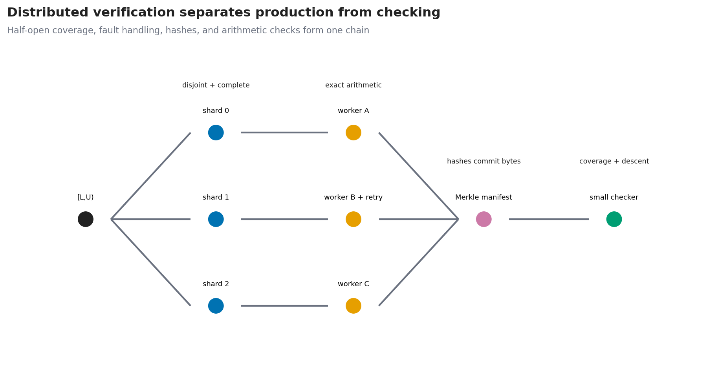

# Complexity and Distributed Verification {#sec-distributed-verification}
<!-- Retained source chapter 31 from collatz_conjecture; mathematical content and anchors preserved. -->

Checking a vast finite interval is an engineering theorem only when arithmetic,
coverage, faults, and independent validation are all controlled. Fast iteration
is not enough. A trustworthy computation defines its cost model, partitions the
domain exactly, detects overflow, survives failed workers, and emits evidence a
small checker can verify.

**Preparation.** The concise primer's exact-computation example, finite verification
from Chapter 14, certificate design from Chapters 21–22, and the research
workflow of [sec-research-practicum](26-research-practicum.md#sec-research-practicum).

**Goals.** You will distinguish step and bit complexity, design half-open work
shards, analyze batching and accelerators, build fault-tolerant manifests, and
separate a fast certificate producer from a small trusted checker.

## Cost models

Let $C(n)$ be the number of Collatz transitions performed for start $n$
before a declared stopping condition. A **step-cost model** counts each
transition as one operation. This is useful for comparing orbit lengths but
ignores the size of intermediate integers.

If a current value has $b$ binary digits, addition, shifting, and
multiplication by 3 cost at least proportional to the number of machine words
holding those bits. A **bit-cost model** therefore measures something like

$$
\sum_{j<\tau(n)} M(b_j),
$$

where $M(b)$ is the cost of the required $b$-bit arithmetic and $b_j$ is
the bit length at step $j$.

On fixed-width hardware, an operation can be constant time only while its result
fits. For unsigned $w$-bit arithmetic, the odd update $3n+1$ is safe only if

$$
n\le\left\lfloor\frac{2^w-2}{3}\right\rfloor.
$$

The check must occur before multiplication. Testing the wrapped result afterward
cannot recover the lost high bits.

### Intermediate growth

Even a small start can reach a large peak. A conservative implementation either
uses arbitrary-precision integers throughout or proves a start- and step-
dependent bound before using a fixed type. A hybrid implementation can run a
fast fixed-width path and transfer to multiprecision before the threshold. Its
certificate records every fallback, because a rare slow path is preferable to a
silent wrong path.

The total runtime over $[L,U)$ is not simply $(U-L)$ times an average step
count when work is imbalanced, memory traffic dominates, or long exceptional
orbits serialize a batch.

## High-performance arithmetic

### Branching and batching

A direct loop branches on parity. Modern processors predict regular branches
well but can mispredict irregular ones. A branchless formulation may compute
both candidates and select one, trading control-flow cost for extra arithmetic.
The faster choice depends on the architecture and compiler; benchmark it under
the exact integer-safety rules.

Batching many starts allows vector operations, but lanes finish at different
times. Options include:

- replace completed lanes with new starts;
- compact live lanes periodically;
- group starts by a finite parity prefix;
- use precomputed affine shortcut tables.

Every optimization needs a reference test on small cases and boundary values.
A table indexed by low bits must document how many input bits guarantee the
encoded prefix and what overflow bound applies to its affine formula.

### Memoization and shared tails

If an orbit reaches a smaller value whose convergence has already been
certified, it can stop by induction. A cache of known stopping information can
save work, but a corrupted cache contaminates many starts. Store exact keys,
version the stopping convention, validate loaded records, and never accept a
hash collision as equality of integers.

Distributed shared caches can cost more communication than they save. Many
large verifications therefore use deterministic local descent rules and combine
only compact certificates.

## Exact interval partitioning

Use half-open integer intervals

$$
[L_i,U_i)=\{L_i,L_i+1,\ldots,U_i-1\}.
$$

They compose without endpoint ambiguity. A manifest for $[L,U)$ is complete
when, after sorting shards,

$$
L_0=L,\quad U_i=L_{i+1},\quad U_{m-1}=U.
$$

These equalities prove no gaps and no overlaps. Counting row totals alone does
not: one duplicated interval can hide one missing interval of equal length.

If only odd starts are checked, specify the projection from interval positions
to integers, or retain ordinary intervals and let the checker verify that even
starts descend immediately to a smaller start. Residue-class shards should
include modulus, canonical residue range, and a proof that their union matches
the declared domain.

### Load balancing

Equal-width intervals can have unequal costs because stopping times vary.
Dynamic scheduling assigns small work units to workers as they become free.
Static scheduling is easier to reproduce and audit. A compromise uses many
deterministic shards with stable identifiers, then schedules them dynamically
while preserving the fixed manifest.

A work identifier should be a function of the specification, not of the worker
that happened to receive it. Retries must reproduce the same output key.

<figure id="fig-distributed-verification">


<figcaption>

Figure 12.1: A distributed verification manifest connects disjoint shards to hashes, redundant checks, and a small trusted verifier.

</figcaption>
</figure>

[Figure 12.1](#fig-distributed-verification) distinguishes the fast producer path from the
trusted checking path. A Merkle root authenticates a set of records only after
the checker knows what each record is required to prove.

## GPU and accelerator issues

Graphics processors excel when thousands of lanes execute similar instructions.
Collatz orbits create **warp divergence**: lanes take different parity branches
and terminate at different times. Grouping by parity prefix reduces short-term
divergence but costs preprocessing and does not synchronize later behavior.

Accelerators also favor fixed-width integers. If multiprecision is unavailable,
the kernel must reject or export a lane before overflow. A host process can then
recompute it with arbitrary precision. The export list belongs in the audit log
and must be covered exactly like ordinary shards.

Independent arithmetic checks should not repeat the identical vulnerable code
path. Useful diversity includes:

- a scalar arbitrary-precision reference implementation;
- a different shortcut table length;
- a second compiler or hardware family;
- modular checksums that every affine update must satisfy;
- recomputation of a deterministic sample plus all boundary and fallback cases.

Agreement raises confidence in a finite run. The formal claim still depends on
the specification and checker.

## Fault tolerance and silent corruption

Workers can stop, networks can duplicate messages, disks can alter bits, and
memory errors can produce plausible integers. Design for these events.

A checkpoint records the last completely certified subrange, not merely the
last start attempted. On retry, output should be idempotent: recomputing the same
shard yields the same canonical record. The coordinator accepts one shard ID
once and compares hashes if multiple copies arrive.

A cryptographic hash detects accidental or adversarial changes with high
confidence, but it does not prove the content is mathematically correct. A
**Merkle tree** combines leaf hashes so that one root commits to an ordered set
of shard records. Inclusion proofs show that a given record belongs to that
committed set.

For especially expensive runs, replicate a random or risk-weighted subset on
independent workers. Record how the sample was selected. Silent errors that
systematically affect both implementations remain possible, so the final
checker should reconstruct the essential arithmetic rather than trust summaries.

## Proof-producing verification

A simple per-start descent certificate gives a finite sequence

$$
n=x_0,x_1,\ldots,x_k=m<n
$$

whose adjacent values satisfy the reference Collatz rule. If every
$2\le n<N$ has such a certificate, strong induction proves every start below
$N$ reaches 1.

Storing every transition is large. Compact alternatives include:

- a parity or valuation word plus exact affine coefficients;
- a residue-class descent lemma valid for all starts in a bounded interval;
- a checkpoint chain with independently recomputable segments;
- a producer summary paired with a deterministic replay rule.

Compression increases checker complexity. The trusted checker should parse a
strict canonical format, reject unknown fields and versions, use
arbitrary-precision arithmetic, enforce resource limits, and recompute the
descent predicate.

### Trusted computing base

The **trusted computing base** is everything whose correctness the proof relies
on without further checking. It can include the checker source, compiler,
runtime, theorem connecting certificates to convergence, and hardware. A small
checker reduces but does not eliminate this base.

Use mutation tests: flip a parity bit, alter an endpoint, duplicate a shard,
delete a leaf, change a hash, force a false overflow flag, or claim descent to a
nonpositive integer. Each mutation should fail for a documented reason.

## Formal specifications and refinement

An executable reference specification can define one exact step and certificate
acceptance. An optimized program **refines** it if every optimized transition or
summary corresponds to the specification.

Formal proof tools can verify:

- absence of fixed-width overflow under a precondition;
- equivalence of a shortcut formula to several reference steps;
- disjoint and complete interval partitioning;
- parser safety and certificate soundness;
- strong-induction closure from descent records.

A proof assistant checks a formal statement inside a kernel. It does not decide
whether the formal statement matches the intended map or whether an external
dataset was loaded correctly. Human-readable specifications and cross-checks
remain part of the chain.

## Complexity reporting checklist

Report:

1. the exact map and stopping condition;
2. domain and half-open endpoints;
3. arithmetic types and overflow/fallback rule;
4. step count, bit-operation proxy, and peak memory;
5. hardware, compiler, flags, and software revision;
6. shard schema and complete manifest;
7. retry, replication, and corruption policy;
8. certificate format, checker revision, and mutation suite;
9. completed range, not a projected future range;
10. theorem-status label: finite verification only.

<!-- inline-formula-code:start -->
## Formula and finite computation

A useful formula in this chapter is

$$
[a,b)=\bigsqcup_j[a_j,b_j)
$$

Half-open chunks make coverage and non-overlap mechanically checkable. The following standalone Python block expresses that finite rule with its inputs and stopping conditions visible.

```python
def half_open_chunks(start: int, stop: int, chunk_size: int) -> list[tuple[int, int]]:
    """Partition [start, stop) into consecutive half-open integer intervals."""
    if start < 0 or stop < start or chunk_size <= 0:
        raise ValueError("require 0 <= start <= stop and positive chunk_size")
    return [
        (left, min(left + chunk_size, stop))
        for left in range(start, stop, chunk_size)
    ]

chunks = half_open_chunks(1, 24, 5)
covered = [value for left, right in chunks for value in range(left, right)]
print(chunks)
print(covered == list(range(1, 24)), len(covered) == len(set(covered)))
```

**What the computation establishes.** The calculation checks a declared finite instance; the surrounding argument explains what is true beyond those inputs.
<!-- inline-formula-code:end -->

## Summary

- Step complexity omits the cost of growing integers; bit complexity exposes it.
- Half-open shard manifests prove coverage through exact endpoint adjacency.
- Vectorization and GPUs require explicit divergence and overflow handling.
- Hashes authenticate records but do not prove their arithmetic content.
- Proof-producing verification separates a fast producer from a small checker.
- Formal methods strengthen the finite chain but do not turn a finite range into
  a universal proof.

## Exercises

<div class="exercise" id="collatz_conjecture-31-distributed-verification-ex-1">
<p class="exercise-title"><strong>Exercise 1</strong></p>

Derive the unsigned $w$-bit safety bound for $3n+1$.

<details class="solution"><summary>Solution</summary>

Require $3n+1\le2^w-1$, hence
$n\le\lfloor(2^w-2)/3\rfloor$.

</details>

</div>

<div class="exercise" id="collatz_conjecture-31-distributed-verification-ex-2">
<p class="exercise-title"><strong>Exercise 2</strong></p>

Give an example where equal shard widths have unequal orbit-step costs.

<details class="solution"><summary>Solution</summary>

One interval may contain a rare long-stopping-time start while another does
not.

</details>

</div>

<div class="exercise" id="collatz_conjecture-31-distributed-verification-ex-3">
<p class="exercise-title"><strong>Exercise 3</strong></p>

Prove the endpoint conditions imply disjoint complete interval coverage.

<details class="solution"><summary>Solution</summary>

Sorted adjacent endpoints touch and never cross, beginning at $L$ and
ending at $U$.

</details>

</div>

<div class="exercise" id="collatz_conjecture-31-distributed-verification-ex-4">
<p class="exercise-title"><strong>Exercise 4</strong></p>

Explain why a duplicated shard can hide a missing shard in a row count.

<details class="solution"><summary>Solution</summary>

The total number of rows can remain correct even though the union is wrong.

</details>

</div>

<div class="exercise" id="collatz_conjecture-31-distributed-verification-ex-5">
<p class="exercise-title"><strong>Exercise 5</strong></p>

Design a safe multiprecision fallback record.

<details class="solution"><summary>Solution</summary>

Store shard/start ID, current exact integer, step count, reason, and checksum,
then recompute from a prior checkpoint.

</details>

</div>

<div class="exercise" id="collatz_conjecture-31-distributed-verification-ex-6">
<p class="exercise-title"><strong>Exercise 6</strong></p>

Distinguish a hash check from a descent check.

<details class="solution"><summary>Solution</summary>

A hash detects changed bytes; a descent check proves the decoded arithmetic
relation.

</details>

</div>

<div class="exercise" id="collatz_conjecture-31-distributed-verification-ex-7">
<p class="exercise-title"><strong>Exercise 7</strong></p>

List five certificate mutations a checker should reject.

<details class="solution"><summary>Solution</summary>

Missing, duplicate, altered endpoint, wrong parity, false descent, stale
version, and broken hash are examples.

</details>

</div>

<div class="exercise" id="collatz_conjecture-31-distributed-verification-ex-8">
<p class="exercise-title"><strong>Exercise 8</strong></p>

Identify the trusted computing base in a proposed verification pipeline.

<details class="solution"><summary>Solution</summary>

It includes every unverified component on which acceptance and the induction
theorem depend.

</details>

</div>

### Answer support

1. Require $3n+1\le2^w-1$, hence
   $n\le\lfloor(2^w-2)/3\rfloor$.
2. One interval may contain a rare long-stopping-time start while another does
   not.
3. Sorted adjacent endpoints touch and never cross, beginning at $L$ and
   ending at $U$.
4. The total number of rows can remain correct even though the union is wrong.
5. Store shard/start ID, current exact integer, step count, reason, and checksum,
   then recompute from a prior checkpoint.
6. A hash detects changed bytes; a descent check proves the decoded arithmetic
   relation.
7. Missing, duplicate, altered endpoint, wrong parity, false descent, stale
   version, and broken hash are examples.
8. It includes every unverified component on which acceptance and the induction
   theorem depend.
