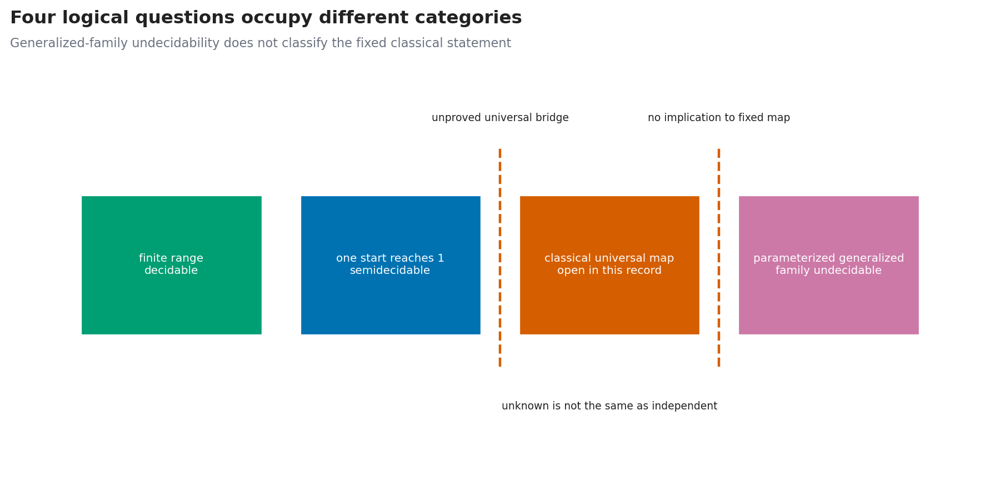

# Logic, Computability, and Generalized Maps {#sec-logic-computability}
<!-- Retained source chapter 32 from collatz_conjecture; mathematical content and anchors preserved. -->

Simple arithmetic rules can encode complicated computation. Some parameterized
families of Collatz-like maps have undecidable reachability or termination
questions. This does not prove that the one fixed classical Collatz statement is
undecidable, independent, or unprovable. Logic is most useful here when it keeps
those very different claims apart.

**Preparation.** Quantifiers, proof, and finite algorithms from the concise primer,
generalized maps from Chapter 16, and proof-attempt auditing from Chapter 17.

**Goals.** You will define decision and semidecision procedures, understand how
piecewise-affine maps can simulate finite control, state generalized
undecidability safely, distinguish it from formal independence, and assess
automated proof searches.

## Decision problems and algorithms

A **decision problem** assigns a yes/no answer to every input string or integer.
An algorithm **decides** the problem when it halts on every valid input and
returns the correct answer.

A problem is **semidecidable** when an algorithm halts and answers yes on every
yes-instance, while it may run forever on a no-instance. Equivalently, every
yes-instance has a finite certificate that can eventually be found and checked.

For a fixed positive start $n$, the property “the classical orbit of $n$
reaches 1” is semidecidable: iterate exactly and halt when 1 appears. If the orbit never
reaches 1, this procedure never returns no. A nontrivial cycle would be a finite
certificate of nonconvergence for a start on that cycle, but an aperiodic
unbounded orbit would not provide such a simple repeated-state certificate.

The universal Collatz conjecture has a different quantifier:

$$
\forall n\in\mathbb Z_{>0}\ \exists k\ge0\quad C^k(n)=1.
$$

Checking starts in sequence can enumerate positive evidence forever, but no
finite initial segment completes the universal quantifier.

## Computable functions and reductions

A function is **computable** when an idealized finite program returns its value
for every input. A **many-one reduction** from problem $A$ to problem $B$
is a computable transformation $r$ satisfying

$$
x\in A\quad\Longleftrightarrow\quad r(x)\in B.
$$

If $A$ is known undecidable and such a reduction exists, then $B$ is
undecidable: a decider for $B$ would decide $A$ after applying $r$.

A valid reduction specifies:

1. how an arbitrary source instance is encoded;
2. why the target instance is legal;
3. how each computational step is simulated;
4. why yes and no answers are both preserved;
5. why the encoding algorithm itself terminates.

An analogy between two systems is not a reduction. Simulation for a few steps is
not enough; the equivalence of outcomes must hold for every source instance.

## Encoding computation arithmetically

A register machine has finitely many instruction states and integer registers.
Instructions increment, decrement, test zero, and jump. Despite the small
instruction set, such machines can perform every algorithm in the usual Turing
sense.

Integers can encode control state and register contents through prime powers or
residue classes. For example, a schematic encoding might use

$$
n=2^{r_1}3^{r_2}5^q,
$$

where $r_1,r_2$ are registers and $q$ is a control label. Multiplication or
division changes a register; congruence tests select an instruction. Actual
constructions must handle zero tests, illegal divisions, and unwanted states.

A piecewise-affine map can select coefficients according to
$n\bmod m$:

$$
F(n)=\frac{a_i n+b_i}{m_i}
\qquad\text{when }n\equiv i\pmod m,
$$

with parameters chosen so every branch maps its intended integer domain back to
integers. Residue classes supply finite control, while magnitude stores
unbounded registers.

This explains why a compact-looking formula family can be computationally
universal. It does not show that every member, or the classical $3n+1$ member,
has that power.

## Generalized Collatz undecidability

Conway constructed generalized iteration systems with undecidable behavior, and
later work proves undecidability for precise generalized Collatz formulations
(Conway 1972; Kurtz and Simon 2007). The exact theorem depends on the allowed family,
domain, and question—such as reachability of a target, eventual periodicity, or
universal termination.

A theorem-status-safe form is:

> There exist finitely described families of residue-dependent affine maps for
> which the parameterized reachability or termination problem is undecidable.

The input to this decision problem includes a map description or encoded machine
instance. Undecidability says there is no single algorithm that correctly
decides every member of that family.

<figure id="fig-logic-boundary">


<figcaption>

Figure 13.1: Generalized-map undecidability does not cross the logical boundary to the fixed classical Collatz statement.

</figcaption>
</figure>

[Figure 13.1](#fig-logic-boundary) blocks two invalid arrows: generalized-family
undecidability does not imply classical undecidability, and an open problem is
not automatically independent of standard axioms.

## What undecidability does not imply

The classical conjecture fixes one map and asks one universal arithmetic
question. A parameterized generalized theorem varies the map or encoding.
Compare:

$$
\text{No algorithm decides every instance in a family}
$$

with

$$
\text{This one fixed sentence has no proof or disproof.}
$$

They are not equivalent. A family can contain individually easy instances even
when no uniform algorithm decides all instances. Conversely, a fixed statement
has a definite truth value in the ordinary natural numbers even if humans do not
know it.

The word **unknown** reports present mathematical knowledge. **Undecidable** is
relative to a computational problem and model. **Independent** is relative to a
formal axiom system. **Unprovable** must also name the system. Substituting one
word for another is a logical error.

## Formal theories and independence

A formal theory $S$ has axioms and mechanical proof rules. A sentence
$\varphi$ is **independent of $S$** when, assuming $S$ is consistent,
neither $\varphi$ nor its negation is provable in $S$.

Gödel's incompleteness theorems show that sufficiently strong consistent
effectively axiomatized theories leave some arithmetic sentences undecided.
They do not identify every difficult open problem as one of those sentences.
To prove independence of Collatz from a theory such as Peano arithmetic or ZFC
would require a separate metamathematical argument. No such conclusion follows
from the generalized-map results discussed here.

Truth and provability also differ. Under the usual interpretation, the classical
Collatz sentence is either true or false. A theory may fail to settle it, but
that possibility is not evidence for either truth value.

### Relative consistency language

Statements such as "if $S$ is consistent, then $S$ cannot prove its own
consistency" carry hypotheses. Informal arguments that invoke Gödel while
ignoring the required encoding, strength, and consistency assumptions do not
establish independence.

## Proof search and automated reasoning

Computers can search for:

- modular invariants;
- affine ranking functions that decrease on every branch;
- bounded cycle solutions;
- inductive residue covers;
- contradictions in finite parity-word systems;
- small counterexamples to proposed lemmas.

An SMT solver can decide a finite bit-vector encoding or a bounded integer
formula. A SAT certificate can prove that no assignment satisfies that bounded
formula. The universal mathematical conclusion is only as broad as the encoding
and bound.

A **ranking function** $R(n)$ for termination takes values in a well-founded
order and strictly decreases on every permitted transition. Ordinary size is not
such a function for Collatz because odd steps can increase. A lexicographic or
residue-sensitive candidate must still be proved decreasing for every state,
not merely tested on a sample.

### Inductive invariants

An invariant set $I$ satisfies two obligations:

1. every initial state of interest lies in $I$;
2. $n\in I$ implies $C(n)\in I$.

Safety invariants can exclude forbidden behavior but do not necessarily prove
termination. Termination requires a well-founded decrease, a finite attractor
argument, or another theorem eliminating infinite runs.

Automated tools are strongest when they emit checkable proof objects: resolution
proofs, algebraic identities, or explicit residue covers. Treat a solver's
"unknown" as a resource or method outcome, not a mathematical classification.

Chapter [source section](../collatz-conjecture/44-presburger-certificates.md#sec-collatz-presburger-certificates) specializes this boundary to
fixed-horizon integer traces, semilinear sets, and independently replayed
optimization certificates.

## Epistemic discipline

Use this ladder:

| label | required support |
|:---|:---|
| theorem | proof from stated definitions and hypotheses |
| conditional theorem | proof whose additional assumptions are visible |
| finite verification | exact bounded domain plus audited coverage |
| model result | theorem inside an explicitly defined model |
| heuristic | explanatory or predictive analogy without transfer proof |
| open conjecture | universal claim not presently settled in the cited record |

Sensational phrases often erase a row. "Collatz is undecidable" may refer to a
generalized family, a speculative independence claim, or merely computational
difficulty. Ask for the exact map, input, decision problem, formal system, and
published proof.

<!-- inline-formula-code:start -->
## Formula and finite computation

A useful formula in this chapter is

$$
H_K(n)=\begin{cases}1&C^k(n)=1\text{ for some }k\le K,\\0&\text{otherwise,}\end{cases}
$$

The bounded predicate is decidable; returning zero does not decide the unbounded statement. The following standalone Python block expresses that finite rule with its inputs and stopping conditions visible.

```python
def bounded_halts(start: int, step_bound: int) -> bool:
    if start < 1 or step_bound < 0:
        raise ValueError("invalid bounds")
    value = start
    for _ in range(step_bound + 1):
        if value == 1:
            return True
        value = value // 2 if value % 2 == 0 else 3 * value + 1
    return False

print([(n, bounded_halts(n, 100)) for n in range(1, 21)])
```

**What the computation establishes.** The output certifies only the declared finite case. The theorem, if one is claimed, still requires the argument developed in the chapter.
<!-- inline-formula-code:end -->

## Summary

- A decider halts on every input; a semidecider may run forever on no-instances.
- Reaching 1 for one start is semidecidable by direct iteration.
- Residue-dependent affine families can encode universal computation, and
  precise generalized decision problems are undecidable.
- Those theorems do not imply undecidability or independence of the fixed
  classical conjecture.
- Automated finite reasoning needs a separate argument to cross from bounded
  certificates to universal termination.

## Exercises

<div class="exercise" id="collatz_conjecture-32-logic-computability-ex-1">
<p class="exercise-title"><strong>Exercise 1</strong></p>

Distinguish a decider from a semidecider by their behavior on no-instances.

<details class="solution"><summary>Solution</summary>

A decider must halt and answer no; a semidecider may continue forever.

</details>

</div>

<div class="exercise" id="collatz_conjecture-32-logic-computability-ex-2">
<p class="exercise-title"><strong>Exercise 2</strong></p>

Write the quantifiers in the universal Collatz statement.

<details class="solution"><summary>Solution</summary>

For every positive $n$, there exists a nonnegative $k$ with
$C^k(n)=1$.

</details>

</div>

<div class="exercise" id="collatz_conjecture-32-logic-computability-ex-3">
<p class="exercise-title"><strong>Exercise 3</strong></p>

List the five obligations in a many-one reduction audit.

<details class="solution"><summary>Solution</summary>

Encoding, legality, step simulation, answer preservation, and termination of
the reduction.

</details>

</div>

<div class="exercise" id="collatz_conjecture-32-logic-computability-ex-4">
<p class="exercise-title"><strong>Exercise 4</strong></p>

Explain how residue classes can encode finite control.

<details class="solution"><summary>Solution</summary>

The residue selects one of finitely many affine instruction branches.

</details>

</div>

<div class="exercise" id="collatz_conjecture-32-logic-computability-ex-5">
<p class="exercise-title"><strong>Exercise 5</strong></p>

State the safe generalized-undecidability claim.

<details class="solution"><summary>Solution</summary>

Some finitely described parameterized residue-affine families have
undecidable reachability or termination problems.

</details>

</div>

<div class="exercise" id="collatz_conjecture-32-logic-computability-ex-6">
<p class="exercise-title"><strong>Exercise 6</strong></p>

Distinguish unknown, undecidable, and independent.

<details class="solution"><summary>Solution</summary>

They concern current knowledge, algorithms for a problem family, and
provability in a named theory, respectively.

</details>

</div>

<div class="exercise" id="collatz_conjecture-32-logic-computability-ex-7">
<p class="exercise-title"><strong>Exercise 7</strong></p>

Give an invariant that proves safety but not termination in a toy loop.

<details class="solution"><summary>Solution</summary>

"The counter never becomes negative" can be invariant in an infinite loop
that increments forever.

</details>

</div>

<div class="exercise" id="collatz_conjecture-32-logic-computability-ex-8">
<p class="exercise-title"><strong>Exercise 8</strong></p>

Explain what a SAT proof of no cycle below a bound establishes.

<details class="solution"><summary>Solution</summary>

Only that the exact bounded encoding has no satisfying cycle witness; its
scope is the encoded bounds and conventions.

</details>

</div>

### Answer support

1. A decider must halt and answer no; a semidecider may continue forever.
2. For every positive $n$, there exists a nonnegative $k$ with
   $C^k(n)=1$.
3. Encoding, legality, step simulation, answer preservation, and termination of
   the reduction.
4. The residue selects one of finitely many affine instruction branches.
5. Some finitely described parameterized residue-affine families have
   undecidable reachability or termination problems.
6. They concern current knowledge, algorithms for a problem family, and
   provability in a named theory, respectively.
7. "The counter never becomes negative" can be invariant in an infinite loop
   that increments forever.
8. Only that the exact bounded encoding has no satisfying cycle witness; its
   scope is the encoded bounds and conventions.
