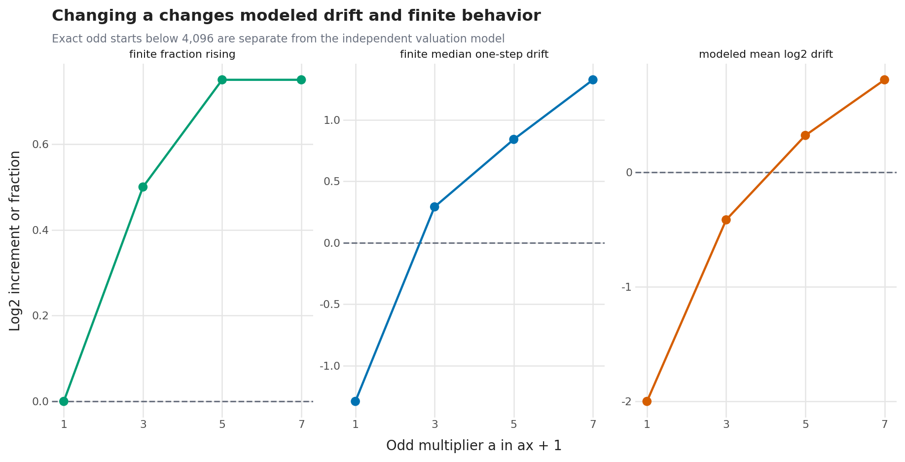

# Comparative Affine Dynamics {#sec-comparative-affine}
<!-- Retained source chapter 33 from collatz_conjecture; mathematical content and anchors preserved. -->

Changing 3 or changing $+1$ produces nearby-looking maps with radically
different behavior. Some collapse immediately, some have obvious escape
regions, some contain nonclassical cycles, and some inherit difficult
computability. Comparison is useful when it identifies which structural
features an argument actually uses.

**Prerequisites.** Generalized maps from Chapter 16, cycle equations from
Chapters 8 and 23, accelerated words from [sec-accelerated-renewal](27-accelerated-renewal.md#sec-accelerated-renewal), and model
drift from [sec-probability-models](20-probability-models.md#sec-probability-models).

**Goals.** You will define an $ax+b$ family precisely, locate invariant residue
sets and cycles, construct tame and divergent examples, compare modeled drift,
and build a taxonomy without transferring conclusions between parameters.

## A common family of maps

Let $a$ and $b$ be odd integers. On positive integers for which the output
stays positive, define the unaccelerated map

$$
C_{a,b}(n)=
\begin{cases}
n/2,&n\text{ even},\\
an+b,&n\text{ odd}.
\end{cases}
$$

Because $a$ and $b$ are odd, $an+b$ is even for odd $n$. The associated
odd-only map is

$$
U_{a,b}(n)
=\frac{an+b}{2^{\nu_2(an+b)}}.
$$

The classical parameters are $(a,b)=(3,1)$. If $b<0$, a positive odd input
may leave the positive domain, so one must choose a stopping convention or work
on all integers. If $a$ or $b$ is even, the forced parity switch can fail and
the formula defines a different structural family.

Scaling parameters may create redundant descriptions. If $d$ divides
$a,b,n$, common factors can trap the orbit in a sublattice. Primitive
comparisons often impose $\gcd(a,b)=1$, but that is a hypothesis to declare,
not part of the syntax.

## Invariant congruence classes

A set of residues $R\subseteq\mathbb Z/m\mathbb Z$ is **forward invariant**
when every legal branch sends a representative of $R$ back into $R$, with
enough modulus retained to make division well defined.

Immediate invariants can obstruct universal convergence to a proposed cycle.
If a residue class never reaches any residue occupied by the target cycle, then
starts in that class cannot enter it. Conversely, a residue graph path to the
target is only a necessary finite shadow; a compatible integer orbit may behave
differently at higher bits.

**Example of a trapped divisor.** Suppose a common divisor $d$ divides both
$b$ and an odd start $n$, and $d$ is odd. Then $d\mid an+b$, and division
by powers of two preserves divisibility by $d$. Hence the odd-only orbit stays
in multiples of $d$. This simple invariant explains why coprimality choices
matter in comparative experiments.

To certify an invariant residue set:

1. declare the modulus and domain;
2. refine the modulus until every division branch is determined;
3. check every residue and every possible lift;
4. prove the projected set excludes or contains the claimed target.

## Fixed points and cycle equations

Let an accelerated cycle have odd states $n_0,\ldots,n_{k-1}$ and valuation
word $e_0,\ldots,e_{k-1}$, with

$$
n_{j+1}=\frac{an_j+b}{2^{e_j}},
\quad n_k=n_0.
$$

Set $S_j=e_0+\cdots+e_{j-1}$. Composition gives

$$
n_k=\frac{a^k n_0+bB_k}{2^{S_k}},
$$

where

$$
B_0=0,\quad B_{j+1}=aB_j+2^{S_j}.
$$

Cycle closure therefore requires

$$
(2^{S_k}-a^k)n_0=bB_k. \tag{33.1}
$$

For a positive cycle with $b>0$, the denominator on the left must be positive:

$$
2^{S_k}>a^k.
$$

This logarithmic inequality narrows possible valuation sums but does not prove
integrality, admissibility of each exact valuation, distinctness of states, or
positivity. Those are separate filters.

A fixed odd point $n$ with valuation $e$ satisfies

$$
(2^e-a)n=b.
$$

Thus a candidate exists only when $2^e-a$ divides $b$ and gives a legal
positive odd $n$ with exactly the stated valuation.

## Structurally tame examples

Comparison works best with examples whose behavior can be proved.

### The $1x+1$ odd-only map

For odd $n>1$,

$$
U_{1,1}(n)=\frac{n+1}{2^{\nu_2(n+1)}}<n.
$$

The numerator $n+1\le2n$, and division removes at least one factor of two;
equality could occur only in an excluded boundary case. Every odd state above 1
strictly decreases, so strong induction proves convergence to the fixed point 1.

The proof uses a pointwise ranking function—ordinary odd value—not an average.
It therefore survives every exceptional path.

### A map with an immediate fixed point

Equation (33.1) can design parameters. If one wants odd $r$ fixed with
valuation $e$, choose

$$
b=(2^e-a)r
$$

and then verify $ar+b=2^er$ has exact valuation $e$. This shows that fixed
cycles can be engineered; their presence in neighboring maps says nothing about
whether the classical map has another cycle.

## Divergent and escaping examples

Relaxing the forced-even condition gives an immediate warning. The odd rule

$$
n\longmapsto an
$$

with odd $a>1$ maps odd integers to odd integers and escapes geometrically.
It is piecewise affine and Collatz-like in appearance, but $b=0$ changes the
parity structure completely.

Within broader residue-dependent affine families, designate an invariant class
and apply $n\mapsto2n$ there. Starts in that class escape explicitly while
other classes may decrease. Chapter 26 used such adversarial maps to show that
"most states decrease" does not settle a universal claim.

For $C_{a,b}$ with odd $a,b$, positive modeled drift can suggest frequent
growth, but it is not an explicit divergent orbit. Proving divergence requires a
specific orbit or invariant escape region that never returns. Long finite growth
is not enough.

Negative domains add further cycles. For the classical formula, $-1$ is fixed
under the shortcut convention. Statements about positive convergence must not
be refuted by examples outside the declared domain.

## The $5x+1$ comparison

For odd $n$, the map

$$
U_{5,1}(n)=\frac{5n+1}{2^{\nu_2(5n+1)}}
$$

has the same one-step geometric valuation marginal over complete odd residue
blocks: multiplication by 5 is invertible modulo powers of two. Under the
independent geometric model,

$$
\mathbb E\left[\log5-A\log2\right]
=\log(5/4)>0.
$$

This contrasts with $\log(3/4)<0$ for $3x+1$. It predicts a stronger
tendency toward growth in modeled large odd states.

<figure id="fig-comparative-drift">


<figcaption>

Figure 14.1: Modeled drift changes sign across selected affine parameters while exact finite behavior remains parameter-specific.

</figcaption>
</figure>

[Figure 14.1](#fig-comparative-drift) separates the analytic model curve from finite exact
samples. Neither panel proves that a particular $5x+1$ orbit diverges or that
every $3x+1$ orbit converges.

Which classical heuristics survive?

- exact valuation counts survive for odd $a$, because $a$ is invertible
  modulo $2^k$;
- the modeled mean changes from $\log(a/4)$;
- affine word and cycle equations survive with $3$ replaced by $a$ and the
  offset scaled by $b$;
- dependence, admissibility, additive terms, and exceptional paths remain;
- no conclusion transfers solely from the sign of the mean.

## Random affine models

Let $A_j$ be independent with
$\mathbb P(A_j=r)=2^{-r}$. The multiplicative model

$$
X_{j+1}=\frac a{2^{A_j}}X_j
$$

has mean logarithmic increment

$$
\delta(a)=\log a-2\log2=\log(a/4).
$$

The threshold is $a=4$: odd $a=1,3$ have negative modeled drift, while
$a=5,7,\ldots$ have positive modeled drift. At $a=4$ the idealized log walk
is centered, but $a$ even lies outside the forced-even odd-parameter family.

The additive term obeys

$$
\log\frac{an+b}{n2^{A}}
=\log a-A\log2+
\log\left(1+\frac b{an}\right).
$$

It is negligible only when $|b|\ll an$ and the expression stays positive.
Near zero it creates fixed points, cycles, and domain exits. A pure
multiplicative model is therefore an asymptotic heuristic.

Changing the distribution of $A_j$ changes the threshold. Residue restrictions
or dependence can change joint fluctuations without changing the one-step
marginal. Comparative models should vary these assumptions in a sensitivity
analysis.

## A taxonomy of generalized maps

Classify a proposed system along independent axes:

| axis | questions |
|:---|:---|
| domain | positive integers, all integers, rationals, or $p$-adics? |
| branches | parity only or arbitrary residue classes? |
| arithmetic | are outputs integral on every branch? |
| parameters | one fixed map or a variable input family? |
| invariants | trapped residues, divisors, signs, or cones? |
| dynamics | ranking function, known cycles, escape region, or unresolved? |
| model | what distribution and dependence assumptions define drift? |
| computation | which finite range, convention, and certificate? |
| logic | decidable subclass or universal parameterized family? |

Two maps are useful controls when they differ along one axis and match along the
others. Changing several features at once may still produce an example, but it
cannot isolate which feature caused the new behavior.

### Universality boundary

Some residue-affine families simulate arbitrary computation, as
[sec-logic-computability](32-logic-computability.md#sec-logic-computability) explains. Other subclasses admit a global decreasing
function and terminate trivially. The family description determines which side
of the boundary is being discussed. The fact that a broad family is universal
does not make every parameter choice computationally universal.

## Comparative experiment protocol

For parameters $(a,b)$, record:

1. domain and positivity policy;
2. unaccelerated or odd-only convention;
3. gcd and parity conditions;
4. finite start interval and step/height caps;
5. fixed points and small cycles checked symbolically;
6. invariant residue classes searched and modulus;
7. exact valuation and altitude data;
8. modeled distribution and drift formula;
9. unresolved starts, without labeling them divergent;
10. a claim ledger comparing theorem, computation, and heuristic.

The output is a comparative case study, not a vote among conjectures.

<!-- inline-formula-code:start -->
## Formula and finite computation

A useful formula in this chapter is

$$
T_{a,b}(n)=n/2\text{ or }an+b
$$

Identical starts and step bounds permit an honest comparison of neighboring affine maps. The following standalone Python block expresses that finite rule with its inputs and stopping conditions visible.

```python
def finite_trace(start: int, multiplier: int, offset: int, steps: int) -> list[int]:
    """Return a bounded trace for one declared integer affine map."""
    if start <= 0 or multiplier <= 0 or steps < 0:
        raise ValueError("start and multiplier must be positive; steps must be nonnegative")
    trace = [start]
    for _ in range(steps):
        value = trace[-1]
        next_value = value // 2 if value % 2 == 0 else multiplier * value + offset
        if next_value <= 0:
            raise ValueError("the selected parameters left the positive domain")
        trace.append(next_value)
    return trace

for parameters in ((3, 1), (3, 5), (5, 1)):
    print(parameters, finite_trace(11, *parameters, 12))
```

**What the computation establishes.** The output certifies only the declared finite case. The theorem, if one is claimed, still requires the argument developed in the chapter.
<!-- inline-formula-code:end -->

## Summary

- Odd $a,b$ preserve the forced even output after an odd branch.
- Accelerated cycles satisfy an exact closure equation with valuation and
  integrality constraints.
- The $1x+1$ map has a pointwise descent proof; broader neighboring families
  can contain explicit escape mechanisms.
- The geometric model predicts mean log drift $\log(a/4)$, negative for
  $a=3$ and positive for $a=5$.
- Drift sign is a model prediction, not a universal orbit theorem.
- A taxonomy prevents parameter, domain, and computability conclusions from
  leaking between unlike maps.

## Exercises

<div class="exercise" id="collatz_conjecture-33-comparative-affine-ex-1">
<p class="exercise-title"><strong>Exercise 1</strong></p>

Prove $an+b$ is even for odd $a,b,n$.

<details class="solution"><summary>Solution</summary>

Odd times odd is odd, and odd plus odd is even.

</details>

</div>

<div class="exercise" id="collatz_conjecture-33-comparative-affine-ex-2">
<p class="exercise-title"><strong>Exercise 2</strong></p>

Derive the accelerated cycle closure equation.

<details class="solution"><summary>Solution</summary>

Iterate the affine recurrence and impose $n_k=n_0$.

</details>

</div>

<div class="exercise" id="collatz_conjecture-33-comparative-affine-ex-3">
<p class="exercise-title"><strong>Exercise 3</strong></p>

Find all possible positive fixed points for a chosen $(a,b)$ by testing
small $e$.

<details class="solution"><summary>Solution</summary>

Use $n=b/(2^e-a)$, then check positivity, oddness, and exact valuation.

</details>

</div>

<div class="exercise" id="collatz_conjecture-33-comparative-affine-ex-4">
<p class="exercise-title"><strong>Exercise 4</strong></p>

Prove every odd $n>1$ descends under $U_{1,1}$.

<details class="solution"><summary>Solution</summary>

At least one factor of two is removed from $n+1\le2n$, with strict
inequality for odd $n>1$.

</details>

</div>

<div class="exercise" id="collatz_conjecture-33-comparative-affine-ex-5">
<p class="exercise-title"><strong>Exercise 5</strong></p>

Give a residue or divisor invariant for a nonprimitive parameter pair.

<details class="solution"><summary>Solution</summary>

Any odd common divisor of $b$ and the start persists under odd-only
iteration.

</details>

</div>

<div class="exercise" id="collatz_conjecture-33-comparative-affine-ex-6">
<p class="exercise-title"><strong>Exercise 6</strong></p>

Compute $\delta(a)$ for $a=1,3,5,7$.

<details class="solution"><summary>Solution</summary>

They are $\log(1/4),\log(3/4),\log(5/4),\log(7/4)$.

</details>

</div>

<div class="exercise" id="collatz_conjecture-33-comparative-affine-ex-7">
<p class="exercise-title"><strong>Exercise 7</strong></p>

Explain why positive modeled drift is not a divergent orbit.

<details class="solution"><summary>Solution</summary>

A mean permits exceptional paths and does not establish arithmetic
independence or transfer.

</details>

</div>

<div class="exercise" id="collatz_conjecture-33-comparative-affine-ex-8">
<p class="exercise-title"><strong>Exercise 8</strong></p>

Design a fair comparison between $3x+1$ and $5x+1$.

<details class="solution"><summary>Solution</summary>

Match domains, start range, caps, convention, summaries, and exact arithmetic;
label the geometric drift as a separate model.

</details>

</div>

### Answer support

1. Odd times odd is odd, and odd plus odd is even.
2. Iterate the affine recurrence and impose $n_k=n_0$.
3. Use $n=b/(2^e-a)$, then check positivity, oddness, and exact valuation.
4. At least one factor of two is removed from $n+1\le2n$, with strict
   inequality for odd $n>1$.
5. Any odd common divisor of $b$ and the start persists under odd-only
   iteration.
6. They are $\log(1/4),\log(3/4),\log(5/4),\log(7/4)$.
7. A mean permits exceptional paths and does not establish arithmetic
   independence or transfer.
8. Match domains, start range, caps, convention, summaries, and exact arithmetic;
   label the geometric drift as a separate model.
