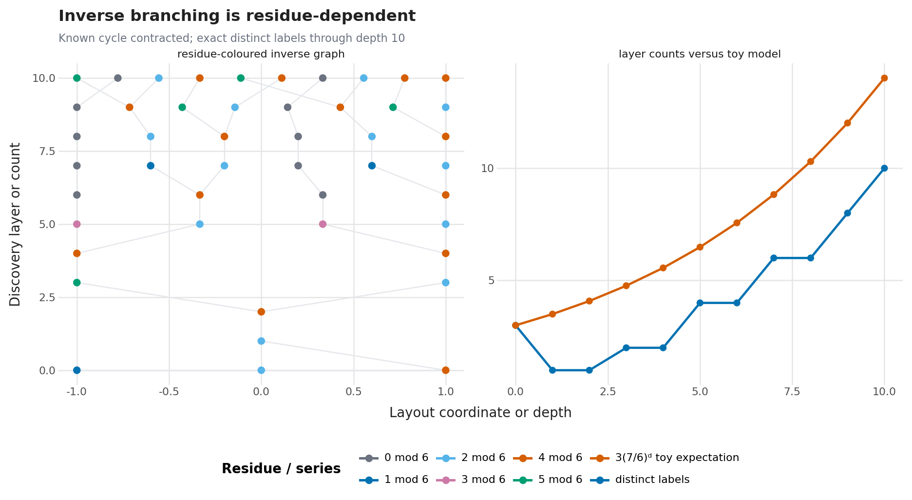

# Inverse Trees and Branching Models {#sec-collatz-inverse-branching}
<!-- Retained source chapter 34 from collatz_conjecture; mathematical content and anchors preserved. -->

Forward Collatz iteration gives each positive integer one successor. Reversing
the arrows gives one or more possible parents and exposes a branching
structure. That structure is valuable for residue sieves, coverage proofs, and
statistical models—but the inverse object is a directed graph with arithmetic
constraints, not an independent random tree.

This chapter begins with parity and divisibility. Chapter [source section](../collatz-conjecture/06-inverse.md#sec-inverse) gives
the first inverse construction; here we develop typed branching matrices,
growth rates, and a certificate protocol.

## Map conventions

For the ordinary map,

$$
C(n)=
\begin{cases}
n/2,&n\text{ even},\\
3n+1,&n\text{ odd}.
\end{cases}
$$

Every positive $m$ has the even parent $2m$. An odd parent must solve

$$
3n+1=m,
\qquad
n=\frac{m-1}{3}.
$$

It is valid exactly when:

1. $m\equiv1\pmod3$, so the quotient is integral;
2. $(m-1)/3$ is positive and odd.

For positive $m$, these combine to

$$
m\equiv4\pmod6.
$$

Thus

$$
C^{-1}(m)=
\begin{cases}
\{2m,(m-1)/3\},&m\equiv4\pmod6,\\
\{2m\},&\text{otherwise}.
\end{cases}
$$

If the shortcut map

$$
T(n)=
\begin{cases}
n/2,&n\text{ even},\\
(3n+1)/2,&n\text{ odd}
\end{cases}
$$

is used, the inverse congruence changes. Every result must name the convention.

## Tree language and graph reality

Starting from a root $r$, define level zero as $\{r\}$ and recursively attach
all valid parents. If each occurrence is kept separately, the result is an
**unfolding tree**: every node occurrence has a unique path to the root. If
equal integer labels are merged, the result is an inverse directed graph.

For the ordinary positive Collatz map, deterministic forward motion means two
different paths from the same integer label to the same root cannot diverge and
later rejoin before the root. But the familiar cycle

$$
1\to4\to2\to1
$$

creates repeated labels if inverse expansion is allowed through the cycle.
A computation must therefore choose:

- stop when a label was seen before;
- keep occurrences but cap depth;
- contract the known cycle;
- or use the odd-only map, where $1$ is a fixed point.

Calling the merged object a tree without this convention can corrupt level
counts.

## Odd-only inverse branches

For a positive odd $n$, the odd-only map is

$$
U(n)=\frac{3n+1}{2^{v_2(3n+1)}}.
$$

To find odd parents $n$ of odd $m$, solve

$$
3n+1=2^k m,\qquad k\ge1,
$$

so

$$
n=\frac{2^k m-1}{3}.
$$

The numerator is divisible by $3$ exactly when

$$
2^k m\equiv1\pmod3.
$$

Since $2\equiv-1\pmod3$, valid $k$ have one parity determined by
$m\bmod3$. Every valid quotient is odd. There are infinitely many formal
parents as $k$ runs through one parity class.

A bounded inverse search must therefore impose a maximum parent value, exponent
$k$, or residue precision. “All parents” is not finite for the odd-only map.

## Residue types

Branch availability depends on residues. For the ordinary map, modulo $6$
already distinguishes the optional odd parent. To predict the type of that
parent, finer moduli are needed because division by $3$ loses one factor of
precision.

Choose a modulus $M$ divisible by $6$. A **type** is a residue class
$a\bmod M$. For each type, enumerate inverse branches and determine possible
parent types modulo $M$, perhaps by lifting $a$ to classes modulo $3M$.
This yields a nonnegative transition matrix $B$ where

$$
B_{ij}
=\text{number of branch templates from type }i\text{ to type }j.
$$

If a row is normalized, it becomes a transition probability for a chosen
random model. The raw count matrix and the stochastic matrix answer different
questions.

## Branching-process repair kit

A Galton–Watson process starts with one individual. Each individual produces
an independent number $X$ of children with probabilities
$p_k=\mathbb P(X=k)$. The generating function is

$$
F(s)=\mathbb E[s^X]=\sum_{k\ge0}p_ks^k.
$$

The mean number of children is

$$
\mu=F'(1)=\sum_k kp_k.
$$

If $Z_n$ is population at generation $n$, independence gives

$$
\mathbb E[Z_n]=\mu^n.
$$

The extinction probability is the smallest solution $q\in[0,1]$ of

$$
F(q)=q.
$$

For the toy distribution $p_1=5/6$, $p_2=1/6$, $\mu=7/6>1$, but extinction is
impossible because every individual has at least one child. This already shows
that the usual “supercritical survival” language behaves differently when
zero offspring is absent.

## Why the arithmetic graph is not Galton–Watson

Residues along a branch are deterministically related. Siblings share their
target, and optional branches occur in prescribed congruence classes. Labels
can return to a cycle or be merged. These violate independent, identically
distributed offspring assumptions.

A multi-type branching process improves the model. If a type-$i$ node has
expected number $M_{ij}$ of type-$j$ children, then expected type counts evolve
by multiplication with $M$. Its spectral radius $\rho(M)$ is the predicted
exponential growth factor under the model.

For a deterministic residue automaton, powers of an adjacency matrix count
allowed branch words exactly. They count **templates**, not necessarily
distinct positive integers after all compatibility and merging constraints.

## Perron growth

For an irreducible nonnegative matrix $M$, Perron–Frobenius gives a positive
eigenvalue

$$
\rho(M)=\max\{|\lambda|:\lambda\text{ eigenvalue of }M\}
$$

with nonnegative eigenvectors. Under mild aperiodicity, normalized powers
$\rho(M)^{-n}M^n$ approach a rank-one profile.

If $a_n$ counts paths of length $n$ in a finite automaton, then

$$
\limsup_{n\to\infty}a_n^{1/n}=\rho(M)
$$

for the relevant accessible component. This is a theorem about the finite
automaton.

Transferring it to inverse Collatz labels requires proving:

1. every automaton path lifts to an integer branch;
2. different paths give different labels or collisions are bounded;
3. the chosen modulus captures every necessary congruence;
4. truncation has not removed outgoing transitions.

Without these, $\rho(M)$ is a model diagnostic.

## Exact inverse-layer computation

For a bounded ordinary-map search:

1. store the current frontier as exact positive integers;
2. generate $2m$ with an overflow guard;
3. generate $(m-1)/3$ only if $m\bmod6=4$;
4. verify every candidate by recomputing $C(n)=m$;
5. either keep occurrences or deduplicate, explicitly;
6. record depth, parent edge, residue, and discovery order;
7. hash the sorted edge list.

For each generated edge, the equality check is a local certificate. Completeness
at depth $d$ follows by induction from the proved inverse formula and exhaustive
processing of every frontier node.

<figure id="fig-inverse-branching">


<figcaption>

Figure 15.1: Inverse neighborhoods branch unevenly according to residue class.

</figcaption>
</figure>

[Figure 15.1](#fig-inverse-branching) merges repeated labels after contracting the
$1,2,4$ cycle and states a finite depth. The expectation curve is explicitly a
model, not a claim about asymptotic inverse growth.

## What inverse growth could imply

If every positive integer eventually reaches $1$, the full inverse graph of the
cycle contains every positive integer. Showing that inverse levels are large
does not prove this coverage: an infinite omitted component could coexist with
rapid growth around $1$.

Likewise, average branching above one does not guarantee that every residue
class connects to the root. Coverage is a reachability statement, while growth
is a counting statement.

<div class="callout callout-warning">
<p class="callout-title">Paths, occurrences, and labels are three counts</p>

An unfolding tree counts branch paths. A merged graph counts distinct integer
labels. A residue automaton counts symbolic templates. They may agree over a
small depth and diverge later.

</div>

## Worked audit: seven inverse layers

Let us carry out a small certified construction rather than trusting a drawing.
Start at $L_0=\{1\}$ and use the ordinary-map predecessor rule. To avoid walking
round the known $1\to4\to2\to1$ cycle forever, omit a candidate when it returns
to $1$ through that cycle. Do not otherwise deduplicate across levels. The first
layers are

| depth $d$ | frontier $L_d$ | reason for each non-doubling parent |
|---:|:---|:---|
| 0 | $\{1\}$ | root |
| 1 | $\{2\}$ | doubling only |
| 2 | $\{4\}$ | doubling only |
| 3 | $\{8\}$ | the extra parent $1$ is the omitted cycle return |
| 4 | $\{16\}$ | $8\not\equiv4\pmod6$ |
| 5 | $\{32,5\}$ | $16\equiv4\pmod6$, so $(16-1)/3=5$ |
| 6 | $\{64,10\}$ | both targets have only their doubling parents |
| 7 | $\{128,21,20,3\}$ | $64$ and $10$ are both $4\pmod6$ |

Every entry has a one-line certificate. For example,

$$
C(21)=64,
\qquad
C(3)=10,
$$

because both starts are odd. Conversely, if an odd $n$ maps to $64$, then
$3n+1=64$, forcing $n=21$; there is no second odd possibility. This proves
local completeness, not merely correctness of the displayed edges.

Now compare the exact layer counts

$$
1,1,1,1,1,2,2,4
$$

with the toy branching expectation $(7/6)^d$. The exact counts stay flat for
several levels and then jump. Nothing is wrong with either calculation: the
expectation averages an independent one-or-two-child experiment, whereas the
arithmetic construction encounters optional branches only when particular
residues occur. A fit over these seven levels would therefore measure this
rooted neighborhood, not a universal branching rate.

### Turning the table into a certificate

A portable record can contain rows

$$
(d,m,n,t),
$$

where $m\in L_d$, $n\in L_{d+1}$, and $t$ is either `double` or `odd`. A checker
verifies $n=2m$ in the first case and verifies
$m\equiv4\pmod6$, $n=(m-1)/3$, and $C(n)=m$ in the second. It then groups rows
by target $m$ and confirms that the required predecessor types occur exactly
once. Finally it recomputes each next frontier and compares its sorted list and
hash with the file. The checker is small because the inverse theorem has
already reduced completeness to two explicit formulas.

This example also explains three choices a research report must expose. If the
cycle is not contracted, the label $1$ reappears at depth three. If paths rather
than labels are counted, a later collision is retained twice. If a magnitude
cutoff is imposed, a missing doubling parent is a truncation artifact, not a
fact about the full graph.

### Mini solution clinic

For Exercise 3, first state the convention just used; otherwise several answers
are legitimate. For Exercise 6, a modulus-$6$ state knows whether the optional
ordinary parent exists, but it does not determine the residue type of every
future ancestor after division by $3$. Refining to a modulus divisible by both
$6$ and an additional power of $3$ records more history, at the cost of more
states. For Exercise 10, write the missing implication explicitly: rapid growth
of the component containing $1$ does not say that every positive label belongs
to that component.

<!-- inline-formula-code:start -->
## Formula and finite computation

A useful formula in this chapter is

$$
L_{j+1}=\bigcup_{m\in L_j}C^{-1}(m)
$$

Sets implement each inverse layer while removing duplicates. The following standalone Python block expresses that finite rule with its inputs and stopping conditions visible.

```python
def collatz_predecessors(value: int) -> set[int]:
    """Return all positive standard-map predecessors of value."""
    if value <= 0:
        raise ValueError("value must be positive")
    predecessors = {2 * value}
    if (value - 1) % 3 == 0:
        candidate = (value - 1) // 3
        if candidate > 0 and candidate % 2 == 1:
            predecessors.add(candidate)
    return predecessors

def inverse_layers(root: int, depth: int) -> list[set[int]]:
    """Return deduplicated inverse layers through a finite depth."""
    if root <= 0 or depth < 0:
        raise ValueError("root must be positive and depth nonnegative")
    layers = [{root}]
    seen = {root}
    for _ in range(depth):
        next_layer = {
            predecessor
            for value in layers[-1]
            for predecessor in collatz_predecessors(value)
            if predecessor not in seen
        }
        seen.update(next_layer)
        layers.append(next_layer)
    return layers

layers = inverse_layers(root=1, depth=20)
summary = [
    (depth, len(layer), min(layer), max(layer))
    for depth, layer in enumerate(layers)
]
print(summary)
```

**What the computation establishes.** The calculation checks a declared finite instance; the surrounding argument explains what is true beyond those inputs.
<!-- inline-formula-code:end -->

## Summary, exercises, and support

Inverse branches follow exact congruence rules. Finite residue automata and
multi-type branching matrices quantify allowed path growth, but arithmetic
dependence prevents a literal independent branching interpretation. Certified
layer construction requires convention, coverage induction, and exact edge
checks.

<div class="exercise" id="collatz_conjecture-34-inverse-branching-ex-1">
<p class="exercise-title"><strong>Exercise 1</strong></p>

Derive the inverse formula for the ordinary map.

</div>

<div class="exercise" id="collatz_conjecture-34-inverse-branching-ex-2">
<p class="exercise-title"><strong>Exercise 2</strong></p>

Derive the shortcut-map inverse conditions.

</div>

<div class="exercise" id="collatz_conjecture-34-inverse-branching-ex-3">
<p class="exercise-title"><strong>Exercise 3</strong></p>

List the first five inverse levels of $1$ under a declared cycle convention.

</div>

<div class="exercise" id="collatz_conjecture-34-inverse-branching-ex-4">
<p class="exercise-title"><strong>Exercise 4</strong></p>

Find the valid exponent parities for odd-only parents when
$m\equiv1$ and $m\equiv2\pmod3$.

</div>

<div class="exercise" id="collatz_conjecture-34-inverse-branching-ex-5">
<p class="exercise-title"><strong>Exercise 5</strong></p>

Compute mean and generating function for the toy one-or-two-child model.

</div>

<div class="exercise" id="collatz_conjecture-34-inverse-branching-ex-6">
<p class="exercise-title"><strong>Exercise 6</strong></p>

Build a residue-type matrix modulo $6$ and explain which transitions need
finer lifting information.

</div>

<div class="exercise" id="collatz_conjecture-34-inverse-branching-ex-7">
<p class="exercise-title"><strong>Exercise 7</strong></p>

Compute the spectral radius of a small branch matrix.

</div>

<div class="exercise" id="collatz_conjecture-34-inverse-branching-ex-8">
<p class="exercise-title"><strong>Exercise 8</strong></p>

Give an example showing path count and distinct-label count differ.

</div>

<div class="exercise" id="collatz_conjecture-34-inverse-branching-ex-9">
<p class="exercise-title"><strong>Exercise 9</strong></p>

Prove finite-depth completeness by induction for your inverse generator.

</div>

<div class="exercise" id="collatz_conjecture-34-inverse-branching-ex-10">
<p class="exercise-title"><strong>Exercise 10</strong></p>

Explain why exponential inverse growth would not by itself prove the
Collatz conjecture.

</div>

For Exercise 1, require integrality and oddness separately. For Exercise 4,
$(-1)^km\equiv1\pmod3$. For Exercise 9, use the fact that the inverse formula
lists every possible predecessor.
