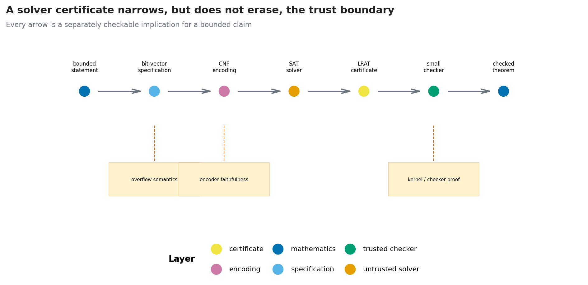

# SAT, SMT, and Formal Proof Assistants {#sec-collatz-formal-verification}
<!-- Retained source chapter 37 from collatz_conjecture; mathematical content and anchors preserved. -->

Computer searches can check billions of cases, but what exactly should be
trusted? SAT and SMT solvers translate bounded claims into logic and can emit
proof certificates. Formal proof assistants go further: a small kernel checks
that each inference follows from definitions and previously proved theorems.

This chapter starts with Boolean logic and binary arithmetic. No knowledge of a
specific prover or solver is assumed.

## Propositions and satisfiability

A proposition is a statement that is true or false. Boolean variables
$b_1,\ldots,b_n$ take values in $\{0,1\}$. The connectives not, and, or, and
implication build formulas.

A formula is **satisfiable** if some assignment makes it true. It is
**unsatisfiable** if no assignment does. A theorem

$$
P\Longrightarrow Q
$$

can be checked over a finite domain by asking whether

$$
P\land\neg Q
$$

is satisfiable. Unsatisfiability proves there is no counterexample in the
encoded domain.

Conjunctive normal form, or CNF, is an AND of clauses, each an OR of literals.
For example,

$$
(a\lor\neg b)\land(b\lor c)
$$

has two clauses. SAT solvers use branching, propagation, conflict analysis,
and clause learning to search far more efficiently than a truth table.

## Tseitin encoding

Converting a nested formula to CNF by distributing OR over AND can grow
exponentially. Tseitin encoding introduces a fresh variable for each subformula
and adds clauses enforcing equivalence.

For $z\leftrightarrow(a\land b)$, use

$$
(\neg z\lor a)
\land(\neg z\lor b)
\land(z\lor\neg a\lor\neg b).
$$

To require the original formula $F$ to be true, also add the unit clause $(r)$ for its output variable $r$. The equivalence clauses together with this root clause are equisatisfiable with $F$ and grow only linearly in circuit size.
Without the root clause, $F=a\land\neg a$ has consistent gate values for either input: if $u\leftrightarrow\neg a$ and $r\leftrightarrow(a\land u)$, the clauses $(u\lor a)\land(\neg u\lor\neg a)\land(\neg r\lor a)\land(\neg r\lor u)\land(r\lor\neg a\lor\neg u)$ allow $(a,u,r)=(0,1,0)$ and $(1,0,0)$, while $(r)$ rules out both.
Auxiliary variables are implementation devices; a model of the root-asserted encoding must be projected back to the original variables before being called a mathematical counterexample.

## Bit-vector Collatz arithmetic

An unsigned $w$-bit vector represents integers
$0,\ldots,2^w-1$. Addition and multiplication normally wrap modulo $2^w$.
Mathematical Collatz arithmetic does not wrap.

To encode one ordinary step on a bounded positive input $n$:

1. test the low bit for parity;
2. if even, use logical right shift by one;
3. if odd, compute $3n+1$ in a wider vector;
4. assert the wide result does not exceed the intended bound;
5. copy the exact result to the next state.

Alternatively use unbounded integer arithmetic in SMT. It avoids overflow but
may solve more slowly.

A bounded stopping claim for starts $1\le n\le N$ and at most $s$ steps can be
encoded with state vectors $x_0,\ldots,x_s$, transition constraints, and

$$
\bigvee_{i=0}^s(x_i=1).
$$

To search for a counterexample, negate the last condition.

## SAT versus SMT

SMT means satisfiability modulo theories. A solver combines Boolean search with
decision procedures for domains such as:

- fixed-width bit vectors;
- unbounded linear integer arithmetic;
- real linear arithmetic;
- arrays;
- uninterpreted functions.

Nonlinear integer arithmetic is generally undecidable, so solver behavior may
be incomplete. Collatz transitions can be encoded through multiplication by
the constant $3$, which remains linear, plus parity and branching.

Mixing bit vectors and integers requires explicit conversion semantics. A
signed comparison on a vector whose high bit is set differs from unsigned
comparison.

## Proof certificates

A solver reporting “unsatisfiable” is a claim by a large program. Modern SAT
solvers can emit resolution-style certificates such as DRAT or LRAT. A smaller
checker verifies that each added clause is redundant and that the empty clause
is eventually derived.

The trust chain includes:

1. mathematical statement;
2. encoder;
3. generated CNF and its hash;
4. solver;
5. certificate;
6. independent certificate checker;
7. decoding proof that CNF unsatisfiability implies the original bounded
   statement.

The certificate checks the CNF, not whether the encoder faithfully represented
Collatz arithmetic. Testing and formal verification of the encoder remain
important.

<figure id="fig-collatz-formal-stack">


<figcaption>

Figure 16.1: A bounded Collatz claim moves through encoding, solving, certificate emission, and independent checking.

</figcaption>
</figure>

[Figure 16.1](#fig-collatz-formal-stack) separates the untrusted fast solver from the trusted
checker and the still-required specification proof.

## Proof assistants from first principles

A proof assistant has a formal language of types, terms, propositions, and
proofs. Under the propositions-as-types viewpoint, a proof of proposition $P$
is a term of type $P$. A small **kernel** checks term typing.

Natural numbers are built from:

$$
0,\quad \operatorname{succ}(n).
$$

Functions are defined by recursion, and theorems by induction. A formal Collatz
function first needs a convention:

$$
C(0)=0
$$

may be added to make a total function on natural numbers, while the conjecture
is restricted to $n>0$.

A bounded theorem can take the form:

$$
\forall n,\ 1\le n\le N
\Longrightarrow
\exists k\le s,\ C^k(n)=1.
$$

The proof can evaluate a verified decision procedure and use **reflection**:
prove once that if the Boolean checker returns true, the proposition holds;
then let the kernel evaluate the checker on concrete input.

## Specifications and recursion

A structurally recursive function must visibly decrease an argument. Direct
Collatz iteration is not structurally decreasing because $3n+1>n$. Bounded
iteration recurses on a fuel parameter:

$$
\operatorname{iterate}(0,n)=n,
\quad
\operatorname{iterate}(s+1,n)
=\operatorname{iterate}(s,C(n)).
$$

A checker can scan the first $s$ states for one. Termination is now evident
because fuel decreases.

This proves only the fuel-bounded statement. Defining an unbounded stopping
time for every $n$ would require exactly the termination fact under
investigation.

## A bounded proof by interval decomposition

Instead of evaluating every start separately, formalise a verified block
certificate. For each residue class $r\bmod2^k$, a precomputed parity block
gives

$$
T^k(n)=\frac{3^a n+b}{2^k}.
$$

If this is provably below $n$ for every $n$ in a declared interval and residue
class, previously verified smaller starts close the induction.

A certificate stores $r,k,a,b$ and interval endpoints. The formal checker:

1. recomputes branch parity from $r$;
2. verifies the affine formula;
3. proves the inequality without overflow;
4. proves residue classes cover the interval exactly;
5. invokes strong induction.

This shifts trust from a massive execution trace to a small general theorem and
finite data.

## Importing external data

External certificates are byte strings until parsed. A secure import pipeline:

- specifies a versioned format;
- validates lengths before allocation;
- rejects duplicate or unsorted ranges if disallowed;
- checks integer bounds;
- hashes the exact file;
- converts to internal mathematical objects;
- runs the proved checker;
- records the checker and kernel versions.

Parser bugs can defeat certificate checking before mathematics begins. A
minimal format and fuzz testing reduce attack surface.

## What formalisation can and cannot do

Formalisation can:

- remove ambiguity from map conventions;
- verify finite coverage without gaps;
- check cycle-exclusion inequalities;
- expose a missing hypothesis in a paper proof;
- compose trusted lemmas with computed certificates.

It cannot turn a bounded quantifier into an unbounded one. Nor does kernel
checking guarantee the physical hardware, compiler, or foundational axioms are
infallible; it sharply reduces and documents the trusted base.

<div class="callout callout-warning">
<p class="callout-title">Verified computation has a quantified boundary</p>

A theorem through $N$ is
$\forall n\le N$, not $\forall n$. The formal statement is the authoritative
scope even when a headline omits the bound.

</div>

## Worked encoding: three safe ordinary steps

Suppose a solver checks three ordinary Collatz transitions from every
$1\le x_0\le20$. It is tempting to choose six unsigned bits because
$3\cdot20+1=61<64$. Six bits are indeed enough for the **first** transition,
but not necessarily for all three. For example, a later state could be $29$,
and six-bit arithmetic would compute

$$
3\cdot29+1=88\equiv24\pmod {64}.
$$

The wrapped result satisfies a bit-vector equation but not the integer
Collatz equation.

A simple conservative bound starts with $B_0=20$ and applies

$$
B_{j+1}=3B_j+1.
$$

This gives

$$
B_1=61,\quad B_2=184,\quad B_3=553.
$$

Ten bits are therefore certainly safe because $553<2^{10}$. The bound is not
tight—it ignores parity and possible divisions—but safety does not require
tightness. A narrower encoding must prove a sharper invariant.

For each step introduce a parity bit $p_i$ and integer-valued state $x_i$.
The intended constraints are

$$
p_i=0\Longrightarrow
\bigl(x_i=2q_i\ \text{and}\ x_{i+1}=q_i\bigr),
$$

and

$$
p_i=1\Longrightarrow
\bigl(x_i=2q_i+1\ \text{and}\ x_{i+1}=3x_i+1\bigr).
$$

The auxiliary $q_i$ makes evenness and exact division explicit. In SMT integer
arithmetic these formulas have their usual meaning. In bit-vector arithmetic,
the proof must additionally establish that every multiplication and addition
stays below $2^{10}$; otherwise the same syntax denotes modular arithmetic.

An end-to-end bounded claim might ask whether there exists an
$x_0\in[2,20]$ with $x_0\not\equiv 3\pmod 4$ for which none of $x_1,x_2,x_3$
is below $x_0$. If the solver reports unsatisfiable and emits a checkable proof,
the result establishes the three-step descent statement for those starts only. It does not say every
start reaches one, and it does not cover descent after four or more steps.

### Refinement from bits to mathematical integers

A clean formal development defines both an executable fixed-width transition
`stepBits` and a mathematical transition `stepNat`. It then proves a refinement
lemma:

$$
x\le B,\quad 3B+1<2^w
\quad\Longrightarrow\quad
\operatorname{decode}(\operatorname{stepBits}(\operatorname{encode}(x)))
=\operatorname{stepNat}(x).
$$

Induction composes the lemma along a bounded trace while updating the certified
bound. The SAT certificate proves a proposition about the bit encoding; the
refinement theorem transports it to natural numbers. Without this bridge, a
perfectly checked SAT proof may establish only a modular-arithmetic surrogate.

### A small trust ledger

Separate four layers:

1. the mathematical statement and map convention;
2. the translation and overflow/refinement proof;
3. the solver's search plus emitted certificate;
4. the certificate checker or proof-assistant kernel.

Testing is helpful at every layer, but the final assurance comes from explicit
interfaces between them. A hash authenticates the certificate file; it does not
show that the encoding represents the intended theorem. A verified parser and
checker reduce the trusted code, while the statement remains open to ordinary
mathematical review.

### Mini solution clinic

For Exercise 3, distinguish a one-step bound from a multi-step bound. For
Exercise 5, write a separate disjunction for each parity branch and constrain
all intermediate states. For Exercise 8, a suitable reflection statement is:
if the verified Boolean checker accepts a declared interval certificate, then
every start in that interval satisfies the stated descent predicate.

Chapter [source section](../collatz-conjecture/44-presburger-certificates.md#sec-collatz-presburger-certificates) separates linear integer
optimization from Presburger quantifier elimination and derives the exact
three-step descent set as a certificate case study.

<!-- inline-formula-code:start -->
## Formula and finite computation

A useful formula in this chapter is

$$
C^k(n)=n\quad\text{for some }n\le B,k\le K
$$

The finite search canonicalizes cycles so rotations are not counted repeatedly. The following standalone Python block expresses that finite rule with its inputs and stopping conditions visible.

```python
def canonical_cycle(values: list[int]) -> tuple[int, ...]:
    """Rotate a nonempty cycle so its least value appears first."""
    if not values:
        raise ValueError("cycle must be nonempty")
    position = min(range(len(values)), key=values.__getitem__)
    rotated = values[position:] + values[:position]
    return tuple(rotated)

def bounded_cycle_search(limit: int) -> tuple[set[tuple[int, ...]], int]:
    """Return cycles detected inside [1, limit] and starts that leave the box."""
    if limit <= 0:
        raise ValueError("limit must be positive")
    cycles: set[tuple[int, ...]] = set()
    escaped = 0
    for start in range(1, limit + 1):
        value = start
        positions: dict[int, int] = {}
        path: list[int] = []
        for _ in range(limit + 1):
            if value > limit or value in positions:
                break
            positions[value] = len(path)
            path.append(value)
            value = value // 2 if value % 2 == 0 else 3 * value + 1
        else:
            raise RuntimeError("finite-state trace exceeded its proved state bound")
        if value in positions:
            cycles.add(canonical_cycle(path[positions[value] :]))
        else:
            escaped += 1
    return cycles, escaped

cycles, escaped = bounded_cycle_search(limit=100_000)
print(cycles)
print("starts whose traced path left the finite box:", escaped)
```

**What the computation establishes.** The calculation checks a declared finite instance; the surrounding argument explains what is true beyond those inputs.
<!-- inline-formula-code:end -->

## Summary, exercises, and support

SAT encodes finite counterexample search; SMT adds arithmetic theories;
certificates allow small independent checkers; proof assistants connect
executable checkers to kernel-verified mathematical statements. Overflow,
encoding faithfulness, parser correctness, and quantifier scope remain explicit
obligations.

<div class="exercise" id="collatz_conjecture-37-formal-verification-ex-1">
<p class="exercise-title"><strong>Exercise 1</strong></p>

Convert a small implication into an unsatisfiability question.

</div>

<div class="exercise" id="collatz_conjecture-37-formal-verification-ex-2">
<p class="exercise-title"><strong>Exercise 2</strong></p>

Write the three Tseitin clauses for OR and verify their truth table.

</div>

<div class="exercise" id="collatz_conjecture-37-formal-verification-ex-3">
<p class="exercise-title"><strong>Exercise 3</strong></p>

Find the minimum safe width for computing $3n+1$ when
$0\le n\le N$.

</div>

<div class="exercise" id="collatz_conjecture-37-formal-verification-ex-4">
<p class="exercise-title"><strong>Exercise 4</strong></p>

Compare signed and unsigned interpretation of the same four-bit pattern.

</div>

<div class="exercise" id="collatz_conjecture-37-formal-verification-ex-5">
<p class="exercise-title"><strong>Exercise 5</strong></p>

Encode three bounded Collatz steps as integer SMT constraints.

</div>

<div class="exercise" id="collatz_conjecture-37-formal-verification-ex-6">
<p class="exercise-title"><strong>Exercise 6</strong></p>

Explain what an LRAT certificate checks and what it does not.

</div>

<div class="exercise" id="collatz_conjecture-37-formal-verification-ex-7">
<p class="exercise-title"><strong>Exercise 7</strong></p>

Define fuel-bounded iteration and prove it terminates.

</div>

<div class="exercise" id="collatz_conjecture-37-formal-verification-ex-8">
<p class="exercise-title"><strong>Exercise 8</strong></p>

State a reflection theorem connecting a Boolean range checker to a
proposition.

</div>

<div class="exercise" id="collatz_conjecture-37-formal-verification-ex-9">
<p class="exercise-title"><strong>Exercise 9</strong></p>

Design a gap-free interval certificate format.

</div>

<div class="exercise" id="collatz_conjecture-37-formal-verification-ex-10">
<p class="exercise-title"><strong>Exercise 10</strong></p>

List the trusted components in a solver-only result and in a
kernel-checked result.

</div>

For Exercise 3 require $3N+1<2^w$. For Exercise 4, binary $1111$ means $15$
unsigned and $-1$ in two's-complement signed form.
