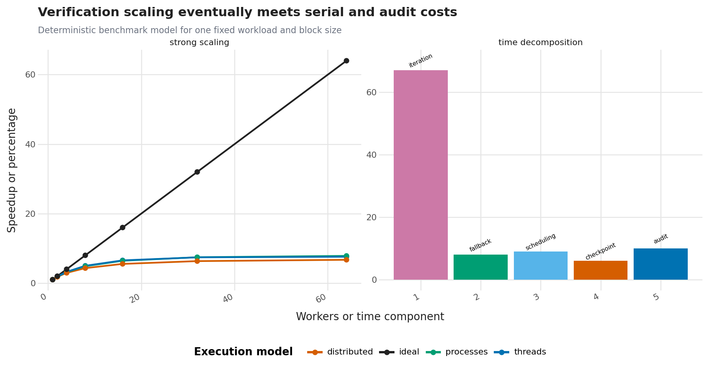

# High-Performance Verification and Verified Datasets {#sec-collatz-verified-datasets}
<!-- Retained source chapter 38 from collatz_conjecture; mathematical content and anchors preserved. -->

Large-scale Collatz computation is not merely “run the loop faster.” A credible
verification campaign must partition a range without gaps, prevent arithmetic
overflow, survive failures, preserve provenance, and let an independent
implementation audit the result. Performance and proof scope are both design
requirements.

This chapter starts with a scalar reference algorithm, then adds optimization
one layer at a time. Chapter [sec-verification-engineering](22-verification-engineering.md#sec-verification-engineering) gives the earlier
foundation; the present chapter develops dataset and scaling protocols.

## Define the claim first

A verification record must specify:

- map convention: ordinary, shortcut, or odd-only;
- starting set, such as every integer $1\le n<N$;
- stopping predicate, such as reaching a value below the start when the start exceeds 1;
- whether the known $1,2,4$ cycle is followed or contracted;
- maximum intermediate representation;
- software and data format versions;
- date and exact artifact hashes.

After separately verifying the base start 1, one useful inductive predicate is:

$$
\forall 2\le n<N,\quad
\exists k\ge1\text{ such that }C^k(n)<n.
$$

If every smaller positive integer is already known to reach $1$, this predicate
extends the verified range. A total-stopping computation can stop at the first
value below the start rather than continue to one.

This induction verifies start $1$ by its declared terminal cycle rather than strict descent, and uses exact positive
integers.

## A reference implementation

For each start:

1. if $n=1$, verify the declared terminal cycle, record a base-case row and continue with the next start; otherwise set $x=n$;
2. while $x\ge n$ and the iteration cap has not been reached, apply the declared map;
3. if an iteration cap is reached before finding a lower value, return unresolved;
4. otherwise record steps, peak, and the first lower value.

The reference version uses arbitrary-precision integers and simple branches.
It is intentionally easy to inspect. Test vectors include:

- powers of two;
- $n=27$ with known ordinary-map statistics;
- values just below and above word-size thresholds;
- odd inputs for which $3n+1$ is near overflow;
- interval endpoints.

A faster engine is compared against this version on random blocks and every
boundary class.

## Batched odd steps

For an odd $x$, compute

$$
y=3x+1,\quad k=v_2(y),\quad x\leftarrow y/2^k.
$$

This combines one odd step and all following divisions by two. Hardware
count-trailing-zero instructions make $k$ cheap for fixed-width words.

The step counter must distinguish ordinary steps from odd-only blocks:
ordinary steps increase by $1+k$, while the number of odd blocks increases by
one. Mixing them corrupts stopping-time data.

Several parity decisions can be precomputed for residues modulo $2^b$. For
each residue, store coefficients

$$
T^b(x)=\frac{3^a x+c}{2^b}
$$

and the number of ordinary or shortcut steps represented. Applying a block
requires proving the current value has that residue and checking the affine
arithmetic for overflow.

## Overflow safety

For unsigned $w$-bit arithmetic, $3x+1$ is safe only when

$$
x\le\left\lfloor\frac{2^w-2}{3}\right\rfloor.
$$

Check this inequality before multiplication. A wrapped value may appear small
and falsely satisfy the stopping predicate.

Safe strategies include:

- promote to a wider integer type;
- use arbitrary precision;
- use checked multiplication and branch to a slow path;
- represent an affine block with a multiprecision intermediate.

Undefined signed overflow in some languages is even more dangerous because a
compiler may optimize under the assumption it never occurs.

Every overflow fallback counter should be recorded. “No fallback used” is a
useful audit result only when the guard itself is tested.

## Partitioning the starting range

Use half-open blocks

$$
[L_i,R_i)
$$

because they compose without shared endpoints. A manifest stores each block's
integer endpoints, status, worker identifier, software hash, result hash, and
summary statistics.

Coverage is verified by sorting completed blocks and checking

$$
L_0=1,\quad R_i=L_{i+1},\quad R_{\mathrm{last}}=N.
$$

This detects gaps and overlaps. If duplicate work is allowed for fault
tolerance, duplicates must have identical content hashes or be reconciled by a
declared rule.

Residue-based partitioning instead assigns classes modulo $M$. Then completeness
requires every residue exactly once and a proof that each worker covers every
integer in its class within the range.

## Parallel execution

Thread-level parallelism shares memory but can contend for queues and counters.
Processes isolate failures. Accelerators favour uniform control flow, while
Collatz trajectories have variable length and branch divergence. Distributed
clusters need durable manifests and idempotent tasks.

Dynamic work stealing balances irregular block times. It changes execution
order but not results if:

- blocks are independent;
- each output depends only on declared input;
- reduction operations are exact or deterministically ordered;
- random audits use seeds derived from stable block identifiers.

Throughput alone can hide stragglers. Report block-time distributions, peak
memory, fallback counts, and unresolved starts.

## Checkpoints and recovery

A checkpoint should be written atomically:

1. write a new temporary record;
2. flush and, where needed, synchronise;
3. compute its hash;
4. rename it into the completed namespace;
5. update the manifest transactionally.

After a crash, scan completed artifacts, validate hashes, and reschedule missing
blocks. Never infer completion from a filename alone.

At-least-once execution is simpler than exactly-once execution: duplicate
blocks are acceptable when results are deterministic and deduplicated by block
identifier plus hash.

## Dataset schema

Separate raw verification claims from derived analytics. A block record might
contain:

| field | meaning |
|---|---|
| start_lo, start_hi | half-open starting interval |
| map_id | versioned transition convention |
| predicate_id | exact stopping predicate |
| max_peak | exact maximum intermediate value in block |
| argmax_peak | start attaining it with tie rule |
| max_steps | maximum counted steps |
| unresolved_count | starts not certified |
| fallback_count | multiprecision transitions |
| engine_hash | executable/source identity |
| payload_hash | content digest |

If per-start rows are retained, use an integer format that cannot silently
round large peaks. Column units and null semantics belong in the schema.

Derived columns—log peak, percentile ranks, record indicators—are produced by
versioned transformations and never overwrite raw values.

## Independent verification

An audit implementation should be structurally different:

- arbitrary precision rather than fixed-width fast paths;
- straightforward scalar transitions rather than parity blocks;
- independent language or compiler where practical;
- separate parser and range-coverage code.

Audit:

1. every block boundary start;
2. every record setter;
3. every start using an overflow fallback;
4. a pseudorandom sample derived from a published seed;
5. whole randomly selected blocks;
6. manifest coverage and all hashes.

Sampling cannot prove every row correct, but complete interval certificates plus
a verified block algorithm can. The report must state which assurance model is
used.

<figure id="fig-collatz-verification-scaling">


<figcaption>

Figure 17.1: Verification throughput rises with workers until memory, scheduling, or long-tail blocks dominate.

</figcaption>
</figure>

[Figure 17.1](#fig-collatz-verification-scaling) uses a deterministic benchmark workload and
identifies hardware and block size. It is a performance result, not
mathematical evidence beyond the benchmarked range.

## Scaling metrics

If one worker takes $T_1$ and $p$ workers take $T_p$, speedup and efficiency are

$$
S_p=\frac{T_1}{T_p},
\quad
E_p=\frac{S_p}{p}.
$$

Strong scaling holds total work fixed. Weak scaling grows work with worker
count. They answer different questions.

Amdahl's law predicts

$$
S_p\le\frac1{s+(1-s)/p}
$$

when fraction $s$ is serial. In an irregular workload, imbalance and
communication add further limits.

Comparisons must fix map convention, range, predicate, arithmetic, and output
detail. A program recording only success cannot be fairly compared with one
writing per-start trajectories.

## Release protocol

A verified dataset release includes:

- immutable data files and checksums;
- machine-readable schema;
- block manifest and coverage proof;
- source and build instructions;
- test vectors and audit results;
- hardware and performance report;
- known limitations;
- a claim statement with finite bound;
- licensing and citation metadata.

Version a correction rather than modifying an old release. Publish a signed
manifest when authenticity matters.

<div class="callout callout-warning">
<p class="callout-title">More computation never changes the quantifier type</p>

Increasing $N$ strengthens a finite theorem
$\forall n<N$. It does not establish the unbounded conjecture. Verification is
valuable evidence and can support inductive coverage, but its endpoint remains
part of the claim.

</div>

## Worked release audit

Suppose a run claims every start in the half-open range $[1,2501)$ is certified:
start 1 by the declared terminal cycle and the other starts by strict descent. Its manifest contains

$$
[1,1001),\quad[1001,2001),\quad[2001,2501).
$$

Sort by lower endpoint. The first lower endpoint is $1$, each lower endpoint
equals the preceding upper endpoint, and the final upper endpoint is $2501$.
Those three comparisons prove exact interval coverage: no start is omitted and
no start is assigned twice. The block sizes are $1000,1000,500$, whose sum
$2500$ agrees with the cardinality of $[1,2501)$.

If the middle block were instead $[1002,2001)$, start $1001$ would be missing.
If it were $[1000,2001)$, start $1000$ would be duplicated. Both defects can be
hidden by a correct total row count when another error compensates, so adjacency
checks are stronger than checking totals alone.

For each block, recompute a content hash over a canonical byte representation
that includes endpoints, map and predicate identifiers, engine version, and
results. A Merkle tree can combine the leaf hashes into one release root. A
membership proof then shows that a particular block belongs to the committed
release without downloading every block. It proves integrity and membership,
not that the Collatz computation inside the block is correct.

### Risk-directed independent audit

A uniform one-percent sample can miss the most failure-prone paths. A stronger
audit combines deterministic and random strata:

- every interval endpoint and its two neighbors;
- every start responsible for a peak or step-count record;
- every multiprecision fallback and every recovered checkpoint;
- every block produced immediately before or after a software upgrade;
- a seeded uniform sample of ordinary rows; and
- several complete blocks selected from a public seed derived after the run.

The auditor uses a scalar arbitrary-precision implementation and checks the
predicate from the raw start, not from cached intermediate data produced by the
fast engine. Publishing the sampling seed and selection algorithm prevents
quietly replacing inconvenient audit cases.

Sampling still does not prove every unaudited row. There are two honest release
claims: either all rows are covered by a proved checker/certificate scheme, or
sampling supplies a quantified error-detection procedure. The documentation
must say which one applies.

### Reading a scaling table

Assume one worker needs $T_1=1200$ seconds, eight workers need $190$ seconds,
and thirty-two need $70$ seconds. Then

$$
S_8=\frac{1200}{190}\approx6.32,
\quad
E_8\approx0.789,
$$

while

$$
S_{32}=\frac{1200}{70}\approx17.14,
\quad
E_{32}\approx0.536.
$$

Throughput still improves at thirty-two workers, but efficiency falls. The
cause cannot be inferred from these three numbers alone. Instrument iteration,
fallback, scheduling, checkpoint, merge, and audit time separately. Also report
the distribution of block durations: one unusually long shard can determine
the wall-clock finish even when average throughput looks strong.

Performance reproducibility needs more than a processor name. Record compiler
flags, integer library, thread affinity, memory size and bandwidth, storage,
block size, output policy, warm-up, repetitions, and whether audit time is
included. A faster run under a weaker predicate or with less output is not the
same experiment.

### Mini solution clinic

For Exercise 5, mechanically compare adjacent half-open endpoints. For Exercise
7, distinguish collision-resistant integrity from semantic correctness. For
Exercise 12, include the exact upper endpoint, map convention, predicate, and
certificate/checker status in one sentence.

<!-- inline-formula-code:start -->
## Formula and finite computation

A useful formula in this chapter is

$$
d=\operatorname{SHA256}(\text{canonical bytes})
$$

A canonical serialization and digest make accidental data changes detectable. The following standalone Python block expresses that finite rule with its inputs and stopping conditions visible. This illustrative payload records ordinary-map total stopping times to first arrival at 1 (zero at the base start), not strict-descent times.

```python
from hashlib import sha256

records = [(1, 0), (2, 1), (3, 7), (4, 2), (5, 5)]
payload = "\n".join(f"{start},{stopping}" for start, stopping in records).encode("ascii")
digest = sha256(payload).hexdigest()
print(len(records), digest)
```

**What the computation establishes.** The output certifies only the declared finite case. The theorem, if one is claimed, still requires the argument developed in the chapter.
<!-- inline-formula-code:end -->

## Summary, exercises, and support

High-performance verification begins with a precise bounded predicate.
Optimised parity blocks require overflow proofs; half-open manifests certify
coverage; atomic checkpoints permit recovery; immutable schemas and independent
audits make results reusable.

<div class="exercise" id="collatz_conjecture-38-verified-datasets-ex-1">
<p class="exercise-title"><strong>Exercise 1</strong></p>

Write the scalar reference algorithm and test it on $1,2,3,6,27$, verifying the base start separately and strict descent for the other starts.

</div>

<div class="exercise" id="collatz_conjecture-38-verified-datasets-ex-2">
<p class="exercise-title"><strong>Exercise 2</strong></p>

Derive the fixed-width overflow threshold for $3x+1$.

</div>

<div class="exercise" id="collatz_conjecture-38-verified-datasets-ex-3">
<p class="exercise-title"><strong>Exercise 3</strong></p>

Prove the odd-only step count conversion.

</div>

<div class="exercise" id="collatz_conjecture-38-verified-datasets-ex-4">
<p class="exercise-title"><strong>Exercise 4</strong></p>

Construct a parity-block affine formula for three shortcut steps.

</div>

<div class="exercise" id="collatz_conjecture-38-verified-datasets-ex-5">
<p class="exercise-title"><strong>Exercise 5</strong></p>

Verify coverage of a sample half-open block manifest and insert one gap.

</div>

<div class="exercise" id="collatz_conjecture-38-verified-datasets-ex-6">
<p class="exercise-title"><strong>Exercise 6</strong></p>

Design deterministic task identifiers for retry-safe distributed work.

</div>

<div class="exercise" id="collatz_conjecture-38-verified-datasets-ex-7">
<p class="exercise-title"><strong>Exercise 7</strong></p>

Explain why a hash verifies integrity but not mathematical correctness.

</div>

<div class="exercise" id="collatz_conjecture-38-verified-datasets-ex-8">
<p class="exercise-title"><strong>Exercise 8</strong></p>

Propose an audit sample that overrepresents risky arithmetic paths.

</div>

<div class="exercise" id="collatz_conjecture-38-verified-datasets-ex-9">
<p class="exercise-title"><strong>Exercise 9</strong></p>

Compute speedup and efficiency from a benchmark table.

</div>

<div class="exercise" id="collatz_conjecture-38-verified-datasets-ex-10">
<p class="exercise-title"><strong>Exercise 10</strong></p>

Distinguish strong and weak scaling with one Collatz example each.

</div>

<div class="exercise" id="collatz_conjecture-38-verified-datasets-ex-11">
<p class="exercise-title"><strong>Exercise 11</strong></p>

Draft a minimal immutable dataset schema.

</div>

<div class="exercise" id="collatz_conjecture-38-verified-datasets-ex-12">
<p class="exercise-title"><strong>Exercise 12</strong></p>

State the strongest mathematical claim justified by your proposed release.

</div>

For Exercise 2 use the largest representable value $2^w-1$. For Exercise 5,
sort by lower endpoint and compare each adjacent pair. For Exercise 7, a
consistently wrong file has a perfectly valid hash.
