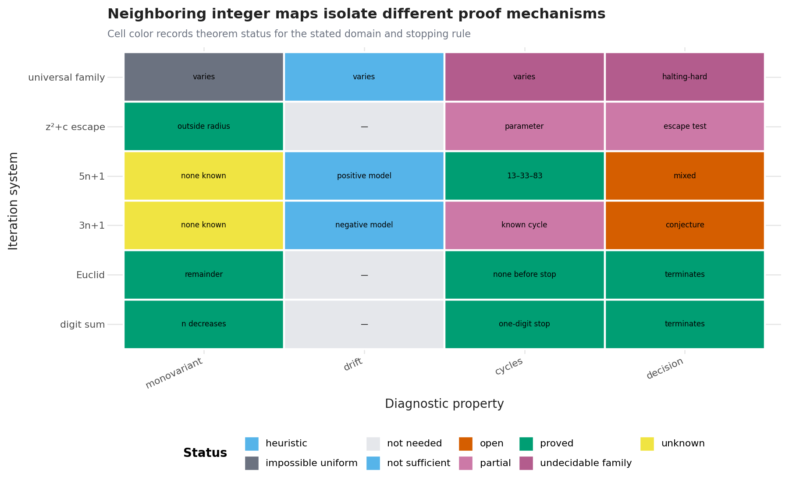

# Neighboring Integer Iteration Problems {#sec-collatz-neighboring-maps}
<!-- Retained source chapter 39 from collatz_conjecture; mathematical content and anchors preserved. -->

The Collatz map is easier to understand when compared with nearby systems.
Some variants terminate because a simple quantity always decreases; others
have obvious cycles, apparent escape, or enough expressive power to simulate a
computer. Comparison identifies which Collatz difficulties come from parity,
affine growth, residue constraints, or the absence of a monovariant.

Every map in this chapter is defined before claims are made, and experimental
status is kept separate from theorem status.

## A taxonomy

An integer dynamical system specifies:

1. a domain, such as positive integers;
2. a total or partial transition map;
3. a stopping set or orbit question;
4. observables such as stopping time, peak, or cycle;
5. a claim scope: one start, a bounded range, density, or all starts.

Useful families include:

- residue-class affine maps;
- digit-rewriting maps;
- division algorithms;
- polynomial maps;
- maps on integer vectors.

Two formulas that look similar may have different domains or stopping
conventions, so they are different problems.

## Generalised odd multipliers

For odd positive $a,b$, define

$$
C_{a,b}(n)=
\begin{cases}
n/2,&n\text{ even},\\
an+b,&n\text{ odd}.
\end{cases}
$$

The odd output is even, so another division follows. An odd-only version is

$$
U_{a,b}(n)
=\frac{an+b}{2^{v_2(an+b)}}
$$

when $an+b\ne0$.

Under the heuristic that $v_2(an+b)$ on odd inputs has geometric distribution

$$
\mathbb P(v_2=k)\approx2^{-k},
\qquad k\ge1,
$$

the mean valuation is two. The modeled odd-to-odd log drift is

$$
\log a-2\log2=\log(a/4).
$$

This is negative for $a=3$, positive for $a=5$, and zero at the unattainable
even multiplier $a=4$ in this odd-parameter family. Residue dependence and the
additive $b$ remain.

## The $5n+1$ contrast

Consider

$$
C_{5,1}(n)=
\begin{cases}
n/2,&n\text{ even},\\
5n+1,&n\text{ odd}.
\end{cases}
$$

The positive modeled odd-to-odd drift suggests that large values are commoner
than under $3n+1$. It does not prove an orbit diverges to infinity: downward
valuation bursts and cycles remain possible.

There is a nontrivial cycle. Under the odd-only map:

$$
13\to33\to83\to13,
$$

because

$$
5\cdot13+1=66=2\cdot33,
$$

$$
5\cdot33+1=166=2\cdot83,
$$

and

$$
5\cdot83+1=416=32\cdot13.
$$

Exact substitution proves the cycle. A search can discover it, but the three
equalities are the certificate.

The existence of one cycle does not classify all positive starts. A map can
have several cycles and unbounded orbits.

## Cycle equations across the family

For an odd-only cycle of length $k$ with valuation exponents
$r_0,\ldots,r_{k-1}$, composition gives

$$
n_0
=\frac{bA(r_0,\ldots,r_{k-1})}
{2^R-a^k},
\qquad
R=r_0+\cdots+r_{k-1},
$$

where

$$
A=
\sum_{j=0}^{k-1}
a^{k-1-j}2^{r_0+\cdots+r_{j-1}}
$$

for a consistent indexing convention. Positivity requires
$2^R>a^k$ when $b>0$. Integrality and the exact valuations impose stronger
conditions.

This formula turns a proposed valuation word into a finite Diophantine test.
Bounding all possible $k$ and $R$ remains difficult.

## Dividing in other bases

A prime-$p$ Syracuse-style map can divide by $p$ on one residue class and apply
an affine rule on the others. For example, a map might use

$$
n\mapsto n/3
\quad\text{when }3\mid n,
$$

with separate formulas for $n\equiv1,2\pmod3$ chosen to make outputs divisible
by $3$.

Symbolic words now use a three-letter residue alphabet, and starting residues
are organized modulo $3^k$. The same tools—affine composition, residue
automata, valuations, and random-walk heuristics—apply, but numerical drift
changes with branch frequencies.

Results do not transfer merely by replacing $2$ with $3$; the exact
congruences and invariant domain must be rederived.

## Digit-sum dynamics

Let $s_b(n)$ be the sum of base-$b$ digits. For $n\ge b$,

$$
s_b(n)\le(b-1)(\lfloor\log_b n\rfloor+1)<n
$$

once the small boundary cases are checked. Repeated digit sum therefore
terminates at a one-digit number. The value modulo $b-1$ is invariant because

$$
b\equiv1\pmod{b-1}.
$$

This gives the digital root formula.

The proof succeeds because $n$ itself is a **monovariant**: it strictly
decreases outside a finite stopping set. Collatz lacks any known simple
quantity with that property.

Multiplicative persistence repeatedly replaces $n$ by the product of its
digits. In base ten, every number eventually reaches one digit because a
multi-digit product is eventually smaller, but the maximum number of steps as
a function of starting size raises subtler extremal questions.

## Euclid as dynamics

On pairs of nonnegative integers with $a\ge b>0$, Euclid's map is

$$
(a,b)\longmapsto(b,a\bmod b).
$$

The second coordinate strictly decreases until zero, proving termination.
The gcd is invariant:

$$
\gcd(a,b)=\gcd(b,a\bmod b).
$$

Thus Euclid combines a monovariant with a conserved quantity. Worst-case step
counts occur for consecutive Fibonacci numbers, connecting dynamics to
continued fractions.

The subtractive version

$$
(a,b)\mapsto
\begin{cases}
(a-b,b),&a>b,\\
(a,b-a),&b>a
\end{cases}
$$

also terminates because $a+b$ decreases, but can be far slower. Algorithmic
form matters even when the invariant and final gcd agree.

## Polynomial iteration

For the complex quadratic family

$$
z_{n+1}=z_n^2+c,
$$

the filled Julia set consists of starts with bounded orbit. If
$|z_n|>\max(2,|c|)$, the orbit escapes to infinity by a direct inequality. This
is an **escape certificate**—a feature absent from positive Collatz dynamics,
where a huge value can later fall.

Restricting polynomial maps to integers often makes growth easy to certify once
outside a bounded set. The mixture of an expanding odd branch and arbitrarily
many halving steps prevents a comparable one-sided threshold for Collatz.

## Computational universality

Piecewise affine maps on integers or vectors can simulate register machines.
For sufficiently broad families, questions such as “does this orbit reach a
target?” are undecidable: a general algorithm would solve the halting problem.

This does **not** prove the fixed $3n+1$ conjecture undecidable. A family can be
computationally universal because its coefficients, dimensions, or residue
rules encode an arbitrary program, while one particular member may still admit
a special proof.

Conway-style generalised Collatz maps provide examples where residue-dependent
rational multipliers simulate computation. Exact definitions and domain
closure are essential when quoting such results.

<figure id="fig-neighboring-maps">


<figcaption>

Figure 18.1: Several neighboring maps occupy different combinations of modeled drift, proved descent, cycles, and computational expressiveness.

</figcaption>
</figure>

[Figure 18.1](#fig-neighboring-maps) is a taxonomy. Axes summarise the stated formulation only;
changing the stopping set or domain can change a classification.

## Fair comparative experiments

To compare maps:

1. choose corresponding domains and map-step conventions;
2. use the same starting range or a justified sampling law;
3. report both raw steps and compressed odd-only blocks;
4. normalize peaks by start and use logarithms;
5. separate completed, cycled, escaped-by-theorem, and censored starts;
6. allocate equal computational effort;
7. retain exact cycle certificates;
8. avoid transferring a heuristic without rechecking residue distribution.

For positive-drift maps, a fixed iteration cap creates more censoring. Treating
censored cases as confirmed divergence exaggerates the contrast.

## Lessons for Collatz

Neighboring maps isolate proof mechanisms:

- digit sum: direct descent outside a finite set;
- Euclid: descent plus invariant;
- polynomial escape: a forward-invariant region of growth;
- $5n+1$: altered drift and explicit nontrivial cycles;
- universal families: no uniform decision algorithm in excessive generality.

The original Collatz map lies in an awkward middle: no known monovariant or
escape region, negative heuristic drift but unbounded finite excursions, and
strong residue structure.

<div class="callout callout-warning">
<p class="callout-title">Similarity of formula is not transfer of theorem</p>

Changing $3$ to $5$, the base, or the accelerated convention changes cycle
equations, drift, and residue coding. Every theorem must be reverified for the
new map.

</div>

## Proof-mechanism transplant laboratory

Comparisons become most useful when we try to move one proof mechanism at a
time. Begin with decimal digit sum. Write $n=10q+r$ with
$q\ge1$ and $0\le r<10$. If $s(n)$ is the sum of the decimal digits, then

$$
s(n)=s(q)+r\le q+r<10q+r=n.
$$

The inequality $s(q)\le q$ follows by induction, with equality only among
single-digit nonnegative integers. Thus every number with at least two digits
strictly decreases after one digit-sum step. The finitely many one-digit states
are the terminal set. This is a complete proof because the monovariant is
pointwise and its exceptional set is finite.

Try the same quantity on Collatz. Ordinary odd steps satisfy

$$
C(n)=3n+1>n,
$$

so magnitude is not a one-step monovariant. Grouping two ordinary steps does
not repair it: for $n\equiv3\pmod4$,

$$
C^2(n)=\frac{3n+1}{2}>n
\qquad(n>1).
$$

An average negative logarithmic drift is weaker than pointwise descent. It says
what a declared random model tends to do, whereas a monovariant supplies an
inequality on every permitted transition.

Euclid offers a second transplant attempt. Its remainder map has both a strict
decrease of the second coordinate and an invariant gcd. Collatz has conserved
congruence information over finite blocks, but no known positive integer-valued
quantity that strictly decreases on every nonterminal block. A proposed proof
that says “choose a long enough block” must give one block-length rule that
works uniformly, not choose the length after seeing each favorable orbit.

Polynomial escape gives the opposite mechanism. Outside a proved radius, every
future iterate grows and remains outside. For Collatz, reaching a large value
does not create a forward-invariant escape region: subsequent powers of two can
erase arbitrarily many factors of growth. A computationally observed peak is
therefore not an escape certificate.

### A four-column audit for a new iteration problem

For any neighboring map, fill in this table before borrowing intuition:

| question | exact obligation | common shortcut | repair |
|:---|:---|:---|:---|
| descent | inequality for every eligible state | negative sample mean | exhibit a monovariant and finite exception set |
| cycles | closure, integrality, and branch replay | repeating residue word | solve the affine equation and verify the orbit |
| escape | forward-invariant unbounded region | one large observed value | prove all later states remain in the region |
| decidability | reduction for the stated fixed/family problem | cite a universal relative | preserve quantifiers and parameters in the reduction |

The table forces the proof object to match the conclusion. It also suggests
productive partial work: a monovariant on one residue subsystem, a complete
cycle certificate below a length bound, or an escape theorem for a restricted
family can be valuable without being inflated into a universal result.

### Worked comparison protocol

When comparing $3n+1$ and $5n+1$, declare the ordinary maps and use the same
half-open starting interval. Classify a start as `terminal`, `certified cycle`,
`escaped by a proved criterion`, or `censored at the cap`. Do not label a
censored $5n+1$ start divergent. Record both ordinary steps and odd-to-odd
blocks, because the valuation distribution changes the relationship between
those clocks.

For every detected cycle, store its minimum element, exact ordered state list,
and a replay hash. Rotate cycles to their smallest element and choose a direction
convention before deduplicating. Report peak ratios on a logarithmic scale but
retain exact integer peaks in the data. These choices make a fair finite
comparison reproducible while leaving universal claims untouched.

### Mini solution clinic

In Exercise 5, the decomposition $n=10q+r$ gives a short induction proof for
all digit lengths. In Exercise 8, after $|z|>\max(2,|c|)$ use
$|z^2+c|\ge |z|^2-|c|>|z|$. In Exercise 9, write the quantifiers: no algorithm
works for every member of a rich family does not imply that no algorithm or
proof works for this one fixed member.

<!-- inline-formula-code:start -->
## Formula and finite computation

A useful formula in this chapter is

$$
T(n)=n/2\text{ if }2\mid n,\quad T(n)=5n+1\text{ otherwise}
$$

A bounded trace shows why behavior of a neighboring map must not be imported into Collatz. The following standalone Python block expresses that finite rule with its inputs and stopping conditions visible.

```python
value = 7
trace = [value]
for _ in range(20):
    value = value // 2 if value % 2 == 0 else 5 * value + 1
    trace.append(value)
print(trace)
```

**What the computation establishes.** The output certifies only the declared finite case. The theorem, if one is claimed, still requires the argument developed in the chapter.
<!-- inline-formula-code:end -->

## Summary, exercises, and support

Generalised affine maps reveal how multiplier and valuation distribution affect
drift. Digit and Euclidean algorithms terminate through explicit
monovariants. Polynomial maps may have escape certificates; broad
piecewise-affine families can be universal. These contrasts sharpen, but do not
resolve, the original conjecture.

<div class="exercise" id="collatz_conjecture-39-neighboring-maps-ex-1">
<p class="exercise-title"><strong>Exercise 1</strong></p>

Derive the modeled odd-to-odd drift $\log(a/4)$.

</div>

<div class="exercise" id="collatz_conjecture-39-neighboring-maps-ex-2">
<p class="exercise-title"><strong>Exercise 2</strong></p>

Verify the $5n+1$ odd cycle exactly and expand it under the ordinary map.

</div>

<div class="exercise" id="collatz_conjecture-39-neighboring-maps-ex-3">
<p class="exercise-title"><strong>Exercise 3</strong></p>

Derive the general affine cycle equation for two odd steps.

</div>

<div class="exercise" id="collatz_conjecture-39-neighboring-maps-ex-4">
<p class="exercise-title"><strong>Exercise 4</strong></p>

Design a base-three residue map whose nondivisible branches return a
multiple of three, then check domain closure.

</div>

<div class="exercise" id="collatz_conjecture-39-neighboring-maps-ex-5">
<p class="exercise-title"><strong>Exercise 5</strong></p>

Prove repeated base-ten digit sum terminates.

</div>

<div class="exercise" id="collatz_conjecture-39-neighboring-maps-ex-6">
<p class="exercise-title"><strong>Exercise 6</strong></p>

Prove Euclid preserves gcd and strictly decreases its second coordinate.

</div>

<div class="exercise" id="collatz_conjecture-39-neighboring-maps-ex-7">
<p class="exercise-title"><strong>Exercise 7</strong></p>

Compare ordinary and subtractive Euclid on consecutive Fibonacci inputs.

</div>

<div class="exercise" id="collatz_conjecture-39-neighboring-maps-ex-8">
<p class="exercise-title"><strong>Exercise 8</strong></p>

Prove the quadratic escape bound for $z^2+c$.

</div>

<div class="exercise" id="collatz_conjecture-39-neighboring-maps-ex-9">
<p class="exercise-title"><strong>Exercise 9</strong></p>

Explain logically why universality of a family says nothing immediate about
undecidability of one member.

</div>

<div class="exercise" id="collatz_conjecture-39-neighboring-maps-ex-10">
<p class="exercise-title"><strong>Exercise 10</strong></p>

Run a fair comparison of $3n+1$ and $5n+1$ with censored outcomes reported
separately.

</div>

<div class="exercise" id="collatz_conjecture-39-neighboring-maps-ex-11">
<p class="exercise-title"><strong>Exercise 11</strong></p>

Construct a claim table with columns for proof, exact certificate,
bounded experiment, and heuristic.

</div>

<div class="exercise" id="collatz_conjecture-39-neighboring-maps-ex-12">
<p class="exercise-title"><strong>Exercise 12</strong></p>

Identify which neighbouring system best tests each of three proposed
Collatz proof ideas.

</div>

For Exercise 2, each odd-only arrow expands to one odd branch followed by the
number of halving steps shown in the factorisation. For Exercise 5, use the
number of digits to bound the next value and check finitely many small cases.
