# Appendix H — Python laboratories for Collatz evidence {#sec-collatz-python-laboratory}

The Collatz conjecture is unusually easy to program and unusually easy to
overclaim. This appendix teaches Python from the ground up while enforcing the
book's evidence ladder. A program may certify an explicitly covered finite
range, compute an exact orbit prefix, or test an implementation invariant. It
cannot infer universal convergence from a large sample.

Each of the twenty-two blocks below is self-contained. Copy one block into a fresh
Python file or notebook cell, predict its behavior, run it, and change one
input. Python integers grow automatically, so these examples do not overflow;
that fact does not remove time, memory, coverage, or transcription risks.

## Python notation from the beginning

Python's `=` stores a value; `==` asks whether two values agree. `def` names a
finite procedure and `return` exposes its result. An indented `if` block chooses
between cases, while an indented `for` or `while` block repeats a rule. A list
records an ordered finite trace, a set removes duplicates, and a dictionary
associates keys with stored values. `None` is used when a bounded procedure has
no mathematical answer within its declared budget. These are representations
of finite evidence, never silent claims about every positive integer.

## Lab 1 — Define one step with a domain check

```python
def collatz_step(number: int) -> int:
    """Return one standard Collatz step for a positive integer."""
    if number <= 0:
        raise ValueError("the standard Collatz map here has domain n >= 1")
    return number // 2 if number % 2 == 0 else 3 * number + 1

for number in range(1, 11):
    print(number, collatz_step(number))
```

The function states which map is implemented. Later labs use a shortcut map;
mixing those conventions silently changes stopping times.

## Lab 2 — Return an orbit and its termination status

A maximum step count prevents an unbounded loop. Reaching the limit is reported
as `False`, not mislabelled divergence.

```python
def collatz_orbit(start: int, max_steps: int = 10_000) -> tuple[list[int], bool]:
    """Return an orbit prefix and whether it reached one within max_steps."""
    if start <= 0 or max_steps < 0:
        raise ValueError("start must be positive and max_steps nonnegative")
    orbit = [start]
    for _ in range(max_steps):
        if orbit[-1] == 1:
            return orbit, True
        current = orbit[-1]
        orbit.append(current // 2 if current % 2 == 0 else 3 * current + 1)
    return orbit, orbit[-1] == 1

orbit, reached_one = collatz_orbit(27)
print(len(orbit) - 1, max(orbit), reached_one, orbit[-5:])
```

The returned Boolean is part of the result. Code that returns only the last
value can make a resource limit look like a mathematical conclusion.

<figure id="fig-code-collatz-orbit-batch">
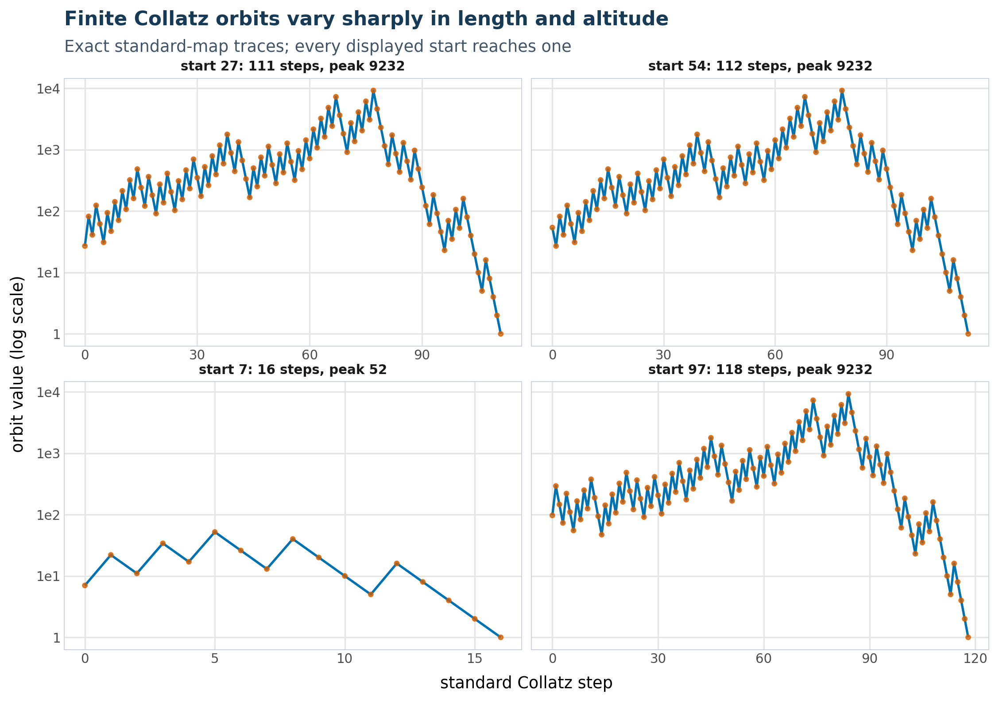

<figcaption>

Figure D.1: Exact orbit profiles for several starts show different lengths and peak heights.

</figcaption>
</figure>

[Figure D.1](#fig-code-collatz-orbit-batch) displays complete finite traces for the
named starts only.

## Lab 3 — Total stopping time with an explicit unknown result

`None` means the search budget ended before the orbit reached one. It does not
mean the stopping time is infinite.

```python
def total_stopping_time(start: int, max_steps: int = 100_000) -> int | None:
    """Return steps to one, or None when the declared budget is exhausted."""
    if start <= 0 or max_steps < 0:
        raise ValueError("start must be positive and max_steps nonnegative")
    value = start
    for step in range(max_steps + 1):
        if value == 1:
            return step
        if step < max_steps:
            value = value // 2 if value % 2 == 0 else 3 * value + 1
    return None

for start in (1, 6, 11, 27):
    print(start, total_stopping_time(start))
```

The special case `start=1` correctly returns zero.

## Lab 4 — Accelerate odd steps and count removed twos

For odd $n$, the shortcut map sends $n$ to the next odd integer by dividing
$3n+1$ by its exact power of two.

```python
def two_adic_valuation(integer: int) -> int:
    """Return v_2(integer) for a positive integer."""
    if integer <= 0:
        raise ValueError("integer must be positive")
    exponent = 0
    while integer % 2 == 0:
        integer //= 2
        exponent += 1
    return exponent

def odd_shortcut(odd_number: int) -> tuple[int, int]:
    """Return the next odd value and v_2(3n+1)."""
    if odd_number <= 0 or odd_number % 2 == 0:
        raise ValueError("input must be a positive odd integer")
    expanded = 3 * odd_number + 1
    exponent = two_adic_valuation(expanded)
    return expanded // (2**exponent), exponent

for odd_number in (1, 3, 5, 7, 9, 27):
    print(odd_number, odd_shortcut(odd_number))
```

This convention counts one accelerated odd step, not the several standard
steps it compresses.

## Lab 5 — Encode a finite shortcut-parity word

The parity word used in this book records parity before each step of the
one-division shortcut map: even $n$ goes to $n/2$, while odd $n$ goes to
$(3n+1)/2$. That convention is tested on two known starts.

```python
def shortcut_parity_word(start: int, length: int) -> str:
    """Return pre-step parity bits for the one-division shortcut map."""
    if start <= 0 or length < 0:
        raise ValueError("start must be positive and length nonnegative")
    value = start
    bits: list[str] = []
    for _ in range(length):
        bits.append(str(value % 2))
        value = value // 2 if value % 2 == 0 else (3 * value + 1) // 2
    return "".join(bits)

print(shortcut_parity_word(1, 3), shortcut_parity_word(5, 3))
print(shortcut_parity_word(27, 12))
```

The first two outputs are `101` and `100`. This guards the convention corrected
in Chapter 21.

<figure id="fig-code-parity-word-map">
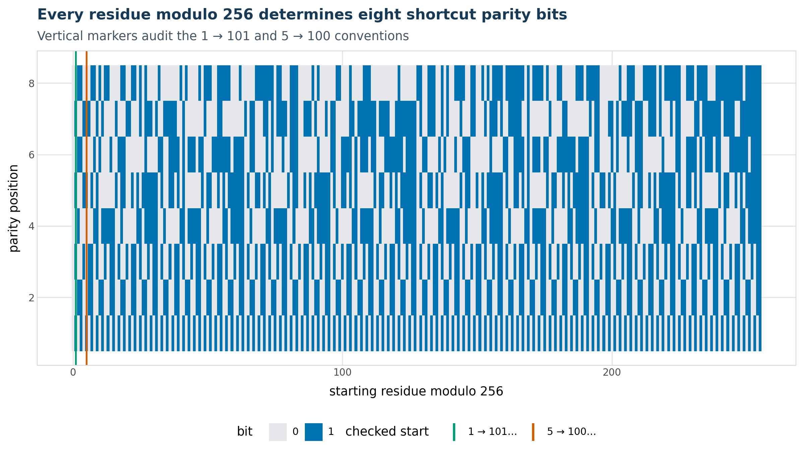

<figcaption>

Figure D.2: Length-eight shortcut parity words are mapped to compatible residue classes modulo two to the eighth.

</figcaption>
</figure>

[Figure D.2](#fig-code-parity-word-map) is a complete finite conjugacy table at depth
eight, not a statement about infinite words.

## Lab 6 — Compose the affine branch attached to a word

For a declared sequence of shortcut-parity branches, the $k$-step iterate has
the form $(a n+b)/2^k$. `Fraction` evaluates that affine expression exactly.

```python
from fractions import Fraction

def parity_affine(word: str) -> tuple[int, int, int]:
    """Return a, b, denominator for the affine composition encoded by word."""
    if any(bit not in "01" for bit in word):
        raise ValueError("word must contain only zero and one")
    coefficient, offset, denominator = 1, 0, 1
    for bit in word:
        if bit == "0":
            denominator *= 2
        else:
            coefficient = 3 * coefficient
            offset = 3 * offset + denominator
            denominator *= 2
    return coefficient, offset, denominator

word = "1110"
a, b, denominator = parity_affine(word)
start = 7
print(a, b, denominator, Fraction(a * start + b, denominator))
```

The affine formula is valid only for starts compatible with the word. Checking
compatibility is a separate arithmetic condition.

## Lab 7 — Build an exact residue transition table

Reducing the map modulo $m$ produces a finite directed graph. When $m$ is even,
the integer division in an even branch is not determined by a residue modulo
$m$ alone, so this example records transitions from representatives modulo
$2m$ into residues modulo $m$.

```python
def residue_transitions(modulus: int) -> dict[int, set[int]]:
    """Return all Collatz transitions induced from representatives modulo 2m."""
    if modulus <= 1:
        raise ValueError("modulus must exceed one")
    transitions = {residue: set() for residue in range(modulus)}
    for representative in range(1, 2 * modulus + 1):
        image = (
            representative // 2
            if representative % 2 == 0
            else 3 * representative + 1
        )
        transitions[representative % modulus].add(image % modulus)
    return transitions

for residue, targets in residue_transitions(16).items():
    print(residue, sorted(targets))
```

<figure id="fig-code-residue-transition-matrix">
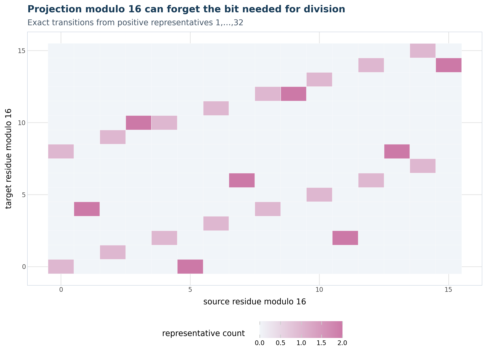

<figcaption>

Figure D.3: Finite residue transition multiplicities show deterministic and ambiguous projected branches.

</figcaption>
</figure>

The ambiguity in [Figure D.3](#fig-code-residue-transition-matrix) is information: quotient
maps can lose the bits needed to determine a division branch.

## Lab 8 — Generate inverse predecessors

The standard map has the even predecessor $2n$ for every target $n$. It also has
an odd predecessor $(n-1)/3$ precisely when that quotient is a positive odd
integer.

```python
def collatz_predecessors(target: int) -> list[int]:
    """Return every positive predecessor under the standard Collatz map."""
    if target <= 0:
        raise ValueError("target must be positive")
    predecessors = [2 * target]
    if (target - 1) % 3 == 0:
        candidate = (target - 1) // 3
        if candidate > 0 and candidate % 2 == 1:
            predecessors.append(candidate)
    return sorted(predecessors)

for target in range(1, 13):
    print(target, collatz_predecessors(target))
```

This produces one inverse layer. Deduplicating a larger inverse graph requires
tracking which nodes were already visited.

## Lab 9 — Verify a declared interval and retain failures

A batch verifier must not stop at the first unresolved start and discard the
rest. This function returns both the largest observed stopping time and every
start that exhausted the budget.

```python
def verify_interval(limit: int, max_steps: int) -> tuple[int, int, list[int]]:
    """Check starts 1..limit, returning record start, record time, and failures."""
    if limit <= 0 or max_steps < 0:
        raise ValueError("limit must be positive and max_steps nonnegative")
    record_start, record_time = 1, 0
    failures: list[int] = []
    for start in range(1, limit + 1):
        value = start
        for step in range(max_steps + 1):
            if value == 1:
                if step > record_time:
                    record_start, record_time = start, step
                break
            if step < max_steps:
                value = value // 2 if value % 2 == 0 else 3 * value + 1
        else:
            failures.append(start)
    return record_start, record_time, failures

print(verify_interval(limit=10_000, max_steps=10_000))
```

An empty failure list certifies exactly the interval $1\le n\le10{,}000$ for
this implementation and step convention.

<figure id="fig-code-stopping-time-coverage">
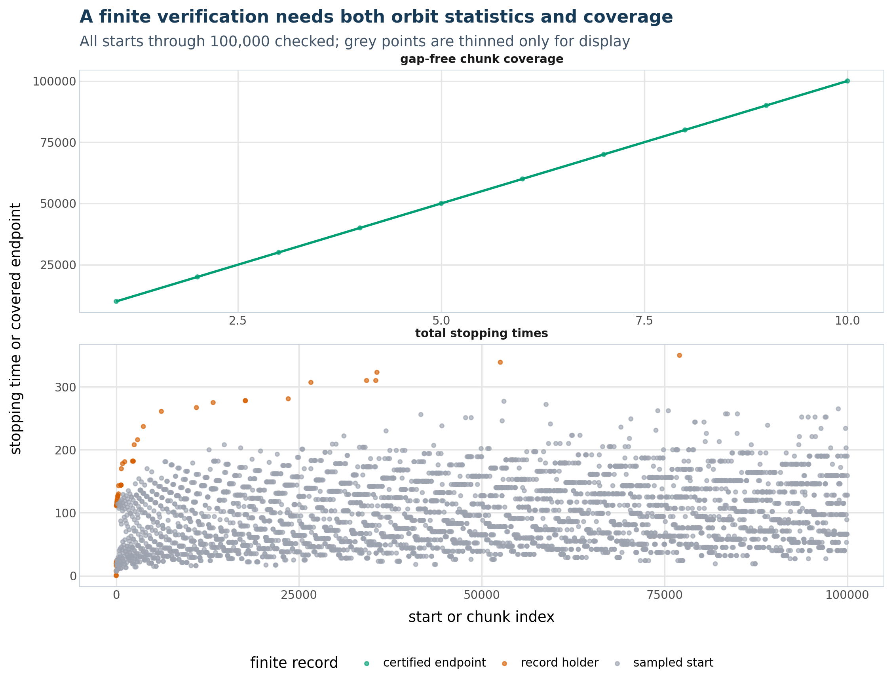

<figcaption>

Figure D.4: Running stopping-time records and certified coverage boundaries over a finite interval.

</figcaption>
</figure>

[Figure D.4](#fig-code-stopping-time-coverage) does not extrapolate beyond its final
endpoint.

## Lab 10 — Partition work without gaps or overlaps

Parallel verification needs a coverage proof. Half-open intervals compose
cleanly and keep neighbouring chunks disjoint.

```python
def half_open_chunks(start: int, stop: int, chunk_size: int) -> list[tuple[int, int]]:
    """Partition [start, stop) into consecutive half-open integer intervals."""
    if start < 0 or stop < start or chunk_size <= 0:
        raise ValueError("require 0 <= start <= stop and positive chunk_size")
    return [
        (left, min(left + chunk_size, stop))
        for left in range(start, stop, chunk_size)
    ]

chunks = half_open_chunks(1, 24, 5)
covered = [value for left, right in chunks for value in range(left, right)]
print(chunks)
print(covered == list(range(1, 24)), len(covered) == len(set(covered)))
```

The two Booleans certify coverage and disjointness for the declared partition.

## Lab 11 — Test the necessary multiplier condition for a cycle

A shortcut-parity word of length $k$ with $r$ odd steps has affine multiplier
$3^r/2^k$. A positive nontrivial cycle requires the denominator to exceed the
numerator before the positive translation term can close the equation.

```python
def cycle_multiplier_test(word: str) -> tuple[int, int, bool]:
    """Return numerator, denominator, and the necessary contraction comparison."""
    if not word or any(bit not in "01" for bit in word):
        raise ValueError("provide a nonempty binary parity word")
    odd_steps = word.count("1")
    numerator = 3**odd_steps
    denominator = 2 ** len(word)
    return numerator, denominator, numerator < denominator

for word in ("10", "1110", "101010", "11111100"):
    print(word, cycle_multiplier_test(word))
```

Passing this test is necessary, never sufficient. Congruence compatibility,
integrality, positivity, and the affine offset still have to be checked.

## Lab 12 — Summarize finite stopping-time data without hiding censoring

The final example returns a table with a status column. It does not replace an
unresolved run by a numerical time.

```python
import pandas as pd

def stopping_table(limit: int, max_steps: int) -> pd.DataFrame:
    """Return finite stopping-time records with explicit censored status."""
    if limit <= 0 or max_steps < 0:
        raise ValueError("limit must be positive and max_steps nonnegative")
    rows: list[dict[str, int | str | None]] = []
    for start in range(1, limit + 1):
        value = start
        stopping_time: int | None = None
        peak = start
        for step in range(max_steps + 1):
            peak = max(peak, value)
            if value == 1:
                stopping_time = step
                break
            if step < max_steps:
                value = value // 2 if value % 2 == 0 else 3 * value + 1
        rows.append(
            {
                "start": start,
                "stopping_time": stopping_time,
                "peak": peak,
                "status": "reached one" if stopping_time is not None else "censored",
            }
        )
    return pd.DataFrame(rows)

table = stopping_table(limit=100, max_steps=1_000)
print(table.groupby("status").size())
print(table.nlargest(5, "peak")[["start", "stopping_time", "peak"]])
```

The table is ready for Plotnine, but its metadata must travel with any exported
graph: map convention, start interval, maximum steps, integer type, and code
version.

## Lab 13 — Cross-check an accelerated step against standard steps

For a positive odd $n$, one odd-only step compresses the standard step
$n\mapsto3n+1$ and every following division by two until the next odd value.
Two separately written functions should agree on both the destination and the
number of standard steps compressed.

```python
def standard_to_next_odd(odd_number: int) -> tuple[int, int]:
    """Return the next odd value and standard-step count from an odd start."""
    if odd_number <= 0 or odd_number % 2 == 0:
        raise ValueError("input must be a positive odd integer")
    value = 3 * odd_number + 1
    steps = 1
    while value % 2 == 0:
        value //= 2
        steps += 1
    return value, steps

def independently_accelerated(odd_number: int) -> tuple[int, int]:
    """Return the odd-only destination and its expanded standard-step count."""
    if odd_number <= 0 or odd_number % 2 == 0:
        raise ValueError("input must be a positive odd integer")
    expanded = 3 * odd_number + 1
    power = (expanded & -expanded).bit_length() - 1
    return expanded // (2**power), power + 1

for odd_number in range(1, 100, 2):
    first = standard_to_next_odd(odd_number)
    second = independently_accelerated(odd_number)
    if first != second:
        raise ArithmeticError(f"implementations disagree at {odd_number}")
print("cross-check passed for every positive odd start below 100")
```

Agreement does not prove either implementation correct, but it catches many
convention and off-by-one errors because the functions organize the work
differently.

<figure id="fig-code-shortcut-compression">
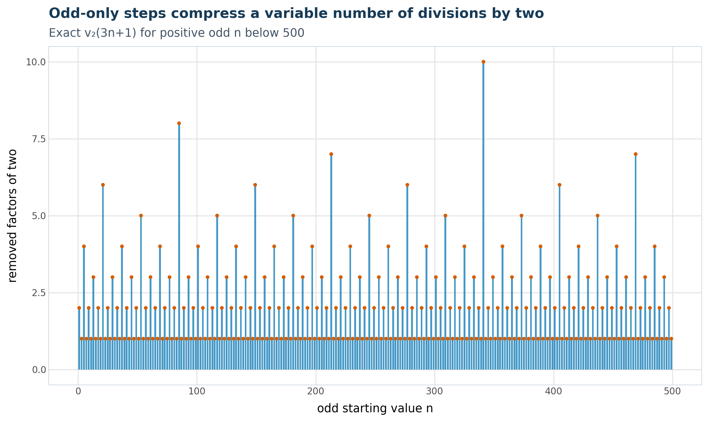

<figcaption>

Figure D.5: Odd-only steps compress different numbers of standard Collatz divisions by two.

</figcaption>
</figure>

## Lab 14 — Retain maximum-excursion record holders

The peak of an orbit can be much larger than its start. A record table keeps
only starts whose peak exceeds every earlier peak, but it also retains a
termination flag so a resource-limited prefix cannot masquerade as a complete
orbit.

```python
def orbit_peak(start: int, max_steps: int) -> tuple[int, bool]:
    """Return the largest seen value and whether one was reached."""
    if start <= 0 or max_steps < 0:
        raise ValueError("start must be positive and max_steps nonnegative")
    value = start
    peak = start
    for step in range(max_steps + 1):
        peak = max(peak, value)
        if value == 1:
            return peak, True
        if step < max_steps:
            value = value // 2 if value % 2 == 0 else 3 * value + 1
    return peak, False

def excursion_records(limit: int, max_steps: int) -> list[tuple[int, int, float]]:
    """Return complete finite peak records through a declared start limit."""
    if limit <= 0:
        raise ValueError("limit must be positive")
    records: list[tuple[int, int, float]] = []
    largest_peak = 0
    for start in range(1, limit + 1):
        peak, reached_one = orbit_peak(start, max_steps)
        if not reached_one:
            raise RuntimeError(f"start {start} exceeded the declared step budget")
        if peak > largest_peak:
            largest_peak = peak
            records.append((start, peak, peak / start))
    return records

print(excursion_records(limit=10_000, max_steps=10_000)[-10:])
```

<figure id="fig-code-excursion-records">
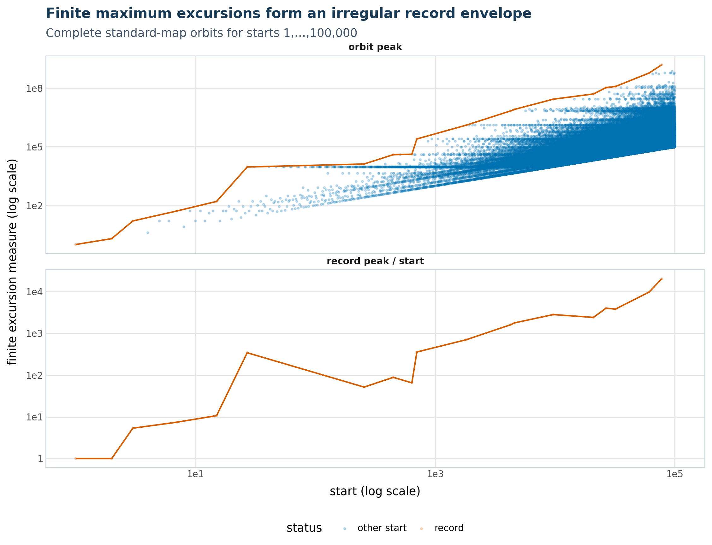

<figcaption>

Figure D.6: Maximum-excursion records rise irregularly across a completely checked finite start interval.

</figcaption>
</figure>

The figure and table describe starts in the stated interval. They do not bound
the excursion of an unseen start.

## Lab 15 — Measure first descent without confusing it with convergence

The first-descent time is the earliest positive step at which an orbit falls
below its starting value. Once this happens, induction can transfer a verified
result from smaller starts—but only if that smaller-start result is already
available.

```python
def first_descent_time(start: int, max_steps: int) -> int | None:
    """Return the first positive time below start, or None at the budget."""
    if start <= 1 or max_steps <= 0:
        raise ValueError("start must exceed one and max_steps must be positive")
    value = start
    for step in range(1, max_steps + 1):
        value = value // 2 if value % 2 == 0 else 3 * value + 1
        if value < start:
            return step
    return None

def descent_by_residue(
    modulus: int, samples_per_residue: int, max_steps: int
) -> dict[int, tuple[int, int]]:
    """Return (solved, censored) for exactly samples_per_residue starts > 1 per class."""
    if modulus <= 0 or samples_per_residue <= 0:
        raise ValueError("modulus and sample count must be positive")
    summary: dict[int, tuple[int, int]] = {}
    for residue in range(modulus):
        solved = 0
        censored = 0
        first_quotient = max(0, (1 - residue) // modulus + 1)
        for quotient in range(first_quotient, first_quotient + samples_per_residue):
            start = residue + quotient * modulus
            if first_descent_time(start, max_steps) is None:
                censored += 1
            else:
                solved += 1
        summary[residue] = solved, censored
    return summary

print(descent_by_residue(modulus=16, samples_per_residue=200, max_steps=500))
```

<figure id="fig-code-first-descent-residues">
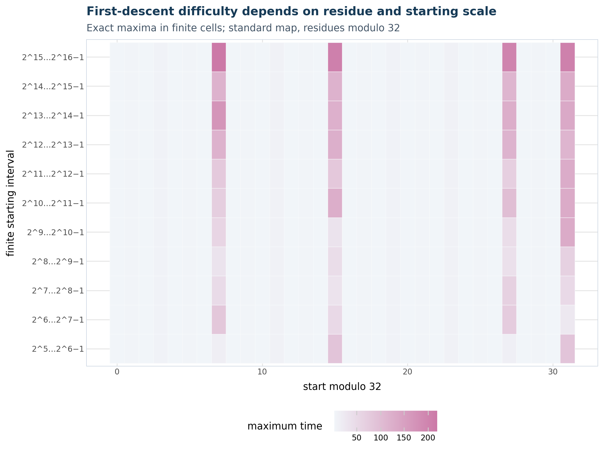

<figcaption>

Figure D.7: Finite first-descent times vary systematically across residue classes and starting scales.

</figcaption>
</figure>

## Lab 16 — Build inverse layers with deduplication

Every positive $m$ has the even predecessor $2m$. It also has an odd
predecessor $(m-1)/3$ precisely when that quotient is a positive odd integer.
Breadth-first layers must use sets because different branches can merge.

```python
def collatz_predecessors(value: int) -> set[int]:
    """Return all positive standard-map predecessors of value."""
    if value <= 0:
        raise ValueError("value must be positive")
    predecessors = {2 * value}
    if (value - 1) % 3 == 0:
        candidate = (value - 1) // 3
        if candidate > 0 and candidate % 2 == 1:
            predecessors.add(candidate)
    return predecessors

def inverse_layers(root: int, depth: int) -> list[set[int]]:
    """Return deduplicated inverse layers through a finite depth."""
    if root <= 0 or depth < 0:
        raise ValueError("root must be positive and depth nonnegative")
    layers = [{root}]
    seen = {root}
    for _ in range(depth):
        next_layer = {
            predecessor
            for value in layers[-1]
            for predecessor in collatz_predecessors(value)
            if predecessor not in seen
        }
        seen.update(next_layer)
        layers.append(next_layer)
    return layers

layers = inverse_layers(root=1, depth=20)
summary = [
    (depth, len(layer), min(layer), max(layer))
    for depth, layer in enumerate(layers)
]
print(summary)
```

<figure id="fig-code-inverse-layer-growth">
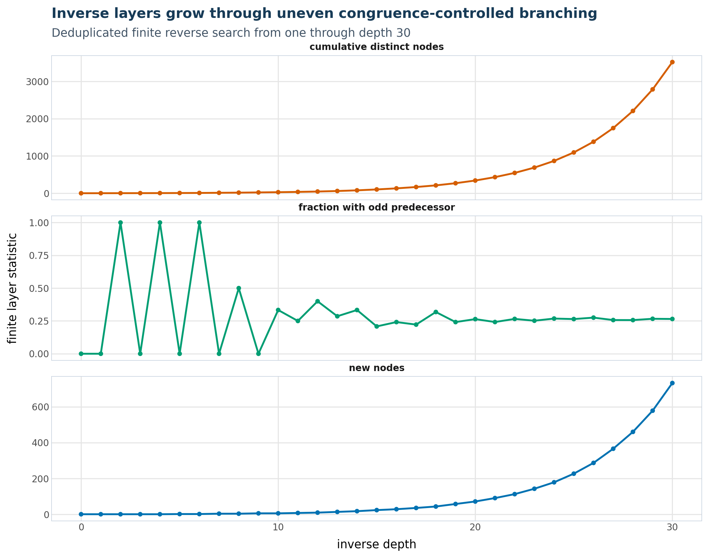

<figcaption>

Figure D.8: Deduplicated inverse layers grow unevenly because admissible odd predecessors appear only in selected congruence classes.

</figcaption>
</figure>

## Lab 17 — Search for cycles inside an explicit finite box

This last laboratory follows starts only while their values remain at most a
declared bound. A detected cycle is canonicalized by rotation so the same cycle
is not counted from several entry points. Leaving the box is recorded as
unresolved, never as evidence that no cycle exists.

```python
def canonical_cycle(values: list[int]) -> tuple[int, ...]:
    """Rotate a nonempty cycle so its least value appears first."""
    if not values:
        raise ValueError("cycle must be nonempty")
    position = min(range(len(values)), key=values.__getitem__)
    rotated = values[position:] + values[:position]
    return tuple(rotated)

def bounded_cycle_search(limit: int) -> tuple[set[tuple[int, ...]], int]:
    """Return cycles detected inside [1, limit] and starts that leave the box."""
    if limit <= 0:
        raise ValueError("limit must be positive")
    cycles: set[tuple[int, ...]] = set()
    escaped = 0
    for start in range(1, limit + 1):
        value = start
        positions: dict[int, int] = {}
        path: list[int] = []
        while value <= limit and value not in positions:
            positions[value] = len(path)
            path.append(value)
            value = value // 2 if value % 2 == 0 else 3 * value + 1
        if value in positions:
            cycles.add(canonical_cycle(path[positions[value] :]))
        else:
            escaped += 1
    return cycles, escaped

cycles, escaped = bounded_cycle_search(limit=100_000)
print(cycles)
print("starts whose traced path left the finite box:", escaped)
```

The familiar cycle appears as `(1, 4, 2)`. The escaped count is essential: the
program has not classified those trajectories, let alone all positive
integers.

## Lab 18 — Recover the affine formula of a parity word

Under the one-division shortcut map, a word $w$ of length $k$ with $r$ odd
steps determines an affine expression

$$
T_w(n)=\frac{3^r n+B_w}{2^k}.
$$

The offset $B_w$ depends on the positions of the odd steps, not only their
number. The recurrence below builds all three coefficients and cross-checks
them against an actual orbit prefix.

```python
def affine_word(word: str) -> tuple[int, int, int]:
    """Return A, B, D with the shortcut branch (A*n+B)/D."""
    if any(bit not in "01" for bit in word):
        raise ValueError("word must contain only zero and one")
    coefficient = 1
    offset = 0
    denominator = 1
    for bit in word:
        if bit == "1":
            coefficient *= 3
            offset = 3 * offset + denominator
        denominator *= 2
    return coefficient, offset, denominator

def shortcut_prefix(start: int, length: int) -> tuple[str, int]:
    """Return a shortcut parity word and the value after length steps."""
    if start <= 0 or length < 0:
        raise ValueError("start must be positive and length nonnegative")
    value = start
    bits: list[str] = []
    for _ in range(length):
        bit = value % 2
        bits.append(str(bit))
        value = value // 2 if bit == 0 else (3 * value + 1) // 2
    return "".join(bits), value

word, actual = shortcut_prefix(27, 10)
coefficient, offset, denominator = affine_word(word)
numerator = coefficient * 27 + offset
print(word, coefficient, offset, denominator)
print(actual, numerator // denominator, numerator % denominator)
```

A zero remainder certifies this finite branch. It does not say that an
arbitrary start follows the same word or that the branch eventually descends.

<figure id="fig-code-affine-word-coefficients">
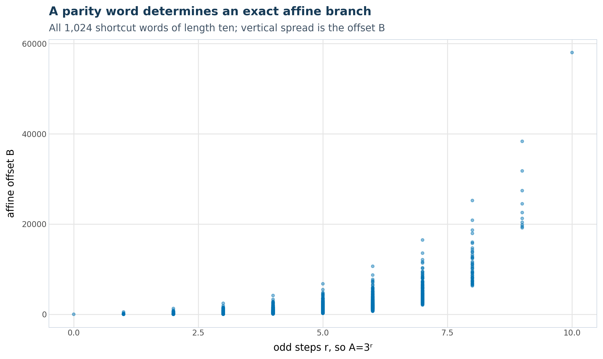

<figcaption>

Figure D.9: Affine offsets vary among parity words with the same number of odd steps.

</figcaption>
</figure>

## Lab 19 — Count parity words by odd-step count

There are exactly $\binom{k}{r}$ binary words of length $k$ containing $r$
ones. This is a combinatorial fact about words, not automatically a statement
about the frequency of realizable Collatz orbit prefixes.

```python
from math import comb

def parity_word_counts(length: int) -> list[int]:
    """Return binomial counts for zero through length odd positions."""
    if length < 0:
        raise ValueError("length must be nonnegative")
    counts = [comb(length, odd_steps) for odd_steps in range(length + 1)]
    if sum(counts) != 2**length:
        raise RuntimeError("binomial word count failed")
    return counts

for length in (4, 8, 16):
    print(length, parity_word_counts(length), sum(parity_word_counts(length)))
```

The final equality is an exact finite certificate for the binomial theorem.
Any transfer from uniformly chosen words to deterministic starting integers
requires a separate residue or measure argument.

<figure id="fig-code-parity-binomial-counts">
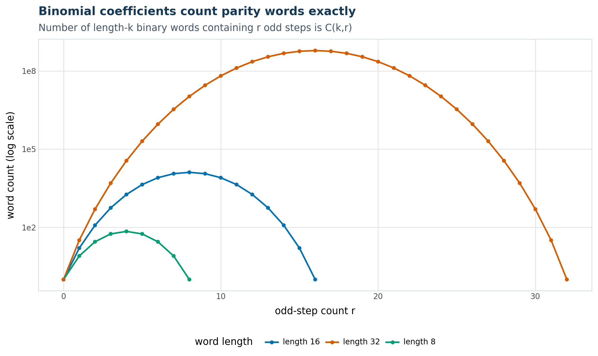

<figcaption>

Figure D.10: Binomial coefficients give the exact number of parity words with each odd-step count.

</figcaption>
</figure>

## Lab 20 — Retain a stopping-time survival curve and its censoring

For a finite set of starts, the empirical survival fraction at time $t$ is the
proportion whose recorded total stopping time exceeds $t$. Unresolved starts
must remain separate rather than being assigned an invented time.

```python
def bounded_stopping_time(start: int, max_steps: int) -> int | None:
    """Return the standard stopping time, or None after the finite budget."""
    if start <= 0 or max_steps < 0:
        raise ValueError("start must be positive and max_steps nonnegative")
    value = start
    for step in range(max_steps + 1):
        if value == 1:
            return step
        if step < max_steps:
            value = value // 2 if value % 2 == 0 else 3 * value + 1
    return None

def survival_table(limit: int, max_steps: int) -> tuple[list[tuple[int, float]], int]:
    """Return empirical survival fractions and the censored-start count."""
    if limit <= 0 or max_steps < 0:
        raise ValueError("limit must be positive and max_steps nonnegative")
    times = [bounded_stopping_time(start, max_steps) for start in range(1, limit + 1)]
    censored = sum(time is None for time in times)
    table = [
        (
            threshold,
            sum(time is None or time > threshold for time in times) / len(times),
        )
        for threshold in range(max_steps + 1)
    ]
    return table, censored

table, censored = survival_table(limit=5_000, max_steps=500)
print(censored)
print(table[::50])
```

Censored starts remain in the numerator through the declared observation
window because the computation has proved that their stopping times exceed
every displayed threshold. The separate count prevents that known lower-bound
information from being mistaken for an eventual stopping time. A survival
curve for 5,000 starts is descriptive finite data, not a tail bound for all
starts.

<figure id="fig-code-stopping-time-survival">
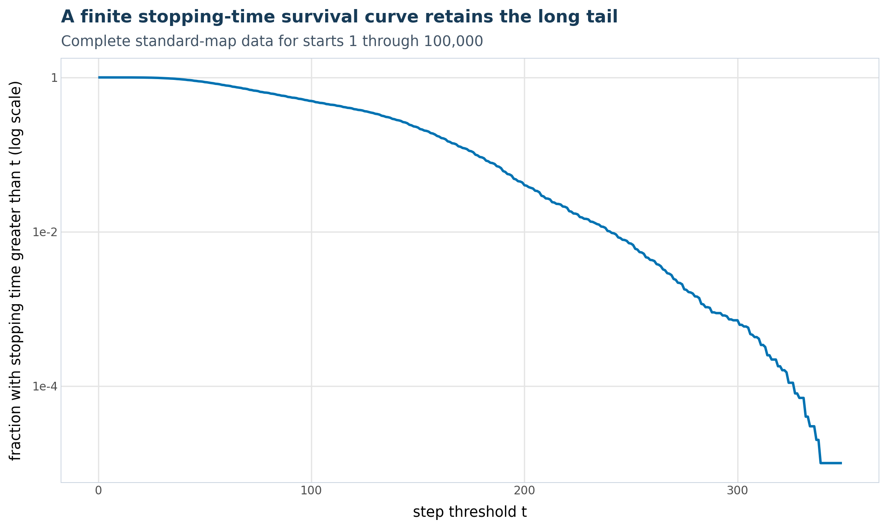

<figcaption>

Figure D.11: A finite Collatz stopping-time survival curve displays a long empirical tail.

</figcaption>
</figure>

## Lab 21 — Separate word multiplicity from logarithmic drift

A shortcut word of length $k$ with $r$ odd steps has leading multiplier
$3^r/2^k$ and logarithmic multiplier $r\log3-k\log2$. The number of such words
is $\binom{k}{r}$. Keeping both columns prevents a likely word count from being
mistaken for a deterministic drift theorem.

```python
from math import comb, log

def logarithmic_drift_ledger(length: int) -> list[tuple[int, int, float, str]]:
    """Return odd count, word count, log multiplier, and its sign label."""
    if length <= 0:
        raise ValueError("length must be positive")
    rows: list[tuple[int, int, float, str]] = []
    for odd_steps in range(length + 1):
        log_multiplier = odd_steps * log(3.0) - length * log(2.0)
        sign = "contracting" if 3**odd_steps < 2**length else "expanding"
        rows.append((odd_steps, comb(length, odd_steps), log_multiplier, sign))
    return rows

for row in logarithmic_drift_ledger(20):
    print(row)
```

The floating logarithm is used only to display scale; the integer comparison
assigns the sign exactly. Neither column proves independence or equidistribution
of parity along Collatz orbits.

<figure id="fig-code-log-drift-ledger">
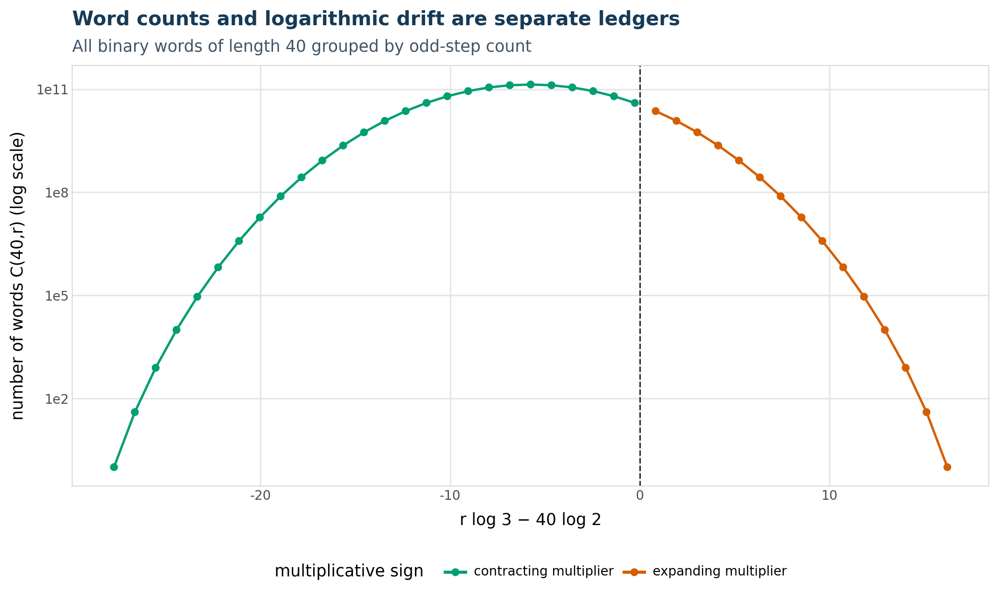

<figcaption>

Figure D.12: Parity-word multiplicities are plotted against their exact multiplier sign.

</figcaption>
</figure>

## Lab 22 — Enumerate the necessary cycle denominator

Closing an affine shortcut word into a cycle leads to a denominator
$2^k-3^r$. Positivity is necessary for a positive cycle in the usual setup,
but it is far from sufficient: the offset, integrality, parity compatibility,
and intermediate values still matter.

```python
def positive_cycle_denominators(max_length: int) -> list[tuple[int, int, int]]:
    """Return finite pairs (k,r,2**k-3**r) with positive denominator."""
    if max_length <= 0:
        raise ValueError("max_length must be positive")
    rows: list[tuple[int, int, int]] = []
    for length in range(1, max_length + 1):
        for odd_steps in range(length + 1):
            denominator = 2**length - 3**odd_steps
            if denominator > 0:
                rows.append((length, odd_steps, denominator))
    return rows

candidates = positive_cycle_denominators(12)
print(len(candidates))
print(candidates[:20])
```

This program filters a finite parameter box by one necessary inequality. It
does not find a cycle, rule out cycles beyond the box, or address aperiodic
divergence.

<figure id="fig-code-cycle-denominator-grid">
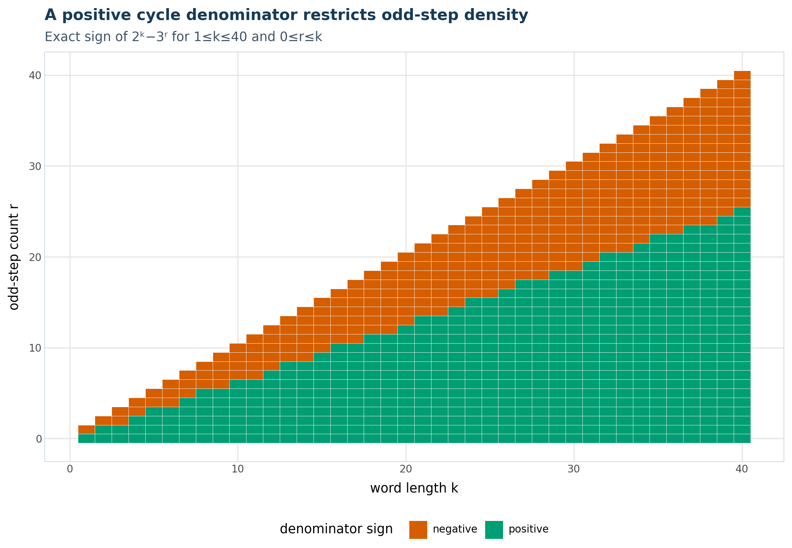

<figcaption>

Figure D.13: The sign of two to the k minus three to the r restricts possible cycle parameters.

</figcaption>
</figure>

## Claim discipline and testing checklist

Test `start=1`, odd and even starts, zero-length words, and a deliberately tiny
step budget. Compare the standard and shortcut conventions only after converting
their step counts. For a distributed run, prove interval coverage and record
checksums or independent reruns. Never silently discard a censored orbit or
translate “not found” into “does not exist.”

The collection validator parses and executes all twenty-two blocks. Functions have
typed boundaries, explicit failure states, and finite work limits; no example
uses external data or catches and suppresses an exception. The thirteen new figures
are deterministic Plotnine outputs from `figures.py`.

Labs 1–5 support [the map](../collatz-conjecture/01-problem.md), [trajectories](../collatz-conjecture/02-measuring.md), and
[parity structure](../collatz-conjecture/04-parity.md). Labs 6–8 support [residue
sieves](../collatz-conjecture/05-sieves.md), [inverse trees](../collatz-conjecture/06-inverse.md), and [symbolic
dynamics](28-ergodic-symbolic.md). Labs 9–12 support [verification
engineering](22-verification-engineering.md), [cycle constraints](../collatz-conjecture/08-cycles.md),
and the [claim ledgers](../collatz-conjecture/f-claim-ledgers.md). None changes the open status of the
Collatz conjecture.
Labs 13–17 support [accelerated dynamics](27-accelerated-renewal.md),
[verification engineering](22-verification-engineering.md), [residue
sieves](../collatz-conjecture/05-sieves.md), [inverse branching](34-inverse-branching.md), and
[cycle constraints](23-diophantine-cycles.md). Their finite certificates do
not change the conjecture's open status.
Labs 18–22 support [parity and affine structure](../collatz-conjecture/04-parity.md), [probability
models](20-probability-models.md), [density](../collatz-conjecture/11-density.md), [large
deviations](../collatz-conjecture/35-large-deviations.md), and [Diophantine cycle
constraints](23-diophantine-cycles.md). They keep exact identities, word
counts, empirical survival, heuristic drift, and necessary cycle conditions in
separate ledgers.
