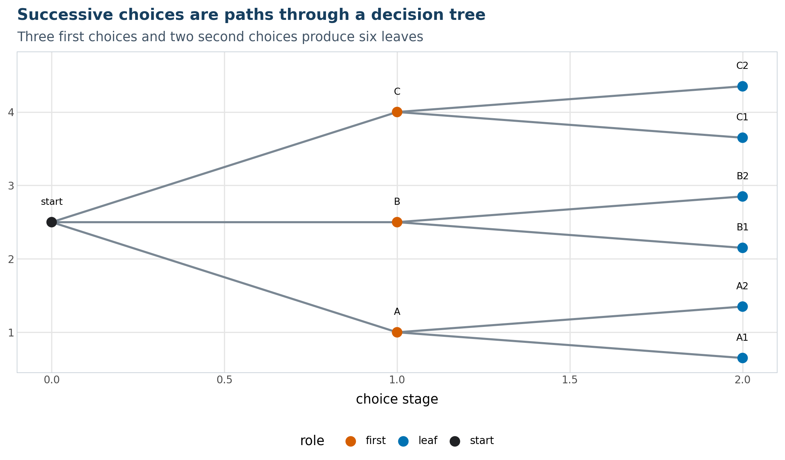

# Counting as Structure {#sec-comb-counting}

Counting begins before arithmetic: decide what an object is and when two
descriptions represent the same object. Once the model is stable, addition,
multiplication, bijection, and complement turn structure into a number.

## Preparation from this book

The set and function notation in the [starting toolkit](00i-combinatorics-bridge.md)
is enough. No calculus or probability is needed.

## Sum, product, and division rules

If a finite set is partitioned into disjoint classes, its size is the sum of
their sizes. If an object is made by an independent choice from $A$ followed by
one from $B$, the product $A\times B$ has size $|A||B|$. “Independent” here
means every first choice permits the same stated second-choice set; it is not a
probability assumption.

If a construction produces every target exactly $r$ times, divide the number
of constructions by $r$. The burden is proving the multiplicity is constant.
Circular necklaces, for example, can have rotational symmetries, so blindly
dividing linear arrangements by the number of positions may fail.

<figure id="fig-comb-counting-tree">


<figcaption>

Figure 1.1: A decision tree turns successive finite choices into leaves counted by the product rule.

</figcaption>
</figure>

## Bijections and complements

A bijection is an explicit reversible translation. Subsets of $[n]$ correspond
to binary words of length $n$: bit $i$ records whether $i$ belongs. This proves
there are $2^n$ subsets without listing them. An injection from $A$ to $B$
proves $|A|\le|B|$; a surjection proves $|A|\ge|B|$ for nonempty finite sets.

Sometimes the unwanted objects are simpler. If $U$ is a finite universe and
$A\subseteq U$, then valid objects number $|U|-|A|$. This complement method is
safe only after $U$ and the forbidden set have been defined with the same
notion of labeling and equivalence.

**Nonexample.** “Choose a captain and then a team” does not automatically use
the product rule. If the captain must belong to the team, choosing the team
first gives a constant number of captain choices; choosing the captain first
changes which remaining selections are allowed but can still work if counted
carefully.

<!-- inline-formula-code:start -->
## Formula and finite computation

For option counts $c_1,\ldots,c_m$, the product rule gives

$$
N=\prod_{i=1}^{m}c_i.
$$

```python
from itertools import product
from math import prod

def count_choice_strings(option_counts: list[int]) -> int:
    if any(count < 0 for count in option_counts):
        raise ValueError("option counts must be nonnegative")
    choices = [range(count) for count in option_counts]
    enumerated = sum(1 for _ in product(*choices))
    formula = prod(option_counts)
    if enumerated != formula:
        raise RuntimeError("enumeration and product disagree")
    return formula

print(count_choice_strings([3, 2, 4]))
```

**What the computation establishes.** Enumeration agrees with the product for
one finite list, including Python's empty-product convention. It does not prove
the product rule; that proof is the bijection between a leaf and its sequence
of choices.
<!-- inline-formula-code:end -->

## Modeling audit

Before calculating, state whether objects are ordered or unordered, labeled or
unlabeled, repeatable or distinct, and whether empty objects are allowed. Test
the smallest sizes. A formula returning a noninteger count, a negative count,
or the wrong value at zero usually reveals a modeling error rather than an
algebra error.

## A worked modeling contrast

Passwords and hands of cards may use the same symbols but require different
models. A password is a sequence: positions are distinguishable and repetition
may be legal. A hand is usually a subset: order of receipt is discarded and a
physical card cannot repeat. If suits or ranks are later identified, a quotient
by symmetry may be needed. Writing one representative example and its exact
equivalence rule before counting prevents most accidental factorial factors.

## Exact finite models and the information they retain

**Definition 1.1 (Finite counting model).** A counting model specifies a finite set of admissible records and a rule determining when two records represent the same outcome. If records themselves are the outcomes, their equality is literal. If some differences are ignored, the outcomes are equivalence classes of records.

For example, a length-four word over an alphabet is a function from four labeled positions to the alphabet. A four-element subset remembers which symbols occur but not their positions, and it forbids repetition. A size-four multiset remembers multiplicities and permits repetition. Stating the same two integers, alphabet size and requested size, does not make these sets equal. An encoding must preserve exactly the information that the problem retains.

The distinction also matters for decoration. A team with a designated captain records more than its member set, and an ordered pair of teams records more than an unordered collection. If an encoding forgets a captain or exchanges two differently positioned teams, it no longer has an inverse on the specified outcomes. Count the decorated records first when they are the objects actually requested.

**Theorem 1.2 (The sum, product, and constant-fibre rules).** Let all sets below be finite. A disjoint union has size equal to the sum of its part sizes. The Cartesian product \(A\times B\) has size \(|A||B|\). If an onto map \(\pi:X\to Y\) has exactly \(r>0\) preimages at every member of \(Y\), then \(|X|=r|Y|\).

*Proof.* For a disjoint union, each member occurs in exactly one part, so counting part by part counts it once. The product partitions by its first coordinate, giving \(|A|\) disjoint parts of size \(|B|\). For the final assertion, the fibres \(\pi^{-1}(\{y\})\) partition \(X\) and each has size \(r\); summing gives the formula. These arguments include empty sets, provided the stated map exists. ∎

The product rule permits choices that depend on earlier choices, provided each partial record has the stated number of legal continuations. It does not require that the actual available sets be identical. Selecting distinct people for successive positions leaves different remaining people after different first choices, but the number remaining is constant. Probability independence is a separate notion and is not assumed here.

### Worked example 1.1: decorated selections

From ten distinct people choose a four-person committee and a chair belonging to it. Choosing the committee first gives \(\binom{10}{4}\cdot4=840\) outcomes. Choosing the chair first gives \(10\binom93=840\). Each construction recovers the same pair consisting of a committee and one of its members.

More generally, for \(1\le k\le n\), this counts the incidence set
\[
\{(S,s):S\subseteq[n],\ |S|=k,\ s\in S\}
\]
and proves \(k\binom nk=n\binom{n-1}{k-1}\). The condition \(s\in S\) is part of the model. If the chair could be an outsider, the first count would instead multiply by \(n\), giving a different set of records.

## Subsets, permutations, and multinomial allocations

**Definition 1.3 (Factorials and binomial coefficients).** Set \(0!=1\). For \(n\ge1\), \(n!=n(n-1)\cdots1\). For integers \(0\le k\le n\), let \(\binom nk\) count the \(k\)-subsets of \([n]\). For integer \(k\) outside that range define \(\binom nk=0\).

There is one empty permutation and one empty subset, explaining the value one at size zero. It is not appropriate to substitute a negative integer into a factorial when a subset size is impossible. The counting definition supplies zero there; the factorial formula has a stated range.

**Theorem 1.4 (Selection and allocation formulas).** An ordered selection of \(k\) distinct elements from an \(n\)-element set, with \(0\le k\le n\), has \(n!/(n-k)!\) possibilities. Consequently
\[
\binom nk=\frac{n!}{k!(n-k)!}.
\]
If \(k_1,\ldots,k_r\) are nonnegative integers summing to \(n\), allocation of the elements to \(r\) labeled parts of those sizes has count
\[
\binom n{k_1,\ldots,k_r}=\frac{n!}{k_1!\cdots k_r!}.
\]

*Proof.* Successive distinct choices give \(n,n-1,\ldots,n-k+1\) possibilities. Forgetting their order maps onto the \(k\)-subsets with exactly \(k!\) preimages each, proving the binomial formula. For the allocation, list all \(n\) elements and cut the list into consecutive segments of the specified lengths. Forgetting order inside a segment does not change its assigned part. Each allocation has exactly \(\prod_i k_i!\) lists, proving the quotient by constant-fibre division. Empty parts cause no exception because \(0!=1\). ∎

The same multinomial quotient counts words with prescribed multiplicities of distinguishable symbols: choose the positions assigned to each type. It does not count arbitrary multisets of size \(n\), because those have varying multiplicities rather than one fixed profile. Choosing the profile and arranging its symbols are separate decisions.

### Worked example 1.2: repeated symbols and a numerical coefficient

For words of length seven with three copies of \(A\), two of \(B\), and two of \(C\), the count is \(7!/(3!2!2!)=210\). Temporarily distinguishing equal copies produces \(3!2!2!\) descriptions of every visible word, not \(7!\).

The coefficient of \(x^3y^2z^2\) in \((x+y+z)^7\) is also 210. Each expanded term selects a symbol from each labeled factor; its three position sets supply exactly the same allocation. If the summand were \(x+2y+z\), the coefficient would become \(210\cdot2^2=840\), because each of the two \(y\)-choices contributes a factor two. The combinatorial position count and numerical term weights must both be retained.

**Theorem 1.5 (Multinomial and binomial expansions).** For a nonnegative integer \(n\) and commuting indeterminates \(x_1,\ldots,x_r\), with \(r\ge1\),
\[
(x_1+\cdots+x_r)^n
=\sum_{\substack{k_1+\cdots+k_r=n\\k_i\ge0}}
\frac{n!}{k_1!\cdots k_r!}x_1^{k_1}\cdots x_r^{k_r}.
\]
The case \(r=2\) is the binomial theorem.

*Proof.* Distribute the product of \(n\) labeled factors. Every term chooses one of the \(r\) summands at each factor. Group terms by their multiplicity vector. The position allocations in Theorem 1.4 count exactly the terms in a group, and commutativity makes their monomials equal. The empty product at \(n=0\) contributes one term with every multiplicity zero. ∎

This is a polynomial identity, so substituting real or complex values preserves it. A negative or fractional exponent does not fit the finite labelled-factor construction and requires another theorem. It is also essential that the indeterminates commute: the position words in a noncommutative product generally cannot be merged into one monomial merely by counting their letters.

## Binomial identities as reversible classifications

**Theorem 1.6 (Pascal, symmetry, and Vandermonde).** For integers in their stated ranges,
\[
\binom nk=\binom n{n-k},\qquad
\binom nk=\binom{n-1}k+\binom{n-1}{k-1}\quad(n\ge1),
\]
and, for nonnegative integers \(a,b,k\),
\[
\binom{a+b}k=\sum_{j=0}^k\binom aj\binom b{k-j}.
\]

*Proof.* Complementing a subset proves symmetry by a bijection. To prove Pascal's formula, distinguish one element: subsets omitting it choose all \(k\) elements among the other \(n-1\), whereas subsets containing it choose the other \(k-1\) there. The cases are disjoint and exhaustive, including boundary cases under the zero convention.

For Vandermonde, take disjoint sets \(A,B\) of sizes \(a,b\). Every \(k\)-subset of their union has a unique intersection size \(j\) with \(A\). In that class choose its \(j\) members in \(A\) and its remaining \(k-j\) in \(B\). Summation over the classes proves the identity. Impossible choices contribute zero rather than requiring extra cases in the displayed sum. ∎

### Worked example 1.3: restricting membership without marking it twice

A collection has five red and seven blue distinguishable cards. The number of five-card subsets containing exactly two red cards is \(\binom52\binom73=350\). The number containing at least one red is \(\binom{12}5-\binom75=792-21=771\).

Choosing one red card first and then any four others would not directly count the latter family: a subset with three red members has three possible choices for that initially marked card. Its fibre size varies with its red count. One could retain that marker and ask a different question, or partition by the exact red count. The complement count avoids this variable multiplicity.

## Bijections must have both directions

A proposed map can fail by identifying two source objects, by omitting some targets, or by returning an inadmissible target. Checking only that the formula produces something of the right general shape does not establish any of those requirements. In a bijective proof, describe the inverse on every target and verify both compositions, including the empty object.

The binary-word encoding of a subset illustrates the full argument. Fix the ground-set ordering once. Send a subset to its membership bits and send a bit word back to the positions of its ones. Reading after writing returns the original subset, and writing after reading returns the original word. Thus there are \(2^n\) subsets, including one subset when \(n=0\). Grouping by size gives \(\sum_{k=0}^n\binom nk=2^n\).

The coefficient viewpoint and the bijection viewpoint support one another but are not interchangeable shortcuts. A generating function must first be shown to encode the intended objects; afterwards its coefficients may be manipulated algebraically. Likewise, a numerical agreement between two closed expressions does not explain which objects were counted. The following chapters will use incidence sets and inclusion–exclusion to handle constructions where a first unique description is less apparent.

## Summary

The elementary rules are consequences of disjoint union, Cartesian product,
constant multiplicity, bijection, and complement. The difficult step is making
the representation honest enough that one of those structures applies.

## Exercises

<div class="exercise" id="comb-counting-structure-ex-1-exercise">

### Exercise 1.1 {#comb-counting-structure-ex-1}

1. Count four-character strings over six symbols with repetition.

<details>
<summary>Hint 1</summary>

**Hint.** Decide whether a chosen symbol remains available for the next position.

</details>
<details>
<summary>Hint 2</summary>
**Hint.** There are four labeled positions and six choices at every position.

</details>
<details>
<summary>Solution</summary>
**Solution.** There are $6^4=1296$ strings. Every choice sequence fills one string, and reading its four positions recovers that sequence. Repetition is allowed, so the available count never decreases.

</details>

</div>

<div class="exercise" id="comb-counting-structure-ex-2-exercise">

### Exercise 1.2 {#comb-counting-structure-ex-2}

2. Count those strings with no repeated symbol.

<details>
<summary>Hint 1</summary>

**Hint.** Successive positions must use previously unused symbols.

</details>
<details>
<summary>Hint 2</summary>

**Hint.** The choice counts decrease by one at each of the four positions.

</details>
<details>
<summary>Solution</summary>

**Solution.** The count is $6\cdot5\cdot4\cdot3=360$. Distinct entries make the choice count depend only on how many positions have been filled. This is an ordered selection, so no factorial division is required.

</details>

</div>

<div class="exercise" id="comb-counting-structure-ex-3-exercise">

### Exercise 1.3 {#comb-counting-structure-ex-3}

3. Give a bijection between subsets of $[n]$ and binary words.

<details>
<summary>Hint 1</summary>

**Hint.** Record membership position by position.

</details>
<details>
<summary>Hint 2</summary>

**Hint.** The inverse chooses exactly the positions whose bits are one.

</details>
<details>
<summary>Solution</summary>

**Solution.** Map $S$ to the word with bit $i$ equal to one precisely when $i\in S$. Conversely, read the one positions to obtain $S$. The two operations undo each other, including at $n=0$, so the correspondence is bijective.

</details>

</div>

<div class="exercise" id="comb-counting-structure-ex-4-exercise">

### Exercise 1.4 {#comb-counting-structure-ex-4}

4. Explain why dividing necklace words by length can fail.

<details>
<summary>Hint 1</summary>

**Hint.** Compare a constant colouring with one whose only fixing rotation is the identity.

</details>
<details>
<summary>Hint 2</summary>

**Hint.** The number of distinct rotations of a word can depend on its period.

</details>
<details>
<summary>Solution</summary>

**Solution.** For binary words of length three, $000$ has only one distinct rotation, whereas $001$ has three. Thus the equivalence classes under rotation do not all have size three. Dividing all eight words by three cannot count the orbits; it even gives a noninteger. The acting equivalence and fibre sizes must be analysed.

</details>

</div>

<div class="exercise" id="comb-counting-structure-ex-5-exercise">

### Exercise 1.5 {#comb-counting-structure-ex-5}

5. Count committees with a designated chair in two orders.

Use a ground set of $n$ people and a committee size $1\le k\le n$.

<details>
<summary>Hint 1</summary>

**Hint.** Both orders must retain the same committee and its marked member.

</details>
<details>
<summary>Hint 2</summary>

**Hint.** Either choose the subset and then its chair, or choose the chair and the other members.

</details>
<details>
<summary>Solution</summary>

**Solution.** Choosing the committee first gives $k\binom nk$. Choosing the chair first gives $n\binom{n-1}{k-1}$. Each construction determines the same pair $(S,s)$ with $|S|=k$ and $s\in S$, and each pair has one description of either kind. This proves equality of the products.

</details>

</div>

<div class="exercise" id="comb-counting-structure-ex-6-exercise">

### Exercise 1.6 {#comb-counting-structure-ex-6}

6. Find the first boundary case that distinguishes an empty sum from product.

<details>
<summary>Hint 1</summary>

**Hint.** Consider choosing no components at all.

</details>
<details>
<summary>Hint 2</summary>

**Hint.** There is one empty tuple, whereas a sum over an empty index set has no contributions.

</details>
<details>
<summary>Solution</summary>

**Solution.** At size zero, the unique empty tuple is counted by the empty product one. A disjoint union with no parts is the empty set and has count zero, the empty sum. Confusing the conventions would incorrectly remove the empty combinatorial object or add a nonexistent member to an empty union.

</details>

</div>

<div class="exercise" id="comb-counting-structure-ex-7-exercise">

### Exercise 1.7 {#comb-counting-structure-ex-7}

Find the coefficient of $x^2y^3z$ in $(x+y+z)^6$, and explain its factorial denominator.

<details>
<summary>Hint 1</summary>

**Hint.** Assign the six factor positions to three labeled types.

</details>
<details>
<summary>Hint 2</summary>

**Hint.** Permuting choices within a type leaves the monomial unchanged.

</details>
<details>
<summary>Solution</summary>

**Solution.** The coefficient is $6!/(2!3!1!)=60$. A list of the six positions grouped into the three prescribed blocks describes each allocation $2!3!1!$ times. Constant-fibre division gives the multinomial coefficient; no commutativity beyond that of the polynomial variables is omitted.

</details>

</div>

<div class="exercise" id="comb-counting-structure-ex-8-exercise">

### Exercise 1.8 {#comb-counting-structure-ex-8}

Prove $\sum_{j=r}^n\binom jr=\binom{n+1}{r+1}$ for $0\le r\le n$.

<details>
<summary>Hint 1</summary>

**Hint.** Classify nonempty subsets by their largest member.

</details>
<details>
<summary>Hint 2</summary>

**Hint.** A subset with largest element $j+1$ chooses its other $r$ members among the first $j$.

</details>
<details>
<summary>Solution</summary>

**Solution.** Every $(r+1)$-subset of $[n+1]$ has a unique largest element $j+1$ with $r\le j\le n$. Removing that member bijects its class with the $r$-subsets of $[j]$. The classes are disjoint and exhaust all subsets, so their counts add to the displayed identity.

</details>

</div>

<div class="exercise" id="comb-counting-structure-ex-9-exercise">

### Exercise 1.9 {#comb-counting-structure-ex-9}

Show by an example that equal marginal inclusion probabilities do not imply a uniform distribution on fixed-size subsets.

<details>
<summary>Hint 1</summary>

**Hint.** Use two-element subsets of a four-element set.

</details>
<details>
<summary>Hint 2</summary>

**Hint.** Choose only two disjoint complementary pairs with equal probabilities.

</details>
<details>
<summary>Solution</summary>

**Solution.** Choose $\{1,2\}$ or $\{3,4\}$, each with probability one half. Every element is included with probability one half, as in a uniform two-subset, but four of the six pairs are never chosen. Thus equal single-element marginals do not determine the joint subset distribution.

</details>

</div>

<div class="exercise" id="comb-counting-structure-ex-10-exercise">

### Exercise 1.10 {#comb-counting-structure-ex-10}

For disjoint sets $A,B$ of sizes four and six, verify Vandermonde's identity for three-subsets by listing its intersection-size counts.

<details>
<summary>Hint 1</summary>

**Hint.** Use the four possible numbers chosen from $A$.

</details>
<details>
<summary>Hint 2</summary>

**Hint.** The terms are $\binom4j\binom6{3-j}$ for $j=0,1,2,3$.

</details>
<details>
<summary>Solution</summary>

**Solution.** The terms are $20,60,36,4$, summing to 120, equal to $\binom{10}3$. Each class is determined by its exact $A$-intersection, so the addition has no overlap. This finite example illustrates the classification proof without replacing it.

</details>

</div>

### Selected solution

For Exercise 5, choose a $k$-person committee and then one of its $k$ chairs,
or choose the chair first and then $k-1$ of the remaining people. The equality
of the two resulting expressions is certified by the shared committee-chair
objects.

## Sources and further reading {#sec-comb-counting-structure-sources}

For an alternative treatment, read [Binomial and multinomial coefficients](02-binomial-multinomial.md). A parallel source is Richard P. Stanley, [Enumerative Combinatorics, volume 1, second-edition author manuscript](https://math.mit.edu/~rstan/ec/ec1.pdf), Chapter 1. References and code above retain their original attribution.

## Summary and next connection {#sec-comb-counting-structure-summary}

Finite counting becomes reliable once the objects and their multiplicities are specified. Disjoint sums, Cartesian products, constant fibres, and bijections justify the basic rules. Permutation, binomial, and multinomial coefficients count different finite records, and their polynomial identities follow by choosing terms or splitting sets. The named starting toolkit supplies notation; [Pigeonhole and double counting](03-pigeonhole-double-counting.md) next uses these exact finite models to force collisions and compare incidence counts. The earlier binomial reading remains available for an alternative presentation, while this chapter supplies the counting and polynomial-expansion entry to the primary route.
