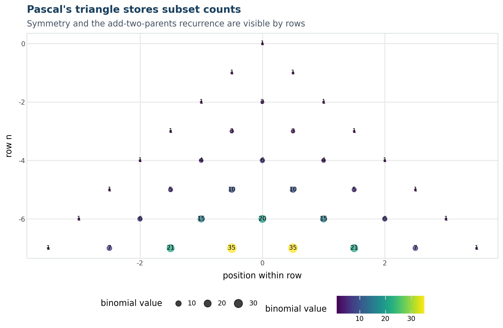

# Binomial and multinomial coefficients {#sec-comb-binomial}

Binomial coefficients count fixed-size subsets, binary words with fixed
content, and lattice paths. Their many interpretations make identities
transportable: an algebraic statement can often be proved by reorganizing a
set of objects.

## Preparation from this book

Use Chapter 1's product and division rules. Factorials are reviewed in the
primer.

## Choosing without order

An ordered selection of $k$ distinct elements from $n$ has
$n(n-1)\cdots(n-k+1)$ possibilities. Each $k$-subset appears in all $k!$
orders. Therefore its count is the binomial coefficient. Symmetry comes from
taking complements: choosing $k$ included elements is equivalent to choosing
$n-k$ excluded ones.

Pascal's recurrence partitions subsets by whether a distinguished element is
present. Iterating the recurrence produces Pascal's triangle. The same numbers
are coefficients of $(1+x)^n$ because choosing either $1$ or $x$ from each
factor records a subset of factors.

<figure id="fig-comb-pascal">


<figcaption>

Figure A.1: Pascal's triangle displays symmetry, recurrence, and row sums in one finite array.

</figcaption>
</figure>

## Several categories

If $n$ labeled positions receive category counts $k_1,\ldots,k_r$ summing to
$n$, choose the first category, then the second from what remains, and so on.
The resulting multinomial coefficient is also the coefficient of the
corresponding monomial in $(x_1+\cdots+x_r)^n$.

**Nonexample.** The expression “choose two red and two blue balls” is ambiguous
until balls are declared distinguishable or not. Multinomial coefficients
assign labeled positions to categories; they do not count multisets of
indistinguishable objects by themselves.

<!-- inline-formula-code:start -->
## Formula and finite computation

For $0\le k\le n$ and $k_1+\cdots+k_r=n$,

$$
\binom nk=\frac{n!}{k!(n-k)!},
\qquad
\binom{n}{k_1,\ldots,k_r}=\frac{n!}{k_1!\cdots k_r!}.
$$

```python
from math import comb, factorial

def multinomial(parts: list[int]) -> int:
    if any(part < 0 for part in parts):
        raise ValueError("parts must be nonnegative")
    total = sum(parts)
    denominator = 1
    for part in parts:
        denominator *= factorial(part)
    return factorial(total) // denominator

row = [comb(6, k) for k in range(7)]
if sum(row) != 2**6 or multinomial([2, 1, 3]) != 60:
    raise RuntimeError("coefficient check failed")
print(row, multinomial([2, 1, 3]))
```

**What the computation establishes.** Exact integer arithmetic verifies one
row sum and one multinomial value. It does not prove the factorial formulas or
the binomial theorem for arbitrary $n$; the ordered-selection and factor-choice
bijections do.
<!-- inline-formula-code:end -->

## Identities as stories

Vandermonde's identity counts a $k$-subset of two disjoint populations by the
number chosen from the first. The hockey-stick identity chooses the largest
element of a subset. These explanations preserve why the summation limits and
boundary terms are present, while a purely factorial proof can hide them.

## Sampling and stable computation

Large factorials are exact in Python but wasteful when only one coefficient is
needed. Multiplicative evaluation can cancel at each step and uses symmetry to
replace $k$ by the smaller of $k$ and $n-k$. For random subset sampling, do not
generate an ordered sample and then assume every subset has equal multiplicity
without checking the sampler. Uniform fixed-size subsets require equal
probability for each combination, not merely equal marginal inclusion rates.

## Summary

Binomial and multinomial coefficients are not merely formulas. They are the
common coordinate system for subsets, fixed-content words, paths, polynomial
coefficients, and successive allocations.

## Three worked translations

**Worked example 2.1 (A path is a word).** A lattice path starts at $(0,0)$,
ends at $(4,3)$, and uses only steps east $(1,0)$ and north $(0,1)$. Every
path has seven steps, exactly four east and three north. Label the step slots
$1,\ldots,7$. Assign to a path the four slots containing east steps. Conversely,
a four-element subset specifies east in those slots and north in the others.
These two constructions undo one another, so there are $\binom74=35$ paths.
This is a bijection, not an approximation based on a drawing. If paths were
also forbidden to enter a specified region, the same $35$ would only be an
upper bound; the restriction would require additional reasoning.

The labels on the slots are essential. East steps are indistinguishable, but
step number one and step number seven have different positions in the word.
A sequence such as EENNENE records one path. Permuting the identities of
individual east steps does not create a different path, explaining the
factor $4!$ that is divided out in the factorial expression.

**Worked example 2.2 (A fixed-content word).** Count distinct arrangements of
A,A,B,B,B,C. First choose the two positions for A, then the three positions
for B from the four remaining positions; C occupies the final slot. The result
is

$$\binom62\binom43\binom11=15\cdot4=60
=\frac{6!}{2!3!1!}.$$

Choosing positions in the order C, A, B gives $\binom61\binom52\binom33=60$
again. There is no factor for ordering the category names: A, B and C are
already fixed categories. If instead the task asks for unlabelled groups of
sizes two and three, relabelling groups can affect the count. Never remove a
factorial merely because several quantities happen to be equal; identify the
actual symmetries of the objects being counted.

**Worked example 2.3 (A coefficient with numerical weights).** Find the
coefficient of $x^2y^3z$ in $(2x-y+3z)^6$. In the product of six factors,
choose $2x$ twice, $-y$ three times, and $3z$ once. There are
$6!/(2!3!1!)=60$ choices of which factors make each contribution. Each choice
produces the same term $2^2(-1)^3 3x^2y^3z=-12x^2y^3z$. The required coefficient
is therefore $60(-12)=-720$. The multinomial coefficient is positive; the
negative sign comes from the three selected negative terms. Keeping these
roles separate prevents a sign error and explains why the coefficient is
not itself the number of arrangements in this weighted example.

## Statements and proofs with boundary cases

**Theorem 2.4 (Vandermonde).** For nonnegative integers $a,b$ and any integer
$k$,

$$\binom{a+b}{k}=\sum_{j\in\mathbb Z}\binom aj\binom b{k-j},$$

where $\binom nr=0$ for integers $r<0$ or $r>n$. Only finitely many summands
are nonzero.

*Proof.* Let $A$ and $B$ be disjoint sets of sizes $a$ and $b$. Partition the
$k$-subsets of $A\cup B$ by the value $j=|S\cap A|$. In the part indexed by
$j$, choose $j$ elements of $A$ and $k-j$ of $B$, independently. This gives
$\binom aj\binom b{k-j}$ subsets. Every $k$-subset occurs in exactly one part,
so addition over the parts gives the identity. If $k$ is outside
$0,\ldots,a+b$, both sides count an empty collection. ∎

The convention for impossible sizes is useful because it makes the formula
valid without separate truncation rules. With $a=4,b=3,k=2$, the terms are
$\binom40\binom32+\binom41\binom31+\binom42\binom30=3+12+6=21$.
This counts a two-person committee from two disjoint groups; group membership
determines the partition but does not impose a quota unless one is stated.

**Theorem 2.5 (Hockey-stick identity).** For integers $n\ge r\ge0$,

$$\sum_{j=r}^{n}\binom jr=\binom{n+1}{r+1}.$$

*Proof.* Choose an $(r+1)$-subset of $\{1,\ldots,n+1\}$ and let its largest
element be $j+1$. Its other $r$ elements form an arbitrary $r$-subset of
$\{1,\ldots,j\}$. The largest element ranges from $r+1$ to $n+1$, so $j$
ranges from $r$ to $n$. This partitions all the subsets and proves the sum.
For $r=0$, each singleton has a unique largest element and the formula says
$n+1=n+1$. ∎

**Theorem 2.6 (Multinomial expansion).** For a nonnegative integer $n$ and
commuting variables $x_1,\ldots,x_r$ with $r\ge1$,

$$(x_1+\cdots+x_r)^n=
\sum_{\substack{k_1+\cdots+k_r=n\\ k_i\ge0}}
\frac{n!}{k_1!\cdots k_r!}x_1^{k_1}\cdots x_r^{k_r}.$$

*Proof.* Expand the product of $n$ copies of $x_1+\cdots+x_r$ by choosing one
term from each factor. The choices form words of length $n$ in $r$ letters.
A word with content $(k_1,\ldots,k_r)$ contributes the indicated monomial.
Assigning positions successively to its letters gives the stated factorial
quotient. Gathering all words with the same content proves the expansion.
For $n=0$, there is one empty word and the sole term is $1$. ∎

Commutativity is a genuine hypothesis. In a noncommutative algebra, the two
words $xy$ and $yx$ may represent different products, so replacing their sum
by $2xy$ is unjustified. The counting argument still enumerates words, but
collecting them under a single monomial requires commuting variables.

## Why marginal symmetry does not determine a sampler

There are six two-element subsets of $\{1,2,3,4\}$. A sampler that chooses
$\{1,2\}$ or $\{3,4\}$ with equal probability includes every individual
element with probability $1/2$. A uniform sampler over all six subsets has
that same inclusion probability. The distributions nevertheless differ:
$\{1,3\}$ has probability zero in the first and $1/6$ in the second.
Thus equal marginal inclusion probabilities do not establish a uniform subset
law. The object being sampled is a subset, so uniformity is a statement
about the probabilities of entire subsets.

One correct construction is to sample a uniformly random ordered list of
$k$ distinct elements and discard its order. Each $k$-subset has precisely
$k!$ preimages, all equally likely, so every subset receives the same
probability $k!/[n(n-1)\cdots(n-k+1)]=1/\binom nk$. The equal-preimage argument
is what justifies discarding order. For a biased ordered sampler, counting
preimages without weighting their probabilities would not suffice.

Similarly, multinomial coefficients count fixed-content words, but do not
make different content vectors equally probable. Under independent uniform
letters, each word has probability $r^{-n}$ and the content vector has
probability $\binom{n}{k_1,\ldots,k_r}r^{-n}$. A balanced content is typically
supported by many more words than a content concentrated in one letter.
Probability follows the specified sampling mechanism, not the visual symmetry
of a list of possible contents.

## Exercises with staged help

The first six questions preserve the earlier question numbers. The remaining
four extend their ideas to weighted coefficients, boundary cases, and sampling.

<div class="exercise" id="sec-comb-binomial-ex-1-exercise">

### Exercise 2.1 {#sec-comb-binomial-ex-1}

Prove binomial symmetry by complement.

<details><summary>Hint 1</summary>

Fix one labeled set of size $n$ and one subset size $k$.

</details>
<details><summary>Hint 2</summary>

Apply the complement operation twice. What sizes occur?

</details>
<details><summary>Solution</summary>

For $0\le k\le n$, send a $k$-subset $S$ of an $n$-element set $U$ to
$U\setminus S$, an $(n-k)$-subset. Taking the complement again returns $S$,
so this is a bijection and $\binom nk=\binom n{n-k}$. In particular, the empty
subset and the whole set correspond at the endpoints.

</details>

</div>

<div class="exercise" id="sec-comb-binomial-ex-2-exercise">

### Exercise 2.2 {#sec-comb-binomial-ex-2}

Derive Pascal's recurrence by a distinguished element.

<details><summary>Hint 1</summary>

Choose one element $u$ of the underlying set.

</details>
<details><summary>Hint 2</summary>

Partition subsets according to whether $u$ belongs to them.

</details>
<details><summary>Solution</summary>

For $n\ge1$, a $k$-subset either excludes $u$, giving $\binom{n-1}k$
possibilities, or includes $u$, leaving $k-1$ choices among the other $n-1$
elements, giving $\binom{n-1}{k-1}$. The cases are disjoint and exhaustive,
so $\binom nk=\binom{n-1}k+\binom{n-1}{k-1}$. The zero convention covers
$k=0,n$ and impossible integer sizes.

</details>

</div>

<div class="exercise" id="sec-comb-binomial-ex-3-exercise">

### Exercise 2.3 {#sec-comb-binomial-ex-3}

Count paths with four east and three north steps.

<details><summary>Hint 1</summary>

Encode each path by a seven-letter word.

</details>
<details><summary>Hint 2</summary>

Choose the four slots for east steps; all remaining slots are then forced.

</details>
<details><summary>Solution</summary>

A path is determined by the four positions occupied by east steps among seven
positions, giving $\binom74=7!/(4!3!)=35$. Conversely every choice of those
positions makes exactly one allowed path, which proves there is no overcount.

</details>

</div>

<div class="exercise" id="sec-comb-binomial-ex-4-exercise">

### Exercise 2.4 {#sec-comb-binomial-ex-4}

Give a story for Vandermonde's identity.

<details><summary>Hint 1</summary>

Take two disjoint populations of sizes $a$ and $b$.

</details>
<details><summary>Hint 2</summary>

Classify a committee by how many members it takes from the first population.

</details>
<details><summary>Solution</summary>

There are $\binom{a+b}k$ committees of size $k$. If exactly $j$ members come
from the first population, there are $\binom aj\binom b{k-j}$ committees.
Every committee has a unique such $j$, so summing gives Vandermonde's identity.
Impossible values contribute zero, explaining the summation convention.

</details>

</div>

<div class="exercise" id="sec-comb-binomial-ex-5-exercise">

### Exercise 2.5 {#sec-comb-binomial-ex-5}

Find the coefficient of $x^3y^2z$ in $(x+y+z)^6$.

<details><summary>Hint 1</summary>

Each of the six factors contributes exactly one of the three variables.

</details>
<details><summary>Hint 2</summary>

Choose three slots for $x$, then two of the remaining slots for $y$.

</details>
<details><summary>Solution</summary>

Choose the $x$ factors in $\binom63$ ways, then the $y$ factors in
$\binom32$ ways; the remaining factor contributes $z$. The coefficient is
$\binom63\binom32=20\cdot3=60$, equivalently $6!/(3!2!1!)$.

</details>

</div>

<div class="exercise" id="sec-comb-binomial-ex-6-exercise">

### Exercise 2.6 {#sec-comb-binomial-ex-6}

Explain why $\binom n0=1$ is structurally necessary.

<details><summary>Hint 1</summary>

Which subsets have no members?

</details>
<details><summary>Hint 2</summary>

Distinguish having one empty object from having no possible objects.

</details>
<details><summary>Solution</summary>

There is exactly one zero-element subset of every set: the empty set.
Consequently the count is one. It also corresponds to choosing the constant
term from every factor in $(1+x)^n$. This includes $n=0$, where the empty
product is one and the empty set has precisely its empty subset.

</details>

</div>

<div class="exercise" id="sec-comb-binomial-ex-7-exercise">

### Exercise 2.7 {#sec-comb-binomial-ex-7}

Evaluate $\sum_{j=2}^{5}\binom j2$ by identifying one collection of subsets.

<details><summary>Hint 1</summary>

Use three-element subsets of a set of six labels.

</details>
<details><summary>Hint 2</summary>

The summation index is one less than the largest selected label.

</details>
<details><summary>Solution</summary>

Partition three-element subsets of $\{1,\ldots,6\}$ by their largest element
$j+1$. The other two labels are chosen among the first $j$, yielding the sum.
It therefore equals $\binom63=20$. Numerically the four summands are
$1,3,6,10$, which also sum to $20$.

</details>

</div>

<div class="exercise" id="sec-comb-binomial-ex-8-exercise">

### Exercise 2.8 {#sec-comb-binomial-ex-8}

Find the coefficient of $x^2y$ in $(3x-2y)^3$.

<details><summary>Hint 1</summary>

Separate the count of factor choices from the numerical weight of each choice.

</details>
<details><summary>Hint 2</summary>

Exactly one factor must contribute $-2y$.

</details>
<details><summary>Solution</summary>

There are three choices for the factor that contributes $-2y$. Each of the
other two contributes $3x$, so each selection has coefficient $(-2)3^2=-18$.
The total coefficient is $3(-18)=-54$. The sign is negative because exactly
one negative term was selected.

</details>

</div>

<div class="exercise" id="sec-comb-binomial-ex-9-exercise">

### Exercise 2.9 {#sec-comb-binomial-ex-9}

Count the words of length seven containing three A's, two B's and two C's.
Why would dividing again by $2!$ be incorrect?

<details><summary>Hint 1</summary>

The letter names B and C specify distinct categories.

</details>
<details><summary>Hint 2</summary>

Choose the A positions, then the B positions, and leave C in the remaining slots.

</details>
<details><summary>Solution</summary>

The count is $\binom73\binom42=35\cdot6=210$, equivalently
$7!/(3!2!2!)$. Exchanging the positions occupied by B and C changes the word;
for example AAABBCC and AAACCBB are different. The equal category sizes do
not make the category names interchangeable, so another division would merge
distinct words and undercount.

</details>

</div>

<div class="exercise" id="sec-comb-binomial-ex-10-exercise">

### Exercise 2.10 {#sec-comb-binomial-ex-10}

A sampler chooses either $\{1,2\}$ or $\{3,4\}$ with probability $1/2$ each.
Show that all four elements have equal inclusion probability but the sampler
is not uniform among two-element subsets.

<details><summary>Hint 1</summary>

Compute an individual inclusion event and then a whole-subset event.

</details>
<details><summary>Hint 2</summary>

Compare the probabilities of $\{1,2\}$ and $\{1,3\}$.

</details>
<details><summary>Solution</summary>

Each element belongs to exactly one of the two equally likely outputs, so its
inclusion probability is $1/2$. But $\{1,2\}$ has probability $1/2$ and
$\{1,3\}$ has probability zero. Uniformity on the six two-element subsets
would require probability $1/6$ for every subset. Equal marginal probabilities
therefore do not imply the required joint distribution.

</details>

</div>

## Final summary

Subsets, fixed-content words, paths and coefficients are connected by explicit
bijections. Factorial quotients are justified by equal multiplicities, and
summation identities arise from disjoint exhaustive cases. Empty objects and
impossible sizes explain the endpoint conventions. Weighted polynomial terms
and nonuniform samplers require their numerical weights as well as counts.
The primary route now returns to pigeonhole and double counting, where choosing
the right classification often reveals a relation before a formula is known.

A final distinction is useful when leaving the chapter. Selecting three objects
with repetition from two types is a different model from arranging three
letters. The possible multiplicity vectors are $(3,0),(2,1),(1,2),(0,3)$, so
there are four selections, whereas there are eight binary words of length
three. Their vector multiplicities are respectively $1,3,3,1$. A multinomial
coefficient counts the words lying over a specified vector; it does not count
the vectors themselves. Before choosing a formula, decide whether order, object
labels, category labels and repetitions belong to the mathematical object.
