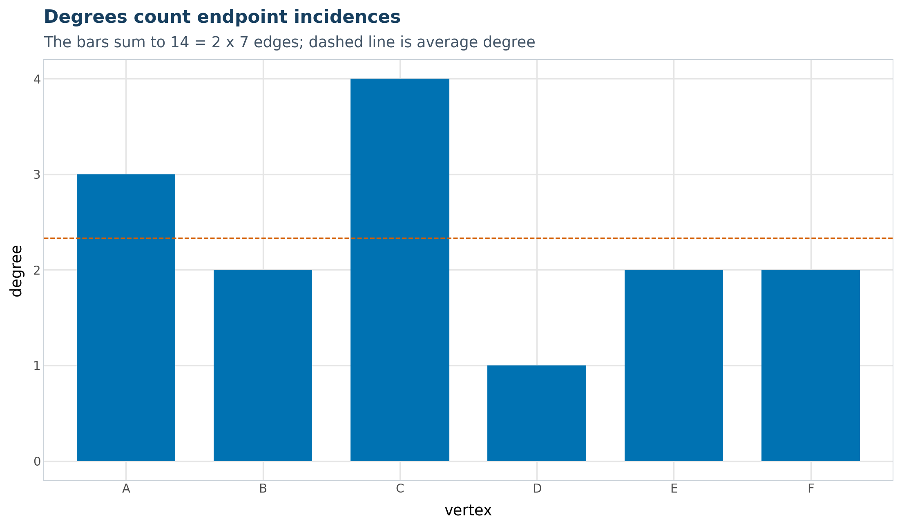

# Pigeonhole and double counting {#sec-comb-double-counting}

Counting can force structure even when it does not enumerate every object.
Pigeonhole arguments compare capacity with demand; double counting equates two
ways of recording the same incidences.

## Preparation from this book

Chapter 1's finite-set model is sufficient. Averages used below are finite
sums divided by the number of terms.

## Capacity and concentration

Putting more than $m$ objects into $m$ boxes forces a shared box. In the strong
form, placing $N$ objects into $m>0$ boxes forces some box to contain at least
the ceiling of $N/m$. The ceiling matters: an average of $2.1$ forces an
integer load at least $3$.

Applications depend on choosing boxes well. Residue classes force congruent
integers; calendar dates force shared birthdays; intervals can force close
points. The conclusion inherits exactly what membership in the same box means.

## Incidence sets

Let $I\subseteq A\times B$ record incident pairs. Counting by the first
coordinate sums the degrees of elements of $A$; counting by the second sums
degrees in $B$. Both equal $|I|$. In an undirected graph, incidences between a
vertex and an edge give the handshake lemma: every edge contributes two.

<figure id="fig-comb-handshake">


<figcaption>

Figure 2.1: Vertex degrees contribute incidences whose total is twice the number of graph edges.

</figcaption>
</figure>

The average degree is therefore twice the edge density per vertex. At least
one vertex has degree no smaller than the average and at least one no larger.
This simple observation is a recurring entry point to extremal arguments.

**Nonexample.** Pigeonhole does not identify which two objects collide, and it
does not say only two collide. Double counting also requires that both sums
range over exactly the same incidences; similar-looking sets are not enough.

<!-- inline-formula-code:start -->
## Formula and finite computation

For a finite simple graph,

$$
\sum_{v\in V}d(v)=2|E|.
$$

```python
def degrees(order: int, edges: list[tuple[int, int]]) -> list[int]:
    if order < 0:
        raise ValueError("order must be nonnegative")
    result = [0] * order
    seen: set[tuple[int, int]] = set()
    for left, right in edges:
        if not 0 <= left < order or not 0 <= right < order or left == right:
            raise ValueError("edges must be distinct non-loop pairs")
        edge = (min(left, right), max(left, right))
        if edge in seen:
            raise ValueError("parallel edge supplied")
        seen.add(edge)
        result[left] += 1
        result[right] += 1
    if sum(result) != 2 * len(edges):
        raise RuntimeError("handshake invariant failed")
    return result

print(degrees(5, [(0, 1), (0, 2), (1, 2), (2, 3)]))
```

**What the computation establishes.** The assertion verifies the incidence
identity for the validated input graph. It does not prove the lemma for all
graphs; the proof is that each edge has exactly two endpoint incidences.
<!-- inline-formula-code:end -->

## Parity and consequences

Because a degree sum is even, the number of odd-degree vertices is even.
Counting triples in two ways yields identities among binomial coefficients;
counting edges across a bipartition underlies Hall's theorem and network flow.
The method scales whenever an object naturally has two classifications.

## Weighted and probabilistic variants

Incidences may carry weights. Summing a weight by rows and then columns remains
valid because both orders traverse the same finite pairs. Probability often
uses this idea through indicators: sum over objects first to count features in
one outcome, or average each feature over outcomes first. The exchange is
automatic for finite sums. This viewpoint explains why linearity of expectation
works even when the individual features are dependent.

## Capacity statements with all boundary cases

**Theorem 2.1 (Strong pigeonhole principle).** Let \(N\ge0\) objects be assigned to \(m\ge1\) boxes. Some box has at least \(\lceil N/m\rceil\) objects. Equivalently, if every box has capacity at most \(r\ge0\), then at most \(mr\) objects can be accommodated.

*Proof.* If each load is at most \(r\), the sum of the \(m\) loads is at most \(mr\). For the ceiling statement with \(N>0\), if every integer load were smaller than \(\lceil N/m\rceil\), the total would be at most \(m(\lceil N/m\rceil-1)<N\), a contradiction. For \(N=0\), every load is zero and the bound is immediate. ∎

The theorem does not depend on equal probabilities or random assignment. An average is an exact finite total divided by a positive number of boxes. At least one load is no smaller than that average; integrality sharpens the conclusion to the ceiling. The box contents may be highly unequal, and the theorem does not identify which box reaches the bound.

A useful contrapositive is that a proposed assignment violating total capacity cannot exist. This is often clearer than trying to name the eventual collision. It also clarifies sharpness: if \(N=qm+s\) with \(0\le s<m\), assign \(q+1\) objects to \(s\) boxes and \(q\) to the rest. The largest load is exactly \(\lceil N/m\rceil\), so no uniformly larger conclusion follows from the totals alone.

### Worked example 2.1: residues and forced multiplicity

Among twenty-one integers, some three have the same residue modulo ten. The ten boxes are the residue classes, and the strong bound is \(\lceil21/10\rceil=3\). Any pair from that box differs by a multiple of ten. The three original integers need not be consecutive in magnitude, and their shared residue need not be zero.

Twenty integers are not enough to force three in one class: the numbers one through twenty put exactly two in every residue class. This example supplies both the capacity proof and a construction showing its numerical threshold is sharp. A statement about differences inherits the modular meaning of the boxes; changing to intervals would force a different relation.

## Choosing a code that makes collision useful

Pigeonhole arguments begin by encoding the property we want. The code is a function from a larger collection to a smaller set of possible values. Equal codes must imply the desired relation. Merely finding fewer descriptive labels is insufficient if a shared label has no useful consequence.

### Worked example 2.2: divisibility through the odd part

Choose \(n+1\) distinct integers from \(\{1,\ldots,2n\}\), with \(n\ge1\). Write each uniquely as \(2^a u\), where \(u\) is odd and \(a\ge0\). Existence follows by repeatedly dividing an even integer by two; uniqueness follows because two different extracted powers would leave one alleged odd part even.

There are exactly \(n\) possible odd parts, the odd integers from one to \(2n-1\). Two chosen integers therefore share an odd part. Their powers of two differ because the original integers are distinct. If the exponents are \(a<b\), then \(2^a u\) divides \(2^b u\). Thus the chosen set contains one member dividing another. The boxes are not residues here; they are equivalence classes under removing all powers of two.

A different encoding could fail. Grouping by parity has only two boxes but sharing parity does not imply divisibility. The proof succeeds because equality of the carefully chosen code implies a precise power-of-two ratio, not merely because a collision is guaranteed.

For metric conclusions, choose boxes of controlled diameter. For example, \(n+1\) points of \([0,1]\) lie in \(n\) half-open subintervals of length \(1/n\), with the final right endpoint included in the last interval. Two points share a box and have distance at most \(1/n\). One cannot replace “at most” by “strictly less” in the general claim: the \(n+1\) equally spaced points have all positive distances at least \(1/n\). Endpoint conventions carry mathematical content.

## Finite incidence sets and exact double counts

**Definition 2.2 (Incidence relation).** For finite sets \(A,B\), an incidence relation is a subset \(I\subseteq A\times B\). The row degree of \(a\) is \(|\{b:(a,b)\in I\}|\), and the column degree of \(b\) is defined analogously.

**Theorem 2.3 (Finite double-counting identity).** If these degrees are \(r(a)\) and \(c(b)\), then
\[
\sum_{a\in A}r(a)=|I|=\sum_{b\in B}c(b).
\]

*Proof.* Partition \(I\) first by its first coordinate and then by its second. Both partitions are disjoint and exhaustive, so the sum rule yields the two equal totals. ∎

An element occurring in several incidences is not an overcount here: the counted objects are ordered pairs. A committee with three members contributes three committee-member incidences because those are three different objects. The model must name this extra marked feature. Otherwise a correct incidence identity may be misreported as a count of undecorated committees.

**Theorem 2.4 (Subset incidences).** For integers \(0\le r\le k\le n\),
\[
\binom nk\binom kr=\binom nr\binom{n-r}{k-r}.
\]

*Proof.* Count pairs \((R,K)\) with \(R\subseteq K\subseteq[n]\), \(|R|=r\), and \(|K|=k\). Choosing \(K\) first gives the left side. Choosing \(R\) first and then the additional \(k-r\) members of \(K\) from its complement gives the right side. Each construction uniquely recovers both sets. ∎

This identity generalises the committee-chair calculation, which has \(r=1\). At \(r=0\), the marked set is the unique empty set; at \(r=k\), the nested sets coincide. Checking these cases explains why the same formula has no missing boundary contribution.

### Worked example 2.3: common neighbours and two-edge paths

Let \(G\) be a finite simple graph. Count records \((w,\{u,v\})\) with distinct vertices \(u,v\) both adjacent to \(w\). For a fixed center \(w\), choose two neighbours in \(\binom{d(w)}2\) ways. For a fixed unordered endpoint pair \(\{u,v\}\), choose the center in \(N(u)\cap N(v)\). Hence
\[
\sum_w\binom{d(w)}2
=\sum_{\{u,v\}\subseteq V}|N(u)\cap N(v)|.
\]

In \(K_{3,3}\), every degree is three, so the left side is \(6\cdot3=18\). A pair in the same bipartition part has three common neighbours, and a pair from different parts has none. There are six same-part pairs, giving \(6\cdot3=18\) on the right. The count concerns two-edge paths with unordered endpoints, not edges or triangles.

The identity can force a four-cycle. If its left side exceeds \(\binom n2\), some endpoint pair has at least two common neighbours. Those two distinct centers, together with the endpoints, form a four-cycle. Extra edges among these vertices do not invalidate the cycle; they only mean it need not be induced. The simple-graph hypothesis ensures a center differs from both endpoints.

## Averaging inequalities retain structural meaning

**Theorem 2.5 (Finite square-sum inequality).** For real numbers \(x_1,\ldots,x_n\) with \(n\ge1\),
\[
\sum_i x_i^2\ge\frac{(\sum_i x_i)^2}{n}.
\]
Equality holds exactly when all the \(x_i\) are equal.

*Proof.* Put \(\overline x=(\sum_i x_i)/n\). Expanding the nonnegative sum \(\sum_i(x_i-\overline x)^2\) gives \(\sum_i x_i^2-n\overline x^2\). Equality holds exactly when each squared difference is zero. ∎

Applied to graph degrees, this inequality combines local incidence counts with a known global edge count. Since \(\sum_v d(v)=2m\),
\[
\sum_v\binom{d(v)}2
=\frac12\left(\sum_vd(v)^2-2m\right)
\ge\frac{2m^2}{n}-m.
\]
If that lower bound exceeds \(\binom n2\), the common-neighbour argument forces a four-cycle. This is a complete implication with a checkable hypothesis. Failure of the inequality to be strict does not prove a four-cycle is absent; it only means this particular argument has not forced one.

Weighted double counting is equally exact. If every incidence has a real weight \(w(a,b)\), summing the weights by rows or by columns traverses the same finite set, so
\[
\sum_a\sum_{b:(a,b)\in I}w(a,b)
=\sum_b\sum_{a:(a,b)\in I}w(a,b).
\]
No convergence theorem is needed because both sums are finite. In a finite probability space, taking the weights to be outcome probabilities yields linearity of expectation. The dependence between different features is irrelevant to this equality; independence is needed only for particular probability calculations, not for rearranging a finite weighted sum.

## What a counting certificate must establish

A double-counting proof has three obligations: define one finite family, describe each count as a partition or reversible construction of that family, and check all restrictions in both descriptions. A factorial manipulation can verify an identity after the fact, but does not substitute for identifying the common family in a requested combinatorial proof.

For a pigeonhole proof, the analogous obligations are to define the assignment, bound the number or capacities of its boxes, and show that sharing a box gives the desired property. A collision code may be many-to-one by design, unlike a bijection. Its success lies in what equal codes imply, not in reconstructing the original object.

Finally, an existence conclusion has a precise scope. “Some vertex has degree at least the average” does not say every vertex does. “Some pair has two common neighbours” does not identify the pair without further work. A construction, a search, and a proof of universal existence can support one another while answering different questions. The next chapter will retain this discipline when overlapping forbidden classes require signed rather than purely positive counts.

## Summary

Pigeonhole turns an average into a forced local event. Double counting builds
an equality by projecting one incidence set in two directions. Both methods
are powerful because their proofs preserve structural meaning.

## Exercises

<div class="exercise" id="comb-pigeonhole-double-counting-ex-1-exercise">

### Exercise 2.1 {#comb-pigeonhole-double-counting-ex-1}

1. Force two of thirteen people into one birth month.

<details>
<summary>Hint 1</summary>

**Hint.** Use the twelve calendar months as boxes.

</details>
<details>
<summary>Hint 2</summary>
**Hint.** No information about the distribution of birthdays is required.

</details>
<details>
<summary>Solution</summary>
**Solution.** Assign each person to their birth month. Thirteen objects in twelve boxes force at least two in one month. This proves shared month, not shared day, and it does not identify the pair without inspecting the data.

</details>

</div>

<div class="exercise" id="comb-pigeonhole-double-counting-ex-2-exercise">

### Exercise 2.2 {#comb-pigeonhole-double-counting-ex-2}

2. Prove the strong pigeonhole principle.

<details>
<summary>Hint 1</summary>

**Hint.** Compare total load with total capacity.

</details>
<details>
<summary>Hint 2</summary>

**Hint.** Treat $N=0$ separately if using a positive ceiling argument.

</details>
<details>
<summary>Solution</summary>

**Solution.** For $N>0$ and $m\ge1$, loads all at most $\lceil N/m\rceil-1$ would sum to less than $N$, impossible. Thus one reaches the ceiling. For $N=0$ each box has load zero, so the statement remains true.

</details>

</div>

<div class="exercise" id="comb-pigeonhole-double-counting-ex-3-exercise">

### Exercise 2.3 {#comb-pigeonhole-double-counting-ex-3}

3. Show that some graph vertex has degree at least the average.

Assume the graph is finite and has at least one vertex.

<details>
<summary>Hint 1</summary>

**Hint.** Averages here require at least one vertex.

</details>
<details>
<summary>Hint 2</summary>

**Hint.** If every degree were smaller, their sum would be too small.

</details>
<details>
<summary>Solution</summary>

**Solution.** For a finite graph on $n\ge1$ vertices, the average degree is $(\sum_vd(v))/n=2m/n$. If every degree were smaller, summing the $n$ strict inequalities would give $\sum_vd(v)<2m$, a contradiction. The empty graph is excluded because this average is undefined.

</details>

</div>

<div class="exercise" id="comb-pigeonhole-double-counting-ex-4-exercise">

### Exercise 2.4 {#comb-pigeonhole-double-counting-ex-4}

4. Prove that odd-degree vertices occur in even number.

<details>
<summary>Hint 1</summary>

**Hint.** Use the handshake identity.

</details>
<details>
<summary>Hint 2</summary>

**Hint.** Reduce the total degree modulo two.

</details>
<details>
<summary>Solution</summary>

**Solution.** Every edge contributes two to the degree sum. Even degrees contribute zero modulo two, while each odd degree contributes one, so the number of odd-degree vertices must be even. This is a parity consequence, not a complete characterisation of graphical degree sequences.

</details>

</div>

<div class="exercise" id="comb-pigeonhole-double-counting-ex-5-exercise">

### Exercise 2.5 {#comb-pigeonhole-double-counting-ex-5}

5. Double-count committee-member incidences.

Use a ground set of $n$ people and a fixed size $1\le k\le n$.

<details>
<summary>Hint 1</summary>

**Hint.** Specify both the committee and the distinguished member.

</details>
<details>
<summary>Hint 2</summary>

**Hint.** Use committees of fixed size $k$ from a ground set of size $n$.

</details>
<details>
<summary>Solution</summary>

**Solution.** The incidence family is $(S,s)$ with $|S|=k$ and $s\in S$, where $1\le k\le n$. Choosing the committee then the member gives $k\binom nk$; choosing the member then the remaining committee gives $n\binom{n-1}{k-1}$. Both descriptions are unique, proving their equality.

</details>

</div>

<div class="exercise" id="comb-pigeonhole-double-counting-ex-6-exercise">

### Exercise 2.6 {#comb-pigeonhole-double-counting-ex-6}

6. Design boxes that force two real numbers within distance $1/n$.

Use $n+1$ points of $[0,1]$ with $n\ge1$; interpret within as distance at most $1/n$.

<details>
<summary>Hint 1</summary>

**Hint.** Use $n+1$ points in the unit interval and $n\ge1$.

</details>
<details>
<summary>Hint 2</summary>

**Hint.** Partition into $n$ intervals, taking care of the final endpoint.

</details>
<details>
<summary>Solution</summary>

**Solution.** Use the intervals $[j/n,(j+1)/n)$ for $0\le j<n-1$ and the last interval $[(n-1)/n,1]$. Every point belongs to exactly one box of diameter at most $1/n$. Two of the $n+1$ points share a box, so their distance is at most $1/n$. Equally spaced points show that strict inequality is not always possible.

</details>

</div>

<div class="exercise" id="comb-pigeonhole-double-counting-ex-7-exercise">

### Exercise 2.7 {#comb-pigeonhole-double-counting-ex-7}

Show that among $2m+1$ integers some three share a residue modulo $m$, for $m\ge1$, and show the threshold is sharp.

<details>
<summary>Hint 1</summary>

**Hint.** Apply the ceiling bound to residue classes.

</details>
<details>
<summary>Hint 2</summary>

**Hint.** For the lower example, put exactly two integers in each class.

</details>
<details>
<summary>Solution</summary>

**Solution.** There are $m$ residue classes and $\lceil(2m+1)/m\rceil\ge3$, so one has three chosen integers. The $2m$ integers one through $2m$ put exactly two in each class, so no smaller universal threshold suffices. Distinctness is not needed for the first implication but holds in this sharpness example.

</details>

</div>

<div class="exercise" id="comb-pigeonhole-double-counting-ex-8-exercise">

### Exercise 2.8 {#comb-pigeonhole-double-counting-ex-8}

Prove that any $n+1$ distinct members of $\{1,\ldots,2n\}$ contain two with one dividing the other.

<details>
<summary>Hint 1</summary>

**Hint.** Assign each integer its odd part after removing powers of two.

</details>
<details>
<summary>Hint 2</summary>

**Hint.** There are $n$ possible odd parts.

</details>
<details>
<summary>Solution</summary>

**Solution.** Write each integer uniquely as $2^a u$ with $u$ odd. Two share $u$ by pigeonhole. Their exponents differ because the integers are distinct; if $a<b$, their ratio is $2^{b-a}$, an integer. Thus the smaller divides the larger. A parity classification alone would not imply that ratio.

</details>

</div>

<div class="exercise" id="comb-pigeonhole-double-counting-ex-9-exercise">

### Exercise 2.9 {#comb-pigeonhole-double-counting-ex-9}

Prove the common-neighbour identity from the worked example by defining its incidence records precisely.

<details>
<summary>Hint 1</summary>

**Hint.** A record consists of a center and an unordered pair of distinct neighbours.

</details>
<details>
<summary>Hint 2</summary>

**Hint.** Count first by the center, then by the endpoint pair.

</details>
<details>
<summary>Solution</summary>

**Solution.** Let $I=\{(w,\{u,v\}):u\ne v,\ uw,vw\in E\}$. The center fibre has size $\binom{d(w)}2$. For fixed endpoints its size is $|N(u)\cap N(v)|$. Both partitions are exhaustive and disjoint, giving the identity. Each record represents one two-edge path with unordered endpoints.

</details>

</div>

<div class="exercise" id="comb-pigeonhole-double-counting-ex-10-exercise">

### Exercise 2.10 {#comb-pigeonhole-double-counting-ex-10}

Show that a simple graph on six vertices and nine edges contains a four-cycle.

<details>
<summary>Hint 1</summary>

**Hint.** Use the degree square-sum inequality before counting pairs of common neighbours.

</details>
<details>
<summary>Hint 2</summary>

**Hint.** Its degree sum is eighteen, so its square sum is at least fifty-four.

</details>
<details>
<summary>Solution</summary>

**Solution.** The wedge count is $\frac12(\sum d(v)^2-\sum d(v))\ge(54-18)/2=18$. There are only $\binom62=15$ endpoint pairs, so some pair has two distinct common neighbours. Those four distinct vertices supply the four cycle edges, proving the claim. The cycle need not be induced.

</details>

</div>

### Selected solution

For Exercise 4, reduce the handshake identity modulo two. Even degrees vanish;
the remaining sum has the parity of the number of odd-degree vertices, while
the right side is even.

## Sources for the expanded chapter {#sec-comb-pigeonhole-double-counting-sources}

Original chapter text, figure, code, and selected solution are retained. The new incidence and inequality arguments are original expositions of classical finite-counting methods. Primary parallel reading is Richard P. Stanley, [Enumerative Combinatorics, volume 1, author manuscript](https://math.mit.edu/~rstan/ec/ec1.pdf), Chapter 1; no distinctive exercises have been copied.

## Summary and next connection {#sec-comb-pigeonhole-double-counting-summary}

Pigeonhole compares demand with the capacity of a precisely chosen encoding. Double counting partitions the same incidence family in two directions, and finite averaging turns its exact totals into existence statements. Every implication depends on its domain, labels, and boundary cases. [Inclusion–exclusion and Möbius inversion](04-inclusion-exclusion-mobius.md) next corrects overlap when a direct sum of cases is not disjoint.
