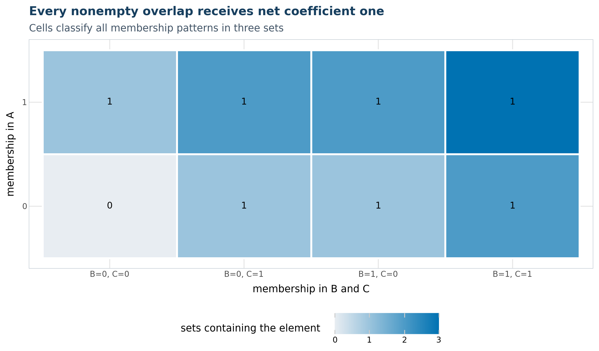

# Inclusion–exclusion and Möbius inversion {#sec-comb-inclusion}

When forbidden properties overlap, subtracting each bad class once removes
objects with two bad properties twice. Inclusion–exclusion repairs every
overlap systematically. Möbius inversion expresses the same cancellation on a
partially ordered set.

## Preparation from this book

Use unions and intersections from the primer and binomial coefficients from
Chapter 2.

## Alternating correction

For two sets, add their sizes and subtract their intersection. For many sets,
an object lying in exactly $r$ of them contributes the alternating sum of the
binomial coefficients indexed from one through $r$, which equals one. This
local contribution proves the general formula.

To count objects avoiding all properties $A_i$, apply the formula to their
union and subtract from the universe, or include the empty intersection as the
whole universe. Derangements follow by taking $A_i$ to mean that a permutation
fixes position $i$.

<figure id="fig-comb-inclusion">


<figcaption>

Figure 3.1: Inclusion–exclusion alternates overlap corrections among three finite sets.

</figcaption>
</figure>

## Möbius inversion

On a finite poset, suppose $g(y)$ accumulates $f(x)$ over all $x\le y$.
Möbius inversion recovers $f$ using coefficients determined recursively by the
interval structure. On the Boolean lattice of subsets, the coefficient between
$S$ and $T$ is $(-1)^{|T\setminus S|}$, exactly the sign in
inclusion–exclusion. On the divisibility poset, it becomes the number-theoretic
Möbius function.

**Nonexample.** Adding pairwise intersections is not enough when triple or
higher overlaps exist. Nor may one use a product of complement probabilities
unless the events are independent; inclusion–exclusion itself requires no
probability assumptions.

<!-- inline-formula-code:start -->
## Formula and finite computation

For finite sets $A_1,\ldots,A_m$,

$$
\left|\bigcup_{i=1}^{m}A_i\right|
=\sum_{\emptyset\ne S\subseteq[m]}(-1)^{|S|+1}
\left|\bigcap_{i\in S}A_i\right|.
$$

```python
from itertools import combinations
from typing import TypeVar

T = TypeVar("T")

def union_size_inclusion_exclusion(sets: list[set[T]]) -> int:
    total = 0
    for size in range(1, len(sets) + 1):
        for chosen in combinations(sets, size):
            intersection = set.intersection(*chosen)
            total += (-1) ** (size + 1) * len(intersection)
    return total

family = [{1, 2, 3, 6}, {2, 4, 6}, {3, 6}]
answer = union_size_inclusion_exclusion(family)
if answer != len(set().union(*family)):
    raise RuntimeError("inclusion-exclusion check failed")
print(answer)
```

**What the computation establishes.** The alternating intersection count
matches direct union construction for this finite family. It does not prove
the general identity or establish that a particular application modeled every
forbidden property correctly.
<!-- inline-formula-code:end -->

## Computational choices

Literal inclusion–exclusion has exponentially many terms. Symmetry may group
equal intersections, dynamic programming may work on a smaller state space,
and Möbius transforms on Boolean lattices can reuse partial sums. Exactness of
the identity does not imply a practical algorithm for large $m$.

## Truncation and bounds

Stopping the alternating expansion after an odd or even level gives opposite
one-sided Bonferroni bounds. These are useful when high-order intersections are
unavailable, but the direction of the inequality must be recorded. In
probability, union bounds keep only the first positive layer and are often
crude but robust. Exact symbolic simplification should be delayed until the
intersection types and their multiplicities have been audited.

## Local multiplicities prove the global alternating formula

**Theorem 3.1 (Finite inclusion–exclusion).** For finite sets \(A_1,\ldots,A_m\),
\[
\left|\bigcup_{i=1}^m A_i\right|
=\sum_{\varnothing\ne S\subseteq[m]}(-1)^{|S|+1}
\left|\bigcap_{i\in S}A_i\right|.
\]
For a finite universe \(U\) containing all these sets, the count avoiding every \(A_i\) is
\[
\sum_{S\subseteq[m]}(-1)^{|S|}
\left|\bigcap_{i\in S}A_i\right|,
\]
where the empty intersection is \(U\).

*Proof.* Fix \(u\in U\), and let \(r\) be the number of sets containing it. In the union expression, if \(r=0\) its contribution is zero. If \(r\ge1\), it occurs in exactly \(\binom rj\) intersections indexed by \(j\) sets. Its net coefficient is \(\sum_{j=1}^r(-1)^{j+1}\binom rj=1\), since \((1-1)^r=0\). Thus every member of the union contributes one and every nonmember zero. In the avoidance expression its coefficient is the full sum \(\sum_{j=0}^r(-1)^j\binom rj\), equal to one for \(r=0\) and zero otherwise. Summing these verified coefficients proves both formulas. ∎

This proof tracks one object's multiplicity rather than manipulating total sizes blindly. It explains the empty-intersection convention and why intersections are indexed by distinct property labels. Two different index sets may describe equal actual intersections; they still contribute separately because they are different terms in the multiplicity calculation. Grouping equal intersections is allowed only after their indexed multiplicities have been counted.

No independence assumption is present. In a finite probability space the same proof works with each object weighted by its probability. The resulting probability identity is exact even for heavily dependent events. A product of complement probabilities, by contrast, requires an appropriate independence hypothesis and is not a replacement for inclusion–exclusion.

### Worked example 3.1: three divisibility conditions

Count integers from one through one hundred divisible by two, three, or five. The three single counts are \(50,33,20\). Pair intersections correspond to multiples of six, ten, and fifteen, with counts \(16,10,6\). The triple intersection consists of multiples of thirty, with count three. Therefore the answer is
\[
50+33+20-16-10-6+3=74.
\]

Each floor in these counts comes from the endpoint: there are \(\lfloor100/d\rfloor\) positive multiples of \(d\) in the interval. Pairwise correction without the triple term would give seventy-one. A multiple of thirty would then have been added three times and removed three times, contributing zero instead of one. The local-contribution proof identifies exactly why the missing three objects must be restored.

## Fixed points and derangements

**Definition 3.2 (Derangement).** A derangement of \([n]\) is a permutation with no fixed point. Let \(D_n\) denote their number, with \(D_0=1\).

**Theorem 3.3 (Derangement formula).** For \(n\ge0\),
\[
D_n=\sum_{j=0}^n(-1)^j\binom nj(n-j)!
=n!\sum_{j=0}^n\frac{(-1)^j}{j!}.
\]

*Proof.* In the universe of \(n!\) permutations, let \(A_i\) be those fixing \(i\). Specifying a set \(S\) of fixed positions leaves an arbitrary permutation of the other \(n-|S|\) elements, so \(|\bigcap_{i\in S}A_i|=(n-|S|)!\). The avoidance formula and grouping index sets by size give the first expression. Cancelling factorials gives the second. At \(n=0\), the universe contains the empty permutation, which has no fixed points, giving the stated value one. ∎

### Worked example 3.2: a complete fixed-point avoidance count

For four labeled positions, the derangement count is
\[
D_4=24-4\cdot6+6\cdot2-4\cdot1+1=9.
\]
The final two intersection sizes both equal one, but correspond to four specified triples of fixed positions and one specified quadruple. They must retain their different binomial multiplicities.

It is incorrect to assign each position a nonfixed image independently and use \(3^4\): that would allow several positions to choose the same image and would no longer count permutations. The starting universe and every forbidden class must belong to the same finite model. The alternating formula works because it begins with genuine permutations and imposes compatible fixed-point conditions.

## Truncation gives proved one-sided bounds

**Theorem 3.4 (Bonferroni bounds).** Truncating the union formula after an odd intersection level gives an upper bound for the union size; truncating after an even level gives a lower bound.

*Proof.* At an object contained in \(r\ge1\) sets, truncation after level \(t\) gives \(\sum_{j=1}^{\min(t,r)}(-1)^{j+1}\binom rj\). If \(t\ge r\) this is exactly one. If \(t<r\), Pascal's identity and cancellation show
\[
\sum_{j=0}^t(-1)^j\binom rj=(-1)^t\binom{r-1}t.
\]
Indeed substitute \(\binom rj=\binom{r-1}j+\binom{r-1}{j-1}\); all terms cancel except the last. Thus the truncated union coefficient is \(1-(-1)^t\binom{r-1}t\), at least one for odd \(t\) and at most one for even \(t\). Objects with \(r=0\) contribute zero. Summing proves the directions. ∎

The first level is the union bound: \(|\bigcup A_i|\le\sum_i|A_i|\). The second adds pair correction and is a lower bound, which can be negative without being false. A negative lower bound is simply uninformative. These inequalities are useful when higher intersections are unknown; they do not assert that stopping after a small number of levels gives a close approximation.

## Finite posets and incidence convolution

**Definition 3.5 (Finite poset and incidence functions).** A partially ordered set \(P\) has a relation \(\le\) that is reflexive, antisymmetric, and transitive. For \(x\le y\), its interval is \([x,y]=\{z:x\le z\le y\}\). An incidence function assigns a rational number to each comparable pair. Define convolution by
\[
(f*g)(x,y)=\sum_{x\le z\le y}f(x,z)g(z,y).
\]
The identity function \(\varepsilon\) has value one on pairs \(x=x\) and zero otherwise; the zeta function \(\zeta\) has value one on every comparable pair.

All interval sums are finite. Convolution is associative: expanding either \((f*g)*h\) or \(f*(g*h)\) gives the sum \(f(x,u)g(u,v)h(v,y)\) over exactly the pairs \(x\le u\le v\le y\). The identity property follows because only the diagonal term of \(\varepsilon\) contributes. These checks establish the algebra used in the next proof rather than assuming matrix inversion as a prerequisite.

**Theorem 3.6 (Existence of the Möbius function).** There is a unique incidence function \(\mu\) with
\[
\mu*\zeta=\zeta*\mu=\varepsilon.
\]
It satisfies \(\mu(x,x)=1\) and
\[
\mu(x,y)=-\sum_{x\le z<y}\mu(x,z)\qquad(x<y).
\]

*Proof.* Write \(\eta=\zeta-\varepsilon\). A convolution power \(\eta^{*j}(x,y)\) counts strict chains \(x=x_0<x_1<\cdots<x_j=y\), as induction on \(j\) shows by selecting the penultimate member. If \(N=|P|\), no chain has \(N\) strict steps, so \(\eta^{*N}=0\). For a nonempty poset put
\[
\mu=\varepsilon-\eta+\eta^{*2}-\cdots+(-1)^{N-1}\eta^{*(N-1)}.
\]
Multiplying on either side by \(\zeta=\varepsilon+\eta\) telescopes to \(\varepsilon\). If another two-sided inverse existed, associativity would give \(\nu=\nu*(\zeta*\mu)=(\nu*\zeta)*\mu=\mu\). The diagonal value and the recursion follow by writing \((\mu*\zeta)(x,y)=\varepsilon(x,y)\). For the empty poset there are no comparable pairs and the assertions hold vacuously. ∎

**Theorem 3.7 (Möbius inversion).** For functions \(F,G:P\to\mathbb Q\) on a finite poset,
\[
G(y)=\sum_{x\le y}F(x)\quad\text{for every }y
\]
holds if and only if
\[
F(y)=\sum_{x\le y}\mu(x,y)G(x)\quad\text{for every }y.
\]

*Proof.* Substitute the first formula into the proposed second. The coefficient of \(F(z)\) is \(\sum_{z\le x\le y}\mu(x,y)=(\zeta*\mu)(z,y)\), equal to one for \(z=y\) and zero otherwise. This proves recovery. Conversely substitute the second into \(\sum_{x\le y}F(x)\); the coefficient of \(G(z)\) is \(\sum_{z\le x\le y}\mu(z,x)=(\mu*\zeta)(z,y)\), giving \(G(y)\). Both changes in summation order are justified by finiteness. ∎

The orientation of the arguments matters. For a lower cumulative sum, the inverse coefficient is \(\mu(x,y)\), not \(\mu(y,x)\), which may not even be defined. An upper cumulative sum uses the corresponding opposite-poset orientation. Write one explicit interval coefficient when checking an unfamiliar formula; this often exposes a reversed index before a lengthy calculation.

### Worked example 3.3: inversion on a chain and on subsets

On a chain \(0<1<\cdots<m\), the recursion gives \(\mu(i,i)=1\), \(\mu(i,i+1)=-1\), and \(\mu(i,j)=0\) for \(j\ge i+2\). To verify the last statement, sum the earlier interval values: one and negative one cancel, and the intervening longer-interval values are zero by induction. Thus if \(G(j)=\sum_{i=0}^jF(i)\), inversion gives \(F(0)=G(0)\) and \(F(j)=G(j)-G(j-1)\). Möbius inversion includes ordinary finite differencing.

On the Boolean lattice of subsets of a finite set, the candidate is \(\mu(S,T)=(-1)^{|T\setminus S|}\). Summing it over \(S\subseteq U\subseteq T\) gives \(\sum_j\binom{|T\setminus S|}j(-1)^j\), equal to the required diagonal indicator. The inverse is unique, so the candidate is correct. The alternating signs of inclusion–exclusion are therefore interval inverse coefficients rather than a separate unrelated trick.

## Divisor sums and the scope of the theory

For positive integers ordered by divisibility, restrict first to the divisors of a fixed integer \(n\), a finite poset. The interval from \(d\) to \(n\) corresponds to the divisors of \(n/d\). Its Möbius coefficient is the arithmetic function \(\mu_{\mathrm{arith}}(n/d)\), where that function is one at one, zero when a square of a prime divides its argument, and \((-1)^r\) for a product of \(r\) distinct primes.

To verify it, sum the candidate over all divisors of a positive integer \(q\). Only squarefree divisors contribute, each selecting a subset of the distinct prime divisors. The sum is \((1-1)^r\), zero unless \(q=1\), when it is one. This is the inverse relation defining the poset Möbius coefficients. Thus a divisor accumulation \(G(n)=\sum_{d\mid n}F(d)\) is inverted by \(\sum_{d\mid n}\mu_{\mathrm{arith}}(n/d)G(d)\).

The proof needs unique prime factorisation for this divisor example, not for the finite-poset inversion theorem itself. More generally, locally finite infinite posets permit interval-by-interval definitions, but sums over all predecessors may then be infinite. This chapter's inversion statements remain finite; an infinite extension needs hypotheses ensuring that its operations make sense. A finite algebraic identity is not permission to interchange arbitrary infinite sums.

## Summary

Inclusion--exclusion assigns each overlap the coefficient needed for net
contribution one. Möbius inversion reveals the underlying order-theoretic
operation and connects set counting with divisor sums and incidence algebras.

## Worked example: retain an impossible-intersection certificate

Suppose three forbidden conditions concern a word of length two: its first
letter is A, its first letter is B, and its second letter is A.
The first two conditions cannot occur together. Their intersection is empty,
and the triple intersection is therefore empty as well. The two remaining
pair intersections each contain exactly one word when the alphabet has
q letters and A and B are distinct.

There are q squared words initially. Each individual condition holds for
q words, so inclusion–exclusion leaves q squared minus three q plus two
words avoiding every condition. Directly, the first position has q minus
two choices and the second has q minus one choices; their product agrees.
The zero intersection was not an omitted term whose size happened to
be small. It had a logical certificate of impossibility, which can be
reused in a larger condition system. Recording those certificates helps keep
the signs and coverage correct when many intersections vanish before any
arithmetic is performed.

## Exercises

<div class="exercise" id="comb-inclusion-exclusion-mobius-ex-1-exercise">

### Exercise 3.1 {#comb-inclusion-exclusion-mobius-ex-1}

1. Derive the three-set formula.

<details>
<summary>Hint 1</summary>

**Hint.** Track the coefficient of an element appearing in one, two, or all three sets.

</details>
<details>
<summary>Hint 2</summary>
**Hint.** The triple term restores the coefficient lost after three pair removals.

</details>
<details>
<summary>Solution</summary>
**Solution.** The formula is $|A|+|B|+|C|-|A\cap B|-|A\cap C|-|B\cap C|+|A\cap B\cap C|$. An element in one set contributes one, in two sets contributes $2-1=1$, and in three contributes $3-3+1=1$. Outside the union it contributes zero, proving equality.

</details>

</div>

<div class="exercise" id="comb-inclusion-exclusion-mobius-ex-2-exercise">

### Exercise 3.2 {#comb-inclusion-exclusion-mobius-ex-2}

2. Count integers at most $100$ divisible by $2$, $3$, or $5$.

Use the positive integers from one through one hundred.

<details>
<summary>Hint 1</summary>

**Hint.** Work in the positive integers one through one hundred.

</details>
<details>
<summary>Hint 2</summary>

**Hint.** Intersections use least common multiples.

</details>
<details>
<summary>Solution</summary>

**Solution.** The single counts are $50,33,20$; the pair counts are $16,10,6$; and the triple count is three. Inclusion–exclusion gives $50+33+20-16-10-6+3=74$. Floors account for the integer endpoint and no independence assumption is used.

</details>

</div>

<div class="exercise" id="comb-inclusion-exclusion-mobius-ex-3-exercise">

### Exercise 3.3 {#comb-inclusion-exclusion-mobius-ex-3}

3. Derive the derangement sum.

<details>
<summary>Hint 1</summary>

**Hint.** Take permutations as the universe and fixed positions as bad properties.

</details>
<details>
<summary>Hint 2</summary>

**Hint.** Fixing a specified set of $j$ positions leaves $(n-j)!$ choices.

</details>
<details>
<summary>Solution</summary>

**Solution.** Avoidance inclusion–exclusion gives $D_n=\sum_{j=0}^n(-1)^j\binom nj(n-j)!=n!\sum_{j=0}^n(-1)^j/j!$. There are $\binom nj$ index sets with the same intersection count. The empty permutation gives $D_0=1$, consistent with the single empty-index term.

</details>

</div>

<div class="exercise" id="comb-inclusion-exclusion-mobius-ex-4-exercise">

### Exercise 3.4 {#comb-inclusion-exclusion-mobius-ex-4}

4. Explain the Boolean-lattice Möbius coefficient.

<details>
<summary>Hint 1</summary>

**Hint.** The interval between $S$ and $T$ is itself a Boolean lattice on $T\setminus S$.

</details>
<details>
<summary>Hint 2</summary>

**Hint.** Test the candidate by convolution with zeta.

</details>
<details>
<summary>Solution</summary>

**Solution.** Summing $(-1)^{|U\setminus S|}$ over $S\subseteq U\subseteq T$ gives $(1-1)^{|T\setminus S|}$. This is one when $S=T$ and zero otherwise, so the candidate satisfies the defining inverse relation. Uniqueness yields $\mu(S,T)=(-1)^{|T\setminus S|}$.

</details>

</div>

<div class="exercise" id="comb-inclusion-exclusion-mobius-ex-5-exercise">

### Exercise 3.5 {#comb-inclusion-exclusion-mobius-ex-5}

5. Give a case where pairwise correction fails.

<details>
<summary>Hint 1</summary>

**Hint.** Let three sets share an element.

</details>
<details>
<summary>Hint 2</summary>

**Hint.** Compute its coefficient after singles and pairs only.

</details>
<details>
<summary>Solution</summary>

**Solution.** Take $A=B=C=\{u\}$. Adding the single sizes gives three and subtracting the three pair sizes gives zero, whereas the union has size one. The triple intersection contributes the missing one. The failure is a local multiplicity error, not an approximate numerical effect.

</details>

</div>

<div class="exercise" id="comb-inclusion-exclusion-mobius-ex-6-exercise">

### Exercise 3.6 {#comb-inclusion-exclusion-mobius-ex-6}

6. Estimate when literal enumeration becomes impractical.

Give a mathematical operation-count estimate, stating any representation assumptions; do not run a timing experiment.

<details>
<summary>Hint 1</summary>

**Hint.** Count the nonempty subsets of the property-index set.

</details>
<details>
<summary>Hint 2</summary>

**Hint.** Separate the number of terms from the cost of evaluating an intersection.

</details>
<details>
<summary>Solution</summary>

**Solution.** With $m$ properties there are $2^m-1$ nonempty index sets. At $m=30$ this exceeds one billion, before charging any intersection work. A useful resource estimate is $(2^m-1)$ times the cost per intersection; feasibility depends on the declared representation and resources, not a universal time threshold. This count is a mathematical estimate, not an executed timing.

</details>

</div>

<div class="exercise" id="comb-inclusion-exclusion-mobius-ex-7-exercise">

### Exercise 3.7 {#comb-inclusion-exclusion-mobius-ex-7}

For a finite poset, prove directly that the lower-sum inversion uses $\mu(x,y)$ rather than $\mu(y,x)$.

<details>
<summary>Hint 1</summary>

**Hint.** Substitute the accumulated sum into the inverse candidate.

</details>
<details>
<summary>Hint 2</summary>

**Hint.** Inspect the coefficient of one fixed original value $F(z)$.

</details>
<details>
<summary>Solution</summary>

**Solution.** The coefficient is $\sum_{z\le x\le y}\mu(x,y)=(\zeta*\mu)(z,y)$, which vanishes unless $z=y$. Reversing the arguments would require coefficients at incomparable or reversed pairs and would not produce this convolution. On a two-element chain the correct inverse is a difference, immediately exposing an incorrectly oriented sum.

</details>

</div>

<div class="exercise" id="comb-inclusion-exclusion-mobius-ex-8-exercise">

### Exercise 3.8 {#comb-inclusion-exclusion-mobius-ex-8}

Compute the Möbius values on the divisors of twelve from one.

<details>
<summary>Hint 1</summary>

**Hint.** List squarefree divisors and divisors containing a square factor.

</details>
<details>
<summary>Hint 2</summary>

**Hint.** Verify that the coefficient sum over divisors of each nontrivial divisor is zero.

</details>
<details>
<summary>Solution</summary>

**Solution.** The divisors are $1,2,3,4,6,12$, with values $1,-1,-1,0,1,0$. The zeros arise from the square factor four. Their full sum is zero, and the same divisor-sum check on $2,3,4,6$ verifies the recursion. These are arithmetic Möbius values, not function inverses under composition.

</details>

</div>

<div class="exercise" id="comb-inclusion-exclusion-mobius-ex-9-exercise">

### Exercise 3.9 {#comb-inclusion-exclusion-mobius-ex-9}

Prove that truncating the union formula after two levels is a lower bound, even if it is negative.

<details>
<summary>Hint 1</summary>

**Hint.** An element in $r$ sets contributes $r-\binom r2$.

</details>
<details>
<summary>Hint 2</summary>

**Hint.** Compare that integer with one for $r\ge1$.

</details>
<details>
<summary>Solution</summary>

**Solution.** For $r\ge1$, $r-\binom r2=1-\binom{r-1}2\le1$, while an element in no set contributes zero. Summing gives $\sum_i|A_i|-\sum_{i<j}|A_i\cap A_j|\le|\bigcup_iA_i|$. The left side can be negative when overlap is large; the inequality remains true but gives no positive information.

</details>

</div>

<div class="exercise" id="comb-inclusion-exclusion-mobius-ex-10-exercise">

### Exercise 3.10 {#comb-inclusion-exclusion-mobius-ex-10}

On a chain $0<1<2<3$, suppose $G=(2,5,9,10)$ is a lower cumulative sum. Recover $F$ and check the accumulation.

<details>
<summary>Hint 1</summary>

**Hint.** Chain inversion is finite differencing.

</details>
<details>
<summary>Hint 2</summary>

**Hint.** Keep the first value separately because it has no predecessor.

</details>
<details>
<summary>Solution</summary>

**Solution.** The recovered values are $F=(2,3,4,1)$. Their successive sums are two, five, nine, and ten, matching $G$. The chain Möbius function has one on the diagonal, negative one on adjacent pairs, and zero on longer intervals, so the difference rule is exactly the general inversion formula.

</details>

</div>

### Selected solution

For Exercise 5, take three sets with a common element. Adding singles and
subtracting pairs gives that element coefficient $3-3=0$; the triple term is
needed to restore coefficient one.

## Sources for the expanded chapter {#sec-comb-inclusion-exclusion-mobius-sources}

All original source material above is retained. The expanded interval-algebra and inversion proofs are original expositions. Primary references are Richard P. Stanley, [Enumerative Combinatorics, volume 1, author manuscript](https://math.mit.edu/~rstan/ec/ec1.pdf), Sections 2.1 and 3.6–3.8, and Gian-Carlo Rota's [On the foundations of combinatorial theory I. Theory of Möbius Functions](https://link.springer.com/article/10.1007/BF00531932), 1964. The publisher record verifies the latter's identity; no distinctive exercise text is copied.

## Summary and next connection {#sec-comb-inclusion-exclusion-mobius-summary}

Inclusion–exclusion proves its alternating signs by an object's exact membership multiplicity. Truncations give directed bounds rather than automatically close approximations. On a finite poset, incidence convolution and the inverse of zeta prove Möbius inversion, with Boolean and divisor intervals supplying familiar special cases. [Recurrences and dynamic structure](05-recurrences.md) next builds counts from smaller objects while retaining the same obligation to justify each decomposition.
