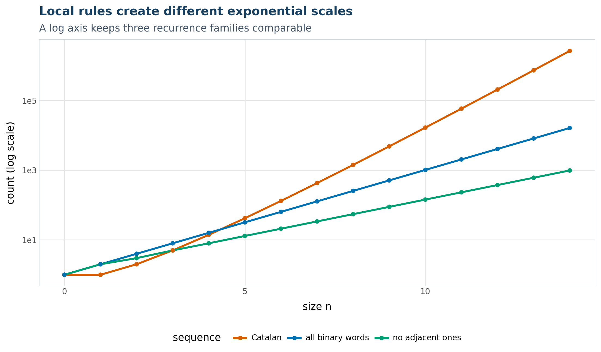

# Recurrences and dynamic structure {#sec-comb-recurrences}

A recurrence specifies an object of size $n$ through smaller sizes. It is both
a proof device and an algorithmic blueprint, but only when initial conditions
and valid index ranges are included.

## Preparation from this book

Chapter 2 supplies Pascal's recurrence as a familiar example. The appendix
reviews finite sums and logarithmic growth.

## Decompose by a first event

For length $n\ge2$, binary strings with no consecutive ones either end in
$0$ after any valid string of length $n-1$, or end in $01$ after any valid
string of length $n-2$. Indeed, a final $1$ must be preceded by $0$.
Removing the indicated suffix and appending it back are inverse operations,
and the two cases have different last symbols, so they are disjoint and
exhaustive. This gives $a_n=a_{n-1}+a_{n-2}$ for $n\ge2$, with $a_0=1$
(the empty string) and $a_1=2$ (the strings $0,1$). Similar decompositions
count tilings, compositions, search trees, and paths in directed acyclic graphs.

A recurrence is not a closed form, but tabulation evaluates it while sharing
overlapping subproblems. Naive recursion recomputes the same values and can
take exponential time even when the recurrence has a linear-time dynamic
program.

<figure id="fig-comb-recurrence">


<figcaption>

Figure 4.1: Several recurrence sequences exhibit distinct growth despite similar local update rules.

</figcaption>
</figure>

## Linear recurrences

For a homogeneous recurrence with constant coefficients, try solutions of the
form $r^n$. The resulting characteristic polynomial converts shifts into
powers of $r$. Distinct roots yield linear combinations of exponentials;
repeated roots require polynomial factors. Initial values determine the
constants.

Nonhomogeneous recurrences add a particular solution. Generating functions in
Chapter 6 provide a unified method and often preserve combinatorial meaning
better than guessing a form.

**Nonexample.** The recurrence $a_n=a_{n-1}+a_{n-2}$ does not define a unique
sequence without two initial values. Nor does agreement through a large finite
index prove that two recursively described sequences agree forever; induction
using the same recurrence and bases does.

<!-- inline-formula-code:start -->
## Formula and finite computation

Valid binary words with no adjacent ones satisfy

$$
a_n=a_{n-1}+a_{n-2},\qquad a_0=1,\quad a_1=2.
$$

```python
from itertools import product

def no_adjacent_one_counts(limit: int) -> list[int]:
    if limit < 0:
        raise ValueError("limit must be nonnegative")
    counts = [1]
    if limit >= 1:
        counts.append(2)
    for size in range(2, limit + 1):
        counts.append(counts[-1] + counts[-2])
    for size, count in enumerate(counts):
        brute_force = sum("11" not in "".join(bits) for bits in product("01", repeat=size))
        if count != brute_force:
            raise RuntimeError("recurrence and enumeration disagree")
    return counts

print(no_adjacent_one_counts(10))
```

**What the computation establishes.** Dynamic values agree with exhaustive
generation through length ten. It does not prove the decomposition for every
length; the exhaustive last-symbol cases and induction supply that proof.
<!-- inline-formula-code:end -->

## State design {#state-design}

When the last choice affects future legality, count refined states. Strings
ending in zero and one, paths arriving at different vertices, or tilings with
an exposed boundary each form a small state vector. A transfer matrix updates
that vector. Choosing too little state loses information; too much state makes
the computation unnecessarily large.

## Correctness and cost

A dynamic program needs three separate arguments: every state has a precise
meaning, transitions enumerate each valid extension exactly once, and the
evaluation order reaches dependencies before consumers. Memory can sometimes
be reduced to a rolling window, but doing so may prevent reconstruction of an
actual object. State count times transition cost gives the basic running-time
estimate; the numeric bit length can also grow with the answer.

## A recurrence must determine a unique sequence

**Definition 4.1 (Recursive specification).** A recurrence specification consists of a permitted index range, initial values, and a rule computing each later value from already defined earlier values. A combinatorial recurrence additionally needs a decomposition explaining why its terms count the specified objects exactly once.

These are two obligations. An algebraically well-defined sequence need not count the proposed objects, while an attractive decomposition with missing base cases does not determine a unique sequence. The empty object frequently supplies a base of one, not zero, because there is one way to build nothing. A recurrence derived only for \(n\ge2\) must not be applied at \(n=1\) using an undefined negative index.

**Theorem 4.2 (Uniqueness from initial data).** Fix \(r\ge1\), and suppose a rule determines \(a_n\) from \(n\) and \(a_{n-1},\ldots,a_{n-r}\) for every \(n\ge r\). Specified values \(a_0,\ldots,a_{r-1}\) determine at most one sequence satisfying the rule. If every prescribed evaluation is defined, they determine a sequence.

*Proof.* Successively apply the rule at \(r,r+1,\ldots\) to construct the values, proving existence when all operations are defined. For uniqueness, two candidate sequences agree at the first \(r\) indices. If they agree through index \(n-1\), their inputs to the same rule at \(n\) agree, so their next values agree. Induction proves equality at every index. ∎

The rule need not be linear for this argument. It might take a maximum over earlier states, or count extensions depending on several boundary conditions. What matters for uniqueness is that all required predecessors are earlier and their values determine the next one unambiguously. A circular equation involving the value being defined needs a separate existence and uniqueness argument.

### Worked example 4.1: tilings and the empty interval

Let \(t_n\) count tilings of a length-\(n\) strip by unit squares and length-two dominoes. The tiles occupy consecutive integer cells and their left-to-right order is part of the tiling. There is one tiling of length zero and one of length one. For \(n\ge2\), classify by the last tile. Removing a square leaves a tiling of length \(n-1\); removing a domino leaves one of length \(n-2\). Both removals are reversible, and the last-tile types are disjoint. Hence
\[
t_0=t_1=1,\qquad t_n=t_{n-1}+t_{n-2}.
\]
The first values are \(1,1,2,3,5,8\). For length three the tilings have tile lengths \(1+1+1\), \(1+2\), and \(2+1\). The latter two are different because tile positions differ, unlike an unordered integer partition.

## Constant-coefficient recurrences and their hypotheses

**Theorem 4.3 (Two distinct real characteristic roots).** Suppose \(q\ne0\) and the real polynomial \(z^2-pz-q\) has two distinct real roots \(\alpha,\beta\). The solution of
\[
a_n=pa_{n-1}+qa_{n-2}\quad(n\ge2)
\]
with specified \(a_0,a_1\) is \(a_n=A\alpha^n+B\beta^n\), where \(A+B=a_0\) and \(A\alpha+B\beta=a_1\).

*Proof.* Each root satisfies \(z^2=pz+q\). Multiplying by \(z^{n-2}\) shows that its power sequence satisfies the recurrence; nonzero roots follow from \(q\ne0\). Any linear combination therefore satisfies it. The two initial equations have a unique solution since their determinant \(\beta-\alpha\) is nonzero. The resulting sequence has the prescribed bases, so Theorem 4.2 proves it is the unique solution. ∎

The proof does not merely guess a convenient answer. It verifies a family of solutions, solves its initial equations, and invokes uniqueness to show the family covers the requested solution. If the roots are not real, complex power sequences can give real combinations, but complex-number preparation must then be supplied. The stated real-root theorem avoids silently introducing it.

For a repeated nonzero root \(\rho\), the recurrence has \(p=2\rho\) and \(q=-\rho^2\). Both \(\rho^n\) and \(n\rho^n\) satisfy it: substituting the latter gives \(2(n-1)-(n-2)=n\) after the common factor \(\rho^n\) is removed. Thus \((A+Bn)\rho^n\) gives the unique sequence after its two bases are matched. The factor \(n\) is necessary because two copies of the same power sequence do not provide two independent initial parameters.

### Worked example 4.2: a formula for the original binary-word count

The original no-consecutive-ones sequence has \(a_0=1,a_1=2\) and recurrence \(a_n=a_{n-1}+a_{n-2}\). Put
\[
\phi=\frac{1+\sqrt5}{2},\qquad\psi=\frac{1-\sqrt5}{2}.
\]
Both solve \(z^2-z-1=0\). The candidate
\[
a_n=\frac{\phi^{n+2}-\psi^{n+2}}{\sqrt5}
\]
satisfies the recurrence. At zero, use \(\phi-\psi=\sqrt5\) and \(\phi+\psi=1\) to get one. At one, factor the difference of cubes and use \(\phi\psi=-1\) to get \(\phi^2+\phi\psi+\psi^2=2\). Uniqueness proves the formula.

The sixth displayed value, \(a_5=13\), can be obtained directly from the bases by \(1,2,3,5,8,13\). The exact formula and the recursive calculation agree because they satisfy the same specification, not because agreement at a few indices proves an infinite claim.

## Nonhomogeneous updates and an optimality recurrence

A nonhomogeneous term can sometimes be removed by a shift. If \(b_n=2b_{n-1}+1\) for \(n\ge1\) and \(b_0=0\), then \(c_n=b_n+1\) satisfies \(c_n=2c_{n-1}\) and \(c_0=1\). Therefore \(b_n=2^n-1\). The change of variables is reversible and its base is part of the calculation.

### Worked example 4.3: the three-peg disk puzzle

For \(n\) differently sized disks stacked on one of three pegs, legal moves transfer only a top disk and never place a larger disk above a smaller one. Let \(H_n\) be the fewest moves transferring the full stack to a different peg, with \(H_0=0\).

Before the first move of the largest disk, all \(n-1\) smaller disks must be stacked on a peg different from their original peg, requiring at least \(H_{n-1}\) smaller-disk moves. After the last move of the largest disk, which places it at its destination, the smaller stack is on another peg and must be transferred onto it, requiring at least another \(H_{n-1}\) moves. These prefix and suffix portions are disjoint, and at least one largest-disk move lies between them. Thus \(H_n\ge2H_{n-1}+1\). The usual three-stage construction attains equality, so \(H_n=2^n-1\).

The distinction between the first and last moves avoids assuming that the largest disk moves only once in an arbitrary candidate solution. Projecting either portion onto the smaller disks gives a legal transfer in the same three-peg problem; the largest disk cannot make an otherwise illegal smaller-disk move legal. Counting only a particular construction would establish an upper bound, not optimality.

## States retain precisely the information future choices need

For pattern avoidance, total length may not be enough to decide whether another symbol is legal. A state should record the part of the current suffix relevant to future forbidden matches. Too little state merges partial objects with different legal extensions, causing a false recurrence. Too much state may preserve correctness while making the computation unnecessarily large.

For binary words avoiding \(101\), use states \(0,1,2\), according to the longest suffix that is a proper prefix of the forbidden pattern: the empty suffix, \(1\), or \(10\). If their counts at length \(n\) are \(A_n,B_n,C_n\), then
\[
A_{n+1}=A_n+C_n,\qquad
B_{n+1}=A_n+B_n,\qquad
C_{n+1}=B_n,
\]
with \((A_0,B_0,C_0)=(1,0,0)\).

To justify the transitions, a zero after state zero stays in state zero, while a one enters state one. After state one, another one keeps suffix \(1\), and zero creates suffix \(10\). After state two, zero leaves no nonempty matching suffix, whereas one would complete \(101\) and is forbidden. Appending the final symbol is reversible by deleting it, so every extension is counted once. The total is \(A_n+B_n+C_n\), giving \(1,2,4,7,12\) for lengths zero through four.

The construction illustrates a finite-state method, not an assumption that every pattern has three states. For a different forbidden set, one must derive the relevant suffix states and their transitions again. An absorbing forbidden state can be included for other questions, but must not be counted among admissible words here.

## Evaluation order and arithmetic cost

A dynamic program evaluates each state after its predecessors. This order proves that the quantities used in every transition already have the meanings claimed by the invariant. A rolling window can retain only the last few values for a fixed-order recurrence, although recovering an actual counted object may require predecessor information that the compressed version discards.

For Fibonacci recursion, the same subproblem is encountered many times. The naive call count satisfies its own branching recurrence, whereas memoisation evaluates each index once. Counting arithmetic operations gives a linear number for the tabulation, but the integers themselves grow: an answer of exponential magnitude has linearly many bits. A bit-complexity claim must charge the growing cost of addition and storage, rather than treating arbitrary integers as fixed-size machine words.

Recurrences also support exact sampling when completion counts are known. At a state with several disjoint extension classes, choose a class with probability equal to its completion count divided by the total. Choosing classes uniformly instead generally biases the final objects. A recurrence's proof of unique decomposition supplies the conditional probabilities; the algorithms chapter returns to the associated distribution and termination proof.

## Summary

Recurrences arise from reversible decomposition into smaller cases. Initial
conditions complete the definition, dynamic programming realizes the formula,
and characteristic roots or generating functions reveal long-range behavior.

## Exercises

<div class="exercise" id="comb-recurrences-ex-1-exercise">

### Exercise 4.1 {#comb-recurrences-ex-1}

1. Count length-$n$ tilings by squares and dominoes.

<details>
<summary>Hint 1</summary>

**Hint.** Classify by the last tile.

</details>
<details>
<summary>Hint 2</summary>
**Hint.** The zero-length strip has one empty tiling.

</details>
<details>
<summary>Solution</summary>
**Solution.** For $n\ge2$, the last tile is a square or domino, whose removal gives a tiling of length $n-1$ or $n-2$. The cases are disjoint and reversible. Thus $t_n=t_{n-1}+t_{n-2}$ with $t_0=t_1=1$, giving $1,1,2,3,5,8,\ldots$.

</details>

</div>

<div class="exercise" id="comb-recurrences-ex-2-exercise">

### Exercise 4.2 {#comb-recurrences-ex-2}

2. State all initial values your recurrence needs.

Refer to the square-and-domino tilings in Exercise 4.1.

<details>
<summary>Hint 1</summary>

**Hint.** Use the tiling recurrence from the previous question.

</details>
<details>
<summary>Hint 2</summary>

**Hint.** Its first permitted update is at index two.

</details>
<details>
<summary>Solution</summary>

**Solution.** The two needed bases are $t_0=1$ and $t_1=1$. They count the empty tiling and the single square. The update at $n=2$ then uses both. Specifying only one would leave a free parameter and would not determine the sequence.

</details>

</div>

<div class="exercise" id="comb-recurrences-ex-3-exercise">

### Exercise 4.3 {#comb-recurrences-ex-3}

3. Compare naive and memoized Fibonacci evaluation.

<details>
<summary>Hint 1</summary>

**Hint.** A naive call branches into two smaller calls.

</details>
<details>
<summary>Hint 2</summary>

**Hint.** Memoisation stores each already computed index.

</details>
<details>
<summary>Solution</summary>

**Solution.** For $F_n=F_{n-1}+F_{n-2}$, naive recursion repeats many subproblems. Its call count obeys $T_n=1+T_{n-1}+T_{n-2}$ with $T_0=T_1=1$, hence grows exponentially. Memoisation computes only indices zero through $n$, giving $O(n)$ additions. This arithmetic-operation estimate does not make each growing integer addition constant-cost in a bit model.

</details>

</div>

<div class="exercise" id="comb-recurrences-ex-4-exercise">

### Exercise 4.4 {#comb-recurrences-ex-4}

4. Solve a second-order recurrence with two distinct roots.

Solve $a_n=3a_{n-1}-2a_{n-2}$ for $n\ge2$, with $a_0=2$ and $a_1=3$.

<details>
<summary>Hint 1</summary>

**Hint.** Use the specified bases and characteristic polynomial.

</details>
<details>
<summary>Hint 2</summary>

**Hint.** For $a_n=3a_{n-1}-2a_{n-2}$, the roots are one and two.

</details>
<details>
<summary>Solution</summary>

**Solution.** With $a_0=2,a_1=3$, write $a_n=A+B2^n$. The initial equations give $A+B=2$ and $A+2B=3$, so $A=B=1$. Thus $a_n=1+2^n$. Both power sequences satisfy the recurrence, and uniqueness from the two bases proves the formula for all $n\ge0$.

</details>

</div>

<div class="exercise" id="comb-recurrences-ex-5-exercise">

### Exercise 4.5 {#comb-recurrences-ex-5}

5. Design states for binary words avoiding $101$.

<details>
<summary>Hint 1</summary>

**Hint.** Record the longest suffix that is a proper prefix of $101$.

</details>
<details>
<summary>Hint 2</summary>

**Hint.** The possible suffixes are empty, $1$, and $10$.

</details>
<details>
<summary>Solution</summary>

**Solution.** Let their counts be $A_n,B_n,C_n$. Appending a bit gives $A_{n+1}=A_n+C_n$, $B_{n+1}=A_n+B_n$, and $C_{n+1}=B_n$; the missing transition appends one to suffix $10$ and is forbidden. Start at $(1,0,0)$. The suffix classifications are exhaustive, and deleting the last bit reverses each admissible transition.

</details>

</div>

<div class="exercise" id="comb-recurrences-ex-6-exercise">

### Exercise 4.6 {#comb-recurrences-ex-6}

6. Prove equality of two recurrence sequences by induction.

State the common recurrence rule, its valid range, and all bases in your proof.

<details>
<summary>Hint 1</summary>

**Hint.** Their recurrence rule and required bases must be the same.

</details>
<details>
<summary>Hint 2</summary>

**Hint.** Assume agreement through the previous index, so all predecessor inputs agree.

</details>
<details>
<summary>Solution</summary>

**Solution.** For an order-$r$ rule valid at $n\ge r$, assume the two sequences agree at zero through $r-1$. If agreement holds through $n-1$, the rule at $n$ receives identical predecessor values and produces identical outputs. Induction proves equality at every index. Finite agreement without a common recursive specification would not suffice.

</details>

</div>

<div class="exercise" id="comb-recurrences-ex-7-exercise">

### Exercise 4.7 {#comb-recurrences-ex-7}

Solve $a_n=4a_{n-1}-4a_{n-2}$ for $n\ge2$ with $a_0=1,a_1=6$.

<details>
<summary>Hint 1</summary>

**Hint.** The characteristic polynomial has a repeated root.

</details>
<details>
<summary>Hint 2</summary>

**Hint.** Use $(A+Bn)2^n$ and fit both bases.

</details>
<details>
<summary>Solution</summary>

**Solution.** The polynomial is $(z-2)^2$. The candidate $(A+Bn)2^n$ satisfies the recurrence. The bases give $A=1$ and $2(1+B)=6$, so $B=2$. Therefore $a_n=(1+2n)2^n$. At index two it gives twenty, agreeing with $4\cdot6-4\cdot1$, while the recurrence uniqueness supplies the general proof.

</details>

</div>

<div class="exercise" id="comb-recurrences-ex-8-exercise">

### Exercise 4.8 {#comb-recurrences-ex-8}

Solve $b_n=2b_{n-1}+1$ with $b_0=0$.

<details>
<summary>Hint 1</summary>

**Hint.** Add a constant to remove the extra term.

</details>
<details>
<summary>Hint 2</summary>

**Hint.** Try $c_n=b_n+1$.

</details>
<details>
<summary>Solution</summary>

**Solution.** Then $c_n=2c_{n-1}$ and $c_0=1$, so $c_n=2^n$ by induction. Undoing the substitution gives $b_n=2^n-1$. The shift changes the initial value as well as the recurrence; failing to adjust it would give an incorrect constant.

</details>

</div>

<div class="exercise" id="comb-recurrences-ex-9-exercise">

### Exercise 4.9 {#comb-recurrences-ex-9}

How many binary words of length five have no adjacent ones? Justify the initial values.

<details>
<summary>Hint 1</summary>

**Hint.** Use the original last-symbol decomposition.

</details>
<details>
<summary>Hint 2</summary>

**Hint.** The count sequence starts at lengths zero and one.

</details>
<details>
<summary>Solution</summary>

**Solution.** The bases are $a_0=1$ and $a_1=2$. The recurrence gives $a_2=3,a_3=5,a_4=8,a_5=13$. Its two classes end in zero after any shorter valid word, or in $01$ after a word two positions shorter. The empty prefix is essential for the valid word $01$ at length two.

</details>

</div>

<div class="exercise" id="comb-recurrences-ex-10-exercise">

### Exercise 4.10 {#comb-recurrences-ex-10}

Derive the exact naive Fibonacci call count and compare its arithmetic and bit models.

<details>
<summary>Hint 1</summary>

**Hint.** Add one to the call count to make its recurrence homogeneous.

</details>
<details>
<summary>Hint 2</summary>

**Hint.** Use $T_0=T_1=1$ and standard $F_0=0,F_1=1$.

</details>
<details>
<summary>Solution</summary>

**Solution.** The recurrence $T_n=1+T_{n-1}+T_{n-2}$ implies $T_n+1=(T_{n-1}+1)+(T_{n-2}+1)$, so $T_n=2F_{n+1}-1$. Tabulation needs only linearly many additions, but $F_n$ has $O(n)$ bits. Charging schoolbook addition yields an $O(n^2)$ bit-operation upper bound for the tabulation. A rolling pair stores $O(n)$ bits, while storing every value uses $O(n^2)$ bits.

</details>

</div>

### Selected solution

For Exercise 1, inspect the last tile. Removing a square leaves a tiling of
length $n-1$; removing a domino leaves length $n-2$. Empty length has one
tiling, which makes the recurrence valid at the boundary.

## Sources for the expanded chapter {#sec-comb-recurrences-sources}

The original chapter's decomposition, figure, code, and selected solution remain intact. The additional uniqueness, characteristic-root, state, and cost arguments are original. Primary parallel reading is Richard P. Stanley, [Enumerative Combinatorics, volume 1, author manuscript](https://math.mit.edu/~rstan/ec/ec1.pdf), Chapter 4, on recursive and rational enumerations. Existing cited sources retain their attribution.

## Summary and next connection {#sec-comb-recurrences-summary}

A recurrence becomes a complete specification only with an index range and enough initial data. Reversible decompositions justify its counting interpretation, uniqueness proves verified closed forms, and refined states preserve the information needed for legal extensions. Arithmetic cost and integer bit cost are distinct. [Ordinary generating functions](06-ordinary-generating-functions.md) next packages those coefficient relations into formal algebra.
