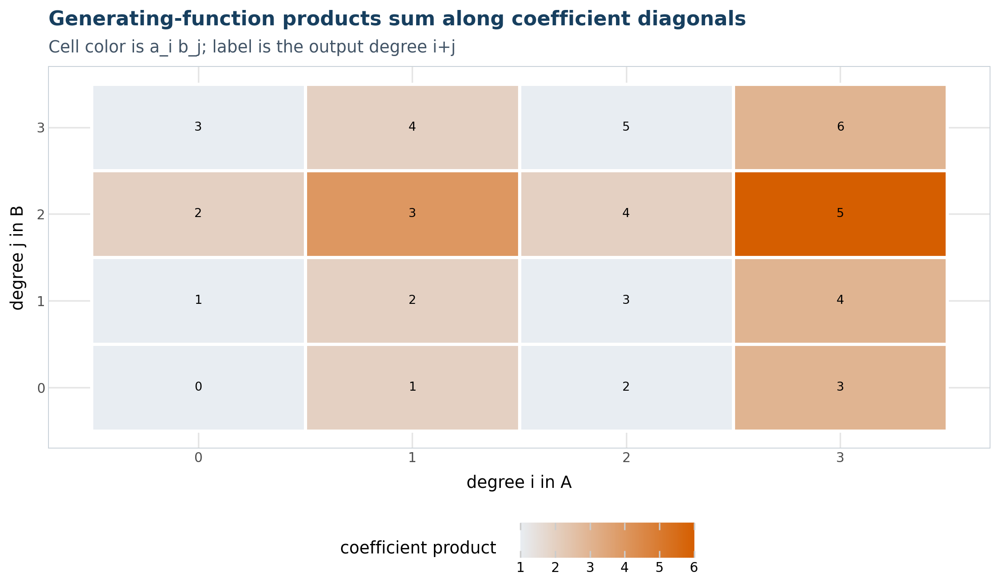

# Ordinary generating functions {#sec-comb-ogf}

An ordinary generating function packages a sequence into a formal power
series. Addition combines alternatives, multiplication combines sizes, and
coefficient extraction turns algebra back into counting.

## Preparation from this book

Chapter 5 supplies recurrences. Only polynomial multiplication is assumed;
formal power series are defined coefficient by coefficient, so analytic
convergence is not initially required.

## Formal series as encodings

For a sequence $(a_n)$, attach $a_n$ to the marker $x^n$. The variable $x$
records size rather than a measured quantity. Equality means equality of every
coefficient. Multiplication performs convolution: a size-$n$ composite splits
into sizes $k$ and $n-k$, and the corresponding counts multiply before all
splits are summed.

The geometric series represents one object of every nonnegative size. Its
finite coefficient identity is justified formally because multiplying by
$1-x$ cancels every positive-degree term. Powers encode bounded or repeated
parts, and products over allowed part sizes encode integer partitions.

<figure id="fig-comb-ogf-convolution">


<figcaption>

Figure 5.1: Coefficient convolution combines two finite sequences by all compatible size splits.

</figcaption>
</figure>

## Recurrences become equations {#sec-comb-formal-pointing}

Multiply a recurrence by $x^n$, sum over its valid range, and handle missing
initial terms explicitly. For Fibonacci-type recurrences, shifts become
multiplication by $x$ and produce a rational generating function. Partial
fractions then recover a closed form or recurrence information.

Formal differentiation is coefficientwise. If $A(x)=\sum_{n\ge0}a_nx^n$,
then

$$
A'(x)=\sum_{n\ge1}na_nx^{n-1},\qquad
xA'(x)=\sum_{n\ge1}na_nx^n.
$$

The second operation preserves recorded size. Its factor $n$ can count a
choice of one marked atom when those choices remain distinguishable. The
first series records the same choices with the marked atom excluded from
the size exponent; it does not mean forgetting the marked atom or its
structural information.

There is a further condition when $a_n$ counts **unlabeled isomorphism
types**. Symmetries can identify different root choices. For the single
unrooted three-vertex path, rooting at either endpoint gives the same type,
while rooting at the center gives another. There are two rooted types,
although the coefficient of $x^3$ in $x(x^3)'$ is three. Thus formal
differentiation always multiplies coefficients as shown, but it need not
count rooted isomorphism types. The [root-orbit clinic](21-algebraic-enumerative.md#sec-comb-root-orbits)
explains the correct counting rule and an exact necklace example.

**Nonexample.** Substituting a numeric value outside the radius of convergence
may be analytically meaningless even when the formal identity is valid.
Conversely, two functions that agree at several numeric points need not encode
the same coefficient sequence.

<!-- inline-formula-code:start -->
## Formula and finite computation

If $C(x)=A(x)B(x)$, then

$$
c_n=[x^n]C(x)=\sum_{k=0}^{n}a_kb_{n-k}.
$$

```python
def convolve(left: list[int], right: list[int]) -> list[int]:
    if not left or not right:
        return []
    result = [0] * (len(left) + len(right) - 1)
    for first_index, first in enumerate(left):
        for second_index, second in enumerate(right):
            result[first_index + second_index] += first * second
    return result

at_most_two_red = [1, 1, 1]
at_most_three_blue = [1, 1, 1, 1]
coefficients = convolve(at_most_two_red, at_most_three_blue)
if coefficients != [1, 2, 3, 3, 2, 1]:
    raise RuntimeError("convolution check failed")
print(coefficients)
```

**What the computation establishes.** The diagonal-sum algorithm extracts all
coefficients of one finite product. It does not prove that a proposed product
models the intended objects; that requires a unique decomposition into the two
components.
<!-- inline-formula-code:end -->

## Rationality and eventual recurrences

A rational generating function with denominator having constant term one
implies a constant-coefficient recurrence after finitely many initial terms.
The converse holds as well. Denominator roots govern exponential growth, while
their multiplicities introduce polynomial factors. Chapter 8 makes this
asymptotic connection precise in common cases.

## Safe algebra with truncated series

Software usually stores only coefficients through a chosen degree. Addition is
exact within that window; multiplication must retain enough input degrees for
the requested output. Inverting a series requires a nonzero constant term and
determines coefficients recursively. Truncation should be represented in the
type or variable name so an omitted high-degree tail is not mistaken for the
zero polynomial. Independent low-degree enumeration is an effective test.

## Formal algebra before numerical substitution

**Definition 5.1 (Formal power series).** A formal power series over \(\mathbb Q\) is a sequence of rational coefficients written \(A(x)=\sum_{n\ge0}a_nx^n\). Define \([x^n]A=a_n\). Equality means coefficientwise equality, addition is coefficientwise, and multiplication is
\[
[x^n](AB)=\sum_{j=0}^n a_jb_{n-j}.
\]
No numerical value of \(x\) is assigned in this definition.

Every product coefficient receives only \(n+1\) contributions. This finiteness is the reason formal multiplication is defined without an analytic convergence assumption. Commutativity follows by replacing \(j\) with \(n-j\), while associativity follows because both triple products sum \(a_ib_jc_k\) over the finite set \(i+j+k=n\). The constant series one is the multiplicative identity.

An ordinary generating function is such a series used to encode counts by size. A count sequence is recovered uniquely by coefficient extraction, so no information is lost about those totals. The encoding usually does lose individual object identities: the series alone does not specify a sampler or reconstruct an example unless a combinatorial decomposition is supplied alongside it.

**Theorem 5.2 (When a formal inverse exists).** A series \(A(x)=\sum_{n\ge0}a_nx^n\) has a multiplicative inverse in \(\mathbb Q[[x]]\) if and only if \(a_0\ne0\). That inverse is unique.

*Proof.* If \(AB=1\), its constant coefficient gives \(a_0b_0=1\), requiring \(a_0\ne0\). Conversely set \(b_0=1/a_0\) and, for \(n\ge1\), recursively define
\[
b_n=-\frac1{a_0}\sum_{j=1}^n a_jb_{n-j}.
\]
Every right-side coefficient has smaller index, so this constructs a unique sequence. Its product with \(A\) has constant coefficient one and every later coefficient zero. Commutativity gives the inverse on both sides. ∎

Thus \(1/(1-x)\) is meaningful formally and equals \(\sum_{n\ge0}x^n\). Multiplying by \(1-x\) verifies each coefficient directly. By contrast, \(1/x\) is not an ordinary power series with nonnegative exponents; it belongs to a larger Laurent-series setting. Calling an expression “a generating function” does not remove the need to specify which algebra contains it.

## Product constructions and a bounded supply

**Theorem 5.3 (Size-additive ordered products).** Suppose each size-\(n\) composite object has a unique description as an ordered pair of an \(\mathcal A\)-object of size \(j\) and a \(\mathcal B\)-object of size \(n-j\), where each size class is finite. If their count series are \(A,B\), the composite series is \(AB\).

*Proof.* For each permitted split \(j\), the product rule gives \(a_jb_{n-j}\) pairs. The split is recovered from the component sizes, so these classes are disjoint and exhaustive. Summing gives exactly the formal product coefficient. ∎

The ordering of the two components is part of this hypothesis, even when their shapes happen to agree. If the objects instead form an unordered pair or share labels, the product coefficient can require a different multiplicity. The next chapter will handle labeled support allocation using exponential generating functions. Here sizes add, and no hidden choice of shared labels is assumed.

### Worked example 5.1: coins of sizes one and two

Consider unordered selections of identical unit coins and identical size-two coins with total value \(n\). The two multiplicities \(a,b\ge0\) satisfy \(a+2b=n\). The generating factors are
\[
(1+x+x^2+\cdots)(1+x^2+x^4+\cdots)
=\frac1{(1-x)(1-x^2)}.
\]
Every selection has one pair of multiplicities, so the product interpretation is unique. The allowed values of \(b\) are zero through \(\lfloor n/2\rfloor\), giving coefficient \(\lfloor n/2\rfloor+1\).

This does not count ordered sequences of coins. At value three, the unordered selections are three unit coins or one of each type, whereas ordered sequences also distinguish the size-one-then-size-two order from its reversal. Their series will arise from a sequence construction rather than the independent multiplicity factors used here.

### Worked example 5.2: an upper bound encoded locally

Suppose there may be at most two red tokens, while any number of blue tokens is allowed, and every token has size one. The multiplicities give
\[
(1+x+x^2)\frac1{1-x}=\frac{1-x^3}{(1-x)^2}.
\]
The coefficient at size \(n\) is the number of possible red counts, namely \(\min(n,2)+1\). It equals one at zero, two at one, and three at every \(n\ge2\).

The numerator \(1-x^3\) has an exact meaning: start with unrestricted multiplicities of the two types, then remove solutions with at least three red tokens by subtracting three there. Its negative coefficient is not a negative number of objects; it records a subtraction between two valid classes. Alternatively, the finite polynomial factor enforces the upper bound directly without signed interpretation.

## Deriving recurrence equations without losing the bases

### Worked example 5.3: the no-consecutive-ones series

Let \(a_0=1,a_1=2\) and \(a_n=a_{n-1}+a_{n-2}\) for \(n\ge2\). With \(A(x)=\sum_{n\ge0}a_nx^n\), sum the recurrence only over its valid range:
\[
A-1-2x=x(A-1)+x^2A.
\]
Rearranging gives
\[
A(x)=\frac{1+x}{1-x-x^2}.
\]
The denominator has constant coefficient one, so formal inversion is permitted. Multiplying the proposed series by its denominator recovers the initial coefficients and the recurrence, proving that the rational expression encodes the sequence uniquely.

If one replaced the numerator by one, the coefficient at \(x\) would be one instead of two. The denominator alone describes a later update; the numerator records boundary information. This explains why apparently similar recurrences can lead to different count series when their bases differ.

**Theorem 5.4 (Rationality and eventual recurrence).** If \(A=P/Q\), where \(P,Q\in\mathbb Q[x]\) and \(Q(0)=1\), then its coefficients satisfy a constant-coefficient linear recurrence after finitely many indices. Conversely, an eventually constant-coefficient linear recurrence yields a rational generating function.

*Proof.* Write \(Q=1+q_1x+\cdots+q_dx^d\). Since \(QA=P\), for every \(n>\deg P\), coefficient extraction gives
\[
a_n+q_1a_{n-1}+\cdots+q_da_{n-d}=0,
\]
where a negative-index coefficient is interpreted as zero in the finite product. Taking \(n\ge d\) avoids those negative indices entirely.

Conversely suppose \(a_n+c_1a_{n-1}+\cdots+c_da_{n-d}=0\) for all sufficiently large \(n\). Multiplying \(A\) by \(1+c_1x+\cdots+c_dx^d\) makes every coefficient beyond that range zero, leaving a polynomial \(P\). The denominator has constant one and is invertible, so \(A=P/Q\). ∎

The word “eventual” is essential. A polynomial numerator can encode exceptional early coefficients before the homogeneous recurrence begins. The theorem makes no claim that every combinatorial sequence has a rational generating function: many recursive specifications give algebraic or more complicated series. It also does not identify an analytic asymptotic from a finite table; the asymptotics chapter supplies the further hypotheses for that step.

## Composition needs a positive-size inner series

**Proposition 5.5 (Formal composition).** If \(B(0)=0\), then \(A(B(x))=\sum_{j\ge0}a_jB(x)^j\) is well-defined as a formal power series. For each fixed coefficient, only finitely many positive powers contribute.

*Proof.* Every monomial in \(B\) has degree at least one, so \(B^j\) has no term of degree below \(j\). Hence the coefficient of \(x^n\) can receive contributions only from \(j=0,\ldots,n\), a finite set. ∎

The condition prevents unlimited insertion of zero-size components. If \(A(t)=\sum_{j\ge0}t^j\) and \(B(x)=1\), the proposed constant coefficient would add infinitely many ones. That is not a rational coefficient in the formal-series definition. A polynomial outer function can be composed without this restriction because it has finitely many terms, and analytic composition under convergence hypotheses is a different operation.

For an ordered sequence of components whose positive-size series is \(B\), the possible lengths give \(1+B+B^2+\cdots=1/(1-B)\). Each fixed size admits only finitely many component lengths because every component consumes positive size. The empty sequence supplies the constant term one. If zero-size components were allowed without further restrictions, even the empty-size class could contain infinitely many sequences.

## Formal differentiation and what is actually marked

The coefficient formulas for \(A'\) and \(xA'\) above are algebraic consequences of defining differentiation term by term. For polynomial truncations the ordinary product rule follows from
\[
[x^{n-1}](A'B+AB')=\sum_{i+j=n}(i+j)a_ib_j
=n\sum_{i+j=n}a_ib_j.
\]
Only finitely many terms contribute at every degree, so the same proof holds formally. No limiting operation is involved.

Their counting interpretation still depends on the equality rule for objects. If a size-\(n\) object carries \(n\) distinguishable selectable atoms, marking one gives \(n\) records, and \(xA'\) preserves its recorded size. For unlabelled types, automorphisms may identify different marks. The existing path example and the root-orbit clinic retain that distinction. Formal calculus gives coefficient identities; it does not by itself prove a theorem about rooted isomorphism classes.

## Truncation is exact only within its stated window

To know a product through degree \(N\), coefficients through degree \(N\) of each input suffice because all exponents are nonnegative. The inverse recurrence similarly computes the inverse through degree \(N\) using only input coefficients through that degree. This is an exact algebraic statement, not an approximation claim about numerical values.

Writing a truncated polynomial without its declared window can create a false conclusion that all later coefficients vanish. Two distinct infinite series may have the same first thousand coefficients. Their equality requires a general identity or a uniqueness argument from a complete specification, not a long numerical agreement. A useful computational record states its size window and the mathematical decomposition whose coefficients it computes.

## Summary

Ordinary generating functions convert alternatives to sums, independent size
splits to products, and recurrences to algebraic equations. Formal and analytic
interpretations are related but must not be silently conflated.

## Exercises

<div class="exercise" id="comb-ordinary-generating-functions-ex-1-exercise">

### Exercise 5.1 {#comb-ordinary-generating-functions-ex-1}

1. Encode the constant sequence one.

<details>
<summary>Hint 1</summary>

**Hint.** Write one coefficient at each nonnegative size.

</details>
<details>
<summary>Hint 2</summary>
**Hint.** Multiplication by $1-x$ should cancel every positive-degree term.

</details>
<details>
<summary>Solution</summary>
**Solution.** The series is $1+x+x^2+\cdots=1/(1-x)$ in $\mathbb Q[[x]]$. Its product with $1-x$ has constant one and every later coefficient zero. This proves the formal identity without assigning a numerical value to $x$.

</details>

</div>

<div class="exercise" id="comb-ordinary-generating-functions-ex-2-exercise">

### Exercise 5.2 {#comb-ordinary-generating-functions-ex-2}

2. Multiply two short series by convolution.

Use $A=1+2x+x^2$ and $B=1-x+3x^2$.

<details>
<summary>Hint 1</summary>

**Hint.** Use the supplied polynomials.

</details>
<details>
<summary>Hint 2</summary>

**Hint.** Group products by their total degree.

</details>
<details>
<summary>Solution</summary>

**Solution.** For $A=1+2x+x^2$ and $B=1-x+3x^2$, the product is $1+x+2x^2+5x^3+3x^4$. For example, the degree-two coefficient is $3-2+1=2$. Every coefficient sums exactly the products with compatible exponents, which is the convolution rule.

</details>

</div>

<div class="exercise" id="comb-ordinary-generating-functions-ex-3-exercise">

### Exercise 5.3 {#comb-ordinary-generating-functions-ex-3}

3. Derive the generating function for the recurrence in Chapter 5.

<details>
<summary>Hint 1</summary>

**Hint.** Retain both initial terms before shifting sums.

</details>
<details>
<summary>Hint 2</summary>

**Hint.** Use the original bases $a_0=1,a_1=2$.

</details>
<details>
<summary>Solution</summary>

**Solution.** The recurrence for $n\ge2$ gives $A-1-2x=x(A-1)+x^2A$. Thus $A=(1+x)/(1-x-x^2)$. The numerator retains the bases; multiplying back gives them and the recurrence, so uniqueness verifies the encoding.

</details>

</div>

<div class="exercise" id="comb-ordinary-generating-functions-ex-4-exercise">

### Exercise 5.4 {#comb-ordinary-generating-functions-ex-4}

4. Encode partitions using parts of size one and two.

<details>
<summary>Hint 1</summary>

**Hint.** The multiplicity of each allowed part is an independent nonnegative integer.

</details>
<details>
<summary>Hint 2</summary>

**Hint.** Its size contribution is the multiplicity times the part size.

</details>
<details>
<summary>Solution</summary>

**Solution.** The factors are $1/(1-x)$ and $1/(1-x^2)$, giving their product. A partition has a unique pair of these multiplicities, so no ordering factor is needed. The coefficient is $\lfloor n/2\rfloor+1$, since the number of twos ranges from zero to $\lfloor n/2\rfloor$.

</details>

</div>

<div class="exercise" id="comb-ordinary-generating-functions-ex-5-exercise">

### Exercise 5.5 {#comb-ordinary-generating-functions-ex-5}

5. State the coefficient identities for $A'(x)$ and $xA'(x)$. Explain
   which preserves recorded size and when its coefficients count marked
   objects. Compare three marked vertex positions on a three-vertex path
   with its rooted isomorphism types.

<details>
<summary>Hint 1</summary>

**Hint.** Differentiation lowers the exponent, whereas multiplication by $x$ restores it.

</details>
<details>
<summary>Hint 2</summary>

**Hint.** A symmetry may identify two different atom choices in an unlabelled type.

</details>
<details>
<summary>Solution</summary>

**Solution.** We have $A'=\sum_{n\ge1}na_nx^{n-1}$ and $xA'=\sum_{n\ge1}na_nx^n$. The latter preserves size and weights every size-$n$ object by $n$. It counts actual marked types only when all those choices remain distinct under the chosen equivalence. The three-vertex unlabelled path has two rooted types, center and endpoint, not three.

</details>

</div>

<div class="exercise" id="comb-ordinary-generating-functions-ex-6-exercise">

### Exercise 5.6 {#comb-ordinary-generating-functions-ex-6}

6. Identify a rational function's recurrence.

Use $A(x)=(1+2x)/(1-3x+2x^2)$ and include its initial values.

<details>
<summary>Hint 1</summary>

**Hint.** Multiply by the specified denominator.

</details>
<details>
<summary>Hint 2</summary>

**Hint.** Compare each coefficient with the numerator, including the first two.

</details>
<details>
<summary>Solution</summary>

**Solution.** For $A=(1+2x)/(1-3x+2x^2)$, the constant equation gives $a_0=1$, and the linear equation gives $a_1-3a_0=2$, so $a_1=5$. All later equations give $a_n=3a_{n-1}-2a_{n-2}$ for $n\ge2$. The numerator affects these bases and cannot be omitted.

</details>

</div>

<div class="exercise" id="comb-ordinary-generating-functions-ex-7-exercise">

### Exercise 5.7 {#comb-ordinary-generating-functions-ex-7}

Construct the formal inverse of $1+x$ and explain its uniqueness.

<details>
<summary>Hint 1</summary>

**Hint.** Use the inverse recurrence or multiply a geometric alternating series.

</details>
<details>
<summary>Hint 2</summary>

**Hint.** The constant term must equal one.

</details>
<details>
<summary>Solution</summary>

**Solution.** The inverse is $\sum_{n\ge0}(-1)^nx^n$. Multiplying by $1+x$ gives constant one and coefficient $(-1)^n+(-1)^{n-1}=0$ at every positive degree. The nonzero constant coefficient of $1+x$ makes the inverse recurrence unique, so no different formal series can be its inverse.

</details>

</div>

<div class="exercise" id="comb-ordinary-generating-functions-ex-8-exercise">

### Exercise 5.8 {#comb-ordinary-generating-functions-ex-8}

Find the first five coefficients of $1/(1-x-x^2)$ and interpret them using positive-size components.

<details>
<summary>Hint 1</summary>

**Hint.** The denominator gives an empty sequence of parts of sizes one or two.

</details>
<details>
<summary>Hint 2</summary>

**Hint.** Compare coefficients after multiplication by $1-x-x^2$.

</details>
<details>
<summary>Solution</summary>

**Solution.** The coefficients at degrees zero through four are $1,1,2,3,5$. They count ordered compositions using parts one and two, including the empty composition. The recurrence begins with $b_0=b_1=1$ and continues by $b_n=b_{n-1}+b_{n-2}$. These bases differ from the no-adjacent-ones series, explaining its different numerator.

</details>

</div>

<div class="exercise" id="comb-ordinary-generating-functions-ex-9-exercise">

### Exercise 5.9 {#comb-ordinary-generating-functions-ex-9}

Show why substituting $B(x)=1$ into the infinite series $A(t)=1+t+t^2+\cdots$ is not a formal composition in $\mathbb Q[[x]]$.

<details>
<summary>Hint 1</summary>

**Hint.** Inspect the constant coefficient before manipulating a rational expression.

</details>
<details>
<summary>Hint 2</summary>

**Hint.** Every outer term contributes one there.

</details>
<details>
<summary>Solution</summary>

**Solution.** The proposed constant coefficient is an infinite sum of ones, not a rational number. Thus the coefficientwise definition fails. The criterion $B(0)=0$ ensures that only finitely many outer powers contribute to a fixed degree; it does not hold here. Analytic substitution would also fail at this point for the geometric series.

</details>

</div>

<div class="exercise" id="comb-ordinary-generating-functions-ex-10-exercise">

### Exercise 5.10 {#comb-ordinary-generating-functions-ex-10}

Count size-$n$ selections of red and blue tokens when red multiplicity is at most two and blue multiplicity is unrestricted.

<details>
<summary>Hint 1</summary>

**Hint.** Use a polynomial for the bounded supply.

</details>
<details>
<summary>Hint 2</summary>

**Hint.** A permitted red count determines the blue count uniquely.

</details>
<details>
<summary>Solution</summary>

**Solution.** The series is $(1+x+x^2)/(1-x)=(1-x^3)/(1-x)^2$. At size $n$ there are $\min(n,2)+1$ choices of red multiplicity. Thus the coefficients are one at zero, two at one, and three thereafter. The numerator subtraction removes solutions with at least three red tokens through a reversible shift.

</details>

</div>

### Selected solution

For Exercise 4, any number of ones contributes $1/(1-x)$ and any number of
twos contributes $1/(1-x^2)$. Their product works because a partition has a
unique multiplicity of each allowed part.

### Pointing explanation {#sec-comb-pointing-answer}

For Exercise 5, multiplication by $x$ restores the exponent from $n-1$ to
$n$. Distinct atom choices count separately only if the chosen equivalence
does not identify them. On the unrooted path, reversal exchanges the two
endpoints and fixes the center, leaving two root types. The marked position
must be retained even when it is excluded from the recorded size; deleting
its information is a different operation.

## Sources for the expanded chapter {#sec-comb-ordinary-generating-functions-sources}

The original chapter, including its formal-pointing warning, cross-references, figure, code, and selected explanations, remains intact. Expanded formal-algebra proofs and exercise solutions are original. Primary parallel reading is Richard P. Stanley, [Enumerative Combinatorics, volume 1, author manuscript](https://math.mit.edu/~rstan/ec/ec1.pdf), Chapter 4 on rational generating functions. Its arguments provide a comparison route rather than copied exercises.

## Summary and next connection {#sec-comb-ordinary-generating-functions-summary}

An ordinary generating function is a coefficient sequence with precisely defined finite arithmetic. Unique size decompositions justify products, nonzero constant coefficients justify inverses, and zero inner constants justify unrestricted formal composition. Rationality is equivalent to an eventual constant-coefficient recurrence, with the numerator retaining initial data. [Exponential generating functions and species](07-exponential-generating-functions.md) next adds the label-allocation factors that ordinary products do not record.
