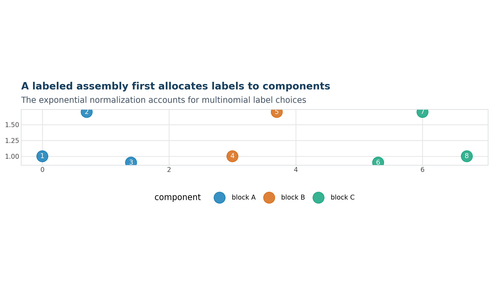

# Exponential generating functions and species {#sec-comb-egf}

Labels change multiplication. Exponential generating functions divide the
size-$n$ coefficient by $n!$, allowing the binomial choices that distribute
labels among components to emerge automatically.

## Preparation from this book

Chapter 6 supplies coefficient encoding and products. Chapter 2 supplies
binomial and multinomial allocation of labels.

## Labeled products

Suppose a labeled structure consists of an $A$-structure and a $B$-structure
on disjoint label subsets. For total size $n$, first choose which labels go to
$A$, then build each component. The binomial coefficient in this count is
exactly absorbed by exponential normalization.

A **combinatorial species** assigns structures to every finite label set and
transports them along bijections. This makes “relabeling changes names but not
structure” precise. Sum, product, sequence, set, and cycle constructions then
translate into operations on generating functions under stated empty-object
conditions.

<figure id="fig-comb-labeled-assembly">


<figcaption>

Figure 6.1: A labeled assembly partitions labels among components before placing a structure on each block.

</figcaption>
</figure>

## The exponential formula

When a labeled object is a set of connected components, the generating
function for all objects is the exponential of the one for connected objects.
Set partitions are sets of nonempty label blocks, permutations are sets of
cycles, and graphs are sets of connected graphs. Taking a formal logarithm
recovers connected counts from total counts.

The construction depends on unique decomposition. If components interact or
carry an external order, the exponential formula must be changed.

**Nonexample.** Ordinary and exponential series can encode the same count
sequence, but their products describe different constructions. If each of two
labeled components is just the set of labels assigned to it, multiplying the
raw-count OGFs gives $n+1$ instead of $2^n$: label allocations were lost.
The [label-allocation clinic](#sec-comb-labelled-assemblies) derives the
coefficient rules, including this undercount for $n\ge2$, with their exact
empty-component conditions.

<!-- labelled-assemblies-clinic:start -->
## Labels, component order and finite coefficients {#sec-comb-labelled-assemblies}

The division rule from [Chapter 1](01-counting-structure.md), label
allocation from [Chapter 2](02-binomial-multinomial.md), refined states from
[Chapter 5](05-recurrences.md), and coefficientwise algebra from
[Chapter 6](06-ordinary-generating-functions.md) fit together here. We will
keep the label support in every object, prove the multiplicities, and then
change the construction rather than only its numeric parameter.

### Record the labels before multiplying {#sec-comb-labelled-product}

Write $[n]=\{1,\ldots,n\}$, with $[0]=\varnothing$. For every finite label
set $U$, let $\mathcal A[U]$ and $\mathcal B[U]$ be finite collections of
structures carried by exactly $U$. Consistent relabeling makes their counts
depend only on $|U|$. The support is retained: an identical decoration on a
different label set is a different supported record.

On a fixed $n$-element set $L$, a labeled ordered pair records
$(U,\alpha,\beta)$, where $U\subseteq L$,
$\alpha\in\mathcal A[U]$, and $\beta\in\mathcal B[L\setminus U]$.
Choose $U$, then its two structures. Recovering those three entries is an
inverse, so no pair is lost or repeated. If $a_k$ and $b_k$ are the counts
on a $k$-element support, the product count is

$$
d_n=\sum_{k=0}^n\binom nk a_kb_{n-k}.
$$

Define $A(z)=\sum_{n\ge0}a_nz^n/n!$, and similarly $B(z)$ and $D(z)$.
Dividing the finite identity by $n!$ proves $D(z)=A(z)B(z)$.
The factorial normalization absorbs the label allocations.

An ordinary product of the raw count series instead has coefficient
$\sum_k a_kb_{n-k}$, with no choice of which labels go to the first
component. If each component is just its assigned set, then $a_k=b_k=1$.
The labeled count is $2^n$, since every label chooses a side; the ordinary
product $(1-z)^{-2}$ gives $n+1$. At size two that is three instead of four.
Other mistakes can overcount. The direction depends on the information
that a particular construction loses or repeats.

### Nonempty supported components {#sec-comb-labelled-components}

Let $\mathcal C$ be another such relabeling-consistent finite family, with
$\mathcal C[\varnothing]=\varnothing$. Write $c_j$ for its count on a
$j$-element support and

$$
C(z)=\sum_{j\ge1}c_j\frac{z^j}{j!}.
$$

An ordered $r$-component object is an ordered partition of $L$ into $r$
nonempty supports, each carrying a $\mathcal C$-structure. Repeated labeled
products give $C(z)^r$. Forget the order. Every unordered assembly has
exactly $r!$ preimages: its nonempty disjoint supports distinguish the
actual components, even when their sizes, shapes or decorations coincide.
Conversely, ordering these supported records in any of the $r!$ ways
recovers a different ordered object. Thus

$$
h_{n,r}=\frac{n!}{r!}[z^n]C(z)^r,
\qquad
\sum_{n,r\ge0}h_{n,r}\frac{z^n}{n!}u^r
=\sum_{r\ge0}\frac{u^rC(z)^r}{r!}
=\exp(uC(z)).
$$

There is one empty assembly: $h_{0,0}=1$. Impossible indices have count
zero. Every component consumes a label, so $r\le n$ and each coefficient
of $z^n$ receives only finitely many contributions. The identities belong
to $\mathbb Q[u][[z]]$: at each size the coefficient is a polynomial in
the component marker $u$. No numerical value of $z$ or analytic
convergence is required.

Keeping component order instead gives

$$
\sum_{r\ge0}u^rC(z)^r=\frac{1}{1-uC(z)}.
$$

The same positive-size condition makes this sum coefficientwise finite.
The factorial relating the two constructions depends on the actual
component number, so keep that statistic before summing.

There is also an integer recurrence. For $n,r\ge1$, inspect the component
containing the least label. Choose its $j-1$ companions, its structure,
and an assembly on the complement. Those choices are reversible:

$$
h_{n,r}=\sum_{j=1}^n
\binom{n-1}{j-1}c_jh_{n-j,r-1}.
$$

Together with $h_{0,0}=1$ and zero at impossible indices, this determines
the table. Taking $c_j=1$ for every positive $j$, summing over $r$, and
reindexing gives the Bell recurrence in the original program below.

### Exact investigation: eight people and captained teams {#sec-comb-labelled-worked}

Partition eight distinct people into teams of size two or three. Each
team chooses one of its members as captain. The other members are
unordered, and the teams have no order. A record retains every team's
people and captain. A size-$j$ support has $j$ possible captain choices for $j=2,3$, so

$$
C(z)=2\frac{z^2}{2!}+3\frac{z^3}{3!}
=z^2+\frac{z^3}{2}.
$$

With $p$ pairs and $q$ triples, $2p+3q=n$. Label allocation, captain
choices and forgetting equal-size team order give

$$
\frac{n!2^p3^q}{(2!)^p(3!)^q p!q!}
=\frac{n!}{p!q!2^q}.
$$

Write a profile as (pairs, triples; teams).

| Profile | Support partitions | Captain choices |
|:--|--:|--:|
| (4,0;4) | 105 | 16 |
| (1,2;3) | 280 | 18 |

| Profile | Unordered | Ordered |
|:--|--:|--:|
| (4,0;4) | 1,680 | 40,320 |
| (1,2;3) | 5,040 | 30,240 |
| Total | 6,720 | 70,560 |

Four pairs have $8!/((2!)^4\,4!)=105$ support partitions and $2^4$
captain choices. For one pair and two triples, choose the pair in
$\binom82=28$ ways, split the other six people into two unordered triples
in $\binom63/2=10$ ways, and choose captains in $2\cdot3^2=18$ ways.
This gives $28\cdot10\cdot18=5,040$.

The marked coefficients preserve the distinction:

$$
8![z^8]\exp(uC(z))=1680u^4+5040u^3,
$$

$$
8![z^8]\frac{1}{1-uC(z)}=40320u^4+30240u^3.
$$

A single factorial applied after totaling cannot convert $6,720$ to
$70,560$: the two profiles contain different numbers of actual teams.

### Bounded exact coefficient tables {#sec-comb-labelled-code}

The next standalone program computes powers of the component EGF with
exact rational coefficients. Its concrete input is a tuple of one to
eleven exact nonnegative integers $(c_0,\ldots,c_m)$, with $c_0=0$ and no
components beyond the supplied catalog. The degree limit is an exact
integer from zero through ten. Booleans, subclasses, floats and arbitrary
iterables are rejected; invalid types raise TypeError and invalid
values raise ValueError before table construction. Integer magnitudes
are unrestricted.

The returned unordered and ordered tables use size as the row and
component number as the column. Only coefficients through the requested
degree are stored; high-degree terms cannot change those coefficients.
The companion function implements the changed task's rational equation,
whose reversible derivation is in the [full explanation](#sec-comb-labelled-solution).
Its tokens have three possibilities on a three-person support and sixty
on a five-person support: a triple, or a pair followed by a triple.

```python
from fractions import Fraction
from math import comb, factorial

def _checked_egf_limit(limit: int) -> None:
    if type(limit) is not int:
        raise TypeError("limit must be an exact integer, excluding bool")
    if not 0 <= limit <= 10:
        raise ValueError("limit must be between zero and ten")

def labelled_component_tables(
    component_counts: tuple[int, ...], limit: int
) -> dict[str, tuple[tuple[int, ...], ...]]:
    """Return exact unordered and ordered counts indexed by size, then components."""
    _checked_egf_limit(limit)
    if type(component_counts) is not tuple:
        raise TypeError("component_counts must be an exact tuple")
    if not 1 <= len(component_counts) <= 11:
        raise ValueError("supply between one and eleven component counts")
    if any(type(count) is not int for count in component_counts):
        raise TypeError("component counts must be exact integers, excluding bool")
    if any(count < 0 for count in component_counts):
        raise ValueError("component counts must be nonnegative")
    if component_counts[0] != 0:
        raise ValueError("components must have positive size: c_0 must be zero")
    coefficients = [
        Fraction(
            component_counts[size] if size < len(component_counts) else 0,
            factorial(size),
        )
        for size in range(limit + 1)
    ]
    power = [Fraction(1)] + [Fraction(0)] * limit
    unordered = [[0] * (limit + 1) for _ in range(limit + 1)]
    ordered = [[0] * (limit + 1) for _ in range(limit + 1)]
    for components in range(limit + 1):
        for size in range(limit + 1):
            ordered_count = factorial(size) * power[size]
            unordered_count = ordered_count / factorial(components)
            if ordered_count.denominator != 1 or unordered_count.denominator != 1:
                raise RuntimeError("a supported-component count is not integral")
            ordered[size][components] = ordered_count.numerator
            unordered[size][components] = unordered_count.numerator
        if components < limit:
            power = [
                sum(
                    (power[split] * coefficients[size - split]
                     for split in range(size + 1)),
                    Fraction(0),
                )
                for size in range(limit + 1)
            ]
    return {
        "unordered": tuple(tuple(row) for row in unordered),
        "ordered": tuple(tuple(row) for row in ordered),
    }

def captained_nonadjacent_counts(limit: int) -> tuple[int, ...]:
    """Count ordered captained pairs/triples with no adjacent pair teams."""
    _checked_egf_limit(limit)
    values = [0] * (limit + 1)
    for size in range(limit + 1):
        count = int(size == 0) + 2 * int(size == 2)
        if size >= 3:
            count += 3 * comb(size, 3) * values[size - 3]
        if size >= 5:
            count += 60 * comb(size, 5) * values[size - 5]
        values[size] = count
    return tuple(values)

tables = labelled_component_tables((0, 0, 2, 3), 10)
unordered_eight = tables["unordered"][8]
ordered_eight = tables["ordered"][8]
constrained = captained_nonadjacent_counts(10)
if (unordered_eight[3], unordered_eight[4], sum(unordered_eight)) != (
    5040, 1680, 6720
):
    raise RuntimeError("the eight-label assembly table is wrong")
if (ordered_eight[3], ordered_eight[4], sum(ordered_eight)) != (
    30240, 40320, 70560
):
    raise RuntimeError("the eight-label sequence table is wrong")
if constrained[:5] != (1, 0, 2, 3, 0) or constrained[10] != 2721600:
    raise RuntimeError("the constrained team count is wrong")
print([(count, value) for count, value in enumerate(unordered_eight) if value])
print([(count, value) for count, value in enumerate(ordered_eight) if value])
print(constrained[10])
```

The displayed outputs are $(3,5040),(4,1680)$ for unordered teams,
$(3,30240),(4,40320)$ for ordered teams, and $2,721,600$ for the changed
task. The code constructs coefficient tables, not millions of sequences.
It establishes only those declared finite calculations. Support
reconstruction, factorial multiplicity, the positive-size condition and
the universal equations require the proofs above and below.

### Changed task: ordered teams with a neighboring restriction {#sec-comb-labelled-task}

Ten distinct people again form captained teams of size two or three, but
the teams now form a linear sequence. Two two-person teams may not be
adjacent. There is no cyclic identification.

1. Specify the complete object and derive a reversible decomposition
   respecting adjacency. Why do $\exp(C(z))$ and $1/(1-C(z))$ describe
   different problems?
2. Derive its EGF $T(z)$, including the constant term, using a state or
   a reversible tokenization.
3. Count the ten-label objects by profiles and valid size orders,
   independently of algebraic coefficient extraction.
4. Add an empty entry $\varepsilon$, using no labels, that may occur any
   number of times in the sequence. Does every size still have finitely
   many objects? Distinguish this question from the existence of an
   analytic exponential with a nonzero constant term.

Attempt the task before using the [hint](#sec-comb-labelled-hint) or
[full explanation](#sec-comb-labelled-solution).

### Hint {#sec-comb-labelled-hint}

Put $a=z^2$ for a captained pair and $b=z^3/2$ for a captained triple.
After a pair, the remainder must be empty or begin with a triple. For an
independent count, place pair symbols in the gaps around the triple
symbols, at most one per gap. The empty entries in part 4 are repeatable
occurrences, not a single optional decoration.

### Full explanation {#sec-comb-labelled-solution}

An object retains an ordered tuple of nonempty disjoint team supports
covering $[10]$, and a captain in each support. Order within a team is
discarded; team order is retained.

Let $R$ consist of empty valid sequences and valid sequences beginning
with a triple, and let $T$ contain all valid sequences. First-team cases
give

$$
R=1+bT,\qquad T=1+aR+bT.
$$

Each product distributes labels between the first team and the remainder.
Recovering that first supported team inverts the construction; the cases
are disjoint. Elimination gives

$$
T(z)=\frac{1+a}{1-b-ab}
=\frac{1+z^2}{1-z^3/2-z^5/2}.
$$

The constant term is one. Equivalently, a valid sequence consists of
tokens $b$ or $ab$, followed by an optional terminal $a$. Every pair
except a terminal one is paired with its following triple, making this
tokenization unique. All nonempty tokens have positive size. The
program's factors $3\binom n3$ and $60\binom n5$ choose the support and
structure of the first token; the empty or lone-pair ending supplies the
initial terms.

For a profile with $p$ pairs and $q$ triples, the $q$ triple symbols create
$q+1$ gaps. Choosing at most one pair per gap gives
$\binom{q+1}{p}$ valid type words when $p\le q+1$, and none otherwise.
For each type word, label allocation and captain choices give $n!/2^q$
records. Hence, for every nonnegative $n$,

$$
t_n=\sum_{\substack{p,q\ge0\\2p+3q=n\\p\le q+1}}
\binom{q+1}{p}\frac{n!}{2^q}.
$$

At size ten the profiles are $(p,q)=(5,0),(2,2)$. The first is forbidden.
The second permits just the words $2323,2332,3232$. Each contributes
$10!/4=907,200$, giving $2,721,600$. The degree-ten term of $T$ is
$3a^2b^2=3z^{10}/4$, which agrees after multiplication by $10!$.

An unrestricted sequence would include five consecutive pairs and all
six orders of the other profile, giving
$10!+6\cdot10!/4=9,072,000$. A set construction additionally discards
the required team order. The task needs a different constructor and
state, rather than a new numeric parameter in the worked example.

For part 4, even the empty label set has the distinct sequences
$(),(\varepsilon),(\varepsilon,\varepsilon),\ldots$. Thus there are
infinitely many size-zero objects. If one instead forgets the order of
repeatable empty occurrences, the sole ordered record
$(\varepsilon,\varepsilon)$ still gives one object; dividing its count by
$2!$ is already wrong. The distinct nonempty supports used in the
factorial proof have disappeared.

This is a combinatorial local-finiteness failure. Over $\mathbb Q$, the
constant coefficients of the formal exponential partial sums for
$\exp(1+z)$ are $\sum_{r=0}^R1/r!$, which never stabilize. Nevertheless
they converge numerically over the reals, and the analytic function
$\exp(1+z)=e\exp(z)$ exists. That analytic fact does not make the
repeatable-empty model a finite counting class. A separate optional
global Boolean decoration, attached once to the whole object with no
insertion position, is another model and gives two choices.

The supported-product and positive-component hypotheses are developed
in Bruce E. Sagan's [author-hosted text](https://users.math.msu.edu/users/bsagan/Books/Aoc/GSM210.pdf#page=145),
Sections 4.4–4.5, printed pages 128–132. The team investigation and
adjacency task here derive their own reversible constructions.

<!-- labelled-assemblies-clinic:end -->

<!-- inline-formula-code:start -->
## Formula and finite computation

The Bell numbers count set partitions and satisfy

$$
B_{n+1}=\sum_{k=0}^{n}\binom nk B_k,\qquad B_0=1.
$$

```python
from math import comb

def bell_numbers(limit: int) -> list[int]:
    if limit < 0:
        raise ValueError("limit must be nonnegative")
    values = [1]
    for size in range(limit):
        values.append(sum(comb(size, chosen) * values[chosen] for chosen in range(size + 1)))
    return values

values = bell_numbers(8)
if values[:6] != [1, 1, 2, 5, 15, 52]:
    raise RuntimeError("Bell-number check failed")
print(values)
```

**What the computation establishes.** The recurrence produces exact Bell
numbers through size eight. It does not prove the recurrence or the species
identity; distinguish the block containing a fixed label to obtain the
reversible decomposition.
<!-- inline-formula-code:end -->

## Marking statistics

Introduce a second variable to mark components, cycles, blocks, or another
statistic. Coefficients then form a distribution table rather than one count.
Differentiating in the marker weights an object by its number of marked
features, a bridge from enumeration to expected values in random structures.

## Recursive specification and sampling

A species equation can describe more than counts: its constructors support
recursive generation of objects. Exact-size sampling needs coefficient tables
to choose component sizes with their correct weights. Boltzmann sampling
instead tunes a parameter and permits random total size, often simplifying
independent component generation. In both cases, a termination argument and a
check for accidental label bias belong beside the attractive symbolic
specification.

## The labelled coefficient rule as a theorem

**Definition 6.1 (Exponential generating function).** If \(a_n\) counts structures supported on a specified \(n\)-element label set, and relabelling gives the same count on every set of that size, its exponential generating function is \(A(z)=\sum_{n\ge0}a_nz^n/n!\). It is a formal series over \(\mathbb Q\), not a probability distribution.

**Theorem 6.2 (Labelled product and set construction).** An ordered pair of structures on complementary label supports has EGF \(A(z)B(z)\). If \(C(0)=0\), unordered assemblies of \(C\)-components on disjoint supports have EGF \(\exp(C(z))\), with \(\exp(uC(z))\) marking the number of components.

*Proof.* For total label set \(L\) of size \(n\), choose the first support in \(\binom nk\) ways and then its two structures, giving \(\sum_k\binom nk a_kb_{n-k}\). Division by \(n!\) yields the product coefficient.

For \(r\) components, repeated products count ordered supported components. Their nonempty disjoint supports distinguish them even when two component shapes agree, so forgetting the order has exactly \(r!\) preimages for every assembly. Division by \(r!\) yields \(C^r/r!\). Summing over \(r\) gives the exponential, and a component marker contributes \(u^r\). Since every component consumes at least one label, \(r\le n\); therefore each fixed coefficient receives finitely many contributions. ∎

The precise objects in this theorem are supported records, not unlabelled isomorphism types. Two isomorphic decorations on different label sets remain different components. Conversely, changing the names of supports consistently gives the same number of possibilities, which is why the count sequence depends only on support size. The existing clinic above makes these distinctions concrete for captained teams.

### Worked example 6.1: two labelled groups versus two sizes

Partition a three-person label set into a first group and a second group, with empty groups permitted. Each person independently chooses one side, giving \(2^3=8\) ordered splits. The EGF for a plain labeled set is \(e^z\), so the product is \(e^{2z}\) and \(3![z^3]e^{2z}=8\).

The ordinary product of the size-count series would be \((1-z)^{-2}\), whose degree-three coefficient is four. It records only the possible first-group sizes zero, one, two, three, losing the choice of which actual people occupy them. This is the concrete label-allocation factor that exponential normalization absorbs.

### Worked example 6.2: the cycle decomposition of permutations

A cyclic order on a specified \(j\)-element set has \((j-1)!\) possibilities: fix one distinguished label as the first displayed entry and arrange the others. Thus its EGF is \(C(z)=\sum_{j\ge1}z^j/j\). Every permutation decomposes uniquely into an unordered set of disjoint cycles, so its EGF is \(\exp(C(z))=1/(1-z)\).

The formal identity can be checked without analytic logarithms. If \(F=\exp(C)\), formal differentiation gives \(F'=C'F=F/(1-z)\) and \(F(0)=1\). The series \(1/(1-z)\) satisfies the same coefficient recurrence and base, hence is equal to \(F\). Its degree-\(n\) coefficient is one, so the labeled count is \(n!\).

For \(n=4\), the cycle-size profiles \(1+1+1+1\), \(2+1+1\), \(2+2\), \(3+1\), and \(4\) contribute respectively \(1,6,3,8,6\), totalling twenty-four. For instance, a three-cycle plus a fixed point chooses the fixed point in four ways and one of two cycles on the other labels. This profile count verifies how repeated component sizes and internal cycle order both enter.

### Worked example 6.3: colouring the blocks, not the labels

Partition a three-element label set into nonempty blocks and assign one of \(q\ge1\) distinguishable colors to each block. A block on any nonempty support has \(q\) decorations, so \(C(z)=q(e^z-1)\). The assembly EGF is \(\exp(q(e^z-1))\).

There is one one-block partition, three two-block partitions, and one three-block partition. Their contributions are \(q\), \(3q^2\), and \(q^3\). For two colors this gives twenty-two objects. Colouring individual labels independently would give only eight assignments and would not specify how equal or differently colored labels were partitioned into blocks. The decoration belongs to a component, so its support and equality rule must remain part of the count.

## Empty supports and the scope of an assembly formula

The positive-size hypothesis is not a minor technical convenience. If a component can use no labels, an unrestricted assembly can add arbitrarily many empty components without changing total label size. Depending on the equality rule, this may make even the size-zero class infinite, and the argument that component supports distinguish all orderings can fail. A bounded number of empty components or a separately declared empty decoration can be handled, but needs a different specification.

Marking a statistic also requires finiteness at a fixed size. In \(\exp(uC(z))\), the coefficient of \(z^n\) is a polynomial in \(u\) because there are at most \(n\) nonempty components. If a model permits arbitrarily many zero-size components, that polynomial property need not survive. The formal ring records an actual mathematical promise about the size classes.

These labeled rules provide more than closed expressions. A decomposition by the component containing the least label yields integer recurrences, and completion counts can guide exact-size generation. A sampler must choose support sizes with their full binomial and structural weights; uniform choice of a size is generally biased. The retained investigations demonstrate those coefficients and the difference between ordered and unordered components without treating a finite program run as proof of the construction.

## Summary

Exponential generating functions are the natural algebra for labeled
components. Species state the relabeling principle, and the exponential
formula converts unique sets of connected pieces into an exact enumeration.

## Exercises

<div class="exercise" id="comb-exponential-generating-functions-ex-1-exercise">

### Exercise 6.1 {#comb-exponential-generating-functions-ex-1}

1. Derive the Bell recurrence by the block containing label one.

<details>
<summary>Hint 1</summary>

**Hint.** Choose the complement of the distinguished block.

</details>
<details>
<summary>Hint 2</summary>
**Hint.** Partition the remaining $k$ labels and sum over its possible size.

</details>
<details>
<summary>Solution</summary>
**Solution.** For a partition of $[n+1]$, choose the $k$ labels not in the block of one in $\binom nk$ ways, then partition them in $B_k$ ways. The rest join one in its unique block. Thus $B_{n+1}=\sum_{k=0}^n\binom nk B_k$ with $B_0=1$. The construction and its inverse identify every partition once.

</details>

</div>

<div class="exercise" id="comb-exponential-generating-functions-ex-2-exercise">

### Exercise 6.2 {#comb-exponential-generating-functions-ex-2}

2. Explain the factorial normalization in a labeled product.

<details>
<summary>Hint 1</summary>

**Hint.** The two supports must be selected as well as their structures.

</details>
<details>
<summary>Hint 2</summary>

**Hint.** Divide the allocation identity by $n!$.

</details>
<details>
<summary>Solution</summary>

**Solution.** The supported ordered-pair count is $d_n=\sum_k\binom nk a_kb_{n-k}$. Since $\binom nk/n!=1/(k!(n-k)!)$, the degree-$n$ coefficient of $A(z)B(z)$ is $d_n/n!$. The factorial normalization absorbs support allocation; it does not discard the label sets from the underlying objects.

</details>

</div>

<div class="exercise" id="comb-exponential-generating-functions-ex-3-exercise">

### Exercise 6.3 {#comb-exponential-generating-functions-ex-3}

3. Find the EGF for labeled sets.

<details>
<summary>Hint 1</summary>

**Hint.** A specified label set has one plain set structure.

</details>
<details>
<summary>Hint 2</summary>

**Hint.** The coefficient is its count divided by its size factorial.

</details>
<details>
<summary>Solution</summary>

**Solution.** There is one such structure on every size, including the empty support. Hence the EGF is $\sum_{n\ge0}z^n/n!=e^z$, interpreted formally. It differs from the ordinary series $1/(1-z)$ for the same count sequence because the chosen normalization is different.

</details>

</div>

<div class="exercise" id="comb-exponential-generating-functions-ex-4-exercise">

### Exercise 6.4 {#comb-exponential-generating-functions-ex-4}

4. Interpret permutations as sets of cycles.

<details>
<summary>Hint 1</summary>

**Hint.** A cyclic order on a fixed $j$-set has $(j-1)!$ possibilities.

</details>
<details>
<summary>Hint 2</summary>

**Hint.** The cycles of a permutation partition its support uniquely.

</details>
<details>
<summary>Solution</summary>

**Solution.** The nonempty cycle EGF is $C(z)=\sum_{j\ge1}z^j/j$. The set construction gives $\exp(C(z))=1/(1-z)$. Therefore the coefficient $a_n/n!$ is one and $a_n=n!$. Support labels distinguish actual cycles even when their lengths coincide, justifying the division by the number-of-cycles factorial.

</details>

</div>

<div class="exercise" id="comb-exponential-generating-functions-ex-5-exercise">

### Exercise 6.5 {#comb-exponential-generating-functions-ex-5}

5. Mark the number of set-partition blocks.

<details>
<summary>Hint 1</summary>

**Hint.** Insert a factor $u$ for every nonempty component.

</details>
<details>
<summary>Hint 2</summary>

**Hint.** An undecorated block has EGF $e^z-1$.

</details>
<details>
<summary>Solution</summary>

**Solution.** The bivariate EGF is $\exp(u(e^z-1))$. Its coefficient $n![z^nu^r]$ is the number of partitions into exactly $r$ blocks. Since each block is nonempty, $r\le n$, so the size-$n$ coefficient is a polynomial in $u$. No analytic convergence hypothesis is required.

</details>

</div>

<div class="exercise" id="comb-exponential-generating-functions-ex-6-exercise">

### Exercise 6.6 {#comb-exponential-generating-functions-ex-6}

6. Give a structure whose components are ordered rather than a set.

<details>
<summary>Hint 1</summary>

**Hint.** Retain positions for the components.

</details>
<details>
<summary>Hint 2</summary>

**Hint.** Do not divide an $r$-component product by $r!$.

</details>
<details>
<summary>Solution</summary>

**Solution.** An ordered list of nonempty labeled blocks has EGF $\sum_{r\ge0}(e^z-1)^r=1/(2-e^z)$. More generally the ordered construction is $1/(1-C(z))$ when $C(0)=0$. Reordering two different supported blocks changes the outcome, so the unordered exponential formula would count another class.

</details>

</div>

<div class="exercise" id="comb-exponential-generating-functions-ex-7-exercise">

### Exercise 6.7 {#comb-exponential-generating-functions-ex-7}

Count partitions of four labeled people into two captained pairs.

<details>
<summary>Hint 1</summary>

**Hint.** Choose the support partition and then one captain per pair.

</details>
<details>
<summary>Hint 2</summary>

**Hint.** There are three pair partitions.

</details>
<details>
<summary>Solution</summary>

**Solution.** The support partitions number $4!/((2!)^2\,2!)=3$. Each has $2^2=4$ captain choices, giving twelve objects. Equivalently, the pair-component EGF is $z^2$, and $4^2/2!=12$. The divisor concerns the two supported pairs, not their internal captain choices.

</details>

</div>

<div class="exercise" id="comb-exponential-generating-functions-ex-8-exercise">

### Exercise 6.8 {#comb-exponential-generating-functions-ex-8}

Explain why unrestricted zero-size components invalidate the usual finite assembly argument.

<details>
<summary>Hint 1</summary>

**Hint.** The number of components need no longer be bounded by total label size.

</details>
<details>
<summary>Hint 2</summary>

**Hint.** Consider adding any number of copies on the empty support.

</details>
<details>
<summary>Solution</summary>

**Solution.** If a repeatable empty component is allowed, assemblies of total size zero can have arbitrarily many components. The coefficient is no longer a finite sum over component counts, and nonempty supports no longer distinguish all actual components for a constant $r!$ fibre argument. A modified bounded or decorated model needs its own definition and proof.

</details>

</div>

<div class="exercise" id="comb-exponential-generating-functions-ex-9-exercise">

### Exercise 6.9 {#comb-exponential-generating-functions-ex-9}

Count partitions of a four-element labeled set into exactly two blocks using the least-label recurrence.

<details>
<summary>Hint 1</summary>

**Hint.** Classify by the size of the block containing label one.

</details>
<details>
<summary>Hint 2</summary>

**Hint.** Its complement must be one nonempty block.

</details>
<details>
<summary>Solution</summary>

**Solution.** If the distinguished block has size $j=1,2,3$, choose its $j-1$ companions in $\binom3{j-1}$ ways; the remaining labels form the other block uniquely. The sum is $1+3+3=7$. The case $j=4$ leaves no labels for a second block and contributes zero.

</details>

</div>

<div class="exercise" id="comb-exponential-generating-functions-ex-10-exercise">

### Exercise 6.10 {#comb-exponential-generating-functions-ex-10}

Count five people partitioned into one captained pair and one captained triple, first unordered and then ordered.

<details>
<summary>Hint 1</summary>

**Hint.** The differing sizes identify which support is the pair.

</details>
<details>
<summary>Hint 2</summary>

**Hint.** After choosing supports, choose one captain in each.

</details>
<details>
<summary>Solution</summary>

**Solution.** There are $\binom52\cdot2\cdot3=60$ unordered assemblies. If an independent order of the two supported teams is retained, there are $2!\cdot60=120$ ordered objects. Their differing sizes do not remove the two possible order positions; they only make the support choice unambiguous.

</details>

</div>

### Selected solution

For Exercise 1, if the distinguished block has $n-k+1$ elements, choose its
other labels and partition the remaining $k$. Reindexing gives the displayed
sum.

## Sources for the expanded chapter {#sec-comb-exponential-generating-functions-sources}

Every original labelled-assembly investigation, changed task, reference, code block, anchor, and selected explanation is retained above. The additional theorem statement and examples are original. Primary parallel reading is Richard P. Stanley's [author page for Enumerative Combinatorics](https://math.mit.edu/~rstan/ec/), including the second volume's treatment of exponential constructions; the original clinic's references remain in place.

## Summary and next connection {#sec-comb-exponential-generating-functions-summary}

Exponential normalization accounts for which labels support each component. Products allocate disjoint supports, and unordered assemblies divide by the exact component-order multiplicity only when their positive supports distinguish them. Markers retain statistics before profiles are summed, while empty components require separate handling. [Asymptotic enumeration](08-asymptotic-enumeration.md) next studies the growth of such exact coefficient sequences, with its additional analytic hypotheses stated where needed.
