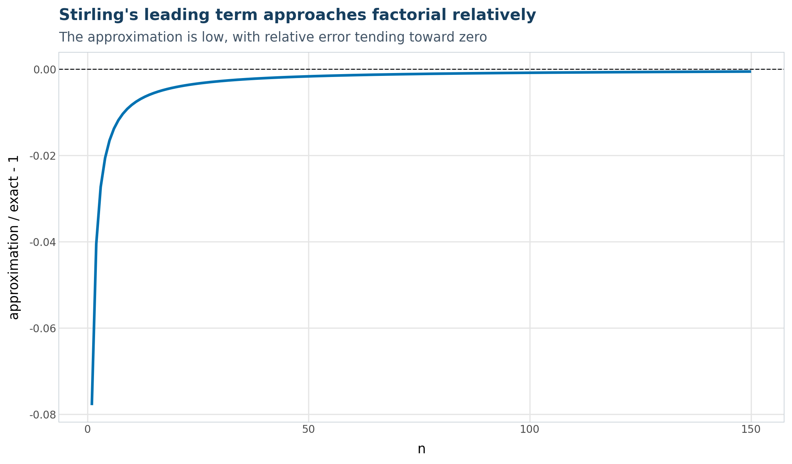

# Asymptotic enumeration {#sec-comb-asymptotic}

Exact formulas can obscure scale. Asymptotic enumeration identifies the main
growth, the relative error, and sometimes a full expansion as size tends to
infinity.

## Preparation from this book

The readiness appendix reviews logarithms and growth notation. Chapter 6
introduces generating functions; limits beyond elementary sequences are
explained where used.

The elementary coefficient arguments below use algebra and limits of
sequences. The logarithmic factorial estimate and the proof of the central
binomial estimate additionally use definite integration, monotonicity of
integrals, and integration by parts. For those proofs, first read
[definite integrals and the Fundamental Theorem](../calculus/06-integrals-ftc.md)
and [integration techniques](../calculus/07-integration-techniques.md)
in Calculus. The displays involving a finite number of initial coefficients
do not prove an asymptotic theorem; the limit arguments and their hypotheses
are needed.

## Comparing claims

An upper bound, a two-sided order estimate, and an asymptotic equivalence carry
different information. Saying $a_n=O(b_n)$ permits a much smaller sequence.
Saying $a_n\sim b_n$ asserts relative error tends to zero, but does not alone
bound the error at a particular finite $n$.

Stirling's approximation converts factorials to powers and exponentials. On a
log scale it separates an extensive term $n\log n-n$, a logarithmic correction,
and smaller error. It yields the central binomial estimate and explains why a
typical binomial layer is of order $2^n/\sqrt n$ rather than $2^n$.

<figure id="fig-comb-stirling">


<figcaption>

Figure 7.1: Stirling's approximation rapidly approaches factorial growth in relative error.

</figcaption>
</figure>

## Singularities and coefficients

For analytic generating functions, the singularity nearest the origin often
controls exponential coefficient growth. A simple pole gives a pure
exponential; algebraic singularities introduce powers of $n$. This principle
requires conditions: cancellation, multiple dominant singularities, or
periodicity can change the answer.

Saddle-point and probabilistic methods handle coefficients whose dominant
index moves with $n$. Subadditivity can prove the existence of exponential
growth rates even without exact formulas.

**Nonexample.** Matching the first ten values or plotting a straight line on a
log scale does not establish asymptotic equivalence. A missing factor of
$\sqrt n$ is visually modest but mathematically unbounded.

<!-- inline-formula-code:start -->
## Formula and finite computation

Stirling's leading approximation is

$$
n!\sim\sqrt{2\pi n}\left(\frac ne\right)^n.
$$

```python
from math import exp, lgamma, log, pi

def stirling_relative_error(size: int) -> float:
    if size < 1:
        raise ValueError("size must be positive")
    log_approximation = 0.5 * log(2.0 * pi * size) + size * (log(size) - 1.0)
    log_exact = lgamma(size + 1.0)
    return exp(log_approximation - log_exact) - 1.0

errors = [stirling_relative_error(size) for size in (1, 5, 20, 100)]
if abs(errors[-1]) >= abs(errors[0]):
    raise RuntimeError("relative error did not improve")
print(errors)
```

**What the computation establishes.** Stable logarithms measure decreasing
relative error at four sizes. They do not prove a limit, monotonicity at every
size, or a rigorous remainder bound.
<!-- inline-formula-code:end -->

## Honest numerical comparison

Compare ratios when claiming equivalence and log differences when values
overflow. Include subleading factors, show several decades of size when
feasible, and never infer an unbounded limit from finite floating-point data.
Rigorous inequalities can bracket a count while computation checks constants.

## Uniformity and parameter ranges

An estimate proved for fixed $k$ as $n$ grows may fail when $k$ grows with
$n$. Uniform asymptotics state which parameter region shares one error bound.
Boundary regimes often need different scaling, such as Poisson behavior for
rare events and Gaussian behavior near a central peak. When applying a theorem,
list every quantity tending to infinity, every fixed quantity, and the norm in
which the error is controlled.

## Precise comparison language

**Definition 7.1 (Asymptotic notation).** Let $b_n>0$ for all sufficiently large integers $n$, and let $a_n$ be real. We write $a_n=O(b_n)$ if constants $C>0$ and $N$ exist such that $|a_n|\le Cb_n$ whenever $n\ge N$. We write $a_n=o(b_n)$ if $a_n/b_n\to0$. For eventually positive $a_n$, the notation $a_n=\Theta(b_n)$ means that both $a_n=O(b_n)$ and $b_n=O(a_n)$ hold. Finally, $a_n\sim b_n$ means $a_n/b_n\to1$.

The constants belong to the statement. A big $O$ estimate is not a numerical error bar until its constant and starting index have been supplied. Nor does a big $O$ expression have a sign: $a_n=b_n+O(c_n)$ means that the difference has absolute value at most a constant times $c_n$. It does not mean that the approximation always lies below the answer. Positivity of the comparison sequence prevents a zero denominator and gives the inequalities their intended meaning.

**Proposition 7.2 (Relative error).** For eventually positive $b_n$, $a_n\sim b_n$ if and only if $a_n=b_n(1+o(1))$. This implies $a_n=\Theta(b_n)$, but the converse fails.

*Proof.* Subtracting $1$ from $a_n/b_n$ gives $(a_n-b_n)/b_n$, so the two limit statements are equivalent. If the ratio tends to $1$, it lies between $1/2$ and $3/2$ eventually; these two inequalities give the required two-sided bounds. Conversely, the constant ratio $a_n/b_n=2$ satisfies two-sided bounds but does not approach $1$. ∎

**Worked example 7.3 (Three levels of information).** Consider $a_n=3n^2+2n+7$. Dividing by $n^2$ gives $3+2/n+7/n^2$. Thus $a_n=\Theta(n^2)$ and $a_n\sim3n^2$, whereas $a_n\not\sim n^2$. More precisely,
$$
\frac{a_n-3n^2}{3n^2}=\frac{2}{3n}+\frac{7}{3n^2}.
$$
For $n\ge7$, the second summand is at most $1/(3n)$, so the relative error is at most $1/n$. The approximation therefore has relative error at most one percent for every $n\ge100$. The explicit inequality supplies a finite guarantee that the limit notation alone does not supply.

There are two common traps in manipulating these expressions. An estimate may be multiplied by a fixed constant without trouble, but dividing by a quantity approaching zero can magnify an error. Also, subtracting two asymptotically equivalent quantities can remove their leading terms. Knowing $u_n\sim n^2$ and $v_n\sim n^2$ does not determine $u_n-v_n$: it could be zero, $n$, or a sequence with changing sign.

## Fixed parameters and factorial growth

**Proposition 7.4 (Choosing a fixed number of objects).** For each fixed integer $k\ge0$,
$$
\binom nk\sim\frac{n^k}{k!}.
$$
For $k\ge1$ and $n\ge k$ there is the explicit relative estimate
$$
0\le1-\frac{k!\binom nk}{n^k}
 \le\frac{k(k-1)}{2n}.
$$

*Proof.* The cases $k=0$ and $k=1$ are exact. Otherwise write
$$
\frac{k!\binom nk}{n^k}=\prod_{j=0}^{k-1}(1-j/n).
$$
For numbers $0\le x_j\le1$, induction gives
$\prod_j(1-x_j)\ge1-\sum_jx_j$: multiply one additional factor and retain the nonnegative cross term. The product is also at most $1$. Substitute $x_j=j/n$ and sum the arithmetic progression. When $k$ is fixed, the upper error bound tends to zero. ∎

**Worked example 7.5 (A range matters).** The number of four-element subsets of an $n$-element set is
$$
\binom n4=\frac{n^4}{24}
 \left(1-\frac1n\right)\left(1-\frac2n\right)
 \left(1-\frac3n\right).
$$
The preceding proposition gives relative error at most $6/n$ when approximating this by $n^4/24$, measured relative to the approximation. At $n=600$ that bound is one percent. If instead $k=n$, the proposed approximation becomes $n^n/n!$, while the exact binomial coefficient is $1$. The fixed-parameter hypothesis has disappeared, and so has the conclusion. The displayed bound also gives a useful sufficient condition when $k$ varies: $k^2/n\to0$ guarantees that the same ratio tends to $1$.

Factorial growth can first be understood without the full precision of Stirling's theorem. Because $\log x$ increases on $[1,\infty)$, comparison on successive unit intervals yields
$$
\int_1^n\log x\,dx\le\log(n!)
 \le\int_1^n\log x\,dx+\log n.
$$
For the lower inequality bound each integral on $[j-1,j]$ by $\log j$. For the upper inequality bound $\log j$ by the integral on $[j,j+1]$ for $j<n$, then retain the final $\log n$. Evaluating the integral proves
$$
\log(n!)=n\log n-n+O(\log n).
$$
Exponentiating establishes the exponential scale, but it leaves a polynomial uncertainty. Recovering the factor $\sqrt{2\pi n}$ requires a stronger analytic argument.

The full Stirling formula displayed above is an analytic input rather than a theorem proved by its numerical illustration. It can be obtained using integral estimates with a controlled remainder or Wallis's product. A reader using it must distinguish the theorem from the finite computation. The next result proves the central binomial estimate directly from elementary integration, so that important enumeration example does not depend on an unstated factorial remainder.

## A complete central-binomial argument

**Theorem 7.6 (Central binomial coefficient).** As $n\to\infty$,
$$
\binom{2n}{n}\sim\frac{4^n}{\sqrt{\pi n}}.
$$

*Proof.* Put $I_m=\int_0^{\pi/2}\sin^m x\,dx$ for integers $m\ge0$. Integration by parts, with vanishing boundary term for $m\ge2$, gives $I_m=(m-1)I_{m-2}/m$. Starting with $I_0=\pi/2$ and $I_1=1$, repeated application gives
$$
I_{2n}=\frac{\pi}{2}\frac{\binom{2n}{n}}{4^n},
\qquad
I_{2n+1}=\frac{4^n}{(2n+1)\binom{2n}{n}}.
$$
Since $0\le\sin x\le1$, the integrals decrease with the exponent. The recurrence therefore implies
$$
1\le\frac{I_{2n}}{I_{2n+1}}
 \le\frac{I_{2n-1}}{I_{2n+1}}=\frac{2n+1}{2n}.
$$
The ratio tends to $1$. Multiplying the two explicit formulas gives
$I_{2n}I_{2n+1}=\pi/[2(2n+1)]$. Thus
$I_{2n}^2\sim\pi/(4n)$, and positivity permits taking square roots. Substitution in the expression for $I_{2n}$ proves the assertion. ∎

**Worked example 7.7 (Balanced binary strings).** There are $2^{2n}=4^n$ binary strings of length $2n$. Exactly $\binom{2n}{n}$ contain equally many zeros and ones, since choosing the positions of the ones determines the string. For a uniformly chosen string the balance probability is therefore asymptotic to $1/\sqrt{\pi n}$. This tends to zero although the count of balanced strings grows exponentially. Dividing counts before interpreting a probability prevents the false conclusion that an enormous number of balanced strings makes balance overwhelmingly likely.

For the earlier exercise using Stirling, substitute Stirling approximations into $(2n)!/(n!)^2$ and cancel common exponential factors. The remaining leading term is $4^n/\sqrt{\pi n}$. This alternative derivation is shorter once Stirling's theorem is available. Both derivations explain the same square-root correction, which cannot be absorbed into an asymptotic equivalence with $4^n$.

## Coefficients that can be controlled exactly

For the examples in this section, formal generating functions suffice. No claim about analytic continuation is needed: multiplication and coefficient extraction can be checked as formal power-series identities. An analytic description in terms of poles is useful, but exact coefficient identities provide the proof.

**Theorem 7.8 (A repeated geometric factor).** If $m\ge1$ is a fixed integer and $\alpha\ne0$, then
$$
[z^n](1-\alpha z)^{-m}=\alpha^n\binom{n+m-1}{m-1}.
$$
Consequently, for fixed $m$ and positive $\alpha$, these coefficients are asymptotic to $\alpha^n n^{m-1}/(m-1)!$.

*Proof.* Multiplying $m$ geometric series gives one contribution $\alpha^n$ for each ordered $m$-tuple of nonnegative integers summing to $n$. Stars and bars counts these tuples as $\binom{n+m-1}{m-1}$. For fixed $m$, this binomial coefficient is a polynomial in $n$ of degree $m-1$ with leading coefficient $1/(m-1)!$, which proves the limit. ∎

**Proposition 7.9 (A finite dominant exponential).** Suppose an exact formula has the form
$$
a_n=A\alpha^n+\sum_{j=1}^s P_j(n)\beta_j^n,
$$
where $A>0$, $\alpha>0$, the $P_j$ are fixed polynomials, and $|\beta_j|<\alpha$ for every $j$. Then $a_n\sim A\alpha^n$.

*Proof.* Divide by $A\alpha^n$. Every remaining term is a constant multiple of $n^d q^n$ for some integer $d\ge0$ and $0\le q<1$. Such terms tend to zero: for $q>0$, the ratio of successive absolute values is $q(1+1/n)^d$, eventually bounded by a number strictly below $1$. They are eventually bounded by a decaying geometric sequence. The case $q=0$ is immediate for positive $n$. A finite sum of terms tending to zero tends to zero. ∎

**Worked example 7.10 (Two poles and an exact error).** Partial fractions give
$$
\frac1{(1-2z)(1-z)}=\frac2{1-2z}-\frac1{1-z}.
$$
Thus $a_n=2^{n+1}-1$, exactly, and $a_n\sim2^{n+1}$. The signed relative error is $-2^{-n-1}$. In this case the pole at $1/2$ identifies the faster exponential and the pole at $1$ contributes an explicitly smaller term. Merely saying “the nearest singularity dominates” would conceal both the leading constant $2$ and the useful finite error formula.

Partial fractions of a rational function reduce coefficient questions to a finite sum of repeated geometric factors, apart from a polynomial that affects only finitely many coefficients. If several factors have equal modulus, all their contributions must be retained. For example,
$$
[z^n]\frac1{1-z^2}=\frac{1+(-1)^n}{2}.
$$
The poles at $1$ and $-1$ jointly encode parity. The sequence is zero at every odd index, so it is not asymptotic to the contribution $1/2$ from just one pole.

General singularity analysis extends this philosophy beyond rational functions, using complex analysis to turn a local expansion into a coefficient estimate. It needs an appropriate domain of analyticity and control away from the chosen singularity. Saddle-point methods need further analytic estimates when the useful contour depends on $n$. These are specialist continuations, not consequences of the formal identities alone; Flajolet and Sedgewick's [*Analytic Combinatorics*](https://ac.cs.princeton.edu/home/) develops the required analytic framework.

## Summary

Asymptotics rank growth and expose structure hidden by exact integers.
Stirling estimates, generating-function singularities, and probabilistic
approximations are distinct tools whose error statements must remain visible.

## Worked example: relative error and exponential-scale error

Suppose an exact counting sequence is two to the power n multiplied by n,
while a proposed leading approximation keeps only the exponential factor.
The approximation has the correct exponential growth rate: taking an nth
root makes the extra factor tend to one. Nevertheless, the ratio of the
exact count to the approximation equals n and grows without bound. Correct
exponential scale is therefore strictly weaker than asymptotic equivalence.

This distinction matters when interpreting a logarithmic plot. The two log
counts differ by the logarithm of n. That difference is small compared with
n, yet it does not tend to zero. Dividing the logarithms by n conceals it,
whereas subtracting the unnormalized logarithms exposes it. Neither plot
changes the exact ratio calculation.

A useful written report names the intended claim before choosing a numerical
comparison. An exponential growth constant asks about nth roots or normalized
logarithms. Equivalence asks whether the count ratio tends to one. A relative
error bound asks for an explicit interval for that ratio at the stated size.
These are three different outputs. Stronger information may imply a weaker
one under positivity assumptions, but the reverse implication needs a proof
and usually fails, as this elementary sequence shows.

## Exercises

<div class="exercise" id="comb-asymptotic-enumeration-ex-1">

### Exercise 7.1

1. Distinguish $O$, $\Theta$, and asymptotic equivalence.

<details><summary>Hint 1</summary>

Write each definition with its quantifiers or its limit.

</details>
<details><summary>Hint 2</summary>

Compare $n$, $2n$, and $n^2$ to the reference sequence $n^2$.

</details>
<details><summary>Solution</summary>

The assertion $a_n=O(b_n)$ gives an eventual constant upper bound on $|a_n|/b_n$. For positive sequences, $\Theta$ adds an eventual positive lower bound. Equivalence fixes the limiting ratio at $1$. Thus $n=O(n^2)$ but $n\ne\Theta(n^2)$; $2n^2=\Theta(n^2)$ but $2n^2\not\sim n^2$; and $n^2+n\sim n^2$. Each example separates one pair of claims.

</details>

</div>

<div class="exercise" id="comb-asymptotic-enumeration-ex-2">

### Exercise 7.2

2. Apply Stirling's formula to the central binomial coefficient.

<details><summary>Hint 1</summary>

Write the coefficient as a quotient of three factorials.

</details>
<details><summary>Hint 2</summary>

Cancel the powers of $e$ before simplifying the square roots.

</details>
<details><summary>Solution</summary>

For Exercise 2, substitute Stirling approximations into $(2n)!/(n!)^2$ and cancel common exponential factors. The remaining leading term is $4^n/\sqrt{\pi n}$. Explicitly the square-root quotient is $\sqrt{4\pi n}/(2\pi n)=1/\sqrt{\pi n}$ and the power quotient is $(2n)^{2n}/n^{2n}=4^n$. The ratio of the three multiplicative error factors tends to one because each factor does.

</details>

</div>

<div class="exercise" id="comb-asymptotic-enumeration-ex-3">

### Exercise 7.3

3. Compare relative and absolute error.

<details><summary>Hint 1</summary>

Use the approximation $n^2$ for $n^2+n$.

</details>
<details><summary>Hint 2</summary>

An increasing difference can still be small compared with the approximated quantity.

</details>
<details><summary>Solution</summary>

For exact value $a_n=n^2+n$ and approximation $b_n=n^2$, the absolute error is $n$, which diverges. The relative error measured against $a_n$ is $n/(n^2+n)=1/(n+1)$, which tends to zero. Measured against $b_n$ it is $1/n$, with the same limiting conclusion. Always specify the denominator in a finite error statement.

</details>

</div>

<div class="exercise" id="comb-asymptotic-enumeration-ex-4">

### Exercise 7.4

4. Find coefficients of a simple pole.

<details><summary>Hint 1</summary>

Use the geometric-series identity.

</details>
<details><summary>Hint 2</summary>

Treat $c/(1-\alpha z)$ and keep the numerator constant.

</details>
<details><summary>Solution</summary>

For constants $c,\alpha$, expansion gives $c/(1-\alpha z)=\sum_{n\ge0}c\alpha^n z^n$. Its coefficient is exactly $c\alpha^n$. If $c,\alpha>0$, it is therefore also asymptotic to that expression, with zero error. The location of the pole determines $\alpha$, while its coefficient determines $c$.

</details>

</div>

<div class="exercise" id="comb-asymptotic-enumeration-ex-5">

### Exercise 7.5

5. Give a periodic sequence with several dominant singularities.

<details><summary>Hint 1</summary>

Count objects only at even sizes.

</details>
<details><summary>Hint 2</summary>

Factor $1-z^2$ and use partial fractions.

</details>
<details><summary>Solution</summary>

Take $a_n=1$ for even $n$ and $a_n=0$ for odd $n$. Its generating function is $(1-z^2)^{-1}=\frac12(1-z)^{-1}+\frac12(1+z)^{-1}$. The two poles have equal modulus and contribute $1/2$ and $(-1)^n/2$. Omitting either term destroys the periodic pattern.

</details>

</div>

<div class="exercise" id="comb-asymptotic-enumeration-ex-6">

### Exercise 7.6

6. Explain why finite plotting cannot prove a limit.

<details><summary>Hint 1</summary>

Imagine two sequences agreeing at every plotted index.

</details>
<details><summary>Hint 2</summary>

Change one sequence after the largest observed index.

</details>
<details><summary>Solution</summary>

For any finite observation range ending at $N$, the sequences $a_n=1$ for all $n$ and $b_n=1$ for $n\le N$, $b_n=n$ thereafter have identical plots in that range. One converges and the other diverges. A limit requires control of every sufficiently large index, which finite observations alone cannot provide.

</details>

</div>

<div class="exercise" id="comb-asymptotic-enumeration-ex-7">

### Exercise 7.7

Find the coefficient and an asymptotic equivalent of $(1-3z)^{-3}$.

<details><summary>Hint 1</summary>

Apply the repeated geometric factor theorem.

</details>
<details><summary>Hint 2</summary>

Keep the leading term of $(n+2)(n+1)/2$.

</details>
<details><summary>Solution</summary>

The exact coefficient is $3^n\binom{n+2}{2}=3^n(n^2+3n+2)/2$. Dividing by $3^n n^2/2$ gives $1+3/n+2/n^2$, which tends to one. Hence the equivalent is $3^n n^2/2$, and the displayed ratio supplies the exact relative error against it.

</details>

</div>

<div class="exercise" id="comb-asymptotic-enumeration-ex-8">

### Exercise 7.8

Prove that $n^4(2/3)^n\to0$ without using numerical data.

<details><summary>Hint 1</summary>

Compare consecutive terms.

</details>
<details><summary>Hint 2</summary>

Choose an eventual ratio bound strictly between $2/3$ and $1$.

</details>
<details><summary>Solution</summary>

The consecutive ratio equals $(2/3)(1+1/n)^4$ and tends to $2/3$. It is therefore at most $5/6$ for all $n\ge N$ for some $N$. Iterating gives $n^4(2/3)^n\le N^4(2/3)^N(5/6)^{n-N}$ for $n\ge N$. The right side tends to zero by geometric decay.

</details>

</div>

<div class="exercise" id="comb-asymptotic-enumeration-ex-9">

### Exercise 7.9

Show that $a_n\sim b_n$ and $c_n\sim d_n$, for positive sequences, imply $a_nc_n\sim b_nd_n$. Give a counterexample to the corresponding subtraction claim.

<details><summary>Hint 1</summary>

Write the ratio of the products as a product of ratios.

</details>
<details><summary>Hint 2</summary>

For subtraction use two sequences with the same quadratic leading term.

</details>
<details><summary>Solution</summary>

The product ratio is $(a_n/b_n)(c_n/d_n)\to1$. For subtraction let $a_n=n^2+n$, $b_n=n^2$, $c_n=n^2$, and $d_n=n^2-1$. Both required equivalences hold, but $a_n-c_n=n$ while $b_n-d_n=1$; their ratio diverges. Cancellation requires finer information than leading equivalents.

</details>

</div>

<div class="exercise" id="comb-asymptotic-enumeration-ex-10">

### Exercise 7.10

Suppose $k=k(n)$ is an integer satisfying $0\le k\le n$ and $k^2/n\to0$. Prove $\binom nk\sim n^k/k!$.

<details><summary>Hint 1</summary>

Use the product bound rather than the fixed-$k$ conclusion.

</details>
<details><summary>Hint 2</summary>

Bound its relative error by $k^2/(2n)$.

</details>
<details><summary>Solution</summary>

For each $n$ the proposition bounds $1-k!\binom nk/n^k$ between zero and $k(k-1)/(2n)$, with the empty product interpreted as one. The latter is at most $k^2/(2n)$ and tends to zero. The ratio therefore tends to one even though $k$ need not be fixed. This proves a uniform extension in a stated parameter range, rather than an unrestricted replacement of fixed parameters.

</details>

</div>

### Selected solution

For Exercise 2, substitute Stirling approximations into $(2n)!/(n!)^2$ and
cancel common exponential factors. The remaining leading term is
$4^n/\sqrt{\pi n}$.

## Summary {#comb-asymptotic-enumeration-summary}

Asymptotics rank growth and expose structure hidden by exact integers.
Stirling estimates, generating-function singularities, and probabilistic
approximations are distinct tools whose error statements must remain visible.
The elementary proofs here give explicit fixed-parameter bounds, the central
binomial equivalent, and rational coefficient formulas. Partitions next provide
a natural class whose formal product is easy to justify but whose sharp
asymptotic analysis requires substantially more analysis.
