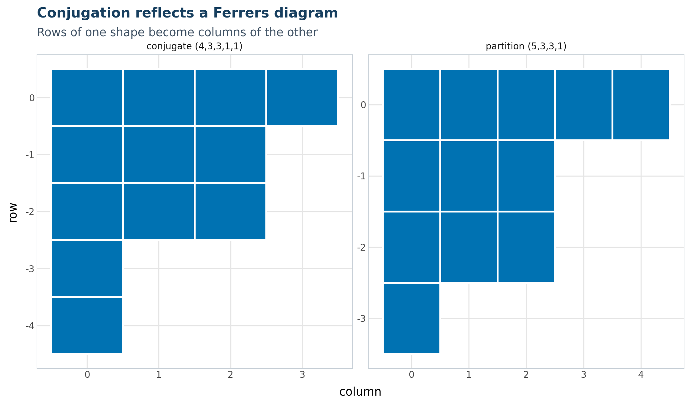

# Integer partitions and tableaux {#sec-comb-partitions}

An integer partition records an unordered additive decomposition. Its diagram
turns arithmetic constraints into geometry, and tableaux enrich that geometry
with labels and order conditions.

## Preparation from this book

Chapter 6's formal products are useful but not required for the first sections.
Do not confuse integer partitions with partitions of a labeled set from
Chapter 7.

## Ferrers diagrams and conjugation

Write a partition as a nonincreasing sequence of positive integers whose sum is
$n$. Draw left-justified rows of cells with those lengths. Reflecting across
the main diagonal exchanges rows and columns, giving the conjugate partition.
This is a bijection between partitions with at most $k$ parts and partitions
whose largest part is at most $k$.

<figure id="fig-comb-ferrers">


<figcaption>

Figure 8.1: Ferrers diagrams make conjugation a visible exchange of row and column counts.

</figcaption>
</figure>

Euler's product chooses a multiplicity for every allowed part size. Restricting
multiplicities or part parity changes individual factors. Euler's theorem that
partitions into distinct parts equal partitions into odd parts follows because
binary decomposition of multiplicities transforms one product into the other.

## Young tableaux

A Young diagram filled with $1$ through $n$ increasing along rows and columns
is a standard Young tableau. The hook-length formula counts such tableaux by a
product over cells. This remarkable formula connects partitions to symmetric
group representations. Semistandard tableaux allow repeated entries with
different row and column rules and generate Schur functions.

**Nonexample.** A composition treats order as significant, so $3+1$ and
$1+3$ differ. A partition does not. Applying a composition count to partitions
overcounts by a multiplicity that depends on repeated part sizes.

<!-- inline-formula-code:start -->
## Formula and finite computation

Let $p(n,k)$ count partitions of $n$ using parts at most $k$. Then

$$
p(n,k)=p(n,k-1)+p(n-k,k).
$$

```python
def partition_number(total: int) -> int:
    if total < 0:
        raise ValueError("total must be nonnegative")
    counts = [1] + [0] * total
    for part in range(1, total + 1):
        for subtotal in range(part, total + 1):
            counts[subtotal] += counts[subtotal - part]
    return counts[total]

values = [partition_number(total) for total in range(11)]
if values != [1, 1, 2, 3, 5, 7, 11, 15, 22, 30, 42]:
    raise RuntimeError("partition-number check failed")
print(values)
```

**What the computation establishes.** Dynamic programming evaluates the
finite product coefficient through ten and matches known small values. It does
not prove Euler's product, conjugation identities, or the hook-length formula.
<!-- inline-formula-code:end -->

## Refinements

Mark the number of parts, largest part, parity, or Durfee-square size to obtain
multivariate identities. Many proofs cut a Ferrers diagram into canonical
regions. The success of this method depends on a reversible reconstruction,
not merely on a suggestive drawing.

## Algorithms and representation

A partition can be stored as decreasing parts, multiplicities, or a boundary
word. Each representation makes different operations cheap: conjugation is
transparent in a diagram, generating products favor multiplicities, and
ranking algorithms often favor recursive part bounds. Enumeration should emit
one canonical order and handle the empty partition of zero. Tableaux require
additional validation of shape, entries, and row and column inequalities.

## Partitions as canonical objects

**Definition 8.1 (Partition and size).** An integer partition of a nonnegative integer $n$ is a finite sequence $\lambda=(\lambda_1,\ldots,\lambda_\ell)$ with $\lambda_1\ge\cdots\ge\lambda_\ell>0$ and $\sum_i\lambda_i=n$. Its length is $\ell$, its size is $|\lambda|=n$, and the unique partition of zero is the empty sequence. Its diagram consists of cells $(i,j)$ with $1\le i\le\ell$ and $1\le j\le\lambda_i$.

The decreasing convention removes ordering ambiguity. It also explains why ordinary generating functions are appropriate: there are no labels on the individual summands. A partition of an integer records sizes, whereas a partition of a labeled set records which elements lie together. For instance, the integer partition $(2,1)$ is a single shape, but the set $\{a,b,c\}$ has three partitions with one block of size two and one singleton.

**Worked example 8.2 (All partitions of five).** Group partitions by largest part. Largest part five gives $(5)$; largest part four gives $(4,1)$; largest part three gives $(3,2)$ and $(3,1,1)$; largest part two gives $(2,2,1)$ and $(2,1,1,1)$; largest part one gives $(1,1,1,1,1)$. The seven cases are exhaustive because every partition has exactly one largest part. Within each case the remaining parts are bounded by that largest part. This grouping is more reliable than generating ordered sums and then trying to remove duplicates.

The same idea leads to an algorithm: choose the next part no larger than the previous part, reduce the remaining total, and stop when the total is zero. The decreasing bound ensures that every completed sequence is a partition. Conversely, following the entries of any partition describes a unique path through the choices. These two observations establish both validity and uniqueness of enumeration.

## Conjugation with an inverse

**Theorem 8.3 (Conjugation).** For a partition $\lambda$, define
\[
\lambda'_j=|\{i:\lambda_i\ge j\}|,
\qquad 1\le j\le\lambda_1.
\]
Then $\lambda'$ is a partition of $|\lambda|$, and $(\lambda')'=\lambda$. Conjugation bijects partitions with at most $k$ parts and partitions with largest part at most $k$.

*Proof.* The sets counted decrease as $j$ increases, so the column lengths $\lambda'_j$ are positive and nonincreasing. Summing them counts every cell of the diagram once, hence preserves size. To compute the $i$th part of the second conjugate, count the columns containing at least $i$ cells. Since the rows are left justified and decreasing, these are exactly columns $1,\ldots,\lambda_i$. Thus the second conjugate has $i$th part $\lambda_i$. Finally, the largest part of $\lambda'$ equals the number of rows of $\lambda$, so reflection exchanges the two stated restrictions. ∎

**Worked example 8.4 (Reading columns accurately).** For $\lambda=(5,3,3,1)$, columns have lengths $4,3,3,1,1$, giving $\lambda'=(4,3,3,1,1)$. Both shapes have size twelve. Conjugating again counts respectively five, three, three and one columns of height at least $1,2,3,4$, recovering the original. Notice that repeated rows do not cause ambiguity: they produce columns with the corresponding multiplicity. Conjugation changes the number of parts from four to five and the largest part from five to four.

The theorem is a size-preserving bijection, so it proves equality for every coefficient, rather than merely equality of total counts up to a bound. It can also carry several restrictions simultaneously. A shape fitting inside an $a$-row, $b$-column rectangle conjugates to one fitting inside a $b$-row, $a$-column rectangle. The transpose is an actual reversible construction, which is the essential point behind a diagrammatic proof.

## Products and recurrences

**Theorem 8.5 (Partition product).** As a formal power series,
\[
\sum_{n\ge0}p(n)q^n=\prod_{j\ge1}\frac1{1-q^j},
\]
where $p(n)$ counts integer partitions of $n$. Restricting all parts to at most $k$ replaces the product by $\prod_{j=1}^k(1-q^j)^{-1}$.

*Proof.* A partition is specified uniquely by multiplicities $m_j\ge0$ of each part size $j$, with finitely many nonzero multiplicities. Expanding $(1-q^j)^{-1}=\sum_{m_j\ge0}q^{jm_j}$ records the choice of $m_j$. Multiplication records the total size $\sum_jjm_j$. For any fixed degree $n$, factors with $j>n$ contribute only their constant term, so the coefficient is defined by a finite multiplication. It counts exactly the multiplicity sequences of size $n$. Restricting allowed part sizes gives the finite-product assertion. ∎

Formal legitimacy matters here. Substituting a numerical value for $q$ introduces convergence questions, but no convergence theorem is needed to extract a fixed coefficient. Infinite formal products are meaningful when only finitely many factors can affect each degree. An arbitrary infinite product without that property would require a separate definition.

**Proposition 8.6 (Bounded-part recurrence).** Put $p(0,k)=1$ for $k\ge0$, $p(n,0)=0$ for $n>0$, and $p(n,k)=0$ for $n<0$. For integers $n\ge1$, $k\ge1$,
\[
p(n,k)=p(n,k-1)+p(n-k,k).
\]

*Proof.* A partition using parts at most $k$ either uses no part $k$, or removing one $k$ leaves a partition of $n-k$ still using parts at most $k$. The classes are disjoint. Appending one $k$ and sorting reverses the removal in the second class. The empty partition supplies the boundary value at zero, and a negative remaining total supplies no possibilities. ∎

The code above implements the same recurrence with a one-dimensional array. After finishing the loop for part size $j$, its entry at total $t$ counts partitions of $t$ using parts at most $j$. Updating totals in increasing order allows the newly updated entry at $t-j$ to include further copies of $j$. Reversing that loop would instead limit each part size to one occurrence. Thus a seemingly minor implementation order encodes a different combinatorial class.

**Worked example 8.7 (Parts at most three).** To count partitions of six using parts at most three, choose the multiplicity of three. With no threes, the solutions of $m_1+2m_2=6$ give four choices, namely $m_2=0,1,2,3$. With one three, the remaining equation is $m_1+2m_2=3$, giving two choices. With two threes the remainder is zero, giving one choice. Therefore $p(6,3)=7$. The recurrence independently gives $p(6,2)+p(3,3)=4+3=7$, and conjugation interprets the same seven objects as partitions of six into at most three parts.

**Theorem 8.8 (Distinct parts and odd parts).** For every $n\ge0$, the number of partitions of $n$ into distinct parts equals the number of partitions of $n$ into odd parts.

*Proof.* Start with an odd-part partition and write each odd-part multiplicity in binary:
$m_u=\sum_{a\ge0}\epsilon_{u,a}2^a$, where $u$ is odd and each $\epsilon_{u,a}$ is zero or one. Replace the $2^a$ copies of $u$ represented by a nonzero binary digit by the single part $2^a u$. All resulting parts are distinct, since every positive integer has a unique expression $2^a u$ with $u$ odd. Total size is preserved. Conversely, factor every distinct part in that way and replace it by $2^a$ copies of $u$. Uniqueness of binary expansion makes these operations inverse. ∎

The corresponding product identity is
$\prod_{j\ge1}(1+q^j)=\prod_{u\ \mathrm{odd}}(1-q^u)^{-1}$.
Indeed $1+q^j=(1-q^{2j})/(1-q^j)$ cancels the even factors degree by degree. The explicit bijection explains what that cancellation does to individual objects.

## Tableaux and a proved counting recurrence

**Definition 8.9 (Standard Young tableau).** A standard Young tableau of shape $\lambda$ and size $n$ is a bijective filling of its cells by $1,\ldots,n$ that strictly increases from left to right in each row and from top to bottom in each column. A removable corner is a cell with no cell immediately to its right or immediately below. Write $f^\lambda$ for the number of standard tableaux and set $f^\varnothing=1$.

The increasing conditions are local tests that imply all longer comparisons in the same row or column. They do not compare every pair of cells. For example, cells $(1,2)$ and $(2,1)$ need not have their entries in either prescribed order. This freedom is precisely what produces multiple tableaux of one shape.

**Theorem 8.10 (Corner recurrence).** For every nonempty partition shape,
\[
f^\lambda=\sum_{c\text{ removable corner of }\lambda}f^{\lambda\setminus c}.
\]

*Proof.* The largest entry $n$ cannot have a cell to its right or below, because such a cell would require an even larger entry. Thus $n$ occupies a removable corner. Removing it gives a standard tableau of the remaining partition shape. Conversely, any tableau of a shape obtained by deleting a corner extends uniquely by placing $n$ in that corner; all relevant inequalities hold because every old entry is smaller. Different corners give disjoint classes. Summing their sizes proves the recurrence. ∎

**Worked example 8.11 (Shape $(3,1)$).** The removable corners are the last cell of the first row and the cell in the second row. Deleting them gives $(2,1)$ and $(3)$. The row shape $(3)$ has one filling, and $(2,1)$ has two because its upper-left cell contains $1$ while $2$ and $3$ may occupy the other cells in either order. Hence $f^{(3,1)}=2+1=3$. Directly, choose the entry in the lower cell from $2,3,4$; the remaining three entries must appear increasingly along the top row. This second count checks the recurrence and explains every filling.

For a cell $(i,j)$ its hook consists of that cell, the cells to its right in the same row, and the cells below it in the same column. Its hook length is
$h_{ij}=\lambda_i-j+\lambda'_j-i+1$. The hook-length formula states
\[
f^\lambda=\frac{n!}{\prod_{(i,j)\in\lambda}h_{ij}}.
\]
This general formula is an optional result beyond the proof development here; the chapter proves and uses the corner recurrence instead. A proof of the product formula requires a further argument and is treated in Stanley's [*Enumerative Combinatorics*, volume 2](https://www.cambridge.org/core/books/enumerative-combinatorics/360F1EEA6B91AE359EE489AC4145EF49). Agreement on small diagrams is a check of a formula, not a proof for every shape.

For semistandard tableaux, specify the convention: rows are weakly increasing and columns strictly increasing, with entries in a prescribed positive alphabet. Repetitions are allowed along rows, which changes both the objects and their generating functions. Their relation to Schur functions belongs to the algebraic continuation; it does not change the standard-tableau recurrence just proved.

## Summary

Integer partitions translate unordered sums into diagrams and formal products.
Conjugation proves bounded-part identities; tableaux add order and connect the
subject to algebraic representation.

## Exercises

<div class="exercise" id="comb-partitions-tableaux-ex-1">

### Exercise 8.1

1. List partitions of five.

<details><summary>Hint 1</summary>

Separate possibilities by largest part.

</details>
<details><summary>Hint 2</summary>

After choosing the largest part, bound every remaining part by it.

</details>
<details><summary>Solution</summary>

The list is $(5)$, $(4,1)$, $(3,2)$, $(3,1,1)$, $(2,2,1)$, $(2,1,1,1)$ and $(1,1,1,1,1)$. Largest parts five, four, three, two and one contribute respectively one, one, two, two and one partitions. These cases are disjoint and exhaustive, so $p(5)=7$.

</details>

</div>

<div class="exercise" id="comb-partitions-tableaux-ex-2">

### Exercise 8.2

2. Conjugate the partition $(5,3,3,1)$.

<details><summary>Hint 1</summary>

Count how many rows reach each column.

</details>
<details><summary>Hint 2</summary>

The first column has four cells and the fourth has one.

</details>
<details><summary>Solution</summary>

Column lengths are $4,3,3,1,1$, so the conjugate is $(4,3,3,1,1)$. Their sum is twelve, agreeing with the original size. Counting columns of height at least one, two, three and four gives $5,3,3,1$, recovering the original partition as required by involutivity.

</details>

</div>

<div class="exercise" id="comb-partitions-tableaux-ex-3">

### Exercise 8.3

3. Prove the bounded-part identity by reflection.

<details><summary>Hint 1</summary>

Translate the largest part and the number of parts into diagram dimensions.

</details>
<details><summary>Hint 2</summary>

Reflection exchanges rows and columns and preserves cells.

</details>
<details><summary>Solution</summary>

A diagram with at most $k$ rows has all column lengths at most $k$. Reflecting it produces a partition with largest part at most $k$. Reflect again to invert the map. Cell count is unchanged, so the bijection works separately for every integer being partitioned and proves equality of the two counts.

</details>

</div>

<div class="exercise" id="comb-partitions-tableaux-ex-4">

### Exercise 8.4

4. Derive the dynamic recurrence.

<details><summary>Hint 1</summary>

Classify partitions according to whether a part $k$ appears.

</details>
<details><summary>Hint 2</summary>

Remove one occurrence, allowing further copies to remain.

</details>
<details><summary>Solution</summary>

For Exercise 4, a partition using parts at most $k$ either uses no part $k$, or removing one $k$ leaves a partition of $n-k$ still using parts at most $k$. Therefore $p(n,k)=p(n,k-1)+p(n-k,k)$. The empty partition gives $p(0,k)=1$, no positive total can use no allowed parts, and negative totals contribute zero.

</details>

</div>

<div class="exercise" id="comb-partitions-tableaux-ex-5">

### Exercise 8.5

5. Distinguish partitions from compositions.

<details><summary>Hint 1</summary>

Compare the expressions $3+1$ and $1+3$.

</details>
<details><summary>Hint 2</summary>

Count all ordered positive decompositions of four using separator positions.

</details>
<details><summary>Solution</summary>

A composition records the order of positive summands; a partition sorts them and forgets order. There are $2^3=8$ compositions of four, obtained by selecting breaks among the three gaps between four units. There are only five partitions: $(4)$, $(3,1)$, $(2,2)$, $(2,1,1)$ and $(1,1,1,1)$. A uniform division by a factorial cannot fix the discrepancy because repeated parts have different stabilizers.

</details>

</div>

<div class="exercise" id="comb-partitions-tableaux-ex-6">

### Exercise 8.6

6. Compute hook lengths for a small diagram.

Use shape $(3,1)$ and compare the product expression with the proved recurrence.

<details><summary>Hint 1</summary>

Count the cell itself, cells to its right, and cells below it.

</details>
<details><summary>Hint 2</summary>

The upper-left hook has length four.

</details>
<details><summary>Solution</summary>

The hook lengths along the first row are $4,2,1$, and the second-row cell has hook length $1$. Their product is eight, giving $4!/8=3$ in the hook formula. The corner recurrence gives $f^{(2,1)}+f^{(3)}=2+1=3$ independently. This verifies agreement for this diagram, without proving the general product formula.

</details>

</div>

<div class="exercise" id="comb-partitions-tableaux-ex-7">

### Exercise 8.7

Write a bivariate product recording both size and number of parts for partitions with parts at most $k$.

<details><summary>Hint 1</summary>

Give each occurrence of part $j$ weight $tq^j$.

</details>
<details><summary>Hint 2</summary>

The multiplicity series for $j$ is a geometric series.

</details>
<details><summary>Solution</summary>

The product is $\prod_{j=1}^k(1-tq^j)^{-1}$. Expanding the factor for $j$ contributes $t^{m_j}q^{jm_j}$. Therefore the coefficient of $t^\ell q^n$ counts multiplicity sequences with $\sum m_j=\ell$ and $\sum jm_j=n$, exactly the partitions of size $n$ with $\ell$ parts and largest part at most $k$.

</details>

</div>

<div class="exercise" id="comb-partitions-tableaux-ex-8">

### Exercise 8.8

Apply the odd-to-distinct bijection to $(5,3,3,3,3,1,1,1)$ and invert the result.

<details><summary>Hint 1</summary>

Write the multiplicities of each odd part in binary.

</details>
<details><summary>Hint 2</summary>

Four copies of three become twelve; three copies of one become two and one.

</details>
<details><summary>Solution</summary>

The image has distinct parts $(12,5,2,1)$, with total twenty. Factoring them into a power of two times an odd number gives four copies of three from twelve, one five, two ones from two, and one one from one. This recovers the original partition and exhibits preservation of size in both directions.

</details>

</div>

<div class="exercise" id="comb-partitions-tableaux-ex-9">

### Exercise 8.9

Use the corner recurrence to count standard tableaux of shape $(2,2)$.

<details><summary>Hint 1</summary>

Only one cell of the square is removable.

</details>
<details><summary>Hint 2</summary>

After removing the largest entry, use the shape $(2,1)$.

</details>
<details><summary>Solution</summary>

The largest entry four must be in the lower-right cell, leaving $(2,1)$. The latter has two tableaux, since one is forced in the upper-left cell and two and three can be exchanged between the remaining incomparable cells. Thus $f^{(2,2)}=f^{(2,1)}=2$. No second corner contribution is permitted because deleting the upper-right cell would not leave a partition diagram.

</details>

</div>

<div class="exercise" id="comb-partitions-tableaux-ex-10">

### Exercise 8.10

Show that partitions of $n$ into exactly $k$ positive parts correspond to partitions of $n-k$ into at most $k$ parts.

<details><summary>Hint 1</summary>

Remove one cell from every row.

</details>
<details><summary>Hint 2</summary>

Keep the resulting zeros temporarily to make the inverse unambiguous.

</details>
<details><summary>Solution</summary>

Subtract one from each of the $k$ decreasing positive entries, then discard zeros. The remaining entries are nonincreasing and have total $n-k$, with at most $k$ positive entries. Conversely pad such a partition to length $k$ with zeros and add one to every entry. The two constructions are inverse. If $n<k$, both classes are empty; if $n=k$, the empty residual partition corresponds to $k$ ones.

</details>

</div>

### Selected solution

For Exercise 4, a partition using parts at most $k$ either uses no part $k$, or
removing one $k$ leaves a partition of $n-k$ still using parts at most $k$.

## Summary {#comb-partitions-tableaux-summary}

Integer partitions translate unordered sums into diagrams and formal products.
Conjugation proves bounded-part identities; tableaux add order and connect the
subject to algebraic representation. Multiplicity products and reversible
diagram operations give exact identities, while the corner recurrence counts
standard tableaux without needing the deeper hook-length theorem. Posets next
provide a common language for the precedence constraints already visible in
tableau rows and columns.
