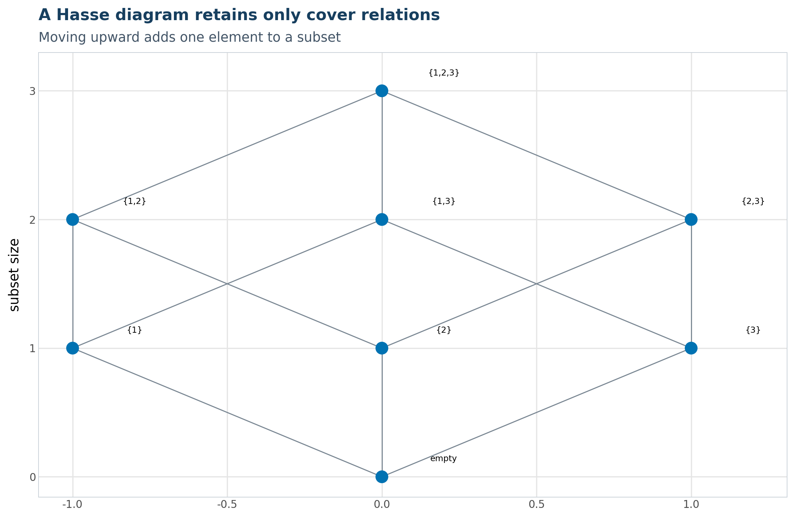

# Posets, chains, and lattices {#sec-comb-posets}

Partial orders formalize precedence, containment, divisibility, and refinement.
Unlike a total order, some pairs may be incomparable; that incomparability is
often the main combinatorial structure.

## Preparation from this book

Relations and subsets are reviewed in the primer. Chapter 4 introduced the
Boolean lattice as the home of inclusion–exclusion.

## Order and diagrams

A partial order is reflexive, antisymmetric, and transitive. A chain consists
of mutually comparable elements; an antichain consists of mutually
incomparable ones. A Hasse diagram draws only cover relations, with larger
elements above smaller ones; transitive edges and self-loops are omitted.

A linear extension is a total order respecting every poset constraint. It is a
valid schedule of tasks with precedence requirements. Counting extensions is
generally difficult, but deletion of a minimal element gives an exact
recurrence for small instances.

<figure id="fig-comb-boolean-lattice">


<figcaption>

Figure 9.1: A Hasse diagram shows subset containment by levels while suppressing transitive edges.

</figcaption>
</figure>

## Width, height, and lattices

Dilworth's theorem equates maximum antichain size with the minimum number of
chains covering a finite poset. Its dual is Mirsky's theorem. In the Boolean
lattice, the largest rank layer is an antichain; Sperner's theorem says none is
larger.

A lattice has a greatest lower bound and least upper bound for every pair,
called meet and join. Subset lattices use intersection and union; divisors of a
fixed integer use greatest common divisor and least common multiple. Not every
poset is a lattice.

**Nonexample.** In a Hasse diagram, horizontal position has no order meaning.
Two vertices at different heights need not be comparable unless an upward path
connects them.

<!-- inline-formula-code:start -->
## Formula and finite computation

For a finite poset, linear extensions satisfy

$$
L(P)=\sum_{x\in\min(P)}L(P\setminus\{x\}),\qquad L(\emptyset)=1.
$$

```python
from functools import lru_cache

def linear_extension_count(order: int, precedences: set[tuple[int, int]]) -> int:
    if order < 0 or any(not 0 <= left < order or not 0 <= right < order for left, right in precedences):
        raise ValueError("invalid precedence relation")

    @lru_cache(maxsize=None)
    def count(remaining: frozenset[int]) -> int:
        if not remaining:
            return 1
        minimal = [vertex for vertex in remaining if not any((other, vertex) in precedences for other in remaining)]
        if not minimal:
            raise ValueError("precedences contain a directed cycle")
        return sum(count(remaining - {vertex}) for vertex in minimal)

    return count(frozenset(range(order)))

print(linear_extension_count(4, {(0, 2), (1, 2), (2, 3)}))
```

**What the computation establishes.** The recursion counts schedules for one
finite precedence relation and rejects a cycle when it blocks all minimal
choices. It does not prove Dilworth's or Sperner's theorem.
<!-- inline-formula-code:end -->

## Incidence algebra

Functions on comparable intervals can be convolved by summing over intermediate
elements. The constant zeta function accumulates lower-order data; its inverse
is the Möbius function from Chapter 4. Thus inversion is an algebraic property
of order, not a collection of unrelated alternating formulas.

## Order algorithms

For a relation supplied as directed constraints, first detect cycles and then
compute a transitive reduction only when the input is a finite acyclic graph.
Topological sorting produces one linear extension; randomized tie breaking does
not generally sample extensions uniformly. Exact extension counting is hard,
so small dynamic programs, approximate samplers, and provable bounds answer
different questions. Store cover edges separately from the full transitive
closure to avoid confusing representation with definition.

## Reading an order precisely

**Definition 9.1 (Finite partial order).** A finite poset is a finite set $P$ with a relation $\le$ satisfying reflexivity ($x\le x$), antisymmetry ($x\le y$ and $y\le x$ imply $x=y$), and transitivity ($x\le y\le z$ implies $x\le z$). Write $x<y$ if $x\le y$ and $x\ne y$. An element $y$ covers $x$ if $x<y$ and no $z$ satisfies $x<z<y$.

A directed drawing represents cover relations rather than the entire order. The full order can be recovered by taking upward paths and adjoining equality. A directed acyclic graph gives a poset by reachability, but its original edges need not all be covers. Keeping those distinctions clear avoids accidental duplication of constraints in a counting argument.

**Worked example 9.2 (Divisors of twelve).** Order $\{1,2,3,4,6,12\}$ by divisibility. The covers are $1<2$, $1<3$, $2<4$, $2<6$, $3<6$, $4<12$, and $6<12$. The relation $2<12$ is present in the order but is not a cover because $2<4<12$. The chain $1<2<4<12$ has four elements. The pair $\{4,6\}$ is an antichain because neither divides the other, even though both have a common upper bound twelve. Sharing an upper bound is different from being comparable.

**Definition 9.3 (Height and width).** A chain is a subset whose elements are pairwise comparable; an antichain is a subset whose distinct elements are pairwise incomparable. The height $h(P)$ is the largest chain size, and the width $w(P)$ is the largest antichain size. Both are zero for the empty poset. A chain partition or antichain partition divides $P$ into disjoint chains or antichains, respectively.

These definitions measure numbers of elements, not numbers of cover edges. A four-element chain has height four. Also, a maximal chain is one that cannot be enlarged, while a maximum chain has the largest possible size. Maximal chains in the same finite poset can have different sizes. Algorithms that greedily enlarge one chain do not automatically compute the height or width.

## Partitioning into antichains

**Theorem 9.4 (Mirsky).** A finite poset of height $h$ can be partitioned into $h$ antichains, and no partition into fewer antichains is possible.

*Proof.* For $x\in P$, let $r(x)$ be the greatest size of a chain ending at $x$. Finiteness ensures that this maximum exists. If $x<y$, a largest chain ending at $x$ extends by $y$, so $r(y)\ge r(x)+1$. Consequently elements having the same value of $r$ form an antichain. The nonempty level sets partition $P$ into at most $h$ antichains. On the other hand, every antichain meets a fixed chain of size $h$ in at most one element, so every antichain partition requires at least $h$ parts. The empty case requires zero parts and satisfies the same conclusion. ∎

The proof supplies an algorithm as well as an existence argument. Compute longest-chain lengths in any linear extension, assigning each element one more than the largest assigned value among its predecessors. Those values divide a precedence system into stages. The interpretation is exact when each task takes one unit of time and any number of tasks can run simultaneously: comparable tasks require different stages, and the rank construction achieves the lower bound given by a longest chain.

## A matching proof of Dilworth's theorem

We will prove the chain counterpart rather than merely name it. The proof uses a finite bipartite matching statement, whose short argument also illustrates how an optimization result can have a certificate. A matching is a set of edges with disjoint endpoints. A vertex cover is a set of vertices meeting every edge.

**Lemma 9.5 (Bipartite matching and covering).** In a finite bipartite graph with vertex classes $L,R$, the maximum matching size equals the minimum vertex-cover size.

*Proof.* Every vertex cover has at least as many vertices as any matching, because the disjoint matching edges need distinct cover vertices. Choose a maximum matching $M$. Starting at all unmatched vertices of $L$, follow alternating paths: traverse edges outside $M$ from $L$ to $R$, and edges of $M$ from $R$ to $L$. Let $Z_L,Z_R$ be the reached vertices in the two classes.

No unmatched right vertex is reached. Otherwise a simple alternating path from an unmatched left vertex to an unmatched right vertex allows matched and unmatched edges to be exchanged, increasing the matching size. Every reached right vertex is therefore matched and its partner is reached left. Conversely, a reached matched left vertex was reached through its matching partner, so that partner is reached right.

The set $C=(L\setminus Z_L)\cup Z_R$ covers every edge. An uncovered edge would go from a reached left vertex to an unreached right vertex. If it is unmatched it is traversable; if it is matched, reachability of its left endpoint forces reachability of its partner. Both cases contradict the choice of endpoints. Every matched pair contributes exactly one vertex to $C$: its right endpoint if both endpoints are reached, its left endpoint otherwise. Unmatched left vertices are reached, and unmatched right vertices are unreached, so no unmatched vertex belongs to $C$. Hence $|C|=|M|$, proving equality. ∎

**Theorem 9.6 (Dilworth).** The minimum number of chains partitioning a finite poset equals its width.

*Proof.* Make a bipartite graph with a left and a right copy of every element of $P$, putting an edge $x_Ly_R$ exactly when $x<y$. Let $n=|P|$ and choose a maximum matching of size $\nu$. Direct its matched comparisons from $x$ to $y$ on the original elements. Every element has at most one incoming and one outgoing matched edge. A directed cycle is impossible because strict order is transitive and irreflexive. The components are therefore directed paths, including isolated vertices. They partition $P$ into $n-\nu$ chains: starting with $n$ singletons, each of the $\nu$ path edges reduces the number of components by one.

By the lemma there is a vertex cover $C$ of size $\nu$ in the bipartite graph. Let $A$ consist of those elements neither of whose copies belongs to $C$. At most $\nu$ original elements have a copy in $C$, so $|A|\ge n-\nu$. No two distinct elements of $A$ are comparable, since such a comparison would give an uncovered edge. Thus $w(P)\ge n-\nu$. Conversely an antichain meets each of the constructed $n-\nu$ chains in at most one element, giving $w(P)\le n-\nu$. Equality follows, and every chain partition requires at least that many parts. ∎

The theorem is stated for partitions, whereas “chain cover” sometimes allows overlapping chains. In a finite cover, assign each element to one covering chain and discard empty chains; every subset of a chain is a chain. Therefore the minimum cover size equals the minimum partition size. Explicitly recording this step reconciles the two common versions without changing the mathematics.

**Worked example 9.7 (A width certificate).** In the divisor poset of twelve, the chains $(1,2,4,12)$ and $(3,6)$ partition all six elements. Hence every antichain has size at most two. The incomparable pair $\{4,6\}$ shows that two is attainable. These two objects certify width two without requiring a search through every subset. They also illustrate the two directions of an extremal proof: the partition gives an upper bound, while the exhibited antichain gives a lower bound.

## Linear extensions and lattices

**Proposition 9.8 (Extension recurrence).** Every finite nonempty poset has a minimal element. If $L(P)$ counts its linear extensions, then
\[
L(P)=\sum_{x\in\min(P)}L(P\setminus\{x\}),\qquad L(\varnothing)=1.
\]

*Proof.* Starting anywhere and repeatedly moving to a strictly smaller element must terminate, since a finite poset contains no strictly decreasing cycle. The terminal element is minimal. In a linear extension, the first element must be minimal; otherwise a smaller element would have to appear earlier. Removing the first element gives an extension of the induced order on the remainder. Conversely prefixing any minimal element to an extension of the remainder respects every comparison. The possible first elements give disjoint classes, proving the recurrence and, inductively, existence of an extension. ∎

**Worked example 9.9 (Two independent chains).** Suppose $a<b$ and $c<d$ are the only nontrivial constraints. Choose which two positions among four contain $a,b$; their order is then forced, and $c,d$ fill the others in their forced order. There are $\binom42=6$ extensions. For the code's constraints $0<2$, $1<2$, $2<3$, however, the first two positions must contain $0,1$ in either order, followed by $2,3$. The answer is two. Equal numbers of tasks do not imply equal scheduling counts.

**Definition 9.10 (Lattice).** A poset is a lattice if every pair $x,y$ has a greatest lower bound $x\wedge y$ and a least upper bound $x\vee y$. A greatest lower bound must dominate every common lower bound, not merely be one maximal lower bound.

In a subset lattice, intersection is a lower bound contained in both sets; every other common lower bound is contained in their intersection. This proves that intersection is the meet. The analogous argument with supersets proves that union is the join. In the positive divisors of a fixed integer $N$, the gcd and lcm divide $N$ and respectively give meet and join. Two incomparable elements with no other elements form a poset but not a lattice, because they have neither a common lower bound nor a common upper bound. Adding artificial top and bottom elements repairs that particular example, but does not show that arbitrary posets already possess lattice operations.

## Finite incidence algebra

**Definition 9.11 (Incidence convolution).** For a finite poset $P$ and a commutative ring $K$ with identity, an incidence function assigns $f(x,y)\in K$ to every comparable pair $x\le y$. Define
\[
(f*g)(x,y)=\sum_{x\le z\le y}f(x,z)g(z,y).
\]
The identity function is $\delta(x,y)=1$ for $x=y$ and zero otherwise. The zeta function is $\zeta(x,y)=1$ whenever $x\le y$.

Convolution is associative because both $(f*g)*h$ and $f*(g*h)$ sum the same products $f(x,u)g(u,v)h(v,y)$ over $x\le u\le v\le y$. All sums are finite, so rearrangement needs no analytic convergence condition.

**Theorem 9.12 (Möbius inverse and inversion).** Define $\mu(x,x)=1$ and, for $x<y$,
\[
\mu(x,y)=-\sum_{x\le z<y}\mu(x,z).
\]
Then $\mu*\zeta=\zeta*\mu=\delta$. If functions $F,G:P\to K$ satisfy $F(y)=\sum_{x\le y}G(x)$, then
\[
G(y)=\sum_{x\le y}\mu(x,y)F(x).
\]

*Proof.* The recursion is well defined by increasing interval size and says directly that $\mu*\zeta=\delta$. To establish the other inverse identity, identify incidence functions with matrices after choosing a linear extension: entries are zero outside comparable pairs. The zeta matrix is $I+N$, where $N$ is strictly upper triangular and $N^{|P|}=0$. The finite geometric sum $I-N+N^2-\cdots$ is a two-sided inverse. A left inverse equals that inverse by associativity, so $\zeta*\mu=\delta$ as well. Finally substitute the defining sum for $F(x)$ into the proposed formula and interchange finite sums. The coefficient of $G(u)$ becomes $\sum_{u\le x\le y}\mu(x,y)=(\zeta*\mu)(u,y)$, which is one for $u=y$ and zero otherwise. ∎

This finite proof extends to locally finite posets, where every interval is finite, by working within each interval; the global matrix shortcut then needs replacement by an intervalwise argument. It does not justify convolution on arbitrary infinite intervals without additional hypotheses.

## Summary

Posets preserve necessary comparisons while exposing incomparability. Chains,
antichains, extensions, lattice operations, and interval convolution turn that
structure into optimization and enumeration.

## Exercises

<div class="exercise" id="comb-posets-lattices-ex-1">

### Exercise 9.1

1. Draw the divisor poset of twelve.

<details><summary>Hint 1</summary>

List all positive divisors before drawing any edges.

</details>
<details><summary>Hint 2</summary>

Keep only divisibility relations with no intermediate divisor.

</details>
<details><summary>Solution</summary>

The elements are $1,2,3,4,6,12$. The covers are $1<2$, $1<3$, $2<4$, $2<6$, $3<6$, $4<12$, and $6<12$. Drawing these upward recovers every other strict divisibility relation by a path. In particular $1<12$ is omitted as an edge because it follows transitively.

</details>

</div>

<div class="exercise" id="comb-posets-lattices-ex-2">

### Exercise 9.2

2. Find a largest chain and antichain in the three-element Boolean lattice.

<details><summary>Hint 1</summary>

A strict inclusion increases cardinality.

</details>
<details><summary>Hint 2</summary>

Partition the eight subsets into three chains to certify an antichain bound.

</details>
<details><summary>Solution</summary>

A largest chain is $\varnothing\subset\{1\}\subset\{1,2\}\subset\{1,2,3\}$, of size four; there are only four possible cardinalities. The singletons give an antichain of size three. A chain partition consists of the displayed chain, $\{2\}\subset\{2,3\}$, and $\{3\}\subset\{1,3\}$. Every antichain meets each of these chains at most once, proving that three is largest.

</details>

</div>

<div class="exercise" id="comb-posets-lattices-ex-3">

### Exercise 9.3

3. Count extensions of two independent two-step tasks.

<details><summary>Hint 1</summary>

Preserve the order within each pair.

</details>
<details><summary>Hint 2</summary>

Choose the two positions occupied by the first pair.

</details>
<details><summary>Solution</summary>

For Exercise 3, an extension interleaves two internally ordered pairs. Choose the two positions of the first pair, giving $\binom42=6$. Once those positions are fixed both internal orders are forced, so every choice gives exactly one extension and every extension is counted.

</details>

</div>

<div class="exercise" id="comb-posets-lattices-ex-4">

### Exercise 9.4

4. Verify meet and join for subset order.

<details><summary>Hint 1</summary>

A lower bound must be contained in both sets.

</details>
<details><summary>Hint 2</summary>

Check the universal property, not only containment.

</details>
<details><summary>Solution</summary>

For subsets $A,B$ of a fixed universe, $A\cap B$ is contained in both. Any set contained in both is contained in $A\cap B$, making it the greatest lower bound. The set $A\cup B$ contains both, and any common superset contains their union. Thus it is the least upper bound, proving both lattice identities.

</details>

</div>

<div class="exercise" id="comb-posets-lattices-ex-5">

### Exercise 9.5

5. Give a finite poset that is not a lattice.

<details><summary>Hint 1</summary>

Use two incomparable elements and no others.

</details>
<details><summary>Hint 2</summary>

Ask whether either a common upper or a common lower bound exists.

</details>
<details><summary>Solution</summary>

On $\{a,b\}$ use only equality as the order. This relation is reflexive, antisymmetric and transitive. The pair $a,b$ has no common upper bound because neither element lies above the other, and likewise has no common lower bound. Therefore the poset is not a lattice.

</details>

</div>

<div class="exercise" id="comb-posets-lattices-ex-6">

### Exercise 9.6

6. Explain why a cycle invalidates precedence order.

<details><summary>Hint 1</summary>

Interpret each directed edge as a strict precedence.

</details>
<details><summary>Hint 2</summary>

Apply transitivity around the cycle.

</details>
<details><summary>Solution</summary>

A directed cycle $x_1<x_2<\cdots<x_m<x_1$ would imply $x_1<x_1$, contradicting irreflexivity of strict order. Equivalently, a schedule would require each task to appear before itself. Thus a directed constraint graph must be acyclic before reachability can define a partial order.

</details>

</div>

<div class="exercise" id="comb-posets-lattices-ex-7">

### Exercise 9.7

Find height, width, and the extension count of an $n$-element antichain, including $n=0$.

<details><summary>Hint 1</summary>

There are no constraints between distinct elements.

</details>
<details><summary>Hint 2</summary>

Every permutation is permitted, but a nonempty chain has only one element.

</details>
<details><summary>Solution</summary>

For $n>0$ the height is one and the width is $n$. Every ordering of all elements is a linear extension, so the count is $n!$. For $n=0$, height and width are zero and the unique empty ordering gives $L(\varnothing)=1=0!$. Recording this boundary case makes the recursive counting rule consistent.

</details>

</div>

<div class="exercise" id="comb-posets-lattices-ex-8">

### Exercise 9.8

Prove that a finite poset satisfies $|P|\le h(P)w(P)$.

<details><summary>Hint 1</summary>

Use the antichain partition from Mirsky's proof.

</details>
<details><summary>Hint 2</summary>

Each level has at most the width many elements.

</details>
<details><summary>Solution</summary>

The poset partitions into $h(P)$ antichains, each of size at most $w(P)$. Summing their sizes gives the inequality. The empty case reads $0\le0$. This argument also proves that a poset with more than $ab$ elements must contain a chain of size at least $a+1$ or an antichain of size at least $b+1$.

</details>

</div>

<div class="exercise" id="comb-posets-lattices-ex-9">

### Exercise 9.9

Compute the Möbius function on a three-element chain $a<b<c$.

<details><summary>Hint 1</summary>

The diagonal values are one.

</details>
<details><summary>Hint 2</summary>

Apply the recurrence to intervals of increasing size.

</details>
<details><summary>Solution</summary>

The adjacent values are $\mu(a,b)=\mu(b,c)=-1$. For the full interval, $\mu(a,c)=-[\mu(a,a)+\mu(a,b)]=-(1-1)=0$. Thus the inverse is not simply $(-1)$ to the length of an interval: the interval structure, including its intermediate elements, matters.

</details>

</div>

<div class="exercise" id="comb-posets-lattices-ex-10">

### Exercise 9.10

For the subset poset, prove $\mu(A,B)=(-1)^{|B\setminus A|}$ whenever $A\subseteq B$.

<details><summary>Hint 1</summary>

Test the proposed formula by convolving with zeta.

</details>
<details><summary>Hint 2</summary>

Group intermediate subsets by the number of newly added elements.

</details>
<details><summary>Solution</summary>

For $d=|B\setminus A|$, the sum $\sum_{A\subseteq C\subseteq B}(-1)^{|C\setminus A|}$ is $\sum_{j=0}^d\binom dj(-1)^j=(1-1)^d$. It equals one if $A=B$ and zero otherwise. Hence the proposed function is a left inverse of zeta and therefore its Möbius inverse by uniqueness. This recovers the alternating signs of inclusion–exclusion from order inversion.

</details>

</div>

### Selected solution

For Exercise 3, an extension interleaves two internally ordered pairs. Choose
the two positions of the first pair, giving $\binom42=6$.

## Summary {#comb-posets-lattices-summary}

Posets preserve necessary comparisons while exposing incomparability. Chains,
antichains, extensions, lattice operations, and interval convolution turn that
structure into optimization and enumeration. Mirsky and Dilworth give matching
partition certificates for height and width; Möbius inversion reverses finite
order sums. The extremal chapter next applies chain counting to the Boolean
lattice, where equal-cardinality layers produce sharp antichain bounds.
