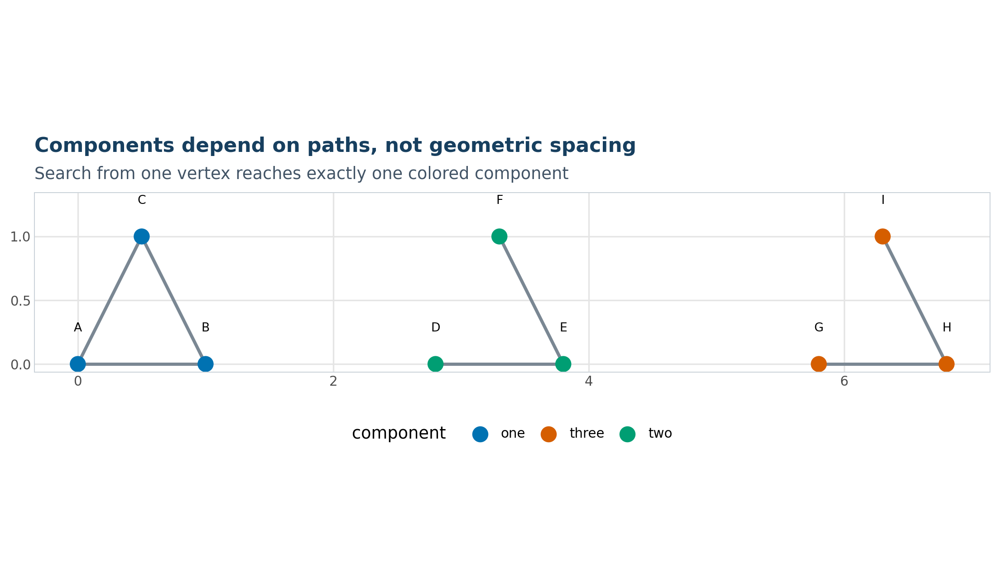

# Graphs, walks, and degrees {#sec-comb-graphs}

Graphs retain adjacency while discarding irrelevant geometry. The same
language models roads, chemical bonds, communication links, conflicts, and
relations, but conclusions are meaningful only when the modeling choice is
stated.

## Preparation from this book

Sets, relations, and incidence counting from Chapters 1 and 3 are sufficient.

## Graph models {#graph-models}

A finite simple graph has a vertex set and a set of unordered pairs of distinct
vertices. Directed graphs use ordered pairs; multigraphs allow parallel edges;
weighted graphs attach values. These variants have different degree and path
conventions, so “graph” must not silently shift meaning.

Two graphs are isomorphic when a vertex bijection preserves adjacency.
Degree sequence, component sizes, and cycle counts are invariants, but agreement
of easy invariants does not guarantee isomorphism. Canonical labeling and
refinement algorithms support larger comparisons.

<figure id="fig-comb-graph-components">


<figcaption>

Figure B.1: A finite graph decomposes into connected components that ignore drawing position and edge shape.

</figcaption>
</figure>

## Walks, trails, and paths

A walk may repeat vertices and edges; a trail does not repeat edges; a path does
not repeat vertices. Connectivity asks whether a path joins every vertex pair.
Breadth-first search discovers all vertices in a component and gives shortest
path lengths in an unweighted graph. Depth-first search supports cycle tests,
topological sorting, and decomposition.

The adjacency matrix turns walks into algebra: its $k$th power counts
length-$k$ walks between ordered vertex pairs. These are walks, not necessarily
simple paths, because matrix multiplication permits repeated intermediate
vertices.

**Nonexample.** A crossing in a drawing is not a graph vertex unless declared
one. Likewise, geometric proximity creates no edge. The abstract edge list,
not the picture, defines the graph.

<!-- inline-formula-code:start -->
## Formula and finite computation

For adjacency matrix $A$,

$$
(A^k)_{ij}=\text{number of length-}k\text{ walks from }i\text{ to }j.
$$

```python
def multiply(left: list[list[int]], right: list[list[int]]) -> list[list[int]]:
    if not left or not right or not left[0] or not right[0]:
        raise ValueError("matrices must be nonempty")
    left_width = len(left[0])
    right_width = len(right[0])
    if (
        any(len(row) != left_width for row in left)
        or any(len(row) != right_width for row in right)
        or left_width != len(right)
    ):
        raise ValueError("matrices must be rectangular with compatible dimensions")
    return [
        [
            sum(left[row][middle] * right[middle][column] for middle in range(len(right)))
            for column in range(right_width)
        ]
        for row in range(len(left))
    ]

def matrix_power(matrix: list[list[int]], exponent: int) -> list[list[int]]:
    size = len(matrix)
    if size == 0 or exponent < 0 or any(len(row) != size for row in matrix):
        raise ValueError("require a nonempty square matrix and nonnegative exponent")
    result = [[int(row == column) for column in range(size)] for row in range(size)]
    factor = matrix
    remaining_power = exponent
    while remaining_power:
        if remaining_power % 2 == 1:
            result = multiply(result, factor)
        remaining_power //= 2
        if remaining_power:
            factor = multiply(factor, factor)
    return result

adjacency = [[0, 1, 1], [1, 0, 1], [1, 1, 0]]
print(matrix_power(adjacency, 3)[0][0])
```

**What the computation establishes.** Matrix multiplication counts closed
three-step walks at one vertex of a triangle. It does not prove the walk-count
identity for every graph; induction on walk length supplies that proof.
<!-- inline-formula-code:end -->

## Representations and complexity

An adjacency list uses space proportional to vertices plus edges and supports
neighbor iteration. An adjacency matrix uses quadratic space but gives
constant-time edge lookup and algebraic operations. The appropriate
representation depends on density and the question, not on one universal
preference.

## Data integrity and provenance

Real network data often contain duplicate edges, missing vertices, uncertain
direction, or identifiers that should not be merged. Validation must precede
theorem application. A connected component in the recorded graph may reflect
the collection process rather than the underlying system. Preserve the mapping
from external identifiers to vertex indices, record whether edges are inferred
or observed, and test conclusions under plausible edge additions and removals.

## Summary

Graph theory begins by fixing the graph variant, then separates abstract
adjacency from its drawing. Walk language, components, matrix powers, and
search algorithms expose complementary aspects of the same finite relation.

## Exercises

<div class="exercise" id="combinatorics-11-graphs-walks-degrees-ex-1">
<p class="exercise-title"><strong>Exercise 1</strong></p>

Translate an edge list to an adjacency list and matrix.

</div>

<div class="exercise" id="combinatorics-11-graphs-walks-degrees-ex-2">
<p class="exercise-title"><strong>Exercise 2</strong></p>

Distinguish a walk, trail, and path by examples.

</div>

<div class="exercise" id="combinatorics-11-graphs-walks-degrees-ex-3">
<p class="exercise-title"><strong>Exercise 3</strong></p>

Prove adjacency powers count walks.

</div>

<div class="exercise" id="combinatorics-11-graphs-walks-degrees-ex-4">
<p class="exercise-title"><strong>Exercise 4</strong></p>

Find connected components by hand.

</div>

<div class="exercise" id="combinatorics-11-graphs-walks-degrees-ex-5">
<p class="exercise-title"><strong>Exercise 5</strong></p>

Give nonisomorphic graphs with the same degree sequence.

</div>

<div class="exercise" id="combinatorics-11-graphs-walks-degrees-ex-6">
<p class="exercise-title"><strong>Exercise 6</strong></p>

Compare matrix and list storage for a sparse graph.

</div>

### Selected solution

For Exercise 3, start with $k=0$: $A^0=I$, and there is exactly one
length-zero walk from each vertex to itself and none between distinct vertices.
Assuming the count holds at length $k$, split every length-$k+1$ walk at its penultimate vertex. The
matrix product sums the number of length-$k$ prefixes times the final-edge
indicator over exactly those intermediate vertices. Thus induction proves the
identity for every integer $k\geq0$.
